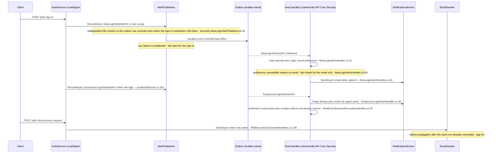
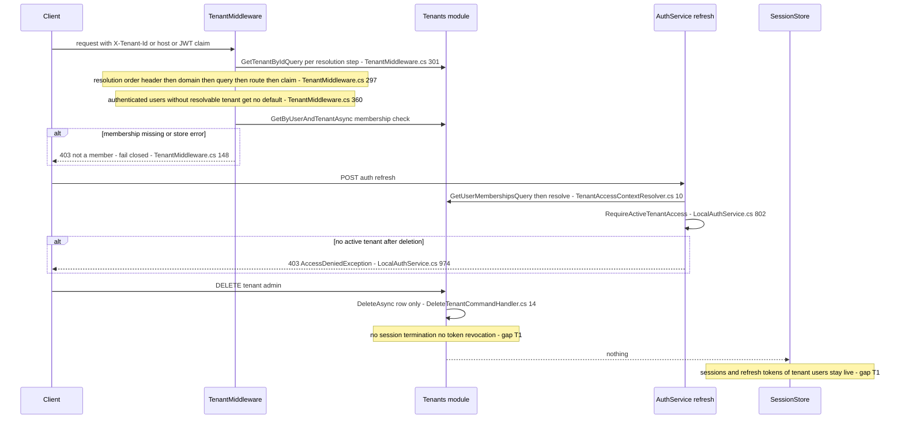
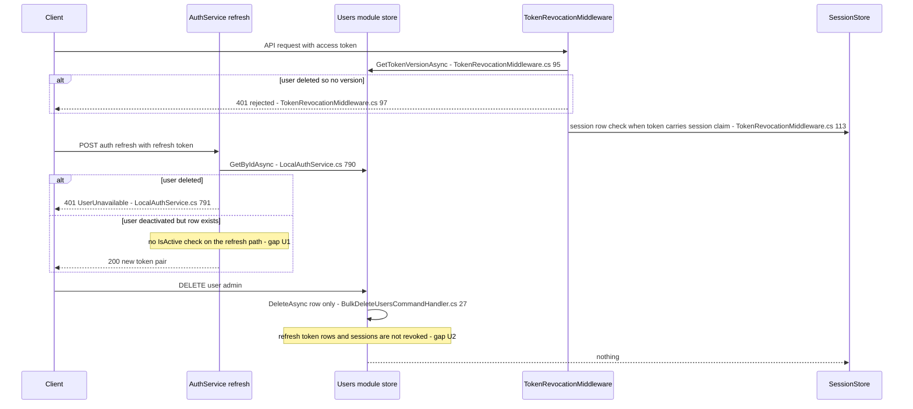
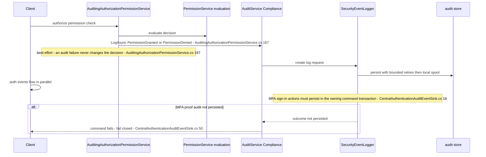
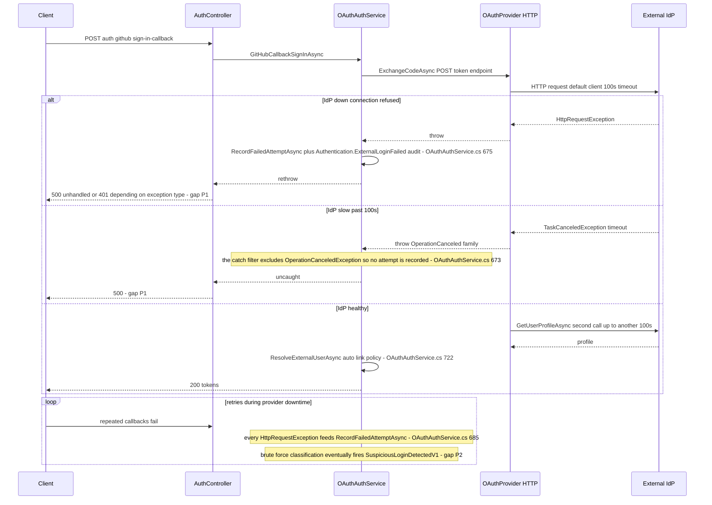
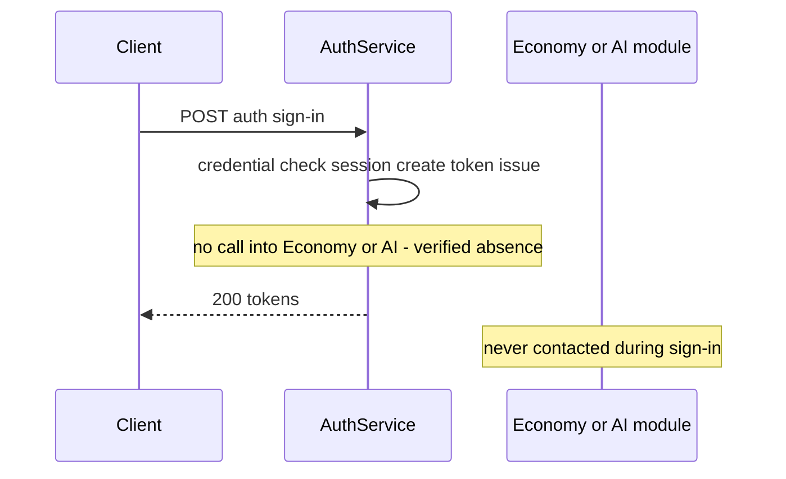

# Authentication Cross-Module Sequences — participants, timeouts, failure paths, fallback verdicts

> Module `GameGuild.Identity.Authentication` ↔ `GameGuild.Notifications`, `GameGuild.Identity.Tenants`, `GameGuild.Identity.Users`, `GameGuild.Compliance.Audit`, external identity providers, `GameGuild.Finance.Economy` / `GameGuild.AI` · Documented against `develop` commit `74e9bba4c`.
> Scope: one Mermaid `sequenceDiagram` per cross-module interaction. Every call carries its timeout (from the HttpClient / options configuration, `file:line`), the failure path (what the user sees), the retry policy, and the fallback verdict — **fail-open** (the auth operation proceeds despite the partner being down) or **fail-closed** (the auth operation is denied) — plus GAPS.
> Why: cross-module sequences catch asymmetric timeout and fallback handling. This week's example: OAuth provider downtime feeding the brute-force detector until accounts are contained (§5, gap P2).

Path convention: `file:line` references are relative to `apps/api/Source/Modules/GameGuild.Identity.Authentication/` unless the path starts with another module or `GameGuild.API`.

Timeout inventory (the numbers cited by the diagrams):

| Outbound call | Client | Timeout | Retry | Registration |
|---|---|---|---|---|
| OAuth code exchange / profile fetch (GitHub, Google, Discord, Microsoft, Steam, Epic, Facebook) | DI-default `HttpClient` injected into each `IOAuthProvider` | `HttpClient` default **100 s** per request (no explicit value set) | none (no Polly / `AddPolicyHandler` anywhere in the module) | `Data/Extensions/DependencyInjection.cs:430` (`services.AddHttpClient()`), providers at `:158-164`, client stored at `OAuth/OAuthProviderBase.cs:26` |
| OIDC discovery / token exchange / JWKS | named client `oidc-federation` | **10 s** (`client.Timeout = TimeSpan.FromSeconds(10)`) | none | `Data/Extensions/DependencyInjection.cs:170`; used at `Services/OidcFederationService.cs:173,203,292` |
| Google ID-token validation | Google.Apis.Auth (`GoogleJsonWebSignature.ValidateAsync`) | library default (no explicit timeout) | library-internal JWKS fetch | `Services/GoogleIdTokenVerifier.cs:48-50` |
| SAML assertion validation | none — no HTTP backchannel (cert-validated assertions) | n/a | n/a | `Services/SamlFederationService.cs` |
| Email dispatch, MFA codes (in-process ports) | `IEmailSender`, `IPublisher` | none at this layer (transport underneath) | none here | `Handlers/MfaRecoveryCommandHandlers.cs:44,132`; `Services/EmailMfaService.cs:157` |

---

## 1. Auth ↔ Notifications — email dispatch on lockout, new-device, MFA recovery

Three different plumbing styles, three different fallback verdicts.

Failure paths and fallback verdicts:

| Path | What the user sees on failure | Retry | Verdict |
|---|---|---|---|
| New-login email (outbox) | Sign-in unaffected; email silently absent | durable-event redelivery (inbox per EventId) | **fail-open** for sign-in; **fail-closed** for the email itself (unreadable preference → no email, `GameGuild.API/Core/Security/NewLoginAlertHandler.cs:50-60`) |
| Suspicious-login alert (outbox) | Sign-in already completed; InApp alert arrives later | durable redelivery | **fail-open** for sign-in; handler throws to force redelivery when the notification is not durably queued (`SuspiciousLoginAlertHandler.cs:63-68`) |
| MFA recovery emails (inline) | 5xx after the recovery row was already created; token never delivered | none — inline `IEmailSender.SendAsync` (`Handlers/MfaRecoveryCommandHandlers.cs:132,227`) | **fail-closed for the request but fail-open for the state machine** — see gap N2 |
| MFA email/SMS codes | Code dropped on dispatch failure (`Services/EmailMfaService.cs:169-175` removes the live entry and rethrows) | user must resend (60 s throttle, `:30`) | **fail-closed** — a code the user never received is never live |
| Lockout notification | **No lockout email exists.** Admission denial is a 401 ProblemDetails from `GameGuild.API/Core/Filters/AuthenticationLockoutActionFilter.cs:30-38`; the enforcement itself is advisory-lock based (`GameGuild.API/Core/Filters/PasswordSignInAdmissionService.cs:46-86`) | n/a | **fail-closed** for the sign-in, silent for notification |

GAPS:

- **N1 — asymmetric durability for equivalent security emails.** New-login and suspicious-login ride the durable outbox with independent-scope commit (`Services/NewLoginAlertPublisher.cs:39-54`, `Services/SuspiciousLoginAlertPublisher.cs` remarks); MFA recovery — arguably more security-critical — sends inline (`Handlers/MfaRecoveryCommandHandlers.cs:108,207`) with no redelivery.
- **N2 — recovery request leaks on email failure.** `recoveryStore.AddAsync` commits at `Handlers/MfaRecoveryCommandHandlers.cs:101` *before* `SendRecoveryStartedEmailAsync` at `:108`; an SMTP failure leaves a live `Pending` request whose request token the user never saw, and the 10-minute email rate limit (`:20,58-62`) plus the live-request skip (`:82-84`) block an immediate retry.
- **N3 — lockout is mute.** Password lockout (`MaxFailedAttemptsPerHour`, `PasswordSignInAdmissionService.cs:79-86`) notifies nobody; only when the brute-force *detector* classifies the pattern does `SuspiciousLoginDetectedV1` fire (`Services/LocalAuthService.cs:501`).

---

## 2. Auth ↔ Identity.Tenants — resolution middleware and tenant deletion with active sessions (#1120)

Failure paths: tenant deleted while sessions live → per-request `TenantMiddleware` finds the tenant inactive or unresolvable (`Modules/GameGuild.Identity.Tenants/Middleware/TenantMiddleware.cs:302,350,363-366`) and either 403s (explicit tenant) or continues tenant-less; the next refresh is denied by `RequireActiveTenantAccess` (`Services/LocalAuthService.cs:974-982`). Access tokens already minted keep passing until expiry **if** they carry no session claim and their version claim still matches (`Middleware/TokenRevocationMiddleware.cs:91-135` checks version and session, not tenant).

Timeouts/retries: all calls are in-process CQRS/database — no HTTP timeouts; DB command timeouts apply only.

Fallback verdict: **fail-closed per request and per refresh; fail-open for already-issued tokens.**

GAPS:

- **T1 (#1120) — deletion does not swing the auth state machines.** `DeleteTenantCommandHandler` (`Modules/GameGuild.Identity.Tenants/Commands/DeleteTenant/DeleteTenantCommandHandler.cs:10-14`) and `BulkDeleteTenantsCommandHandler` (`.../BulkDeleteTenants/BulkDeleteTenantsCommandHandler.cs:18-34`) delete the row; nothing terminates `UserSession` rows or revokes `RefreshToken` families for the tenant's members. Compare the SCIM path, which *does* terminate with `AdministrativeTermination` (`Modules/GameGuild.Identity.Provisioning/Services/ScimUserService.cs:252`).
- **T2 — provisioning on every sign-in.** `DefaultTenantMembershipProvisioner.EnsureAsync` runs inside refresh (`Services/LocalAuthService.cs:799`); a Tenants-module failure during sign-in therefore fails the sign-in — an availability coupling in the opposite direction (auth fails closed because tenants is down).

---

## 3. Auth ↔ Identity.Users — user deletion vs active refresh tokens (#1119), profile reads

Profile reads on the account page: the session-state surface is auth-internal (`Queries/GetAuthSessionState/GetAuthSessionStateQuery.cs:36-58` — reads sessions, revocation store and MFA config through auth ports only), while profile data comes from the Users module endpoints; the auth module consumes Users through `IUserRepository` (e.g. `Services/LocalAuthService.cs:287,790`).

Failure paths and verdicts:

| Path | User sees | Verdict |
|---|---|---|
| Refresh after user deletion | 401 (`Services/LocalAuthService.cs:791-796`) | **fail-closed** |
| API request with session-bound token after deletion | 401 — session lookup fails or version unavailable (`Middleware/TokenRevocationMiddleware.cs:95-135`) | **fail-closed** |
| API request with legacy token (no session claim, no version claim) after deletion | passes both checks — nothing about the user is consulted (`Middleware/TokenRevocationMiddleware.cs` runs only the checks above) | **fail-open** — gap U3 |
| Profile read while Users store is down | 5xx from the Users endpoint; auth session-state still answers | independent |

No HTTP timeouts — in-process and database calls only.

GAPS:

- **U1 — refresh never checks `user.IsActive`.** `RefreshTokenAsync` rejects only the missing user (`Services/LocalAuthService.cs:790-796`); a deactivated user's refresh token keeps minting new token pairs. The orchestrated flow *does* check (`Services/AuthenticationOrchestrationService.cs:189-192`), and SCIM deactivation terminates sessions (`Modules/GameGuild.Identity.Provisioning/Services/ScimUserService.cs:252`), but the plain Users-module deactivate path (`Modules/GameGuild.Identity.Users/Abstractions/IUserService.cs:43`) does neither.
- **U2 (#1119) — deletion leaves live credentials.** `BulkDeleteUsersCommandHandler` (`Modules/GameGuild.Identity.Users/Commands/BulkDeleteUsers/BulkDeleteUsersCommandHandler.cs:18-27`) deletes the user row without revoking refresh tokens or terminating sessions; containment is *reactive* (next refresh/middleware check fails) instead of *proactive* (no `RevokeAllForUserAsync`, no `IncrementTokenVersion`).
- **U3 — legacy tokens bypass both post-deletion fences.** The middleware enforces version and session claims only when present (`Middleware/TokenRevocationMiddleware.cs:93,113`); a pre-upgrade token with neither claim outlives its user.

---

## 4. Auth ↔ Compliance.Audit — audit writes on PermissionDenied / PermissionGranted

The permission-decision audit and the authentication-event audit are two pipelines into the same sink family. The permission one is what shows up in Session-state log analysis (every session-bound request that hits `[Authorize]` permission checks emits granted/denied).

Emitters: `GameGuild.API/Core/Security/AuditingAuthorizationPermissionService.cs:167,233,246` (decision audits), `GameGuild.API/Core/Security/AuditingAuthorizationMiddlewareResultHandler.cs:90` (authorization-middleware outcomes, e.g. MFA-challenge denials observed in session-state logs), `GameGuild.API/Core/Security/AuditPermissionEvaluationLogSink.cs:31` (durable per-evaluation sink whose `TryRecordAsync` *reports* delivery failure instead of swallowing, `:19-23`). The taxonomy classifies `PermissionDenied` as risk High (`Modules/GameGuild.Compliance.Audit/Constants/SecurityEventTaxonomy.cs:65-66`).

Fallback verdicts — deliberately **split**:

| Stream | On audit-store failure | Verdict |
|---|---|---|
| Permission decision audit | logged and dropped; the grant/deny decision stands (`AuditingAuthorizationPermissionService.cs:197-200`) | **fail-open** |
| Ordinary authentication events | bounded retries then local spool (`Modules/GameGuild.Compliance.Audit/Services/CentralAuthenticationAuditEventSink.cs:55-62`) | **fail-open with spool** |
| MFA proof events (`Authentication.MfaSignIn*`) | sink rethrows so the owning command rolls back (`CentralAuthenticationAuditEventSink.cs:50-53,67-69`) | **fail-closed** |

GAP: **A1 — the two permission-audit emitters disagree on error reporting.** The middleware result handler and the permission service swallow audit failures; the evaluation log sink surfaces `false` to its caller (`AuditPermissionEvaluationLogSink.cs:19-23`), but nothing aggregates or alerts on those `false` returns — a silently degrading audit trail is observable only by reading logs.

---

## 5. Auth ↔ external providers — token exchange, timeout asymmetries (#1116)

Error mapping at the controller: `UnauthorizedAccessException` → 401 ProblemDetails; `InvalidOperationException` (provider not configured) → 503 (`Controllers/AuthController.cs:362-383`). `HttpRequestException` and timeout exceptions match neither clause.

Failure path the user sees: healthy-but-unauthenticated → 401; provider unconfigured → 503 "…is not configured"; provider down/slow → **unhandled 500** (gap P1).

Retry policy: **none at the HTTP layer** for any provider (no Polly, no `AddPolicyHandler`, no manual backoff — verified across `OAuth/` and `Data/Extensions/DependencyInjection.cs`). The only retry machinery in the chain is the *user* pressing sign-in again.

Fallback verdict: **fail-closed** — no provider means no federated sign-in (correct), but with two asymmetries:

GAPS:

- **P1 (#1116) — timeout asymmetry becomes an exception-type asymmetry.** Seven providers share the DI-default `HttpClient` with the implicit 100-second timeout (`Data/Extensions/DependencyInjection.cs:430` + `OAuth/OAuthProviderBase.cs:26`), while OIDC federation stops at an explicit 10 seconds (`:170`). During an IdP brownout the GitHub path can hold a request ~200 s (exchange + profile), the OIDC path 10 s; and because `RunProviderAuthenticationAsync`'s filter excludes `OperationCanceledException` (`Services/OAuthAuthService.cs:673`), a timeout produces **no failed-attempt record and no `Authentication.ExternalLoginFailed` audit** — the outage is invisible to the very monitors that would page someone.
- **P2 — provider downtime feeds the brute-force detector (the "OAuth downtime lockout").** Each connection-refused retry is recorded as a failed attempt (`Services/OAuthAuthService.cs:680-692`); sustained retries during an outage push the identifier into brute-force classification, whose `SuspiciousLoginDetectedV1` consumer then *terminates every session and bumps the token version* for a confirmed-compromise kind (`GameGuild.API/Core/Security/RiskEventSessionRevocationHandler.cs:55`, kinds at `:43-47`). An IdP outage plus a retrying client can therefore lock a legitimate account out of its other sessions.
- **P3 — Google ID-token path is untimeouted.** `GoogleJsonWebSignature.ValidateAsync` (`Services/GoogleIdTokenVerifier.cs:48-50`) uses the library's own HTTP defaults — a third, undocumented timeout bucket alongside 100 s and 10 s.

---

## 6. Auth ↔ Economy / AI — credit and quota checks on sign-in

**Verified absent.** The authentication module contains no reference to `GameGuild.Finance.Economy`, `AiCredits`, wallets, credit balances, or quotas (search across `Modules/GameGuild.Identity.Authentication/` — the only "credit/quota" hits are permission-scope names in role and ABAC commands, e.g. `Commands/RoleCommands.cs`). Sign-in issues no economic events either: `UserSignedInEvent` (`Events/UserSignedInEvent.cs`) has no consumer outside the authentication module.

Consequence for the sequence inventory: there is no diagram to draw — the sign-in path cannot fail open or closed on Economy/AI because it never calls them. The coupling point, should credits-on-sign-in ever be introduced, would be the post-issuance window in `Services/LocalAuthService.cs:295-312` (token issuance) or the durable `UserSignedInEvent` — the latter keeps any future check fail-open by construction (fire-and-forget event), the former would make sign-in fail-closed on the Economy store.

Fallback verdict: **not applicable (no dependency)** — recorded here precisely so a future regression that adds such a call is visible in review.

---

## Cross-cutting gap summary

| # | Interaction | Gap | file:line |
|---|---|---|---|
| N2 | Auth ↔ Notifications | inline MFA-recovery email commits the request row before sending; failure orphans a live request under a 10-minute rate limit | `Handlers/MfaRecoveryCommandHandlers.cs:101-108` |
| T1 | Auth ↔ Tenants | tenant deletion terminates no sessions and revokes no tokens (#1120) | `Modules/GameGuild.Identity.Tenants/Commands/DeleteTenant/DeleteTenantCommandHandler.cs:14` |
| U1 | Auth ↔ Users | refresh path never checks `user.IsActive` | `Services/LocalAuthService.cs:790-796` |
| U2 | Auth ↔ Users | user deletion revokes nothing proactively (#1119) | `Modules/GameGuild.Identity.Users/Commands/BulkDeleteUsers/BulkDeleteUsersCommandHandler.cs:27` |
| P1 | Auth ↔ providers | 100 s default vs 10 s OIDC timeout; timeouts skip the failed-attempt audit and surface as 500 (#1116) | `Data/Extensions/DependencyInjection.cs:170,430`, `Services/OAuthAuthService.cs:673` |
| P2 | Auth ↔ providers | IdP-outage retries feed brute-force classification → session revocation for legitimate users | `Services/OAuthAuthService.cs:685`, `GameGuild.API/Core/Security/RiskEventSessionRevocationHandler.cs:55` |

Companion document: `docs/auth/state-machines.md` (the entities these interactions mutate).
