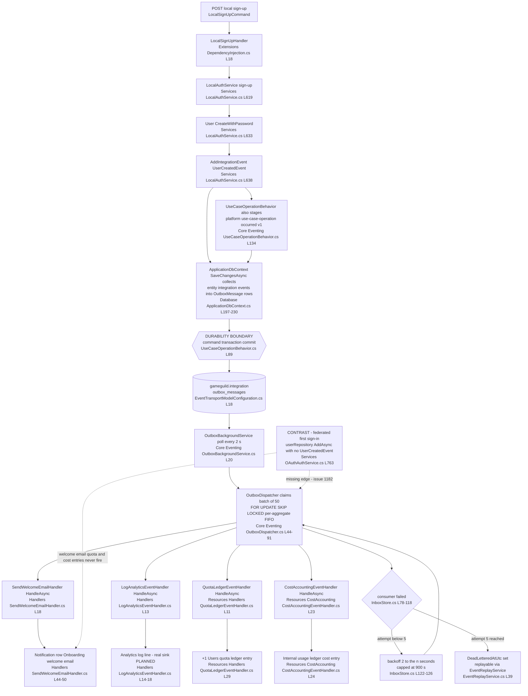
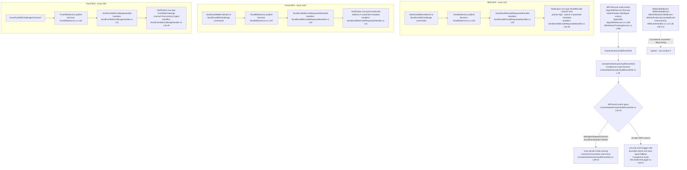
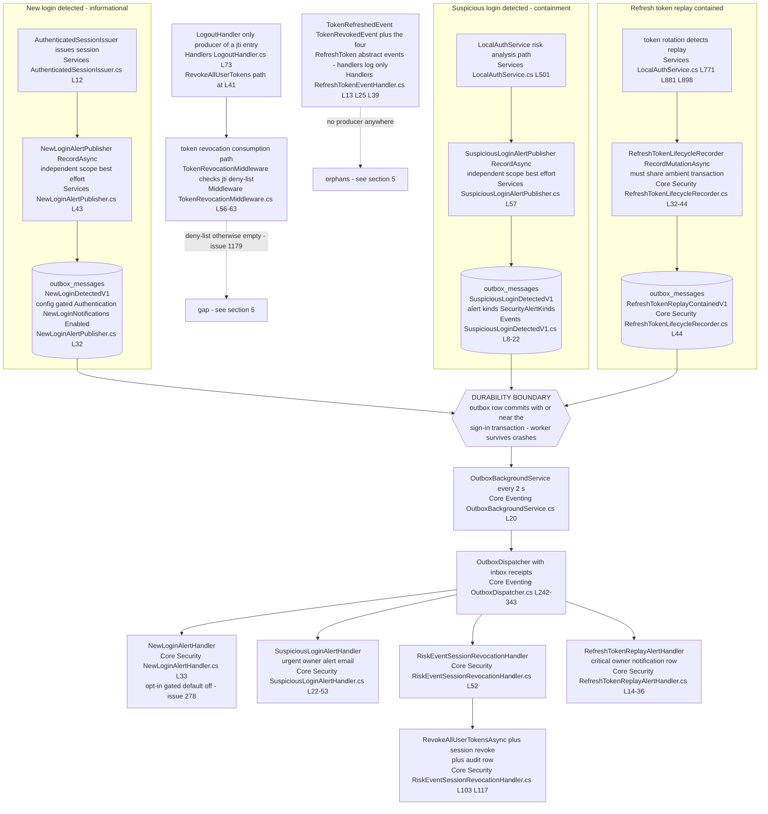
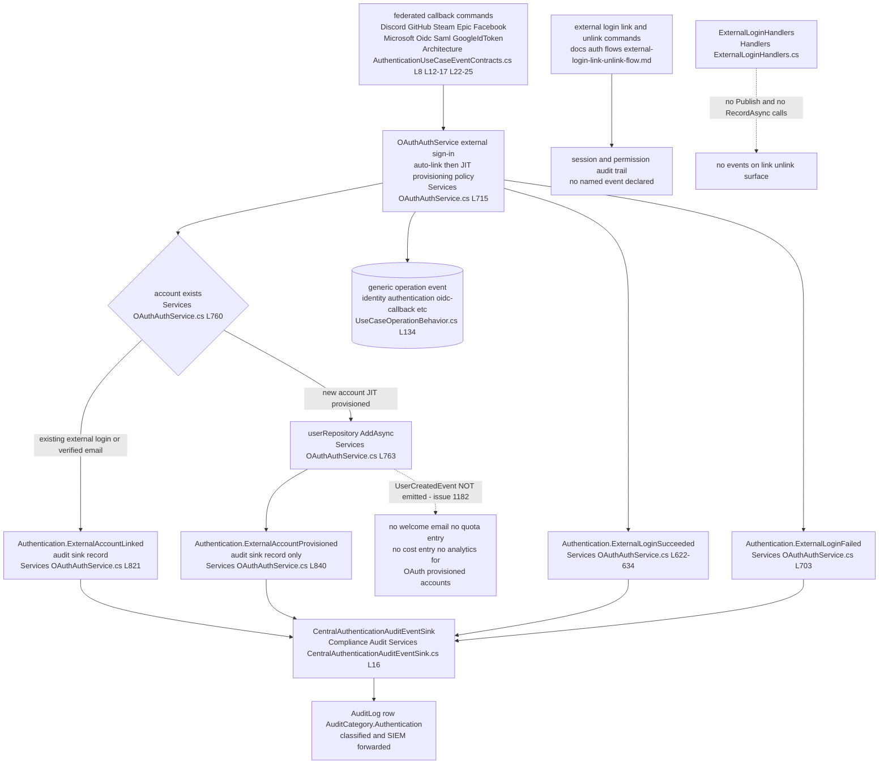
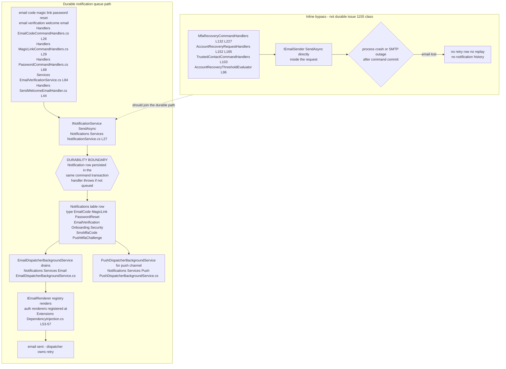

# Authentication Event Flows — Inventory, Outbox Diagrams, Cross-Module Edges, Gaps

> Module `GameGuild.Identity.Authentication` (+ host-side consumers in `GameGuild.API/Core`) · Documented against `develop` commit `74e9bba4c`.
> Scope: every domain event / notification type the auth module publishes or consumes, the outbox hop for each, cross-module edges, and orphan/durability gaps. This document class exists to catch orphan events (produced never consumed / consumed never produced) and missing durability — this cycle it tracks #1182 (UserCreatedEvent only in local sign-up), #1179 (per-jti deny-list never populated) and #1155 (MFA recovery emails bypass the durable notification queue).

All paths below are relative to `apps/api/Source`. Line numbers are from commit `74e9bba4c`.

## 1. How auth events move — three transports

The auth module uses three distinct event transports. Which transport an event uses determines its durability, retry and dead-letter story.

| Transport | Write path | Durability boundary | Delivery | Retry | DLQ |
| --- | --- | --- | --- | --- | --- |
| Durable outbox (`IDurableIntegrationEvent`) | `entity.AddIntegrationEvent` collected by `ApplicationDbContext.SaveChangesAsync` (`GameGuild.API/Database/ApplicationDbContext.cs:183-230`) or `IDurableEventProducer.RecordAsync` (`GameGuild.API/Core/Eventing/DurableEventProducer.cs:8-46`) → row in `gameguild.integration.outbox_messages` (`GameGuild.API/Database/EventTransportModelConfiguration.cs:18`) | **In-request transaction commit.** The outbox row is written in the same EF transaction as the command's business mutation, so a rolled-back command leaves no event. | `OutboxBackgroundService` polls every 2 s (`GameGuild.API/Core/Eventing/OutboxBackgroundService.cs:12-57`) → `OutboxDispatcher` claims batches of 50 with `FOR UPDATE SKIP LOCKED`, per-aggregate FIFO ordering (`OutboxDispatcher.cs:16-17,44-148`) → every registered `IIntegrationEventHandler<T>` runs in its own scope with a transactional inbox receipt (`OutboxDispatcher.cs:242-343`) | Per consumer: max 5 attempts, exponential backoff 2^attempt s capped at 900 s (`GameGuild.API/Core/Eventing/InboxStore.cs:8,108-115,122-126`) | `InboxReceipt.DeadLetteredAtUtc` + `OutboxMessage.DeadLetteredAtUtc`; listed and replayable via `EventReplayService` (`EventReplayService.cs:23,39,103`) |
| Generic operation event (every command) | `UseCaseOperationBehavior<TRequest,TResponse>` pipeline behavior wraps every `ICommand`; on business mutation it stores a `UseCaseOperationOccurredV1` (`platform.use-case-operation.occurred.v1`) outbox row (`GameGuild.API/Core/Eventing/UseCaseOperationBehavior.cs:117-154`, mirrored in `ApplicationDbContext.cs:246-287`) | Same — same transaction as the command | Same outbox worker | Same | Same |
| In-process notification (`GameGuild.CQRS.INotification`) | `publisher.Publish(...)` called inside a command handler or service (`Modules/GameGuild.SharedKernel/CQRS/Implementation/MediatorPublisher.cs:41-49` resolves `INotificationHandler<T>` synchronously) | **None at the transport.** The handler runs inline in the same request/scope; durability comes only from what the handler itself persists (all `Send*` handlers persist a `Notification` row via `INotificationService.SendAsync` in the same scoped `DbContext`, so the row shares the command's transaction) | Synchronous, in-request | None at dispatch; email delivery retries are owned by the Notifications email dispatcher | None at dispatch |

A fourth channel is the **audit-event sink stream**: auth call sites push `AuthenticationAuditEvent` / `ApiKeyAuditEvent` / `RefreshTokenLifecycleEvent` records into sink interfaces implemented by the Compliance.Audit module and the host. These are in-process interface calls, not outbox rows; their durability is the sink's own (spool fallback, in-transaction persistence for MFA proof events). See the inventory rows marked *sink*.

## 2. Event inventory

Columns: **outbox** = persisted to `gameguild.integration.outbox_messages` before delivery. **worker** = the background pickup that delivers it. **HOLE** = orphan or durability gap (details in §5).

### 2.1 Durable integration events published by auth

| Type | Producer(s) file:line | Outbox | Worker | Consumer(s) file:line | Side effect | Retry | DLQ | HOLE |
| --- | --- | --- | --- | --- | --- | --- | --- | --- |
| `UserCreatedEvent` (`Modules/GameGuild.SharedKernel/Events/ResourceLifecycleEvents.cs:3`) | auth local sign-up `Modules/GameGuild.Identity.Authentication/Services/LocalAuthService.cs:638` (`AddIntegrationEvent`); also Users module `Modules/GameGuild.Identity.Users/Commands/CreateUser/CreateUserCommandHandler.cs:20` | yes — `ApplicationDbContext.cs:197-230` | `OutboxBackgroundService` | auth `Handlers/SendWelcomeEmailHandler.cs:18` and `Handlers/LogAnalyticsEventHandler.cs:13` (registered `Extensions/DependencyInjection.cs:62-63`); Resources `Modules/GameGuild.Resources/Handlers/QuotaLedgerEventHandler.cs:11` and `Modules/GameGuild.Resources/CostAccounting/CostAccountingEventHandler.cs:23` (registered `Modules/GameGuild.Resources/Extensions/DependencyInjectionInfrastructure.cs:143,150`) | welcome email notification row (NotificationType.Onboarding), analytics log, +1 Users quota, internal cost ledger entry | inbox 5 attempts, exp backoff ≤ 900 s | DeadLetteredAtUtc + replay | **YES — #1182** — only local sign-up emits it; OAuth-provisioned accounts never do (`Services/OAuthAuthService.cs:763` adds the user with no event), so they get no welcome email/quota/cost entries |
| `NewLoginDetectedV1` (`identity.authentication.new-login-detected.v1`, `Events/NewLoginDetectedV1.cs:11`) | `Services/NewLoginAlertPublisher.cs:43`, invoked after every session issuance from `Services/AuthenticatedSessionIssuer.cs:129` | yes — but recorded in an **independent scope that commits separately from the sign-in transaction** (best effort, failures swallowed, `NewLoginAlertPublisher.cs:50-65`) | `OutboxBackgroundService` | host `GameGuild.API/Core/Security/NewLoginAlertHandler.cs:33` (registered `GameGuild.API/Core/Eventing/EventTransportServiceCollectionExtensions.cs:23`) | preference-gated owner security email (NotificationType.Security, opt-in default off) + audit row | inbox 5 attempts | yes + replay | no (independent-scope commit is deliberate defense-in-depth) |
| `SuspiciousLoginDetectedV1` (`identity.authentication.suspicious-login-detected.v1`, `Events/SuspiciousLoginDetectedV1.cs:24`; alert kinds `SecurityAlertKinds` same file) | `Services/SuspiciousLoginAlertPublisher.cs:57`, invoked only from the local password sign-in risk path `Services/LocalAuthService.cs:501` | yes — independent scope, best effort, failures swallowed (`SuspiciousLoginAlertPublisher.cs:66-82`) | `OutboxBackgroundService` | host `GameGuild.API/Core/Security/SuspiciousLoginAlertHandler.cs:22` (urgent owner alert) and `GameGuild.API/Core/Security/RiskEventSessionRevocationHandler.cs:52` (revokes sessions + all user tokens, audits) — registered `EventTransportServiceCollectionExtensions.cs:19-20` | urgent security alert email; step-up/brute-force/impossible-travel containment revocation | inbox 5 attempts | yes + replay | **NEW — producer coverage gap** — only the local sign-in path records it; orchestrated, polymorphic, federated and MFA sign-in paths never call `ISuspiciousLoginAlertPublisher` (sole caller is `LocalAuthService.cs:501`) |
| `RefreshTokenReplayContainedV1` (`identity.authentication.refresh-token.replay-contained.v1`, `Events/RefreshTokenReplayContainedV1.cs:4`) | host `GameGuild.API/Core/Security/RefreshTokenLifecycleRecorder.cs:44`, triggered by replay detection in `Services/LocalAuthService.cs:771,881,898` | yes — **enforced in-transaction with the token mutation** (`RefreshTokenLifecycleRecorder.cs:32-34` throws if no ambient transaction) | `OutboxBackgroundService` | host `GameGuild.API/Core/Security/RefreshTokenReplayAlertHandler.cs:14` (registered `EventTransportServiceCollectionExtensions.cs:18`) | critical security notification row to owner (NotificationType.Security) + audit row | inbox 5 attempts | yes + replay | no |
| `UseCaseOperationOccurredV1` (`platform.use-case-operation.occurred.v1`, `Modules/GameGuild.SharedKernel/Events/UseCaseOperationContext.cs:198-204`) | emitted for **every auth command** by `GameGuild.API/Core/Eventing/UseCaseOperationBehavior.cs:134` and `GameGuild.API/Database/ApplicationDbContext.cs:262`; operation codes declared per command in `Architecture/AuthenticationUseCaseEventContracts.cs:4-61` and `Architecture/StepUpEventContracts.cs:4-6` (all `NoDomainEventReason` — the operation event is the contract) | yes — same command transaction | `OutboxBackgroundService` | Resources `Modules/GameGuild.Resources/CostAccounting/CostAccountingEventHandler.cs:20-21` (registered `DependencyInjectionInfrastructure.cs:149`) | internal usage-ledger entry (cost accounting) per auth operation | inbox 5 attempts | yes + replay | no |

### 2.2 In-process notifications published by auth

| Type | Producer(s) file:line | Outbox | Consumer(s) file:line | Side effect | Retry | DLQ | HOLE |
| --- | --- | --- | --- | --- | --- | --- | --- |
| `EmailCodeRequestedNotification` (`Events/EmailCodeRequestedNotification.cs:8`) | `Handlers/EmailCodeCommandHandlers.cs:26-27` | no — in-process publish inside the command | `Handlers/SendEmailCodeRequestedHandler.cs:18` | NotificationType.EmailCode email row persisted in same scope; delivered out-of-band by `Modules/GameGuild.Notifications/Services/Email/EmailDispatcherBackgroundService.cs` | email dispatcher owns retries | notification row survives; dispatcher re-scans | no |
| `MagicLinkRequestedNotification` (`Events/MagicLinkRequestedNotification.cs:8`) | `Handlers/MagicLinkCommandHandlers.cs:29-30` | no | `Handlers/SendMagicLinkRequestedHandler.cs:18` | NotificationType.MagicLink email row | as above | as above | no |
| `PasswordResetRequestedNotification` (`Events/PasswordResetRequestedNotification.cs:8`) | `Handlers/PasswordCommandHandlers.cs:68-69` | no | `Handlers/SendPasswordResetRequestedHandler.cs:18` | NotificationType.PasswordReset email row | as above | as above | no |
| `EmailVerificationRequestedNotification` (`Events/EmailVerificationRequestedNotification.cs:8`) | `Services/EmailVerificationService.cs:84-85` | no | `Handlers/SendEmailVerificationRequestedHandler.cs:18` | NotificationType.EmailVerification email row | as above | as above | no |
| `EmailMfaCodeRequestedNotification` (`Events/EmailMfaCodeRequestedNotification.cs:8`, issue #1152) | `Services/EmailMfaService.cs:157` | no | `Handlers/SendEmailMfaCodeRequestedHandler.cs:18` | NotificationType.EmailCode email row (address in protected metadata) | as above | as above | no |
| `SmsMfaCodeRequestedNotification` (`Events/SmsMfaCodeRequestedNotification.cs:8`, issue #244) | `Services/SmsMfaService.cs:150` | no | `Handlers/SendSmsMfaCodeRequestedHandler.cs:20` | NotificationType.SmsMfaCode row (phone in protected metadata) | as above | as above | no |
| `PushMfaChallengeNotification` (`Events/PushMfaChallengeNotification.cs:8`, issue #259) | `Services/PushMfaService.cs:101` | no | `Handlers/SendPushMfaChallengeHandler.cs:21` | NotificationType.PushMfaChallenge row (device token in protected metadata) | as above | as above | no |
| `UserSignedUpNotification` (`Events/UserSignedUpNotification.cs:8`) | **no direct producer** — only synthesized inside `Handlers/SendWelcomeEmailHandler.cs:27` when adapting `UserCreatedEvent` | no | `Handlers/SendWelcomeEmailHandler.cs:36` (welcome email row, NotificationType.Onboarding) and `Handlers/LogAnalyticsEventHandler.cs:22` (log only, real analytics integration PLANNED per `LogAnalyticsEventHandler.cs:8-9`) | see consumers | none at dispatch | none | **YES — vestigial pair** — no command ever publishes it; both handlers fire only via the durable `UserCreatedEvent` adapter, so the `INotificationHandler` registrations are dead wiring |

### 2.3 In-process events with handlers but no producer (consumed never produced)

All are declared `abstract` (or sealed with no construction site) and **no subtype or `new` expression exists anywhere in `apps/api/Source`**. Their handlers are dead wiring.

| Type | Definition file:line | Handler(s) file:line | Handler side effect | HOLE |
| --- | --- | --- | --- | --- |
| `UserSignedInEvent` | `Events/UserSignedInEvent.cs:8` | `Handlers/UserSignedInEventHandler.cs:11` | logs sign-in | **YES** — orphan consumer |
| `AuthenticationFailedEvent` | `Events/AuthenticationFailedEvent.cs:8` | `Handlers/AuthenticationFailedEventHandler.cs:11` | logs failure (comment `:25` points to the real durable path `SuspiciousLoginDetectedV1`) | **YES** — orphan consumer |
| `MfaEnabledEvent` | `Events/MfaEnabledEvent.cs:8` | `Handlers/MfaEventHandler.cs:26` | logs | **YES** — orphan consumer |
| `MfaDisabledEvent` | `Events/MfaDisabledEvent.cs:8` | `Handlers/MfaEventHandler.cs:14` | logs | **YES** — orphan consumer |
| `MfaVerificationFailedEvent` | `Events/MfaVerificationFailedEvent.cs:8` | `Handlers/MfaEventHandler.cs:38` | logs | **YES** — orphan consumer |
| `MfaVerificationSucceededEvent` | `Events/MfaVerificationSucceededEvent.cs:8` | `Handlers/MfaEventHandler.cs:51` | logs | **YES** — orphan consumer |
| `RefreshTokenGeneratedEvent` | `Events/RefreshTokenGeneratedEvent.cs:8` | `Handlers/RefreshTokenEventHandler.cs:13` | logs | **YES** — orphan consumer |
| `RefreshTokenUsedEvent` | `Events/RefreshTokenUsedEvent.cs:8` | `Handlers/RefreshTokenEventHandler.cs:39` | logs (comment `:30-33` points to the replay-contained durable path) | **YES** — orphan consumer |
| `RefreshTokenRevokedEvent` | `Events/RefreshTokenRevokedEvent.cs:8` | `Handlers/RefreshTokenEventHandler.cs:25` | logs | **YES** — orphan consumer |

### 2.4 Orphaned definitions (no producer and no consumer)

| Type | Definition file:line | HOLE |
| --- | --- | --- |
| `UserSignedUpEvent` | `Events/UserSignedUpEvent.cs:8` | **YES** — fully orphaned definition |
| `MfaVerifiedEvent` | `Events/MfaVerifiedEvent.cs:8` | **YES** — fully orphaned definition |
| `TokenRefreshedEvent` | `Events/TokenRefreshedEvent.cs:8` | **YES** — fully orphaned definition |
| `TokenRevokedEvent` | `Events/TokenRevokedEvent.cs:8` | **YES** — fully orphaned definition |

### 2.5 Audit-event sink stream (auth publishes, Compliance.Audit / host consume)

Not outbox rows — direct interface calls whose durability is the sink's own (bounded retries + local spool + background drainer, `Modules/GameGuild.Compliance.Audit/Services/SecurityEventLogger.cs:36-57`; MFA sign-in proof events must persist inside the owning command transaction or the command fails, `Modules/GameGuild.Compliance.Audit/Services/CentralAuthenticationAuditEventSink.cs:18-19,46-53`).

| Type + sink | Producer(s) file:line (representative) | Consumer | Side effect | Retry | DLQ | HOLE |
| --- | --- | --- | --- | --- | --- | --- |
| `AuthenticationAuditEvent` via `IAuthenticationAuditEventSink` (`Abstractions/IAuthenticationAuditEventSink.cs:7-26`) | sign-in/local: `Services/LocalAuthService.cs:561,1044`; federated: `Services/OAuthAuthService.cs:656,821,840,703`; attempts: `Services/AuthAttemptService.cs:225`; MFA: `Services/MfaAttemptTrackingService.cs:286`, `SignInMfa/SignInMfaService.cs:198`; guest: `Guest/GuestSessionService.cs:174`; account recovery: `Handlers/AccountRecoveryRequestHandlers.cs:175,215`, `Handlers/ApproveAccountRecoveryCommandHandler.cs:99,208`, `Handlers/CompleteAccountRecoveryResetCommandHandler.cs:119,151`, `Services/AccountRecoveryThresholdEvaluator.cs:59`; trusted contacts: `Handlers/TrustedContactCommandHandlers.cs:123,161,219`; scheme handlers: `Services/BasicAuthenticationHandler.cs:174`, `Services/ApiKeyAuthenticationHandler.cs:172`, `Services/ClientCertificateAuthenticationHandler.cs:272`; WebAuthn: `Services/WebAuthnAuthenticationSubService.cs:268`; sessions: `Services/SessionManagementService.cs:349`; risk analysis: `Services/LoginAttemptAnalysisService.cs:385`; threat intel feed errors: `Services/LocalFileThreatIntelligenceProvider.cs:246` | `Modules/GameGuild.Compliance.Audit/Services/CentralAuthenticationAuditEventSink.cs:16` (registered `Modules/GameGuild.Compliance.Audit/Extensions/AuditModule.cs`) | `AuditLog` row (AuditCategory.Authentication) via `ISecurityEventLogger`, classified by the security-event taxonomy, evaluated against alert rules, forwarded to SIEM by `Services/SiemIntegrationService.cs` | bounded retries + durable local spool replayed by background drainer | none — spool is the terminal fallback | no |
| `ApiKeyAuditEvent` via `IApiKeyAuditEventSink` (`Abstractions/IApiKeyAuditEventSink.cs:8`) | create/revoke/rotate API keys: `Commands/ApiKeyCommands.cs:96,235,396` (helper `ApiKeyLifecycleAudit.RecordAsync`, `Commands/ApiKeyCommands.cs:440-455` — failures logged and swallowed) | `Modules/GameGuild.Compliance.Audit` `CentralApiKeyAuditEventSink` (registered `Modules/GameGuild.Compliance.Audit/Extensions/AuditModule.cs:136`) | AuditLog row for API-key lifecycle | as security event pipeline | none | no |
| `RefreshTokenLifecycleEvent` via `IRefreshTokenLifecycleRecorder` (`Abstractions/IRefreshTokenLifecycleRecorder.cs:4`) | issued: `Services/JwtTokenService.cs:290`; revoked: `Services/JwtTokenService.cs:440`, `Commands/RevokeAllUserTokensCommand.cs:48`; replay contained: `Services/LocalAuthService.cs:771,881,898`; account-recovery reset: `Handlers/CompleteAccountRecoveryResetCommandHandler.cs:93`; MFA lockout: `Services/MfaAttemptTrackingService.cs:172`; risk revocation: host `GameGuild.API/Core/Security/RiskEventSessionRevocationHandler.cs:103` | host `GameGuild.API/Core/Security/RefreshTokenLifecycleRecorder.cs:19` (registered `GameGuild.API/Core/Setup/InfrastructureLayerExtensions.cs:399`) | `AuditLog` row (Critical risk on replay) + metrics buffer; replay additionally emits `RefreshTokenReplayContainedV1` to the outbox in the same transaction (`RefreshTokenLifecycleRecorder.cs:44`) | rejections persist in an independent scope; mutations are transactional | none | no |

### 2.6 Totals

- **26 event/notification types** defined in the auth module's `Events/` directory: 3 durable V1 integration events, 8 in-process notifications with live producers, 9 in-process events with handlers but no producer, 4 orphaned definitions, plus `UserSignedUpNotification` (consumers only, no direct producer) and `UserSignedInEvent` counted above.
- **5 durable event types** flow out of auth commands in total (the 3 named V1 events + `UserCreatedEvent` + the generic `UseCaseOperationOccurredV1` emitted for all ~65 contracted auth commands).
- **3 sink streams** (`AuthenticationAuditEvent`, `ApiKeyAuditEvent`, `RefreshTokenLifecycleEvent`) with 40+ producer call sites.
- **1 integration event consumed from another module**: `UserCreatedEvent` (SharedKernel type; also produced by the Users module).

## 3. Flowcharts per event family

All diagrams are `flowchart TD`. The **durability boundary** is the point where the in-request transaction commits: everything before it is atomic with the command; everything after it survives process death in `gameguild.integration.outbox_messages`.

### 3.1 Sign-up lifecycle events

Notes: `UserSignedUpNotification` is synthesized only inside `SendWelcomeEmailHandler.cs:27` when adapting the durable `UserCreatedEvent`; no command publishes it directly. The four orphaned log-only sign-in events (`UserSignedUpEvent` etc., §2.3-2.4) have no edge to draw.

### 3.2 MFA events

The notification publishes are in-process (`GameGuild.CQRS` mediator, `MediatorPublisher.cs:41-49`); there is no outbox hop because the durable artifact is the `Notification` row the `Send*` handler persists in the same command scope — each handler throws if the row was not durably queued.

### 3.3 Session and token events

### 3.4 OAuth link events

Federated sign-in and account linking currently publish **no durable or in-process events** — only audit-sink records and the generic operation event. The named-linking edge that is missing is `UserCreatedEvent` (#1182).

### 3.5 Trusted-device, trusted-contact and account-recovery events

Trusted contacts and account recovery rely on audit-sink records plus the generic operation event; **all owner/contact emails on this surface are inline sends** (see §5.2).

```mermaid
flowchart TD
    TC["trusted contact commands<br/>Add Remove Confirm<br/>Architecture AuthenticationUseCaseEventContracts.cs L52-54"] --> TCH["TrustedContactCommandHandlers<br/>Handlers TrustedContactCommandHandlers.cs"]
    TCH --> TCE["INLINE emailSender SendAsync invite mail<br/>Handlers TrustedContactCommandHandlers.cs L103"]
    TCH --> TCAUD["AuthenticationAuditEvent records<br/>Handlers TrustedContactCommandHandlers.cs L123 L161 L219"]
    REC["account recovery commands<br/>Request Cancel Approve ApprovePasskey<br/>BeginPasskeyApproval CompleteReset<br/>Architecture AuthenticationUseCaseEventContracts.cs L55-60"] --> RECH["AccountRecoveryRequestHandlers<br/>Handlers AccountRecoveryRequestHandlers.cs"]
    RECH --> RCE1["INLINE emailSender SendAsync approval code<br/>Handlers AccountRecoveryRequestHandlers.cs L152"]
    RECH --> RCE2["INLINE emailSender SendAsync recovery requested<br/>Handlers AccountRecoveryRequestHandlers.cs L165"]
    RECH --> RCAUD["AuthenticationAuditEvent records<br/>Handlers AccountRecoveryRequestHandlers.cs L175 L215"]
    THR["AccountRecoveryThresholdEvaluator<br/>Services AccountRecoveryThresholdEvaluator.cs L59"] --> THRE["INLINE emailSender SendAsync<br/>complete-your-recovery mail<br/>Services AccountRecoveryThresholdEvaluator.cs L96"]
    RESET["CompleteAccountRecoveryResetCommandHandler<br/>Handlers CompleteAccountRecoveryResetCommandHandler.cs"] --> REVT["RevokeAllUserTokensAsync forced reset<br/>Handlers CompleteAccountRecoveryResetCommandHandler.cs L93"]
    RESET --> REVAUD["AuthenticationAuditEvent records<br/>Handlers CompleteAccountRecoveryResetCommandHandler.cs L119 L151"]
    MFAR["MFA recovery commands<br/>Request Continue Confirm<br/>Architecture AuthenticationUseCaseEventContracts.cs L37-39"] --> MFRH["MfaRecoveryCommandHandlers<br/>Handlers MfaRecoveryCommandHandlers.cs"]
    MFRH --> MRE1["INLINE emailSender SendAsync recovery requested<br/>Handlers MfaRecoveryCommandHandlers.cs L132"]
    MFRH --> MRE2["INLINE emailSender SendAsync confirm mail<br/>Handlers MfaRecoveryCommandHandlers.cs L227"]
    TCAUD --> CAS["CentralAuthenticationAuditEventSink"]
    RCAUD --> CAS
    REVAUD --> CAS
    CAS --> AL["AuditLog rows via security event pipeline"]
    TC --> OP1[("generic operation event<br/>identity authentication add-trusted-contact etc")]
    REC --> OP2[("generic operation event<br/>identity authentication request-account-recovery etc")]
    MFAR --> OP3[("generic operation event<br/>identity authentication request-mfa-recovery etc")]
    DEV["trusted devices - WebAuthn credential<br/>Activate Deactivate Begin Complete registration<br/>Architecture StepUpEventContracts.cs L5<br/>AuthenticationUseCaseEventContracts.cs L34-35"] --> DEVOP[("generic operation event only<br/>no named cross-module event declared")]
    TCE -.->|"bypasses durable notification queue"| GX["inline gap class 1155 - see section 5"]
    RCE1 -.-> GX
    RCE2 -.-> GX
    THRE -.-> GX
    MRE1 -.-> GX
    MRE2 -.-> GX
```

### 3.6 Notification emails — durable path and inline bypasses

Durable path (what every `Send*` handler and host-side alert handler uses): the `Notification` row **is** the queue; the email dispatcher drains it out-of-band.

## 4. Cross-module edges

### 4.1 Auth publishes → other modules consume

| Event | Consumer module | Registration / subscription file:line | Handler file:line | Side effect in consumer module |
| --- | --- | --- | --- | --- |
| `UserCreatedEvent` | Identity.Authentication (self) | `Modules/GameGuild.Identity.Authentication/Extensions/DependencyInjection.cs:62` | `Handlers/SendWelcomeEmailHandler.cs:18` | welcome email notification row (delegates to Notifications) |
| `UserCreatedEvent` | Identity.Authentication (self) | `Modules/GameGuild.Identity.Authentication/Extensions/DependencyInjection.cs:63` | `Handlers/LogAnalyticsEventHandler.cs:13` | log line (real analytics sink PLANNED) |
| `UserCreatedEvent` | Resources — quotas | `Modules/GameGuild.Resources/Extensions/DependencyInjectionInfrastructure.cs:143` | `Modules/GameGuild.Resources/Handlers/QuotaLedgerEventHandler.cs:11` | +1 Users quota ledger entry |
| `UserCreatedEvent` | Resources — cost accounting | `Modules/GameGuild.Resources/Extensions/DependencyInjectionInfrastructure.cs:150` | `Modules/GameGuild.Resources/CostAccounting/CostAccountingEventHandler.cs:23` | internal usage ledger entry |
| `UseCaseOperationOccurredV1` (every auth command) | Resources — cost accounting | `Modules/GameGuild.Resources/Extensions/DependencyInjectionInfrastructure.cs:149` | `Modules/GameGuild.Resources/CostAccounting/CostAccountingEventHandler.cs:20-21` | per-operation cost entry |
| `NewLoginDetectedV1` | API host — security bridge (routes into Notifications) | `GameGuild.API/Core/Eventing/EventTransportServiceCollectionExtensions.cs:23` | `GameGuild.API/Core/Security/NewLoginAlertHandler.cs:33` | NotificationType.Security email row via `INotificationService` (`:70,81`) |
| `SuspiciousLoginDetectedV1` | API host — security bridge (routes into Notifications) | `EventTransportServiceCollectionExtensions.cs:19` | `GameGuild.API/Core/Security/SuspiciousLoginAlertHandler.cs:22` | urgent NotificationType.Security email (`:44,53`) + audit row (`:56`) |
| `SuspiciousLoginDetectedV1` | API host — containment (writes back into auth token revocation) | `EventTransportServiceCollectionExtensions.cs:20` | `GameGuild.API/Core/Security/RiskEventSessionRevocationHandler.cs:52` | revoke sessions + `RevokeAllUserTokensAsync` (`:103`) + audit (`:117-121`) |
| `RefreshTokenReplayContainedV1` | API host — security bridge (routes into Notifications) | `EventTransportServiceCollectionExtensions.cs:18` | `GameGuild.API/Core/Security/RefreshTokenReplayAlertHandler.cs:14` | critical NotificationType.Security row (`:32`) + audit (`:36`) |
| `AuthenticationAuditEvent` (sink stream, 20+ producer files) | Compliance.Audit | interface binding `Modules/GameGuild.Compliance.Audit/Extensions/AuditModule.cs` | `Modules/GameGuild.Compliance.Audit/Services/CentralAuthenticationAuditEventSink.cs:16` | `AuditLog` row via `ISecurityEventLogger`, spool fallback, SIEM forward |
| `ApiKeyAuditEvent` (sink stream) | Compliance.Audit | `Modules/GameGuild.Compliance.Audit/Extensions/AuditModule.cs:136` | `CentralApiKeyAuditEventSink` (same registration) | API-key lifecycle AuditLog row |

Delivery for the first five rows is the shared outbox worker (no per-module subscription config — the dispatcher resolves every registered `IIntegrationEventHandler<T>` at dispatch time, `OutboxDispatcher.cs:153-160`). The sink rows are in-process interface calls.

**Notifications module** consumes auth events only transitively: the host-side alert handlers above call `INotificationService.SendAsync`, which persists into the Notifications store. **Analytics** module has no handler for any auth event — the only analytics reaction to sign-up is the log-only `LogAnalyticsEventHandler` inside auth itself. **Economy** (`Finance.Economy`) has no handler for any auth event; its `EconomyPostingAcceptedEventV1` flows the other way into Resources cost accounting.

### 4.2 Auth consumes ← other modules

| Event | Producing module | Producer file:line | Auth consumer file:line | Registration | Side effect |
| --- | --- | --- | --- | --- | --- |
| `UserCreatedEvent` | Identity.Users | `Modules/GameGuild.Identity.Users/Commands/CreateUser/CreateUserCommandHandler.cs:20` (contract `Modules/GameGuild.Identity.Users/Architecture/UseCaseEventContracts.g.cs:17` — `ExpectedEventTypes UserCreatedEvent`, `QuotaImpact +1 Users`) | `Handlers/SendWelcomeEmailHandler.cs:18`, `Handlers/LogAnalyticsEventHandler.cs:13` | `Extensions/DependencyInjection.cs:62-63` | welcome email + analytics log |
| `UserCreatedEvent` | Identity.Authentication (self, local sign-up only) | `Services/LocalAuthService.cs:638` | same handlers | same | same — see #1182 for the coverage hole |

That is the complete inbound list: no other `IIntegrationEventHandler<>` implementation exists inside the auth module.

## 5. Gaps

### 5.1 Orphan producers and consumers

| # | Gap | Evidence | Status |
| --- | --- | --- | --- |
| 1 | `UserCreatedEvent` produced only by local sign-up — OAuth/JIT-provisioned accounts never emit it, so they get no welcome email, no quota entry, no cost entry, no analytics | auth producer `Services/LocalAuthService.cs:638` only; federated provisioning `Services/OAuthAuthService.cs:763` adds the user with no event; consumers `SendWelcomeEmailHandler.cs:18` + `QuotaLedgerEventHandler.cs:11` therefore never fire for those accounts | **Filed — #1182** |
| 2 | Per-jti access-token deny-list checked on every request but no auth path populates it | check `Middleware/TokenRevocationMiddleware.cs:56-63`; the only `RevokeTokenAsync(jti …)` caller is logout `Handlers/LogoutHandler.cs:73` (and `RevokeAllUserTokensAsync` at `:41`), so sign-out-token jtis only; `Commands/RevokeTokenCommand`/`RevokeAllUserTokensCommand` revoke refresh-token lineage, not outstanding access-token jtis | **Filed — #1179** |
| 3 | Nine in-process events with handlers but no producer anywhere (dead handlers) | `UserSignedInEvent`, `AuthenticationFailedEvent`, `MfaEnabledEvent`, `MfaDisabledEvent`, `MfaVerificationFailedEvent`, `MfaVerificationSucceededEvent`, `RefreshTokenGeneratedEvent`, `RefreshTokenUsedEvent`, `RefreshTokenRevokedEvent` — definitions in `Events/*.cs`, handlers in `Handlers/UserSignedInEventHandler.cs:11`, `Handlers/AuthenticationFailedEventHandler.cs:11`, `Handlers/MfaEventHandler.cs:14,26,38,51`, `Handlers/RefreshTokenEventHandler.cs:13,25,39`; no subtype or construction site exists in `apps/api/Source` | **NEW — no issue found** |
| 4 | Four fully orphaned event definitions (no producer, no consumer) | `Events/UserSignedUpEvent.cs:8`, `Events/MfaVerifiedEvent.cs:8`, `Events/TokenRefreshedEvent.cs:8`, `Events/TokenRevokedEvent.cs:8` | **NEW — no issue found** |
| 5 | `UserSignedUpNotification` has consumers but no direct producer — its `INotificationHandler` registrations can only ever fire via the durable `UserCreatedEvent` adapter inside `SendWelcomeEmailHandler.cs:27` | `Events/UserSignedUpNotification.cs:8`; consumers `Handlers/SendWelcomeEmailHandler.cs:36`, `Handlers/LogAnalyticsEventHandler.cs:22`; no `publisher.Publish(new UserSignedUpNotification` exists | **NEW — vestigial pair, no issue found** |
| 6 | `SuspiciousLoginDetectedV1` recorded only from the local password sign-in risk path — orchestrated, polymorphic, federated and MFA sign-in paths never call the publisher, so brute-force/impossible-travel containment revocation does not cover them | sole caller `Services/LocalAuthService.cs:501` (`ISuspiciousLoginAlertPublisher` referenced nowhere else); consumers `RiskEventSessionRevocationHandler.cs:52` + `SuspiciousLoginAlertHandler.cs:22` | **NEW — no issue found** |

### 5.2 Inline side effects that bypass the outbox / durable notification queue (#1155 class)

The durable pattern for auth mail is: publish notification → `Send*` handler → `INotificationService.SendAsync` → `Notification` row persisted in the command transaction → `EmailDispatcherBackgroundService` delivers out-of-band. The following sites bypass it with a direct `IEmailSender.SendAsync` inside the request — an SMTP outage or process death after commit loses the mail with no retry row and no notification history:

| Site | file:line |
| --- | --- |
| MFA recovery requested email | `Handlers/MfaRecoveryCommandHandlers.cs:132` |
| MFA recovery confirmation email | `Handlers/MfaRecoveryCommandHandlers.cs:227` |
| Trusted-contact invite email | `Handlers/TrustedContactCommandHandlers.cs:103` |
| Account-recovery approval code email | `Handlers/AccountRecoveryRequestHandlers.cs:152` |
| Account-recovery requested email | `Handlers/AccountRecoveryRequestHandlers.cs:165` |
| Account-recovery threshold nudge email | `Services/AccountRecoveryThresholdEvaluator.cs:96` |

Rows 1-2 are the open **#1155** ("MFA recovery emails bypass durable notification queue"); rows 3-6 are additional members of the same class still unfiled (**NEW**).

Inline `IHttpClientFactory` uses exist in `Services/OidcFederationService.cs:21` (federated metadata discovery — appropriate inline, request-scoped dependency) and `Services/SiemIntegrationService.cs:24` (SIEM forward, best-effort fire-and-forget from the security-event pipeline — not inside a command handler, failures do not lose the already-persisted audit row). Neither is a #1155-class durability hole.

### 5.3 Events without a retry/DLQ story

- Every outbox-delivered durable event has the full story (5 attempts, exponential backoff ≤ 900 s, dead-letter + replay — `InboxStore.cs:8,108-126`, `EventReplayService.cs:39`). No durable auth event lacks it.
- In-process `INotification` dispatch has **no dispatch-level retry** (`MediatorPublisher.cs:41-49`): a handler exception surfaces inside the command and rolls it back together with the business mutation — acceptable because the durable artifact is the `Notification` row written in that same transaction; there is nothing left to retry after commit.
- The audit-sink stream has bounded retries plus a durable local spool replayed by a background drainer (`SecurityEventLogger.cs:36-57`), except `ApiKeyLifecycleAudit.RecordAsync` which **swallows sink failures after logging** (`Commands/ApiKeyCommands.cs:448-455`) — a failed API-key audit row is not spooled at that boundary (the underlying `SecurityEventLogger` spool only engages if the call reaches it).
- `NewLoginDetectedV1` and `SuspiciousLoginDetectedV1` are recorded in independent scopes whose commit precedes the sign-in transaction (`NewLoginAlertPublisher.cs:50-65`, `SuspiciousLoginAlertPublisher.cs:66-82`): a crash between the two commits emits an alert for a sign-in that did not complete (false positive, not lost durability) and vice versa a failed sign-in attempt that already recorded can alert without a session (deliberate defense-in-depth; documented here, not filed).

### 5.4 Gap summary

| Class | Count | Filed |
| --- | --- | --- |
| Orphan producer (produced, never consumed) | 0 | — |
| Orphan consumer (consumed, never produced) | 9 events + 1 notification pair | #1182 (partial-coverage producer), NEW: §5.1 rows 3, 5, 6 |
| Orphaned definitions (neither produced nor consumed) | 4 | NEW: §5.1 row 4 |
| Inline side effects bypassing durable queue | 6 email sites | #1155 (2 sites), NEW: 4 sites |
| Deny-list consumer never populated | 1 | #1179 |
