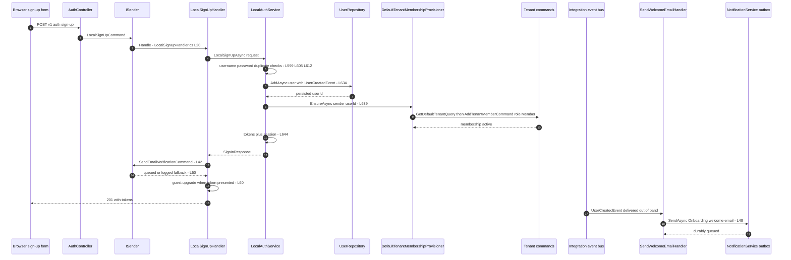
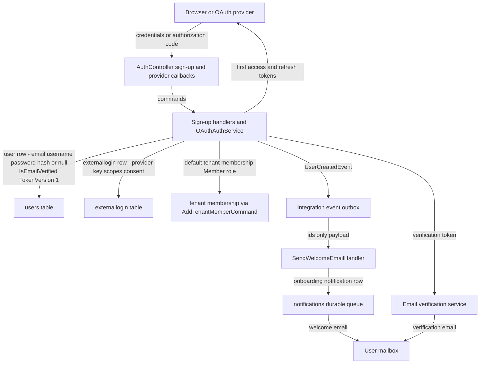

# Account Provisioning Flow (Local Sign-Up, OAuth Auto-Provision, Tenant Assignment, Default Roles, Welcome Email) — User Flow Diagram

> Issue #1114 · Modules `GameGuild.Identity.Authentication` (+ `GameGuild.Identity.Users`, `GameGuild.Identity.Tenants`, `GameGuild.Notifications`) · Documented against `develop` commit `a96679c7a`.
> Scope: how an account is created and provisioned — self-service email sign-up, OAuth first-sign-in auto-provisioning (including email-collision rules and race handling), default-tenant membership and the `Member` role, global default permissions, verification email, and the welcome email.

## 1. Overview

There are two account-creation paths. **Local sign-up** (`POST /v1/auth/sign-up`, `Controllers/AuthController.cs:33-52` → `Handlers/LocalSignUpHandler.cs:20-63` → `LocalAuthService.LocalSignUpAsync`, `Services/LocalAuthService.cs:594`) validates username/password, creates the user with `User.CreateWithPassword` (`Entities/User.cs:563`), attaches a `UserCreatedEvent` integration event, saves, then provisions default-tenant membership (`Services/DefaultTenantMembershipProvisioner.cs:14-55`) and issues the first session. The handler then dispatches `SendEmailVerificationCommand` — a notification-queue failure never fails the committed sign-up (`Handlers/LocalSignUpHandler.cs:40-56`) — and upgrades a presented guest session (`:60-62`). **OAuth auto-provision** happens inside every provider sign-in through `ResolveExternalUserAsync` (`Services/OAuthAuthService.cs`, `ResolveExternalUserAsync`): an existing (Provider, ProviderKey) link wins; otherwise an email match is honored **only** when the provider verified the email (`User.CreateOAuthUser(email, name, emailVerified)`, `Entities/User.cs:603-618`); otherwise a fresh account is created; unique-index races re-fetch and resume. The welcome email rides the `UserCreatedEvent` → `SendWelcomeEmailHandler` (`Handlers/SendWelcomeEmailHandler.cs:13-73`) → durable onboarding notification. SCIM-based enterprise provisioning exists as a separate surface (`GameGuild.Identity.Provisioning`, `Controllers/ScimUsersController.cs`).

## 2. End-to-End Flowchart — happy path and every edge case

```mermaid
flowchart TD
    subgraph LOCAL["Local sign-up - POST auth sign-up"]
        LA1["Client POST email password username optional tenant<br/>AuthController.cs L33"] --> LA2["LocalSignUpCommand with GuestAccessToken<br/>AuthController.cs L37"]
        LA2 --> LA3["LocalSignUpHandler<br/>LocalSignUpHandler.cs L20"]
        LA3 --> LA4["LocalAuthService LocalSignUpAsync<br/>LocalAuthService.cs L594"]
        LA4 --> LA5{"Username normalizes to 3 to 50 chars<br/>UsernameSlug Normalize - L599"}
        LA5 -- "no" --> LA400a["400 validation error - L601"]
        LA5 -- "yes" --> LA6{"ValidatePasswordStrength<br/>L605"}
        LA6 -- "weak" --> LA400b["400 password validation failures"]
        LA6 -- "strong" --> LA7{"ExistsByEmailAsync lowercase<br/>L612"}
        LA7 -- "email exists" --> LA409["InvalidOperationException User already exists - L617"]
        LA7 -- "free" --> LA8["HashPassword then User CreateWithPassword<br/>IsActive true generated username - User.cs L563"]
        LA8 --> LA9["Attach UserCreatedEvent integration event<br/>TenantId platform default - L621"]
        LA9 --> LA10["AddAsync plus SaveChangesAsync - L634"]
        LA10 --> LA11["DefaultTenantMembershipProvisioner EnsureAsync<br/>LocalAuthService.cs L639"]
        LA10 --> LA12["ResolveTenantAccessContext then<br/>refresh and access tokens plus CreateSessionAsync - L644"]
        LA12 --> LA13["RecordSuccessfulAttemptAsync Registration - L668"]
        LA13 --> LA14["201 SignInResponse with tokens - AuthController.cs L51"]
        LA14 --> LA15{"SendEmailVerificationCommand dispatch<br/>LocalSignUpHandler.cs L42"}
        LA15 -- "queued" --> LA16["Message - verification email sent - L47"]
        LA15 -- "queue failure" --> LA17["Sign-up still succeeds - resend available<br/>message pending - L50"]
        LA16 --> LA18{"GuestAccessToken presented<br/>LocalSignUpHandler.cs L60"}
        LA17 --> LA18
        LA18 -- "yes and valid" --> LA19["Guest session upgraded - continuity<br/>GuestSessionUpgradeIntegration.cs L13"]
        LA18 -- "no or invalid" --> LA20["Response unchanged - guest token never blocks"]
        LA19 --> LADONE["Sign-up complete"]
        LA20 --> LADONE
    end

    subgraph TENANT["Default tenant and role provisioning"]
        TN1["DefaultTenantMembershipProvisioner EnsureAsync<br/>called by sign-up every sign-in and refresh<br/>DefaultTenantMembershipProvisioner.cs L14"] --> TN2["GetDefaultTenantQuery<br/>public GameGuild tenant - L16"]
        TN2 -- "no default tenant configured" --> TN3["Return silently - no membership - L20"]
        TN2 -- "default tenant found" --> TN4["GetUserMembershipsQuery include inactive - L25"]
        TN4 --> TN5{"Active membership with valid invite state<br/>L32"}
        TN5 -- "yes" --> TN6["Idempotent return - L35"]
        TN5 -- "inactive or missing" --> TN7["Role preserved when present else Member - L42<br/>reactivation never downgrades SystemAdmin - L41"]
        TN7 --> TN8["AddTenantMemberCommand default tenant user role<br/>L46"]
        TN8 -- "failure other than already-member" --> TN9["InvalidOperationException - provisioning fails the flow - L52"]
        TN8 -- "success or already member" --> TN10["Membership active with Member default role"]
        TN10 --> TN11["Global default permissions row user null tenant null<br/>effective-permission layer 4<br/>EffectivePermissionResolverService.cs L185"]
    end

    subgraph OAUTH["OAuth auto-provision - first provider sign-in"]
        OA1["Provider sign-in - Google id token or Discord GitHub Microsoft Epic Facebook callback<br/>OAuthAuthService.cs L127 L165 L205 L281"] --> OA2["Verify provider credential<br/>cryptographic or code exchange"]
        OA2 -- "invalid" --> OA401["401"]
        OA2 -- "valid" --> OA3["ResolveExternalUserAsync provider email providerKey<br/>emailVerified grantedScopes"]
        OA3 --> OA4{"Existing link by Provider plus ProviderKey<br/>GetByProviderKeyAsync"}
        OA4 -- "link exists" --> OA5["Consent refresh when scope set changed<br/>load linked user - linked not found is 401"]
        OA5 --> OA6["Existing account signs in - no provisioning"]
        OA4 -- "no link" --> OA7{"Account with same email exists<br/>GetByEmailAsync"}
        OA7 -- "yes and provider email NOT verified" --> OA401b["401 - refuse unverified-email merge<br/>hijack prevention"]
        OA7 -- "yes and email verified" --> OA8["Auto-link existing account by email<br/>user stays - createdNewUser false"]
        OA7 -- "no account" --> OA9["User CreateOAuthUser email name emailVerified<br/>PasswordHash null IsEmailVerified from provider - User.cs L603"]
        OA9 --> OA10["createdNewUser true"]
        OA8 --> OA11["UpsertAsync ExternalLogin row with granted scopes<br/>and consent stamp"]
        OA10 --> OA12["AddAsync user then SaveChanges"]
        OA12 --> OA11
        OA11 --> OA13["External account lifecycle audit event<br/>created or linked - RecordExternalAccountLifecycleEventAsync"]
        OA13 --> OA14{"DbUpdateException race<br/>unique Provider ProviderKey or email"}
        OA14 -- "link now exists" --> OA15["Resume with winning link - L race path"]
        OA14 -- "email row won" --> OA16["Refetch user by email then Upsert link<br/>lifecycle event with ResumedAfterRace"]
        OA14 -- "no race" --> OA17["DefaultTenantMembershipProvisioner EnsureAsync<br/>OAuthAuthService.cs L105 L151 L184 L224 L310"]
        OA15 --> OA17
        OA16 --> OA17
        OA17 --> OA18["ResolveTenantAccessContext then CompleteSignInAsync<br/>tokens and session issued"]
        OA18 --> OA19["Steam and email-less providers<br/>synthesized unverified identifier provider local<br/>never matches a real account - OAuthAuthService.cs L301"]
    end

    subgraph WELCOME["Welcome email"]
        W1["UserCreatedEvent integration event<br/>attached only by local sign-up<br/>LocalAuthService.cs L621"] --> W2["SendWelcomeEmailHandler<br/>IIntegrationEventHandler of UserCreatedEvent<br/>SendWelcomeEmailHandler.cs L16"]
        W2 --> W3{"User exists and not deleted<br/>delayed delivery guard - L21"}
        W3 -- "deleted" --> W4["Skip - deleted account gets no welcome - L23"]
        W3 -- "alive" --> W5["UserSignedUpNotification with ids only"]
        W5 --> W6["NotificationService SendAsync Onboarding Welcome to GameGuild<br/>channel Email with metadata - L48"]
        W6 -- "queued durably" --> W7["Log welcome queued - L63"]
        W6 -- "queue write failed" --> W8["Throw - outbox retries - never ack a lost write - L70"]
    end
```

## 3. CQRS Chain Sequence Diagram

## 4. Data Flow Diagram

## 5. Edge-Case Matrix

| # | Edge case | Code path | Outcome |
|---|-----------|-----------|---------|
| 1 | Username too short/long or slug collision | `UsernameSlug.Normalize` guard (`Services/LocalAuthService.cs:598-603`) | 400 validation error |
| 2 | Weak password | `ValidatePasswordStrength` (`:605-610`) | 400 with failure list |
| 3 | Duplicate email at sign-up | `ExistsByEmailAsync` pre-check (`:612-618`) | 409-shaped InvalidOperationException "User already exists" |
| 4 | Duplicate email racing two sign-ups | users-table uniqueness backs the pre-check; loser gets `DbUpdateException` on save | one succeeds, other errors |
| 5 | Default tenant not configured | silent no-membership return (`Services/DefaultTenantMembershipProvisioner.cs:20-23`) | user exists without tenant membership |
| 6 | Existing inactive membership | reactivation preserving prior role (`:40-44`) | cancelled SystemAdmin is never downgraded to Member |
| 7 | AddTenantMember fails (non already-member message) | throw (`:50-54`) | the whole sign-in/sign-up fails — provisioning is mandatory when tenant exists |
| 8 | Verification email queue down at sign-up | catch → success message changes (`Handlers/LocalSignUpHandler.cs:50-56`) | account committed; resend path available |
| 9 | Welcome email delivery to a since-deleted user | guard (`Handlers/SendWelcomeEmailHandler.cs:21-25`) | skipped |
| 10 | Welcome notification not durably queued | throw → outbox retries (`:66-71`) | never acknowledged as sent |
| 11 | OAuth first sign-in, email already registered, provider email **unverified** | merge refused (`Services/OAuthAuthService.cs`, `ResolveExternalUserAsync` unverified branch) | 401 — no silent account takeover (issue #1118 class) |
| 12 | OAuth first sign-in, email registered, provider email verified | auto-link to existing user | existing account gains the provider link |
| 13 | OAuth sign-in with no email claim (Steam) | synthesized `providerId@provider.local` unverified (`Services/OAuthAuthService.cs:301-304`) | always a fresh account, never an email match |
| 14 | Concurrent OAuth provisioning on the same external identity | unique index + `DbUpdateException` resume (`ResolveExternalUserAsync` race path) | loser re-fetches winner and continues once |
| 15 | Linked user deleted between link and load | `Linked user not found` 401 (`ResolveExternalUserAsync`) | sign-in fails closed |
| 16 | OAuth-created account has `PasswordHash = null` | `User.CreateOAuthUser` (`Entities/User.cs:603-618`) | password set later via set-initial change-password mode (see password-change doc) |
| 17 | Guest registering during sign-up | `ApplyGuestUpgradeAsync` (`Handlers/LocalSignUpHandler.cs:60-62`) | guest session upgraded; invalid token never blocks |
| 18 | Sign-up while already signed in | no guard on the endpoint (anonymous) | second account created; no re-auth required |

## 6. Endpoint Inventory

| Method + Route | Handler chain | Controller ref |
|----------------|---------------|----------------|
| POST `v{v}/auth/sign-up` | `LocalSignUpCommand` → `LocalSignUpHandler` → `LocalAuthService.LocalSignUpAsync` | `Controllers/AuthController.cs:33-52` |
| POST `v{v}/auth/google:id-token` (OAuth provision path) | `GoogleIdTokenSignInCommand` → `GoogleIdTokenSignInHandler` → `OAuthAuthService.GoogleIdTokenSignInAsync` | `Controllers/AuthController.cs` (Google region) |
| POST `v{v}/auth/discord:callback`, `github:callback`, `microsoft:callback`, `epic:callback`, `facebook:callback`, Steam | provider callback commands → `OAuthAuthService` callback sign-ins (all end in `ResolveExternalUserAsync` + provisioning) | `Controllers/AuthController.cs:988+` and provider regions |
| (guest upgrade on sign-up/sign-in) | in-handler `ApplyGuestUpgradeAsync` | `Handlers/LocalSignUpHandler.cs:60-62` |
| (welcome email) | `UserCreatedEvent` → `SendWelcomeEmailHandler` | `Handlers/SendWelcomeEmailHandler.cs:13-73` |
| (verification email) | `SendEmailVerificationCommand` → `SendEmailVerificationCommandHandler` | `Handlers/LocalSignUpHandler.cs:42-45` |
| SCIM 2.0 provisioning (enterprise) | `ScimUsersController` / `ScimGroupsController` / `ScimBulkController` | `GameGuild.Identity.Provisioning/Controllers/ScimUsersController.cs:18` |

## 7. Events Published / Consumed

- **Published**
  - `UserCreatedEvent` (durable integration event, tenant = platform default) — attached **only** in local sign-up (`Services/LocalAuthService.cs:621-628`).
  - `UserSignedUpNotification` (in-process → welcome email) (`Handlers/SendWelcomeEmailHandler.cs:27-33`).
  - `PasswordResetRequestedNotification`, email-verification notifications on their respective paths.
  - External-account lifecycle audit events (`Authentication.ExternalAccountLinked` / created / resumed-after-race) from `ResolveExternalUserAsync` (`Services/OAuthAuthService.cs`, `RecordExternalAccountLifecycleEventAsync`).
- **Consumed**
  - `SendWelcomeEmailHandler` consumes `UserCreatedEvent` (`:16`) and `UserSignedUpNotification` (`:36`).
  - `SendEmailVerificationRequestedHandler` / `SendWelcomeEmailHandler` consume the notification-side events raised by their commands.

## 8. Entities and Tables Touched

| Entity / table | Writes | Ref |
|----------------|--------|-----|
| `User` → users | INSERT with email/username/password-hash-or-null, `IsActive`, `IsEmailVerified`, `TokenVersion` 1 | `Entities/User.cs:563-618`; `Repositories/UserRepository.cs` |
| `ExternalLogin` → `externallogin` | INSERT/Upsert with granted scopes + consent on OAuth paths | `Services/OAuthAuthService.cs` (`ResolveExternalUserAsync`) |
| Tenant membership (via `AddTenantMemberCommand`) | INSERT/reactivate with role (default `Member`) in the default tenant | `Services/DefaultTenantMembershipProvisioner.cs:46-48` |
| `UserSession` + `RefreshToken` | first session + refresh token row at sign-up / provider sign-in | `Services/LocalAuthService.cs:644-666`; `OAuthAuthService` `CompleteSignInAsync` |
| Notifications (onboarding) | durable welcome-email row | `Handlers/SendWelcomeEmailHandler.cs:48-56` |
| Integration event outbox | `UserCreatedEvent` row | `Services/LocalAuthService.cs:621-628` |

## 9. Gaps — realistic scenarios the code does not handle

1. **OAuth-provisioned accounts never get a welcome email.** `UserCreatedEvent` is attached only by `LocalSignUpAsync` (`Services/LocalAuthService.cs:621-628`); `User.CreateOAuthUser` (`Entities/User.cs:603-618`) and `ResolveExternalUserAsync` raise no creation event — the welcome-email consumer (`Handlers/SendWelcomeEmailHandler.cs:16`) never fires for provider-created accounts. The issue's "welcome email" expectation holds only for email+password sign-up.
2. **No email verification flow for OAuth accounts with unverified provider emails.** `CreateOAuthUser(email, name, emailVerified: false)` stores an unverified address but nothing schedules a verification email for it (the send-verification command exists only on the sign-up handler path); such accounts also can never email-match-link later without it.
3. **Provider email case sensitivity.** `GetByEmailAsync(email)` is called with the provider-reported address after `CreateOAuthUser` lowercases only what it stores; the *lookup* in `ResolveExternalUserAsync` uses the raw provider email — `User@Gmail.com` from Google will not match a stored `user@gmail.com` (open issue #1118 describes exactly this). Local sign-up lowercases (`:612`), OAuth lookup does not uniformly.
4. **No transactional coupling between user creation and tenant provisioning.** The user row commits, then `EnsureAsync` runs as separate commands; a crash between them leaves an account with no tenant membership (self-healed only at the *next* sign-in/refresh, which re-runs `EnsureAsync`).
5. **Sign-up endpoint has no Turnstile/CAPTCHA hook visible on this path.** The controller relies on the shared `Authentication` rate-limit policy; server-side CAPTCHA verification exists in the codebase (Turnstile fixes from `feat/auth-security-batch1`) but is not invoked by `POST /auth/sign-up` itself — bot provisioning is bounded only by rate limits.
6. **Admin/SCIM provisioning bypasses the default-role story.** SCIM users (`GameGuild.Identity.Provisioning/Controllers/ScimUsersController.cs`) are provisioned through their own command surface; nothing there calls `DefaultTenantMembershipProvisioner`, so SCIM-created users depend on the IdP-driven group/role mapping and may hold no platform default-tenant membership at all.
