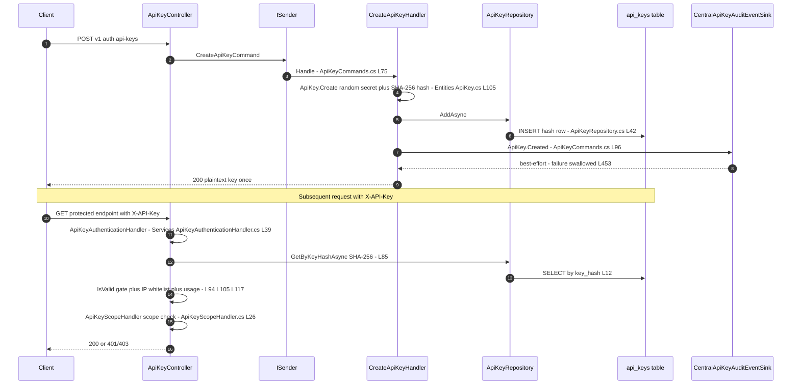
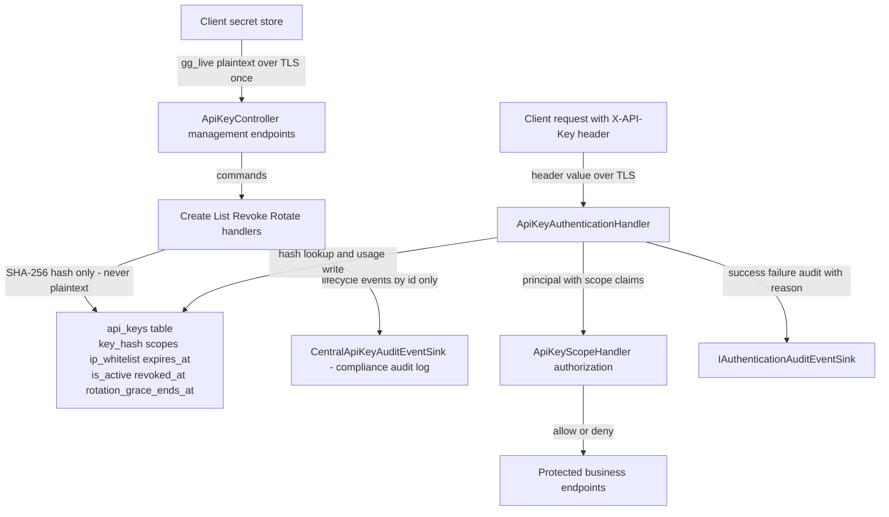

# API Key Flow (Creation, Listing, Scopes, Expiry, Revocation) — User Flow Diagram

> Issue #1102 · Module `GameGuild.Identity.Authentication` (+ `GameGuild.Compliance.Audit` bridge, `GameGuild.API` host pipeline) · Documented against `develop` commit `74e9bba4c`.
> Scope: API-key creation (secret generation, hashing, scopes, IP whitelist, expiry), listing with usage counters, per-request authentication through the `ApiKey` scheme, dynamic scope authorization (`apikey-scope:*` policies), explicit revocation, rotation with an overlap (grace) window and lazy finalization, and lifecycle audit events.

## 1. Overview

API keys are `gg_live_<32 chars>` secrets generated from 48 random bytes (`Entities/ApiKey.cs:113-127`) — only the SHA-256 hex hash is persisted (`ApiKey.cs:128`, `:250-256`); the plaintext is returned exactly once in the create/rotate response (`Commands/ApiKeyCommands.cs:22`, `:34-40`). Creation runs `CreateApiKeyHandler` (`Commands/ApiKeyCommands.cs:56-109`): actor from `IActorContextAccessor`, entity via `ApiKey.Create`, persist through `ApiKeyRepository.AddAsync` (`Repositories/ApiKeyRepository.cs:42-47`), then a best-effort audit event `ApiKey.Created` through `IApiKeyAuditEventSink` (`Abstractions/IApiKeyAuditEventSink.cs:30-35`, bridged by `CentralApiKeyAuditEventSink` in `Modules/GameGuild.Compliance.Audit/Services/CentralApiKeyAuditEventSink.cs:12`). All four management endpoints sit behind `Authorize(Policy = ApiKeyScopePolicies.Prefix + ApiKeyScopes.ManageApiKeys)` and (for create/rotate/revoke) `TrustedDevicePolicy` (`Controllers/ApiKeyController.cs:28-29`, `:63-64`, `:93-94`) — the trusted-device handler intentionally passes non-interactive sessions through (`Authorization/TrustedDeviceRequirement.cs:57-63`). Listing (`Commands/ApiKeyCommands.cs:159-184`) returns prefix/scopes/counters only, never key material. Per-request authentication is `ApiKeyAuthenticationHandler` (`Services/ApiKeyAuthenticationHandler.cs:39-151`): exactly one configured source (header `X-API-Key`, optional query parameter, optional custom resolver), SHA-256 lookup by hash, `ApiKey.IsValid()` gate (`Entities/ApiKey.cs:159-182` — active, not revoked, rotation-grace not expired, not expired), optional exact-match IP whitelist, usage counters, then a principal with `sub`, `tenant_id`, `api_key_id`, `auth_method=api_key` and per-scope `scope` claims (`Services/ApiKeyAuthenticationHandler.cs:120-133`). Scope enforcement is dynamic: `ApiKeyScopePolicyProvider` resolves `apikey-scope:{scope}` policies (`Authorization/ApiKeyScopePolicyProvider.cs:19-31`) handled by `ApiKeyScopeHandler`, which fails closed for API-key principals without the required scope (or `*` wildcard) and passes non-API-key principals through (`Authorization/ApiKeyScopeHandler.cs:26-70`). Revocation sets `IsActive=false` + `RevokedAt` + reason, scoped to the calling user (`Repositories/ApiKeyRepository.cs:49-61`); rotation with a grace window is detailed in the key-rotation flow doc.

## 2. End-to-End Flowchart — happy path and every edge case

```mermaid
flowchart TD
    subgraph CREATE["Create - POST auth api-keys"]
        C1["Authenticated caller<br/>ApiKeyController.cs L27"] --> C2["Policies apikey-scope api_keys manage<br/>plus require-trusted-device L28"]
        C2 --> C3["CreateApiKeyCommand Name Scopes ExpiresAt IpWhitelist<br/>ApiKeyController.cs L33"]
        C3 --> C4["CreateApiKeyValidator<br/>name 1-100 chars - scopes non-empty -<br/>expiry must be in the future<br/>ApiKeyCommands.cs L43"]
        C4 -- "invalid" --> C400["400 validation error"]
        C4 -- "valid" --> C5{"Actor SubjectIdAsGuid<br/>ApiKeyCommands.cs L77"}
        C5 -- "anonymous" --> C401["failure Auth.Required<br/>ApiKeyCommands.cs L80"]
        C5 -- "authenticated" --> C6["ApiKey Create generates gg_live prefix<br/>48 random bytes - 32 alphanumeric chars<br/>SHA-256 hash stored - Entities ApiKey.cs L105"]
        C6 --> C7["ApiKeyRepository AddAsync persists row<br/>ApiKeyRepository.cs L42"]
        C7 --> C8["Audit ApiKey.Created best-effort<br/>sink failure never fails the command<br/>ApiKeyCommands.cs L96"]
        C8 --> C9["200 with plaintext key returned once<br/>plus prefix scopes expiry<br/>ApiKeyCommands.cs L108"]
    end

    subgraph LIST["List - GET auth api-keys"]
        L1["Authenticated caller<br/>ApiKeyController.cs L46"] --> L2["Policy apikey-scope api_keys manage L47"]
        L2 --> L3{"Actor SubjectIdAsGuid<br/>ApiKeyCommands.cs L175"}
        L3 -- "anonymous" --> L401["failure Auth.Required L177"]
        L3 -- "authenticated" --> L4["GetByUserIdAsync ordered by CreatedAt desc<br/>AsNoTracking - ApiKeyRepository.cs L24"]
        L4 --> L5["200 list of ApiKeyDto<br/>prefix scopes IsActive ExpiresAt<br/>LastUsedAt UsageCount rotation fields<br/>ApiKeyCommands.cs L118"]
    end

    subgraph AUTH["Per-request authentication - ApiKey scheme"]
        A1["Request reaches ApiKeyAuthenticationHandler<br/>Services ApiKeyAuthenticationHandler.cs L39"] --> A2["Collect header X-API-Key plus optional<br/>query api_key plus optional CustomKeyResolver L41"]
        A2 --> A3{"Custom resolver threw<br/>L46"}
        A3 -- "yes" --> A401a["fail AuthenticationError - audited L53"]
        A3 -- "no" --> A4{"More than one source present<br/>L60"}
        A4 -- "yes" --> A401b["fail MultipleApiKeySources L62"]
        A4 -- "exactly one or none" --> A5{"Key present<br/>L68"}
        A5 -- "absent" --> A6["NoResult - other schemes try L70"]
        A5 -- "present via query" --> A7{"Request is HTTPS<br/>L73"}
        A7 -- "no" --> A401c["fail ApiKeyQueryRequiresHttps L75"]
        A7 -- "yes" --> A8
        A5 -- "present via header" --> A8["SHA-256 hash then GetByKeyHashAsync<br/>L82"]
        A8 --> A9{"Row found<br/>L87"}
        A9 -- "unknown hash" --> A401d["fail InvalidApiKey - audited L90"]
        A9 -- "found" --> A10{"ApiKey IsValid<br/>active - not revoked - grace not expired - not expired<br/>Entities ApiKey.cs L159"}
        A10 -- "invalid" --> A11["lazy FinalizeRotationRevocationAsync<br/>records revocation once grace closed<br/>ApiKeyRepository.cs L86"]
        A11 --> A401e["fail InactiveOrExpiredApiKey - audited L101"]
        A10 -- "valid" --> A12{"IpWhitelist configured<br/>L105"}
        A12 -- "yes and client IP not in list<br/>exact string match" --> A401f["fail ApiKeyIpNotAllowed - audited L112"]
        A12 -- "no whitelist or match" --> A13["RecordUsageAsync bumps LastUsedAt UsageCount<br/>L117"]
        A13 --> A14["Principal sub tenant_id api_key_id<br/>auth_method api_key plus scope claims L120"]
        A14 --> A15["Success ticket - audit Authentication.Succeeded L144"]
    end

    subgraph SCOPE["Scope authorization - apikey-scope policies"]
        S1["Endpoint declares apikey-scope scope policy<br/>ApiKeyScopeRequirement.cs L25"] --> S2["ApiKeyScopePolicyProvider builds<br/>RequireAuthenticatedUser plus requirement<br/>ApiKeyScopePolicyProvider.cs L24"]
        S2 --> S3["ApiKeyScopeHandler HandleRequirementAsync<br/>ApiKeyScopeHandler.cs L26"]
        S3 --> S4{"api_key_id claim present<br/>L28"}
        S4 -- "absent - not an API key request" --> S5["Succeed - other schemes unaffected L32"]
        S4 -- "present" --> S6{"scope claims exist<br/>L41"}
        S6 -- "none" --> S7["Fail closed - declared no scopes L47"]
        S6 -- "some" --> S8{"exact case-insensitive match<br/>or wildcard star - L53"}
        S8 -- "no match" --> S9["Fail - not authorized for scope L66"]
        S8 -- "match or wildcard" --> S10["Succeed L56"]
    end

    subgraph REVOKE["Revoke - POST auth api-keys keyId revoke"]
        R1["Authenticated owner<br/>ApiKeyController.cs L92"] --> R2["Policies api_keys manage plus trusted device L93"]
        R2 --> R3["RevokeApiKeyHandler - actor required<br/>ApiKeyCommands.cs L213"]
        R3 --> R4["RevokeAsync scoped to Id plus UserId<br/>ApiKeyRepository.cs L49"]
        R4 -- "no row for this user" --> R404["failure ApiKey.NotFound<br/>ApiKeyCommands.cs L229"]
        R4 -- "found" --> R5["Revoke sets IsActive false RevokedAt reason<br/>Entities ApiKey.cs L213"]
        R5 --> R6["Audit ApiKey.Revoked best-effort<br/>ApiKeyCommands.cs L235"]
        R6 --> R7["200 revoked successfully<br/>ApiKeyController.cs L111"]
    end

    subgraph EXPIRY["Expiry and rotation grace"]
        E1["IsValid checks ExpiresAt against SystemClock<br/>Entities ApiKey.cs L176"] --> E2{"ExpiresAt in the past"}
        E2 -- "yes" --> E3["invalid on next use - fail InactiveOrExpired"]
        E2 -- "no or null" --> E4{"RotationGraceEndsAt passed<br/>Entities ApiKey.cs L187"}
        E4 -- "yes - old rotated key" --> E5["invalid - next use lazily records<br/>FinalizeRotationRevocation - Entities ApiKey.cs L236"]
        E4 -- "no" --> E6["key continues to work"]
    end
```

## 3. CQRS Chain Sequence Diagram

## 4. Data Flow Diagram

## 5. Edge-Case Matrix

| # | Edge case | Code path | Outcome |
|---|-----------|-----------|---------|
| 1 | Anonymous caller hits a management endpoint | `RequireAuthenticatedUser` in the dynamic policy (`Authorization/ApiKeyScopePolicyProvider.cs:25`) | 401 before the handler runs |
| 2 | Handler runs without a resolvable subject id | `SubjectIdAsGuid` guard (`Commands/ApiKeyCommands.cs:77-81`) | `Auth.Required` failure, controller maps to 400 (`Controllers/ApiKeyController.cs:38-40`) |
| 3 | Empty name, >100 chars, empty scopes | `CreateApiKeyValidator` (`Commands/ApiKeyCommands.cs:43-54`) | validation failure |
| 4 | Expiry in the past at creation | `Must(expiry > UtcNow)` (`Commands/ApiKeyCommands.cs:49-52`) | rejected; note the validator compares against server clock without tolerance |
| 5 | Key presented through two sources at once (header + query) | multiple-source check (`Services/ApiKeyAuthenticationHandler.cs:56-65`) | fail `MultipleApiKeySources`, audited |
| 6 | Custom key resolver throws | try/catch around resolver (`:46-54`) | fail `AuthenticationError`, audited; never a 500 |
| 7 | API key in query string over plain HTTP | HTTPS gate (`:73-76`) | fail `ApiKeyQueryRequiresHttps` |
| 8 | Unknown key hash (typo or revoked-then-deleted key) | lookup miss (`:85-91`) | fail `InvalidApiKey`, audited; no oracle detail |
| 9 | Inactive / revoked / grace-expired / expired key used | `IsValid()` (`Entities/ApiKey.cs:159-182`) | fail `InactiveOrExpiredApiKey`; grace-expired rows also get their revocation lazily recorded (`Services/ApiKeyAuthenticationHandler.cs:96-102`) |
| 10 | Key restricted by `IpWhitelist` called from other IP | exact string compare (`:105-114`) | fail `ApiKeyIpNotAllowed`, audited |
| 11 | IPv6-mapped IPv4 remote address vs IPv4 whitelist entry | `RemoteIpAddress.ToString()` raw compare (`:107-109`) | mismatch denies (no normalization — see Gaps) |
| 12 | API-key principal without any `scope` claim hits a scope policy | fail-closed branch (`Authorization/ApiKeyScopeHandler.cs:41-51`) | denied, never passed through |
| 13 | Key lacking the required scope (no wildcard) | exact/wildcard check (`:53-59`) | denied with per-key log |
| 14 | Non-API-key principal hits a scope policy | `api_key_id` absent (`:28-33`) | succeeds — policy only constrains API-key traffic |
| 15 | Interactive user without trusted device hits create/rotate/revoke | `TrustedDevicePolicy` (`Controllers/ApiKeyController.cs:29`) with `RequireTrustedDeviceForSensitiveOps=false` default (`Modules/GameGuild.SharedKernel/Configuration/ApplicationLayer/SessionOptions.cs:84`) | passes today; enforced only when the option is enabled |
| 16 | Revoking a key owned by another user | `RevokeAsync` scoped to `Id + UserId` (`Repositories/ApiKeyRepository.cs:49-56`) | null → `ApiKey.NotFound`; no cross-tenant oracle |
| 17 | Double revoke of the same key | second call finds row, `Revoke` re-stamps (`Entities/ApiKey.cs:213-219`) | idempotent 200, reason overwritten |
| 18 | Audit sink down during create/revoke/rotate | try/catch in `ApiKeyLifecycleAudit` (`Commands/ApiKeyCommands.cs:453-461`) | operation still succeeds, error logged |
| 19 | Hash collision on key generation | 48 random bytes → effectively impossible; no retry loop unlike refresh tokens (`Entities/ApiKey.cs:113-127`) | unique index would surface a 500 (`ApiKeyConfiguration` unique `key_hash`) |
| 20 | Listing with many keys | `GetByUserIdAsync` unbounded (`Repositories/ApiKeyRepository.cs:24-31`) | all rows returned; no pagination |
| 21 | Usage counter write on every authenticated request | `RecordUsageAsync` SaveChanges per request (`Repositories/ApiKeyRepository.cs:63-67`) | counters fresh; row-lock/update per request (see Gaps) |
| 22 | Old key used after grace window but never rotated row finalized | finalize only runs inside the auth attempt (`Services/ApiKeyAuthenticationHandler.cs:98`) | row shows active-but-invalid until someone attempts; no background sweeper |

## 6. Endpoint Inventory

| Method + Route | Handler chain | Controller ref |
|----------------|---------------|----------------|
| POST `v{v}/auth/api-keys` | `CreateApiKeyCommand` → `CreateApiKeyValidator` → `CreateApiKeyHandler` → `ApiKeyRepository.AddAsync` | `Controllers/ApiKeyController.cs:27-41` |
| GET `v{v}/auth/api-keys` | `ListApiKeysQuery` → `ListApiKeysHandler` → `ApiKeyRepository.GetByUserIdAsync` | `Controllers/ApiKeyController.cs:46-56` |
| POST `v{v}/auth/api-keys/{keyId}:rotate` | `RotateApiKeyCommand` → `RotateApiKeyValidator` → `RotateApiKeyHandler` → `ApiKeyRepository.RotateAsync` | `Controllers/ApiKeyController.cs:62-87` (detailed in key-rotation flow doc) |
| POST `v{v}/auth/api-keys/{keyId}:revoke` | `RevokeApiKeyCommand` → `RevokeApiKeyHandler` → `ApiKeyRepository.RevokeAsync` | `Controllers/ApiKeyController.cs:92-113` |
| (any route) per-request auth | `ApiKeyAuthenticationHandler` registered by `AddApiKeyAuthentication` (`GameGuild.API/Core/Extensions/SecurityServiceCollectionExtensions.cs:189-207`) | scheme `ApiKey` (`Services/ApiKeyAuthenticationHandler.cs:203`) |
| (any route with `apikey-scope:*`) | `ApiKeyScopePolicyProvider` + `ApiKeyScopeHandler` (`SecurityServiceCollectionExtensions.cs:329-331`) | dynamic policy (`Authorization/ApiKeyScopePolicies.cs:30`) |

## 7. Events Published / Consumed

- **Published** — `ApiKeyAuditEvent` lifecycle via `IApiKeyAuditEventSink` (`Abstractions/IApiKeyAuditEventSink.cs:17-35`): `ApiKey.Created` (`Commands/ApiKeyCommands.cs:96-106`), `ApiKey.Rotated` (`:396-412`), `ApiKey.Revoked` (`:235-245`); bridged to the central audit log by `CentralApiKeyAuditEventSink` (`Modules/GameGuild.Compliance.Audit/Services/CentralApiKeyAuditEventSink.cs:12`). Per-request `Authentication.Succeeded`/`Authentication.Failed` with reasons `InvalidApiKey`, `InactiveOrExpiredApiKey`, `ApiKeyIpNotAllowed`, `MultipleApiKeySources`, `ApiKeyQueryRequiresHttps`, `AuthenticationError` via `IAuthenticationAuditEventSink` (`Services/ApiKeyAuthenticationHandler.cs:153-187`). Durable operation events `identity.authentication.create-api-key` / `revoke-api-key` / `rotate-api-key` (`Architecture/AuthenticationUseCaseEventContracts.cs:31-33`).
- **Consumed** — `ApiKeyLifecycleOptions` (`ApiKeys` section, defaults 24 h grace / 30 d max — `Configuration/ApiKeyLifecycleOptions.cs:14-19`); actor context claims (`sub`, `tenant_id`) from the authenticating scheme; the authorization surface consumes `api_key_id` + `scope` claims minted by the handler.

## 8. Entities and Tables Touched

| Entity / store | Fields that matter | Ref |
|----------------|--------------------|-----|
| `ApiKey` → `gameguild.authentication.api_keys` | `KeyHash` (unique, SHA-256 hex), `KeyPrefix`, `Scopes` (CSV, 1000), `IpWhitelist`, `IsActive`, `ExpiresAt`, `LastUsedAt`, `UsageCount`, `RevokedAt/Reason`, `ReplacesKeyId`, `RotationGraceEndsAt` | `Entities/ApiKey.cs:17-100`, `Data/Configurations/ApiKeyConfiguration.cs:10-24` |
| Authentication principal (no row) | `sub`, `tenant_id`, `api_key_id`, `auth_method=api_key`, `scope`×N | `Services/ApiKeyAuthenticationHandler.cs:120-133` |
| Central audit log | lifecycle + authentication events | `Modules/GameGuild.Compliance.Audit/Services/CentralApiKeyAuditEventSink.cs` |
| Operation event stream | `identity.authentication.{create,revoke,rotate}-api-key` | `Architecture/AuthenticationUseCaseEventContracts.cs:31-33` |

## 9. Gaps — realistic scenarios the code does not handle

1. ~~**A leaked key with `api_keys:manage` (or `*`) can mint replacement keys and persist access.**~~ **fixed (issue #1192)**: created keys record the API-key principal that minted them (`ApiKey.CreatedByApiKeyId`, honored only when the actor authenticated on the ApiKey scheme so a forged claim on another scheme cannot fabricate lineage), rotation inherits the linkage, and `RevokeApiKeyHandler` cascades revocation transitively through `IApiKeyRepository.RevokeCreatedByCascadeAsync` — revoking the compromised key also kills every replacement it minted. Original evidence: `Commands/ApiKeyCommands.cs:83-91` recorded only the owning user; revocation never cascaded.
2. ~~**IP whitelist matching is exact-string with no normalization.**~~ **fixed for IPv6-mapped addresses (issue #1192)**: both sides of the compare are normalized out of IPv6-mapped IPv4 form (`ApiKeyAuthenticationHandler.NormalizeAddress`), so `::ffff:1.2.3.4` and `1.2.3.4` compare equal. CIDR ranges remain exact-match-only (still tracked on the service-account twin, `Services/ServiceAccountService.cs:397-409`).
3. ~~**No brute-force protection on the ApiKey scheme.**~~ **fixed (issue #1192)**: unknown-hash failures are counted per source address in `IDistributedCache` (shared across instances); after `ApiKeyAuthenticationHandler.LockoutThreshold` (10, mirroring service accounts) failures within the 30-minute window the source is locked out before the credential lookup, and a successful validation resets its budget. Audit telemetry is unchanged.
4. **Scope strings are free-form at creation.** `CreateApiKeyValidator` only checks non-emptiness (`Commands/ApiKeyCommands.cs:48`); there is no catalog of valid scopes, so a typo like `api_keys:manag` mints a key that passes creation but can never satisfy a policy — discovered only as 403s at use time.
5. **`UsageCount`/`LastUsedAt` write on every request** (`Services/ApiKeyAuthenticationHandler.cs:117`, `Repositories/ApiKeyRepository.cs:63-67`): a hot key turns every authenticated call into a row update — contention on the `api_keys` row and a write-amplification path with no sampling/throttling.
6. ~~**Create declares 201 but returns 200.**~~ **fixed (issue #1192)**: the create endpoint now answers with the declared `201 Created` (`Controllers/ApiKeyController.cs`).
7. **Rotation finalization is purely lazy.** A rotated key whose grace window closed is only marked revoked when someone attempts to use it (`Services/ApiKeyAuthenticationHandler.cs:96-102`, `Entities/ApiKey.cs:236-245`); an abandoned old key stays `IsActive=true` with a past `RotationGraceEndsAt` in listings and audits indefinitely — no background sweep exists.
8. **`tenant_id` defaults to `Guid.Empty` when the actor has no tenant** (`Commands/ApiKeyCommands.cs:85`): keys created in tenant-less sessions persist a sentinel tenant that later flows into claims (`Services/ApiKeyAuthenticationHandler.cs:124`) and audit events.
