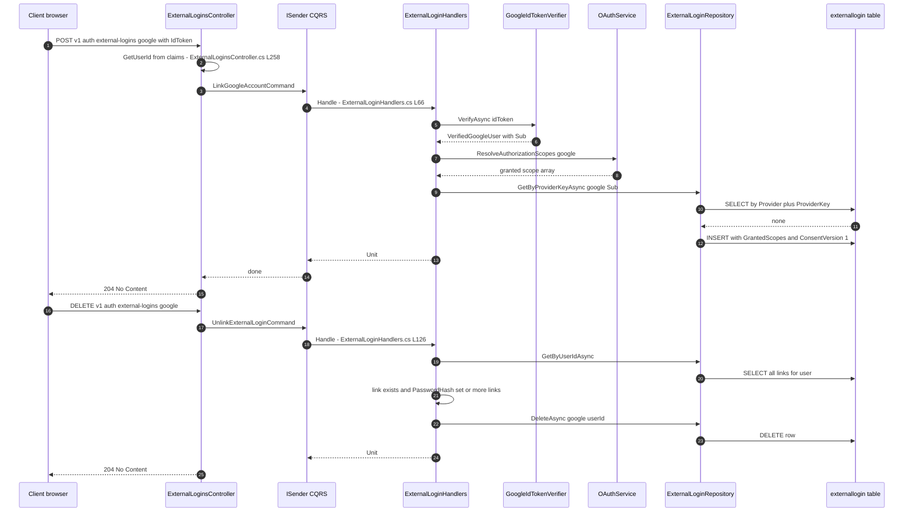
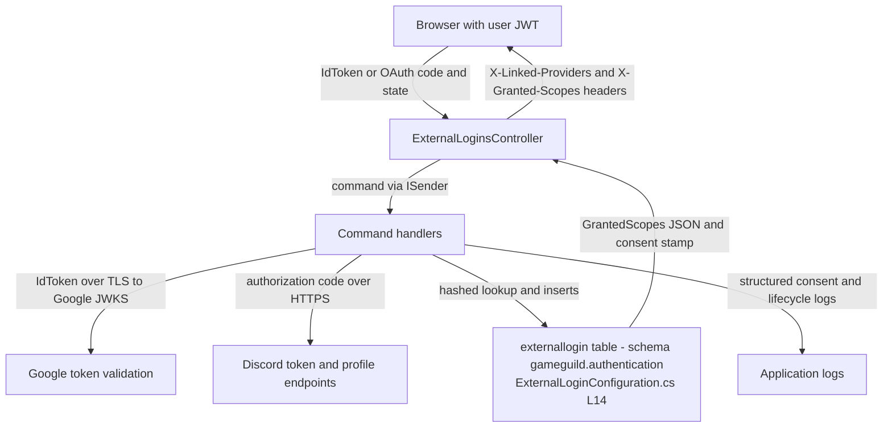

# External Login Link / Unlink Flow — User Flow Diagram

> Issue #1108 · Module `GameGuild.Identity.Authentication` · Documented against `develop` commit `a96679c7a`.
> Scope: linking Google / Discord external identities to an authenticated account, listing links and granted scopes, revoking individual OAuth scopes, unlinking a provider, and the guards that prevent orphaned accounts (a user left with no sign-in method, or an external identity silently re-owned).

## 1. Overview

External login linking is a self-service surface for **authenticated** users (`ExternalLoginsController`, `[Authorize]` at `Controllers/ExternalLoginsController.cs:22`). Two providers have dedicated link flows: Google (ID-token verification, single request) and Discord (authorize + callback, two requests). The shared three-way link rule lives in `ExternalLoginLinking.LinkAsync` (`Handlers/ExternalLoginHandlers.cs:212`): no row → insert; same user → idempotent re-consent; different user → `ExternalLoginConflictException` (409). Unlinking refuses to remove the user's last sign-in method when no password is set (`UnlinkExternalLoginCommandHandler`, `Handlers/ExternalLoginHandlers.cs:121-146`).

GitHub, Microsoft, Epic, Facebook, Steam and others are supported for **sign-in** (auto-link policy in `OAuthAuthService.ResolveExternalUserAsync`, `Services/OAuthAuthService.cs`) but the authenticated link surface in `ExternalLoginsController` only exposes Google and Discord endpoints; `GetExternalLoginLinkPreviewQueryHandler` whitelists google / discord / github / microsoft for preview (`Handlers/ExternalLoginHandlers.cs:32-38`). See Gaps.

## 2. End-to-End Flowchart — happy path and every edge case

```mermaid
flowchart TD
    subgraph LIST["List linked providers - HEAD auth external-logins"]
        L1["Client HEAD v1 auth external-logins<br/>ExternalLoginsController.cs L30"] --> L2{"GetUserId parses<br/>NameIdentifier or sub or user_id<br/>ExternalLoginsController.cs L258"}
        L2 -- "no valid claim" --> L401["401 Unauthorized"]
        L2 -- "ok" --> L3["GetExternalLoginsQuery - UserId<br/>ExternalLoginsController.cs L43"]
        L3 --> L4["GetExternalLoginsQueryHandler<br/>ExternalLoginHandlers.cs L8"]
        L4 --> L5["ExternalLoginRepository GetByUserIdAsync<br/>newest first - ExternalLoginRepository.cs L19"]
        L5 --> L6["X-Linked-Providers header<br/>provider equals iso timestamp<br/>ExternalLoginsController.cs L48"]
        L5 --> L7["X-Granted-Scopes header when consents exist<br/>ExternalLoginsController.cs L53"]
        L6 --> L8["200 OK - headers only - no body<br/>ExternalLoginsController.cs L62"]
        L7 --> L8
    end

    subgraph PREVIEW["Link preview - GET auth external-logins provider link-preview"]
        P1["Client GET provider link-preview<br/>ExternalLoginsController.cs L76"] --> P2{"Provider in LinkableProviders<br/>google discord github microsoft<br/>ExternalLoginHandlers.cs L32"}
        P2 -- "no" --> P400["400 NotSupportedException<br/>ExternalLoginsController.cs L305"]
        P2 -- "yes" --> P3["OAuthService ResolveAuthorizationScopes<br/>same list the authorize URL embeds<br/>OAuthService.cs L48"]
        P3 --> P4["200 with provider and requested scopes<br/>ExternalLoginsController.cs L90"]
    end

    subgraph GLINK["Link Google - POST auth external-logins google"]
        G1["Client POST id token<br/>ExternalLoginsController.cs L104"] --> G2["LinkGoogleAccountCommand<br/>UserId plus IdToken<br/>ExternalLoginsController.cs L117"]
        G2 --> G3["LinkGoogleAccountCommandHandler<br/>ExternalLoginHandlers.cs L59"]
        G3 --> G4{"GoogleIdTokenVerifier VerifyAsync<br/>signature iss aud exp<br/>GoogleIdTokenVerifier.cs L27"}
        G4 -- "ClientId not configured" --> G401a["401 - Google OAuth ClientId is not configured<br/>GoogleIdTokenVerifier.cs L32"]
        G4 -- "invalid forged or expired token" --> G401b["401 - generic invalid message<br/>GoogleIdTokenVerifier.cs L53"]
        G4 -- "valid" --> G5["ResolveAuthorizationScopes google<br/>ExternalLoginHandlers.cs L72"]
        G5 --> G6["ExternalLoginLinking LinkAsync<br/>ExternalLoginHandlers.cs L74"]
        G6 --> LINKRULE
    end

    subgraph DLINK["Link Discord - authorize then callback"]
        D1["Client POST discord link-authorize<br/>ExternalLoginsController.cs L134"] --> D2["DiscordLinkAuthorizeCommandHandler<br/>ExternalLoginHandlers.cs L80"]
        D2 --> D3["state equals Guid NewGuid N<br/>ExternalLoginHandlers.cs L89"]
        D3 --> D4["OAuthService GetAuthorizationUrlAsync<br/>EnsureProviderEnabled then BuildAuthorizationUrl<br/>OAuthService.cs L30"]
        D4 -- "provider disabled" --> D503a["503 - provider not configured<br/>ExternalLoginsController.cs L311"]
        D4 -- "ok" --> D5["200 AuthUrl plus State<br/>ExternalLoginsController.cs L149"]
        D5 --> D6["User authorizes at Discord<br/>then POST discord link-callback<br/>ExternalLoginsController.cs L163"]
        D6 --> D7["LinkDiscordAccountCommandHandler<br/>ExternalLoginHandlers.cs L100"]
        D7 --> D8{"OAuthService HandleCallbackAsync<br/>OAuthService.cs L57"}
        D8 -- "state empty" --> D400a["InvalidOperationException - Missing OAuth state parameter<br/>mapped to 503 by ProblemFrom<br/>ExternalLoginsController.cs L311"]
        D8 -- "provider disabled" --> D503a
        D8 -- "code exchange or profile failure" --> D400b["400 or 503 per provider error<br/>ExternalLoginsController.cs L305"]
        D8 -- "ok" --> D9["ResolveAuthorizationScopes discord<br/>ExternalLoginHandlers.cs L113"]
        D9 --> D10["LinkAsync with profile ProviderId<br/>ExternalLoginHandlers.cs L115"]
        D10 --> LINKRULE
    end

    LINKRULE{"Three-way link rule<br/>GetByProviderKeyAsync<br/>ExternalLoginHandlers.cs L223"}
    LINKRULE -- "no existing row" --> LR1["insert-only AddAsync with GrantedScopes<br/>ConsentedAt and ConsentVersion 1<br/>ExternalLoginHandlers.cs L229"]
    LR1 -- "DbUpdateException unique index race" --> LR2["refetch and reapply rule<br/>ExternalLoginHandlers.cs L250"]
    LR2 -- "row still missing" --> LR3["rethrow original exception"]
    LR2 -- "row now exists" --> LINKRULE
    LR1 -- "saved" --> LR204["204 No Content"]
    LINKRULE -- "existing row same user" --> LR4{"ConsentedAt set and scope set unchanged<br/>ExternalLoginHandlers.cs L277"}
    LR4 -- "yes" --> LR5["keep first consent stamp - no write<br/>ExternalLoginHandlers.cs L279"]
    LR4 -- "no - scopes changed or legacy row" --> LR6["RecordConsentAsync rewrites grant and stamp<br/>ExternalLoginRepository.cs L98"]
    LR5 --> LR204
    LR6 --> LR204
    LINKRULE -- "existing row different user" --> LR409["ExternalLoginConflictException<br/>409 Conflict - never re-link<br/>ExternalLoginHandlers.cs L266"]

    subgraph SCOPES["Revoke individual scopes - POST provider scopes revoke"]
        S1["Client POST scopes to revoke<br/>ExternalLoginsController.cs L201"] --> S2{"Every scope token valid<br/>ExternalLoginGrants IsValidScopeToken<br/>Entities ExternalLogin.cs L125"}
        S2 -- "invalid token" --> S400["400 InvalidOAuthScopeException<br/>ExternalLoginHandlers.cs L165"]
        S2 -- "ok" --> S3["GetByUserIdAsync then match provider<br/>case-insensitive - ExternalLoginHandlers.cs L169"]
        S3 -- "provider not linked" --> S404a["404 ExternalLoginNotFoundException<br/>ExternalLoginHandlers.cs L173"]
        S3 -- "linked" --> S4["remaining equals current minus revoke set<br/>ExternalLoginHandlers.cs L176"]
        S4 -- "set changed" --> S5["UpdateGrantedScopesAsync persists narrower grant<br/>ExternalLoginRepository.cs L82"]
        S4 -- "no effective change" --> S6["skip write - idempotent<br/>ExternalLoginHandlers.cs L180"]
        S5 --> S7["200 remaining grant state<br/>ExternalLoginsController.cs L220"]
        S6 --> S7
    end

    subgraph UNLINK["Unlink provider - DELETE auth external-logins provider"]
        U1["Client DELETE provider<br/>ExternalLoginsController.cs L236"] --> U2["UnlinkExternalLoginCommandHandler<br/>ExternalLoginHandlers.cs L121"]
        U2 --> U3["GetByUserIdAsync all links<br/>ExternalLoginHandlers.cs L128"]
        U3 -- "provider not linked - ordinal compare" --> U404["404 ExternalLoginNotFoundException<br/>ExternalLoginHandlers.cs L130"]
        U3 -- "linked" --> U4{"User PasswordHash is null<br/>and logins Count equals 1<br/>ExternalLoginHandlers.cs L137"}
        U4 -- "yes - last sign-in method" --> U400["400 LastSignInMethodException<br/>orphan prevention guard<br/>ExternalLoginHandlers.cs L139"]
        U4 -- "no" --> U5["ExternalLoginRepository DeleteAsync<br/>ExternalLoginRepository.cs L67"]
        U5 --> U6["204 No Content<br/>ExternalLoginsController.cs L250"]
    end
```

## 3. CQRS Chain Sequence Diagram

## 4. Data Flow Diagram

## 5. Edge-Case Matrix

| # | Edge case | Code path | Outcome |
|---|-----------|-----------|---------|
| 1 | Google token forged / expired / wrong audience | `GoogleIdTokenVerifier.VerifyAsync` wraps every library failure into one 401 (`Services/GoogleIdTokenVerifier.cs:53-60`) | 401, indistinguishable messages |
| 2 | `OAuth:Google:ClientId` missing | explicit guard (`Services/GoogleIdTokenVerifier.cs:32-37`) | 401, configuration warning logged |
| 3 | External identity already linked to **another** user | `ExternalLoginLinking.LinkAsync` throws `ExternalLoginConflictException` (`Handlers/ExternalLoginHandlers.cs:266`); `UpsertAsync` deliberately not used because it would silently reassign ownership | 409 Conflict |
| 4 | Re-link same provider to **same** user | idempotent branch (`Handlers/ExternalLoginHandlers.cs:260-263`) | 204, consent stamp kept when scope set unchanged |
| 5 | Concurrent link requests race on the unique index | insert-only `AddAsync` + `DbUpdateException` refetch (`Handlers/ExternalLoginHandlers.cs:250-257`) | loser re-applies three-way rule, no ownership steal |
| 6 | Discord callback missing `state` | empty-state check (`Services/OAuthService.cs:62-66`) | rejected as potential CSRF, surfaces 503 via `ProblemFrom` |
| 7 | Provider not configured / disabled | `EnsureProviderEnabled` + client-id check (`Services/OAuthService.cs:32-42`, `:59`) | 503 (InvalidOperationException mapping) or 400 (NotSupportedException) |
| 8 | Unlink when provider not linked | `ExternalLoginNotFoundException` (`Handlers/ExternalLoginHandlers.cs:130-133`) | 404 |
| 9 | Unlink last sign-in method with no password | `LastSignInMethodException` (`Handlers/ExternalLoginHandlers.cs:137-140`) — orphan prevention | 400 |
| 10 | Unlink one of several links on a passwordless account | allowed because `logins.Count > 1` (`Handlers/ExternalLoginHandlers.cs:137`) | 204 |
| 11 | Revoke invalid scope token (empty / control chars) | `InvalidOAuthScopeException` (`Handlers/ExternalLoginHandlers.cs:162-166`) | 400 |
| 12 | Revoke scopes on unlinked provider | 404 (`Handlers/ExternalLoginHandlers.cs:171-174`) | 404 |
| 13 | Revoke all granted scopes | link stays with empty grant list (`Handlers/ExternalLoginHandlers.cs:180-190`); whole-provider revocation is DELETE only | 200 with empty set |
| 14 | Malformed stored `GrantedScopes` JSON | `ExternalLoginGrants.Deserialize` returns empty list (`Entities/ExternalLogin.cs:74-90`) | read as no scopes, no throw |
| 15 | Legacy rows linked before consent tracking | `ConsentVersion 0`, `ConsentedAt null`; first re-authorization re-stamps (`Handlers/ExternalLoginHandlers.cs:277-283`) | consent recorded on next link |
| 16 | User id claim missing / unparseable | `GetUserId` throws `UnauthorizedAccessException` (`Controllers/ExternalLoginsController.cs:263-266`) | 401 |
| 17 | Provider name case mismatch on unlink | ordinal compare `l.Provider != request.Provider` (`Handlers/ExternalLoginHandlers.cs:130`) | 404 for `GOOGLE` vs `google` (see Gaps) |

## 6. Endpoint Inventory

| Method + Route | Handler chain | Controller ref |
|----------------|---------------|----------------|
| HEAD `v{v}/auth/external-logins` | `GetExternalLoginsQuery` → `GetExternalLoginsQueryHandler` | `Controllers/ExternalLoginsController.cs:30-39` |
| GET `v{v}/auth/external-logins/{provider}/link-preview` | `GetExternalLoginLinkPreviewQuery` → `GetExternalLoginLinkPreviewQueryHandler` | `Controllers/ExternalLoginsController.cs:76-83` |
| POST `v{v}/auth/external-logins/google` | `LinkGoogleAccountCommand` → `LinkGoogleAccountCommandHandler` | `Controllers/ExternalLoginsController.cs:104-111` |
| POST `v{v}/auth/external-logins/discord:link-authorize` | `DiscordLinkAuthorizeCommand` → `DiscordLinkAuthorizeCommandHandler` | `Controllers/ExternalLoginsController.cs:134-140` |
| POST `v{v}/auth/external-logins/discord:link-callback` | `LinkDiscordAccountCommand` → `LinkDiscordAccountCommandHandler` | `Controllers/ExternalLoginsController.cs:163-171` |
| POST `v{v}/auth/external-logins/{provider}/scopes:revoke` | `RevokeExternalLoginScopesCommand` → `RevokeExternalLoginScopesCommandHandler` | `Controllers/ExternalLoginsController.cs:201-208` |
| DELETE `v{v}/auth/external-logins/{provider}` | `UnlinkExternalLoginCommand` → `UnlinkExternalLoginCommandHandler` | `Controllers/ExternalLoginsController.cs:236-243` |

All endpoints are `[Authorize]` with the `Authentication` rate-limit policy (the list endpoint rides the general `Api` policy, `Controllers/ExternalLoginsController.cs:34`).

## 7. Events Published / Consumed

- **Published (logs only, no domain events on this surface).** Consent recording: `OAuth scope consent recorded ...` (`Handlers/ExternalLoginHandlers.cs:241-246`); re-consent (`:285-290`); scope revocation audit line with user, provider, revoked and remaining scopes (`Handlers/ExternalLoginHandlers.cs:184-189`); Discord link initiation (`:87`).
- **Consumed:** none. The OAuth auto-link path used at sign-in (`OAuthAuthService.ResolveExternalUserAsync`) emits `Authentication.ExternalAccountLinked` / lifecycle audit events, but the authenticated link/unlink surface above writes only structured logs.

## 8. Entities and Tables Touched

| Entity / Table | Mapping | Writes |
|----------------|---------|--------|
| `ExternalLogin` → `gameguild.authentication.externallogin` | `Data/Configurations/ExternalLoginConfiguration.cs:14` | INSERT (`AddAsync` `Repositories/ExternalLoginRepository.cs:53`), UPDATE scopes (`:82`), UPDATE consent (`:98`), DELETE (`:67`) |
| Unique index `ix_externallogin_provider_provider_key` on (Provider, ProviderKey) | `Data/Configurations/ExternalLoginConfiguration.cs:32-34` | race backstop for concurrent links |
| `User` (read-only here) | `GameGuild.Identity.Users` | `GetByIdAsync` for the `PasswordHash` unlink guard (`Handlers/ExternalLoginHandlers.cs:135`) |

## 9. Gaps — realistic scenarios the code does not handle

1. **No GitHub / Microsoft link endpoints.** The issue names Google/GitHub/Discord; only Google and Discord have link endpoints. GitHub and Microsoft appear in the preview whitelist (`Handlers/ExternalLoginHandlers.cs:32-38`) but a GitHub- or Microsoft-only account cannot set up its link from this surface — those links are only created implicitly by the sign-in auto-link policy (`Services/OAuthAuthService.cs`, `ResolveExternalUserAsync`).
2. **Discord link callback state is not round-trip validated server-side.** `DiscordLinkAuthorizeCommandHandler` generates a state (`Handlers/ExternalLoginHandlers.cs:89`) but nothing stores it; `HandleCallbackAsync` only rejects an *empty* state (`Services/OAuthService.cs:62-66`). The doc comment says the client validates it (`Controllers/ExternalLoginsController.cs:136`), so CSRF protection in the link flow rests on the caller. A server-side state store (like the one used for WebAuthn challenges) does not exist for OAuth link flows.
3. **Case-sensitivity inconsistency between unlink and scope revocation.** Unlink matches the provider with ordinal `!=` (`Handlers/ExternalLoginHandlers.cs:130`) while scope revocation matches `OrdinalIgnoreCase` (`:169`). `DELETE .../GOOGLE` returns 404 for a `google` row while `POST .../GOOGLE/scopes:revoke` would find it.
4. **Unlink does not revoke tokens at the provider.** `OAuthService.RevokeTokenAsync` is a no-op stub returning true (`Services/OAuthService.cs:83-99`), so unlinking removes the row but the provider-side grant and any provider access token remain live.
5. **No unlink of a provider currently being used for sign-in session invalidation.** Unlinking does not touch sessions, refresh tokens or the token version; a user who unlinks their only provider after signing in with a password keeps all existing sessions (consistent, but worth noting for the "orphan prevention" story: the guard only protects the *account sign-in* path, not live sessions).
6. **Scope-revocation response can leak legacy consent state.** `RevokeExternalLoginScopesResponse` echoes `ConsentedAt`/`ConsentVersion` of the link even when the request changed nothing; combined with the empty-grant case there is no flag distinguishing "revoked to empty" from "never granted" (`Handlers/ExternalLoginHandlers.cs:192-198`).
