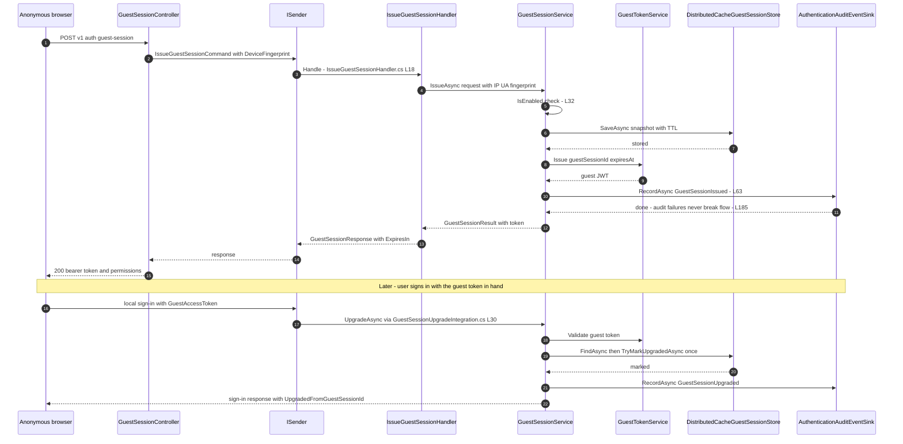
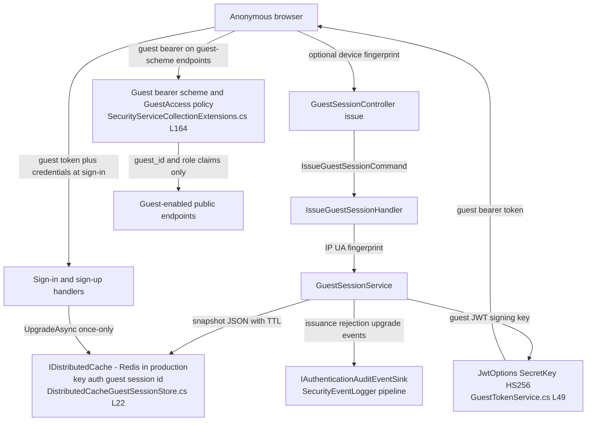

# Guest Session Lifecycle — User Flow Diagram

> Issue #1112 · Module `GameGuild.Identity.Authentication` (Guest namespace) + `GameGuild.Identity.Authorization` (guest policies) · Documented against `develop` commit `a96679c7a`.
> Scope: anonymous guest session issuance, browsing under the guest scheme, upgrade on sign-up and sign-in (session continuity), expiry, and cleanup.

## 1. Overview

A guest session (issue #213) is a short-lived anonymous identity in its own namespace. Issuance is anonymous, per-IP rate limited and audited (`Controllers/GuestSessionController.cs:30-52` → `Handlers/IssueGuestSessionHandler.cs` → `Guest/GuestSessionService.cs:27-82`). The token is an HS256 JWT in the **guest audience** carrying only `jti`, `iat`, `exp`, `guest_id` and the role `Guest` — never `sub`, `email` or tenant claims (`Guest/GuestTokenService.cs:27-62`), so a guest credential is structurally useless on the standard bearer scheme and a user token is useless on the guest scheme. The session snapshot lives in `IDistributedCache` with a TTL of lifetime + eviction slack (`Guest/DistributedCacheGuestSessionStore.cs:28-48`). There is **no refresh token by design** — expiry always ends the session (`Guest/GuestSessionOptions.cs:20-25`). Sign-in and sign-up migrate a presented guest credential into the fresh authenticated session exactly once via `GuestSessionUpgradeIntegration.ApplyGuestUpgradeAsync` (`Guest/GuestSessionUpgradeIntegration.cs:13-40`), and an invalid guest token never blocks the sign-in itself.

## 2. End-to-End Flowchart — happy path and every edge case

```mermaid
flowchart TD
    subgraph ISSUE["Issue - POST auth guest-session"]
        A1["Anonymous client POST optional DeviceFingerprint<br/>GuestSessionController.cs L32"] --> A2{"GuestIssuance rate limit per IP<br/>RateLimitingServiceCollectionExtensions.cs L349"}
        A2 -- "over limit" --> A429["429 Too Many Requests"]
        A2 -- "allowed" --> A3["IssueGuestSessionCommand<br/>GuestSessionController.cs L43"]
        A3 --> A4["IssueGuestSessionHandler<br/>captures IP UA fingerprint server-side<br/>IssueGuestSessionHandler.cs L18"]
        A4 --> A5{"GuestSessionOptions IsEnabled<br/>default true - GuestSessionOptions.cs L19"}
        A5 -- "disabled by configuration" --> A6["Audit GuestSessionIssuanceRejected<br/>GuestSessionService.cs L34"]
        A6 --> A403["403 Forbidden - GuestAccessDisabledException<br/>fails closed - GuestSessionController.cs L47"]
        A5 -- "enabled" --> A7["GuestSessionId Guid NewGuid<br/>ExpiresAt now plus 30 minutes default<br/>GuestSessionService.cs L46"]
        A7 --> A8["Store SaveAsync snapshot<br/>TTL equals lifetime plus 5 minutes slack<br/>DistributedCacheGuestSessionStore.cs L36"]
        A8 -- "TTL already zero - logically expired" --> A8b["Never persisted - store no-op<br/>DistributedCacheGuestSessionStore.cs L37"]
        A8 --> A9["GuestTokenService Issue<br/>HS256 guest audience with jti iat exp guest_id role Guest<br/>GuestTokenService.cs L27"]
        A9 -- "empty session id or past expiry" --> A9b["ArgumentException - contract violation<br/>GuestTokenService.cs L29"]
        A9 --> A10["Audit GuestSessionIssued via sink<br/>GuestSessionService.cs L63"]
        A10 --> A11["200 token and ExpiresIn and GuestPermission Allowlist<br/>IssueGuestSessionHandler.cs L40"]
    end

    subgraph BROWSE["Browse under the guest scheme"]
        B1["Guest calls guest-enabled endpoint<br/>GuestAccessDefaults AuthenticationScheme<br/>SecurityServiceCollectionExtensions.cs L167"] --> B2{"JwtBearer validates guest audience<br/>issuer signature HS256 lifetime zero skew<br/>GuestTokenService.cs L75"}
        B2 -- "invalid signature or expired or wrong audience" --> B401["401 - structural reject"]
        B2 -- "valid JWT" --> B3{"Principal IsGuest structural check<br/>no user-id claims allowed<br/>GuestTokenService.cs L96"}
        B3 -- "carries user claims" --> B401
        B3 -- "well-formed guest" --> B4{"GuestAccess policy<br/>GuestAccessHandler fail-closed<br/>AuthorizationPolicies.cs L357"}
        B4 -- "no guest claim or permission outside allowlist" --> B403b["403 Forbidden"]
        B4 -- "allowlisted permission present" --> B5["Endpoint serves public guest content"]
        B5 --> B6["Standard bearer scheme elsewhere rejects guest audience<br/>structural isolation - GuestTokenService.cs L17"]
        B6 --> B401b["401 on every non-guest endpoint"]
    end

    B5 --> CEX{"Every subsequent guest call<br/>store FindAsync re-checks domain expiry<br/>DistributedCacheGuestSessionStore.cs L51"}
    CEX -- "snapshot expired by domain clock" --> CEX1["Treated as missing - session ended<br/>DistributedCacheGuestSessionStore.cs L59"]
    CEX -- "cache lag revives stale entry" --> CEX2["Logical expiry re-checked on read<br/>domain clock wins - class remarks L13"]
    CEX -- "active" --> B5

    subgraph UPGRADE["Upgrade on sign-in and sign-up"]
        U1["User signs in or signs up<br/>LocalSignInHandler.cs L55 or LocalSignUpHandler.cs L62<br/>or PolymorphicSignInHandler.cs L87"] --> U2["Authenticated session issued first<br/>SignInResponse with UserId and SessionId"]
        U2 --> U3{"GuestAccessToken presented<br/>GuestSessionUpgradeIntegration.cs L22"}
        U3 -- "absent or sign-in failed or ids empty" --> U4["No upgrade - response unchanged"]
        U3 -- "present" --> U5["GuestSessionService UpgradeAsync<br/>GuestSessionService.cs L97"]
        U5 --> U6{"Ids non-empty<br/>GuestSessionService.cs L104"}
        U6 -- "empty ids" --> U7["Denied AuthenticatedSessionRequired - L106"]
        U6 -- "ok" --> U8{"Guest token validates and has guest id<br/>L109"}
        U8 -- "invalid token" --> U9["Audit UpgradeRejected InvalidGuestToken<br/>denied - never blocks sign-in - L112"]
        U8 -- "valid" --> U10{"Snapshot found and not expired<br/>L116"}
        U10 -- "missing or expired" --> U11["Audit UpgradeRejected GuestSessionUnavailable - L119"]
        U10 -- "found" --> U12{"TryMarkUpgradedAsync once-only<br/>L124 - DistributedCacheGuestSessionStore.cs L68"}
        U12 -- "already upgraded or expired" --> U13["Denied GuestSessionUnavailable - L126"]
        U12 -- "marked upgraded" --> U14["Audit GuestSessionUpgraded - L130"]
        U14 --> U15["Response UpgradedFromGuestSessionId set<br/>GuestSessionUpgradeIntegration.cs L36"]
        U7 --> U16["Sign-in still succeeds - continuity link dropped only"]
        U9 --> U16
        U11 --> U16
        U13 --> U16
    end

    subgraph INTROSPECT["Introspect current guest session"]
        T1["GET auth guest-session with guest bearer<br/>GuestSessionController.cs L59"] --> T2{"GuestAccess policy satisfied<br/>scheme plus policy - L59"}
        T2 -- "no" --> T403["401 or 403"]
        T2 -- "yes" --> T3{"TryGetGuestId defense in depth<br/>GuestSessionController.cs L68"}
        T3 -- "no guest id - unreachable" --> T403
        T3 -- "ok" --> T4["200 guest session id role Guest permissions<br/>GuestSessionController.cs L74"]
    end

    subgraph CLEANUP["Expiry and cleanup"]
        CL1["No refresh token exists<br/>GuestSessionOptions.cs L20"] --> CL2["exp claim expires after 30 minutes<br/>token rejected - GuestTokenService.cs L84"]
        CL2 --> CL3["Cache entry evicted at TTL plus 5 minutes slack<br/>DistributedCacheGuestSessionStore.cs L36"]
        CL3 --> CL4["No durable table - nothing else to clean"]
        CL2 --> CL5["Upgraded snapshots stay until TTL eviction<br/>FindsAsync returns null once UpgradedToUserId set<br/>DistributedCacheGuestSessionStore.cs L59"]
    end
```

## 3. CQRS Chain Sequence Diagram

## 4. Data Flow Diagram

## 5. Edge-Case Matrix

| # | Edge case | Code path | Outcome |
|---|-----------|-----------|---------|
| 1 | Guest access disabled by configuration | fail closed with audit (`Guest/GuestSessionService.cs:32-43`) | 403, policy decision not an error |
| 2 | Issuance rate limit exceeded | `GuestIssuance` per-IP policy (`GameGuild.API/Core/Extensions/RateLimitingServiceCollectionExtensions.cs:349`; controller `:31`) | 429 |
| 3 | Misconfigured lifetime (0 / > 60 min / negative slack) | `GuestSessionOptions.Validate` (`Guest/GuestSessionOptions.cs:34-47`) | boot-time InvalidOperationException |
| 4 | Guest token used on a standard endpoint | guest audience invalid on the standard bearer scheme (`Guest/GuestTokenService.cs:17-18` remarks, scheme registration `SecurityServiceCollectionExtensions.cs:164-186`) | 401 |
| 5 | User access token used on a guest endpoint | wrong audience for guest scheme + `IsGuest` structural check | 401/403 |
| 6 | Forged guest token (wrong signature / algorithm) | HS256-only validation, `ValidAlgorithms` pinned (`Guest/GuestTokenService.cs:83`) | 401 |
| 7 | Expired guest token | `ValidateLifetime` with `ClockSkew` zero (`:84-85`) | 401 |
| 8 | Cache entry alive but logically expired | domain-clock re-check on read (`Guest/DistributedCacheGuestSessionStore.cs:59`) | treated as missing — lagging cache cannot revive a session |
| 9 | Unreadable / corrupted cache payload | JsonException → null (`:128-132`) | treated as expired |
| 10 | Guest permission outside allowlist | `GuestAccessHandler` fail-closed (`Authorization/Requirements/GuestAccessRequirement.cs`, policy registration `SecurityServiceCollectionExtensions.cs:357-366`) | 403 |
| 11 | Guest principal smuggling a user claim | structural `IsGuest()` check after crypto (`Guest/GuestTokenService.cs:96`) | rejected |
| 12 | Sign-in with invalid / expired / already-upgraded guest token | upgrade denied + audited; sign-in unaffected (`Guest/GuestSessionService.cs:109-127`, `Guest/GuestSessionUpgradeIntegration.cs:8-9`) | authenticated session issued, continuity link dropped |
| 13 | Double upgrade attempt (same guest token used twice) | `TryMarkUpgradedAsync` sees `UpgradedToUserId` (`Guest/DistributedCacheGuestSessionStore.cs:81`) | second upgrade denied |
| 14 | Two concurrent upgrades of the same guest session | no compare-and-swap on `IDistributedCache` (`:94-96` comment) | both may report success — bounded by single-client bearer + short lifetime |
| 15 | Audit sink throws during issuance/upgrade | catch + log (`Guest/GuestSessionService.cs:185-190`) | guest flow continues; sink owns retry/spool |
| 16 | `ExpiresIn` computation at issuance | `checked` ceiling (`Handlers/IssueGuestSessionHandler.cs:46`) | integer overflow impossible |
| 17 | Guest introspection without guest credential | `GuestAccess` policy (`Controllers/GuestSessionController.cs:59`) | 401/403 |
| 18 | Redis unavailable (non-production host) | memory distributed cache fallback (class remarks `:10-15`) | sessions not shared across instances — single-instance only |

## 6. Endpoint Inventory

| Method + Route | Handler chain | Controller ref |
|----------------|---------------|----------------|
| POST `v{v}/auth/guest-session` | `IssueGuestSessionCommand` → `IssueGuestSessionHandler` → `IGuestSessionService.IssueAsync` | `Controllers/GuestSessionController.cs:30-52` |
| GET `v{v}/auth/guest-session` | direct principal projection (no CQRS dispatch) under `GuestAccessDefaults.AuthenticationScheme` + `AuthorizationPolicies.GuestAccess` | `Controllers/GuestSessionController.cs:59-80` |
| (upgrade path) POST `v{v}/auth/sign-in` / `sign-up` / polymorphic variants | sign-in/up handlers → `GuestSessionUpgradeIntegration.ApplyGuestUpgradeAsync` | `Handlers/LocalSignInHandler.cs:55`, `Handlers/LocalSignUpHandler.cs:62`, `Handlers/PolymorphicSignInHandler.cs:87` |

## 7. Events Published / Consumed

- **Published** (all via `IAuthenticationAuditEventSink`, category Authentication → SecurityEventLogger):
  - `Authentication.GuestSessionIssuanceRejected` (`Guest/GuestSessionService.cs:34-41`)
  - `Authentication.GuestSessionIssued` (`:63-70`)
  - `Authentication.GuestSessionUpgradeRejected` with reasons `InvalidGuestToken` / `GuestSessionUnavailable` (`:146-156`)
  - `Authentication.GuestSessionUpgraded` (`:130-137`)
- **Consumed:** none — the guest namespace is self-contained; upgrade hooks are in-process calls from the sign-in/sign-up handlers, not event subscriptions.

## 8. Entities and Tables Touched

| Store | Shape | Ref |
|-------|-------|-----|
| `IDistributedCache` (Redis in production, memory otherwise) | key `auth:guest:session:{id}` → JSON snapshot (issued/expiry, IP, UA, fingerprint, upgrade triple), TTL = lifetime + slack | `Guest/DistributedCacheGuestSessionStore.cs:22`, `:36`, `:43-47` |
| Guest JWT | claims `jti`, `iat`, `exp`, `guest_id`, `role=Guest`; audience = guest namespace | `Guest/GuestTokenService.cs:41-57` |
| Security-event pipeline (audit rows) | guest lifecycle events above | `Abstractions/IAuthenticationAuditEventSink.cs` |
| No durable database table | by design — no guest rows in any module schema | `Guest/GuestSessionService.cs` remarks |

## 9. Gaps — realistic scenarios the code does not handle

1. **Guest session expiry during active use is a hard stop.** There is no refresh or silent re-issue (`Guest/GuestSessionOptions.cs:21-25`): a browsing guest who crosses the 30-minute boundary loses access mid-journey and must call the issue endpoint again (getting a brand-new session id — any client-side guest state keyed to the old id is orphaned). Related open issue: #1128 "Guest session expiry during active use".
2. **Upgrade transfers only the continuity link, not guest-side data.** `UpgradeAsync` marks the snapshot upgraded and stamps `UpgradedFromGuestSessionId` on the response; nothing copies guest-session artifacts (e.g. progress or carts keyed by guest id) to the user account — there is no migration hook beyond the audit event.
3. **Concurrent double-upgrade window is acknowledged but unguarded.** `TryMarkUpgradedAsync` is read-modify-write on `IDistributedCache` with no CAS (`Guest/DistributedCacheGuestSessionStore.cs:93-96`); two parallel sign-ins presenting the same guest token can both "win" and bind the same guest session to two authenticated sessions.
4. **No server-side issuance abuse signal beyond the per-IP limiter.** Device fingerprints are recorded but not throttled — a rotating-IP client can mint unbounded guest sessions (audit events exist, but no anomaly detection consumes them on this path).
5. **Guest sessions are invisible to the user's session list.** Because they live in the cache namespace with no `UserSession` row, the session-management surface (list/terminate) cannot see or terminate them; a guest credential stays valid until its own expiry even after the account is provisioned from it.
6. **Cross-instance memory-cache fallback breaks guest continuity.** When Redis is disabled, the distributed-memory cache is per-instance (`Guest/DistributedCacheGuestSessionStore.cs:10-15` remarks) — a guest validated on instance A gets 401 on instance B behind a load balancer.
