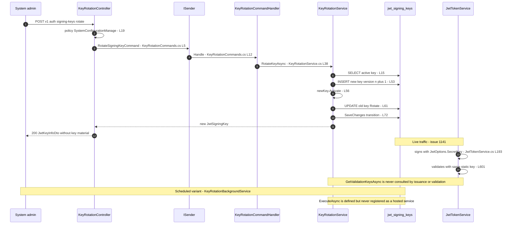
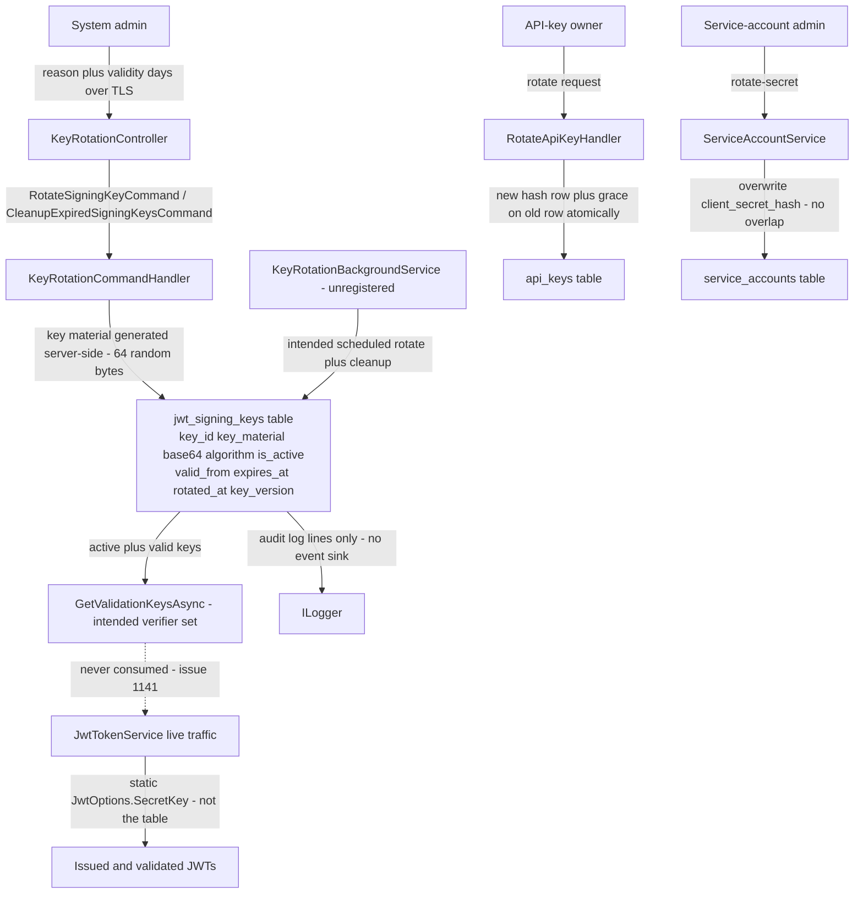

# Key Rotation Flow (Manual Rotation, JWT Signing Keys, Scheduled Rotation, Overlap Windows) — User Flow Diagram

> Issue #1103 · Module `GameGuild.Identity.Authentication` (+ `GameGuild.API` host) · Documented against `develop` commit `74e9bba4c`.
> Scope: JWT HS256 signing-key rotation (manual `signing-keys:rotate`, the scheduled `KeyRotationBackgroundService`, validation overlap for rotated keys, expired-key cleanup), the API-key rotation overlap (grace) window, and the service-account secret rotation as the zero-overlap contrast. Documents the wiring state that is issue #1141.

## 1. Overview

The platform has three rotation surfaces. **JWT signing keys** live in `jwt_signing_keys` (`Entities/JwtSigningKey.cs:10`): `KeyRotationService.RotateKeyAsync` (`Services/KeyRotationService.cs:38-75`) creates a 512-bit HS256 key via `JwtSigningKey.CreateNew` (`Entities/JwtSigningKey.cs:71-91`), persists it, activates it (`:96-100`), and rotates the previous active key out (`:105-111`) while it stays **valid for verification until its own `ExpiresAt`** — `GetValidationKeysAsync` returns every key whose validity window is open (`Services/KeyRotationService.cs:23-30`), which is the zero-downtime overlap. The manual endpoint is `POST v{v}/auth/signing-keys:rotate` behind `Policies.SystemConfigurationManage` (`Controllers/KeyRotationController.cs:72-88`); scheduled rotation is `KeyRotationBackgroundService` (hourly check, rotate at ≤7 days to expiry, default 90-day validity, 30-day retention cleanup — `Services/KeyRotationBackgroundService.cs:93-114`). **The critical caveat (issue #1141):** `JwtTokenService` signs and validates with the static `JwtOptions.SecretKey` (`Services/JwtTokenService.cs:193-194`, `:507-511`, `:601`) and never reads `GetValidationKeysAsync`; `IKeyRotationService` is not registered in DI and the background service is never added as a hosted service (only outbox/quota/refresh-token/economy workers are — `GameGuild.API/Core/Setup/InfrastructureLayerExtensions.cs:246`, `:406`). Rotation is therefore fully built but **unwired** to live traffic. **API keys** rotate with an explicit, bounded overlap window: `RotateApiKeyHandler` (`Commands/ApiKeyCommands.cs:327-434`) issues a replacement and atomically transitions the old key (`Repositories/ApiKeyRepository.cs:69-84` — one `SaveChanges`), with the old key honored until `RotationGraceEndsAt` (`Entities/ApiKey.cs:225-229`) and revocation lazily finalized after close (`:236-245`). **Service-account secrets** rotate with **no overlap** — `RotateSecretAsync` overwrites the hash immediately (`Services/ServiceAccountService.cs:206-222`).

## 2. End-to-End Flowchart — happy path and every edge case

```mermaid
flowchart TD
    subgraph MANUAL["Manual signing-key rotation - POST auth signing-keys rotate"]
        M1["System configuration admin<br/>KeyRotationController.cs L72"] --> M2["Authorize Policies SystemConfigurationManage<br/>platform scoped - no tenant clamp - L19"]
        M2 --> M3["RotateKeyRequest Reason plus optional ValidityDays<br/>L142"]
        M3 --> M4["RotateSigningKeyCommand reason manual-rotation validity 90 default<br/>KeyRotationCommands.cs L5"]
        M4 --> M5["KeyRotationCommandHandler delegates to IKeyRotationService<br/>KeyRotationCommands.cs L12"]
        M5 --> ROT["KeyRotationService RotateKeyAsync<br/>KeyRotationService.cs L38"]
    end

    subgraph SCHEDULED["Scheduled rotation - KeyRotationBackgroundService"]
        SC1["Service start - ExecuteAsync<br/>KeyRotationBackgroundService.cs L27"] --> SC2["InitializeAsync creates initial key<br/>when none active - reason initialization<br/>KeyRotationService.cs L100"]
        SC2 -- "init throws" --> SCX1["log error and rethrow - service aborts L39"]
        SC2 --> SC3["Delay CheckInterval - default 1 hour L48"]
        SC3 --> SC4{"Active signing key found<br/>L54"}
        SC4 -- "none" --> SC5["rotate - reason missing-active-key L58"]
        SC4 -- "found" --> SC6{"Time to expiry at or below<br/>RotationThreshold default 7 days<br/>L62"}
        SC6 -- "yes" --> SC7["rotate - reason scheduled-rotation L66"]
        SC6 -- "no" --> SC8["no rotation this cycle"]
        SC5 --> SC9["CleanupExpiredKeysAsync retention default 30 days<br/>L71"]
        SC7 --> SC9
        SC8 --> SC9
        SC9 --> SC3
        SC9 -- "cycle error" --> SCX2["log and rethrow - loop exits L80"]
        SCW["NOT REGISTERED as hosted service<br/>and IKeyRotationService not in DI<br/>issue 1141 - see Gaps"] -.-> SC3
    end

    subgraph ROT["RotateKeyAsync - core transition"]
        R1["GetActiveSigningKeyAsync<br/>active plus valid window ordered by version<br/>KeyRotationService.cs L15"] --> R2["nextVersion current plus 1<br/>L44"]
        R2 --> R3["JwtSigningKey CreateNew<br/>key- guid - 64 random bytes base64 -<br/>IsActive false initially<br/>Entities JwtSigningKey.cs L71"]
        R3 --> R4["SaveChanges persists new key L53"]
        R4 --> R5["newKey Activate sets IsActive true L56"]
        R5 --> R6{"Previous active key exists<br/>L59"}
        R6 -- "yes" --> R7["currentKey Rotate - IsActive false plus<br/>RotatedAt plus reason - overlap keeps<br/>ExpiresAt unchanged L61"]
        R6 -- "no - bootstrap" --> R8["logged as initial key L68"]
        R7 --> R9["second SaveChanges commits transition L72"]
        R8 --> R9
        R9 --> R10["Return new key - controller 200 JwtKeyInfoDto<br/>no key material exposed L87"]
    end

    subgraph OVERLAP["Zero-downtime validation overlap"]
        O1["Verifier asks GetValidationKeysAsync<br/>KeyRotationService.cs L23"] --> O2["All keys with ValidFrom at or before now<br/>and ExpiresAt after now - version desc L27"]
        O2 --> O3["Old key stays in the set until its own expiry<br/>Entities JwtSigningKey.cs L116"]
        O3 --> O4["Tokens signed before rotation keep verifying<br/>for the remainder of the old window"]
        O5["Current token issuance and validation<br/>JwtTokenService signs with static JwtOptions SecretKey<br/>JwtTokenService.cs L193 and L601"] -.->|"GetValidationKeysAsync never called<br/>issue 1141"| O2
    end

    subgraph CLEANUP["Expired-key cleanup"]
        CL1["CleanupExpiredKeysAsync retentionDays 30 default<br/>KeyRotationService.cs L77"] --> CL2["Select keys with ExpiresAt older than now minus retention<br/>L79"]
        CL2 -- "none" --> CL3["return 0 - debug log L87"]
        CL2 -- "found" --> CL4["RemoveRange plus SaveChanges L91"]
        CL4 --> CL5["count returned - DeletedCount in response<br/>KeyRotationController.cs L105"]
    end

    subgraph APROT["API-key rotation with grace window"]
        AP1["Owner rotates key - see api-key-flow doc<br/>ApiKeyController.cs L62"] --> AP2["RotateApiKeyValidator grace 0 to 30 days<br/>ApiKeyCommands.cs L302"]
        AP2 --> AP3{"Old key IsValid<br/>L364"}
        AP3 -- "no" --> AP400["failure ApiKey.Invalid - only valid keys rotate L366"]
        AP3 -- "yes" --> AP4["ResolveGracePeriod - request or default 24 h<br/>clamped to configured max 30 days L423"]
        AP4 --> AP5{"Grace greater than zero<br/>L381"}
        AP5 -- "yes" --> AP6["graceEndsAt now plus grace - old key<br/>BeginRotationGrace stays valid until then<br/>ApiKeyRepository.cs L72"]
        AP5 -- "zero" --> AP7["old key revoked immediately<br/>reason Rotated superseded by - L78"]
        AP6 --> AP8["Single SaveChanges - issuance plus transition atomic L83"]
        AP7 --> AP8
        AP8 --> AP9["200 NewKey plaintext once plus OldKeyGraceEndsAt<br/>ApiKeyCommands.cs L414"]
        AP9 --> AP10["Old key used during grace - IsValid honors<br/>RotationGraceEndsAt - Entities ApiKey.cs L171"]
        AP10 --> AP11["After grace - next use fails and<br/>FinalizeRotationRevocation records revocation<br/>Entities ApiKey.cs L236"]
    end

    subgraph SVCSEC["Service-account secret rotation - zero overlap contrast"]
        SV1["Admin rotates secret<br/>ServiceAccountOperationsController.cs L29"] --> SV2["RotateSecretAsync generates new 64-byte secret<br/>hashes it and overwrites ClientSecretHash<br/>ServiceAccountService.cs L206"]
        SV2 --> SV3["Old secret invalid on the very next token call<br/>no grace window exists"]
        SV3 --> SV4["200 new secret once with storage warning L39"]
    end
```

## 3. CQRS Chain Sequence Diagram

## 4. Data Flow Diagram

## 5. Edge-Case Matrix

| # | Edge case | Code path | Outcome |
|---|-----------|-----------|---------|
| 1 | Manual rotation with no prior key (bootstrap) | `currentKey == null` branch (`Services/KeyRotationService.cs:66-70`) | new key version 1 created, logged as initial key |
| 2 | Two admins rotate concurrently | no lock; both read the same active key (`:43-44`) | both compute the same `nextVersion`; two active keys with equal version can coexist until the next query picks one (`:17-20` orders by version, first wins) |
| 3 | `GetActiveSigningKeyAsync` finds zero rows mid-rotation | `:15-21` filters `IsActive && ValidFrom <= now < ExpiresAt` | background service would rotate with reason `missing-active-key` (`Services/KeyRotationBackgroundService.cs:54-59`) — except the service is not registered |
| 4 | Multiple keys flagged `IsActive=true` (manual race, restore) | `GetActiveSigningKeyAsync` orders by `KeyVersion` desc and takes the first (`:19-20`) | newest version silently wins; the stale active key lingers in the validation set |
| 5 | Old-key overlap ends | `IsValidForValidation` (`Entities/JwtSigningKey.cs:116-119`) | key drops out of `GetValidationKeysAsync`; tokens it signed become unverifiable the moment its `ExpiresAt` passes |
| 6 | Rotated key's `ExpiresAt` extended (data edit) | rotation does not touch `ExpiresAt` (`:105-111`) | old key verifies until the edited expiry — no forced post-rotation cap |
| 7 | Cleanup runs before all tokens signed by the old key expired | cleanup cutoff `ExpiresAt < now - retentionDays` (`Services/KeyRotationService.cs:79-83`) | retention (default 30 d) exceeds max token lifetime so verification need is honored in design; deleting early would strand tokens signed with that key |
| 8 | Cleanup with `RetentionDays` unset in the request body | controller default 30 (`Controllers/KeyRotationController.cs:101-103`) | safe default; no validation that the caller passed ≥0 — a negative value would compute a future cutoff and delete every expired key immediately |
| 9 | Manual rotation with `ValidityDays <= 0` | no validator on `RotateKeyRequest` (`:142-146`) | `TimeSpan.FromDays(0)` produces `ExpiresAt == ValidFrom` — key is born expired and never appears active |
| 10 | Rotation throws between the two `SaveChanges` calls | new key saved (`:53`), then activate/rotate saved (`:72`) | crash window leaves an inactive new-key row; next rotation reuses the same version number |
| 11 | Issued token verification after rotation | static key path (`Services/JwtTokenService.cs:601`) | unaffected — tokens never carry the rotated keys' `kid`; rotation changes nothing for live traffic (issue #1141) |
| 12 | Scheduled rotation attempt while a manual rotation is in flight | no distributed lock anywhere in the service | duplicate-version race as row 2 |
| 13 | Background service startup with no keys | `InitializeAsync` creates one (`:100-113`); failure rethrows (`Services/KeyRotationBackgroundService.cs:38-42`) | service would crash-loop — but it is never registered, so this never executes |
| 14 | API-key rotation of an already-invalid key | `IsValid()` gate (`Commands/ApiKeyCommands.cs:364-367`) | `ApiKey.Invalid` failure — expired/revoked keys cannot be rotated back to life |
| 15 | API-key rotation grace requested above 30 days | `ResolveGracePeriod` clamps to `MaxRotationGracePeriodMinutes` (`:423-433`); validator range 0–30 d (`:320-323`) | clamped silently (handler) / rejected (validator when routed through MediatR pipeline) |
| 16 | API-key grace window set to exactly zero | `graceEndsAt` stays null (`:380-384`) | old key revoked immediately; the response carries `OldKeyRevoked` set to true |
| 17 | Old API key still used after grace ends but row never finalized | lazy `FinalizeRotationRevocation` on next failed use (`Services/ApiKeyAuthenticationHandler.cs:96-102`) | denies + records; abandoned rows stay un-finalized in the table |
| 18 | Old API key used *during* grace from a non-whitelisted IP | rotation preserves `IpWhitelist` (`Commands/ApiKeyCommands.cs:378`) | the auth-time IP gate still applies to both keys |
| 19 | Rotation request overrides scopes with an empty array | `request.Scopes is { Length: > 0 }` falls back to old scopes (`:370`) | empty override silently inherits; validator only rejects `null`-provided-nonempty cases (`:312-315`) |
| 20 | Replacement expiry defaults | `request.ExpiresAt ?? oldKey.ExpiresAt` (`:377`) | preserves the old key's expiry — a rotating near-expiry key yields a near-expiry replacement unless the caller sets a new date |
| 21 | Service-account secret rotated while a client mid-token-call | hash overwritten immediately (`Services/ServiceAccountService.cs:206-222`) | no overlap: in-flight `client_credentials` calls with the old secret fail on next use |
| 22 | `signing-keys` GET with `status=active` and no active key | empty list returned (`Controllers/KeyRotationController.cs:50-53`) | 200 with `[]`, not 404 |
| 23 | Non-admin calls any signing-key endpoint | `Policies.SystemConfigurationManage` (`:19`) | 403 — the surface is platform-scoped by design (issue #386 comment, `:16-18`) |

## 6. Endpoint Inventory

| Method + Route | Handler chain | Controller ref |
|----------------|---------------|----------------|
| GET `v{v}/auth/signing-keys?status=active\|valid\|none` | direct `IKeyRotationService.GetActiveSigningKeyAsync` / `GetValidationKeysAsync` | `Controllers/KeyRotationController.cs:41-67` |
| POST `v{v}/auth/signing-keys:rotate` | `RotateSigningKeyCommand` → `KeyRotationCommandHandler` → `KeyRotationService.RotateKeyAsync` | `Controllers/KeyRotationController.cs:72-88` |
| POST `v{v}/auth/signing-keys:cleanup` | `CleanupExpiredSigningKeysCommand` → `KeyRotationCommandHandler` → `CleanupExpiredKeysAsync` | `Controllers/KeyRotationController.cs:93-106` |
| POST `v{v}/auth/api-keys/{keyId}:rotate` | `RotateApiKeyCommand` → `RotateApiKeyValidator` → `RotateApiKeyHandler` → `ApiKeyRepository.RotateAsync` | `Controllers/ApiKeyController.cs:62-87` (full detail in `api-key-flow.md`) |
| POST `v{v}/auth/service-accounts/{id}:rotate-secret` | `RotateServiceAccountSecretCommand` → `ServiceAccountMutationCommandHandler` → `ServiceAccountService.RotateSecretAsync` | `Controllers/ServiceAccountOperationsController.cs:29-49` |
| (background, unwired) | `KeyRotationBackgroundService.ExecuteAsync` → `InitializeAsync` / `RotateKeyAsync` / `CleanupExpiredKeysAsync` | `Services/KeyRotationBackgroundService.cs:27-87` |

## 7. Events Published / Consumed

- **Published** — durable operation events only, no domain events and no audit sink: `identity.authentication.rotate-signing-key` (`Architecture/UseCaseEventContracts.g.cs:78`), `identity.authentication.cleanup-expired-signing-keys` (`:17`); API-key rotation adds `ApiKey.Rotated` via `IApiKeyAuditEventSink` (`Commands/ApiKeyCommands.cs:396-412`) and `identity.authentication.rotate-api-key` (`Architecture/AuthenticationUseCaseEventContracts.cs:33`); service-account secret rotation publishes `identity.authentication.rotate-service-account-secret` (`Architecture/UseCaseEventContracts.g.cs:77`). Signing-key rotation itself writes only `ILogger` lines (`Services/KeyRotationService.cs:40`, `:62-64`) — no `IAuditEventSink` on this path.
- **Consumed** — `KeyRotationOptions` (hourly check, 90-day validity, 7-day threshold, 30-day retention — `Services/KeyRotationBackgroundService.cs:93-114`); `ApiKeyLifecycleOptions` (24 h default grace, 30 d max — `Configuration/ApiKeyLifecycleOptions.cs:14-19`). **Nothing consumes the rotated key material**: `JwtTokenService` reads only `JwtOptions.SecretKey` (`Services/JwtTokenService.cs:193`, `:507`, `:601`).

## 8. Entities and Tables Touched

| Entity / store | Fields that matter | Ref |
|----------------|--------------------|-----|
| `JwtSigningKey` → `jwt_signing_keys` | `KeyId` (unique, intended `kid`), `KeyMaterial` (base64 512-bit), `Algorithm` HS256, `IsActive`, `ValidFrom`, `ExpiresAt`, `RotatedAt`, `RotationReason`, `KeyVersion` | `Entities/JwtSigningKey.cs:10-119` |
| `ApiKey` → `api_keys` | `ReplacesKeyId`, `RotationGraceEndsAt`, `RevokedAt/Reason` on rotation | `Entities/ApiKey.cs:94-100`, `Repositories/ApiKeyRepository.cs:69-84` |
| `ServiceAccount` → `service_accounts` | `ClientSecretHash`, `SecretRotatedAt`, `SecretRotationCount` | `Entities/ServiceAccount.cs:220-226` |
| `JwtOptions` (config) | `SecretKey` — the *actual* signing secret in live traffic | `Services/JwtTokenService.cs:193`, `:601` |

## 9. Gaps — realistic scenarios the code does not handle

1. **JWT signing-key rotation is entirely unwired to live traffic (issue #1141, open).** `JwtTokenService` signs every token — user, guest, service-account — with the static `JwtOptions.SecretKey` (`Services/JwtTokenService.cs:193-194`, `:507-511`) and validates with the same key (`:601`); the `jwt_signing_keys` rows produced by `RotateKeyAsync` are never consulted. Rotating via the endpoint changes database state without changing a single accepted signature.
2. **`IKeyRotationService` is not registered in DI and `KeyRotationBackgroundService` is never added as a hosted service.** No `AddScoped<IKeyRotationService, ...>` or `AddHostedService<KeyRotationBackgroundService>` exists in the module (`Data/Extensions/DependencyInjection.cs`) or the host (`GameGuild.API/Core/Setup/InfrastructureLayerExtensions.cs:246`, `:406` registers only quota/refresh-token workers). The manual controller would fail to construct at resolution time, and scheduled rotation never runs — "scheduled rotation" exists only as dead code (`Services/KeyRotationBackgroundService.cs:27-87`).
3. **Rotation is not concurrency-safe.** `RotateKeyAsync` reads the active key, computes `version + 1`, then writes twice with no lock or unique-version constraint (`Services/KeyRotationService.cs:43-53`); concurrent rotations (two admins, or admin + scheduler once wired) can create duplicate versions and two `IsActive` keys, with `GetActiveSigningKeyAsync` silently electing one (`:19-20`).
4. **Two-phase save leaves crash windows.** The new key is persisted inactive (`:53`) before the activate/rotate transition (`:72`); a crash between them strands an orphan row and reuses the same version number on the next attempt.
5. **No validator on the manual rotation request.** `ValidityDays <= 0` creates a stillborn key (`ExpiresAt == ValidFrom`), and cleanup accepts negative `RetentionDays` computing a future cutoff that deletes every expired key (`Controllers/KeyRotationController.cs:101-103`).
6. **No revocation/compromise fast-path for signing keys.** A `Rotate(reason: "compromised")` keeps the old key valid until its natural `ExpiresAt` (`Entities/JwtSigningKey.cs:105-111`) — up to 90 days; there is no "invalidate now" that shortens the old key's validation window, and since verification ignores the table anyway (gap 1) the point is currently moot but will matter when #1141 is fixed.
7. **Signing-key lifecycle emits no audit events** — only `ILogger` lines (`Services/KeyRotationService.cs:40`, `:62`); API-key and service-account rotations both reach audit sinks, this one does not.
8. **API-key grace-window overlap cannot be shortened once issued** — `BeginRotationGrace` only ever sets a future end (`Entities/ApiKey.cs:225-229`); a caller who realizes the old key was compromised right after rotating with a 30-day grace must wait out the window (or hand-edit), unlike the zero-grace option which was available only at rotation time.
