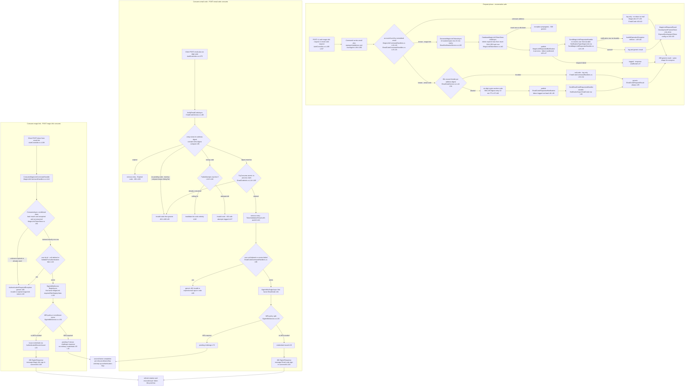
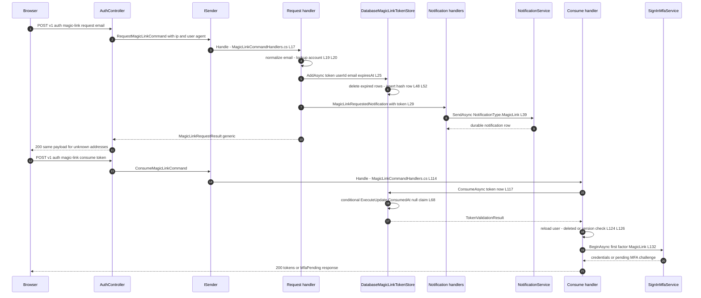
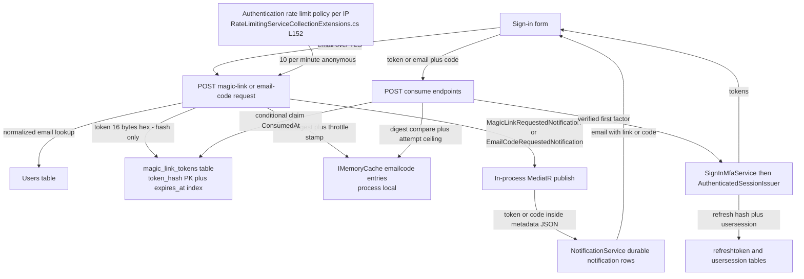

# Magic-Link and Email-Code Passwordless Sign-In Flow (Request, Consume, Token Storage, Enumeration Protection) — User Flow Diagram

> Issue #1079 · Features #43 / #252 · Module `GameGuild.Identity.Authentication` (+ `GameGuild.Notifications` delivery, `GameGuild.Identity.Users`) · Documented against `develop` commit `501477fce`.
> Scope: `POST /auth/magic-link:request` / `:consume` and `POST /auth/email-code:request` / `:consume` — durable database-backed magic-link tokens (single-use, 15-minute expiry, hash-only storage), in-process six-digit email codes (10-minute expiry, 5-attempt brute ceiling, 60-second resend throttle), enumeration-safe request responses, constant-time code comparison, the merge of a verified first factor into the sign-in MFA policy pipeline, and the per-IP rate-limit posture (filed #1090/#1170).

## 1. Overview

Both passwordless modalities share one shape: an enumeration-safe **request** endpoint that only sends mail, and a **consume** endpoint that turns possession of the emailed secret into a first factor. `POST v1/auth/magic-link:request` (`Controllers/AuthController.cs:169-191`) stamps the client IP and user-agent onto `RequestMagicLinkCommand` (`:184-185`); `RequestMagicLinkCommandHandler` (`Handlers/MagicLinkCommandHandlers.cs:10-70`) normalizes the address, looks the account up (`:19-20`) and, for a known user, generates a 16-random-byte hex token with a 15-minute expiry (`Services/EmailVerificationService.cs:65-73`) persisted **hash-only** by `DatabaseMagicLinkTokenStore.AddAsync` (`StepUp/MagicLinkTokenStore.cs:40-60`: opportunistic delete of already-expired rows, then insert into `magic_link_tokens`). The token travels in the in-process `MagicLinkRequestedNotification` (`Handlers/MagicLinkCommandHandlers.cs:29-41`; dispatch failure is logged and swallowed `:47-50`) to `SendMagicLinkRequestedHandler` (`Handlers/SendMagicLinkRequestedHandler.cs:13-65`), which records a durable `NotificationType.MagicLink` email row and **throws** if the notification was not durably queued (`:49-52`). Unknown addresses take a log-only branch (`MagicLinkCommandHandlers.cs:57-60`); every caller gets the same `MagicLinkRequestResult`, optionally carrying `DevelopmentPreviewToken` when `Authentication:MagicLink:ExposeDevelopmentToken` is on (`:62-69`).

`POST v1/auth/email-code:request` (`Controllers/AuthController.cs:247-267`) mirrors this through `RequestEmailCodeCommandHandler` (`Handlers/EmailCodeCommandHandlers.cs:7-68`) and `EmailCodeService.GenerateEmailCodeAsync` (`Services/EmailCodeService.cs:40-84`): a 60-second per-address resend throttle keyed on a SHA-256 email digest (`:44-54`), a cryptographically uniform six-digit code (`:57`), stored **as a digest only** in the size-bounded process `IMemoryCache` with a 10-minute logical TTL and 5-minute eviction slack (`:58-75`). The code goes out via `EmailCodeRequestedNotification` → `SendEmailCodeRequestedHandler` (`Handlers/SendEmailCodeRequestedHandler.cs:13-61`), and the response is an identical empty `EmailCodeRequestResult` for known, unknown, and throttled requests (`EmailCodeCommandHandlers.cs:65-66`).

Consumption is deliberately conservative. `POST /auth/magic-link:consume` (`Controllers/AuthController.cs:199-219`) calls `VerifyMagicLinkTokenAsync` (`Services/EmailVerificationService.cs:163-191`) → `DatabaseMagicLinkTokenStore.ConsumeAsync` (`StepUp/MagicLinkTokenStore.cs:62-84`), a conditional `ExecuteUpdate` that claims the row only when `TokenHash` matches, `ExpiresAt` is still ahead and `ConsumedAt` is null — single-use is enforced by the database itself, and a replay reads as "Invalid or expired token". `POST /auth/email-code:consume` (`Controllers/AuthController.cs:275-296`) runs `EmailCodeService.VerifyEmailCodeAsync` (`Services/EmailCodeService.cs:86-144`): constant-time digest comparison including a dummy comparison on the unknown-email path (`:38`, `:96-98`), expiry removal, a 5-attempt wrong-code ceiling that invalidates the code (`:113-133`), and an in-process atomic `TryConsume` (`Services/EmailCodeInfo.cs:8-25`). Both consume handlers then reload the account (deleted/version-failed → generic 401, `MagicLinkCommandHandlers.cs:124-129`; `EmailCodeCommandHandlers.cs:86-91`) and hand the verified first factor to `SignInMfaService.BeginAsync` with `SignInFirstFactor.MagicLink` / `.EmailCode` and `requiresRiskStepUp: false` (`MagicLinkCommandHandlers.cs:131-146`; `EmailCodeCommandHandlers.cs:93-108`; policy split at `SignInMfa/SignInMfaService.cs:50-53` — accounts without MFA policy and without enrollment get credentials immediately; everyone else gets a 5-minute pending challenge). All four endpoints are `[AllowAnonymous]` (anonymous registry `GameGuild.API/Security/AnonymousEndpointRegistry.cs:52-55`) under the class-level `Authentication` rate-limit policy (`AuthController.cs:20`, per-IP for anonymous callers, `GameGuild.API/Core/Extensions/RateLimitingServiceCollectionExtensions.cs:152-170`); a dedicated passwordless per-IP limiter is filed but not yet on `develop` (see Gaps).

## 2. End-to-End Flowchart — happy path and every edge case

## 3. CQRS Chain Sequence Diagram

## 4. Data Flow Diagram

## 5. Edge-Case Matrix

| # | Edge case | Code path | Outcome |
|---|-----------|-----------|---------|
| 1 | Magic-link request for unknown address | log-only branch (`Handlers/MagicLinkCommandHandlers.cs:57-60`) | identical 200 `MagicLinkRequestResult` — no enumeration oracle |
| 2 | Email-code request for unknown address | log-only branch (`Handlers/EmailCodeCommandHandlers.cs:60-63`) | identical empty `EmailCodeRequestResult` (`:65-66`) |
| 3 | Magic-link dispatch fails after token row insert | catch-all around publish (`Handlers/MagicLinkCommandHandlers.cs:47-50`) | response still generic 200; token row exists but mail never queued — user must re-request |
| 4 | Notification row not durably persisted | `InvalidOperationException` throw (`Handlers/SendMagicLinkRequestedHandler.cs:49-52`, rethrow `:62`; same contract `SendEmailCodeRequestedHandler.cs:46-49`) | request surfaces as 500 — "do not acknowledge a lost notification" (fails closed) |
| 5 | `ExposeDevelopmentToken` enabled | config gate (`Handlers/MagicLinkCommandHandlers.cs:62-69`) | token echoed in the response body — development affordance, single flag from disclosure |
| 6 | Second magic link requested while first is live | every request inserts a new row (`StepUp/MagicLinkTokenStore.cs:52-59`) | both links stay valid until their own expiry — no single-active-link invalidation |
| 7 | Magic-link token expired (15 min) | claim predicate `ExpiresAt > now` (`StepUp/MagicLinkTokenStore.cs:69`) | `changed != 1` → "Invalid or expired token" → generic 401 |
| 8 | Magic-link token replay (already consumed) | `ConsumedAt == null` predicate (`StepUp/MagicLinkTokenStore.cs:69`) + conditional `ExecuteUpdate` (`:68-73`) | second claim matches zero rows → generic 401 — single-use enforced by the database |
| 9 | Two concurrent consumes of one magic link | same conditional update — exactly one `changed == 1` | winner authenticates; loser gets 401, no double session |
| 10 | Hash collision probe (forged token string) | SHA-256 hash lookup (`StepUp/MagicLinkTokenStore.cs:67`) | 128-bit token space; miss → generic 401 |
| 11 | Email-code request within 60 s of previous | throttle key on email digest (`Services/EmailCodeService.cs:44-54`) | `null` code; handler logs and returns the identical generic result (`Handlers/EmailCodeCommandHandlers.cs:52-57`) |
| 12 | Email code expired (10 min) | logical TTL check (`Services/EmailCodeService.cs:106-111`) | entry removed, "Expired code" → generic 401 |
| 13 | Wrong code, 1st–4th attempt | `FailedAttempts++` under ceiling (`Services/EmailCodeService.cs:113-133`) | "Invalid code" → 401; remaining attempts logged only (never in the response) |
| 14 | Wrong code, 5th attempt | ceiling branch (`Services/EmailCodeService.cs:116-123`) | code invalidated entirely; user must request a new one (throttle applies) |
| 15 | Code guess against an address with no pending code | dummy-digest constant-time compare (`Services/EmailCodeService.cs:38`, `:96-104`) | timing-flat "Invalid code" → 401 |
| 16 | Empty/whitespace code submitted | digest of empty string (`Services/EmailCodeService.cs:90-92`) | compare fails → 401 (no crash, no oracle) |
| 17 | Code consumed twice concurrently | in-process `TryConsume` (`Services/EmailCodeInfo.cs:14`; call `EmailCodeService.cs:135-139`) | one winner within the process; entry removed (`:141`) |
| 18 | Token/code valid but account deleted or token-version mismatch | reload + `ValidateForAuthentication` (`Handlers/MagicLinkCommandHandlers.cs:124-129`; `Handlers/EmailCodeCommandHandlers.cs:86-91`) | generic 401 with the same message as an invalid token |
| 19 | Account has MFA policy or enrolled factors | `SignInMfaService.PrepareAsync` split (`SignInMfa/SignInMfaService.cs:50-53`, challenge `:55-71`) | no credentials; 5-minute pending challenge (verify or enroll) — see step-up flow |
| 20 | Account has no MFA policy and no enrollment | permit branch (`SignInMfa/SignInMfaService.cs:50-53`) | ordinary credentials issued immediately (`:33`) |
| 21 | Sign-in MFA service not configured | ctor guard (`Handlers/MagicLinkCommandHandlers.cs:131`) | `InvalidOperationException` → 500 (misconfiguration, not user error) |
| 22 | API restart between request and consume — magic link | tokens in PostgreSQL (`StepUp/MagicLinkTokenStore.cs:36`) | link keeps working — durable post-#1172 hardening batch |
| 23 | API restart or second node between request and consume — email code | entries in process `IMemoryCache` (`Services/EmailCodeService.cs:17`, `:66`) | pending codes and throttle stamps vanish; user sees "Invalid code" — see Gaps |
| 24 | Flood of requests from one IP | class-level `Authentication` policy (`Controllers/AuthController.cs:20`; partitioning `RateLimitingServiceCollectionExtensions.cs:152-170`) | 10 requests/minute for anonymous IPs; dedicated passwordless per-IP limiter filed (#1090, bundled #1170) but not on `develop` — see Gaps |
| 25 | Guest visitor consumes a passwordless secret | no `GuestAccessToken` on either consume request (`Controllers/AuthController.cs:206-216`, `:282-293`) | no guest-upgrade attempt — contrast sign-up and polymorphic sign-in — see Gaps |

## 6. Endpoint Inventory

| Method + Route | Handler chain | Controller ref |
|----------------|---------------|----------------|
| POST `v{v}/auth/magic-link:request` | `RequestMagicLinkCommand` → `RequestMagicLinkCommandHandler` → `EmailVerificationService.GenerateMagicLinkTokenAsync` → `DatabaseMagicLinkTokenStore.AddAsync` + `MagicLinkRequestedNotification` | `Controllers/AuthController.cs:169-191` |
| POST `v{v}/auth/magic-link:consume` | `ConsumeMagicLinkCommand` → `ConsumeMagicLinkCommandHandler` → `EmailVerificationService.VerifyMagicLinkTokenAsync` → `DatabaseMagicLinkTokenStore.ConsumeAsync` → `SignInMfaService.BeginAsync` | `Controllers/AuthController.cs:199-219` |
| POST `v{v}/auth/email-code:request` | `RequestEmailCodeCommand` → `RequestEmailCodeCommandHandler` → `EmailCodeService.GenerateEmailCodeAsync` + `EmailCodeRequestedNotification` | `Controllers/AuthController.cs:247-267` |
| POST `v{v}/auth/email-code:consume` | `ConsumeEmailCodeCommand` → `ConsumeEmailCodeCommandHandler` → `EmailCodeService.VerifyEmailCodeAsync` → `SignInMfaService.BeginAsync` | `Controllers/AuthController.cs:275-296` |

All four are `[AllowAnonymous]` (anonymous registry `GameGuild.API/Security/AnonymousEndpointRegistry.cs:52-55`) under the `Authentication` rate-limit policy (`Controllers/AuthController.cs:20`); consume endpoints route through `ExecuteAuthCommandAsync` so `UnauthorizedAccessException`s become 401 problem details (`Controllers/AuthController.cs:802-819`).

## 7. Events Published / Consumed

- **Published (in-process MediatR notifications):**
  - `MagicLinkRequestedNotification` (`Events/MagicLinkRequestedNotification.cs`) — carries the plaintext token, redirect target, locale, tenant and request metadata (`Handlers/MagicLinkCommandHandlers.cs:29-41`).
  - `EmailCodeRequestedNotification` (`Events/EmailCodeRequestedNotification.cs`) — carries the six-digit code (`Handlers/EmailCodeCommandHandlers.cs:26-36`).
  - Both are consumed in-process by their `Send…RequestedHandler`, which records the durable notification row (`NotificationType.MagicLink` / `.EmailCode`, email channel) — `Handlers/SendMagicLinkRequestedHandler.cs:39-47`, `Handlers/SendEmailCodeRequestedHandler.cs:36-44`.
- **Audit/session events downstream:** the consume paths delegate to `SignInMfaService`, which records `Authentication.MfaSignInRequired` / denied / completed audit events and, on immediate permit, issuance flows through `AuthenticatedSessionIssuer` (the #1199 suspicious-login coverage point for magic-link completions — `docs/auth/event-flows.md` gap 6).
- **No durable integration events** are published by request or consume (no `identity.*.v1` event for passwordless issuance).

## 8. Entities and Tables Touched

| Entity / store | Mapping | Writes |
|----------------|---------|--------|
| `MagicLinkToken` → `magic_link_tokens` (schema `gameguild.authentication`) | PK `token_hash` (64-char hex), `expires_at` index (`Data/Configurations/MagicLinkTokenModelConfiguration.cs:5-19`; migration `20261019013953_AddDistributedMagicLinkTokens`) | INSERT hash-only rows; conditional UPDATE `ConsumedAt`; opportunistic DELETE of expired rows (`StepUp/MagicLinkTokenStore.cs:40-95`) |
| `Users` | lookup by normalized email on request; reload by id on consume | read-only on this flow |
| Notification rows (`NotificationType.MagicLink` / `.EmailCode`) | `INotificationService.SendAsync` (`Handlers/SendMagicLinkRequestedHandler.cs:39-47`) | INSERT durable email notifications (metadata JSON contains the plaintext token/code) |
| `IMemoryCache` (not a table) | email-code entries + 60 s throttle stamps, size-accounted (`Services/EmailCodeService.cs:19-20`, `:66-80`) | volatile, process-local |
| `refreshtoken` / `usersession` | via `AuthenticatedSessionIssuer` after `SignInMfaService` permit | INSERT on credential issuance |

## 9. Gaps — realistic scenarios the code does not handle

1. **Filed — #1090 (bundled in #1170), not yet on `develop`: no dedicated per-IP limit on passwordless requests.** Today the request endpoints are bounded only by the shared `Authentication` policy (10/min per anonymous IP, `RateLimitingServiceCollectionExtensions.cs:152-170`) plus the email-code 60-second per-address throttle; **magic-link requests have no per-address cooldown at all**, so one IP can trigger one mail per victim address per rate-limit window indefinitely. A `DistributedCachePasswordlessRequestIpRateLimiter` exists on branch `feat/security-batch3` (commit `a9ad2f553e`) but is not merged. Same email-bombing class as the #1197 resend-cooldown bypass on the verification-email path.
2. **NEW — Email codes remain process-local.** `EmailCodeService` stores digests and throttle stamps in `IMemoryCache` (`Services/EmailCodeService.cs:17`, `:66`, `:77`): a restart or a load-balanced consume landing on another node loses every pending code and resets all throttle windows. Magic-link tokens got durable storage (`DatabaseMagicLinkTokenStore`, delivered with PR #1172's hardening batch) and email-verification/reset tokens moved to `IDistributedCache` (#1151, commit `a901dcddd`) — the six-digit modality was left behind, despite being the weaker secret (10^6 space vs 2^128).
3. **NEW — Plaintext secrets persist in notification metadata.** The token and code travel inside the notification payload and are serialized into the durable notification row's metadata JSON (`Handlers/SendMagicLinkRequestedHandler.cs:30-37`; `Handlers/SendEmailCodeRequestedHandler.cs:29-34`). The credential stores keep only hashes, but the notifications table retains a usable secret for the token's 15-minute (or code's 10-minute) lifetime — and for as long as the notification row is retained afterwards; no post-delivery redaction exists.
4. **NEW — No single-active-link policy.** Each `magic-link:request` inserts a fresh valid row without invalidating prior live links for the same account (`StepUp/MagicLinkTokenStore.cs:40-60`); a user who requests several links (or an attacker triggering mails to a victim) accumulates concurrently redeemable links within the 15-minute window. There is also no scheduled cleanup — expired rows are deleted only opportunistically by the *next* request on any address (`:48-50`), so an idle system retains expired hashes indefinitely.
5. **NEW — Magic-link consume has no attempt accounting.** A wrong or replayed token yields the generic 401 with only a warning log (`Services/EmailVerificationService.cs:179-182`); unlike email codes (5-attempt ceiling) and password sign-in (lockout + progressive delay + #1082 Turnstile), nothing counts magic-link consume failures per address or per IP beyond the endpoint rate limit — an enumeration/replay farm is bounded only by 10 req/min/IP.
6. **NEW — No guest-session continuity on passwordless consume.** `ConsumeMagicLinkRequest` / `ConsumeEmailCodeRequest` carry no `GuestAccessToken` (`Controllers/AuthController.cs:206-216`, `:282-293`) and neither consume handler calls `GuestSessionUpgradeIntegration`, so an anonymous visitor who built a guest cart and then signs in via link or code silently loses it — sign-up (`Handlers/LocalSignUpHandler.cs:62`) and polymorphic sign-in (`Handlers/PolymorphicSignInHandler.cs:87-89`) both preserve continuity.
7. **NEW — Development-token echo is one config flag from production disclosure.** `Authentication:MagicLink:ExposeDevelopmentToken` returns the live token in the response (`Handlers/MagicLinkCommandHandlers.cs:62-69`); there is no environment guard (e.g. refuse when hosting is Production) — a single mis-set flag turns the endpoint into a token oracle for any known address.
