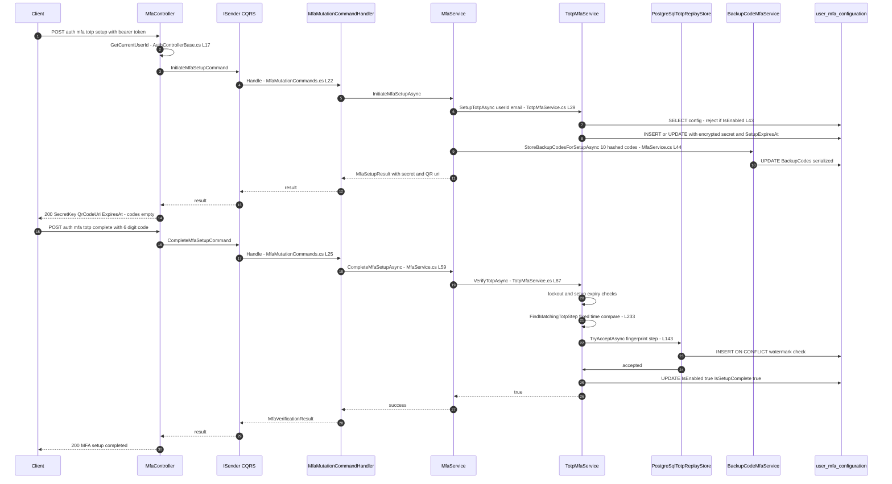
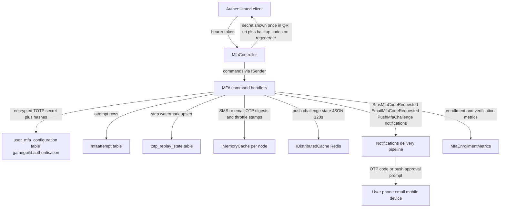

# MFA Enrollment Flow (TOTP, Backup Codes, SMS, Email, Push) — User Flow Diagram

> Issue #1097 · Module `GameGuild.Identity.Authentication` · Documented against `develop` commit `74e9bba4c`.
> Scope: enrolling a second factor on an authenticated account — TOTP setup/complete with QR provisioning and replay protection, backup-code generation (setup-time and regenerate), SMS-OTP enrollment (issue #244), email-OTP enrollment (issue #1152), push-device registration and approval challenges (issue #259), configuration/status reads, and MFA disable with password re-verification.

## 1. Overview

All enrollment endpoints live in `MfaController` (`Controllers/MfaController.cs:19-23`, `[Authorize]`); identity comes from `GetCurrentUserId()` (`Controllers/AuthControllerBase.cs:17`). Commands are dispatched over `ISender` to `MfaMutationCommandHandler` (`Commands/MfaMutationCommands.cs:15-36`), `SmsPushMfaCommandHandler` (`Commands/SmsPushMfaCommands.cs:28-62`) and the email handlers (`Commands/EmailMfaCommands.cs:18-20`), which delegate to factor services behind the `MfaService` orchestrator (`Services/MfaService.cs:12-22`).

TOTP (`POST auth/mfa/totp:setup`, `Controllers/MfaController.cs:54-78`) generates a 160-bit Base32 secret (`Services/TotpMfaService.cs:209-217`), stores it **encrypted** (`:54`), and returns an `otpauth://` QR URI (`:222-228`) with a 10-minute setup window (`MfaOptions.SetupSessionDurationMinutes`, `SharedKernel/Configuration/ApplicationLayer/MfaOptions.cs:52`). Setup also pre-generates 10 backup codes of 12 chars (`MfaService.cs:37-44`, `MfaOptions.cs:28-34`) stored as PBKDF2-SHA256-600k hashes (`Services/BackupCodeMfaService.cs:205-213`) — but the controller returns `BackupCodes = []` (`Controllers/MfaController.cs:76`), so the only way to see codes is `backup-codes:regenerate` after enablement. `totp:complete` (`:86-104`) verifies the code (±1 step clock skew, fixed-time compare, `TotpMfaService.cs:233-248`) and flips `IsEnabled` atomically through the `PostgreSqlTotpReplayStore` watermark (`Repositories/PostgreSqlTotpReplayStore.cs:51-69`, `INSERT … ON CONFLICT … WHERE last_accepted_step < new`), preventing same-step replay across nodes. Failed attempts accumulate (`MfaAttemptTrackingService.cs:312-334`): 5 failures → 15-minute lockout (`MfaOptions.cs:16-22`, checked `:372-379`).

SMS/email OTP mirror `EmailCodeService` semantics (`Services/SmsMfaService.cs:11-17`, `Services/EmailMfaService.cs`): crypto-random 6-digit codes, SHA-256-digest-only storage in `IMemoryCache`, constant-time comparison with a dummy-digest miss path, single-use, 5-attempt ceiling, 10-minute lifetime, 60-second resend throttle (`SmsMfaService.cs:25-36`); delivery failure drops the live code (`:162-168`). Completing either enrollment sets `SmsPhoneNumber`/`EmailMfaAddress` and `IsEnabled = true` (`SmsMfaService.cs:76-79`, `EmailMfaService.cs:79-84`). Push registration stores a device token (16–512 chars) on the MFA row (`Services/PushMfaService.cs:31-60`); challenges are 120-second Pending/Approved/Denied state machines in `IDistributedCache` (`:63-168`), verified via `VerifyAsync` with explicit TOTP fallback on timeout (`:171-224`). Disable requires the account password (`Services/MfaService.cs:113-131`, issue #244 hardening), wipes all factor data, revokes every user token unconditionally and terminates sessions per option (`Services/MfaAttemptTrackingService.cs:144-196`).

## 2. End-to-End Flowchart — happy path and every edge case

```mermaid
flowchart TD
    subgraph TOTP["TOTP enrollment"]
        T1["POST auth mfa totp setup - Authorize<br/>MfaController.cs L54"] --> T2["InitiateMfaSetupCommand<br/>MfaMutationCommands.cs L22"]
        T2 --> T3{"MfaOptions Enabled<br/>TotpMfaService.cs L31"}
        T3 -- "disabled globally" --> T500a["InvalidOperationException<br/>generic 500 - ExceptionHandlingMiddleware.cs L74"]
        T3 -- "enabled" --> T4{"Existing config IsEnabled<br/>TotpMfaService.cs L43"}
        T4 -- "already enabled" --> T500b["InvalidOperationException MFA already enabled - L47<br/>500 not the declared 400 - see Gaps"]
        T4 -- "not enabled" --> T5["GenerateBase32Secret 160 bits - L51<br/>encrypted at rest - L54"]
        T5 --> T6["IsEnabled false IsSetupComplete false<br/>SetupExpiresAt now plus 10 min - L61"]
        T6 --> T7["Create or Update user_mfa_configuration row - L66"]
        T7 --> T8["otpauth URI with issuer secret SHA1 6 digits 30s - L70"]
        T8 --> T9["MfaService also generates 10 backup codes of 12 chars<br/>hashed PBKDF2 then stored - MfaService.cs L37"]
        T9 --> T10["200 SecretKey plus QrCodeUri plus ExpiresAt<br/>BackupCodes returned EMPTY - MfaController.cs L76"]
        T10 --> T11["User scans QR in authenticator app<br/>then POST totp complete with code - MfaController.cs L86"]
        T11 --> T12{"VerifyTotpAsync<br/>TotpMfaService.cs L87"}
        T12 -- "no config or no secret" --> TF1["false plus attempt row<br/>No TOTP configuration - L104"]
        T12 -- "setup window expired before enable<br/>not yet enabled and now past SetupExpiresAt" --> TF2["secret and backup codes wiped<br/>attempt row Setup expired - L111"]
        T12 -- "locked out - 5 fails within window" --> TF3["false plus attempt row Account locked - L124"]
        T12 -- "code not 6 digits or no step match within skew" --> TF4["RecordFailedMfaAttemptAsync - L168<br/>5th failure sets LockedOutUntil plus 15 min"]
        T12 -- "code matches a step" --> T13{"PostgreSqlTotpReplayStore TryAcceptAsync<br/>watermark last_accepted_step - L143"}
        T13 -- "same or older step already accepted - replay" --> TF4
        T13 -- "newest step wins atomically" --> T14["IsEnabled true IsSetupComplete true EnabledAt set<br/>failures reset - L146"]
        T14 --> T15["200 MFA setup completed - MfaController.cs L103"]
        TF1 --> T400x["400 Invalid TOTP code - MfaController.cs L100"]
        TF2 --> T400x
        TF3 --> T400x
        TF4 --> T400x
    end

    subgraph BACKUP["Backup codes"]
        B1["GET auth mfa backup-codes - masked status<br/>MfaController.cs L144"] --> B2["counts only - plaintext never returned - L154"]
        B3["POST auth mfa backup-codes regenerate<br/>MfaController.cs L170"] --> B4{"MFA IsEnabled<br/>BackupCodeMfaService.cs L37"}
        B4 -- "not enabled or MFA disabled globally" --> B500["InvalidOperationException<br/>500 - see Gaps"]
        B4 -- "enabled" --> B5["HashSet until 10 unique codes - L44<br/>charset without lookalikes - L194"]
        B5 --> B6["PBKDF2 SHA256 600000 iters per code - L210<br/>BackupCodeSet serialized to row - L62"]
        B6 --> B7["200 plaintext codes shown once - L70<br/>invalidates all previous codes"]
    end

    subgraph SMS["SMS OTP factor - issue 244"]
        S1["POST auth mfa sms setup with phone<br/>MfaController.cs L197"] --> S2{"E.164 normalize 8 to 15 digits<br/>SmsMfaService.cs L225"}
        S2 -- "invalid" --> S400a["400 Phone number must be E.164 - L45"]
        S2 -- "valid" --> S3{"60s resend throttle per user<br/>IMemoryCache - L116"}
        S3 -- "throttled" --> S400b["400 code was sent recently - L50"]
        S3 -- "ok" --> S4["6 digit crypto random code<br/>SHA256 digest cached 10 min - L127"]
        S4 --> S5["publish SmsMfaCodeRequestedNotification - L150"]
        S5 -- "publish fails" --> S410a["code removed then rethrow - L165"]
        S5 -- "queued" --> S6["200 masked phone plus 600s expiry"]
        S6 --> S7["POST sms complete with code<br/>MfaController.cs L228"]
        S7 --> S8{"ConsumeCode - L176<br/>constant time compare incl dummy digest"}
        S8 -- "no entry or expired or 5 wrong attempts or reused" --> S400c["400 Invalid or expired SMS code - L66"]
        S8 -- "match" --> S9{"user_mfa_configuration row exists - L69"}
        S9 -- "missing" --> S400d["400 No MFA configuration - L73"]
        S9 -- "exists" --> S10["SmsPhoneNumber saved IsEnabled true - L76"]
        S10 --> S11["200 SMS MFA enrolled - L83"]
    end

    subgraph EMAILF["Email OTP factor - issue 1152"]
        E1["POST auth mfa email setup<br/>MfaController.cs L287"] --> E2{"user email present and valid<br/>EmailMfaService.cs L41"}
        E2 -- "missing or invalid" --> E400a["400 failure message - L45"]
        E2 -- "valid" --> E3["same code semantics as SMS<br/>10 min TTL 60s throttle 5 attempts - L27"]
        E3 --> E4["publish EmailMfaCodeRequestedNotification - L157"]
        E4 --> E5["POST email complete with code - L317"]
        E5 --> E6{"ConsumeCode"} 
        E6 -- "invalid expired exhausted" --> E400b["400 Invalid or expired email code"]
        E6 -- "match and config row exists" --> E7["EmailMfaAddress saved IsEnabled true - L79"]
        E7 --> E8["200 Email MFA enrolled"]
    end

    subgraph PUSH["Push factor - issue 259"]
        P1["POST auth mfa push register-device<br/>MfaController.cs L377"] --> P2{"token 16 to 512 chars<br/>PushMfaService.cs L41"}
        P2 -- "malformed" --> P400a["400 invalid token - MfaController.cs L391"]
        P2 -- "valid" --> P3{"MFA config row exists - L46"}
        P3 -- "none" --> P400a
        P3 -- "exists" --> P4["PushDeviceToken stored replace idempotent - L53"]
        P4 --> P5["200 device registered"]
        P6["POST push challenge - AllowAnonymous<br/>MfaController.cs L404"] --> P7{"device enrolled - L66"}
        P7 -- "no" --> P400b["400 No push MFA device enrolled"]
        P7 -- "yes" --> P8["challenge state Pending in distributed cache<br/>TTL 120s - L77"]
        P8 --> P9["publish PushMfaChallengeNotification - L101"]
        P9 -- "publish fails" --> P410a["challenge removed then rethrow - L115"]
        P9 -- "queued" --> P10["200 ChallengeId plus 120s"]
        P10 --> P11["Device POST push respond approve or deny<br/>MfaController.cs L433"]
        P11 --> P12{"challenge state - RespondAsync L132"}
        P12 -- "unknown or expired" --> P400c["400 Challenge not found or expired"]
        P12 -- "already decided" --> P400d["400 Challenge was already answered"]
        P12 -- "pending" --> P13["status written Approved or Denied - L153"]
        P13 --> P14["200 decision recorded"]
        P15["Sign-in asks VerifyAsync userId - L171"] --> P16{"user pointer challenge state"}
        P16 -- "no challenge or user mismatch" --> P400e["fail closed plus TOTP fallback signal - L174"]
        P16 -- "pending or expired" --> P400f["RequiresAdditionalVerification true<br/>timeout fallback to TOTP - L197"]
        P16 -- "denied" --> P400g["failed then challenge removed - L211"]
        P16 -- "approved and unexpired" --> P17["both cache keys consumed - no replay - L219"]
        P17 --> P18["verified success - L223"]
    end

    subgraph DISABLE["Disable MFA - password re-verified"]
        D1["POST auth mfa disable with password<br/>MfaController.cs L546"] --> D2["DisableMfaCommand UserId Password<br/>MfaMutationCommands.cs L13"]
        D2 --> D3{"user PasswordHash on file<br/>MfaService.cs L119"}
        D3 -- "passwordless OAuth account" --> D400a["false then 400 - L123<br/>no way to disable MFA self-service - see Gaps"]
        D3 -- "hash present" --> D4{"VerifyPassword - L126"}
        D4 -- "wrong password" --> D400a
        D4 -- "correct" --> D5{"tracking DisableMfaAsync - IsEnabled - L150"}
        D5 -- "not enabled" --> D400a
        D5 -- "enabled" --> D6["factor data wiped - secret codes phone push token - L157"]
        D6 --> D7["RevokeAllUserTokensAsync unconditional - L169<br/>TerminateAllUserSessions when option set - L177"]
        D7 --> D8["200 MFA disabled"]
    end

    CFG1["GET auth mfa - configuration and status<br/>MfaController.cs L32"] --> CFG2["GetMfaConfigurationAsync<br/>MfaAttemptTrackingService.cs"]
    M1["GET auth mfa methods<br/>MfaController.cs L460"] --> M2["per-method enabled plus availability<br/>SMS and push per delivery options - L472"]
```

## 3. CQRS Chain Sequence Diagram

## 4. Data Flow Diagram

## 5. Edge-Case Matrix

| # | Edge case | Code path | Outcome |
|---|-----------|-----------|---------|
| 1 | MFA globally disabled (`Mfa:Enabled=false`) | `SetupTotpAsync` throws (`Services/TotpMfaService.cs:31-34`); same for backup-code generation (`BackupCodeMfaService.cs:26-29`) | 500 (InvalidOperationException), not the declared 400 (`Controllers/MfaController.cs:58`) |
| 2 | TOTP setup while already enabled | `InvalidOperationException("MFA is already enabled")` (`TotpMfaService.cs:43-48`) | 500; re-enrollment requires disable first |
| 3 | Setup abandoned > 10 minutes | `SetupExpiresAt` guard wipes secret + backup codes (`TotpMfaService.cs:109-121`, `MfaOptions.cs:52`) | later `totp:complete` → 400 "Invalid TOTP code", setup must restart |
| 4 | Re-scanning/re-setup before completion | `SetupTotpAsync` overwrites secret + resets window on existing row (`TotpMfaService.cs:57-67`) | previous pending secret invalidated; new QR issued |
| 5 | Wrong TOTP code | `FindMatchingTotpStep` miss → `RecordFailedMfaAttemptAsync` (`TotpMfaService.cs:168-173`) | 400; `FailedAttempts++` |
| 6 | 5 consecutive failed MFA attempts | lockout branch (`MfaAttemptTrackingService.cs:331-334`, `MfaOptions.cs:16-22`), checked `:372-379` | 15-minute lockout, verification refused with "Account locked" |
| 7 | Same TOTP code replayed (two sessions) | `PostgreSqlTotpReplayStore` watermark `WHERE last_accepted_step < new` (`Repositories/PostgreSqlTotpReplayStore.cs:51-59`) | second use rejected as "Invalid or previously used code" |
| 8 | Concurrent TOTP verify race on the same step | atomic upsert + savepoint (`PostgreSqlTotpReplayStore.cs:32-44`) | exactly one winner; loser counts a failed attempt |
| 9 | Clock skew between phone and server | ±1 step window (`MfaOptions.cs:46`, loop `TotpMfaService.cs:240-246`) | codes from previous/next 30s step accepted |
| 10 | Backup codes generated at setup never displayed | controller returns `BackupCodes = []` (`Controllers/MfaController.cs:71-77`) | user must call regenerate after completing setup to ever see codes (see Gaps) |
| 11 | Regenerate with MFA not enabled | `InvalidOperationException("MFA must be enabled…")` (`BackupCodeMfaService.cs:37-42`) | 500 (declared 200/401 at `Controllers/MfaController.cs:173-174`) |
| 12 | Backup-code verify races on concurrent use | retry loop with `DbUpdateConcurrencyException` reload, max 16 (`BackupCodeMfaService.cs:94-155`) | loser rechecks; exhausted retries → 400 |
| 13 | Legacy SHA-256 backup-code hashes | dual verify path (`BackupCodeMfaService.cs:235-240`) | old-format hashes still verify; new codes PBKDF2 600k |
| 14 | SMS phone not E.164 | `NormalizePhoneNumber` (`SmsMfaService.cs:225-240`) | 400 with format guidance |
| 15 | SMS/email code requested twice within 60 s | per-user throttle (`SmsMfaService.cs:115-124`, `EmailMfaService.cs`) | 400 "code was sent recently" |
| 16 | SMS/email OTP delivery pipeline failure | code removed from cache then rethrow (`SmsMfaService.cs:162-168`) | no orphan live code; request errors out |
| 17 | 5 wrong SMS/email code guesses | `FailedAttempts >= 5` invalidates the code (`SmsMfaService.cs:204-212`) | code dead; must wait throttle and request new |
| 18 | SMS/email complete with no MFA config row | `configuration is null` (`SmsMfaService.cs:69-74`) | 400 "No MFA configuration found" |
| 19 | Push device token malformed (<16 or >512 chars) | shape check (`PushMfaService.cs:41-44`) | 400 invalid token |
| 20 | Push challenge expires (120 s) before response | `RespondAsync` expiry branch (`PushMfaService.cs:141-145`) | 400 "Challenge expired"; `VerifyAsync` signals TOTP fallback (`:197-208`) |
| 21 | Push challenge answered twice | `Status != Pending` (`PushMfaService.cs:147-151`) | 400 "Challenge was already answered" — no decision flip-flop |
| 22 | Push challenge delivered to wrong user pointer | `state?.UserId != userId` (`PushMfaService.cs:186-195`) | generic "No push challenge pending" — no cross-user oracle |
| 23 | Push verify on approved challenge replays | both cache keys removed on success (`PushMfaService.cs:219-220`) | consumed; second verify → fallback message |
| 24 | Disable MFA with wrong password / passwordless account | `MfaService.DisableMfaAsync` guards (`Services/MfaService.cs:119-131`) | 400 "Failed to disable MFA" (no detail leak); passwordless accounts cannot disable at all (Gaps) |
| 25 | Disable with everything correct | factor wipe + `RevokeAllUserTokensAsync` unconditional + optional session termination (`MfaAttemptTrackingService.cs:157-181`) | 200; all sessions lose tokens (amr claims die with them) |

## 6. Endpoint Inventory

| Method + Route | Handler chain | Controller ref |
|----------------|---------------|----------------|
| GET `v{v}/auth/mfa` | `IMfaService.GetMfaConfigurationAsync` (direct) | `Controllers/MfaController.cs:32-43` |
| POST `v{v}/auth/mfa/totp:setup` | `InitiateMfaSetupCommand` → `MfaMutationCommandHandler` → `MfaService.InitiateMfaSetupAsync` | `Controllers/MfaController.cs:54-78` |
| POST `v{v}/auth/mfa/totp:complete` | `CompleteMfaSetupCommand` → `MfaService.CompleteMfaSetupAsync` | `Controllers/MfaController.cs:86-104` |
| POST `v{v}/auth/mfa/verify` (anonymous) | `VerifyMfaCodeCommand` → `MfaService.VerifyMfaAsync` | `Controllers/MfaController.cs:117-133` |
| GET `v{v}/auth/mfa/backup-codes` | direct `GetMfaConfigurationAsync` (status only) | `Controllers/MfaController.cs:144-163` |
| POST `v{v}/auth/mfa/backup-codes:regenerate` | `RegenerateMfaBackupCodesCommand` → `BackupCodeMfaService.GenerateBackupCodesAsync` | `Controllers/MfaController.cs:170-185` |
| POST `v{v}/auth/mfa/sms:setup` | `StartSmsMfaEnrollmentCommand` → `SmsMfaService.StartEnrollmentAsync` | `Controllers/MfaController.cs:197-220` |
| POST `v{v}/auth/mfa/sms:complete` | `CompleteSmsMfaEnrollmentCommand` → `SmsMfaService.CompleteEnrollmentAsync` | `Controllers/MfaController.cs:228-246` |
| POST `v{v}/auth/mfa/sms:challenge` (anonymous) | `SendSmsMfaChallengeCommand` → `SmsMfaService.SendChallengeAsync` | `Controllers/MfaController.cs:255-276` |
| POST `v{v}/auth/mfa/email:setup` | `StartEmailMfaEnrollmentCommand` → `EmailMfaService.StartEnrollmentAsync` | `Controllers/MfaController.cs:287-309` |
| POST `v{v}/auth/mfa/email:complete` | `CompleteEmailMfaEnrollmentCommand` → `EmailMfaService.CompleteEnrollmentAsync` | `Controllers/MfaController.cs:317-335` |
| POST `v{v}/auth/mfa/email:challenge` (anonymous) | `SendEmailMfaChallengeCommand` → `EmailMfaService.SendChallengeAsync` | `Controllers/MfaController.cs:344-365` |
| POST `v{v}/auth/mfa/push:register-device` | `RegisterPushMfaDeviceCommand` → `PushMfaService.RegisterDeviceAsync` | `Controllers/MfaController.cs:377-395` |
| POST `v{v}/auth/mfa/push:challenge` (anonymous) | `IssuePushMfaChallengeCommand` → `PushMfaService.IssueChallengeAsync` | `Controllers/MfaController.cs:404-424` |
| POST `v{v}/auth/mfa/push:respond` (anonymous) | `RespondPushMfaChallengeCommand` → `PushMfaService.RespondAsync` | `Controllers/MfaController.cs:433-449` |
| GET `v{v}/auth/mfa/methods` | direct configuration read | `Controllers/MfaController.cs:460-…` |
| POST `v{v}/auth/mfa:disable` | `DisableMfaCommand` → `MfaService.DisableMfaAsync` | `Controllers/MfaController.cs:546-566` |

Setup/complete/regenerate/register routes are `[Authorize]`; `verify`, `sms:challenge`, `email:challenge`, `push:challenge`, `push:respond` are `[AllowAnonymous]` (they operate on pending sign-in contexts or device-side flows).

## 7. Events Published / Consumed

- **Published (in-process notifications, no durable integration events on this surface):**
  - `SmsMfaCodeRequestedNotification` (`Services/SmsMfaService.cs:150-156`) — carries the plaintext code to the Notifications SMS channel.
  - `EmailMfaCodeRequestedNotification` (`Services/EmailMfaService.cs:157`) — same pattern for the email channel.
  - `PushMfaChallengeNotification` (`Services/PushMfaService.cs:101-106`) — approval prompt with challenge id and device token.
- **Side channels:** `MfaEnrollmentMetrics.RecordEnrollment/RecordVerification` (`Services/MfaEnrollmentMetrics.cs:11`) emit enrollment/verify outcome metrics on every factor path; `MfaAttempt` rows are written to the `mfaattempt` table for every verification outcome (`Services/MfaAttemptTrackingService.cs:254-272`); MFA disable triggers the full token-revocation battery (`MfaAttemptTrackingService.cs:169-181`).
- **Consumed:** none — enrollment does not subscribe to any event.

## 8. Entities and Tables Touched

| Entity / Table | Mapping | Writes |
|----------------|---------|--------|
| `UserMfaConfiguration` → `gameguild.authentication.user_mfa_configuration` | `Data/Configurations/UserMfaConfigurationConfiguration.cs:14`, `:76` (unique per user) | INSERT/UPDATE on setup (`TotpMfaService.cs:66-67`), enablement (`:157`), wipe on expiry (`:117`), SMS/email enrollment (`SmsMfaService.cs:79`, `EmailMfaService.cs:83`), push token (`PushMfaService.cs:55`), backup codes (`BackupCodeMfaService.cs:65`, `:149`, `:267`), disable wipe (`MfaAttemptTrackingService.cs:157-166`) |
| `totp_replay_state` (raw SQL) | `Repositories/PostgreSqlTotpReplayStore.cs:51-59` | upsert watermark per (configuration, secret fingerprint) |
| `MfaAttempt` → `gameguild.authentication.mfaattempt` | snapshot `:19555` | INSERT per verification outcome (`MfaAttemptTrackingService.cs:272`) |
| `User` (read-only) | `GameGuild.Identity.Users` | password re-verification for disable (`MfaService.cs:118`) and email source for email OTP (`EmailMfaService.cs:42`) |
| `IMemoryCache` (SMS/email OTP digests + throttles) | `SmsMfaService.cs:33-34` | volatile per-node entries |
| `IDistributedCache` (push challenges) | `PushMfaService.cs:25-26` | 120 s challenge state + user pointer |

## 9. Gaps — realistic scenarios the code does not handle

1. **Setup-time backup codes are never shown to the user.** `MfaService.InitiateMfaSetupAsync` generates 10 codes and stores their hashes (`Services/MfaService.cs:37-44`), but `InitiateTotpSetup` returns `BackupCodes = []` (`Controllers/MfaController.cs:76`). The plaintext exists only in the handler's memory and is discarded. A user who completes TOTP setup and never calls `backup-codes:regenerate` believes they have codes that they have never seen — and regeneration invalidates the stored set anyway.
2. **Error contract mismatch: domain throws produce 500 where 400/401 declared.** `totp:setup` with MFA disabled or already enabled throws `InvalidOperationException` (`TotpMfaService.cs:33`, `:47`) and `backup-codes:regenerate` when not enabled (`BackupCodeMfaService.cs:41`); the middleware converts these to 500 (`SharedKernel/Middlewares/ExceptionHandlingMiddleware.cs:74-85`) although the controller declares 400 (`Controllers/MfaController.cs:58`, `:173`). No `MfaDisabledException`/typed mapping exists.
3. **SMS and email OTP state is per-node `IMemoryCache`.** Code digests and throttle stamps (`SmsMfaService.cs:135-146`) live in process memory: on multi-node deployments the code can be issued by node A and verified against node B (fail), and the 60-second resend throttle is trivially bypassed by round-robin nodes. Push challenges got `IDistributedCache` (`PushMfaService.cs:18`); SMS/email did not.
4. **No per-user authorization on the enrollment endpoints beyond authentication.** Any authenticated session (including a stolen one) can call `totp:setup` (overwriting a pending setup), `push:register-device` (replacing the push token with the attacker's device, `PushMfaService.cs:53`), or `sms:setup` (rebinding the phone). Only `mfa:disable` re-verifies the password. Enrollment changes are not step-up-gated.
5. **Passwordless (OAuth-only) accounts can never disable MFA self-service.** `DisableMfaAsync` requires a stored `PasswordHash` (`Services/MfaService.cs:119-124`); an OAuth-created account (`User.CreateOAuthUser`) has none, so once MFA is on, disable is impossible without support — there is no alternative second-factor confirmation path.
6. **Lockout only counts the shared `FailedAttempts` counter.** TOTP, backup-code, and (partially) other factor failures all increment one counter on the same row (`MfaAttemptTrackingService.cs:312-334`); there is no per-method lockout, so SMS-code spraying also locks TOTP, and the lockout is not surfaced distinctly to the user (all failures read "Invalid MFA code"/"Account locked" with identical 400s).
7. **`sms:challenge`, `email:challenge`, `push:challenge` are `[AllowAnonymous]` with user-id-only payloads.** Anyone knowing a user's id can trigger SMS/email codes (60 s throttle per user is the only brake, `SmsMfaService.cs:115-124`) — an SMS-bombing / enumeration vector; the responses leak whether the factor is enrolled via distinct failure messages ("SMS MFA is not enrolled for this account.", `SmsMfaService.cs:92`).
8. **Push approval has no out-of-band binding to the requesting session.** The challenge state carries only `UserId` (`PushMfaService.cs:79-85`); `RespondAsync` accepts approve/deny from anyone presenting the challenge id with no device-attestation or proof-of-possession beyond the notification itself, and a denied challenge is removable only on `VerifyAsync` (`:214`) — a pending challenge left unanswered blocks nothing but is replayable as a fallback signal indefinitely within TTL+5min cache retention.
