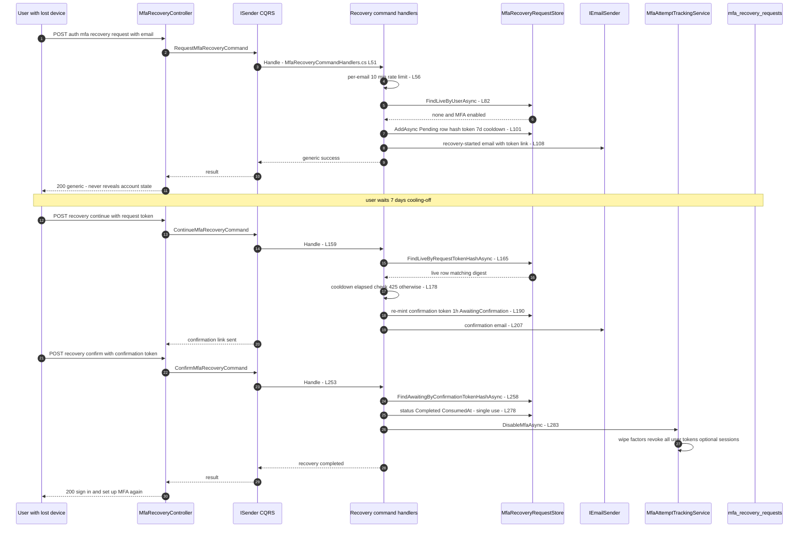
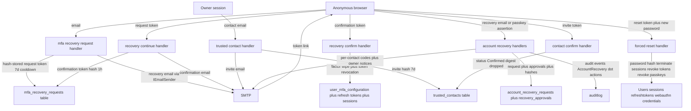

# MFA Recovery Flow (Lost Device, Backup Codes, Recovery Contacts, Re-Enrollment) — User Flow Diagram

> Issue #1098 · Module `GameGuild.Identity.Authentication` · Documented against `develop` commit `74e9bba4c`.
> Scope: every path a user with a lost MFA device can take — completing sign-in with a backup code; the three-stage lost-device MFA recovery (request email → 7-day cooling-off → continue → confirmation email → confirm disables MFA); delegated account recovery with trusted contacts and surviving passkeys (K-of-N approvals → forced credential reset); and re-enrollment afterwards. **In-flight:** PR #1172 (open) reworks the recovery/notification emails onto the durable outbox (#1155) and adds a rate limit to `trusted-contacts/confirm` (#1145); this document reflects the **current develop** code and flags the overlap in Gaps.

## 1. Overview

Three distinct recovery surfaces exist. (1) **Backup code in hand:** the second-factor leg of sign-in is `POST auth/mfa/sign-in/complete` (`Controllers/AuthController.cs:91-110`) → `SignInMfaService.CompleteCodeAsync` (`SignInMfa/SignInMfaService.cs:74-137`), which accepts **only** `Totp` or `BackupCode` (`:78`); a consumed code is removed single-use (`Services/BackupCodeMfaService.cs:135-161`), and a successful factor cancels any live lost-device recovery request (`SignInMfaService.cs:121-126`). (2) **Lost-device MFA recovery** (`Controllers/MfaRecoveryController.cs:18-79`, all anonymous): `recovery:request` opens a row with a 7-day cooldown (`Handlers/MfaRecoveryCommandHandlers.cs:17`, `:84-110`) and emails a 32-byte request token (hash-stored); `recovery:continue` after the cooldown re-mints a 1-hour confirmation token and emails it (`:146-215`); `recovery:confirm` consumes the token and disables MFA through the shared disable path (revokes all tokens, optionally terminates sessions, `:242-291` + `Services/MfaAttemptTrackingService.cs:144-196`). All responses are enumeration-safe. (3) **Delegated account recovery** with trusted contacts / passkeys (issue #209, `Controllers/AccountRecoveryController.cs:21-186`): contacts are invited (7-day single-use invite, `Handlers/TrustedContactCommandHandlers.cs:15-131`, confirmed `:183-240`); `request` requires at least one recovery factor and snapshots a clamped K-of-N threshold (default 2, `Configuration/AccountRecoveryOptions.cs:13-41`); approvals are single-use contact codes (`Handlers/ApproveAccountRecoveryCommandHandler.cs:30-122`) or verified passkey assertions with replay rejection (`:131-231`); at threshold the evaluator mints a 1-hour single-use reset token (`Services/AccountRecoveryThresholdEvaluator.cs:32-76`); `reset` consumes the token **before** any destructive step, then terminates all sessions, revokes all refresh tokens and every passkey, and sets the new password (`Handlers/CompleteAccountRecoveryResetCommandHandler.cs:30-138`). Re-enrollment afterwards is the standard enrollment flow, except the policy-driven `EnrollFactor` sign-in challenge which returns freshly generated backup codes on completion (`SignInMfaService.cs:128-136`).

## 2. End-to-End Flowchart — happy path and every edge case

```mermaid
flowchart TD
    subgraph CODE["Path A - lost device but backup codes remain"]
        A1["Sign-in password ok<br/>server returns MfaToken challenge"] --> A2["POST auth mfa sign-in complete<br/>Method BackupCode plus code<br/>AuthController.cs L91"]
        A2 --> A3{"Method is Totp or BackupCode<br/>SignInMfaService.cs L78"}
        A3 -- "Sms Email or Push method" --> AD1["Denied - this endpoint accepts codes only<br/>see Gaps"]
        A3 -- "code method ok" --> A4{"Active challenge for token hash<br/>L81"}
        A4 -- "expired or consumed or unknown" --> AD2["401 Additional verification failed"]
        A4 -- "active" --> A5{"subject still matches challenge<br/>and not locked - L94"}
        A5 -- "changed" --> AD2
        A5 -- "ok" --> A6["VerifyMfaAsync BackupCode<br/>single-use consume plus concurrency retry<br/>BackupCodeMfaService.cs L94"]
        A6 -- "wrong or no codes or locked" --> AD3["denied attempt recorded - 401"]
        A6 -- "code matches" --> A7{"TryConsumeAsync challenge<br/>bound to user version policy - L115"}
        A7 -- "lost race" --> AD2
        A7 -- "consumed" --> A8["live MFA recovery request cancelled<br/>L121"]
        A8 --> A9["MFA-bound session issued - L127"]
    end

    subgraph MREC["Path B - lost-device MFA recovery - 3 stages"]
        B1["POST auth mfa recovery request with email<br/>MfaRecoveryController.cs L27"] --> B2{"10 min per-email rate limit<br/>IMemoryCache digest key<br/>MfaRecoveryCommandHandlers.cs L56"}
        B2 -- "throttled" --> BG["generic success response"]
        B2 -- "ok" --> B3{"user exists - L74"}
        B3 -- "unknown" --> BG
        B3 -- "exists" --> B4{"MFA enabled and no live request - L81"}
        B4 -- "no MFA or live request exists" --> BG
        B4 -- "eligible" --> B5["row Pending with 7 day CooldownEndsAt<br/>32 byte request token stored as hash - L87"]
        B5 -- "duplicate key race" --> B6["logged as success - L103"]
        B5 --> B7["recovery-started email via IEmailSender<br/>link token plus cooldown note - L108"]
        B7 --> BG2["200 generic success"]
        B8["after cooldown POST recovery continue with request token<br/>MfaRecoveryController.cs L46"] --> B9{"live request token hash matches<br/>constant time - L164"}
        B9 -- "unknown expired or retention-purged - 30d - L162" --> BD["generic denial Invalid or expired recovery request"]
        B9 -- "valid but before cooldown" --> B425["425 with RetryAfterSeconds remaining - L181<br/>controller maps 425 - MfaRecoveryController.cs L57"]
        B9 -- "cooldown elapsed" --> B10["re-mint 32 byte confirmation token 1h lifetime<br/>status AwaitingConfirmation - L190"]
        B10 --> B11["confirmation email via IEmailSender - L207"]
        B11 --> B12["200 confirmation link sent"]
        B13["POST recovery confirm with confirmation token<br/>MfaRecoveryController.cs L69"] --> B14{"AwaitingConfirmation row hash matches<br/>and not expired 1h - L258"}
        B14 -- "unknown consumed or expired" --> BD2["generic denial Invalid or expired recovery confirmation"]
        B14 -- "valid" --> B15["status Completed plus ConsumedAt - single use - L278"]
        B15 --> B16["DisableMfaAsync shared path<br/>wipe factors revoke all tokens<br/>optional terminate sessions - MfaAttemptTrackingService.cs L144"]
        B16 --> B17["200 recovery completed - sign in and set up MFA again"]
    end

    subgraph CONTACTS["Path C - trusted contacts lifecycle"]
        C1["POST auth trusted-contacts - owner session<br/>TrustedContactsController.cs L43"] --> C2{"owner exists and not self-email<br/>TrustedContactCommandHandlers.cs L34 L40"}
        C2 -- "self-delegation" --> CD1["400 cannot designate your own email"]
        C2 -- "ok" --> C3{"active contacts below cap 5 - L45"}
        C3 -- "at cap" --> CD2["400 at most 5 contacts"]
        C3 -- "room" --> C4{"email not already active - L55"}
        C4 -- "duplicate" --> CD3["400 already an active contact"]
        C4 -- "new" --> C5["invite row 7 day expiry token hash - L66"]
        C5 --> C6["invite email via IEmailSender - L81"]
        C6 --> C7["contact POST confirm with invite token - anonymous<br/>TrustedContactsController.cs L72"]
        C7 --> C8{"Invited row hash matches unexpired - L194"}
        C8 -- "unknown expired or replayed" --> CD4["generic denial Invalid or expired invitation"]
        C8 -- "valid" --> C9["status Confirmed digest dropped - single use - L212"]
        C9 --> C10["200 confirmed - will receive recovery codes"]
        C11["DELETE trusted-contacts id - owner<br/>TrustedContactsController.cs L94"] --> C12["revoke terminal - stops counting immediately"]
    end

    subgraph AREC["Path D - delegated account recovery K-of-N"]
        D1["POST auth account-recovery request with email<br/>AccountRecoveryController.cs L30"] --> D2{"10 min per-email rate limit<br/>AccountRecoveryRequestHandlers.cs L38"}
        D2 -- "throttled" --> DG["generic success"]
        D2 -- "ok" --> D3{"user exists - L58"}
        D3 -- "unknown" --> DG
        D3 -- "exists" --> D4{"confirmed contacts plus passkey at least one - L65"}
        D4 -- "zero factors" --> DG
        D4 -- "has factors" --> D5{"no live request - L77"}
        D5 -- "live exists" --> DG
        D5 -- "ok" --> D6["threshold clamped to factors default K 2<br/>cooldown 24h window 72h - L84 L94"]
        D6 --> D7["per-contact single-use codes emailed<br/>plus owner notice - L100 L125"]
        D7 --> DG2["200 generic"]
        D8["contact POST approve with code - anonymous<br/>AccountRecoveryController.cs L76"] --> D9{"redeemable code row - L49"}
        D9 -- "unknown or consumed" --> DD["generic denial plus audit High"]
        D9 -- "found" --> D10{"request PendingApprovals and contact Confirmed<br/>L58 L67"}
        D10 -- "revoked contact or wrong status" --> DD
        D10 -- "ok" --> D11{"cooldown 24h elapsed and window 72h open - L75 L86"}
        D11 -- "before cooldown" --> D425b["425 with RetryAfterSeconds - L78"]
        D11 -- "window elapsed" --> DD
        D11 -- "in window" --> D12["ApprovedAt stamped - single use - L94"]
        D12 --> THR
        D13["surviving device approve-passkey begin then complete<br/>AccountRecoveryController.cs L110 L134"] --> D14{"assertion verified cryptographically<br/>ApproveAccountRecoveryCommandHandler.cs L151"}
        D14 -- "verify fails" --> DD
        D14 -- "verified" --> D15{"live PendingApprovals request for that user - L160"}
        D15 -- "none" --> DD
        D15 -- "found in window" --> D16["TryAddPasskeyApprovalAsync dedupe<br/>same credential replay denied - L200"]
        D16 --> THR
        THR["ThresholdEvaluator - count distinct approvals<br/>AccountRecoveryThresholdEvaluator.cs L35"] --> THR2{"count at or above snapshot K<br/>or already ResetUnlocked"}
        THR2 -- "below threshold" --> TP["200 approval recorded N of K"]
        THR2 -- "threshold reached" --> TQ["status ResetUnlocked plus 1h reset token hash<br/>reset email to owner - L50 L58"]
        TQ --> TQ2["audit ResetUnlocked Critical - L59"]
        D17["owner POST reset with token plus new password<br/>AccountRecoveryController.cs L169"] --> D18{"password strength ok<br/>CompleteAccountRecoveryResetCommandHandler.cs L34"}
        D18 -- "weak" --> DR["failure with rule list"]
        D18 -- "strong" --> D19{"ResetUnlocked row hash matches unexpired 1h - L47"}
        D19 -- "unknown or expired" --> DD2["generic denial plus audit"]
        D19 -- "valid" --> D20{"password not in last 5 - L72"}
        D20 -- "reused" --> D21["token consumed then denial - start over - L74"]
        D20 -- "new" --> D22["token consumed BEFORE destructive steps - L85"]
        D22 --> D23["terminate all sessions SecurityViolation - L89"]
        D23 --> D24["revoke all refresh tokens account_recovery_forced_reset - L93"]
        D24 --> D25["revoke every passkey - mandatory re-enrollment - L97"]
        D25 --> D26["set new password concurrency-token guarded - L104"]
        D26 -- "concurrent password change" --> D27["credentials already invalidated - start new recovery - L106"]
        D26 -- "updated" --> D28["200 password set - sign in and re-enroll"]
        D29["owner POST cancel while still has access<br/>AccountRecoveryController.cs L52"] --> D30["status Cancelled plus reset token digest nulled<br/>AccountRecoveryRequestHandlers.cs L198"]
    end

    RE1["Re-enrollment after recovery"] --> RE2{"policy requires MFA at sign-in"}
    RE2 -- "yes - EnrollFactor challenge" --> RE3["sign-in enrollment completes and returns<br/>freshly generated backup codes MfaEnrollmentBackupCodes<br/>SignInMfaService.cs L128"]
    RE2 -- "no" --> RE4["standard mfa totp setup then complete<br/>see mfa-enrollment-flow.md"]
```

## 3. CQRS Chain Sequence Diagram

## 4. Data Flow Diagram

## 5. Edge-Case Matrix

| # | Edge case | Code path | Outcome |
|---|-----------|-----------|---------|
| 1 | Lost device but valid backup code | `CompleteCodeAsync` accepts `BackupCode` (`SignInMfa/SignInMfaService.cs:78`) → single-use consume (`Services/BackupCodeMfaService.cs:135-161`) | MFA-bound session; code removed |
| 2 | Only remaining factor is SMS/email/push | method whitelist rejects (`SignInMfaService.cs:78`) | denied on `mfa/sign-in/complete`; `/auth/mfa/verify` can verify but returns no session (see Gaps) |
| 3 | Backup code used twice concurrently | `DbUpdateConcurrencyException` retry loop max 16 (`BackupCodeMfaService.cs:94-155`) | one use wins; loser re-verifies against reloaded state |
| 4 | Recovery requested for unknown email | unknown-account branch (`Handlers/MfaRecoveryCommandHandlers.cs:75-79`) | identical generic 200; no enumeration |
| 5 | Second recovery request while one is live | `FindLiveByUserAsync` guard (`:82-84`) | skipped silently, generic 200 — no new email |
| 6 | Recovery requested when MFA not enabled | `mfaEnabled && liveRequest is null` gate (`:84`) | skipped, generic 200 |
| 7 | `recovery:request` email spam | 10-minute per-email digest rate limit (`:56-62`) | throttled to generic 200; per-node memory only (Gaps) |
| 8 | Two concurrent recovery requests (race) | duplicate-key catch on message text (`:103-106`) | logged as success; one row survives |
| 9 | `recovery:continue` before 7-day cooldown | cooldown branch (`:178-187`) | 425 + `RetryAfterSeconds` (valid-token holders only learn the wait) |
| 10 | `recovery:continue` with unknown/expired token | `FindLiveByRequestTokenHashAsync` miss (`:165-170`) | generic denial; retention purge removes >30-day rows (`:162`) |
| 11 | `recovery:continue` repeated after eligibility | re-mints confirmation token each time (`:189-194`) | previous confirmation token overwritten — newest email link wins |
| 12 | Confirmation token expired (>1 h) | expiry check (`:271-274`) | generic denial; must re-run continue |
| 13 | Confirmation token replayed | status transition to Completed is the single-use gate (`:278-280`) | replay finds no AwaitingConfirmation row → generic denial |
| 14 | MFA disabled by password between request and confirm | `DisableMfaAsync` returns false (`MfaAttemptTrackingService.cs:150-156`) | confirm still reports success ("recovery completed"), `disabled:false` only logged (`MfaRecoveryCommandHandlers.cs:283-284`) |
| 15 | Owner regains device mid-recovery and signs in with MFA | any successful second factor cancels live recovery (`SignInMfaService.cs:121-126`) | recovery row Cancelled; confirm afterwards → generic denial |
| 16 | Trusted-contact invite expired (7 d) | `RevokeExpiredInvitesBeforeAsync` housekeeping (`Handlers/TrustedContactCommandHandlers.cs:192`) | invite revoked; confirm → generic denial |
| 17 | Invite token replayed after confirm | digest dropped on confirm (`:212-216`) | generic denial |
| 18 | Contact revoked after codes issued | `Status != Confirmed` fail-closed check (`Handlers/ApproveAccountRecoveryCommandHandler.cs:66-72`) | approval denied even with a valid code |
| 19 | Approval code replayed | `ApprovedAt` stamp is the single-use gate (`:93-97`) | redeemable lookup misses → generic denial + High-risk audit |
| 20 | Approval before 24-h cooldown | cooldown branch (`:75-84`) | 425 + `RetryAfterSeconds` |
| 21 | Approval after 72-h window | window check (`:86-91`) | generic denial + audit |
| 22 | Same passkey approves twice | `TryAddPasskeyApprovalAsync` dedupe (`:200-206`) | replay denied, not a second approval |
| 23 | Threshold reached twice (race on evaluator) | `ResetUnlocked` status short-circuit (`Services/AccountRecoveryThresholdEvaluator.cs:36`) | idempotent; second evaluation reports already-unlocked |
| 24 | Reset token expired (1 h) | expiry check (`Handlers/CompleteAccountRecoveryResetCommandHandler.cs:56-61`) | generic denial; new recovery required |
| 25 | Reset with reused (last-5) password | history policy (`:72-81`) | token **consumed**, explicit message "Start a new recovery" |
| 26 | Reset crashes mid-way / token replay | token consumed before destructive steps (`:85`, `:140-148`) | replay finds no ResetUnlocked row; sessions/tokens already invalid |
| 27 | Owner cancels a ResetUnlocked recovery | cancel nulls reset-token digest (`Handlers/AccountRecoveryRequestHandlers.cs:204-212`) | minted token dies immediately |
| 28 | Password changes concurrently during reset | concurrency-token guarded update (`:104-117`) | sessions/tokens/passkeys already invalidated; user told to start a new recovery |

## 6. Endpoint Inventory

| Method + Route | Handler chain | Controller ref |
|----------------|---------------|----------------|
| POST `v{v}/auth/mfa/sign-in/complete` | `CompleteMfaSignInCommand` → `CompleteMfaSignInHandler` → `SignInMfaService.CompleteCodeAsync` | `Controllers/AuthController.cs:91-110` |
| POST `v{v}/auth/mfa/recovery:request` (anon) | `RequestMfaRecoveryCommand` → `RequestMfaRecoveryCommandHandler` | `Controllers/MfaRecoveryController.cs:27-37` |
| POST `v{v}/auth/mfa/recovery:continue` (anon) | `ContinueMfaRecoveryCommand` → `ContinueMfaRecoveryCommandHandler` | `Controllers/MfaRecoveryController.cs:46-60` |
| POST `v{v}/auth/mfa/recovery:confirm` (anon) | `ConfirmMfaRecoveryCommand` → `ConfirmMfaRecoveryCommandHandler` | `Controllers/MfaRecoveryController.cs:69-79` |
| POST `v{v}/auth/mfa/recovery:cancel` (owner) | `CancelMfaRecoveryCommand` → guarded `CancelMfaRecoveryCommandHandler` → atomic live-state cancellation | `Controllers/MfaRecoveryController.cs` |
| GET `v{v}/auth/trusted-contacts` | direct `ITrustedContactStore.GetActiveByOwnerAsync` | `Controllers/TrustedContactsController.cs:26-36` |
| POST `v{v}/auth/trusted-contacts` | `AddTrustedContactCommand` → `AddTrustedContactCommandHandler` | `Controllers/TrustedContactsController.cs:43-63` |
| POST `v{v}/auth/trusted-contacts/confirm` (anon) | `ConfirmTrustedContactCommand` → `ConfirmTrustedContactCommandHandler` | `Controllers/TrustedContactsController.cs:71-87` |
| DELETE `v{v}/auth/trusted-contacts/{contactId}` | `RemoveTrustedContactCommand` → `RemoveTrustedContactCommandHandler` | `Controllers/TrustedContactsController.cs:94-112` |
| POST `v{v}/auth/account-recovery/request` (anon) | `RequestAccountRecoveryCommand` → `RequestAccountRecoveryCommandHandler` | `Controllers/AccountRecoveryController.cs:29-45` |
| POST `v{v}/auth/account-recovery/cancel` | `CancelAccountRecoveryCommand` → `CancelAccountRecoveryCommandHandler` | `Controllers/AccountRecoveryController.cs:52-67` |
| POST `v{v}/auth/account-recovery/approve` (anon) | `ApproveAccountRecoveryCommand` → `ApproveAccountRecoveryCommandHandler` → `AccountRecoveryThresholdEvaluator` | `Controllers/AccountRecoveryController.cs:75-100` |
| POST `v{v}/auth/account-recovery/approve-passkey:begin` (anon) | `BeginPasskeyRecoveryApprovalCommand` → `BeginPasskeyRecoveryApprovalCommandHandler` | `Controllers/AccountRecoveryController.cs:109-124` |
| POST `v{v}/auth/account-recovery/approve-passkey:complete` (anon) | `ApproveAccountRecoveryWithPasskeyCommand` → `ApproveAccountRecoveryWithPasskeyCommandHandler` → evaluator | `Controllers/AccountRecoveryController.cs:133-158` |
| POST `v{v}/auth/account-recovery/reset` (anon) | `CompleteAccountRecoveryResetCommand` → `CompleteAccountRecoveryResetCommandHandler` | `Controllers/AccountRecoveryController.cs:168-186` |

## 7. Events Published / Consumed

- **Required MFA recovery security events:** `Authentication.MfaRecoveryRequested`,
  `.MfaRecoveryContinued`, `.MfaRecoveryConfirmed` and `.MfaRecoveryCancelled`.
  These persist with the owning command transaction; spool-only capture fails the
  operation. Token expiry, invalid tokens and a lost conditional transition never
  generate a successful confirmation audit.

- **Published (audit events, no durable integration events):** `AccountRecovery.RequestOpened` / `.RequestRejected` (`Handlers/AccountRecoveryRequestHandlers.cs:73`, `:126`), `.RequestCancelled` (`:215`), `.ContactInvited` / `.ContactConfirmed` (`Handlers/TrustedContactCommandHandlers.cs:82`, `:222`), `.ApprovalRecorded` / `.ApprovalDenied` (`Handlers/ApproveAccountRecoveryCommandHandler.cs:99`, `:112`), `.PasskeyApprovalRecorded` / `.PasskeyApprovalDenied` (`:208`, `:221`), `.ResetUnlocked` (`Services/AccountRecoveryThresholdEvaluator.cs:59`), `.ResetDenied` / `.ResetCompleted` (`Handlers/CompleteAccountRecoveryResetCommandHandler.cs:150`, `:119`) — all `AuthenticationAuditEvent` rows with risk levels up to Critical.
- **MFA recovery emails:** request and confirmation are durable notifications with protected token metadata. The transaction includes the state transition and required stage audit. Separate account-recovery/contact delivery retains its own flow and is not re-credited as new work here.
- **Consumed:** the recovery passkey approval reuses the WebAuthn authentication ceremony (`IWebAuthnAuthenticationService.CompleteAuthenticationAsync`, `ApproveAccountRecoveryCommandHandler.cs:151`); sign-in MFA completion consumes `SignInMfa` challenge rows.

## 8. Entities and Tables Touched

| Entity / Table | Mapping | Writes |
|----------------|---------|--------|
| `MfaRecoveryRequest` → `gameguild.authentication.mfa_recovery_requests` | snapshot `:19617` | INSERT Pending (`MfaRecoveryCommandHandlers.cs:101`), UPDATE AwaitingConfirmation (`:194`), Completed (`:280`), Cancelled by MFA sign-in (`SignInMfaService.cs:124`), retention purge (`:162`) |
| `AccountRecoveryRequest` → `gameguild.authentication.account_recovery_requests` | snapshot `:18694` | INSERT + approvals (`AccountRecoveryRequestHandlers.cs:117`), ResetUnlocked + token hash (`AccountRecoveryThresholdEvaluator.cs:56`), Completed/cancelled (`Handlers/CompleteAccountRecoveryResetCommandHandler.cs:142-147`, `AccountRecoveryRequestHandlers.cs:205-214`) |
| `RecoveryApproval` → `gameguild.authentication.recovery_approvals` | snapshot `:19701` | INSERT contact approvals (`AccountRecoveryRequestHandlers.cs:100-112`), `ApprovedAt` consume (`ApproveAccountRecoveryCommandHandler.cs:94`), passkey approvals deduped (`:200`) |
| `TrustedContact` → `gameguild.authentication.trusted_contacts` | snapshot `:20379` | INSERT Invited (`TrustedContactCommandHandlers.cs:80`), Confirmed (`:212`), revoked on remove/expiry |
| `UserMfaConfiguration` → `user_mfa_configuration` | — | factor wipe via `DisableMfaAsync` (`MfaAttemptTrackingService.cs:157-166`) |
| `Users`, `usersession`, `refreshtoken`, WebAuthn credentials | — | forced reset writes (`CompleteAccountRecoveryResetCommandHandler.cs:89-105`) |
| `auditlog` | — | every `AuthenticationAuditEvent` listed above |

## 9. Gaps — realistic scenarios the code does not handle

1. **MFA recovery collapses to the single account email.** `recovery:request`/`:continue` both deliver tokens to the very address that protects the account (`Handlers/MfaRecoveryCommandHandlers.cs:108`, `:207`). An attacker with mailbox access (the classic lost-MFA threat) sails through both stages; a legitimate user whose mailbox is the lost factor has no alternative channel. Trusted contacts exist only for the *account* recovery surface — the MFA recovery path never uses them.
2. **Owner-driven MFA recovery cancellation.** Authenticated `POST /v1/auth/mfa/recovery:cancel` dispatches `CancelMfaRecoveryCommand`. The handler derives the owner only from the trusted authenticated user actor and rejects non-user actors. Atomic live-status updates invalidate both recovery bearers; cancellation committed before confirmation cannot be overwritten by an old tracked request. Successful MFA sign-in uses the same atomic cancellation operation.
3. **MFA recovery notification durability is already implemented.** Both MFA recovery handlers queue protected token metadata through `INotificationService.SendAsync`. This change makes their successful stage audit participate in the same command transaction. The earlier direct-send description is historical; this slice does not claim new implementation or a fresh audit of every separate account-recovery/contact delivery path.
4. **Resolved by #1145: trusted-contact confirmation rate limit.** The anonymous confirm action now declares the Authentication policy and HTTP 429. A PostgreSQL HTTP regression verifies two admitted requests followed by 429 with Retry-After and RateLimit-Limit, while an unrelated anonymous recovery request still succeeds under the separate global budget. This confirms the existing implementation rather than introducing a new limit.
5. **SMS/email/push-only accounts cannot complete an MFA sign-in.** `CompleteCodeAsync` whitelists `Totp`/`BackupCode` only (`SignInMfaService.cs:78`); a user whose TOTP device is lost and whose remaining factor is SMS/email/push has no code-completion path that yields tokens — `/auth/mfa/verify` (`Controllers/MfaController.cs:117`) verifies those methods but returns only `IsValid`, never credentials.
6. **Per-email recovery rate limits are per-node `IMemoryCache`.** Both recovery surfaces key their 10-minute throttle in process memory (`MfaRecoveryCommandHandlers.cs:56`, `AccountRecoveryRequestHandlers.cs:38`); multi-node deployments multiply the budget, and restarts clear it.
7. **Race detection by exception-message sniffing.** Duplicate-key races are caught via `ex.Message.Contains("duplicate key") || ex.Message.Contains("unique constraint")` (`MfaRecoveryCommandHandlers.cs:103`, `AccountRecoveryRequestHandlers.cs:119`) — a provider message change silently converts the race branch into a 500.
8. **Required MFA-recovery stage audit.** Request, continuation, confirmation and owner cancellation record `Authentication.MfaRecoveryRequested`, `.MfaRecoveryContinued`, `.MfaRecoveryConfirmed` and `.MfaRecoveryCancelled`. The central sink persists these in the owning command transaction; audit failure rolls back state, queued notifications and factor reset. Events contain server-owned request/actor identifiers and transition reasons, with no raw recovery bearers.
9. **Confirmation requires the factor reset to succeed.** A failed reset propagates failure and rolls back confirmation consumption; it cannot produce a successful completion audit or a misleading success acknowledgement.
10. **Cooling-off asymmetry.** MFA recovery uses a 7-day cooldown + 1-hour confirmation (`MfaRecoveryTokens`, `MfaRecoveryCommandHandlers.cs:17-19`) while account recovery uses 24 h/72 h/1 h (`Configuration/AccountRecoveryOptions.cs:22-31`); both are undocumented constants to users, and the 7-day MFA window exceeds the 72-hour approval window of the stronger flow — the weaker, single-channel surface waits longer.
