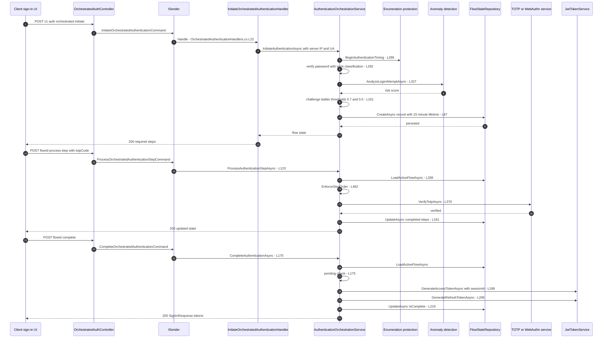
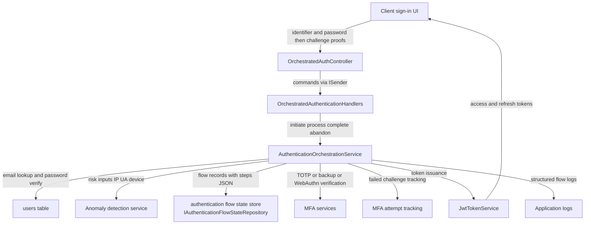

# Orchestrated Auth Flow (Multi-Step Composite Authentication) — User Flow Diagram

> Issue #1111 · Module `GameGuild.Identity.Authentication` · Documented against `develop` commit `a96679c7a`.
> Scope: the multi-step sign-in state machine — initiation with the primary credential, risk-based challenge ladder, per-step challenge verification, token-issuing completion, state lookup, abandonment, expiry and recovery.

## 1. Overview

`OrchestratedAuthController` (`Controllers/OrchestratedAuthController.cs:24`) exposes five anonymous endpoints over `IAuthenticationOrchestrationService` (`Services/AuthenticationOrchestrationService.cs:16`). Initiation verifies the local primary credential (email + password, with enumeration timing protection), assesses risk via `IAuthenticationAnomalyDetectionService`, and persists an `AuthenticationFlowStateRecord` with the required challenge ladder — risk ≥ 0.7 adds MFA + RiskChallenge, ≥ 0.5 adds MFA, and an unrecognized device always adds DeviceTrust (`Services/AuthenticationOrchestrationService.cs:96-121`). Flows live 15 minutes (`FlowLifetime`, `:34-35`). Steps are enforced in order, challenges delegate to the existing TOTP / backup-code / WebAuthn services, and completion issues tokens only when every required step is satisfied on an unexpired, non-abandoned flow (`:170-240`). Expired flows are lazily abandoned and become unobservable (`:338-355`).

## 2. End-to-End Flowchart — happy path and every edge case

```mermaid
flowchart TD
    subgraph INITIATE["Initiate - POST auth orchestrated initiate"]
        I1["Client POST identifier and password<br/>OrchestratedAuthController.cs L33"] --> I2["InitiateOrchestratedAuthenticationHandler<br/>captures IP and UA server-side<br/>OrchestratedAuthenticationHandlers.cs L22"]
        I2 --> I3{"Identifier empty<br/>AuthenticationOrchestrationService.cs L56"}
        I3 -- "empty" --> I400["400 - an identifier is required"]
        I3 -- "ok" --> I4{"AuthMethod Local<br/>AuthenticationOrchestrationService.cs L273"}
        I4 -- "other method" --> I405["NotSupportedException - only Local is orchestrated<br/>AuthenticationOrchestrationService.cs L275"]
        I4 -- "Local" --> I5{"Password in context payload<br/>L279"}
        I5 -- "missing" --> I401a["401 - a primary credential is required"]
        I5 -- "present" --> I6["EnumerationProtection BeginAuthenticationTiming<br/>L286"]
        I6 --> I7["GetByEmailAsync lowercase identifier<br/>L287"]
        I7 --> I8{"User active and HasPassword<br/>L291"}
        I8 -- "no - passwordless or inactive" --> I9["RejectedWithoutWork<br/>timing delay without crypto work - L293"]
        I8 -- "yes" --> I10["VerifyPasswordWithWorkClassification<br/>L292"]
        I10 --> I11{"Password valid<br/>L295"}
        I11 -- "invalid" --> I12["timing protection delay then<br/>RecordFailedAttemptAsync then<br/>401 generic enumeration-safe message - L297"]
        I11 -- "valid" --> I13["RecordSuccessfulAttemptAsync - L312"]
        I13 --> I14["AssessRiskScoreAsync via anomaly detection<br/>L323"]
        I14 -- "analyzer throws" --> I15["Fail closed - risk score 1.0 maximum - L333"]
        I14 -- "score available" --> I16["Clamp score to 0.0 - 1.0 - L328"]
        I15 --> LADDER
        I16 --> LADDER{"DetermineRequiredChallengesAsync<br/>L96"}
        LADDER -- "risk at or above 0.7" --> LC1["MfaVerification plus RiskChallenge - L101"]
        LADDER -- "risk 0.5 to 0.7" --> LC2["MfaVerification - L106"]
        LADDER -- "below 0.5" --> LC3["no risk challenge"]
        LC1 --> LC4{"Device fingerprint trusted<br/>TrustedDeviceRepository.IsDeviceTrustedAsync - L112"}
        LC2 --> LC4
        LC3 --> LC4
        LC4 -- "missing or untrusted" --> LC5["Add DeviceTrust - L117"]
        LC4 -- "trusted" --> LC6["No device challenge"]
        LC5 --> LC7["Persist flow record FlowId Guid NewGuid<br/>ExpiresAt now plus 15 minutes<br/>PrimaryCredential pre-completed - L72"]
        LC6 --> LC7
        LC7 --> I200["200 flow state with required steps<br/>OrchestratedAuthenticationHandlers.cs L51"]
    end

    subgraph STEP["Process step - POST auth orchestrated flowId process-step"]
        S1["Client POST step plus one proof<br/>TOTP code or backup code or WebAuthn assertion<br/>OrchestratedAuthController.cs L61"] --> S2["ProcessOrchestratedAuthenticationStepHandler<br/>OrchestratedAuthenticationHandlers.cs L65"]
        S2 --> S3["LoadActiveFlowAsync<br/>AuthenticationOrchestrationService.cs L338"]
        S3 -- "flow unknown" --> S404["401 - flow not found"]
        S3 -- "flow abandoned" --> S401b["401 - flow was abandoned - L345"]
        S3 -- "flow expired" --> S401c["401 - flow has expired - lazy abandoned - L350"]
        S3 -- "active" --> S4{"Step equals PrimaryCredential<br/>L128"}
        S4 -- "yes" --> S400b["InvalidOperationException - primary is satisfied at initiation - L131"]
        S4 -- "challenge step" --> S5{"Flow has identified user<br/>L134"}
        S5 -- "no" --> S401d["401 - no identified user"]
        S5 -- "yes" --> S6["EnforceStepOrder - L462"]
        S6 -- "step not required" --> S400c["400 - step not required for this flow - L466"]
        S6 -- "step already completed" --> S400d["400 - step already completed - L471"]
        S6 -- "out of order - NextStep differs" --> S400e["400 - cannot process before NextStep - L476"]
        S6 -- "in order" --> S7{"MFA lockout active<br/>IsUserLockedOutAsync - L141"}
        S7 -- "locked out" --> S401e["401 - MFA temporarily locked out - L143"]
        S7 -- "not locked" --> S8{"VerifyChallengeAsync payload - L357"}
        S8 -- "no proof key present" --> S401f["401 - no supported verification payload - L406"]
        S8 -- "totpCode" --> S9{"TotpMfaService VerifyTotpAsync - L370"}
        S9 -- "invalid code" --> S10["FailChallengeAsync records MFA attempt<br/>then 401 invalid TOTP code - L373"]
        S9 -- "valid" --> S11["RecordSuccessAttemptAsync then complete step - L376"]
        S8 -- "backupCode" --> S12{"BackupCodeMfaService VerifyBackupCodeAsync - L382"}
        S12 -- "invalid" --> S10
        S12 -- "valid" --> S11
        S8 -- "webAuthnAssertion" --> S13{"WebAuthn CompleteAuthenticationAsync<br/>must succeed and match flow user - L394"}
        S13 -- "invalid or wrong user" --> S10
        S13 -- "valid" --> S11
        S11 --> S14["Update record CompletedSteps and CurrentStep and IsComplete<br/>L156"]
        S14 --> S15["200 updated flow state - L167"]
    end

    subgraph COMPLETE["Complete - POST auth orchestrated flowId complete"]
        C1["Client POST complete<br/>OrchestratedAuthController.cs L89"] --> C2["LoadActiveFlowAsync fail-closed like step<br/>AuthenticationOrchestrationService.cs L172"]
        C2 -- "unknown abandoned expired" --> C401["401 fail closed"]
        C2 -- "active" --> C3{"Pending steps remain<br/>L175"}
        C3 -- "yes" --> C400f["400 - cannot complete while steps pending - L178"]
        C3 -- "none" --> C4{"User exists and IsActive<br/>L187"}
        C4 -- "deleted inactive or missing" --> C401b2["401 - user no longer exists or inactive - L188"]
        C4 -- "ok" --> C5["Load active role names - L194"]
        C5 --> C6["GenerateAccessTokenAsync with sessionId claim<br/>and user TokenVersion - L198"]
        C6 --> C7["GenerateRefreshTokenAsync with device info<br/>L206"]
        C7 --> C8["Mark flow IsComplete and CompletedAt - L216"]
        C8 --> C9["200 SignInResponse with tokens - L223"]
    end

    subgraph STATE["State and recovery"]
        T1["GET auth orchestrated flowId<br/>OrchestratedAuthController.cs L108"] --> T2["GetFlowStateAsync<br/>AuthenticationOrchestrationService.cs L248"]
        T2 -- "unknown" --> T404["404 - not observable"]
        T2 -- "abandoned" --> T404
        T2 -- "expired - lazily abandoned on read - L264" --> T404
        T2 -- "active" --> T200["200 flow state"]
        AB1["POST flowId abandon<br/>OrchestratedAuthController.cs L128"] --> AB2["AbandonAsync sets AbandonedAt - L244"]
        AB2 --> AB204["204 - later steps and completion fail closed"]
    end

    C9 --> GAP1["Next authenticated call<br/>TokenRevocationMiddleware session check<br/>TokenRevocationMiddleware.cs L111"]
    GAP1 --> GAP2{"sid claim present but no UserSession row<br/>complete never created one<br/>TokenRevocationMiddleware.cs L121"}
    GAP2 -- "session null" --> GAP401["401 Invalid access token - see Gaps"]
```

## 3. CQRS Chain Sequence Diagram

## 4. Data Flow Diagram

## 5. Edge-Case Matrix

| # | Edge case | Code path | Outcome |
|---|-----------|-----------|---------|
| 1 | Empty identifier | guard (`Services/AuthenticationOrchestrationService.cs:55-59`) | 400 ArgumentException |
| 2 | Non-Local auth method | only `Local` orchestrated (`:273-277`) | NotSupportedException (400) |
| 3 | Passwordless / inactive account | `RejectedWithoutWork` (`:291-293`) — no crypto work, timing delay still applied | 401 generic message |
| 4 | Wrong password | timing compensation + `RecordFailedAttemptAsync` + generic 401 (`:295-310`) | 401, no account disclosure |
| 5 | Risk analyzer unavailable | fail closed to risk score 1.0 (`:330-335`) | maximum challenge ladder |
| 6 | Risk ≥ 0.7 | `MfaVerification` + `RiskChallenge` (`:101-105`) | strongest ladder |
| 7 | Risk 0.5-0.7 | MFA only (`:106-109`) | MFA challenge |
| 8 | Unknown / untrusted device fingerprint | `DeviceTrust` added (`:111-118`) | device challenge regardless of risk |
| 9 | Flow older than 15 minutes | lazy abandon on any access (`:348-352`, `:262-266`) | 401 "flow has expired"; state reads 404 |
| 10 | Abandoned flow reused | `AbandonedAt` check (`:343-346`) | 401 "flow was abandoned" |
| 11 | Attempt to process `PrimaryCredential` step | rejected (`:128-132`) | InvalidOperationException (400) |
| 12 | Step not in required list | `EnforceStepOrder` (`:462-467`) | 400 "step not required" |
| 13 | Step already satisfied | `EnforceStepOrder` (`:469-472`) | 400 "already completed" |
| 14 | Out-of-order step (NextStep differs) | `EnforceStepOrder` (`:474-477`) | 400 "cannot be processed before NextStep" |
| 15 | MFA lockout active for account | `IsUserLockedOutAsync` (`:141-144`) | 401 "temporarily locked out" |
| 16 | Invalid TOTP / backup code / assertion | `FailChallengeAsync` records through MFA tracking (lockout accrues) then throws (`:414-446`) | 401; repeated failures lock out |
| 17 | WebAuthn assertion verifies a *different* user | `result.UserId != userId` (`:397-399`) | challenge failed (401) |
| 18 | Step payload with no supported proof | unsupported payload guard (`:406-407`) | 401 |
| 19 | Complete with pending steps | pending check (`:175-180`) | 400 listing pending steps |
| 20 | User deleted / deactivated between steps and completion | revalidation at completion (`:187-192`) | 401 |
| 21 | Concurrent step processing on the same flow | last-write-wins `UpdateAsync` (`:161`) — no optimistic concurrency on the record | possible double-completion of a step (see Gaps) |
| 22 | State lookup of abandoned/expired/unknown flow | not observable (`:248-269`) | 404 |
| 23 | Validation failure | FluentValidation in every handler (`Handlers/OrchestratedAuthenticationHandlers.cs:24-28` etc.) | 400 RequestValidationException |
| 24 | Anonymous access to endpoints | all `[AllowAnonymous]` (`Controllers/OrchestratedAuthController.cs:32`, `:60`, `:88`, `:107`, `:127`) | allowed by design; the flow itself is the credential |

## 6. Endpoint Inventory

| Method + Route | Handler chain | Controller ref |
|----------------|---------------|----------------|
| POST `v{v}/auth/orchestrated:initiate` | `InitiateOrchestratedAuthenticationCommand` → `InitiateOrchestratedAuthenticationHandler` | `Controllers/OrchestratedAuthController.cs:32-51` |
| POST `v{v}/auth/orchestrated/{flowId}:process-step` | `ProcessOrchestratedAuthenticationStepCommand` → `ProcessOrchestratedAuthenticationStepHandler` | `Controllers/OrchestratedAuthController.cs:60-80` |
| POST `v{v}/auth/orchestrated/{flowId}:complete` | `CompleteOrchestratedAuthenticationCommand` → `CompleteOrchestratedAuthenticationHandler` | `Controllers/OrchestratedAuthController.cs:88-99` |
| GET `v{v}/auth/orchestrated/{flowId}` | `GetOrchestratedAuthenticationFlowStateQuery` → `GetOrchestratedAuthenticationFlowStateHandler` | `Controllers/OrchestratedAuthController.cs:107-119` |
| POST `v{v}/auth/orchestrated/{flowId}:abandon` | `AbandonOrchestratedAuthenticationCommand` → `AbandonOrchestratedAuthenticationHandler` | `Controllers/OrchestratedAuthController.cs:127-137` |

All endpoints sit under the `Authentication` rate-limit policy (10/min per client, class header `:22`).

## 7. Events Published / Consumed

- **Published (audit/log stream):** flow initiated with risk score and steps (`Services/AuthenticationOrchestrationService.cs:89-91`); step satisfied with method (`:163-165`); flow completed / tokens issued (`:221`); flow abandoned (`:245`); challenge failure warnings (`:420-422`); primary-credential failure warning (`:308`). Authentication attempts recorded through `IAuthAttemptService` (`:300-307`, `:312-318`); MFA attempts through `IMfaAttemptTrackingService` (`:426-438`, `:448-460`).
- **Consumed:** none — the orchestrator calls services directly; no domain events are raised (no `UserSignedIn`-style event on completion).

## 8. Entities and Tables Touched

| Entity / store | Writes | Ref |
|----------------|--------|-----|
| `AuthenticationFlowStateRecord` via `IAuthenticationFlowStateRepository` | Create on initiate; Update on every step and completion; Abandon on abandon/expiry | `Services/AuthenticationOrchestrationService.cs:87`, `:161`, `:219`, `:244`, `:350`, `:264` |
| `User` (read) | email lookup, password verify, revalidation at completion, roles | `:287`, `:187-195` |
| Authentication attempts (`IAuthAttemptService`) | failed/successful primary credential | `:300`, `:312` |
| MFA attempt tracking store | every challenge verification outcome (lockout policy) | `:426-438`, `:448-460` |
| Refresh tokens table | one row issued at completion (`GenerateRefreshTokenAsync`) | `:206-214` |
| Trusted-device store (read) | fingerprint recognition at initiation | `:112-114` |

## 9. Gaps — realistic scenarios the code does not handle

1. **Completion issues tokens that the global middleware immediately rejects.** `CompleteAuthenticationAsync` generates the access token with a `sessionId` claim (`Services/AuthenticationOrchestrationService.cs:197-205`; claim added in `Services/JwtTokenService.cs:191`) but never creates a `UserSession` row — `ISessionManagementService` is not even a dependency (`:16-32`). `TokenRevocationMiddleware` (`Middleware/TokenRevocationMiddleware.cs:111-127`) checks every token carrying a session claim against the usersessions table and rejects when the row is missing or inactive. Every orchestrated-completion access token would therefore be 401-rejected on its next authenticated call. The refresh token likewise has no `SessionId` binding, so rotation would create a *new* session rather than refresh one.
2. **No optimistic concurrency on the flow record.** Two concurrent `process-step` calls for the same step both pass `EnforceStepOrder` (check-then-act on the loaded record, `:462-477`) and both `UpdateAsync` (`:161`) — a step can be double-completed and, with interleaved completion, tokens can be issued twice from one flow. There is no rowversion/conditional update.
3. **Recovery from a wrong-path step is abandonment only.** A user who fails a challenge cannot switch to a different proof method for the same step within one flow except by re-supplying another payload (each call is one proof); there is no explicit "retry with different method" state, and after MFA lockout the only recovery is a brand-new flow 15 minutes later.
4. **`RiskChallenge` step has no dedicated verifier.** The ladder can require `AuthenticationStep.RiskChallenge` (`:101-105`) but `VerifyChallengeAsync` only knows TOTP, backup-code and WebAuthn payloads (`:357-408`); a `RiskChallenge` step can only be satisfied by presenting one of those proofs — there is no out-of-band (email code / push) risk challenge wired into the orchestrator.
5. **No tenant context on completion.** Tokens are issued with `tenantId: null` (`:202`), unlike the local sign-in path which resolves a tenant access context (`Services/LocalAuthService.cs:799-807`); the orchestrated response has no tenant claim and the client must refresh to obtain one.
6. **Flow state readable by anyone who learns the flowId.** `GET /auth/orchestrated/{flowId}` is anonymous and returns risk score, steps and IP (`Controllers/OrchestratedAuthController.cs:107-119`); flow ids are unguessable GUIDs but there is no binding of the lookup to the initiating client (IP/UA not compared), so a leaked flowId leaks sign-in state.
7. **No max-flow-per-identifier limiter.** Initiation is rate limited per client IP by the shared policy, but nothing caps concurrent flows per account — an attacker can fan many valid-password in-flight flows (password reuse across sessions), each persisting 15 minutes of state.
