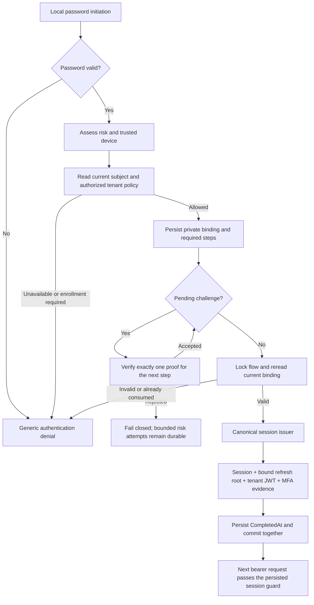

# Orchestrated Authentication Flow

> Issue #1111 documents the flow. Issue #1178 repairs credential persistence, completion concurrency, tenant binding and the dedicated risk challenge.
> Scope: local password initiation, ordered challenges, completion, state lookup, abandonment and expiry. Source references below use symbols rather than historical line numbers.

## Entry points

`OrchestratedAuthController` exposes the existing five reviewed anonymous endpoints under `/v1/auth/orchestrated`. Each mutation passes the request cancellation token through its CQRS handler. The authentication rate limit remains enabled.

| Method and suffix | Purpose |
| --- | --- |
| POST `:initiate` | Validate the local primary credential and persist a server-bound flow |
| POST `/{flowId}:process-step` | Verify exactly one proof for the next required step |
| POST `/{flowId}:complete` | Create credentials and consume the flow once |
| GET `/{flowId}` | Read public flow state; unknown, abandoned or expired flows return 404 |
| POST `/{flowId}:abandon` | Terminate a flow under the same mutation fence |

Initiation accepts `identifier`, `password`, optional `tenantId` and `deviceFingerprint`. The handler captures IP and user agent from server request context. The flow ID is a bearer capability: clients must keep it private and discard it on termination. Possession does not replace any outstanding proof or current account/tenant policy check.

## Initiation and binding

`AuthenticationOrchestrationService.InitiateAuthenticationAsync` verifies the password with enumeration timing protection, evaluates risk and determines the challenge ladder. Analyzer failure assumes maximum risk. An unrecognized device adds `DeviceTrust`; risk at least 0.5 adds `MfaVerification`; risk at least 0.7 adds both MFA and `RiskChallenge`.

The fresh `ISignInMfaSubjectReader` and `IMfaSubjectRequirementPolicy` then resolve the active subject and an authorized tenant. Enrolled MFA, a default-sourced MFA requirement, or the risk ladder adds `MfaVerification`; a default/risk requirement without an enrolled factor must use the existing enrollment path before restarting. At low risk, an elevated-role-only requirement with no enrolled factor follows the platform compliance grace: ordinary credentials carry `mfaCompliancePending` and the `mfa_compliance_pending` JWT claim. Completion re-evaluates the current policy and enrollment before choosing that path; a client cannot request grace.

Private `StepDataJson` binds the flow to the selected tenant, account token version, policy fingerprint and enrolled-MFA status. Those fields, risk proof state and verification timestamps are excluded from public flow state. Legacy flows without this binding must restart.

`PrimaryCredential` starts completed. MFA-bound flows expire five minutes after initiation; ordinary primary-only flows retain the fifteen-minute lifetime. Expiry is inclusive (`now >= ExpiresAt`) and cannot be extended by retries. State lookup is read-only and hides expired/abandoned records.

## Challenge proofs

`ProcessOrchestratedAuthenticationStepCommandValidator` accepts defined non-primary steps and exactly one proof. `MfaVerification` and `DeviceTrust` delegate to existing TOTP, backup-code or WebAuthn verification. A WebAuthn result must identify the same subject. The current subject and policy are checked before verification and again before accepting the transition. The next required step must be processed in order.

`RiskChallenge` accepts only `riskCode`, an eight-digit ASCII code from `OrchestratedRiskChallengeVerifier`. TOTP, backup codes and generic MFA proofs cannot satisfy this separate challenge. Mixed proofs are rejected at validation.

The code is cryptographically random, bound to flow/subject/tenant and expires after at most five minutes or the earlier flow expiry. Persisted challenge state contains a Data Protection protected SHA-256 digest, expiry, consumption state and bounded failed-attempt count; it never contains the raw code. Wrong proofs increment the count. Five failures abandon the flow. A consumed, expired, malformed or differently bound challenge cannot be accepted.

`SendOrchestratedRiskCodeRequestedHandler` queues the code to the verified recipient snapshot. The notification body is generic. The raw code appears only in the email-code metadata, encrypted at rest by the existing `NotificationMetadataProtector`. The renderer states the exact UTC expiry; existing legacy email-code messages retain their prior format. Queue failure or request cancellation propagates rather than acknowledging an undelivered challenge. Tests disable outbound email while exercising the actual queue and protected metadata.

Wrong risk proofs return HTTP 401 in the host's RFC 7807 Problem Details envelope. Its `legacy` extension preserves `success=false` and `errorCode=InvalidRiskCode`. Internal `OrchestrationChallengeDeniedState` and `OrchestratedFlowCommittedDenialResponse` implement the trusted commit-on-failure contract so the command transaction retains failed-attempt accounting. Unrelated failed outcomes and exceptions retain rollback behavior. Clients cannot supply this internal contract.

## Completion and transaction ownership

Every flow mutation obtains `AuthenticationFlowStateRepository.GetForUpdateAsync`. On PostgreSQL this requires the caller-owned Read Committed command transaction and performs a parameterized `SELECT ... FOR UPDATE`. Completion and abandonment share this fence. A waiter sees the committed terminal state and cannot issue a second session. The nonrelational fallback exists for isolated tests.

Completion rejects pending challenges, abandoned/expired/consumed flows, invalid current subjects, changed token versions, changed MFA enrollment and changed tenant policy. Trusted MFA evidence contains the server-recorded password and MFA verification times and the verified method; the client cannot provide a completion attestation.

`IAuthenticatedSessionIssuer.IssueAsync` or `IssueMfaAsync` creates the root refresh token, persists the corresponding `UserSession`, binds the root to that session and issues the JWT for the selected authorized tenant. MFA completion additionally persists `SessionMfaEvidence`. `AuthenticationMappings.ToSignInResponse` preserves the complete canonical response, including tenant and access/refresh expirations. Session lifetime caps may make those expirations equal; stored PostgreSQL timestamps have microsecond precision.

The same command transaction persists `CompletedAt`. Any later exception rolls back the session, refresh root and flow finalization together, so no partial credentials are returned. The next request uses the ordinary bearer validation and persisted session guard. Replay is denied without creating another session/root.

## Recovery and remaining scope

Clients restart expired, abandoned, consumed or legacy unbound flows. Abandonment is idempotent and cannot overwrite an already completed flow. Enrollment, password reset, lost-factor recovery and provider sign-in retain their own existing flows; this local orchestrator does not add a new recovery authority or an IP/user-agent equality requirement.

The dedicated risk transport is email to an already verified address. Push approval is not implemented. This change does not introduce flow-level audit events, an account-management UI or an alternate enrollment protocol. The canonical issuer retains its existing sign-in telemetry and notification behavior.

## Source map

All paths below are relative to `apps/api/Source/Modules/GameGuild.Identity.Authentication` unless stated otherwise.

- `Controllers/OrchestratedAuthController.cs`: reviewed anonymous HTTP entry points.
- `Handlers/OrchestratedAuthenticationHandlers.cs`: validation, server request context, cancellation and response mapping.
- `Services/AuthenticationOrchestrationService.cs`: binding, ordered proof checks, terminal guards and canonical issuance.
- `Repositories/AuthenticationFlowStateRepository.cs`: PostgreSQL mutation fence and persistence.
- `Services/OrchestratedRiskChallengeVerifier.cs`: dedicated protected challenge and bounded attempts.
- `Handlers/SendOrchestratedRiskCodeRequestedHandler.cs`: verified-recipient delivery contract.
- `Services/AuthenticatedSessionIssuer.cs`: durable session/root, tenant JWT and MFA evidence.
- `Mappings/AuthenticationMappings.cs`: preserves canonical credentials and trusted failed-attempt outcomes.
- `../GameGuild.Notifications/Services/Email/Renderers/IdentityEmailRenderers.cs`: risk email expiry and legacy compatibility.
- `apps/api/tests/GameGuild.API.IntegrationTests/OrchestratedAuthenticationPostgreSqlHttpTests.cs` (repository-relative): actual-host PostgreSQL HTTP/session/concurrency/rollback regressions.
