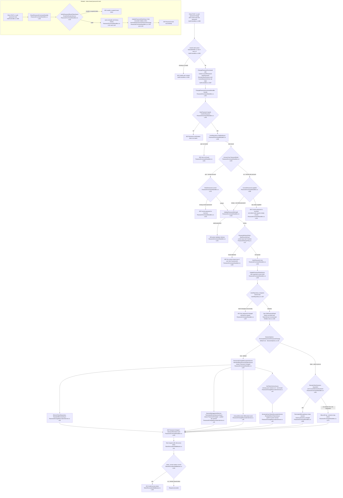
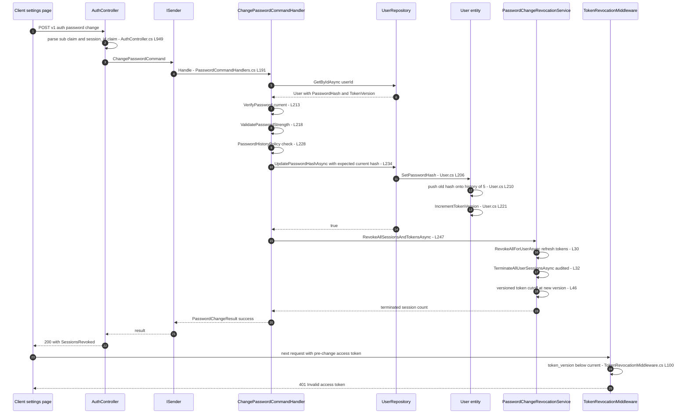
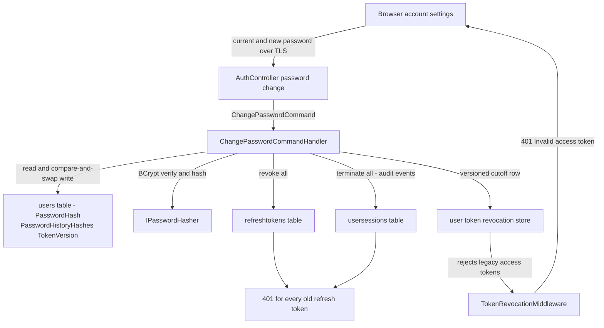

# Password Change Flow — User Flow Diagram

> Issue #1109 · Module `GameGuild.Identity.Authentication` (+ `GameGuild.Identity.Users`, `GameGuild.SharedKernel`) · Documented against `develop` commit `a96679c7a`.
> Scope: authenticated password change (current-password verification, strength + history policy, optimistic-concurrency write, token-version bump), the all-session revocation battery, the related token-based password reset, and the password-history mechanism.

## 1. Overview

An authenticated user changes their password via `POST /v{version}/auth/password:change` (`Controllers/AuthController.cs:938-975`). The controller resolves the user id from claims (and the `session_id` claim for keep-current-session semantics), then sends `ChangePasswordCommand`. `ChangePasswordCommandHandler` (`Handlers/PasswordCommandHandlers.cs:183-285`) verifies the current password (or allows set-initial mode for OAuth-only accounts), enforces strength and the last-5-passwords history, and writes the new hash through `UserRepository.UpdatePasswordHashAsync` (`Repositories/UserRepository.cs:334-346`), which compares the observed hash before applying `User.SetPasswordHash` — the write that records history and bumps `TokenVersion` (`Entities/User.cs:206-223`). With the default `SessionOptions.TerminateSessionsOnPasswordChange = true` (`SharedKernel/Configuration/ApplicationLayer/SessionOptions.cs:64`) the full revocation battery then runs through `PasswordChangeRevocationService` (`Services/PasswordChangeRevocationService.cs:16-55`): revoke all refresh tokens, terminate all sessions (audited), and record a versioned token cutoff that rejects pre-bump access tokens.

## 2. End-to-End Flowchart — happy path and every edge case

## 3. CQRS Chain Sequence Diagram

## 4. Data Flow Diagram

## 5. Edge-Case Matrix

| # | Edge case | Code path | Outcome |
|---|-----------|-----------|---------|
| 1 | Confirmation mismatch | `PasswordCommandHandlers.cs:193-196` | 400, message from handler |
| 2 | User record vanished mid-request | `PasswordCommandHandlers.cs:199-202` | 400 "User not found" |
| 3 | Wrong current password | `PasswordCommandHandlers.cs:213-216` | 400 "Current password is incorrect" |
| 4 | OAuth-only account (no `PasswordHash`) supplies any current password | set-initial mode guard (`PasswordCommandHandlers.cs:204-212`) | 400 — supplied password can never match; empty current password proceeds to set initial |
| 5 | Weak new password | `IPasswordHasher.ValidatePasswordStrength` (`PasswordCommandHandlers.cs:218-226`) | 400 with joined failure list |
| 6 | New password equals current or one of last 5 | `PasswordHistoryPolicy.WasRecentlyUsed` (`Services/PasswordHistoryPolicy.cs:10-25`) checks current hash + `GetPasswordHistoryHashes()` with legacy-hash fallback | 400 "cannot reuse any of your last 5 passwords" |
| 7 | Legacy long BCrypt hashes in history | `PasswordHasher.MatchesLongLegacyHashForHistory` (`Services/PasswordHistoryPolicy.cs:15-16`) | still detected, no false negative |
| 8 | Two concurrent change requests | `UpdatePasswordHashAsync` compares observed hash (`Repositories/UserRepository.cs:337-340`) | loser gets 400 "Your password changed during this request", no double history push |
| 9 | Password reset races a change | same compare-and-swap in `ResetPasswordCommandHandler` (`PasswordCommandHandlers.cs:148-152`) | 400 with retry guidance |
| 10 | All-session revocation | default `TerminateSessionsOnPasswordChange = true` (`SharedKernel/.../SessionOptions.cs:64`) + `PasswordChangeRevocationService` (`Services/PasswordChangeRevocationService.cs:24-54`) | refresh tokens revoked, sessions terminated with audit, versioned cutoff recorded |
| 11 | Versioned cutoff store unavailable | store failure propagates (`PasswordChangeRevocationService.cs:45-47` comment) | handler throws — revocation never reported complete |
| 12 | User row disappears between write and revocation | `GetTokenVersionAsync` returns null → resolves to 0 (`PasswordChangeRevocationService.cs:44`) | fails closed, revokes everything |
| 13 | `TerminateSessionsOnPasswordChange` set to false + `RevokeOtherSessions` + valid `session_id` claim | keep-current branch (`PasswordCommandHandlers.cs:261-270`) | all sessions except current terminated (`TerminateAllExceptAsync`) |
| 14 | `RevokeOtherSessions` requested but no session repository / no session id | skip branch (`PasswordCommandHandlers.cs:271-274`) | sessions stay active, logged |
| 15 | Pre-change access tokens after revocation | `TokenRevocationMiddleware` version check (`Middleware/TokenRevocationMiddleware.cs:91-109`) | 401 Invalid access token |
| 16 | Anonymous call to change endpoint | `[Authorize]` (`Controllers/AuthController.cs:937`) | 401 before handler |
| 17 | Expired reset token on the reset path | `VerifyPasswordResetTokenAsync` (`PasswordCommandHandlers.cs:122-130`) | 400 Invalid or expired reset token |

## 6. Endpoint Inventory

| Method + Route | Handler chain | Controller ref |
|----------------|---------------|----------------|
| POST `v{v}/auth/password:change` | `ChangePasswordCommand` → `ChangePasswordCommandHandler` | `Controllers/AuthController.cs:937-975` |
| POST `v{v}/auth/password:reset` | `ResetPasswordCommand` → `ResetPasswordCommandHandler` (related completion path) | `Controllers/AuthController.cs:904-929` |
| POST `v{v}/auth/password:reset-request` (forgot password) | `RequestPasswordResetCommand` → `RequestPasswordResetCommandHandler` (`Handlers/PasswordCommandHandlers.cs:55-94`) | `Controllers/AuthController.cs:878` |

## 7. Events Published / Consumed

- **Published**
  - `PasswordResetRequestedNotification` on the forgot-password path only (`Handlers/PasswordCommandHandlers.cs:68-75`) → consumed by `SendPasswordResetRequestedHandler` (email pipeline).
  - Refresh-token lifecycle events `AllRevoked` (`Services/PasswordChangeRevocationService.cs:35-38`) via `IRefreshTokenLifecycleRecorder`, with `RefreshTokenLifecycleMetrics.RecordAttempt` (`:29`).
  - Session termination audit events per session via `ISessionManagementService.TerminateAllUserSessionsAsync` (`:32-34`).
  - Structured log "Password changed for user ... revoked sessions" (`Handlers/PasswordCommandHandlers.cs:276`).
- **Consumed:** none (no `PasswordChanged` domain event exists — see Gaps).

## 8. Entities and Tables Touched

| Entity / Table | Fields | Write ref |
|----------------|--------|-----------|
| `User` → users table | `PasswordHash`, `PasswordHistoryHashes` (max 2600, newline-joined 5 hashes, `Entities/UserConfiguration.cs:66`), `TokenVersion` | `Repositories/UserRepository.cs:334-346` via `Entities/User.cs:206-223` |
| `RefreshToken` → refreshtokens | `IsRevoked`, `RevokedAt`, `RevokedByIp` | `IRefreshTokenRepository.RevokeAllForUserAsync` (`Services/PasswordChangeRevocationService.cs:30`) |
| `UserSession` → usersessions | `IsActive`, `TerminatedAt`, `TerminationReason = PasswordChanged` | `ISessionManagementService.TerminateAllUserSessionsAsync` (`:32`) |
| Versioned user-token revocation store | per-user version cutoff | `IVersionedUserTokenRevocationService.RevokeAllUserTokensAsync` (`:46`) |
| Refresh-token lifecycle metrics/events | operation counters + audit rows | `IRefreshTokenLifecycleRecorder.RecordMutationAsync` (`:35`) |

## 9. Gaps — realistic scenarios the code does not handle

1. **No email notification on password change.** The issue names "email notification"; only the *reset request* sends email (`PasswordResetRequestedNotification`). A successful authenticated change (or reset) sends no confirmation email, so a silent attacker-driven change is invisible to the account owner. `PasswordChanged` exists only as a session-termination reason and revocation-service reason string, not as a notification.
2. **`RevokeOtherSessions` is dead in the default configuration.** The keep-current-session branch (`Handlers/PasswordCommandHandlers.cs:261-270`) is reachable only when `TerminateSessionsOnPasswordChange` is false; with the default true (`SessionOptions.cs:64`) the request flag is ignored and the caller's own session is also terminated — the client gets a 200 but its tokens are immediately invalid. There is no default path that keeps the current session.
3. **No step-up / re-authentication cadence beyond the current password.** A stolen access token can change the password (the password itself is the only second factor); no MFA proof or recent-auth (`auth_time`) requirement gates the endpoint.
4. **History truncation before the write can lose an entry under concurrency.** `User.SetPasswordHash` keeps old current + first 4 history (`Entities/User.cs:210-217`); concurrent writers are stopped by the compare-and-swap, but a successful change immediately followed by another valid change with a stale UI can still push out the 5th-oldest hash early — the "last 5" window is best-effort, not transactional across requests.
5. **Rate limiting / lockout not specific to wrong-current-password attempts.** The endpoint sits under the generic `Authentication` rate-limit policy; wrong current-password attempts are not fed into `IAuthAttemptService` (unlike sign-in), so brute-forcing the current password through this endpoint is bounded only by the shared limiter.
6. **`Password:forgot` response is intentionally identical for unknown emails** (`Handlers/PasswordCommandHandlers.cs:87-92`, good), but the reset path never invalidates *unconsumed* reset tokens after a successful change — a second, still-valid reset token issued before the change can be replayed to change the password again (its own history check would pass if the attacker picks a different password).
