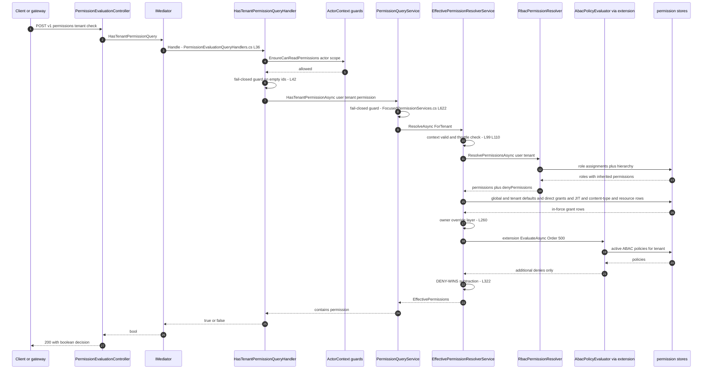
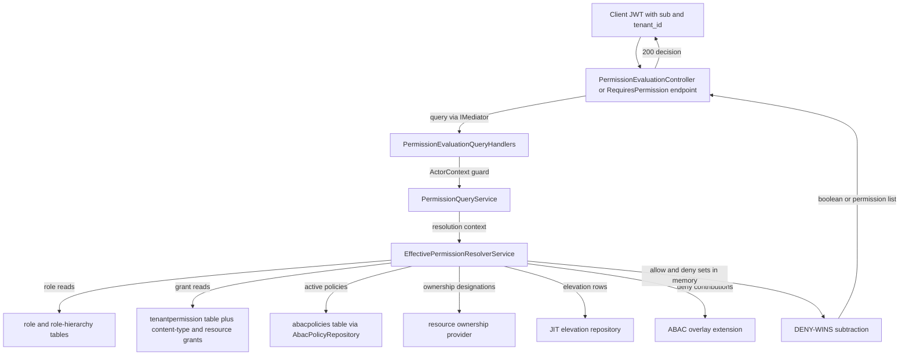

# Permission Evaluation Flow (ABAC / DAC / RBAC / Owner Override) — User Flow Diagram

> Issue #1110 · Modules `GameGuild.Identity.Authorization` (engine) + `GameGuild.Identity.Authentication` (API surface) · Documented against `develop` commit `a96679c7a`.
> Scope: how a permission check is evaluated — ABAC policy overlay, DAC 3-layer model (tenant / content-type / resource), permission grants, role inheritance, and owner override — with the deny-by-default / DENY-WINS / fail-closed contract.

## 1. Overview

Every permission decision funnels through `EffectivePermissionResolverService.ResolveAsync` (`Services/EffectivePermissionResolverService.cs:95-365`, contract `apps/api/docs/effective-permission-resolution.md`). It accumulates allow/deny sets from ordered layers — static system wildcard, RBAC roles (direct + inherited), role providers, global/tenant defaults, direct grants, JIT elevations, content-type grants, resource grants, owner override, evaluation extensions (ABAC overlay runs at Order 500), and an external veto-only decision layer — then applies **DENY-WINS**: `Effective = Union allows − Union denies`. ABAC policies are evaluated by `AbacPolicyEvaluator` (`Services/AbacPolicyEvaluator.cs:69-126`): policies sorted by priority; a matching **deny** short-circuits; **allow** policies never mint permissions on the resolution path — they only match as request gates. The DAC vocabulary (tenant `{permission}`, content-type `{ContentType}.{permission}`, resource `{ResourceType}.{ResourceId}.{permission}`) is centralized in `DacPermissionResolver` (`Services/DacPermissionResolver.cs:38-103`). The HTTP surface lives in `PermissionEvaluationController`, `AbacPolicyController` and `ConditionalPolicyEvaluationController` (Authentication module, hidden from OpenAPI via `ApiExplorerSettings(IgnoreApi = true)`).

## 2. End-to-End Flowchart — happy path and every edge case

```mermaid
flowchart TD
    subgraph ENTRY["Entry points"]
        EN1["PermissionEvaluationController v1 permissions checks<br/>PermissionEvaluationController.cs L39"]
        EN2["RequiresPermission attribute on business endpoints<br/>Authorization module"]
        EN3["AbacPolicyController v1 abac-policies evaluate<br/>AbacPolicyController.cs L101"]
        EN4["ConditionalPolicyEvaluationController v1 conditional-policies evaluate<br/>ConditionalPolicyEvaluationController.cs L31"]
    end

    EN1 --> GUARD["PermissionEvaluationQueryGuards EnsureCanReadPermissions<br/>actor must be authenticated and tenant-scoped<br/>PermissionEvaluationQueryHandlers.cs L38"]
    GUARD -- "not authenticated or cross-tenant" --> D403["403 AccessDenied - fail closed"]
    GUARD -- "allowed" --> PQS["IPermissionQueryService HasTenantPermissionAsync<br/>FocusedPermissionServices.cs L615"]
    EN2 --> PQS
    PQS --> CTXCHK{"Context valid<br/>user and tenant non-empty<br/>FocusedPermissionServices.cs L622"}
    CTXCHK -- "invalid" --> FC1["Return false - fail closed<br/>FocusedPermissionServices.cs L627"]
    CTXCHK -- "valid" --> RES["EffectivePermissionResolverService ResolveAsync<br/>EffectivePermissionResolverService.cs L95"]

    RES --> VCHK{"Context IsValid<br/>EffectivePermissionResolverService.cs L99"}
    VCHK -- "invalid" --> FC2["FailClosed empty set with log<br/>EffectivePermissionResolverService.cs L105"]
    VCHK -- "valid" --> THR{"Denial throttle active for user plus tenant<br/>EffectivePermissionResolverService.cs L110"}
    THR -- "throttled" --> FC3["Empty set Throttled equals true<br/>no store consulted - enumeration protection<br/>EffectivePermissionResolverService.cs L115"]

    THR -- "not throttled" --> L1["Layer 1 Static system-account wildcard<br/>non-deniable - L142"]
    L1 --> L2["Layer 2 RBAC direct roles<br/>RbacPermissionResolver.ResolvePermissionsAsync L293<br/>direct grants attributed Role"]
    L2 --> L2b{"Role inheritance traversal<br/>IRoleInheritanceEngine hierarchy cap 20<br/>RbacPermissionResolver.cs L161"}
    L2b -- "cycle beyond depth 20" --> L2c["Traversal stops - inherited grants dropped"]
    L2b -- "inherited grants" --> L2d["Attributed RoleInheritance<br/>EffectivePermissionResolverService.cs L153"]
    L2 --> L3["Layer 3 Role permission providers<br/>admin wildcard not delegable - L173"]
    L3 --> L4["Layer 4 Global defaults row user null tenant null - L185"]
    L4 --> L5["Layer 5 Tenant defaults row user null - L188"]
    L5 --> L6["Layer 6 Direct user grants row user plus tenant - L191"]
    L6 --> L7{"Layer 7 JIT elevations in force<br/>resource-unscoped - L197"}
    L7 -- "approved inside window" --> L7a["Allow TemporaryElevation<br/>admin wildcard never grantable"]
    L7 --> L8{"Layer 8 Content-type grants when context names a type<br/>L222"}
    L8 -- "grant row effective" --> L8a["Allow only ContentType.permission qualified name<br/>never tenant-wide"]
    L8 --> L9{"Layer 9 Resource grants when context names exact resource<br/>L229"}
    L9 -- "resource id matches and not expired" --> L9a["Allow ResourceGrant - L248"]
    L9 -- "other resource ids" --> L9b["Isolated - skipped - L237"]

    L9 --> OWN{"Owner override layer - issue 372<br/>unrevoked ownership designation for exact resource<br/>EffectivePermissionResolverService.cs L260"}
    OWN -- "designation in force" --> OWNA["Mint owner permissions<br/>mode AllowUnlessDenied default or AlwaysAllow or Off<br/>bounded by ownership expiry - temporal precedence"]
    OWN -- "no designation or lapsed" --> EXT

    OWNA --> EXT{"Evaluation extensions by Order<br/>EffectivePermissionResolverService.cs L267"}
    EXT --> ABACX["AbacPolicyEvaluationExtension Order 500<br/>AbacPolicyEvaluationExtension.cs L41"]

    subgraph ABAC["ABAC policy evaluation - AbacPolicyEvaluator"]
        AB1["Load active policies for tenant<br/>AbacPolicyEvaluator.cs L85"] --> AB2["Sort by Priority descending<br/>AbacPolicyEvaluator.cs L88"]
        AB2 --> AB3{"Policy IsEffective<br/>enabled and inside EffectiveFrom EffectiveUntil<br/>AdvancedPermissions.cs L171"}
        AB3 -- "not effective" --> AB4["Skip policy"]
        AB3 -- "effective" --> AB5{"EvaluatePolicy matches<br/>resource type subject resource environment action JSON<br/>AttributeExpression and ConditionExpression<br/>AbacPolicyEvaluator.cs L150"}
        AB5 -- "no match" --> AB6["NotApplicable detail recorded"]
        AB5 -- "match and Effect Deny" --> AB7["Short-circuit Deny with deciding policy<br/>AbacPolicyEvaluator.cs L105"]
        AB5 -- "match and Effect Allow" --> AB8["Permit detail - request gate only<br/>never mints a permission"]
        AB6 --> AB2
        AB8 --> AB2
        AB7 --> ABX1["Extension subtracts denied target actions<br/>context-wide deny when no TargetActions<br/>AbacPolicyEvaluationExtension.cs"]
    end

    ABACX --> AB1
    ABX1 --> XTHR{"Extension threw<br/>EffectivePermissionResolverService.cs L288"}
    XTHR -- "yes" --> XSKIP["Log error and skip plugin<br/>can neither open nor break the decision"]
    XSKIP --> EXTL
    ABX1 --> EXTL["Other extensions continue"]

    EXTL --> EXTDEC{"External decision provider - issue 146<br/>veto-only - L316"}
    EXTDEC -- "external Deny for allowed permission" --> EXTD["Union into deny set<br/>allow never resurrects"]
    EXTDEC -- "provider throws" --> EXTD2["Fail closed - permission under question denied"]

    EXTD --> DW["DENY-WINS subtraction<br/>EffectivePermissionResolverService.cs L322"]
    EXTL --> DW
    DW --> DW1{"Denied permission is Static source<br/>L325"}
    DW1 -- "yes" --> DW2["Deny skipped - static non-deniable with warning"]
    DW1 -- "no" --> DW3{"AlwaysAllow owner override minted it<br/>L333"}
    DW3 -- "yes" --> DW4["Deny skipped - owner grants non-deniable"]
    DW3 -- "no" --> DW5["Remove from effective set<br/>deny wins"]
    DW2 --> RESULT
    DW4 --> RESULT
    DW5 --> RESULT["EffectivePermissions result<br/>permission set plus sources plus owner override<br/>L354"]

    RESULT --> CHK{"Caller asked for one permission<br/>HasPermissionAsync - L373"}
    CHK -- "not in set" --> DENYR["Deny - deny-by-default issue 327"]
    CHK -- "in set" --> ALLOWR["Allow"]

    subgraph DAC["DAC layer-aware checks - DacPermissionResolver"]
        DAC1["DacPermissionQuery with Layer Tenant or ContentType or Resource or Auto<br/>DacPermissionResolver.cs L43"]
        DAC1 --> DAC2{"Query IsValid<br/>DacPermissionResolver.cs L47"}
        DAC2 -- "invalid - empty ids or half resource pair" --> DACFC["Empty set ContextValid false<br/>never consults engine"]
        DAC2 -- "valid" --> DAC3["Route context - resource pair or content type or tenant<br/>DacPermissionResolver.cs L75"]
        DAC3 --> RES
        DAC3 --> DAC4["Grants check per layer<br/>DacPermissionResolver.cs L132"]
        DAC4 -- "Auto layer" --> DAC5["Tenant grant satisfies every layer<br/>else ContentType qualified<br/>else Resource qualified - inheritance downward"]
    end

    EN4 --> CPE["ConditionalPolicyEvaluator EvaluateAsync<br/>ConditionalPolicyEvaluator.cs L78"]
    CPE --> CP1["Active policies filtered and sorted by Priority desc<br/>ConditionalPolicyEvaluator.cs L86"]
    CP1 --> CP2{"Applicable - action and resource type filters<br/>ConditionalPolicyEvaluator.cs L159"}
    CP2 -- "conditions met and action Deny" --> CP3["IsAllowed false with policy id and reason<br/>ConditionalPolicyEvaluator.cs L104"]
    CP2 -- "no deny matched" --> CP4["IsAllowed true - allow policies continue evaluating<br/>ConditionalPolicyEvaluator.cs L126"]
    CP2 -- "time environment location device custom conditions fail" --> CP5["Policy not applied<br/>ConditionalPolicyEvaluator.cs L176"]
```

## 3. CQRS Chain Sequence Diagram

## 4. Data Flow Diagram

## 5. Edge-Case Matrix

| # | Edge case | Code path | Outcome |
|---|-----------|-----------|---------|
| 1 | Missing / empty user or tenant context | fail-closed guard (`Services/FocusedPermissionServices.cs:622-628`, `EffectivePermissionResolverService.cs:99-106`) | deny / empty set, never global defaults |
| 2 | Denial throttle active (enumeration protection, issue #358) | short-circuit (`EffectivePermissionResolverService.cs:110-125`) | empty `Throttled` result, no store reads |
| 3 | Expired / inactive tenant grant | `IsGrantEffective` predicate (`Services/FocusedPermissionServices.cs:727-728`) treats row as absent | grant contributes nothing |
| 4 | Explicit deny from any layer | DENY-WINS subtraction (`EffectivePermissionResolverService.cs:322-347`) | permission removed even if also allowed |
| 5 | Attempt to deny the static system-account wildcard | source check (`EffectivePermissionResolverService.cs:325-331`) | deny skipped with warning — non-deniable |
| 6 | Role hierarchy cycle | hierarchy traversal caps at depth 20 (`Services/RbacPermissionResolver.cs:161`) | traversal stops, inherited grants beyond cap dropped |
| 7 | Throwing evaluation extension | try/catch skip (`EffectivePermissionResolverService.cs:284-296`) | plugin skipped, decision continues |
| 8 | ABAC evaluator failure inside overlay | catch → contribute nothing (`Services/AbacPolicyEvaluationExtension.cs` catch block) | no ABAC contributions applied (permissive-skip logged) |
| 9 | ABAC deny policy with no `TargetActions` | context-wide deny in overlay | subtracts everything other layers allowed |
| 10 | ABAC allow policy matches | permit never mints (`AbacPolicyEvaluationExtension.cs` remarks; `AbacPolicyEvaluator.cs:121-125`) | no permission granted by ABAC allow |
| 11 | Malformed `SubjectConditions` JSON | parse failure returns false (`Services/AbacPolicyEvaluator.cs:247-251`) | policy does not match (conservative) |
| 12 | Malformed `TargetActions` JSON | `ParseTargetActions` returns null (`AbacPolicyEvaluator.cs:132-148`) | treated as no targeted actions |
| 13 | Policy outside `EffectiveFrom`/`EffectiveUntil` | `IsEffective()` false (`Entities/AdvancedPermissions.cs:171-185`) | skipped in evaluation |
| 14 | Cross-tenant actor reading another user's permissions | `PermissionEvaluationQueryGuards.EnsureCanReadPermissions` (`Handlers/PermissionEvaluationQueryHandlers.cs:38`) | access denied |
| 15 | Resource grant for a different resource id | context isolation (`EffectivePermissionResolverService.cs:237-239`) | skipped |
| 16 | Expired resource grant | expiry check (`EffectivePermissionResolverService.cs:242-245`) | skipped |
| 17 | Content-type grant | qualified name only (`EffectivePermissionResolverService.cs:214-225`) | never conveys tenant-wide permission |
| 18 | Expired JIT elevation | `IsGrantInForce()` check (`EffectivePermissionResolverService.cs:203-211`) | no TemporaryElevation allow; `admin:*` never grantable |
| 19 | Owner override + explicit deny | mode precedence (`Authorization:OwnerOverride`): `AllowUnlessDenied` default → deny wins; `AlwaysAllow` → owner-minted non-deniable; `Off` → no override; unknown mode fails closed to Off (`EffectivePermissionResolverService.cs:56-62` remarks) | per mode |
| 20 | Lapsed ownership designation | temporal bound (issue #363, class remarks `:62-70`) | no override applied |
| 21 | External decision provider denies | veto-only union into denies (`EffectivePermissionResolverService.cs:311-316`, `:419-459`) | allowed permission removed; external allow never grants |
| 22 | DAC query with half-specified resource pair | `query.IsValid` false (`Services/DacPermissionResolver.cs:47-69`) | `ContextValid false`, empty set |
| 23 | Conditional policy conditions met with Deny action | deny short-circuit (`Services/ConditionalPolicyEvaluator.cs:102-116`) | `IsAllowed false` with policy id |
| 24 | Unauthenticated call to `/v1/permissions` | `[Authorize]` (`Controllers/PermissionEvaluationController.cs:27`) | 401 |
| 25 | Rate-limit abuse of evaluation surface | `RateLimitPolicies.Authorization` (`Controllers/PermissionEvaluationController.cs:26`) | throttled |

## 6. Endpoint Inventory

| Method + Route | Handler chain | Controller ref |
|----------------|---------------|----------------|
| POST `v{v}/permissions/tenant:check` | `HasTenantPermissionQuery` → `HasTenantPermissionQueryHandler` | `Controllers/PermissionEvaluationController.cs:39-48` |
| GET `v{v}/permissions/tenant` | `GetTenantPermissionsQuery` → handler (paginated, #298/#307) | `Controllers/PermissionEvaluationController.cs:53-76` |
| POST `v{v}/permissions/content-type:check` | `HasContentTypePermissionQuery` → `HasContentTypePermissionQueryHandler` | `Controllers/PermissionEvaluationController.cs:85-94` |
| GET `v{v}/permissions/content-type` | `GetContentTypePermissionsQuery` → handler | `Controllers/PermissionEvaluationController.cs:99-111` |
| POST `v{v}/permissions/resource:check` | `HasResourcePermissionQuery` → handler | `Controllers/PermissionEvaluationController.cs:120-129` |
| GET `v{v}/permissions/resource` | `GetResourcePermissionsQuery` → handler | `Controllers/PermissionEvaluationController.cs:134-145` |
| GET `v{v}/users/{userId}/permissions` | `GetUserPermissionsQuery` → handler | `Controllers/PermissionEvaluationController.cs:154-163` |
| GET `v{v}/users/{userId}/permissions/effective` | `GetEffectivePermissionsQuery` → handler | `Controllers/PermissionEvaluationController.cs:168-180` |
| POST `v{v}/permissions/:resolve-hierarchy` | `ResolvePermissionHierarchyQuery` → handler | `Controllers/PermissionEvaluationController.cs:185-194` |
| POST `v{v}/abac-policies` + GET/PUT/DELETE | `CreateAbacPolicyCommand` etc. → `PolicyEvaluationCommandHandlers` | `Controllers/AbacPolicyController.cs:32-92` |
| POST `v{v}/abac-policies/:evaluate` | `EvaluateAbacPoliciesCommand` → handler | `Controllers/AbacPolicyController.cs:101-107` |
| POST `v{v}/abac-policies/:evaluate-bulk` | `BulkEvaluateAbacPoliciesCommand` | `Controllers/AbacPolicyController.cs:112-118` |
| POST `v{v}/abac-policies/:test-expression` | `TestAbacExpressionCommand` | `Controllers/AbacPolicyController.cs:123-129` |
| POST `v{v}/abac-policies/{policyId}:activate` / `:deactivate` | `Activate/DeactivateAbacPolicyCommand` | `Controllers/AbacPolicyController.cs:138-150` |
| POST `v{v}/conditional-policies/:evaluate` | `EvaluateConditionalPoliciesCommand` → `ConditionalPolicyEvaluator` | `Controllers/ConditionalPolicyEvaluationController.cs:31` |
| POST `v{v}/conditional-policies/:evaluate-bulk`, `:test-rule`, `:simulate`, `:validate`; GET `statistics`, `{id}/usage`, `{id}/evaluation-history`, `conflicts`, `condition-types` | conditional-policy command/query handlers | `Controllers/ConditionalPolicyEvaluationController.cs:42-146` |

Note: `AbacPolicyController`, `ConditionalPolicyEvaluationController` and `PermissionEvaluationController` all carry `[ApiExplorerSettings(IgnoreApi = true)]` — hidden from the OpenAPI surface (`Controllers/AbacPolicyController.cs:19`, `Controllers/PermissionEvaluationController.cs:25`).

## 7. Events Published / Consumed

- **Published:** permission-decision logging is DEBUG-level on the resolution path (`EffectivePermissionResolverService.cs:349-352`); durable audit of *ownership changes* happens in `TransferOwnershipCommand` (class remarks `:68-70`); ABAC deny logs a warning with the policy name (`Services/AbacPolicyEvaluator.cs:105-109`); conditional-policy deny logs a warning (`Services/ConditionalPolicyEvaluator.cs:104-108`). `PermissionEvaluationLogEntry` entities record evaluations via `Services/PermissionEvaluationLogService.cs` on the admin surfaces.
- **Consumed:** the resolver consumes cache-invalidation and role-change signals indirectly through `Caching/CacheInvalidationService.cs` and the Redis invalidation subscriber (`Caching/RedisPermissionCacheInvalidationSubscriber.cs`) so cached decisions do not outlive a grant change.

## 8. Entities and Tables Touched

| Entity / Table | Role in the flow | Ref |
|----------------|------------------|-----|
| `AbacPolicy` | active policies per tenant, priority, effect, JSON conditions, attribute/condition expressions | `Entities/AdvancedPermissions.cs:14-105` |
| `ConditionalPolicy` | time/environment/location/device/custom conditions, priority, allow/deny action | `Entities/ConditionalPolicy.cs` |
| `TenantPermission` rows (user/tenant defaults + direct grants) | layers 4-6, deny entries, expiry | `Services/FocusedPermissionServices.cs:642-653` |
| Content-type permission grants (scoped store #846) | layer 8 | `Handlers/PermissionEvaluationQueryHandlers.cs:79-109` |
| `ResourceUserPermission` (resource grants) | layer 9 | `EffectivePermissionResolverService.cs:229-253` |
| JIT elevation requests | layer 7 | `EffectivePermissionResolverService.cs:197-212` |
| Role / role-assignment / role-hierarchy tables | layer 2 inheritance | `Services/RbacPermissionResolver.cs:293` |
| `PermissionEvaluationLogEntry` | durable evaluation log | `Entities/PermissionEvaluationLogEntry.cs` |
| Resource ownership designations | owner override layer | `IResourceOwnershipProvider` (`EffectivePermissionResolverService.cs:84`) |

## 9. Gaps — realistic scenarios the code does not handle

1. **`AbacPolicyMiddleware` is a header-writing stub.** Both copies (`Middleware/AbacPolicyMiddleware.cs:27-35` in the Authorization module and the `[Obsolete]` Authentication copy at `AbacPolicyMiddleware.cs:14-25`) only append `X-ABAC-Policies: enabled`. Request-gate ABAC enforcement (IP / device / geo-conditional denies at request time) is not actually invoked by middleware — only the resolution-time overlay and the explicitly-called evaluator endpoints apply ABAC. Policies conditioned on request-time attributes are documented as "enforced by the request-time gates" (`Services/AbacPolicyEvaluationExtension.cs` remarks), but no such gate middleware exists on this path.
2. **The ABAC/conditional-policy management controllers are hidden and marked planned.** `AbacPolicyController` carries a `PLANNED: Reactivate this controller when ABAC policy management is ready for production` comment (`Controllers/AbacPolicyController.cs:11`) plus `IgnoreApi`; the evaluation endpoints exist but are not part of the published API surface, so policy data can only enter through seeds/admin paths.
3. **ABAC allow policies cannot grant anything by design, but the evaluator's `Permit` result is exposed by `/abac-policies/:evaluate` as if it were a decision** (`AbacPolicyEvaluator.cs:121-125` returns Permit when any allow matched) — callers may mistake a Permit for access approval while the resolver path ignores allow matches entirely. The two semantics (request gate vs resolution overlay) are only documented in code remarks.
4. **Overlay failure of the ABAC evaluator is permissive.** When `AbacPolicyEvaluator.EvaluateAsync` throws inside the overlay, the extension logs and contributes nothing (`Services/AbacPolicyEvaluationExtension.cs` catch block) — a deny policy that fails to load is silently not enforced on the resolution path (fail-open for that layer), relying only on the outer extension-skip contract. For a security overlay, failing closed would revoke rather than pass.
5. **Owner-override audit is DEBUG-only.** Override *use* is intentionally kept out of the durable audit trail (`EffectivePermissionResolverService.cs:66-68` remarks); a compliance investigation of owner-override usage has no durable record.
6. **Role-hierarchy cap silently drops grants.** Cycles are stopped at depth 20 (`Services/RbacPermissionResolver.cs:161`) but a legitimate deep hierarchy (>20) also loses inherited grants with no dedicated warning.
