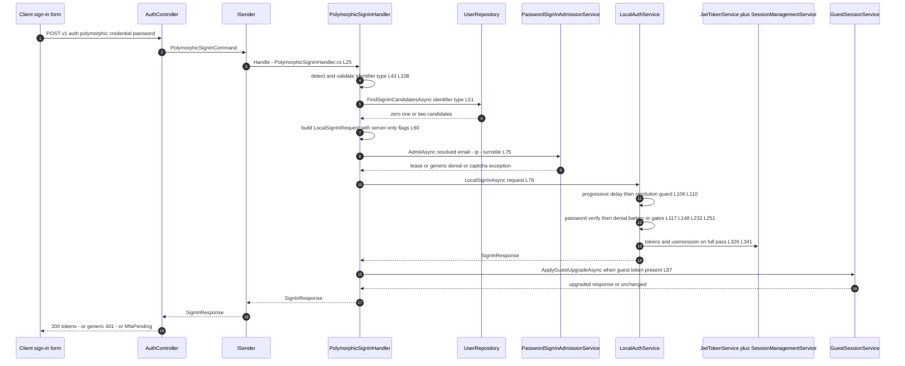
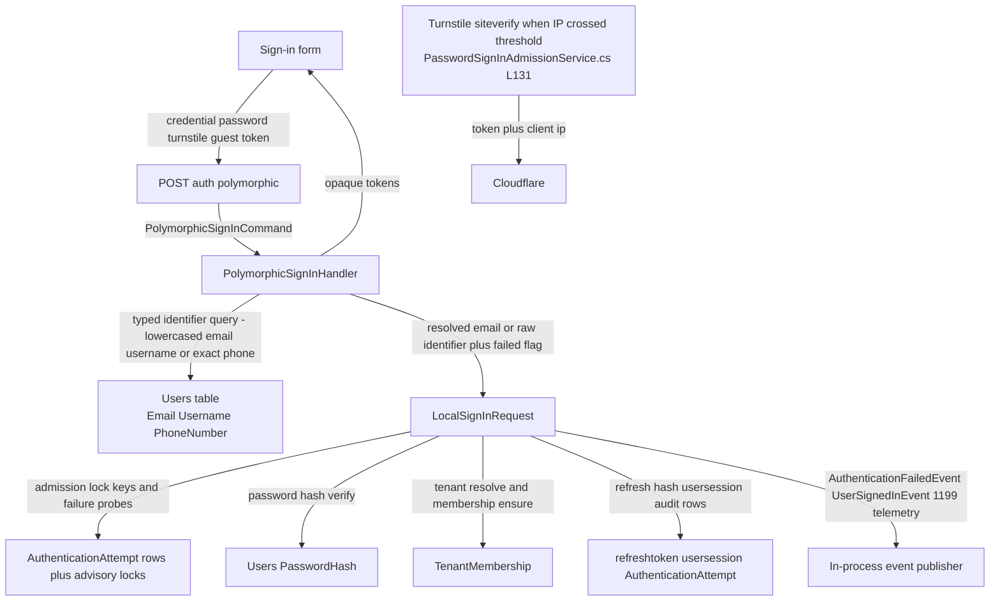

# Polymorphic Sign-In Flow (Email/Username/Phone Resolution, Ambiguity, Generic-Failure Contract, Local-Pipeline Merge) — User Flow Diagram

> Issue #1079 · Features #230 / #257 / #258 / #289 · Module `GameGuild.Identity.Authentication` (+ `GameGuild.Identity.Users` lookups, host `GameGuild.API` admission filter) · Documented against `develop` commit `501477fce`.
> Scope: `POST /auth/polymorphic` — credential-type detection and validation for email, username and E.164 phone identifiers, unique-account resolution with ambiguity and invalid-format handling, the server-only account-resolution handoff into the local email/password pipeline (admission, progressive delay, generic enumeration-protected failure, risk analysis, tenant and compliance gates, MFA/step-up split, session issuance), guest-session upgrade, and the un-wired `ICredentialData` converter contract.

## 1. Overview

`POST v1/auth/polymorphic` (`Controllers/AuthController.cs:113-135`, `[AllowAnonymous]`, class-level `Authentication` rate-limit policy at `:20`) accepts a flat `PolymorphicSignInRequest` (`DTOs/PolymorphicSignInRequest.cs:4-26`: `Credential`, optional `CredentialType`, `Password`, tenant/device/remember-me, `TurnstileToken` #1082, `GuestAccessToken` #213) and maps it to `PolymorphicSignInCommand` (`Commands/PolymorphicSignInCommand.cs:8-48`). `PolymorphicSignInHandler` (`Handlers/PolymorphicSignInHandler.cs:14-122`) first runs an optional FluentValidation validator → 400 (`:31-40`), then detects the identifier type when the caller did not send one (`DetectCredentialType`, `:92-106`: `@` → email, leading `+` → phone, otherwise username) and validates the shape (`ValidIdentifierType`, `:108-121`: email ≤ 255 chars via `EmailAddressAttribute`; username ≤ `UsernameSlug.MaximumLength` with the `[A-Za-z0-9._-]` charset; phone ≤ 16 chars matching `^\+[1-9][0-9]{1,14}$` E.164). Resolution then queries `FindSignInCandidatesAsync` (`GameGuild.Identity.Users/Repositories/UserRepository.cs:302-314`: lowercased email or username equality, exact `PhoneNumber` match, deleted users excluded, capped at 2 rows) and only a **single** candidate resolves an account — zero matches (unknown identifier) and two-or-more matches (only reachable for phone, whose column is not unique) both leave the account null (`Handlers/PolymorphicSignInHandler.cs:47-56`).

The handler never authenticates by itself: it builds a `LocalSignInRequest` whose `Email` is the resolved account's real email — or the raw identifier when resolution failed — plus the **server-only, non-bindable** `CredentialResolutionFailed` / `ResolvedUserId` flags (`DTOs/LocalSignInRequest.cs:50-54`), so a failed lookup cannot fall through to an email-shaped lookup of another account (`Handlers/PolymorphicSignInHandler.cs:58-71`). It then acquires shared password admission (`IPasswordSignInAdmissionService.AdmitAsync`, `:75-77` → `GameGuild.API/Core/Filters/PasswordSignInAdmissionService.cs:41-122`: per-identifier PostgreSQL advisory locks plus the per-source-IP lock engaged only when the address has failed attempts in the admission window so clean-address concurrency is never denied (#1309), hourly source-IP throttle, account lockout with fresh-lockout owner alert #1083, and the #1082 Turnstile challenge whose `PasswordSignInCaptchaRequiredException` is an `UnauthorizedAccessException` subclass — `Abstractions/PasswordSignInCaptchaRequiredException.cs:11` — so the controller's `ExecuteAuthCommandAsync` renders it as the same generic 401, `Controllers/AuthController.cs:802-819`). `LocalAuthService.LocalSignInAsync` (`Services/LocalAuthService.cs:59+`) applies progressive delay (#1084, `:106`), resolves the user (`:110-113`: `CredentialResolutionFailed` → null — no lookup at all), verifies the password with a work-aware hasher (`:117-140`), and on **any** failure runs the full denial battery — failed-attempt record, `AuthenticationFailedEvent` telemetry (#1199), risk analysis, brute-force owner alert, timing compensation — before throwing the single generic `UnauthorizedAccessException(enumerationProtection.GetGenericErrorMessage("login"))` (`:148-196`, message from `Services/UserEnumerationProtectionService.cs:77`). Success re-validates the account version (`:232-238`), provisions/resolves tenants (`:239-241`), enforces the optional verified-email policy (`:243-247`) and the #267 compliance gate (deny → 403, challenge → step-up response, `:251-300`), then splits at the sign-in MFA policy (`:303-319`) before issuing tokens, session and success audits (`:320-398`). Back in the handler, the response is mapped to a DTO and `GuestSessionUpgradeIntegration.ApplyGuestUpgradeAsync` migrates a presented guest session without ever blocking the sign-in (`:87-89`).

The richer polymorphic contract from #230 — `PolymorphicCredentialConverter` discriminating `ICredentialData` subtypes (`email`/`phone`/`username`/`oauth`/`web3`/`certificate` by `type` field or property sniffing, `DTOs/PolymorphicCredentialConverter.cs:9-68`) — exists in the DTO layer but is bound by no endpoint; the live route uses the flat request (see Gaps).

## 2. End-to-End Flowchart — happy path and every edge case

```mermaid
flowchart TD
    P1["POST v1 auth polymorphic<br/>credential password optional type tenant turnstile guest token<br/>AuthController.cs L113"] --> P2["PolymorphicSignInCommand<br/>PolymorphicSignInCommand.cs L8"]
    P2 --> P3{"FluentValidation validator present<br/>and fails L31"}
    P3 -- "invalid" --> P400["RequestValidationException 400 L37"]
    P3 -- "valid or none" --> P4["identifier trimmed L42"]
    P4 --> P5{"CredentialType supplied L43"}
    P5 -- "no" --> P6["DetectCredentialType<br/>at sign Email - plus prefix Phone - else Username L92"]
    P5 -- "yes" --> P7
    P6 --> P7{"ValidIdentifierType shape checks L108"}
    P7 -- "empty control chars or over length or<br/>bad email or bad username charset or bad E164" --> P8["lookupType null - no query L48 L110"]
    P7 -- "valid shape" --> P9["FindSignInCandidatesAsync max 2 rows<br/>UserRepository.cs L302"]
    P9 -- "zero matches - unknown identifier" --> P10["account stays null L52"]
    P9 -- "two matches - ambiguous phone" --> P10
    P9 -- "exactly one match" --> P11["account resolved - real email and id L53"]
    P10 --> H1["LocalSignInRequest with raw identifier as Email<br/>CredentialResolutionFailed true L60"]
    P11 --> H2["LocalSignInRequest with account email<br/>ResolvedUserId set L60"]
    H1 --> AD1
    H2 --> AD1["admissionService AdmitAsync before any credential work L75<br/>PasswordSignInAdmissionService.cs L41"]
    AD1 -- "advisory lock busy or IP hourly ceiling<br/>or account locked out" --> AD401["timing compensation then generic 401<br/>GetGenericErrorMessage login L227 L239"]
    AD1 -- "IP crossed turnstile threshold and<br/>token missing or rejected" --> ADT["PasswordSignInCaptchaRequiredException<br/>UnauthorizedAccessException subclass - 401 with marker L173<br/>PasswordSignInCaptchaRequiredException.cs L11"]
    AD1 -- "admitted" --> LS1["authService LocalSignInAsync L78<br/>LocalAuthService.cs L59"]
    LS1 --> LS2["progressive delay per account identifier<br/>issue 1084 L106"]
    LS2 --> LS3{"user resolution L110<br/>failed flag nulls the lookup"}
    LS3 -- "CredentialResolutionFailed" --> LS4["user null - no fallback lookup"]
    LS3 -- "ResolvedUserId set" --> LS5["GetByIdAsync"]
    LS4 --> PW{"password verifies L117<br/>work aware hasher L122"}
    LS5 --> PW
    PW -- "no password on account or wrong password<br/>or account unresolvable" --> FAIL["denial battery L148 to L195<br/>failed attempt record - AuthenticationFailedEvent 1199<br/>risk analysis - brute force owner alert - timing"]
    FAIL --> G401["throw UnauthorizedAccessException generic message L195<br/>UserEnumerationProtectionService.cs L77<br/>401 ProblemDetails via ExecuteAuthCommandAsync L810"]
    PW -- "verified" --> SV{"re-read version and<br/>ValidateForAuthentication L232"}
    SV -- "deleted or stale version" --> G401
    SV -- "active" --> TN["tenant provision then resolve<br/>RequireActiveTenantAccess L239"]
    TN -- "no active tenant" --> TN403["AccessDeniedException 403"]
    TN -- "resolved" --> VE{"RequiresVerifiedEmail policy on<br/>and email unverified L243"}
    VE -- "yes" --> G401
    VE -- "no" --> CG{"compliance gate issue 267 L251"}
    CG -- "deny" --> CG403["AccessDeniedException plus audit L272"]
    CG -- "challenge" --> CGS["step-up response - no credentials L289"]
    CG -- "pass or disabled" --> MF{"SignInMfa PrepareAsync split L303<br/>SignInMfaService.cs L50"}
    MF -- "MFA or risk step-up required" --> MFP["pending challenge response L70<br/>step-up-authentication-flow"]
    MF -- "no MFA needed" --> ISS["tokens usersession deadline risk audits<br/>UserSignedInEvent success telemetry L320 L398"]
    ISS --> OK["200 SignInResponse<br/>message Sign-in successful L395"]
    ADT --> PEND["401 with stable captcha marker - client shows Turnstile"]
    CG403 --> PEND403["403 ProblemDetails"]
    TN403 --> PEND403
    MFP --> PENDM["200 MfaPending shape"]
    CGS --> PENDM
    OK --> GU{"GuestAccessToken presented L87"}
    GU -- "absent or failed response" --> DONE["client proceeds"]
    GU -- "present" --> GU2["GuestSessionUpgradeIntegration<br/>invalid token never blocks - guest-session-lifecycle"]
    GU2 --> DONE
```

## 3. CQRS Chain Sequence Diagram

## 4. Data Flow Diagram

## 5. Edge-Case Matrix

| # | Edge case | Code path | Outcome |
|---|-----------|-----------|---------|
| 1 | `CredentialType` omitted | auto-detection (`Handlers/PolymorphicSignInHandler.cs:43`, `:92-106`) | `@` → email, leading `+` → phone, otherwise username — a `+`-prefixed or `@`-containing *username* cannot be reached without an explicit type |
| 2 | Identifier empty or contains control characters | `ValidIdentifierType` guard (`Handlers/PolymorphicSignInHandler.cs:110-112`) | no query; straight to the denial path (generic 401) |
| 3 | Email over 255 chars / fails `EmailAddressAttribute` | shape check (`:116`) | no query; generic 401 |
| 4 | Username over 256 chars or outside `[A-Za-z0-9._-]` | shape check (`:117`; `UsernameSlug.MaximumLength` = 256) | no query; generic 401 |
| 5 | Phone not E.164 (`+` then 1–15 digits, total ≤ 16) | regex check (`:118`) | no query; generic 401 — no normalization of spaces/dashes/`00` prefixes |
| 6 | Unknown identifier (no account) | zero candidates (`:51-56`) → `CredentialResolutionFailed` (`:68`) → user null (`Services/LocalAuthService.cs:110-113`) | full denial battery then the single generic 401 (`:148-196`) — indistinguishable from wrong password |
| 7 | **Ambiguous identifier — two accounts match** | `candidates.Count != 1` (`Handlers/PolymorphicSignInHandler.cs:52-56`); only phone can match twice (`UserRepository.cs:313` `Take(2)`) | treated exactly like an unknown identifier — generic 401, no oracle distinguishing "ambiguous" |
| 8 | Identifier matches a deleted account | `DeletedAt == null` filter (`UserRepository.cs:305`) | excluded from candidates → unknown-identifier path → generic 401 |
| 9 | Resolution failed but identifier looks like an email | server-only flag blocks lookup (`Services/LocalAuthService.cs:110-113`) | cannot authenticate a *different* account through an email fallback — the comment contract at `Handlers/PolymorphicSignInHandler.cs:58-59` |
| 10 | Account has no password (OAuth/wallet-only) | `!user.HasPassword` → `default` verification (`Services/LocalAuthService.cs:122-125`) | verification fails → generic 401 (no "use another method" hint) |
| 11 | Wrong password | failure branch (`:135-139`) | attempt record + `AuthenticationFailedEvent` + risk analysis + possible owner alert → generic 401 |
| 12 | Source IP over the hourly failed-attempt ceiling | admission throttle (`GameGuild.API/Core/Filters/PasswordSignInAdmissionService.cs:83-87`) | generic 401 after timing compensation — before any credential work |
| 13 | Account locked out (per-identifier failures) | lockout branch (`:102-112`) + fresh-lockout owner alert #1083 (`:185-225`) | generic 401; owner emailed once per fresh lockout |
| 14 | IP crossed the Turnstile threshold, token missing/rejected | `RequireTurnstileAsync` (`:131-175`) | `PasswordSignInCaptchaRequiredException` (an `UnauthorizedAccessException` subclass) → generic-401 shape with the stable captcha marker (`Controllers/AuthController.cs:810-818`) |
| 15 | Concurrent sign-ins same account/IP | per-identifier + per-IP advisory locks (`:242-343`) | serialized by `pg_try_advisory_lock`; loser waits, no double lockout increments |
| 16 | Deleted or token-version-stale account after password verify | re-read + `ValidateForAuthentication` (`Services/LocalAuthService.cs:232-238`) | generic 401 |
| 17 | No active tenant / requested tenant inaccessible | `RequireActiveTenantAccess` (`:240-241`) | `AccessDeniedException` → 403 |
| 18 | Tenant enforces verified email, account unverified | policy check (`:243-247`) | generic 401 |
| 19 | Compliance gate deny / challenge (#267) | gate evaluation (`:251-300`) | deny → 403 with audit; challenge → step-up response with 5-minute token, no credentials |
| 20 | High-risk anomaly (step-up) or MFA policy/enrollment | `SignInMfa.PrepareAsync` split (`:303-319`; `SignInMfa/SignInMfaService.cs:50-53`) | pending MFA/step-up response instead of tokens |
| 21 | Guest token presented | `ApplyGuestUpgradeAsync` (`Handlers/PolymorphicSignInHandler.cs:87-89`) | valid guest session upgraded; invalid/expired token audited and ignored — never blocks the sign-in |
| 22 | Identifier type lies (says `email`, sends a username) | explicit type wins, shape check fails (`:108-121`) | no query; generic 401 — no cross-type rescue |
| 23 | Phone identifier case/whitespace variants | exact `PhoneNumber == identifier` match (`UserRepository.cs:310`) | no trimming on the phone branch — only the literal E.164 string matches |

## 6. Endpoint Inventory

| Method + Route | Handler chain | Controller ref |
|----------------|---------------|----------------|
| POST `v{v}/auth/polymorphic` | `PolymorphicSignInCommand` → `PolymorphicSignInHandler` (type detection/validation → `FindSignInCandidatesAsync` → `LocalSignInRequest` merge → `IPasswordSignInAdmissionService.AdmitAsync` → `LocalAuthService.LocalSignInAsync` → guest upgrade) | `Controllers/AuthController.cs:113-135` |

`[AllowAnonymous]` (anonymous registry `GameGuild.API/Security/AnonymousEndpointRegistry.cs:50`) under the `Authentication` rate-limit policy (`Controllers/AuthController.cs:20`); the action returns through `ExecuteAuthCommandAsync` so `UnauthorizedAccessException` (including the captcha subclass) maps to 401 problem details (`:802-819`). The email-only counterpart `POST /auth/sign-in` runs the same admission through the host's `AuthenticationLockoutActionFilter` (`GameGuild.API/Core/Filters/AuthenticationLockoutActionFilter.cs:10-55`); the polymorphic route inlines the admission call instead.

## 7. Events Published / Consumed

- **Published (in-process, #1199 telemetry):** `AuthenticationFailedEvent` with reason and request context on every denial (`Services/LocalAuthService.cs:163-167`) and `UserSignedInEvent` ("Password") at the single issuance point (`:386-390`); failures never leak the reason to the client.
- **Audit events:** failed-attempt `AuthenticationAttempt` rows (`:152`), `Authentication.ThreatDetected` (`:174-181`, `:355-364`), `Authentication.StepUpRequired` + suspicious-login owner alerts (`:211-224`, `:369-379`), compliance deny/challenge audits (`:261-268`, `:277-284`), lockout owner alert via `IAccountLockoutAlertPublisher` #1083 (`PasswordSignInAdmissionService.cs:185-225`), success attempt row (`:382`).
- **Consumed:** none directly; the merged local pipeline consumes the risk/anomaly services, tenant membership queries, and the MFA policy — cross-referenced in `docs/auth/event-flows.md` (gap 6: polymorphic coverage rides on the local path, already wired).

## 8. Entities and Tables Touched

| Entity / store | Fields that matter | Ref |
|----------------|--------------------|-----|
| `User` → Users | `Email` (unique, lowercased compare), `Username` (unique, lowercased compare), `PhoneNumber` (**not unique** — ambiguity source), `DeletedAt`, `TokenVersion`, `PasswordHash`, `IsEmailVerified` | `GameGuild.Identity.Users/Repositories/UserRepository.cs:302-314`; resolution `Handlers/PolymorphicSignInHandler.cs:51` |
| `AuthenticationAttempt` | `Email`, `IpAddress`, `IsSuccessful`, `AttemptedAt` — admission probes and attempt records | `PasswordSignInAdmissionService.cs:76-101`; `Services/LocalAuthService.cs:152`, `:382` |
| `refreshtoken` / `usersession` | issued on the MFA-permit branch only | `Services/LocalAuthService.cs:326-351` |
| `TenantMembership` | `DefaultTenantMembershipProvisioner.EnsureAsync` then `ResolveTenantAccessContextAsync` | `Services/LocalAuthService.cs:239-241` |
| PostgreSQL advisory locks | per-identifier + per-IP lock keys (SHA-256 scoped digests) | `PasswordSignInAdmissionService.cs:242-343` |
| Guest session store | upgrade link on presented guest token | `Handlers/PolymorphicSignInHandler.cs:87-89` |

## 9. Gaps — realistic scenarios the code does not handle

1. **NEW — Ambiguous phone identifiers are indistinguishable from unknown ones.** `PhoneNumber` has no unique index and `FindSignInCandidatesAsync` returns at most 2 rows (`UserRepository.cs:305-313`); when two accounts share a number, sign-in fails with the generic 401 (`Handlers/PolymorphicSignInHandler.cs:52-56`) with no signal to the user to sign in with email/username instead, and no product surface prevents two accounts from claiming the same number in the first place (phone is never verified on this path — the string is trusted as typed).
2. **NEW — Phone matching is literal-only.** The phone branch compares the exact submitted string (`UserRepository.cs:310`); no E.164 canonicalization of `00`-prefixes, spaces, dashes or missing `+` — identifiers that are "the same number" to a human never match. The regex admits exactly one spelling (`^\+[1-9][0-9]{1,14}$`), so this is a reachability limitation rather than a security hole, but every other login form in the wild normalizes.
3. **NEW — The #230 `ICredentialData` polymorphic contract is dead code.** `PolymorphicCredentialConverter` and the `Email/Phone/Username/OAuth/Web3/CertificateCredentialData` hierarchy (`DTOs/PolymorphicCredentialConverter.cs:9-68`; `DTOs/ICredentialData.cs:6`) are referenced by no endpoint or model binding — the shipped route takes the flat `Credential` + `CredentialType` pair. Wallet/certificate/OAuth "types" the converter knows about have no polymorphic dispatch; they exist only for the never-wired richer contract (and unknown `type` values would throw a bare `JsonException` → 400 if it ever were bound).
4. **NEW — Resolution-failure timing is only partially flattened.** Unknown/ambiguous/invalid identifiers skip the DB user load and password-hash work but still pay admission queries and the progressive-delay lookup keyed on the raw identifier (`Services/LocalAuthService.cs:106`, `:110-113`); the enumeration-protection delay compensates (`:194-195`) but the generic-message contract does not cover *which identifier shape* failed — a per-identifier-type response-time fingerprint is still theoretically observable by an attacker who can average many requests.
5. **Filed — #1197 class (cross-reference):** admission and the local pipeline record failures under the resolved (or raw) identifier; polymorphic has no 409-style distinct signals by design (correct), but the shared 500-vs-declared-status mismatch class documented for sign-up in #1197 applies to nothing here — polymorphic's contract (single generic 401) is honored on every path except middleware-level 500s (e.g. database outage during resolution), which are unavoidable.
6. **NEW — No `RequiresVerifiedEmail` escape hatch on the polymorphic response.** When the tenant policy denies an unverified account (`Services/LocalAuthService.cs:243-247`), the client receives the same generic 401 as a wrong password — the user is not told to verify their email, so the recoverable state is indistinguishable from credential failure (contrast the compliance gate, which returns a distinct step-up challenge shape, `:289-299`).
