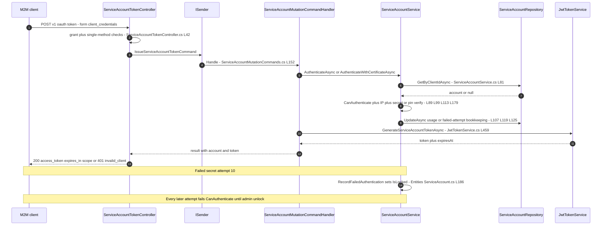
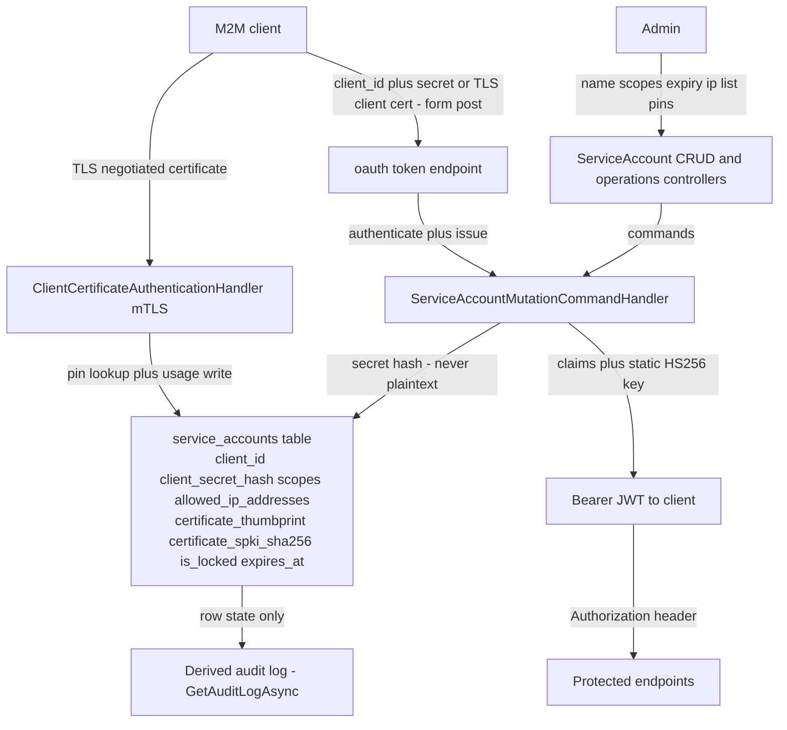

# Service Account Flow (Creation, Client-Certificate Binding, Token Exchange, Expiry) — User Flow Diagram

> Issue #1104 · Module `GameGuild.Identity.Authentication` (+ `GameGuild.API` host pipeline) · Documented against `develop` commit `74e9bba4c`.
> Scope: machine-to-machine accounts — admin creation with one-time client secret, OAuth2 `client_credentials` token exchange (secret or bound X.509 client certificate), scope management, secret rotation, lock/unlock, activation and expiry, the standalone mTLS `ClientCertificate` scheme, and the derived audit log. The certificate-binding API surface landed via PR #1168 (issue #1146).

## 1. Overview

Service accounts are M2M principals in `service_accounts` (`Entities/ServiceAccount.cs`, table per `Data/Configurations/ServiceAccountConfiguration.cs:10`) with a public `svc_<guid>` ClientId and a hashed 64-byte client secret (`Services/ServiceAccountService.cs:29-72` — plaintext returned once at creation, `Controllers/ServiceAccountCrudController.cs:60-76`). All management endpoints require the `RequireAdminRole` policy (`Controllers/ServiceAccountCrudController.cs:33`, `Controllers/ServiceAccountOperationsController.cs:30`). Token exchange is `POST /v{v}/oauth/token` — anonymous, rate-limited, form-encoded `client_credentials` (`Controllers/ServiceAccountTokenController.cs:34-107`): the controller enforces exactly one client-authentication method (RFC 6749 §2.3 — secret or TLS-negotiated certificate, never both), then `IssueServiceAccountTokenCommand` (`Commands/ServiceAccountMutationCommands.cs:152-182`) authenticates via secret (`ServiceAccountService.AuthenticateAsync`, `:75-132` — hash verify, `CanAuthenticate` gate, optional IP allowlist, failed-attempt lockout at 10) or via certificate (`AuthenticateWithCertificateAsync`, `:135-203` — fail-closed thumbprint/SPKI match against the bound pins) and mints an HS256 JWT with `sub`, `client_id`, `service_name`, `actor_kind=Service`, `grant_type`, per-scope `scope` claims and optional `tenant_id` (`Services/JwtTokenService.cs:459-519`; same 60-minute lifetime and static platform signing key as user tokens). Certificate binding is `PATCH /auth/service-accounts/{id}/client-certificate` (`Controllers/ServiceAccountOperationsController.cs:223-244`): pins are normalized exactly as authentication-time computes (hex-stripped, uppercased — `Services/ServiceAccountService.cs:225-288`), and unique indexes enforce one cert per account (`Data/Configurations/ServiceAccountConfiguration.cs:88-93`). A standalone mTLS scheme (`Services/ClientCertificateAuthenticationHandler.cs:57-182`) authenticates requests directly from a negotiated certificate: CA-allowlist chain validation, client-auth EKU, unique binding lookup, account state and IP checks — issuing the same Service-actor claims plus `auth_method=client_certificate` and `cert_thumbprint`. Expiry (`ExpiresAt`), deactivation and lockout all collapse into `CanAuthenticate` (`Entities/ServiceAccount.cs:147-155`); the audit log is *derived* from row state, not a persisted event stream (`Services/ServiceAccountService.cs:411-476`).

## 2. End-to-End Flowchart — happy path and every edge case

```mermaid
flowchart TD
    subgraph CREATE["Admin creates account"]
        CR1["Admin POST v1 auth service-accounts<br/>ServiceAccountCrudController.cs L32"] --> CR2{"Name non-empty<br/>L43"}
        CR2 -- "blank" --> CR400a["400 Name is required L45"]
        CR2 -- "ok" --> CR3["CreateServiceAccountCommand<br/>CreatedBy from current user L48"]
        CR3 --> CR4["ServiceAccountService CreateServiceAccountAsync<br/>ServiceAccountService.cs L29"]
        CR4 --> CR5["ClientId svc_ guid - uniqueness loop<br/>L40"]
        CR5 --> CR6["64 random bytes secret - base64url<br/>hashed via IRefreshTokenHasher L49"]
        CR6 --> CR7["Repository CreateAsync persists row L65"]
        CR7 --> CR8["201 with ClientId plus ClientSecret once<br/>plus storage warning L60"]
    end

    subgraph TOKEN["Token exchange - POST oauth token"]
        T1["M2M client POST form to v1 oauth token<br/>ServiceAccountTokenController.cs L34"] --> T2["AllowAnonymous plus rate limit policy Authentication L35"]
        T2 --> T3{"GrantType is client_credentials<br/>L42"}
        T3 -- "other" --> T400a["400 unsupported_grant_type L44"]
        T3 -- "ok" --> T4{"ClientId present<br/>L57"}
        T4 -- "missing" --> T400b["400 invalid_request L59"]
        T4 -- "present" --> T5{"Certificate AND secret both present<br/>L66"}
        T5 -- "yes" --> T400c["400 use either not both L68"]
        T5 -- "no" --> T6{"Neither present<br/>L75"}
        T6 -- "yes" --> T400d["400 secret or certificate required L77"]
        T6 -- "no" --> T7["IssueServiceAccountTokenCommand<br/>Commands ServiceAccountMutationCommands.cs L152"]
        T7 --> T8{"Certificate supplied<br/>L158"}
        T8 -- "no" --> T9["AuthenticateAsync secret path<br/>ServiceAccountService.cs L75"]
        T8 -- "yes" --> T10["AuthenticateWithCertificateAsync<br/>ServiceAccountService.cs L135"]
    end

    subgraph SECRETPATH["Secret authentication"]
        SP1["GetByClientIdAsync<br/>ServiceAccountService.cs L81"] --> SP2{"Account found<br/>L83"}
        SP2 -- "unknown client" --> SP401a["null - 401 invalid_client - no attempt recorded L85"]
        SP2 -- "found" --> SP3{"CanAuthenticate - active - not locked - not expired<br/>Entities ServiceAccount.cs L147"}
        SP3 -- "no" --> SP401b["null with state logged L91"]
        SP3 -- "yes" --> SP4{"AllowedIpAddresses set and IP provided<br/>L99"}
        SP4 -- "yes and IP not allowed - exact match" --> SP401c["RecordFailedAuthentication then null L106"]
        SP4 -- "no list or no IP" --> SP5{"Hasher VerifyToken secret<br/>L113"}
        SP5 -- "mismatch" --> SP401d["RecordFailedAuthentication - lock at 10 fails<br/>Entities ServiceAccount.cs L186"]
        SP5 -- "match" --> SP6["RecordSuccessfulAuthentication - clears fail count<br/>Entities ServiceAccount.cs L174"]
    end

    subgraph CERTPATH["Certificate authentication - exchange and mTLS scheme"]
        CP1["Certificate presented via TLS<br/>ServiceAccountService.cs L135 or ClientCertificateAuthenticationHandler.cs L57"] --> CP2{"Account found by ClientId<br/>or by thumbprint SPKI lookup L143 L95"}
        CP2 -- "unknown" --> CP401a["null - fail closed"]
        CP2 --> CP3{"CanAuthenticate<br/>L151 L127"}
        CP3 -- "no" --> CP401b["null - fail closed"]
        CP3 -- "yes" --> CP4{"IP allowlist check<br/>L161 L139"}
        CP4 -- "not allowed" --> CP401c["fail closed - counts failed attempt"]
        CP4 -- "allowed" --> CP5{"Thumbprint OR SPKI matches bound pin<br/>case-insensitive - L179 L96"]
        CP5 -- "neither matches or nothing bound" --> CP401d["fail closed - counts failed attempt L184"]
        CP5 -- "match" --> CP6["RecordSuccessfulAuthentication then claims"]
        MT1["mTLS scheme extra gates<br/>ClientCertificateAuthenticationHandler.cs L61"] --> MT2{"CA allowlist configured<br/>L61"}
        MT2 -- "empty" --> MT401a["fail CertificateAllowlistUnconfigured L63"]
        MT2 -- "configured" --> MT3{"Chain builds to custom root trust<br/>L75 L184"}
        MT3 -- "no" --> MT401b["fail CertificateChainUntrusted L77"]
        MT3 -- "yes" --> MT4{"Client-auth EKU present or no EKU<br/>L82 L207"}
        MT4 -- "restricted without clientAuth" --> MT401c["fail CertificateUseNotAllowed L85"]
        MT4 -- "ok" --> MT5{"Matches exactly one account<br/>L108"}
        MT5 -- "more than one" --> MT401d["fail CertificateBindingAmbiguous L113"]
        MT5 -- "zero" --> MT401e["fail CertificateNotBound L121"]
        MT5 -- "one" --> CP6
    end

    subgraph BIND["Certificate binding - PATCH client-certificate"]
        B1["Admin PATCH id client-certificate<br/>ServiceAccountOperationsController.cs L223"] --> B2["BindServiceAccountCertificateCommand L235"]
        B2 --> B3["NormalizeHexPin - strip separators - uppercase<br/>thumbprint 40 or 64 hex - spki 64 hex<br/>ServiceAccountService.cs L225"]
        B3 -- "malformed pin" --> B400["ArgumentException - 400 via nothing caught - see Gaps"]
        B3 -- "valid" --> B4["BindCertificate persists both pins<br/>Entities ServiceAccount.cs L232"]
        B4 --> B5["204 - next auth matches on either pin"]
        B4 -- "pin already bound to another account" --> B500["unique index violation - 500 - Configuration L88"]
    end

    subgraph ISSUE["Token issuance after authentication"]
        I1["Authenticated account<br/>Commands ServiceAccountMutationCommands.cs L169"] --> I2["GenerateServiceAccountTokenAsync<br/>Services JwtTokenService.cs L459"]
        I2 --> I3["Claims sub client_id service_name jti iat<br/>actor_kind Service grant_type client_credentials<br/>plus scope claims plus tenant_id L475"]
        I3 --> I4["Sign HS256 static platform key - 60 min default<br/>L473 L507"]
        I4 --> I5["200 access_token bearer expires_in scope<br/>ServiceAccountTokenController.cs L100"]
    end

    subgraph LIFECYCLE["Lifecycle - rotation lock expiry"]
        LC1["Rotate secret - POST id rotate-secret<br/>ServiceAccountOperationsController.cs L29"] --> LC2["New secret hashed - old invalid immediately<br/>ServiceAccountService.cs L206"]
        LC3["Lock - POST id lock with reason L78"] --> LC4["IsLocked true - auth fails until admin unlock"]
        LC5["Unlock - POST id unlock L54"] --> LC6["Unlock clears counter L199"]
        LC7["Deactivate or DELETE id L156 L167"] --> LC8["IsActive false - soft delete only"]
        LC9["ExpiresAt passes"] --> LC10["CanAuthenticate false - silent - no notification<br/>Entities ServiceAccount.cs L153"]
        LC11["Patch scopes - PATCH id scopes L196"] --> LC12["Scopes overwritten - next token carries new set<br/>ServiceAccountService.cs L365"]
    end

    SP6 --> ISSUE
    CP6 --> ISSUE
```

## 3. CQRS Chain Sequence Diagram



## 4. Data Flow Diagram



## 5. Edge-Case Matrix

| # | Edge case | Code path | Outcome |
|---|-----------|-----------|---------|
| 1 | Grant type other than `client_credentials` | check (`Controllers/ServiceAccountTokenController.cs:42-49`) | 400 `unsupported_grant_type` |
| 2 | Both client secret and TLS certificate presented | single-method rule (`:66-73`) | 400 `invalid_request` (RFC 6749 §2.3) |
| 3 | Neither secret nor certificate | (`:75-82`) | 400 `invalid_request` |
| 4 | Unknown `client_id` | lookup miss (`Services/ServiceAccountService.cs:81-87`) | uniform 401 `invalid_client`; no failed-attempt row exists to count |
| 5 | Deleted/inactive account | `CanAuthenticate` (`Entities/ServiceAccount.cs:147-155`) | 401; state details only in server logs (`:91-95`) |
| 6 | Locked account (10 consecutive failures) | `RecordFailedAuthentication` lock at threshold (`:186-194`) | 401 until `:unlock`; **no automatic lock expiry** |
| 7 | Expired account (`ExpiresAt` passed) | `CanAuthenticate` (`:153`) | 401, silent — no warning or notification path exists |
| 8 | IP allowlist set, request from disallowed IP | exact-match `IsIpAllowed` (`Services/ServiceAccountService.cs:397-409`) | failure **and** the attempt counts toward lockout (`:106-109`) — a attacker on any network can lock the account by spamming wrong-IP attempts |
| 9 | IP allowlist set but `ipAddress` null/empty (secret path) | guard `&& !string.IsNullOrEmpty(ipAddress)` (`:99`) | **whitelist skipped entirely** — fail-open on the secret path (contrast: mTLS path denies null IP, `Services/ClientCertificateAuthenticationHandler.cs:228-237`) |
| 10 | CIDR entry in `AllowedIpAddresses` | exact string compare only (`:402-408`, comment "CIDR support could be added") | subnet entries never match |
| 11 | Wrong secret 9 times then correct one | success resets counter (`Entities/ServiceAccount.cs:174-180`) | attacker keeps 9-attempt budget indefinitely — no sliding window |
| 12 | Certificate bound, secret also valid | either method accepted at `/oauth/token` (`Commands/ServiceAccountMutationCommands.cs:158-168`) | dual credentials until secret rotation |
| 13 | Presented cert matches neither pin | fail-closed OR-match (`Services/ServiceAccountService.cs:179-192`) | 401 + failed-attempt counted |
| 14 | Same certificate pinned to two accounts (attempted bind) | unique indexes (`Data/Configurations/ServiceAccountConfiguration.cs:88-93`) | DB unique violation surfaces as an unhandled 500 on the bind endpoint, not a 400 |
| 15 | Malformed thumbprint/SPKI in bind request | `NormalizeHexPin` throws `ArgumentException` (`Services/ServiceAccountService.cs:231-240`) | controller catches only `InvalidOperationException` → 404 (`Controllers/ServiceAccountOperationsController.cs:239-242`); `ArgumentException` escapes as 500 despite the declared 400 |
| 16 | mTLS request with untrusted CA | custom-root chain build (`Services/ClientCertificateAuthenticationHandler.cs:184-205`) | fail `CertificateChainUntrusted` |
| 17 | Certificate with EKU but no client-auth OID | EKU check (`:207-226`) | fail `CertificateUseNotAllowed`; no-EKU certs are accepted |
| 18 | mTLS with allowlist unconfigured | fail-closed startup + runtime check (`:61-66`, `:308-317`) | scheme refuses every cert; registration itself throws on empty allowlist (`:393-408`) |
| 19 | Ambiguous cert→account matches | `matches.Count > 1` (`:108-116`) | fail `CertificateBindingAmbiguous` (defense in depth over the unique index) |
| 20 | Revocation checking for client certs | `CheckCertificateRevocation` option (`:306`, `:191-194`) | off by default — revoked-but-unexpired certs still pass chain validation |
| 21 | Concurrent token calls | `RecordSuccessfulAuthentication` + `UpdateAsync` per call (`Services/ServiceAccountService.cs:124-125`) | last-write-wins on counters; no row-version token → lost updates under load |
| 22 | `DELETE /{id}` | maps to `DeactivateServiceAccountCommand` (`Controllers/ServiceAccountCrudController.cs:167-181`) | soft delete only; ClientId and pins stay reserved forever, no hard-delete path |
| 23 | Admin lists without tenant filter | `GetAllAsync` (`:159-161`) | every tenant's service accounts returned to any `RequireAdminRole` caller |
| 24 | Audit log requested | derived entries from row state (`Services/ServiceAccountService.cs:411-476`) | only the *latest* state is reconstructable — no persisted per-event history |
| 25 | Token lifetime / signing | `AccessTokenExpirationMinutes` + static `SecretKey` (`Services/JwtTokenService.cs:473`, `:507-511`) | same 60-minute lifetime and same signing key as user tokens; no separate service-token policy |

## 6. Endpoint Inventory

| Method + Route | Handler chain | Controller ref |
|----------------|---------------|----------------|
| POST `v{v}/auth/service-accounts` | `CreateServiceAccountCommand` → handler → `CreateServiceAccountAsync` | `Controllers/ServiceAccountCrudController.cs:32-76` |
| GET `v{v}/auth/service-accounts` (+`?tenantId=`) | direct `IServiceAccountService` read | `Controllers/ServiceAccountCrudController.cs:148-162` |
| GET/HEAD `v{v}/auth/service-accounts/{id}` | direct read | `Controllers/ServiceAccountCrudController.cs:81-112` |
| PATCH `v{v}/auth/service-accounts/{id}` | `PatchServiceAccountCommand` | `Controllers/ServiceAccountCrudController.cs:121-140` |
| DELETE `v{v}/auth/service-accounts/{id}` | `DeactivateServiceAccountCommand` (soft) | `Controllers/ServiceAccountCrudController.cs:167-181` |
| POST `v{v}/auth/service-accounts/{id}:rotate-secret` | `RotateServiceAccountSecretCommand` | `Controllers/ServiceAccountOperationsController.cs:29-49` |
| POST `v{v}/auth/service-accounts/{id}:lock` / `:unlock` | `Lock/UnlockServiceAccountCommand` | `Controllers/ServiceAccountOperationsController.cs:54-94` |
| GET `v{v}/auth/service-accounts/{id}/audit-log` | direct `GetAuditLogAsync` | `Controllers/ServiceAccountOperationsController.cs:104-151` |
| POST `v{v}/auth/service-accounts/{id}:deactivate` / `:reactivate` | `Deactivate/ReactivateServiceAccountCommand` | `Controllers/ServiceAccountOperationsController.cs:156-191` |
| PATCH `v{v}/auth/service-accounts/{id}/scopes` | `UpdateServiceAccountScopesCommand` | `Controllers/ServiceAccountOperationsController.cs:196-213` |
| PATCH `v{v}/auth/service-accounts/{id}/client-certificate` | `BindServiceAccountCertificateCommand` → `BindCertificateAsync` | `Controllers/ServiceAccountOperationsController.cs:223-244` (issue #1146, merged via PR #1168) |
| POST `/v{v}/oauth/token` | `IssueServiceAccountTokenCommand` → authenticate (secret or cert) → `GenerateServiceAccountTokenAsync` | `Controllers/ServiceAccountTokenController.cs:34-107` |
| (any route) mTLS scheme `ClientCertificate` | `ClientCertificateAuthenticationHandler` registered behind `EnableClientCertificateAuthentication` | `GameGuild.API/Core/Extensions/SecurityServiceCollectionExtensions.cs:221-224` |

## 7. Events Published / Consumed

- **Published** — durable operation events only (no domain events, no audit sink): `identity.authentication.create-service-account`, `patch-service-account`, `rotate-service-account-secret`, `lock/unlock/deactivate/reactivate-service-account`, `issue-service-account-token`, `bind-service-account-certificate` (`Architecture/UseCaseEventContracts.g.cs:34-59`, `Architecture/AuthenticationUseCaseEventContracts.cs:47`). Per-request authentication outcomes (success/failure with reasons like `CertificateChainUntrusted`, `CertificateBindingAmbiguous`, `ServiceAccountIpNotAllowed`) flow through `IAuthenticationAuditEventSink` (`Services/ClientCertificateAuthenticationHandler.cs:260-287`). Lifecycle changes otherwise surface as `ILogger` lines only (`Services/ServiceAccountService.cs:67`, `:217`, `:248`).
- **Consumed** — `IRefreshTokenHasher` for secret hashing; `JwtOptions` for token lifetime/signing; `ClientCertificateAuthenticationSettings` (CA allowlist, revocation mode) for the mTLS scheme; `RateLimitPolicies.Authentication` on `/oauth/token` (`Controllers/ServiceAccountTokenController.cs:36`).

## 8. Entities and Tables Touched

| Entity / store | Fields that matter | Ref |
|----------------|--------------------|-----|
| `ServiceAccount` → `gameguild.authentication.service_accounts` | `ClientId` (unique), `ClientSecretHash`, `Scopes`, `IsActive`, `ExpiresAt`, `IsLocked/LockedAt`, `FailedAuthenticationAttempts`, `LastAuthenticatedAt/FromIp`, `AuthenticationCount`, `SecretRotatedAt/Count`, `AllowedIpAddresses`, `CertificateThumbprint` (unique), `CertificateSpkiSha256` (unique) | `Entities/ServiceAccount.cs:9-247`, `Data/Configurations/ServiceAccountConfiguration.cs:10-93` |
| Issued JWT (no row) | `sub`, `client_id`, `service_name`, `jti`, `iat`, `actor_kind=Service`, `grant_type=client_credentials`, `scope`×N, optional `tenant_id` | `Services/JwtTokenService.cs:475-505` |
| Authentication audit events | via `IAuthenticationAuditEventSink` (mTLS path) | `Services/ClientCertificateAuthenticationHandler.cs:272-281` |
| Operation event stream | `identity.authentication.*-service-account` | `Architecture/UseCaseEventContracts.g.cs:34-59` |

## 9. Gaps — realistic scenarios the code does not handle

1. **IP allowlist fails open when the caller IP is unavailable on the secret path.** `AuthenticateAsync` only evaluates `AllowedIpAddresses` when `ipAddress` is non-empty (`Services/ServiceAccountService.cs:99`, `:161`); a deployment where `RemoteIpAddress` resolves null (some proxies/test hosts) silently bypasses the restriction. The mTLS twin fails closed (`Services/ClientCertificateAuthenticationHandler.cs:139`, `:228-237`) — the two paths disagree.
2. **Lockout is a denial-of-service lever.** Every failed secret/IP/pin attempt increments `FailedAuthenticationAttempts` (`Services/ServiceAccountService.cs:106-108`, `:118-120`, `:189-191`); any party who knows a valid `client_id` can push the account to `IsLocked` with 10 requests from anywhere, and locks never expire — only an admin `:unlock` restores service (`Entities/ServiceAccount.cs:199-204`).
3. **`ExpiresAt` expiry is silent.** `CanAuthenticate` flips false (`Entities/ServiceAccount.cs:153`) with no warning horizon, notification, or listing signal — M2M integrations discover expiry as production 401s.
4. **Certificate binding error handling is wrong twice.** A malformed pin throws `ArgumentException` (`Services/ServiceAccountService.cs:235-240`) which the controller does not catch (only `InvalidOperationException` → 404, `Controllers/ServiceAccountOperationsController.cs:239-242`) producing a 500 despite the declared 400; a pin already bound to another account trips the unique index (`Data/Configurations/ServiceAccountConfiguration.cs:88-93`) as an unhandled 500 too.
5. **No certificate unbind surface.** `ServiceAccount.UnbindCertificate` exists (`Entities/ServiceAccount.cs:242-247`) but no command or endpoint calls it — an account can re-bind a new cert but cannot return to secret-only authentication via the API.
6. **Audit "log" is derived, not recorded.** `GetAuditLogAsync` reconstructs entries from current row state (`Services/ServiceAccountService.cs:411-476`): rotation count survives, but *who* locked, *when* scopes changed, or a full authentication history does not exist anywhere.
7. **Secret rotation has no overlap window** (`Services/ServiceAccountService.cs:206-222`, contrast in `key-rotation-flow.md`) — distributed clients face an inevitable window of 401s between rotation and reconfiguration; there is also no `SecretRotatedAt`-based forced-expiry of previously issued tokens (issued 60-minute JWTs outlive the secret that minted them).
8. **Service tokens share the user-token signing key and lifetime** (`Services/JwtTokenService.cs:473`, `:507-511`): no shorter service lifetime, no separate key, no audience restriction per client — compounded by the unwired signing-key rotation of issue #1141.
9. **Counter updates race under concurrent authentication.** `RecordSuccessfulAuthentication`/`RecordFailedAuthentication` mutate a tracked entity and `UpdateAsync` (last-write-wins, `Services/ServiceAccountService.cs:107`, `:119`, `:125`); parallel token calls can lose attempt counts or authentication stats.

