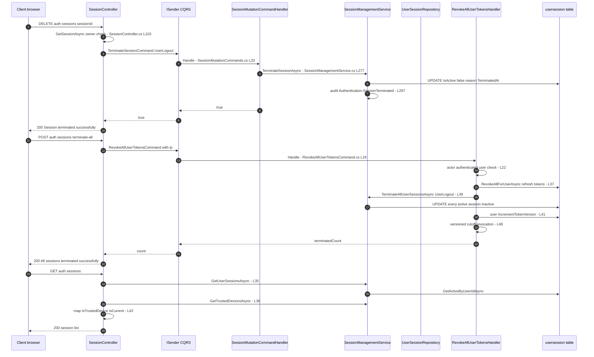
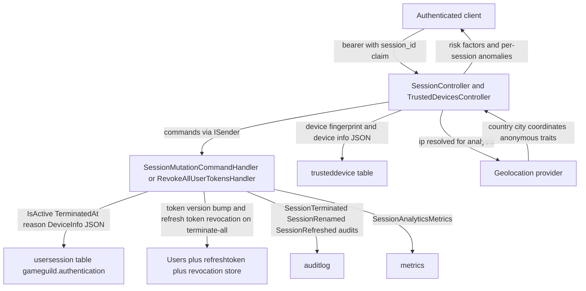

# Session Management Flow (List, Terminate, Terminate-Others, Terminate-All, Rename, Security Analysis, Device Trust) — User Flow Diagram

> Issue #1100 · Module `GameGuild.Identity.Authentication` · Documented against `develop` commit `74e9bba4c`.
> Scope: the authenticated user's view and control of their own sessions — listing with trust/current markers, per-session security analysis (geo-velocity, anonymous networks, per-session anomalies), single-session termination, terminate-others, terminate-all (full token-revocation battery), session refresh, session/trusted-device naming, and the trusted-device (device trust) surface.

## 1. Overview

Two controllers serve this flow: `SessionController` (`Controllers/SessionController.cs:18`, `[Authorize]`) and `TrustedDevicesController` (`Controllers/TrustedDevicesController.cs:18`, `[Authorize]`). The current session is identified from the `session_id` claim (`SessionController.cs:244-254`); mutations go through `SessionMutationCommandHandler` (`Commands/SessionMutationCommands.cs:24-80`) into `SessionManagementService` (`Services/SessionManagementService.cs:12`).

**List** (`GET auth/sessions`, `SessionController.cs:27-57`) returns active rows via `GetActiveByUserIdAsync` (expiry-aware, `SessionManagementService.cs:94-104`), parsed device/location JSON (`SessionEnrichmentJson`), an `IsTrustedDevice` marker computed by intersecting session fingerprints with valid trusted devices (`:36-51`), and `IsCurrent` from the session claim. **Security analysis** (`GET auth/sessions:analyze-security`, `:68-82`) computes an additive risk score (`SessionManagementService.cs:629-841`): >10 unique IPs +30, >5 devices +30, >10 active sessions +60, ≥2 concurrent locations +25, impossible-travel geo-velocity +35 (`GeoVelocity.DefaultImpossibleTravelSpeedKmh`), Tor +30 / VPN-proxy +20 / hosting +10 (issue #278), sessions outside the usual country +15 each (max 2), mapped to Low/Medium/High/Critical at 30/60/80 with per-session anomaly ids in metadata.

**Terminate one** (`DELETE auth/sessions/{id}`, `SessionController.cs:94-119`): owner-checked, then `TerminateSessionAsync` flips `IsActive=false` with reason `UserLogout` (`SessionManagementService.cs:277-302`) — access tokens die at the next request via `TokenRevocationMiddleware`'s session check, and a refresh attempt from that session triggers **replay containment** (`SessionInactive`, see token-lifecycle doc). **Terminate-others** (`:168-186`) keeps the current session. **Terminate-all** (`:193-208`) sends `RevokeAllUserTokensCommand` — revoke every refresh token, terminate every session, `IncrementTokenVersion`, and a versioned-cutoff revocation covering legacy tokens (`Commands/RevokeAllUserTokensCommand.cs:19-51`). **Rename session** (`:128-157`) writes the name into the session's device-metadata JSON (1–64 chars, survives rotation, `SessionManagementService.cs:472-501`). **Refresh** (`:215-238`) extends expiry capped by the absolute timeout (`:129-153`). **Trusted devices**: list/`POST` trust-current (fingerprint resolved from the session row, never client-supplied, `Commands/SessionMutationCommands.cs:46-70`), revoke, rename (1–200 chars). Max concurrent sessions default 5 enforces eviction of least-recently-used rows on creation (`SessionManagementService.cs:557-579`, `SessionOptions.cs:47`).

## 2. End-to-End Flowchart — happy path and every edge case

```mermaid
flowchart TD
    subgraph LISTV["List and view sessions"]
        L1["GET auth sessions - Authorize<br/>SessionController.cs L27"] --> L2["GetActiveByUserIdAsync expiry aware<br/>SessionManagementService.cs L94"]
        L2 -- "all sessions expired or none" --> L3["200 empty list"]
        L2 -- "active rows" --> L4["GetTrustedDevicesAsync valid fingerprints<br/>SessionController.cs L36"]
        L4 --> L5["per session IsTrustedDevice by fingerprint match<br/>IsCurrent from session_id claim - L51"]
        L5 --> L6["200 list with device location ip created lastUsed expires"]
    end

    subgraph ANALYZE["Security analysis - GET auth sessions analyze-security"]
        N1["request with ip and user agent<br/>SessionController.cs L68"] --> N2["active sessions expiry aware<br/>SessionManagementService.cs L635"]
        N2 --> N3{"count thresholds<br/>L651 L657 L663"}
        N3 -- "over 10 unique IPs" --> N4["plus 30 Multiple IPs"]
        N3 -- "over 5 unique devices" --> N5["plus 30 Multiple devices"]
        N3 -- "over 10 active sessions" --> N6["plus 60 High active session count"]
        N2 --> N7{"concurrent populated locations at least 2 - L675"}
        N7 -- "yes" --> N8["plus 25 Concurrent locations"]
        N2 --> N9{"geo velocity between consecutive located sessions<br/>L715 L724"}
        N9 -- "over impossible travel speed" --> N10["plus 35 Impossible travel"]
        N2 --> N11{"anonymous network traits - L740 L746 L753"}
        N11 -- "Tor or VPN proxy or hosting" --> N12["plus 30 or plus 20 or plus 10"]
        N2 --> N13{"sessions outside usual country<br/>majority or request-matching baseline - L765"}
        N13 -- "anomalous sessions found" --> N14["plus 15 each capped at 2 plus anomalous ids"]
        N4 --> N15{"risk score tiers - L811"}
        N5 --> N15
        N6 --> N15
        N8 --> N15
        N10 --> N15
        N12 --> N15
        N14 --> N15
        N15 -- "80 or more" --> N16["Critical"]
        N15 -- "60 to 79" --> N17["High"]
        N15 -- "30 to 59" --> N18["Medium"]
        N15 -- "below 30" --> N19["Low"]
        N16 --> N20["200 analysis with factors and metadata"]
        N17 --> N20
        N18 --> N20
        N19 --> N20
        N2 -- "geolocation provider missing or disabled" --> N21["geo factors skipped<br/>metadata geo_data_available false - L696"]
        N21 --> N15
    end

    subgraph TERM["Termination surfaces"]
        T1["DELETE auth sessions by id<br/>SessionController.cs L94"] --> T2{"session exists and owner matches - L105"}
        T2 -- "missing or not owner" --> T404["404 Session not found"]
        T2 -- "own session" --> T3["TerminateSessionCommand reason UserLogout<br/>SessionMutationCommands.cs L33"]
        T3 --> T4["TerminateSessionAsync flips IsActive<br/>TerminatedAt reason - SessionManagementService.cs L287"]
        T4 --> T5["audit Authentication.SessionTerminated - L297"]
        T5 --> T6["200 terminated"]
        T6 --> T7["next request with that sid token<br/>TokenRevocationMiddleware session check 401"]
        T6 --> T8["refresh attempt from terminated session<br/>SessionInactive replay containment - LocalAuthService"]
        T9["POST auth sessions terminate-others<br/>SessionController.cs L168"] --> T10["TerminateUserSessionsCommand with except current - L179"]
        T10 --> T11["TerminateAllUserSessionsAsync keeps exceptSessionId<br/>SessionManagementService.cs L312"]
        T11 --> T12["200 count of terminated"]
        T13["POST auth sessions terminate-all<br/>SessionController.cs L193"] --> T14["RevokeAllUserTokensCommand<br/>RevokeAllUserTokensCommand.cs L19"]
        T14 --> T15["actor must be authenticated user - L22"]
        T15 --> T16["RevokeAllForUserAsync all refresh tokens - L37"]
        T16 --> T17["TerminateAllUserSessionsAsync UserLogout - L39"]
        T17 --> T18["IncrementTokenVersion and save - L41"]
        T18 --> T19["versioned cutoff covers legacy tokens - L48"]
        T19 --> T20["200 count"]
    end

    subgraph MISC["Rename and refresh"]
        M1["PATCH auth sessions id name<br/>SessionController.cs L128"] --> M2{"name 1 to 64 chars after trim - L141"}
        M2 -- "out of range" --> M400["400 length message"]
        M2 -- "ok" --> M3["RenameSessionAsync owner and active checked<br/>SessionManagementService.cs L472"]
        M3 -- "not owner or inactive" --> M404["404 Session not found"]
        M3 -- "own active session" --> M4["name written into DeviceInfo JSON<br/>survives rotation - L492"]
        M4 --> M5["audit Authentication.SessionRenamed - L496"]
        M6["POST auth sessions refresh<br/>SessionController.cs L215"] --> M7{"session_id claim present - L223"}
        M7 -- "absent" --> M400b["400 No active session found"]
        M7 -- "present" --> M8["RefreshSessionAsync L129"]
        M8 -- "inactive or expired" --> M400c["400 Failed to refresh session"]
        M8 -- "active" --> M9["ExpiresAt now plus AbsoluteTimeoutMinutes<br/>capped at CreatedAt plus absolute cap - L145"]
        M9 --> M10["audit Authentication.SessionRefreshed"]
    end

    subgraph TRUST["Trusted device view and management"]
        D1["GET auth trusted-devices<br/>TrustedDevicesController.cs L25"] --> D2{"EnableDeviceFingerprinting<br/>SessionManagementService.cs L456"}
        D2 -- "disabled" --> D3["200 empty list"]
        D2 -- "enabled" --> D4["active unexpired devices only - L464"]
        D5["POST auth trusted-devices trust current<br/>TrustedDevicesController.cs L55"] --> D6{"session_id claim resolves - L65"}
        D6 -- "no" --> D400["400 Current session device is unavailable"]
        D6 -- "yes" --> D7["TrustDeviceCommand<br/>SessionMutationCommands.cs L46"]
        D7 --> D8{"session valid owner matches<br/>has DeviceFingerprint not client supplied - L56"}
        D8 -- "no fingerprint or terminated" --> D400b["400 Failed to trust device"]
        D8 -- "ok" --> D9["TrustDeviceAsync reactivates expired rows<br/>max-device eviction enforced<br/>SessionManagementService.cs L366"]
        D9 --> D10["200 Device trusted successfully"]
        D11["DELETE auth trusted-devices id<br/>TrustedDevicesController.cs L87"] --> D12{"device exists and owner - SessionManagementService.cs L510"}
        D12 -- "no" --> D404["404"]
        D12 -- "yes" --> D13["IsActive false revoke - L515"]
        D14["PATCH auth trusted-devices id name<br/>TrustedDevicesController.cs L113"] --> D15{"name 1 to 200 chars"}
        D15 -- "ok and owner" --> D16["DeviceName updated - L544"]
    end
```

## 3. CQRS Chain Sequence Diagram

## 4. Data Flow Diagram

## 5. Edge-Case Matrix

| # | Edge case | Code path | Outcome |
|---|-----------|-----------|---------|
| 1 | List when every session expired but `IsActive` lazily true | expiry-aware `GetActiveByUserIdAsync` (`Services/SessionManagementService.cs:94-104`) | stale rows excluded from listing |
| 2 | Session with legacy unset `ExpiresAt` in analysis | `ExpiresAt == default` treated as not expired (`:633-636`) | counted active — no false risk inflation |
| 3 | Terminate another user's session | owner check (`Controllers/SessionController.cs:105-108`) | 404, no existence oracle |
| 4 | Terminate an already-terminated session | `TerminateSessionAsync` returns true after rewriting (`:286-301`) | idempotent 200; metrics only recorded when previously active |
| 5 | Terminated session's access token reused | per-request middleware session check (token-lifecycle doc) | 401 at next request — no jti deny-list write needed |
| 6 | Terminated session's refresh token reused | rotation path sees session inactive → replay containment (`Services/LocalAuthService.cs` rotation branch) | family revocation — containment, not just denial |
| 7 | Legacy token without `sid` claim after single-session terminate | single terminate does not bump token version or write cutoff (`:277-302`) | legacy access token keeps working until expiry (Gaps) |
| 8 | `terminate-others` with no `session_id` claim | `exceptSessionId = null` (`Controllers/SessionController.cs:176-179`) | **all** sessions terminated including current (Gaps) |
| 9 | `terminate-all` from a service-account token | actor-kind guard (`Commands/RevokeAllUserTokensCommand.cs:22-26`) | `AuthenticationRequiredException` (401) |
| 10 | `terminate-all` with user row deleted mid-flight | `user is null` (`:31-34`) | 401, no partial revocation |
| 11 | Rename with empty/oversized name | length guard (`Controllers/SessionController.cs:141-147`, `SessionManagementService.cs:474-478`) | 400 with bound message; service returns false → 404 path |
| 12 | Rename an inactive session | `IsActive` + owner check (`:480-484`) | 404 |
| 13 | Refresh an expired session | expired branch terminates with reason Expired (`:140-144`) | 400; row cleaned |
| 14 | Refresh pushing beyond absolute cap | `CapAbsoluteExpiration(now+timeout, CreatedAt+cap)` (`:145`) | expiry clamped, no infinite sessions |
| 15 | Trust device when fingerprinting disabled | option gate (`:368`, `:456-459`) | refuse/list empty — feature fully off |
| 16 | Trust a session without a stored fingerprint | guard (`Commands/SessionMutationCommands.cs:56-59`) | 400 — client-supplied fingerprints never trusted |
| 17 | Re-trust an expired trusted device | reactivation + max-device eviction (`Services/SessionManagementService.cs:376-384`) | row reactivated, oldest evicted |
| 18 | Concurrent sign-ins beyond 5 | eviction of least-recently-used on creation (`:557-579`, `SessionOptions.cs:47`) | oldest sessions terminated `MaxSessionsExceeded` |
| 19 | Analysis with geolocation provider down | try/catch continues without location (`:696-707`, `:270-274`) | geo factors skipped; analysis still returns |
| 20 | Analysis with tied country distribution and no request match | strict-majority requirement (`:784-797`) | no usual-country baseline → no anomaly flags |
| 21 | Impossible travel flagged on first pair | loop breaks after first hit (`:724-729`) | +35 once, not stacked per pair |
| 22 | Trusted-device list shows revoked/expired rows | filter (`:463-464`) | only active, unexpired rows returned |
| 23 | Rename trusted device not owned | owner check (`:538-541`) | 404 |

## 6. Endpoint Inventory

| Method + Route | Handler chain | Controller ref |
|----------------|---------------|----------------|
| GET `v{v}/auth/sessions` | direct `SessionManagementService.GetUserSessionsAsync` + trusted-device intersect | `Controllers/SessionController.cs:27-57` |
| GET `v{v}/auth/sessions:analyze-security` | direct `AnalyzeSessionSecurityAsync` | `Controllers/SessionController.cs:68-82` |
| DELETE `v{v}/auth/sessions/{sessionId:guid}` | `TerminateSessionCommand` → `TerminateSessionAsync` | `Controllers/SessionController.cs:94-119` |
| PATCH `v{v}/auth/sessions/{sessionId:guid}/name` | `RenameSessionCommand` → `RenameSessionAsync` | `Controllers/SessionController.cs:128-157` |
| POST `v{v}/auth/sessions:terminate-others` | `TerminateUserSessionsCommand` → `TerminateAllUserSessionsAsync` (except current) | `Controllers/SessionController.cs:168-186` |
| POST `v{v}/auth/sessions:terminate-all` | `RevokeAllUserTokensCommand` → `RevokeAllUserTokensHandler` | `Controllers/SessionController.cs:193-208` |
| POST `v{v}/auth/sessions:refresh` | `RefreshUserSessionCommand` → `RefreshSessionAsync` | `Controllers/SessionController.cs:215-238` |
| GET `v{v}/auth/trusted-devices` | direct `GetTrustedDevicesAsync` | `Controllers/TrustedDevicesController.cs:25-47` |
| POST `v{v}/auth/trusted-devices` | `TrustDeviceCommand` → `TrustDeviceAsync` | `Controllers/TrustedDevicesController.cs:55-79` |
| DELETE `v{v}/auth/trusted-devices/{deviceId:guid}` | `RevokeTrustedDeviceCommand` → `RevokeTrustedDeviceAsync` | `Controllers/TrustedDevicesController.cs:87-104` |
| PATCH `v{v}/auth/trusted-devices/{deviceId:guid}/name` | `RenameTrustedDeviceCommand` → `RenameTrustedDeviceAsync` | `Controllers/TrustedDevicesController.cs:113-141` |

## 7. Events Published / Consumed

- **Published (audit events + metrics, no durable integration events):** `Authentication.SessionTerminated` on every termination path incl. eviction (`Services/SessionManagementService.cs:297`, `:323`, `:571`), `Authentication.SessionRenamed` (`:496`), `Authentication.SessionRefreshed` (`:150`); `SessionAnalyticsMetrics.RecordTerminated` (`:294`, `:328`, `:577`); refresh-token lifecycle event `AllRevoked` on terminate-all (`Commands/RevokeAllUserTokensCommand.cs:44-45`); `RefreshTokenLifecycleMetrics.RecordAttempt(AllRevoked)` (`:29`).
- **Consumed:** `TokenRevocationMiddleware` reads the `usersession` row on every authenticated request (session-check leg); token rotation binds/refreshes the session row (`BindSessionAsync`, `:304-310`).

## 8. Entities and Tables Touched

| Entity / Table | Mapping | Writes |
|----------------|---------|--------|
| `UserSession` → `gameguild.authentication.usersession` | snapshot `:20694` | UPDATE IsActive/TerminatedAt/reason (terminate `:287-291`, bulk `:317-323`, eviction `:565-571`), UPDATE DeviceInfo JSON (rename `:493`), UPDATE ExpiresAt/LastUsedAt (refresh `:145-147`) |
| `TrustedDevice` → `trusteddevice` | — | INSERT/reactivate (trust `:374-389`), UPDATE IsActive false (revoke `:515-518`), UPDATE DeviceName (rename `:544-547`) |
| `Users` (token version) | — | `IncrementTokenVersion` on terminate-all (`Commands/RevokeAllUserTokensCommand.cs:41-43`) |
| `refreshtoken` | — | `RevokeAllForUserAsync` on terminate-all (`:37-38`) |
| revocation store (distributed) | — | versioned cutoff on terminate-all (`:48-49`) |
| `auditlog` | — | session lifecycle audit events above |

## 9. Gaps — realistic scenarios the code does not handle

1. **Single-session termination leaves legacy access tokens alive.** `TerminateSessionAsync` only flips the session row (`Services/SessionManagementService.cs:286-291`); it writes no jti deny-list entry and no versioned cutoff. Tokens carrying the `sid` claim die at the next middleware check, but **legacy or custom-issued access tokens without `sid`** keep working until natural expiry — asymmetric with terminate-all's full battery (`Commands/RevokeAllUserTokensCommand.cs:37-49`).
2. **`terminate-others` without a `session_id` claim kills every session including the current one.** `GetCurrentSessionId()` returns null and `exceptSessionId` is passed as null (`Controllers/SessionController.cs:176-179`), making "terminate others" degrade into terminate-all **without** the token revocation battery (only session rows flip; refresh tokens stay unrevoked-but-contained) — the caller still holds a now-terminated session and a still-valid access token until its next request 401s.
3. **Terminated session's refresh attempt triggers replay containment, not a clean denial.** Because rotation treats "session inactive" as a replay signal (`Services/LocalAuthService.cs` rotation branch), a user who terminates one device then has that device auto-refresh gets the whole token family revoked (and account-wide revocation under the Account containment scope) — collateral damage from a self-inflicted, legitimate action.
4. **No confirmation/step-up for global termination.** `terminate-all` executes on a bare access token with no re-authentication; a stolen session can lock the victim out everywhere (defense-acceptable but undocumented; contrast MFA disable's password re-verification).
5. **Risk analysis is per-request only.** `AnalyzeSessionSecurityAsync` runs solely when the user asks (`Controllers/SessionController.cs:68-82`); no background job evaluates geo-velocity/Tor anomalies to raise alerts or force re-authentication — the risk score is informational and consumed by nobody server-side.
6. **Geo factors depend on provider data that may never exist.** When `EnableLocationTracking` is off or the provider lacks coordinates/anonymous-IP traits, the analysis silently degrades to count-only tiers (`Services/SessionManagementService.cs:696-707`, metadata `geo_data_available=false`) — a deployment can run indefinitely with Critical-only signals (session count) while believing geo detection is active.
7. **Concurrent-session eviction races.** `EnforceMaxConcurrentSessionsAsync` (`:557-579`) counts then terminates without a lock; simultaneous sign-ins on a full account can exceed `MaxConcurrentSessions` briefly (and each eviction is a separate `UpdateAsync`, not a batch).
8. **Trusted-device trust confers no documented privilege.** `IsTrustedDevice` is surfaced on the session list (`Controllers/SessionController.cs:51`) and trust survives via fingerprint, but no flow on current develop grants trusted devices relaxed MFA or extended lifetimes — the flag is written, read, and unused for policy (PR #1172 adds step-up receipt gating for *trusting*, which will make this surface stricter).
9. **Rename failures conflate validation and ownership.** `RenameSessionAsync` returns the same `false` for "wrong owner", "inactive session" and "empty name" (`:474-484`); the controller maps it to 404 (`Controllers/SessionController.cs:151-154`) — an over-length name after the controller pre-check is indistinguishable from a missing session, which complicates client error handling.
