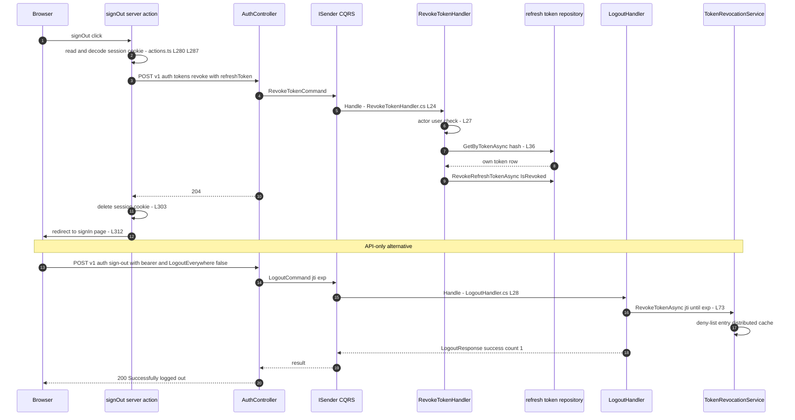
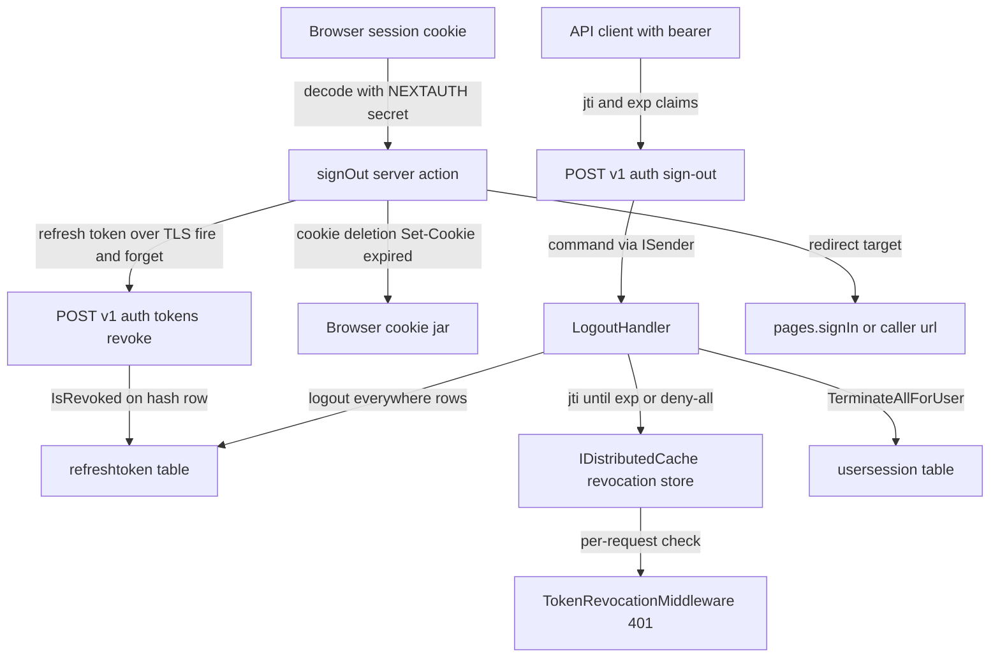

# Sign-Out Flow (Single Session, All Devices, Token Revocation Semantics, Redirect) — User Flow Diagram

> Issue #1101 · Module `GameGuild.Identity.Authentication` (+ `@game-guild/client` web sign-out action) · Documented against `develop` commit `74e9bba4c`.
> Scope: the API `POST /v1/auth/sign-out` endpoint (issue #1154) with its single-token and logout-everywhere modes, the `POST /v1/auth/tokens:revoke` endpoint the web client actually calls on sign-out, the jti deny-list and versioned-cutoff revocation semantics, cookie clearing and redirect behavior in the Next.js client, and how the two surfaces (API sign-out vs web sign-out) differ.

## 1. Overview

There are **two server-side sign-out surfaces**. (1) `POST v1/auth/sign-out` (`Controllers/AuthController.cs:736-767`, `[Authorize]`, issue #1154): builds `LogoutCommand` from the caller's claims (`jti`, `exp`, optional `LogoutEverywhere`, ip) and handles it in `LogoutHandler` (`Handlers/LogoutHandler.cs:28-107`). Single-session mode writes the access token's **jti to the revocation deny-list** until the token's `exp` (fallback now+1h, `:69-84`); `TokenRevocationMiddleware` then rejects that token at the next request (see token-lifecycle doc). Logout-everywhere mode runs the battery: deny-all revocation for the user, `RevokeAllForUserAsync` on every refresh token, `TerminateAllForUserAsync` on every session (`:41-60`). Failures are swallowed into `Success=false` (`:96-106`). (2) `POST v1/auth/tokens:revoke` (`Controllers/AuthController.cs:708-727`) → `RevokeTokenHandler` (`Handlers/RevokeTokenHandler.cs:24-51`): the actor must be the token's owner (`AccessDeniedException` otherwise), then `RevokeRefreshTokenAsync` flips `IsRevoked` on the stored hash row — a revoked refresh token triggers **replay containment** if ever reused.

**The web client signs out through surface (2), not (1).** `createSignOutAction` (`packages/infrastructure/client/src/integrations/next/actions.ts:271-319`) decodes the encrypted session cookie, extracts the embedded `refreshToken`, POSTs it to `/v1/auth/tokens:revoke` **fire-and-forget** (errors ignored, `:292-296`), deletes the session cookie (`:303-307`), and redirects to `redirectTo ?? pages.signIn ?? '/'` (`:310-317`). The API's `/v1/auth/sign-out` endpoint is therefore not exercised by the shipped web sign-out: the jti deny-list write, the `LogoutEverywhere` option and the `LogoutResponse` counts are API-only surface today (see Gaps). Server-side semantics: jti deny-list entries live in the distributed cache until token expiry (`Services/DistributedCacheTokenRevocationService.cs:28-51`); versioned user cutoffs are retained 30 days (`:15`).

## 2. End-to-End Flowchart — happy path and every edge case

```mermaid
flowchart TD
    subgraph WEBOUT["Web client sign-out - the shipped path"]
        W1["User clicks sign out<br/>e.g. public-account-menu.tsx L59"] --> W2["signOut action<br/>actions.ts L274"]
        W2 --> W3{"encrypted session cookie present<br/>L280"}
        W3 -- "no cookie - already signed out" --> W7
        W3 -- "present" --> W4["decodeJWT with config secret - L287"]
        W4 -- "decode fails" --> W6["revocation skipped errors ignored - L298"]
        W4 -- "decoded with refreshToken claim" --> W5["POST v1 auth tokens revoke with refresh token<br/>fire and forget catch swallow - L292"]
        W5 -- "network error or 4xx or 5xx" --> W6["cookie still cleared - local sign-out wins"]
        W5 -- "204" --> W6b["refresh token row IsRevoked"]
        W6 --> W7["session cookie deleted - L303"]
        W6b --> W7
        W7 --> W8{"redirect option - L310"}
        W8 -- "redirect true default" --> W9["redirect callback then navigate<br/>to redirectTo or signIn page or slash - L312"]
        W8 -- "redirect false" --> W10["caller navigates manually<br/>e.g. router push sign-in"]
    end

    subgraph APIREVOKE["tokens revoke - server side"]
        AR1["POST v1 auth tokens revoke - Authorize<br/>AuthController.cs L708"] --> AR2["RevokeTokenCommand with token and ip<br/>L718"]
        AR2 --> AR3{"actor is authenticated user<br/>RevokeTokenHandler.cs L27"}
        AR3 -- "no" --> AR401["AuthenticationRequiredException 401"]
        AR3 -- "yes" --> AR4{"hash lookup finds row - L36"}
        AR4 -- "unknown token" --> AR400["ArgumentException Invalid token 400"]
        AR4 -- "found" --> AR5{"token belongs to actor - L41"}
        AR5 -- "another user token" --> AR403["AccessDeniedException 403"]
        AR5 -- "own token" --> AR6["RevokeRefreshTokenAsync sets IsRevoked"]
        AR6 --> AR7["204 No Content"]
        AR7 --> AR8["later reuse of the revoked token<br/>rotation sees IsRevoked<br/>replay containment family or account scope"]
    end

    subgraph APISIGNOUT["API sign-out endpoint - POST v1 auth sign-out"]
        S1["POST v1 auth sign-out - Authorize<br/>AuthController.cs L736"] --> S2{"user id claim parses<br/>NameIdentifier sub user_id - L744"}
        S2 -- "missing or unparseable" --> S401["401 Invalid user context"]
        S2 -- "ok" --> S3["LogoutCommand with jti exp<br/>LogoutEverywhere reason ip - L752"]
        S3 --> S4{"LogoutEverywhere flag<br/>LogoutHandler.cs L38"}
        S4 -- "false - single session" --> S5{"jti claim present - L69"}
        S5 -- "absent" --> S6["no revocation at all<br/>SessionsInvalidated 0 - L87"]
        S5 -- "present" --> S7["RevokeTokenAsync jti until exp<br/>fallback now plus 1h - L71"]
        S7 --> S8["deny-list entry in distributed cache<br/>middleware rejects token at next request<br/>DistributedCacheTokenRevocationService.cs L28"]
        S8 --> S9["200 Successfully logged out SessionsInvalidated 1"]
        S4 -- "true - all devices" --> S10["RevokeAllUserTokensAsync deny-all - L41"]
        S10 --> S11["RevokeAllForUserAsync refresh rows - L47"]
        S11 --> S12["TerminateAllForUserAsync sessions - L53"]
        S12 --> S13["count sessions post-termination - L59"]
        S13 --> S14["200 logged out from all devices with count"]
        S5 -- "exception in any step" --> SERR["catch - Success false<br/>An error occurred during logout - 200 - L96"]
        S10 -- "exception" --> SERR
    end

    SEM1["Token revocation semantics"] --> SEM2{"which credential dies"}
    SEM2 -- "single sign-out jti" --> SEM3["access token only until its exp<br/>refresh token and session row untouched"]
    SEM2 -- "web sign-out tokens revoke" --> SEM4["refresh token row only<br/>access token in cookie dies with cookie<br/>session row stays active until expiry"]
    SEM2 -- "logout everywhere" --> SEM5["all access tokens via deny-all<br/>all refresh rows plus all sessions<br/>no token-version bump - contrast RevokeAllUserTokensCommand"]
    SEM2 -- "session terminate - other controller" --> SEM6["session row flip plus middleware check<br/>see session-management-flow.md"]
```

## 3. CQRS Chain Sequence Diagram

## 4. Data Flow Diagram

## 5. Edge-Case Matrix

| # | Edge case | Code path | Outcome |
|---|-----------|-----------|---------|
| 1 | Sign-out with no session cookie (already signed out) | cookie read miss (`packages/infrastructure/client/src/integrations/next/actions.ts:280-285`) | skips revocation, still clears/deletes cookie and redirects |
| 2 | Session cookie undecodable (wrong secret, tampered) | decode catch (`:298-300`) | revocation skipped silently; local sign-out proceeds |
| 3 | Refresh token missing from decoded cookie JWT | `token?.refreshToken` guard (`:291`) | no revoke call; cookie still deleted |
| 4 | `tokens:revoke` unreachable (API down / network error) | `.catch(() => {})` (`:292-296`) | web signs out locally; the refresh token stays valid server-side until expiry (Gaps) |
| 5 | `tokens:revoke` for an unknown token | hash lookup miss (`Handlers/RevokeTokenHandler.cs:36-38`) | 400 "Invalid token"; web ignores the error anyway |
| 6 | `tokens:revoke` for another user's token | ownership check (`:40-42`) | 403 `AccessDeniedException` — no cross-user revocation |
| 7 | `tokens:revoke` without authentication | actor guard (`:27-31`) | 401 |
| 8 | Reuse of a revoked refresh token later | rotation sees `IsRevoked`/`ReplacedByToken` (token-lifecycle doc) | replay containment — family (default) or account-wide revocation |
| 9 | `sign-out` with unparseable user claim | claim extraction (`Controllers/AuthController.cs:744-750`) | 401 "Invalid user context" |
| 10 | `sign-out` single mode with no `jti` claim | jti guard (`Handlers/LogoutHandler.cs:69`) | 200 success but **nothing revoked**, `SessionsInvalidated = 0` |
| 11 | `sign-out` with no `exp` claim | fallback `now + 1h` deny-list TTL (`:71`) | jti denied for a conservative extra hour |
| 12 | `sign-out` twice (idempotency) | deny-list overwrite (`Services/DistributedCacheTokenRevocationService.cs:28-51`) | second call succeeds; deny-list entry refreshed |
| 13 | `sign-out` everywhere with zero sessions | count query after terminate (`:59-60`) | 200 with count of all rows (terminated or not — count semantics, see Gaps) |
| 14 | Revocation store outage during `sign-out` | catch-all (`:96-106`) | **200 with `Success=false`** — client must inspect the flag; no retry |
| 15 | Concurrent sign-out everywhere + refresh rotation | non-atomic steps revoke → terminate (`:41-56`) | a refresh that lands between steps may already be revoked → containment instead of clean deny |
| 16 | Redirect target validation | `config.callbacks.redirect` (`actions.ts:312-315`) | open-redirect protection delegated to the shared callback (baseUrl check) |
| 17 | `redirect: false` sign-out | option branch (`:310`, callers e.g. `workspace-user-menu.tsx:49`) | no navigation; caller routes manually |
| 18 | Multiple tabs sharing the session | cookie deletion only affects this browser | other tabs hold the in-memory session until next server read (react `use-auth` broadcasts sign-out locally, `integrations/react/use-auth.ts:326`) |
| 19 | Logout-everywhere vs `terminate-all` battery | no `IncrementTokenVersion` in `LogoutHandler` (`:38-60`) | legacy access tokens **without** jti claims survive logout-everywhere until expiry (contrast `Commands/RevokeAllUserTokensCommand.cs:41-49`) |
| 20 | Sign-out of a guest session | guest token has no `refreshToken` in the session cookie payload | same as case 3; guest session cleared client-side only |

## 6. Endpoint Inventory

| Method + Route | Handler chain | Controller ref |
|----------------|---------------|----------------|
| POST `v{v}/auth/tokens:revoke` | `RevokeTokenCommand` → `RevokeTokenHandler` → `LocalAuthService.RevokeRefreshTokenAsync` | `Controllers/AuthController.cs:708-727` |
| POST `v{v}/auth/sign-out` | `LogoutCommand` → `LogoutHandler` (single-jti or everywhere battery) | `Controllers/AuthController.cs:736-767` |
| (client) signOut server action | decode cookie → `tokens:revoke` → delete cookie → redirect | `packages/infrastructure/client/src/integrations/next/actions.ts:271-319` |
| (adjacent) POST `v{v}/auth/sessions:terminate-all` | `RevokeAllUserTokensCommand` (the strongest battery) | `Controllers/SessionController.cs:193-208` (see session-management-flow.md) |

## 7. Events Published / Consumed

- **Published:** refresh-token lifecycle metric/event on the everywhere path is **absent here** — `LogoutHandler` writes only structured logs (`Handlers/LogoutHandler.cs:30-32`, `:62-64`, `:81-83`); `RefreshTokenLifecycleMetrics.RecordAttempt(AllRevoked)` and the lifecycle event are emitted by the *other* battery (`Commands/RevokeAllUserTokensCommand.cs:29`, `:44-45`), not by logout. The distributed revocation store records the jti/deny-all entries with reason strings (`"User initiated logout"`, `:76`).
- **Consumed:** `TokenRevocationMiddleware` consumes the jti deny-list and deny-all state on every subsequent authenticated request (token-lifecycle doc); token rotation consumes the revoked refresh rows.

## 8. Entities and Tables Touched

| Entity / Table | Mapping | Writes |
|----------------|---------|--------|
| `refreshtoken` | — | UPDATE `IsRevoked` (`RevokeTokenHandler` → `RevokeRefreshTokenAsync`); bulk `RevokeAllForUserAsync` on everywhere (`Handlers/LogoutHandler.cs:47-50`) |
| `usersession` | — | bulk `TerminateAllForUserAsync` (`:53-56`) |
| Distributed revocation store (`IDistributedCache`) | `Services/DistributedCacheTokenRevocationService.cs:28-51` | jti entry until token exp (single) / deny-all entry (everywhere); versioned cutoffs retained 30 days (`:15`) |
| Browser cookie jar | `actions.ts:303-307` | session cookie deletion (Max-Age 0) |

## 9. Gaps — realistic scenarios the code does not handle

1. **The web never calls `/v1/auth/sign-out`.** The shipped `signOut` action revokes only the refresh token (`packages/infrastructure/client/src/integrations/next/actions.ts:292-296`); the API's jti-deny-list path, `LogoutEverywhere` option and `LogoutResponse` counts (`Controllers/AuthController.cs:736-767`) are dead surface for the web app. Consequence: the browser's still-unexpired access token is only killed by cookie deletion — anything that captured it (devtools, extension) can keep using it until `exp` because no jti was denied.
2. **Fire-and-forget revocation can silently fail.** The revoke fetch swallows all errors (`:292-296` `.catch(() => {})`); when the API is unreachable the user believes they signed out but the refresh token remains redeemable for up to its 30-day lifetime. There is no retry or client-side "sign-out failed" state.
3. **`LogoutHandler` single mode without a `jti` claim revokes nothing.** The jti-missing branch falls through to a success response with `SessionsInvalidated = 0` (`Handlers/LogoutHandler.cs:69-84`, `:87-94`) — legacy/foreign-issued tokens get a 200 "Successfully logged out" while staying fully valid (no session-row termination either).
4. **Logout-everywhere does not bump the token version.** `LogoutHandler` (`:41-60`) revokes rows and denies via the store but never calls `IncrementTokenVersion` or the versioned cutoff, unlike the equivalent `RevokeAllUserTokensHandler` (`Commands/RevokeAllUserTokensCommand.cs:41-49`); access tokens **without** jti claims (legacy) survive "logout everywhere" until natural expiry. Two near-identical batteries with different strength is a trap for callers choosing between them.
5. **Everywhere-count semantics are wrong.** `sessionsInvalidated` counts **all** rows via `GetByUserIdAsync` after termination (`:59-60`), including previously-terminated and expired sessions, not just the ones invalidated by this call.
6. **Errors are reported as 200 + `Success=false`.** The catch-all (`:96-106`) converts a partial/failed revocation battery into a 200 with a flag; REST clients that only check the status code will treat a failed sign-out as success, and the response gives no hint of which step failed.
7. **No revocation of the current session row on single sign-out.** Single-mode sign-out denies the access-token jti but leaves the `usersession` row active until expiry; the session keeps appearing in `GET /auth/sessions` (filtered only later by expiry) — the user sees a "signed-out" session listed as active.
8. **Cookie-only multi-tab story.** Sign-out clears the cookie for the current browser; other tabs learn of it only via the local broadcast (`integrations/react/use-auth.ts:326`) — a tab on a stalled network keeps serving cached authenticated UI, and other devices are untouched unless the user knew to use the (web-absent) logout-everywhere option.
