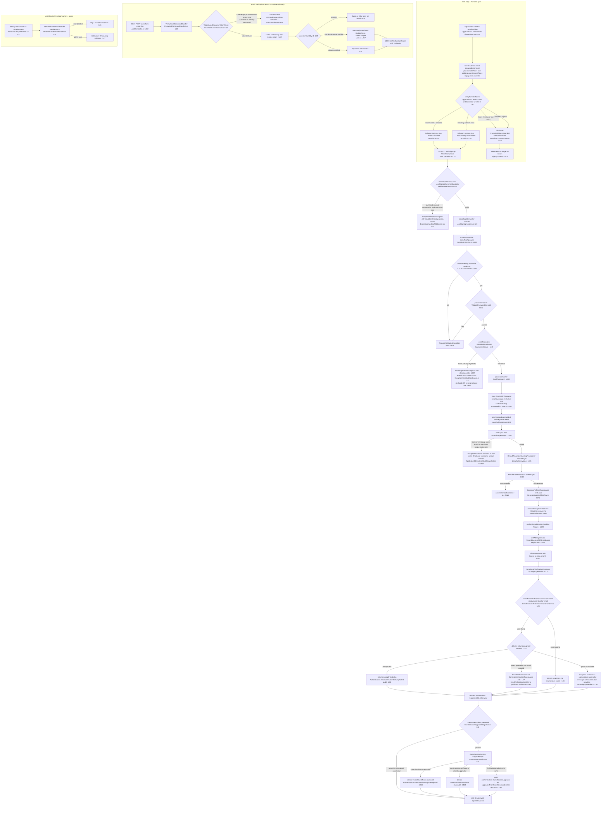
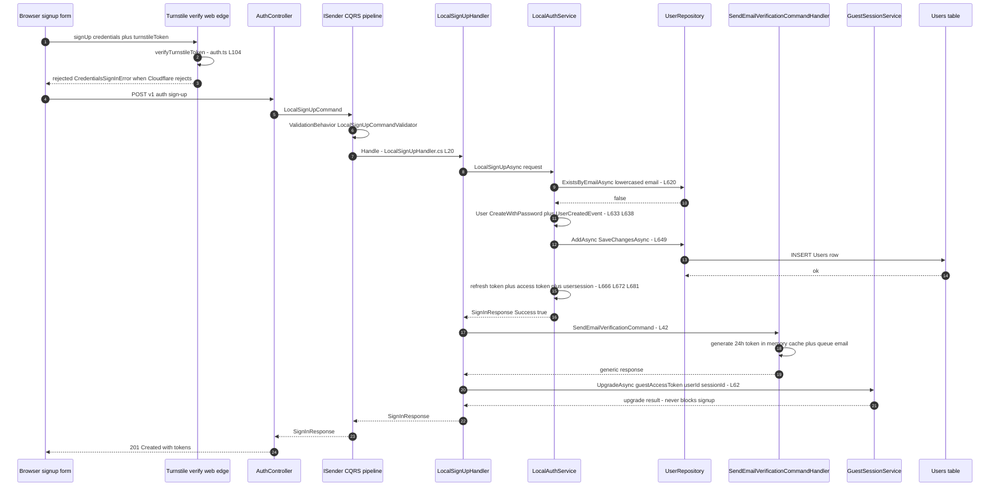
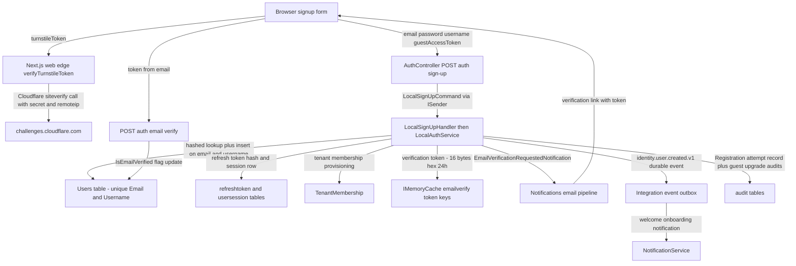

# Sign-Up Flow (Email + Password Registration, Verification Email, Guest Upgrade) — User Flow Diagram

> Issue #1096 · Module `GameGuild.Identity.Authentication` (+ `GameGuild.Identity.Users`, web anti-bot edge) · Documented against `develop` commit `74e9bba4c`.
> Scope: email+password registration, Turnstile CAPTCHA gating at the web edge, username/password validation, duplicate-account handling, first-session issuance, the verification email pipeline, token-based email verification, guest-session upgrade on signup (issue #213), and the compliance gates that do (and do not) apply at registration.

## 1. Overview

Registration starts at `POST v1/auth/sign-up` (`Controllers/AuthController.cs:33-54`, `[AllowAnonymous]`, `Authentication` rate-limit policy at `:20`). Anti-bot gating (Cloudflare Turnstile) is enforced **unconditionally at the Next.js web edge** — `apps/web/src/auth.ts:98-112` wraps every password sign-up with `verifyTurnstileToken` (`apps/web/src/lib/antibot/turnstile.ts:31-77`: fail-open when `TURNSTILE_SECRET_KEY` is unset, fail-closed on `missing-token`/`verify-failed`, fail-open on Cloudflare outage) — the .NET API itself has no CAPTCHA check on this route.

The command is `LocalSignUpCommand` (`Commands/LocalSignUpCommand.cs:8-26`, carries optional `GuestAccessToken`). `ValidationBehavior` runs `LocalSignUpCommandValidator` (`Validators/LocalSignUpCommandValidator.cs:13-58`, email format + RFC 5321 length, password strength via `IPasswordHasher`, username slug rules) and throws `RequestValidationException` → 400 (`SharedKernel/Middlewares/ExceptionHandlingMiddleware.cs:43-58`). `LocalSignUpHandler` (`Handlers/LocalSignUpHandler.cs:10-63`) delegates to `LocalAuthService.LocalSignUpAsync` (`Services/LocalAuthService.cs:594-723`): duplicate-email guard (`:620-628`), `User.CreateWithPassword` (`GameGuild.Identity.Users/Entities/User.cs:563-585`), `UserCreatedEvent` durable integration event (`:638-646`), user row + unique `Users.Email`/`Users.Username` indexes (`GameGuild.API/Database/Migrations/ApplicationDbContextModelSnapshot.cs:23697-23703`), default tenant provisioning (`:655`), then immediate session issuance (refresh + access token + `usersession` row, `:662-691`) — **sign-up signs the user in** (201 with tokens). Back in the handler, the verification email is dispatched via `SendEmailVerificationCommand` (`Handlers/LocalSignUpHandler.cs:42-48`) and an email-delivery failure never fails the committed account (`:50-56`). Finally `GuestSessionUpgradeIntegration.ApplyGuestUpgradeAsync` (`Guest/GuestSessionUpgradeIntegration.cs:13-40`) upgrades the anonymous session into the new authenticated session; an invalid guest token never blocks registration.

Verification tokens are 16 random bytes, hex, 24-hour lifetime, stored in **`IMemoryCache`** (`Services/EmailVerificationService.cs:27-30`, `:47-78`) — see Gaps. `POST v1/auth/email:verify` (`Controllers/AuthController.cs:882-905`) consumes the token single-use (`EmailVerificationService.cs:163-246`) and flips `User.IsEmailVerified` (`Entities/User.cs:267-271`). KYC/compliance gates do **not** run at sign-up: `KycAndHoldSignInCompliancePolicy` (`GameGuild.API/Core/Compliance/KycAndHoldSignInCompliancePolicy.cs:58-91`) evaluates at sign-in, and nothing at registration blocks an unverified email from receiving working tokens.

## 2. End-to-End Flowchart — happy path and every edge case

## 3. CQRS Chain Sequence Diagram

## 4. Data Flow Diagram

## 5. Edge-Case Matrix

| # | Edge case | Code path | Outcome |
|---|-----------|-----------|---------|
| 1 | Turnstile secret not configured | fail-open branch (`apps/web/src/lib/antibot/turnstile.ts:34-40`) | signup allowed, one warning per process |
| 2 | Turnstile token missing / > 2048 chars | fail-closed (`turnstile.ts:26`, `:42-45`) | `CredentialsSignInError` "Bot verification failed"; widget token reset for re-issue (`signup-form.tsx:118`) |
| 3 | Cloudflare siteverify outage | fail-open `verify-unavailable` (`turnstile.ts:70-73`) | signup allowed (availability over strictness) |
| 4 | Malformed email / email > 254 chars | validator (`Validators/LocalSignUpCommandValidator.cs:13-21`) + `ValidationBehavior` (`SharedKernel/CQRS/Behaviors/ValidationBehavior.cs:50-54`) | 400 Validation Failed with property errors |
| 5 | Weak password | `IPasswordHasher.ValidatePasswordStrength` via validator (`LocalSignUpCommandValidator.cs:28-43`) and re-check in service (`LocalAuthService.cs:612-617`) | 400 with per-rule failures |
| 6 | Username does not slugify to 3–50 chars | validator `Must` clause (`LocalSignUpCommandValidator.cs:54-55`) + service guard (`LocalAuthService.cs:605-610`) | 400 |
| 7 | Email already registered | `ExistsByEmailAsync` → `InvalidOperationException("User already exists")` (`LocalAuthService.cs:620-628`); generic catch (`ExceptionHandlingMiddleware.cs:74-85`, `:141-155`) | **500** (declared 409 at `AuthController.cs:38` is never produced — see Gaps) |
| 8 | Two concurrent signups with same email (TOCTOU) | both pass `ExistsByEmailAsync`, loser hits unique `Users.Email` index (`ApplicationDbContextModelSnapshot.cs:23697-23698`) | loser gets unhandled `DbUpdateException` → 500 |
| 9 | Duplicate username | unique `Users.Username` index (`ApplicationDbContextModelSnapshot.cs:23700-23701`); no pre-check in service | 500, no friendly duplicate-username message |
| 10 | Guest token invalid / expired / already upgraded | `GuestSessionService.UpgradeAsync` denies with audited reason (`Guest/GuestSessionService.cs:109-127`) | registration still succeeds; continuity link dropped; `Authentication.GuestSessionUpgradeRejected` audit |
| 11 | Guest token missing / response not successful | early return (`Guest/GuestSessionUpgradeIntegration.cs:22-28`) | plain 201, no upgrade attempted |
| 12 | Verification email pipeline unavailable after account commit | catch-all in handler (`Handlers/LocalSignUpHandler.cs:50-56`) | signup still 201; message says "request again"; resend endpoint available |
| 13 | Verification delivery fails twice | 2-attempt loop + `LogCritical` + `Authentication.EmailVerificationDeliveryFailed` audit (`Handlers/SendEmailVerificationCommandHandler.cs:42-70`) | enumeration-safe generic 200; failure visible in logs/audit only |
| 14 | `POST v1/auth/email:send-verification` for unknown email | unknown-account branch (`SendEmailVerificationCommandHandler.cs:30-34`) | identical generic message — no account enumeration |
| 15 | Verification token expired (24 h) | `ExpiresAt < now` → remove + fail (`Services/EmailVerificationService.cs:198-205`) | 400 "Expired token"; user must resend |
| 16 | Verification token reused (already consumed) | `TryConsume()` fails (`EmailVerificationService.cs:219-225`; token removed after consume `:232`) | 400 "Invalid token" |
| 17 | Password-reset token presented to email verify (type confusion) | `tokenInfo.Type != expectedType` (`EmailVerificationService.cs:207-217`) | 400 "Invalid token type" |
| 18 | Token belongs to different user (user-scoped verify overload) | `expectedUserId` mismatch (`EmailVerificationService.cs:188-196`) | 400 "Token does not belong to the requested user" |
| 19 | Verify token valid but user row deleted | `user is null` (`Handlers/PasswordCommandHandlers.cs:26-33`) | 400 "User not found" |
| 20 | Verify called when already verified | `if (!user.IsEmailVerified)` skip (`PasswordCommandHandlers.cs:35-40`) | idempotent 200 success |
| 21 | API restart / multi-node between send and verify | tokens in `IMemoryCache` only (`EmailVerificationService.cs:60`) | all pending tokens lost (or invisible to other node) — see Gaps |
| 22 | Resend verification spam | endpoint-level `Authentication` rate limit (`AuthController.cs:20`); the 2-minute per-address limiter in `ResendVerificationEmailAsync` (`EmailVerificationService.cs:281-294`) is **not** called by the CQRS handler | only global rate limit applies (see Gaps) |
| 23 | Compliance hold / KYC state at sign-up | `KycAndHoldSignInCompliancePolicy` evaluates at sign-in (`GameGuild.API/Core/Compliance/KycAndHoldSignInCompliancePolicy.cs:58-91`); no call in `LocalSignUpAsync` | sign-up itself has no compliance gate; tokens are issued before any KYC challenge |
| 24 | Unverified email signs in | `RequiresEmailVerification` (`GameGuild.Identity.Users/Entities/User.cs:508-512`) has no callers in the sign-in path | unverified accounts can authenticate (by design; verification is not a login gate) |

## 6. Endpoint Inventory

| Method + Route | Handler chain | Controller ref |
|----------------|---------------|----------------|
| POST `v{v}/auth/sign-up` | `LocalSignUpCommand` → `LocalSignUpHandler` → `LocalAuthService.LocalSignUpAsync` (+ nested `SendEmailVerificationCommand`, guest upgrade) | `Controllers/AuthController.cs:33-54` |
| POST `v{v}/auth/email:send-verification` | `SendEmailVerificationCommand` → `SendEmailVerificationCommandHandler` | `Controllers/AuthController.cs:861-873` |
| POST `v{v}/auth/email:verify` | `VerifyEmailCommand` → `VerifyEmailCommandHandler` | `Controllers/AuthController.cs:882-905` |

All three are `[AllowAnonymous]` under the `Authentication` rate-limit policy (`Controllers/AuthController.cs:20`).

## 7. Events Published / Consumed

- **Published:**
  - `UserCreatedEvent` (`identity.user.created.v1`, durable integration event) — attached to the aggregate in `LocalAuthService.cs:638-646`, defined at `GameGuild.SharedKernel/Events/ResourceLifecycleEvents.cs:3-10`.
  - `EmailVerificationRequestedNotification` (in-process MediatR notification carrying the token) — `Services/EmailVerificationService.cs:84-90`.
  - `AuthenticationAuditEvent` rows: successful "Registration" attempt (`LocalAuthService.cs:694`), email-verification delivery failure (`Handlers/SendEmailVerificationCommandHandler.cs:87-93`), guest upgrade accepted/rejected (`Guest/GuestSessionService.cs:130-137`, `:146-155`).
- **Consumed:**
  - `SendWelcomeEmailHandler` handles `UserCreatedEvent` (`IIntegrationEventHandler<UserCreatedEvent>`, `Handlers/SendWelcomeEmailHandler.cs:14-30`) — records an Onboarding welcome notification, skipping deleted users.
  - The notifications module's email sender handles `EmailVerificationRequestedNotification` (delivery of the actual mail).

## 8. Entities and Tables Touched

| Entity / Table | Mapping | Writes |
|----------------|---------|--------|
| `User` → `Users` (unique `Email`, unique `Username` indexes) | `GameGuild.Identity.Users/Entities/UserConfiguration.cs:14-66`; indexes visible in `ApplicationDbContextModelSnapshot.cs:23695-23703` | INSERT (`UserRepository.AddAsync` via `LocalAuthService.cs:649`); UPDATE `IsEmailVerified` (`Handlers/PasswordCommandHandlers.cs:38-39`) |
| `UserSession` → `gameguild.authentication.usersession` | snapshot `:20694` | INSERT at sign-up session creation (`LocalAuthService.cs:681`) |
| `RefreshToken` → `gameguild.authentication.refreshtoken` | `JwtTokenService.GenerateRefreshTokenAsync` (`LocalAuthService.cs:666`) | INSERT (hash only) |
| `TenantMembership` | `DefaultTenantMembershipProvisioner.EnsureAsync` (`Services/DefaultTenantMembershipProvisioner.cs:9`, called `LocalAuthService.cs:655`) | INSERT (default membership) |
| `AuthenticationAttempt` | `AuthenticationAttemptConfiguration` (index `ix_authenticationattempt_email`) | INSERT "Registration" success (`LocalAuthService.cs:694`) |
| Guest session store | `GuestSessionService` / `IGuestSessionStore.TryMarkUpgradedAsync` (`Guest/GuestSessionService.cs:124`) | UPDATE upgraded-by/session link |
| `IMemoryCache` (not a table) | `EmailVerificationService.cs:60`, `:229` | verification token + verified flag (volatile) |

## 9. Gaps — realistic scenarios the code does not handle

1. **Duplicate email returns 500, not the declared 409.** `AuthController.LocalSignUp` declares `[ProducesResponseType(StatusCodes.Status409Conflict)]` (`Controllers/AuthController.cs:38`) but `LocalAuthService` throws plain `InvalidOperationException("User already exists")` (`Services/LocalAuthService.cs:627`), which falls into the generic 500 bucket (`SharedKernel/Middlewares/ExceptionHandlingMiddleware.cs:74-85`). Clients cannot distinguish "already registered" from a server fault; `GameGuild.Identity.Users/Models/UserAlreadyExistsException.cs:11` exists but is never thrown on this path.
2. **TOCTOU duplicate registration race.** The duplicate check (`ExistsByEmailAsync`, `LocalAuthService.cs:620`) and the insert (`:649`) are not atomic; two concurrent signups with the same email (or username) rely on the DB unique indexes (`ApplicationDbContextModelSnapshot.cs:23697-23701`), and the loser surfaces an unhandled `DbUpdateException` → 500 with no retry or friendly conflict mapping. Unlike the external-login link path, there is no `DbUpdateException` refetch/retry branch here.
3. **Verification tokens live only in `IMemoryCache`.** `EmailVerificationService.GenerateTokenAsync` stores the token with a 24-hour absolute expiry in process memory (`Services/EmailVerificationService.cs:60-63`). An API restart, scale-out to a second node (token created on node A, verify hits node B), or memory pressure eviction silently invalidates every in-flight verification email; the user just sees "Invalid token" (`:184-186`). The magic-link flow already has a durable `IMagicLinkTokenStore` (`:41`) — email-verification tokens do not.
4. **Sign-up does not verify email before issuing tokens.** `LocalSignUpAsync` issues access + refresh tokens and creates a session (`LocalAuthService.cs:662-691`) before any email verification. `User.RequiresEmailVerification` (`GameGuild.Identity.Users/Entities/User.cs:508-512`) has no callers, so unverified registrants can authenticate indefinitely; there is no re-verification challenge, no lockout for never-verified accounts, and no cleanup job for them.
5. **No server-side CAPTCHA on the API route.** Turnstile is enforced only in the Next.js web wrapper (`apps/web/src/auth.ts:98-112`); `POST /v1/auth/sign-up` itself accepts any request (`[AllowAnonymous]`, no captcha claim checked). A direct API caller bypasses anti-bot entirely; `AuthenticationSecurityOptions.EnableCaptchaOnSuspiciousActivity` (`GameGuild.SharedKernel/Configuration/ApplicationLayer/AuthenticationSecurityOptions.cs:71`, default false) is not wired to this endpoint.
6. **Resend endpoint bypasses the per-address cooldown.** `EmailVerificationService.ResendVerificationEmailAsync` implements a 2-minute rate limit keyed on user + email digest (`Services/EmailVerificationService.cs:271-294`), but `SendEmailVerificationCommandHandler` calls `GenerateVerificationTokenAsync` + `SendVerificationEmailAsync` directly (`Handlers/SendEmailVerificationCommandHandler.cs:46-47`) and never invokes the cooldown method — an attacker (within the global policy limit) can trigger unbounded verification mails to a victim's address.
7. **Sign-up has no compliance gate.** The KYC/compliance-hold gate exists only on the sign-in path (`GameGuild.API/Core/Compliance/KycAndHoldSignInCompliancePolicy.cs:58-91`); a signup that will immediately be challenged/denied at next sign-in still provisions the user, tenant membership, session and welcome email. Account enumeration via timing (existing-email path returns quickly with 500; new-email path does hashing + inserts) is also unmitigated.
8. **Guest-upgrade failure is silent to the client.** `GuestSessionUpgradeIntegration` only sets `UpgradedFromGuestSessionId` on success (`Guest/GuestSessionUpgradeIntegration.cs:34-37`); a rejected upgrade (invalid/expired/already-used guest token) produces no response field or warning — the web form unconditionally clears the stored guest session after signup (`apps/web/src/components/signup-form.tsx:116-117`), so a failed upgrade permanently discards the guest cart/progress with no recovery prompt.
