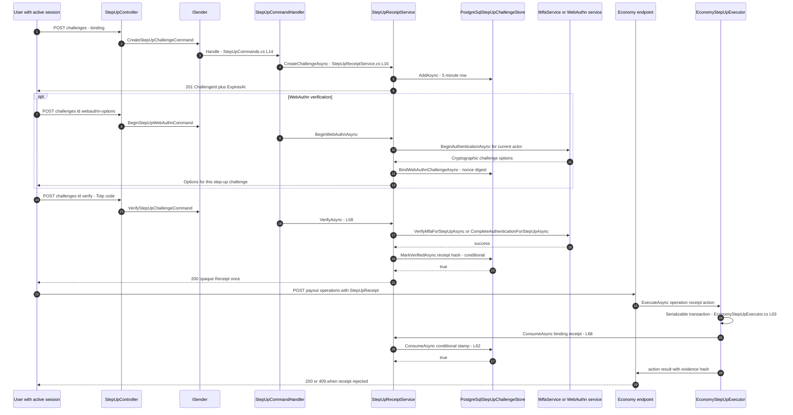
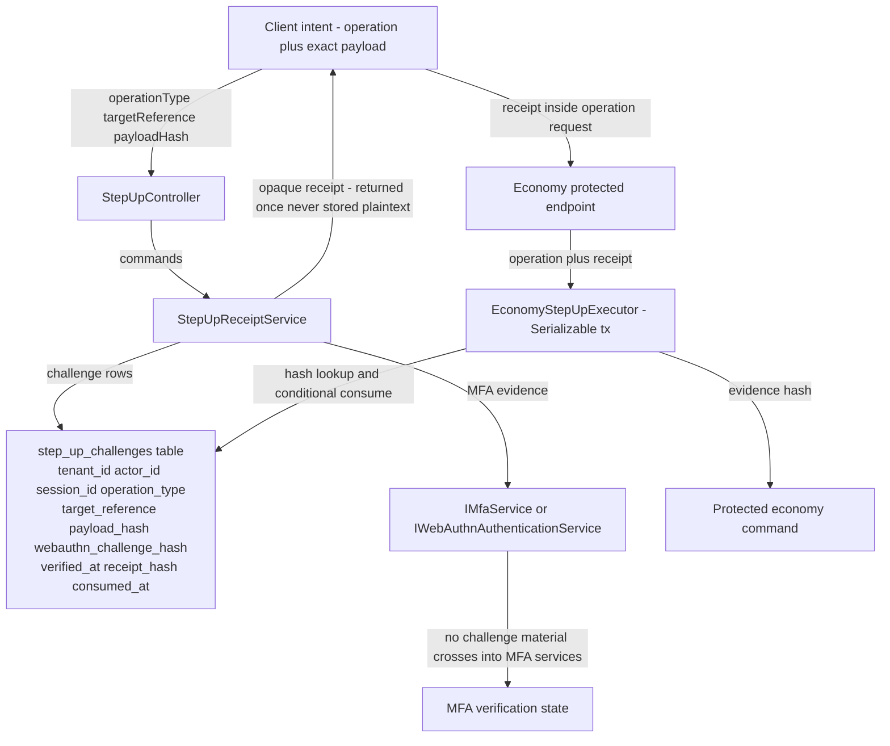

# Step-Up Authentication Flow (Sensitive Actions Requiring Fresh Verification) — User Flow Diagram

> Issue #1105 · Module `GameGuild.Identity.Authentication` (+ `GameGuild.API` economy protected operations) · Documented against `develop` commit `74e9bba4c`.
> Scope: when step-up is required and how it is signaled, challenge creation bound to an operation (type + target + payload hash), the three accepted challenge methods (TOTP, backup code, WebAuthn), opaque single-use receipts, single-use consumption inside the protected action's serializable transaction, expiry and replay handling. In-flight hardening (receipt/consumption fixes, WebAuthn attestation `Indirect`) is tracked in open PR #1172 against #1143/#1144/#1145.

## 1. Overview

Step-up protects sensitive operations by requiring MFA evidence *within the current session* before the operation executes. The flow is three-phase. **Challenge:** the client calls `POST v{v}/auth/step-up/challenges` with a `StepUpOperationBinding` — `operationType` (≤128), `targetReference` (≤256) and a 64-hex-char SHA-256 `payloadHash` of the exact intended payload, all validated in the binding constructor (`StepUp/StepUpContracts.cs:9-37`). `StepUpReceiptService.CreateChallengeAsync` (`StepUp/StepUpReceiptService.cs:16-38`) requires an authenticated tenant + session actor (`RequireSubject`, `:139-151` — reads the `session_id` from actor typed attributes) and persists a `StepUpChallenge` row with a **5-minute lifetime** (`:14`) scoped to (tenant, actor, session). **Verify:** `POST challenges/{id}:verify` (`Controllers/StepUpController.cs:73-102`) presents `MfaMethod` + evidence; `VerifyAsync` (`StepUp/StepUpReceiptService.cs:58-100`) accepts only `Totp`/`BackupCode` (via `IMfaService.VerifyMfaForStepUpAsync`, `:153-164`) or `WebAuthn` (via `IWebAuthnAuthenticationService.CompleteAuthenticationForStepUpAsync` + user match, `:166-175`); on success it mints an opaque 256-bit receipt (`:177-183`), returns it **once**, and persists only its SHA-256 hash through a conditional `ExecuteUpdate` that requires the row to be live and unverified (`StepUp/PostgreSqlStepUpChallengeStore.cs:34-60`). WebAuthn needs an options round-trip first (`POST challenges/{id}:webauthn-options`, `:40-56`). **Consume:** the protected endpoint receives the receipt in its request body and runs the real action through `EconomyStepUpExecutor.ExecuteAsync` (`GameGuild.API/Core/Authorization/EconomyStepUpExecutor.cs:49-81`): inside a `Serializable` PostgreSQL transaction it calls `ConsumeAsync`, which conditionally stamps `ConsumedAt` only when subject, all three binding fields, the receipt hash, verification and expiry line up (`StepUp/PostgreSqlStepUpChallengeStore.cs:62-89`) — any mismatch, replay or expiry throws `StepUpReceiptInvalidException` (`StepUp/StepUpReceiptService.cs:115-118`), which the economy controllers map to **409 Conflict** (`GameGuild.API/Core/Controllers/EconomyPayoutExecutionController.cs:300-306`). Trusted-device requests also have an automatic challenge entry point, described below. Other protected endpoint families still opt in explicitly; there is no global risk middleware.

Current verification also reserves one of five durable attempt slots before evaluating a supported factor. Invalid proofs retain their slot; storage/provider failures, cancellation and failed conditional receipt writes roll back the command transaction. An expired-row worker keeps one additional day of evidence and deletes at most 128 rows per minute. For `POST /v1/auth/trusted-devices`, a missing receipt calls `IStepUpRequirementService` through the authenticated controller. The service derives the exact device-name binding on the server and persists a challenge through the existing command transaction. It returns HTTP 403 as a `StepUpAuthenticationRequiredResponse` derived from `ProblemDetails`, with the challenge identifier, operation, expiry and supported enrolled methods at the response root. Creation uses the store's microsecond precision so the returned expiry equals the persisted deadline. Storage failures and cancellation roll back the creation; they never grant trust or fabricate a challenge.

The client verifies a listed factor and retries the same device name with the returned single-use receipt. TOTP and backup codes require enabled, setup-complete enrollment and global MFA enablement; active WebAuthn credentials remain available independently. A challenge identifier is not a receipt. The generated SDK keeps this 403 demand in `error.metadata.stepUp` for schema validation and explicit verification/retry; it does not retry or grant trust automatically. API-key creation and service-account secret rotation still need adoption of the platform gate.

## 2. End-to-End Flowchart — happy path and every edge case

```mermaid
flowchart TD
    subgraph TRIGGER["When is step-up required"]
        TR1["Sensitive economy operations declare a receipt field<br/>economy payout reserve and dispatch and control-plane ops<br/>EconomyPayoutExecutionController.cs L15 L168"]
        TR2["Client without a valid receipt"] --> TR3["ConsumeAsync fails - StepUpReceiptInvalidException<br/>mapped to 409 Conflict with message<br/>EconomyPayoutExecutionController.cs L300"]
        TR4["No global risk middleware - protected endpoint families opt in"]
        TR5["Trusted-device request without a receipt"] --> TR6["Requirement service derives binding and persists challenge<br/>403 RFC problem with challenge id, expiry and enrolled methods"]
        TR6 --> V1
    end

    subgraph CREATE["Phase 1 - create challenge"]
        C1["Client POST v1 auth step-up challenges<br/>with operation type target reference payload hash<br/>StepUpController.cs L23"] --> C2{"Binding valid<br/>operation 128 chars - target 256 -<br/>payload hash 64 hex lowercase<br/>StepUpContracts.cs L14"}
        C2 -- "malformed" --> C400["ArgumentException - 400 invalid L42"]
        C2 -- "valid" --> C3{"Subject resolvable<br/>authenticated plus tenant plus session id<br/>StepUpReceiptService.cs L139"}
        C3 -- "missing any" --> C401["StepUpContextUnavailableException - 401 L46"]
        C3 -- "ok" --> C4["StepUpChallenge row tenant actor session<br/>binding plus CreatedAt plus ExpiresAt now plus 5 min<br/>L23"]
        C4 --> C5["Store AddAsync persists - check constraints enforce<br/>expiry after creation and hex hashes<br/>PostgreSqlStepUpChallengeStore.cs L9"]
        C5 --> C6["201 ChallengeId plus ExpiresAt L37"]
    end

    subgraph WEBAUTHN["Phase 2a - WebAuthn options"]
        W1["Client POST challenges id webauthn-options<br/>StepUpController.cs L52"] --> W2{"Subject resolvable<br/>StepUpReceiptService.cs L44"}
        W2 -- "missing" --> C401
        W2 -- "ok" --> W3{"Challenge active for this subject<br/>FindActiveAsync - unverified unconsumed unexpired<br/>PostgreSqlStepUpChallengeStore.cs L16"}
        W3 -- "missing or expired or used" --> C409a["StepUpChallengeUnavailableException - 409 L63"]
        W3 -- "active" --> W4["WebAuthn BeginAuthenticationAsync for actor<br/>L46"]
        W4 -- "failure" --> C409b["StepUpVerificationFailedException - 409 L50"]
        W4 -- "options" --> W5["200 assertion options"]
    end

    subgraph VERIFY["Phase 2b - verify evidence"]
        V1["Client POST challenges id verify<br/>with method plus evidence<br/>StepUpController.cs L73"] --> V2{"Subject and active challenge<br/>StepUpReceiptService.cs L64"}
        V2 -- "unavailable" --> C409a
        V2 -- "active" --> V3{"Method switch<br/>L67"}
        V3 -- "Totp or BackupCode" --> V4["IMfaService VerifyMfaForStepUpAsync<br/>L153"]
        V3 -- "WebAuthn" --> V5["CompleteAuthenticationForStepUpAsync plus<br/>result UserId equals actor L166"]
        V3 -- "any other method" --> V400b["StepUpVerificationFailedException - 400<br/>method cannot authorize step-up L77"]
        V4 -- "invalid code" --> V400c["StepUpVerificationFailedException - 400 MFA evidence invalid L82"]
        V5 -- "assertion fails or wrong user" --> V400c
        V4 -- "verified" --> V6["CreateOpaqueReceipt 32 random bytes base64url<br/>L177"]
        V5 -- "verified" --> V6
        V6 --> V7["MarkVerifiedAsync conditional update<br/>requires live unverified unconsumed row<br/>PostgreSqlStepUpChallengeStore.cs L34"]
        V7 -- "changed rows not 1 - raced" --> C409c["StepUpChallengeUnavailableException - 409<br/>expired or already verified L96"]
        V7 -- "exactly 1" --> V8["200 Receipt returned once plus<br/>ExpiresAt - challenge expiry L99"]
    end

    subgraph CONSUME["Phase 3 - consume inside the protected action"]
        K1["Client calls sensitive endpoint with receipt<br/>EconomyPayoutExecutionController.cs L168"] --> K2["EconomyStepUpOperation Create canonicalizes payload<br/>length-prefixed values then SHA-256<br/>EconomyStepUpExecutor.cs L14"]
        K2 --> K3["ExecuteAsync opens Serializable transaction<br/>PostgreSqlTransactionExecutor L63"]
        K3 --> K4["ConsumeAsync conditional update requires<br/>same tenant actor session plus same operation type<br/>target reference payload hash plus receipt hash plus<br/>verified plus unconsumed plus unexpired<br/>PostgreSqlStepUpChallengeStore.cs L72"]
        K4 -- "changed rows not 1" --> K400["StepUpReceiptInvalidException - 409<br/>invalid expired mismatched or consumed<br/>StepUpReceiptService.cs L115"]
        K4 -- "exactly 1" --> K5["Protected action runs with receipt evidence hash<br/>EconomyStepUpExecutor.cs L75"]
        K5 --> K6["Commit - receipt permanently consumed"]
    end

    subgraph EDGES["Cross-cutting edge cases"]
        E1["Receipt replay - second consume finds ConsumedAt set"] --> K400
        E2["Payload changed between challenge and consume<br/>payload hash differs"] --> K400
        E3["Session terminated between verify and consume<br/>sid no longer matches subject"] --> K400
        E4["Challenge older than 5 minutes at consume<br/>ExpiresAt check in ConsumeAsync L81"] --> K400
        E5["Receipt used for a different operation type or target"] --> K400
    end
```

## 3. CQRS Chain Sequence Diagram

## 4. Data Flow Diagram

## 5. Edge-Case Matrix

| # | Edge case | Code path | Outcome |
|---|-----------|-----------|---------|
| 1 | Binding with missing/oversized fields or non-hex payload hash | constructor guards (`StepUp/StepUpContracts.cs:11-27`) | `ArgumentException` → 400 (`Controllers/StepUpController.cs:42-45`) |
| 2 | Caller without tenant or session context | `RequireSubject` (`StepUp/StepUpReceiptService.cs:139-151`) | `StepUpContextUnavailableException` → 401 (`Controllers/StepUpController.cs:46-49`) |
| 3 | Session claim present but no live `UserSession` row (orchestrated-auth gap) | subject resolves from claims only; no session-table check anywhere in the service | challenge proceeds — tracked by issue #1178 |
| 4 | Challenge older than 5 minutes at verify | `FindActiveAsync` `ExpiresAt > now` (`StepUp/PostgreSqlStepUpChallengeStore.cs:28`) | `StepUpChallengeUnavailableException` → 409 |
| 5 | Verify a challenge that is already verified | `VerifiedAt == null` predicate (`:29`, `:51`) | 409 "expired or already verified" (`StepUp/StepUpReceiptService.cs:94-97`) |
| 6 | Two tabs verify the same challenge concurrently | conditional `MarkVerifiedAsync` — exactly one `ExecuteUpdate` wins (`:44-59`) | loser gets 409; one receipt exists |
| 7 | Unsupported method (EmailCode, Sms, None) | method switch default arm (`StepUp/StepUpReceiptService.cs:77`) | 400 — only Totp, BackupCode, WebAuthn authorize step-up |
| 8 | Wrong TOTP / exhausted backup code | `VerifyMfaAsync` false (`:153-164`) | 400 "MFA evidence is invalid"; a durable slot is reserved before factor verification. At most five evaluations are allowed; the next request receives 409 before invoking the factor |
| 9 | WebAuthn assertion from a different user | `result.UserId == actorId` check (`:174`) | 400 |
| 10 | WebAuthn options requested for expired challenge | `RequireActiveChallengeAsync` (`:45`, `:121-137`) | 409 |
| 11 | WebAuthn begin succeeds but assertion never completes | challenge row stays unverified until expiry (`StepUp/StepUpContracts.cs:80-81`) | row becomes unusable after 5 min; the cleanup worker removes it only after another 24 hours |
| 12 | Receipt replayed (second consume) | `ConsumedAt == null` predicate (`StepUp/PostgreSqlStepUpChallengeStore.cs:83`) | 409 invalid (`StepUp/StepUpReceiptService.cs:115-118`) |
| 13 | Receipt used with a mutated payload | binding `PayloadHash` compare (`PostgreSqlStepUpChallengeStore.cs:79`) | 409 — hash binds receipt to the exact bytes |
| 14 | Receipt used on a different operation/target | `OperationType`/`TargetReference` compare (`:77-78`) | 409 |
| 15 | Receipt consumed from a different session | subject triple compare (`:74-76`) | 409 |
| 16 | Consume after the 5-minute window even though verified in time | `ExpiresAt > consumedAt` (`:81`) | 409 — verified receipts still die at challenge expiry |
| 17 | Two concurrent consumes of the same receipt | conditional update inside Serializable transaction (`GameGuild.API/Core/Authorization/EconomyStepUpExecutor.cs:63-74`) | one commits, the other serialization-conflicts/409 |
| 18 | Sensitive request with no receipt field at all | empty receipt → `ArgumentException` in executor (`:60`) → 409 mapping (`GameGuild.API/Core/Controllers/EconomyPayoutExecutionController.cs:300-306`) | 409 conflict message |
| 19 | Verify succeeds but client never consumes | row stays verified-unconsumed until expiry (`StepUpContracts.cs` states) | receipt expires silently at `ExpiresAt`; no notification |
| 20 | Challenge-store outage during consume | exception inside serializable transaction | transaction aborts, protected action never runs (fail closed) |
| 21 | Client reuses the *challenge id* for a new operation | challenge binding fixed at creation (`StepUp/StepUpReceiptService.cs:29-31`) | new operation needs a new challenge; old id 409s once consumed |
| 22 | Actor token revoked between verify and consume | no token-state check in `ConsumeAsync` | receipt still consumed if within 5 min — step-up does not re-check authentication freshness mid-window (jti deny-list gap #1179) |
| 23 | Assertion from login or another step-up challenge | nonce digest comparison before cryptographic verification | Denied without issuing a receipt |
| 24 | New options issued while an earlier assertion is being verified | receipt write requires the original nonce digest | Earlier verification cannot commit a receipt |
| 25 | Legacy WebAuthn receipt has no bound nonce | consumption requires a nonce digest for WebAuthn receipts | Denied; TOTP/backup-code receipt behavior is unchanged |

## 6. Endpoint Inventory

| Method + Route | Handler chain | Controller ref |
|----------------|---------------|----------------|
| POST `v{v}/auth/step-up/challenges` | `CreateStepUpChallengeCommand` → `StepUpCommandHandler` → `StepUpReceiptService.CreateChallengeAsync` | `Controllers/StepUpController.cs:23-50` |
| POST `v{v}/auth/step-up/challenges/{id}:webauthn-options` | `BeginStepUpWebAuthnCommand` → `BeginWebAuthnAsync` | `Controllers/StepUpController.cs:52-71` |
| POST `v{v}/auth/step-up/challenges/{id}:verify` | `VerifyStepUpChallengeCommand` → `VerifyAsync` → MFA/WebAuthn services → `MarkVerifiedAsync` | `Controllers/StepUpController.cs:73-102` |
| POST `v{v}/auth/trusted-devices` | Missing receipt → `StepUpRequirementService` → `CreateStepUpChallengeCommand` → structured 403; supplied receipt → existing guarded `TrustDeviceCommand` → consumption and trust mutation | `Controllers/TrustedDevicesController.cs`, `StepUp/StepUpRequirementService.cs`, `Commands/SessionMutationCommands.cs` |
| (receipt-consuming surface) `economy payouts .../reserve`, `.../dispatch`, control-plane/compliance/treasury admin ops | request DTO carries `StepUpReceipt` → `IEconomyStepUpExecutor.ExecuteAsync` → `ConsumeAsync` + protected command | `GameGuild.API/Core/Controllers/EconomyPayoutExecutionController.cs:151-215`, executor at `GameGuild.API/Core/Authorization/EconomyStepUpExecutor.cs:49-81` |

## 7. Events Published / Consumed

- **Published** — durable operation events only (explicitly no domain events, security material excluded): `identity.authentication.create-step-up-challenge`, `identity.authentication.begin-step-up-webauthn`, `identity.authentication.verify-step-up-challenge` (`Architecture/StepUpEventContracts.cs:4-6`). No named event marks consumption — the consuming economy command's own operation event carries the receipt *evidence hash* (`GameGuild.API/Core/Authorization/EconomyStepUpExecutor.cs:75-77`).
- **Consumed** — `IActorContextAccessor` (authenticated, `SubjectIdAsGuid`, `TenantId`, `TypedAttributes.SessionId`); `IMfaService` for Totp/BackupCode evidence; `IWebAuthnAuthenticationService` for the WebAuthn ceremony; `IApplicationDbContext` for the challenge store. Step-up is not triggered by any middleware or risk engine — protected endpoints opt in explicitly (see Gaps).

## 8. Entities and Tables Touched

| Entity / store | Fields that matter | Ref |
|----------------|--------------------|-----|
| `StepUpChallenge` → `gameguild.authentication.step_up_challenges` | `TenantId`, `ActorId`, `SessionId`, `OperationType` (128), `TargetReference` (256), `PayloadHash` (64 fixed hex), `CreatedAt`, `ExpiresAt`, `VerificationAttempts` (0–5), `VerifiedAt`, `VerificationMethod`, `ReceiptHash` (64 fixed hex, indexed), `ConsumedAt` | `StepUp/StepUpContracts.cs:56-81`, `Data/Configurations/StepUpChallengeConfiguration.cs:10-50` (check constraints enforce state machine) |
| Receipt (client-held) | 256-bit base64url opaque string; only its SHA-256 hash is persisted | `StepUp/StepUpReceiptService.cs:177-186` |
| Operation event stream | the three command events above | `Architecture/StepUpEventContracts.cs:4-6` |
| Consuming command evidence | receipt evidence hash persisted by protected actions | `GameGuild.API/Core/Authorization/EconomyStepUpExecutor.cs:75-77` |

## 9. Gaps — realistic scenarios the code does not handle

1. **Platform gate adoption is partial (#1191).** Trusted-device requests now produce a persisted, operation-bound `StepUpAuthenticationRequiredResponse` through the platform requirement service. Missing receipts receive a structured 403; verified receipts follow the existing guarded command. The economy family retains its explicit receipt contract. Sensitive API-key creation and service-account secret rotation still have no step-up gate, and there is no global risk engine. Those remaining surfaces keep this issue open.
2. **WebAuthn ceremony binding is enforced server-side (#1191).** `BeginWebAuthnAsync` stores the SHA-256 digest of the provider-issued nonce on the tenant/actor/session/operation-bound challenge row. Verification compares the signed client-data challenge before calling the existing cryptographic verifier, then conditionally commits the receipt only if that same nonce remains current. Another operation, a sign-in ceremony, missing options, or options reissued during verification cannot authorize this challenge. Legacy WebAuthn receipts without this binding fail closed on consumption. The provider still verifies the signature, origin, relying party and credential owner; nonce equality is insufficient by itself. Broader platform-gate adoption remains open under #1191.
3. **Verification attempts are bounded (#1191).** Each supported factor evaluation first reserves one of five durable slots using an atomic tenant/actor/session-scoped update. Ordinary invalid proofs commit the slot through an internal recorded-denial outcome; operational failures and cancellation escape and roll back the command transaction. Reissuing options preserves the count, and a valid fifth proof can still issue a receipt. Strict factor ports preserve existing non-step-up authentication contracts.
4. **Expired challenge cleanup is bounded (#1191).** A scoped worker removes up to 128 rows per minute, oldest expiry first, only after they have been expired for at least 24 hours. The store enforces the batch range and the schema includes an expiry index. Live or recently expired rows remain intact; durable event/audit retention is separate. The remaining platform-gate adoption described above keeps this issue open.
5. **Step-up relies solely on claims for the session.** `RequireSubject` trusts the `session_id` claim without consulting the `UserSession` table (`:139-151`), so the orchestrated-auth gap where tokens carry `sid` without a session row (issue #1178) also weakens step-up's session scoping; likewise a mid-window token revocation (unpopulated jti deny-list, issue #1179) does not invalidate an in-flight 5-minute receipt window.
6. **Receipt lifetime == challenge lifetime is tight for human flows.** The receipt dies at the challenge's `ExpiresAt` (`StepUp/PostgreSqlStepUpChallengeStore.cs:81`) — 5 minutes total for challenge + MFA + user confirmation of the sensitive dialog; a user verifying immediately then hesitating loses the receipt and must redo MFA.
