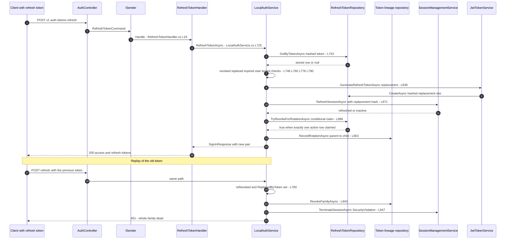
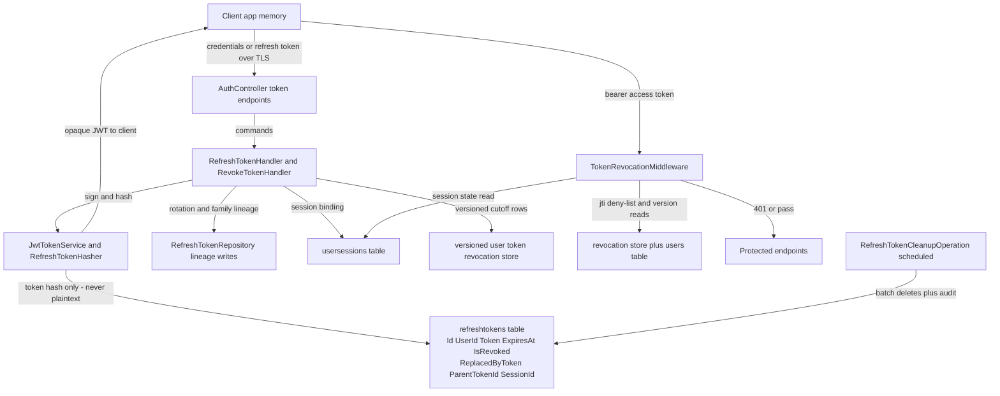

# Token Lifecycle (JWT Issuance, Refresh Rotation, Reuse Detection, Family Revocation, Expiry) — User Flow Diagram

> Issue #1113 · Module `GameGuild.Identity.Authentication` (+ `GameGuild.API` host pipeline) · Documented against `develop` commit `a96679c7a`.
> Scope: access-token issuance and claims, refresh-token issuance, rotation with a single-writer claim, replay (reuse) detection and containment, family vs account revocation, versioned user-token cutoff, per-request validation, and expiry cleanup.

## 1. Overview

Access tokens are HS256 JWTs issued by `JwtTokenService.GenerateAccessTokenCoreAsync` (`Services/JwtTokenService.cs:125-210`) with `sub`, `email`, `jti`, `iat`, `auth_time`, `token_version`, roles, optional `tenant_id`, optional `sid`, and MFA `amr` claims; default lifetime 60 minutes (`SharedKernel/.../JwtOptions.cs:33`). Refresh tokens are 64 random bytes plus entropy, returned as base64 and **stored only as a hash** (`Services/JwtTokenService.cs:233-315`); default lifetime 30 days with sliding renewal (`JwtOptions.cs:39`, `:52`). Rotation (`Services/LocalAuthService.cs:725-920`) validates the presented hash, refuses revoked/replaced tokens, then atomically claims the old row via `TryRevokeForRotationAsync` (`Repositories/RefreshTokenRepository.cs:185-217`, a conditional `ExecuteUpdate` that only succeeds for the still-active row) — concurrent rotations lose and trigger replay containment. Reuse of a rotated token (`IsRevoked || ReplacedByToken != null`, `LocalAuthService.cs:760-776`) triggers `InvalidateSessionsAfterRefreshReplayAsync` (`:934-972`): family-scope revocation by default (`JwtOptions.cs:55`), falling back to account-wide revocation plus a token-version bump. Every authenticated request passes `TokenRevocationMiddleware` (`Middleware/TokenRevocationMiddleware.cs:45-145`): jti deny-list, versioned cutoff, live `token_version` comparison, and session checks. Expired/revoked rows are garbage-collected by `RefreshTokenCleanupOperation` (`GameGuild.API/Core/Security/RefreshTokenCleanupOperation.cs:23-60`) after a 30-day retention.

## 2. End-to-End Flowchart — happy path and every edge case

```mermaid
flowchart TD
    subgraph ISSUEACC["Access token issuance"]
        IA1["Sign-in or sign-up or MFA completion<br/>LocalAuthService or AuthenticatedSessionIssuer"] --> IA2["JwtTokenService GenerateAccessTokenCoreAsync<br/>JwtTokenService.cs L125"]
        IA2 --> IA3["Claims sub email jti iat auth_time<br/>token_version roles tenant_id sid<br/>JwtTokenService.cs L143"]
        IA3 --> IA4{"MFA proof bound<br/>JwtTokenService.cs L169"}
        IA4 -- "yes" --> IA5["amr mfa plus method claims<br/>MfaVerified and MfaTime - L172"]
        IA4 -- "no" --> IA6["standard claims only"]
        IA5 --> IA7["Sign HS256 platform key<br/>expire now plus 60 minutes default - L196"]
        IA6 --> IA7
        IA7 --> IA8["Access token string returned to client<br/>no database row - stateless"]
    end

    subgraph ISSUEREF["Refresh token issuance"]
        IR1["Authenticated session issuance<br/>GenerateRefreshTokenAsync<br/>JwtTokenService.cs L233"] --> IR2["64 random bytes plus time user guid entropy<br/>base64 token string - L257"]
        IR2 --> IR3["HashToken - plaintext never stored<br/>L269"]
        IR3 --> IR4["RefreshToken row Id UserId Token hash<br/>ExpiresAt CreatedByIp - L272"]
        IR4 -- "duplicate key collision" --> IR5["regenerate - up to 3 retries<br/>L298"]
        IR5 -- "still failing after 3" --> IR6["InvalidOperationException - L307"]
        IR5 -- "unique" --> IR7["CreateAsync persists hash row<br/>lifecycle event Issued - L287"]
        IR4 --> IR7
    end

    subgraph ROTATE["Rotation - POST auth tokens refresh"]
        RT1["Client POST refresh token<br/>AuthController.cs L675"] --> RT2["RefreshTokenCommand<br/>RefreshTokenHandler.cs L19"]
        RT2 --> RT3["LocalAuthService RefreshTokenAsync<br/>LocalAuthService.cs L725"]
        RT3 --> RT4{"Token missing<br/>L729"}
        RT4 -- "missing" --> RT401a["401 Invalid refresh token - L734"]
        RT4 -- "present" --> RT5["HashToken then GetByTokenAsync<br/>L742"]
        RT5 --> RT6{"Row found<br/>L746"}
        RT6 -- "unknown hash" --> RT401b["401 - lifecycle reason Unknown - L748"]
        RT6 -- "found" --> RT7{"IsRevoked or ReplacedByToken set<br/>L760"}
        RT7 -- "yes - reuse of a rotated or revoked token" --> RT8["Replay containment<br/>InvalidateSessionsAfterRefreshReplayAsync L769<br/>lifecycle event ReplayContained - L771"]
        RT8 --> RT9["ContainmentDenial returned - no throw<br/>HTTP 401 via controller mapping - L775<br/>AuthController.cs L691"]
        RT7 -- "no" --> RT10{"ExpiresAt in the future<br/>L778"}
        RT10 -- "expired" --> RT401c["401 - reason Expired - L780"]
        RT10 -- "valid" --> RT11{"User exists<br/>L790"}
        RT11 -- "deleted or missing" --> RT401d["401 - reason UserUnavailable - L793"]
        RT11 -- "exists" --> RT12["DefaultTenantMembershipProvisioner then<br/>ResolveTenantAccessContext - L799"]
        RT12 -- "tenant denied" --> RT401e["AccessDeniedException - reason TenantDenied - L805"]
        RT12 -- "active tenant" --> RT13["ReadSessionProofAsync MFA evidence for session<br/>L818"]
        RT13 --> RT14["ResolveRenewalDays - persistent vs standard lifetime<br/>2026-10-10 regression fix - L833"]
        RT14 --> RT15["GenerateRefreshTokenAsync replacement<br/>L838"]
        RT15 --> RT16{"Sliding expiration disabled and<br/>new deadline beyond stored deadline<br/>L840"}
        RT16 -- "yes" --> RT17["Clamp to original absolute deadline - L842"]
        RT16 -- "no" --> RT18["Keep resolved deadline"]
        RT17 --> RT19["GenerateAccessTokenAsync with tokenVersion<br/>and sid - plain or Mfa proof variant - L847"]
        RT18 --> RT19
        RT19 --> RT20{"Session row for old hash exists<br/>GetSessionByRefreshTokenAsync - L816"}
        RT20 -- "missing" --> RT21["CreateSessionAsync with replacement hash - L861"]
        RT20 -- "exists" --> RT22{"RefreshSessionAsync succeeds<br/>L871"}
        RT22 -- "session inactive" --> RT23["Replay containment - reason SessionInactive<br/>ContainmentDenial - L880"]
        RT22 -- "refreshed" --> RT24["TryRevokeForRotationAsync conditional claim<br/>only wins when row still active and unreplaced<br/>RefreshTokenRepository.cs L185"]
        RT21 --> RT24
        RT24 -- "claim lost to concurrent rotation" --> RT25["Replay containment - reason ConcurrentRotation<br/>ContainmentDenial - L896"]
        RT24 -- "claimed exactly one row" --> RT26["Lineage RecordRotationAsync links parent to child<br/>RefreshTokenRepository.cs L77"]
        RT26 --> RT27["AuthenticatedSessionDeadline.Require then<br/>lifecycle event Rotated - L906"]
        RT27 --> RT200["200 new access and refresh tokens<br/>same session id - L916"]
    end

    subgraph CONTAIN["Reuse containment - InvalidateSessionsAfterRefreshReplayAsync"]
        CO1["Replay detected - LocalAuthService.cs L934"] --> CO2{"ReplayContainmentScope<br/>default Family - JwtOptions.cs L55"}
        CO2 -- "Family" --> CO3["RevokeFamilyAsync by lineage<br/>RefreshTokenRepository.cs L129"]
        CO3 -- "token bound to a session" --> CO4["Revoke whole family in that session<br/>terminate session SecurityViolation - L947"]
        CO3 -- "no session binding on row" --> CO5["fall through to account scope"]
        CO2 -- "Account" --> CO5
        CO5 --> CO6["RevokeAllForUserAsync all refresh tokens<br/>TerminateAllUserSessionsAsync - L956"]
        CO6 --> CO7["User IncrementTokenVersion and save<br/>kills legacy access tokens - L969"]
        CO2 -- "invalid scope value" --> CO8["InvalidOperationException Family or Account only - L954"]
    end

    subgraph VALIDATE["Per-request validation - TokenRevocationMiddleware"]
        V1["Request with bearer token<br/>after UseAuthentication<br/>PipelineExtensions.cs L105"] --> V2{"Authenticated principal<br/>TokenRevocationMiddleware.cs L49"}
        V2 -- "anonymous" --> V3["Pipeline continues"]
        V2 -- "authenticated" --> V4{"JTI on deny-list<br/>ITokenRevocationService.IsRevokedAsync - L61"}
        V4 -- "revoked jti" --> V401["401 Invalid access token - L63"]
        V4 -- "clear" --> V5{"Versioned cutoff after token iat<br/>IVersionedUserTokenRevocationService - L78"}
        V5 -- "user tokens revoked after iat" --> V401
        V5 -- "clear" --> V6{"token_version claim present<br/>L94"}
        V6 -- "present" --> V7{"Claim version below current stored version<br/>L100"}
        V7 -- "stale or user missing" --> V401
        V7 -- "current" --> V8{"Session claim present exactly one<br/>L111"}
        V8 -- "malformed or duplicate" --> V401
        V8 -- "one sid" --> V9{"Session row active same user not expired<br/>L121"}
        V9 -- "missing or terminated or expired" --> V401
        V9 -- "active" --> V10{"Strict IP binding enabled<br/>L132"}
        V10 -- "address mismatch - fail closed" --> V401
        V10 -- "matching or binding off" --> V11["Request proceeds"]
        V6 -- "absent - legacy token" --> V11
    end

    subgraph REVOKE["Explicit revocation"]
        RV1["POST auth tokens revoke<br/>AuthController.cs L708"] --> RV2["RevokeTokenHandler - actor must own the token<br/>RevokeTokenHandler.cs L27"]
        RV2 -- "token belongs to another user" --> RV403["AccessDeniedException"]
        RV2 -- "own token" --> RV3["RevokeRefreshTokenAsync sets IsRevoked<br/>JwtTokenService.cs L408"]
        RV3 --> RV204["204"]
        RV4["Sign-out everywhere - RevokeAllUserTokensHandler<br/>RevokeAllUserTokensCommand.cs L19"] --> RV5["RevokeAllForUser plus TerminateAllUserSessions<br/>plus IncrementTokenVersion plus versioned cutoff - L37"]
        RV5 --> RV6["Covers legacy tokens without version claims - L47"]
    end

    subgraph CLEANUP2["Expiry and cleanup"]
        CL1["Revoked or expired rows retained as replay markers<br/>RefreshTokenRepository.cs L262"] --> CL2["RefreshTokenCleanupOperation<br/>cutoff now minus RetentionDays default 30<br/>RefreshTokenCleanupOperation.cs L26"]
        CL2 --> CL3["Batched deletes max 10 batches of 500<br/>tokens and sessions in one transaction<br/>RefreshTokenCleanupOperation.cs L30"]
        CL3 --> CL4["AuditLog row written with counts<br/>deletion and audit commit together"]
        CL2 --> CL5["Predecessors retained while any child retained<br/>including active descendant - L263"]
    end
```

## 3. CQRS Chain Sequence Diagram

## 4. Data Flow Diagram

## 5. Edge-Case Matrix

| # | Edge case | Code path | Outcome |
|---|-----------|-----------|---------|
| 1 | Missing refresh token on refresh call | guard (`Services/LocalAuthService.cs:729-735`) | 401, lifecycle reason Missing |
| 2 | Unknown refresh-token hash | lookup miss (`:746-758`) | 401, reason Unknown (no oracle detail in response) |
| 3 | **Reuse of an already-rotated token** | `IsRevoked \|\| ReplacedByToken != null` (`:760-776`) | replay containment + `ReplayContained` event + containment-denial 401 (no exception, containment survives the transaction) |
| 4 | Reuse of an explicitly revoked token | same branch as rotation reuse | same containment |
| 5 | Expired refresh token | `ExpiresAt <= now` (`:778-787`) | 401, reason Expired |
| 6 | User deleted between issuance and refresh | user re-load (`:790-796`) | 401, reason UserUnavailable |
| 7 | Tenant access lost (suspended membership) | `RequireActiveTenantAccess` (`:802-807`) | AccessDeniedException, reason TenantDenied |
| 8 | Concurrent rotation of the same token | `TryRevokeForRotationAsync` conditional `ExecuteUpdate` (`Repositories/RefreshTokenRepository.cs:201-216`) — exactly one writer wins | loser takes containment path, reason ConcurrentRotation |
| 9 | Session already terminated at rotation | `RefreshSessionAsync` false (`Services/LocalAuthService.cs:871-884`) | containment, reason SessionInactive |
| 10 | Replay with family scope (default) | `RevokeFamilyAsync` (`Repositories/RefreshTokenRepository.cs:129-171`) revokes the session's tokens + terminates that one session | only the compromised family dies, other devices survive |
| 11 | Replayed row has no session binding | family lookup returns null → account-wide path (`Services/LocalAuthService.cs:952-971`) | all tokens + sessions revoked, token version bumped |
| 12 | Legacy access token without `token_version` claim | `parsedTokenVersion` null → version comparison skipped (`Middleware/TokenRevocationMiddleware.cs:94-109`) | only the iat-based versioned cutoff covers it |
| 13 | Legacy access token without `sid` claim | session block skipped (`:111`) | token valid until expiry unless version cutoff applies |
| 14 | Access token whose session was terminated | session lookup (`:121-127`) | 401 Invalid access token |
| 15 | Multiple `sid` claims (forged) | exactly-one check (`:113-119`) | 401 |
| 16 | Deleted user with live access token | `GetTokenVersionAsync` null → reject (`:100-101`) | 401 (issue #1119 partially covered for versioned tokens) |
| 17 | Strict session IP binding mismatch | fail-closed comparison, IPv4-mapped normalization (`:129-141`, `:153-166`) | 401; binding off by default |
| 18 | Stale bearer on anonymous endpoint | `RejectAsync` downgrades principal and continues for `[AllowAnonymous]` (`:168-176`) | endpoint served anonymously, no 401 loop |
| 19 | Duplicate refresh-token hash collision at issuance | 3-retry regeneration loop (`Services/JwtTokenService.cs:250-304`) | new token; failure after 3 throws |
| 20 | Sliding expiration disabled and longer renewal resolved | clamp to original absolute deadline (`Services/LocalAuthService.cs:840-845`) | absolute cap respected |
| 21 | Persistent remember-me row renewed | `ResolveRenewalDays` picks persistent lifetime, not raw span replay (`:822-837`, regression fix comment) | configured lifetime always lands |
| 22 | Revoking another user's refresh token | ownership check (`Handlers/RevokeTokenHandler.cs:40`) | AccessDeniedException |
| 23 | Sign-out everywhere | `RevokeAllUserTokensHandler` battery (`Commands/RevokeAllUserTokensCommand.cs:37-49`) | all tokens + sessions + version cutoff |
| 24 | Cleanup deletes rows still needed as replay markers | retention keeps revoked rows through original expiry + retention (`Repositories/RefreshTokenRepository.cs:260-269`) | markers survive; deletes batched 500×10 with audit |

## 6. Endpoint Inventory

| Method + Route | Handler chain | Controller ref |
|----------------|---------------|----------------|
| POST `v{v}/auth/tokens:refresh` | `RefreshTokenCommand` → `RefreshTokenHandler` → `LocalAuthService.RefreshTokenAsync` | `Controllers/AuthController.cs:674-699` |
| POST `v{v}/auth/tokens:revoke` | `RevokeTokenCommand` → `RevokeTokenHandler` → `RevokeRefreshTokenAsync` | `Controllers/AuthController.cs:707-727` |
| GET `v{v}/auth/session-state` | `GetAuthSessionStateQuery` (session validity, token version, MFA state) | `Controllers/AuthController.cs:735-759` |
| (all sign-in/up endpoints) | token issuance on success | `Controllers/AuthController.cs` sign-in regions |
| (sign-out everywhere surface) | `RevokeAllUserTokensCommand` → `RevokeAllUserTokensHandler` | `Commands/RevokeAllUserTokensCommand.cs:8-52` |

Per-request validation runs in the host pipeline at `GameGuild.API/Core/Setup/PipelineExtensions.cs:105` (after `UseAuthentication` + `PolicyAuthenticationMiddleware`, before tenant resolution and authorization).

## 7. Events Published / Consumed

- **Published** — refresh-token lifecycle events via `IRefreshTokenLifecycleRecorder` with `RefreshTokenLifecycleMetrics` counters: `Issued` (`Services/JwtTokenService.cs:288-292`), `Rotated` (`Services/LocalAuthService.cs:728`, `:908`), `ReplayContained` with reasons Revoked / SessionInactive / ConcurrentRotation (`:771`, `:881`, `:898`), `Revoked` (`Services/JwtTokenService.cs:438-442`), `AllRevoked` (`Commands/RevokeAllUserTokensCommand.cs:44`, `Services/PasswordChangeRevocationService.cs:35`). Rejection reasons (Missing/Unknown/Expired/UserUnavailable/TenantDenied) recorded through `RecordRefreshRejectionAsync` (`Services/LocalAuthService.cs:732` etc.).
- **Consumed:** cleanup consumes retention config (`RefreshTokenCleanupOptions`); the middleware consumes the revocation stores; password-change and risk events feed the same revocation battery (see password-change flow doc).

## 8. Entities and Tables Touched

| Entity / store | Fields that matter | Ref |
|----------------|--------------------|-----|
| `RefreshToken` → refreshtokens | `Token` (hash), `ExpiresAt`, `IsRevoked`, `RevokedAt/ByIp`, `ReplacedByToken`, `ParentTokenId`, `SessionId` | `Entities/RefreshToken.cs:8-49` |
| `UserSession` → usersessions | `IsActive`, `TerminatedAt`, `TerminationReason`, `ExpiresAt`, `IpAddress` (strict binding) | `Middleware/TokenRevocationMiddleware.cs:121-141` |
| `User` | `TokenVersion` (compare-and-invalidate) | `Entities/User.cs:141`, `:244-247` |
| Versioned user-token revocation store | per-user cutoff (userId, version, reason) | `IVersionedUserTokenRevocationService` (`Middleware/TokenRevocationMiddleware.cs:78-80`) |
| jti deny-list store | individually revoked access-token ids | `ITokenRevocationService.IsRevokedAsync` (`Middleware/TokenRevocationMiddleware.cs:61`) |
| AuditLog | cleanup deletion audit | `GameGuild.API/Core/Security/RefreshTokenCleanupOperation.cs:50-56` |

## 9. Gaps — realistic scenarios the code does not handle

1. **Access tokens are unrevokable individually except via the jti deny-list, which nothing populates on normal revocation paths.** `tokens:revoke`, password change, replay containment and sign-out-everywhere all revoke *refresh* tokens / sessions / versions; the per-jti store (`Middleware/TokenRevocationMiddleware.cs:58-67`) exists but no auth-flow code path writes a jti to it — access tokens stay valid until their ≤60-minute expiry unless the version/session cutoffs catch them.
2. **Legacy access tokens without a `token_version` claim skip the version comparison** (`Middleware/TokenRevocationMiddleware.cs:94-109` — the check only runs `if (parsedTokenVersion.HasValue)`). They are covered only by the iat-based versioned cutoff; a very old token minted before versioning but after the last cutoff write would pass.
3. **Family containment depends on session binding.** Rows with a null `SessionId` (legacy lineage, `Entities/RefreshToken.cs:18`) cause `RevokeFamilyAsync` to return null and containment escalates to **account-wide** revocation (`Services/LocalAuthService.cs:952-971`) — an attacker replaying one legacy token logs every device out (availability impact, not security).
4. **A stolen access token plus its session stays valid while the session row is alive even if the refresh token was separately revoked** — revoking a refresh token (`RevokeTokenHandler`) does not terminate the bound session, so the paired access token keeps working until expiry; only password-change / sign-out-everywhere / containment terminate sessions.
5. **No sender-consumed invalidation push.** Clients learn their token died only via the next 401; there is no notification channel for revocation (no push/signal), so UX recovery depends on the client refresh loop hitting 401 and re-authenticating.
6. **HS256 single shared symmetric key.** All tokens (user, guest, service-account) are signed with the same `JwtOptions.SecretKey` (`Services/JwtTokenService.cs:193`, `Guest/GuestTokenService.cs:49`); compromise of one verifier's configuration forges every token class. Key-rotation tooling exists (`Controllers/KeyRotationController.cs`, issue #1023 follow-ups) but issued-token verification has no dual-key acceptance window documented on this path.
