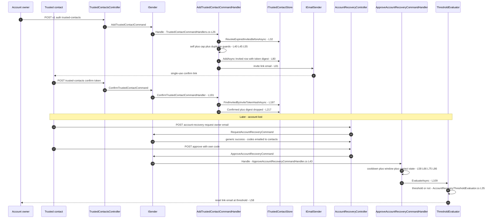
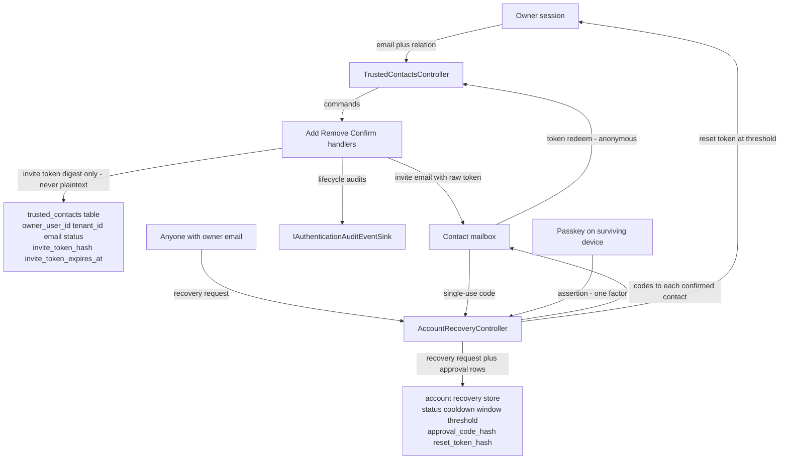

# Trusted Contacts Flow (Add, Confirm, Invite Emails, Recovery Role) — User Flow Diagram

> Issue #1107 · Module `GameGuild.Identity.Authentication` (+ `GameGuild.Email`) · Documented against `develop` commit `74e9bba4c`.
> Scope: designating trusted contacts with single-use emailed invite tokens, anonymous invite confirmation, removal/revocation, and the contacts' recovery role — single-use recovery codes, K-of-N approval with cooldown and window, the forced credential reset — per issue #209. Email-delivery reliability (no outbox) is issue #1145, fix in flight via PR #1172.

## 1. Overview

An authenticated owner designates a contact via `POST v{v}/auth/trusted-contacts` (`Controllers/TrustedContactsController.cs:43-63`). `AddTrustedContactCommandHandler` (`Handlers/TrustedContactCommandHandlers.cs:15-131`) first expires stale invites (`RevokeExpiredInvitesBeforeAsync`), rejects self-delegation and duplicate active emails, and enforces the cap `MaxTrustedContacts = 5` (`Configuration/AccountRecoveryOptions.cs:16`); it then mints a 32-byte invite token — persisted **only as a SHA-256 digest** with `InviteLifetime` 7 days (`Services/AccountRecoveryTokens.cs:8-21`) — and emails a single-use confirmation link (`:93-104`). The contact confirms anonymously via `POST /auth/trusted-contacts/confirm` (`Controllers/TrustedContactsController.cs:71-87`): `ConfirmTrustedContactCommandHandler` (`Handlers/TrustedContactCommandHandlers.cs:180-235`) matches the token digest (constant-time), checks expiry, transitions `Invited → Confirmed`, and **drops the digest** so the token can never replay; denials are generic. Removal (`:94-112`) is terminal (`Revoked`) and also kills in-flight invites. The **recovery role** is the K-of-N flow in `AccountRecoveryController` (`Controllers/AccountRecoveryController.cs:21-187`): an anonymous `POST /auth/account-recovery/request` for an email (`Handlers/AccountRecoveryRequestHandlers.cs:32-136`, rate-limited 10 min per email via `IMemoryCache`, enumeration-safe identical responses) requires at least one recovery factor (confirmed contacts and/or an enrolled passkey), opens a request with `Cooldown` 24 h and `ApprovalWindow` 72 h (`Configuration/AccountRecoveryOptions.cs:22-25`), and emails each confirmed contact a single-use 32-byte recovery code (stored hashed, `:100-111`). Contacts approve anonymously via `POST /auth/account-recovery/approve` (`Handlers/ApproveAccountRecoveryCommandHandler.cs:43-110`): the code is redeemed single-use, re-checked against contact revocation and cooldown (too-early returns **425 with Retry-After**), and `AccountRecoveryThresholdEvaluator` (`Services/AccountRecoveryThresholdEvaluator.cs:32-76`) counts distinct approvals; at the snapshotted threshold (`RequiredApprovals` clamped, default 2) it mints a 1-hour single-use reset token and emails the owner. `POST /auth/account-recovery/reset` then forces the full credential reset (new password, all sessions terminated, all refresh tokens and passkeys revoked). A surviving passkey can serve as one approval factor via `approve-passkey:begin/:complete` (`Handlers/ApproveAccountRecoveryCommandHandler.cs:124-231`).

## 2. End-to-End Flowchart — happy path and every edge case

```mermaid
flowchart TD
    subgraph ADD["Add a trusted contact - owner session"]
        A1["Owner POST v1 auth trusted-contacts<br/>email plus optional relation<br/>TrustedContactsController.cs L43"] --> A2["AddTrustedContactCommand - email validated<br/>RFC 5321 max 254 - relation max 100<br/>Validators TrustedContactCommandValidators.cs L12"]
        A2 --> A3["Housekeeping RevokeExpiredInvitesBeforeAsync<br/>Handlers TrustedContactCommandHandlers.cs L32"]
        A3 --> A4{"Owner exists<br/>L34"}
        A4 -- "no" --> A400a["failure Account not found L37"]
        A4 -- "yes" --> A5{"Email equals owner email<br/>L40"}
        A5 -- "yes" --> A400b["failure - cannot designate yourself L42"]
        A5 -- "no" --> A6{"Active count at cap 5<br/>L45"}
        A6 -- "yes" --> A400c["failure - max 5 active contacts L48"]
        A6 -- "no" --> A7{"Active row for owner plus email exists<br/>L55"}
        A7 -- "yes" --> A400d["failure - already an active contact L60"]
        A7 -- "no" --> A8["Invite token 32 bytes - stored as SHA-256 digest<br/>expires in 7 days - Status Invited<br/>L66"]
        A8 --> A9["Persist row L80"]
        A9 --> A10["Email invite link with token and expiry<br/>L81"]
        A10 -- "email send throws" --> A500["command aborts after persist - issue 1145<br/>no outbox on develop"]
        A10 -- "sent" --> A11["200 Invitation sent - audit<br/>AccountRecovery.ContactInvited L82"]
    end

    subgraph CONFIRM["Confirm invite - anonymous"]
        CF1["Contact opens link - POST confirm with token<br/>TrustedContactsController.cs L71"] --> CF2["Hash token then<br/>FindInvitedByInviteTokenHashAsync plus<br/>FixedTimeHexEquals - L196 L198"]
        CF2 -- "no live invitation" --> CF200a["generic denial Invalid or expired invitation L200"]
        CF2 -- "match" --> CF3{"InviteTokenExpiresAt in future<br/>L205"}
        CF3 -- "expired or null" --> CF200a
        CF3 -- "valid" --> CF4["Status Confirmed - ConfirmedAt now -<br/>digest dropped - token single use L213"]
        CF4 --> CF5["200 confirmed - audit<br/>AccountRecovery.ContactConfirmed L219"]
    end

    subgraph REMOVE["Remove - owner session"]
        RM1["Owner DELETE id<br/>TrustedContactsController.cs L94"] --> RM2{"Contact exists and owned and not Revoked<br/>Handlers TrustedContactCommandHandlers.cs L148"}
        RM2 -- "no" --> RM404["failure - not found - indistinguishable L150"]
        RM2 -- "yes" --> RM3["Status Revoked terminal - digest dropped -<br/>in-flight invite killed L154"]
        RM3 --> RM4["200 removed - audit ContactRemoved L161"]
    end

    subgraph RECOVERY["Recovery role - K of N"]
        RC1["Anyone POST account-recovery request with email<br/>AccountRecoveryController.cs L29"] --> RC2{"Rate limit 10 min per email digest<br/>Handlers AccountRecoveryRequestHandlers.cs L40"}
        RC2 -- "throttled" --> RC3["generic empty success L43"]
        RC2 -- "ok" --> RC4{"User exists and has factors -<br/>confirmed contacts plus or passkey L58 L69"}
        RC4 -- "no account or no factors" --> RC5["generic empty success - enumeration safe L72"]
        RC4 -- "has factors" --> RC6{"Live request already exists<br/>L77"}
        RC6 -- "yes" --> RC5
        RC6 -- "no" --> RC7["Recovery request PendingApprovals<br/>Cooldown 24 h - Window 72 h - threshold clamped<br/>L85"]
        RC7 --> RC8["Per contact - code 32 bytes hashed plus emailed<br/>L100 L112"]
        RC8 --> RC9["Owner notice email L125"]
        RC9 --> RC10["generic empty success L135"]
        RC11["Contact POST approve with code<br/>AccountRecoveryController.cs L75"] --> RC12{"Redeemable code row - unapproved<br/>Handlers ApproveAccountRecoveryCommandHandler.cs L49"}
        RC12 -- "unknown or consumed" --> RC400a["generic denial L52"]
        RC12 -- "found" --> RC13{"Request PendingApprovals<br/>L58"}
        RC13 -- "no" --> RC400a
        RC13 -- "yes" --> RC14{"Contact still Confirmed<br/>L66"}
        RC14 -- "revoked meanwhile" --> RC400a
        RC14 -- "confirmed" --> RC15{"Now before CooldownEndsAt<br/>L75"}
        RC15 -- "too early - valid code" --> RC425["425 with RetryAfterSeconds L78"]
        RC15 -- "in window" --> RC16{"Now inside ApprovalWindow<br/>L86"}
        RC16 -- "elapsed" --> RC400a
        RC16 -- "ok" --> RC17["ApprovedAt stamped - code consumed L94"]
        RC17 --> RC18["ThresholdEvaluator CountDistinctApprovals<br/>Services AccountRecoveryThresholdEvaluator.cs L35"]
        RC18 -- "below threshold" --> RC19["200 recorded k of n L43"]
        RC18 -- "threshold reached" --> RC20["ResetUnlocked - reset token 1 h hashed<br/>plus owner email L50 L58"]
        RC21["Owner POST account-recovery reset with token<br/>plus new password<br/>AccountRecoveryController.cs L168"] --> RC22["Single-use reset token consumed -<br/>password set - all sessions terminated -<br/>all refresh tokens revoked - all passkeys revoked"]
        RC23["Owner cancel while still in control<br/>AccountRecoveryController.cs L52"] --> RC24["Status Cancelled - reset token digest dropped<br/>Handlers AccountRecoveryRequestHandlers.cs L198"]
    end

    subgraph PASSKEY["Passkey as one approval factor"]
        P1["Surviving device POST approve-passkey begin<br/>AccountRecoveryController.cs L109"] --> P2["WebAuthn assertion options - no credentials issued<br/>Handlers ApproveAccountRecoveryCommandHandler.cs L14"]
        P2 --> P3["POST approve-passkey complete with assertion<br/>L133"] --> P4{"Assertion verifies and request live<br/>L151 L161"}
        P4 -- "no" --> RC400a
        P4 -- "yes" --> P5{"Same credential already approved<br/>TryAddPasskeyApprovalAsync L200"}
        P5 -- "replay" --> RC400a
        P5 -- "new" --> RC18
    end
```

## 3. CQRS Chain Sequence Diagram

## 4. Data Flow Diagram

## 5. Edge-Case Matrix

| # | Edge case | Code path | Outcome |
|---|-----------|-----------|---------|
| 1 | Add with malformed/too-long email or relation | validator (`Validators/TrustedContactCommandValidators.cs:12-18`) | 400 validation failure |
| 2 | Owner designates their own email | self check (`Handlers/TrustedContactCommandHandlers.cs:40-43`) | failure "cannot designate your own account email" |
| 3 | Sixth active contact | cap check (`:45-53`, cap 5 `Configuration/AccountRecoveryOptions.cs:16`) | failure with the cap in the message |
| 4 | Same email invited twice while first invite alive | duplicate check (`:55-63`) | failure "already an active trusted contact" |
| 5 | Expired invite occupying the slot | housekeeping runs first (`:32`) | expired rows revoked before the cap/duplicate checks — slot freed |
| 6 | Invite email delivery fails | `SendInviteEmailAsync` after `AddAsync` (`:80-81`) | command throws **after** the row persisted — owner sees an error yet the invite exists and counts toward the cap; no outbox (issue #1145, PR #1172 in flight) |
| 7 | Confirm with unknown/garbled token | digest lookup + constant-time compare (`:196-201`) | generic "Invalid or expired invitation" — no state oracle |
| 8 | Confirm after the 7-day invite lifetime | expiry check (`:205-209`) | generic denial; row was already revoked by housekeeping |
| 9 | Confirm replay (token used twice) | digest dropped at first confirm (`:215`) | second attempt finds no live invitation → generic denial |
| 10 | Owner removes the contact while invite in flight | removal drops digest (`:156-158`) | outstanding email link becomes dead — fail closed |
| 11 | Remove of another owner's contact id | ownership check (`:148-151`) | indistinguishable "not found" |
| 12 | Revoked (removed) contact tries to approve a recovery | re-check at approval (`Handlers/ApproveAccountRecoveryCommandHandler.cs:66-72`) | generic denial — revocation is effective immediately even for already-issued codes |
| 13 | Recovery request for unknown email | user lookup (`Handlers/AccountRecoveryRequestHandlers.cs:58-63`) | identical generic success — enumeration-safe |
| 14 | Recovery request for an account with zero factors | factor count (`:69-75`) | generic success, nothing opened |
| 15 | Second live recovery request for the same owner | live-request check (`:77-82`) | generic success, first request keeps running |
| 16 | Request spam per email | `IMemoryCache` 10-min bucket keyed by email digest (`:40-54`) | throttled to generic success; per-instance cache only (not distributed) |
| 17 | Approval submitted during the 24 h cooldown with a valid code | cooldown branch (`Handlers/ApproveAccountRecoveryCommandHandler.cs:75-84`) | **425** with `RetryAfterSeconds` — the only non-generic denial, safe because code possession was proven |
| 18 | Approval after the 72 h window | window check (`:86-91`) | generic denial; request expired by housekeeping |
| 19 | Same recovery code submitted twice | `ApprovedAt` stamp consumes (`:93-97`) | second submission finds no redeemable row → generic denial |
| 20 | Two contacts approve; threshold is 2 | evaluator (`Services/AccountRecoveryThresholdEvaluator.cs:35-48`) | second approval unlocks reset — 1-hour single-use token emailed to owner |
| 21 | Threshold already reached, third approval arrives | idempotent branch (`:36-48`) | "Approval recorded" without minting another token |
| 22 | Passkey assertion replayed for a second approval factor | `TryAddPasskeyApprovalAsync` (`Handlers/ApproveAccountRecoveryCommandHandler.cs:200-206`) | rejected as replay — one credential, one approval |
| 23 | Reset token expired (1 h) or consumed | reset handler consumes digest; lookups require live state | generic denial; owner must restart the recovery |
| 24 | Owner cancels after threshold | cancel drops reset-token digest (`Handlers/AccountRecoveryRequestHandlers.cs:208-212`) | minted link dies immediately — fail closed |
| 25 | Concurrent duplicate request inserts | unique live-request constraint caught by message sniff (`Handlers/AccountRecoveryRequestHandlers.cs:117-123`) | treated as generic success — no double request |

## 6. Endpoint Inventory

| Method + Route | Handler chain | Controller ref |
|----------------|---------------|----------------|
| GET `v{v}/auth/trusted-contacts` | direct `ITrustedContactStore.GetActiveByOwnerAsync` | `Controllers/TrustedContactsController.cs:26-36` |
| POST `v{v}/auth/trusted-contacts` | `AddTrustedContactCommand` → validator → `AddTrustedContactCommandHandler` | `Controllers/TrustedContactsController.cs:43-63` |
| POST `v{v}/auth/trusted-contacts/confirm` (anonymous) | `ConfirmTrustedContactCommand` → validator → `ConfirmTrustedContactCommandHandler` | `Controllers/TrustedContactsController.cs:71-87` |
| DELETE `v{v}/auth/trusted-contacts/{contactId}` | `RemoveTrustedContactCommand` → `RemoveTrustedContactCommandHandler` | `Controllers/TrustedContactsController.cs:94-112` |
| POST `v{v}/auth/account-recovery/request` (anonymous) | `RequestAccountRecoveryCommand` → `RequestAccountRecoveryCommandHandler` | `Controllers/AccountRecoveryController.cs:29-45` |
| POST `v{v}/auth/account-recovery/cancel` | `CancelAccountRecoveryCommand` → `CancelAccountRecoveryCommandHandler` | `Controllers/AccountRecoveryController.cs:52-67` |
| POST `v{v}/auth/account-recovery/approve` (anonymous) | `ApproveAccountRecoveryCommand` → `ApproveAccountRecoveryCommandHandler` → threshold evaluator | `Controllers/AccountRecoveryController.cs:75-100` |
| POST `v{v}/auth/account-recovery/approve-passkey:begin` / `:complete` (anonymous) | `BeginPasskeyRecoveryApprovalCommand` / `ApproveAccountRecoveryWithPasskeyCommand` | `Controllers/AccountRecoveryController.cs:109-158` |
| POST `v{v}/auth/account-recovery/reset` (anonymous) | `CompleteAccountRecoveryResetCommand` → forced credential reset | `Controllers/AccountRecoveryController.cs:168-186` |

## 7. Events Published / Consumed

- **Published** — audit events via `IAuthenticationAuditEventSink`, all under category `AccountRecovery`: `AccountRecovery.ContactInvited` (`Handlers/TrustedContactCommandHandlers.cs:82`), `ContactRemoved` (`:161`), `ContactConfirmed` (`:219`), `RequestRejected`/`RequestOpened` (`Handlers/AccountRecoveryRequestHandlers.cs:73`, `:126`), `RequestCancelled` (`:215`), `ApprovalRecorded`/`ApprovalDenied` (`Handlers/ApproveAccountRecoveryCommandHandler.cs:99`, `:113`), `PasskeyApprovalRecorded`/`PasskeyApprovalDenied` (`:208`, `:221`), `ResetUnlocked` at Critical risk (`Services/AccountRecoveryThresholdEvaluator.cs:59-67`). Durable operation events: `identity.authentication.{add,remove,confirm}-trusted-contact` and the six account-recovery commands (`Architecture/AuthenticationUseCaseEventContracts.cs:52-60`). Emails (invite, codes, owner notices, reset link) are sent inline — not outbox-relayed (issue #1145).
- **Consumed** — `AccountRecoveryOptions` bound from `Authentication:AccountRecovery` (`Configuration/AccountRecoveryOptions.cs:10-41`: cap 5, threshold 2, cooldown 24 h, window 72 h, invite 7 d, reset 1 h, retention 30 d, email rate limit 10 min); `IEmailSender`; `IUserRepository` (owner lookup, enumeration-safe email lookup); `IWebAuthnCredentialRepository` (passkey factor availability); `IMemoryCache` (rate limiting); `App:BaseUrl` for links (defaults `http://localhost:3000`, `Handlers/TrustedContactCommandHandlers.cs:116-120`).

## 8. Entities and Tables Touched

| Entity / store | Fields that matter | Ref |
|----------------|--------------------|-----|
| `TrustedContact` → `gameguild.authentication.trusted_contacts` | `OwnerUserId`, `TenantId`, `Email` (normalized lowercase, 254), `Relation`, `Status` (Invited/Confirmed/Revoked, CHECK-constrained), `InviteTokenHash` + `InviteTokenExpiresAt` (dropped on confirm/revoke), `InvitedAt`, `ConfirmedAt`, `RevokedAt` | `Entities/TrustedContact.cs:8-40`, `Enums/TrustedContactStatus.cs:5-21`, `Data/Configurations/TrustedContactConfiguration.cs:10-25` |
| `AccountRecoveryRequest` (+ `RecoveryApproval`) | `Status`, `CooldownEndsAt`, `ApprovalWindowEndsAt`, `RequiredApprovals` snapshot, `ApprovalCodeHash` per contact factor, `ResetTokenHash`/`ResetTokenExpiresAt` | `Handlers/AccountRecoveryRequestHandlers.cs:85-111`, `Repositories/PostgreSqlAccountRecoveryStore.cs` |
| Audit log | the `AccountRecovery.*` events above | `Abstractions/IAuthenticationAuditEventSink.cs` |
| Operation event stream | the nine command events above | `Architecture/AuthenticationUseCaseEventContracts.cs:52-60` |

## 9. Gaps — realistic scenarios the code does not handle

1. **Email failure leaves half-committed state (issue #1145, PR #1172 in flight).** The invite row is persisted *before* the email send (`Handlers/TrustedContactCommandHandlers.cs:80-81`); a down SMTP throws after the write — the owner gets a 500, yet the Invited row exists, counts toward the cap of 5, and its token (which nobody received) occupies the owner+email slot for 7 days unless housekeeping expires it. Same pattern for recovery codes (`Handlers/AccountRecoveryRequestHandlers.cs:112-117`): a code email failure aborts mid-loop, leaving some contacts with codes and none recorded as "partially notified". No outbox exists on `develop`.
2. **Contact-side email compromise is silent.** Nothing notifies the owner when an invite is confirmed (`Handlers/TrustedContactCommandHandlers.cs:219-227` audits but sends no email to the owner), and confirmations are not rate-limited or IP-bound — a mailbox attacker who intercepts one invite email quietly becomes a standing recovery factor.
3. **Recovery-request rate limiting is per-instance.** The 10-minute email bucket uses `IMemoryCache` (`Handlers/AccountRecoveryRequestHandlers.cs:23`, `:40-54`) — behind multiple API instances an attacker gets N× the budget; unlike tokens there is no distributed-cache fallback.
4. **No cap on distinct pending recoveries across accounts.** Anyone can open a recovery for any email with factors (enumeration-safe but unbounded across *different* emails), each emailing every confirmed contact — a mail-bomb amplification vector via the contacts (`:97-113`), gated only by the per-email 10-minute bucket.
5. **Approval-cooldown 425 reveals request existence to a code holder** — acceptable by design (code possession proves factor) but combined with gap 2 the *contact* learns a recovery is live before the cooldown ends while the owner is only notified by email (`SendOwnerNoticeEmailAsync`, `:125`) which can fail silently (gap 1 pattern).
6. **The forced reset revokes every passkey and session** (`Controllers/AccountRecoveryController.cs:162-166` description; reset handler) — correct for compromise, but there is no post-reset notification to the trusted contacts that their codes completed a takeover, and no cooling-off re-confirmation by a second factor at reset time beyond the single-use token itself.
7. **Relation and email are the only contact identity.** No verification that the contact *account* (if any) matches the email, no MFA requirement for the confirming party beyond mailbox control, and no maximum velocity on add/remove cycling (`Handlers/TrustedContactCommandHandlers.cs:26-91`) — an attacker with the owner session can silently swap the entire contact set (remove all, add attacker-controlled emails) in five calls.
