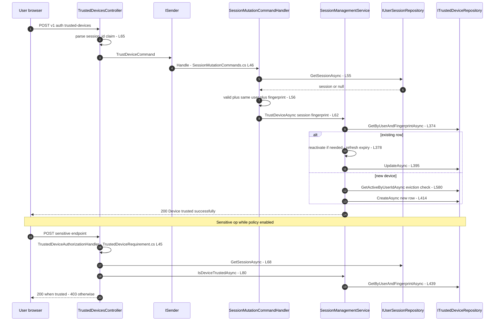
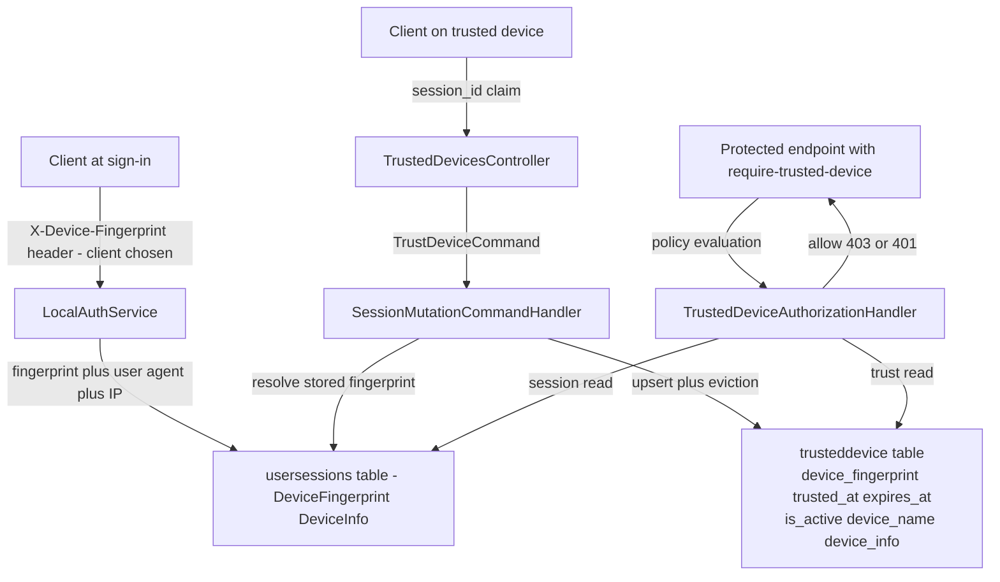

# Trusted Devices Flow (Registration, Trust Decision, Expiry, Device Management) — User Flow Diagram

> Issue #1106 · Module `GameGuild.Identity.Authentication` (+ session/token infrastructure) · Documented against `develop` commit `74e9bba4c`.
> Scope: trusting the current session's device (session-resolved fingerprint, no fresh verification today — issue #1144, fix in flight via PR #1172), the `require-trusted-device` authorization decision for sensitive operations, trust expiry (30-day sliding), revocation and renaming, and the max-device eviction policy.

## 1. Overview

Device trust starts at sign-in: the session row stores a device fingerprint taken from the client-supplied `X-Device-Fingerprint` header or request field (`Services/LocalAuthService.cs:60-63`, persisted via `CreateSessionAsync` at `Services/SessionManagementService.cs:67`). A user registers the device by `POST v{v}/auth/trusted-devices` (`Controllers/TrustedDevicesController.cs:55-79`): the controller reads the `session_id` claim, and `TrustDeviceCommand`'s handler (`Commands/SessionMutationCommands.cs:46-70`) re-resolves the session and **fails closed** unless it is live, un-terminated, owned by the caller and carries a non-empty fingerprint — the trusted-device row inherits the session's stored fingerprint and metadata (`:62-69`), never a client-provided one. `SessionManagementService.TrustDeviceAsync` (`Services/SessionManagementService.cs:366-419`) requires `EnableDeviceFingerprinting` (default true, `Modules/GameGuild.SharedKernel/Configuration/ApplicationLayer/SessionOptions.cs:74`), upserts by (userId, fingerprint) — reactivating expired or inactive rows and refreshing `ExpiresAt` to now + `TrustedDeviceDurationDays` (default 30, `SessionOptions.cs:53`) — and evicts least-recently-used devices beyond `MaxTrustedDevices` (default 10, `SessionOptions.cs:59`) via `EnforceMaxTrustedDevicesAsync` (`Services/SessionManagementService.cs:580-597`). The **trust decision** is the `require-trusted-device` policy (`Authorization/TrustedDeviceRequirement.cs:10-13`) enforced by `TrustedDeviceAuthorizationHandler` (`:39-98`): it is a no-op unless `RequireTrustedDeviceForSensitiveOps` is enabled (default **false**, `SessionOptions.cs:84`); when enabled, interactive sessions must map to a live session whose fingerprint is currently trusted (`IsDeviceTrustedAsync`, `Services/SessionManagementService.cs:432-452` — active, unexpired), non-interactive schemes pass through (`:57-63`), and registry outages fail closed (`:90-96`). Management endpoints: list active devices (`Controllers/TrustedDevicesController.cs:25-47`), revoke (`:87-104`), rename (`:113-142`, 1–200 chars). Expiry is lazy — `IsExpired`/`IsValid` on the entity (`Entities/TrustedDevice.cs:64-66`) and time-filtered reads (`Services/SessionManagementService.cs:463-464`); there is no pruning job (issue #1144).

## 2. End-to-End Flowchart — happy path and every edge case

```mermaid
flowchart TD
    subgraph ORIGIN["Fingerprint origin - sign-in"]
        O1["Sign-in request<br/>X-Device-Fingerprint header or body field<br/>LocalAuthService.cs L60"] --> O2{"Header present<br/>L61"}
        O2 -- "yes" --> O3["use header value"]
        O2 -- "no" --> O4["use request DeviceFingerprint L63"]
        O3 --> O5["Session row stores DeviceFingerprint plus<br/>DeviceInfo plus IpAddress<br/>SessionManagementService.cs L67"]
        O4 --> O5
    end

    subgraph REGISTER["Register trust - POST auth trusted-devices"]
        R1["Authenticated user with session<br/>TrustedDevicesController.cs L55"] --> R2{"session_id claim parses<br/>L65"}
        R2 -- "missing or empty" --> R400a["400 Current session device is unavailable L67"]
        R2 -- "ok" --> R3["TrustDeviceCommand userId sessionId deviceName<br/>L70"]
        R3 --> R4{"Session resolvable and valid and same user<br/>and not terminated and has fingerprint<br/>SessionMutationCommands.cs L56"}
        R4 -- "any check fails" --> R400b["false - 400 Failed to trust device L75"]
        R4 -- "ok" --> R5["TrustDeviceAsync with session fingerprint plus<br/>session DeviceInfo - never client payload<br/>L62"]
        R5 --> R6{"EnableDeviceFingerprinting<br/>SessionManagementService.cs L368"}
        R6 -- "disabled" --> R400b
        R6 -- "enabled" --> R7{"Existing row for user plus fingerprint<br/>L374"}
        R7 -- "found inactive or expired" --> R8["EnforceMaxTrustedDevicesAsync then reactivate<br/>L381"]
        R7 -- "found active" --> R9["Update name plus refresh metadata plus<br/>ExpiresAt now plus 30 days - L385"]
        R8 --> R9
        R7 -- "not found" --> R10["EnforceMaxTrustedDevicesAsync evicts<br/>least recently used beyond 10 - L580"]
        R10 --> R11["Create row TrustedAt now ExpiresAt<br/>now plus 30 days IsActive true - L401"]
        R9 --> R12["200 Device trusted successfully L78"]
        R11 --> R12
    end

    subgraph DECIDE["Trust decision - require-trusted-device policy"]
        D1["Sensitive endpoint declares TrustedDevicePolicy<br/>ApiKeyController.cs L29 for example"] --> D2{"RequireTrustedDeviceForSensitiveOps<br/>SessionOptions.cs L84 - default false"}
        D2 -- "disabled - current default" --> D3["Succeed for everyone L51"]
        D2 -- "enabled" --> D4{"session_id and sub claims valid<br/>TrustedDeviceRequirement.cs L57"}
        D4 -- "absent - API key service account guest" --> D5["Succeed - other schemes own policies govern L62"]
        D4 -- "present" --> D6{"Session active same user<br/>and has DeviceFingerprint - L68"}
        D6 -- "missing or terminated or no fingerprint" --> D7["Fail - trust could not be verified L74"]
        D6 -- "ok" --> D8{"IsDeviceTrustedAsync - row active and unexpired<br/>SessionManagementService.cs L432"}
        D8 -- "not trusted or expired" --> D9["Fail - trust this device first L86"]
        D8 -- "trusted" --> D10["Succeed L81"]
        D6 -- "registry exception" --> D11["Fail closed - verification failed L93"]
    end

    subgraph MANAGE["Device management"]
        M1["GET auth trusted-devices<br/>TrustedDevicesController.cs L25"] --> M2["GetTrustedDevicesAsync - only active unexpired<br/>SessionManagementService.cs L454"]
        M2 -- "fingerprinting disabled" --> M3["empty list L458"]
        M2 --> M4["200 rows with parsed DeviceInfo JSON L35"]
        M5["DELETE id - revoke<br/>TrustedDevicesController.cs L87"] --> M6{"Device exists and owned by caller<br/>SessionManagementService.cs L510"}
        M6 -- "no" --> M404["404 not found"]
        M6 -- "yes" --> M7["IsActive false - sessions on the device stay alive"]
        M8["PATCH id name - rename 1 to 200 chars<br/>TrustedDevicesController.cs L113"] --> M9{"Length in range and device active and owned<br/>SessionManagementService.cs L533 L539"}
        M9 -- "invalid or not owned" --> M400c["400 or 404"]
        M9 -- "ok" --> M10["DeviceName updated"]
    end

    subgraph EXPIRY["Expiry"]
        E1["ExpiresAt trustedAt plus 30 days default<br/>SessionManagementService.cs L393"] --> E2{"Clock passes ExpiresAt"}
        E2 -- "yes" --> E3["IsDeviceTrustedAsync false - sensitive ops blocked<br/>L446"]
        E2 -- "yes" --> E4["Row hidden from listing L464"]
        E2 -- "yes" --> E5["Row stays in table - no pruning job<br/>issue 1144"]
        E5 --> E6["Re-trust same device reactivates the expired row<br/>L379"]
    end
```

## 3. CQRS Chain Sequence Diagram

## 4. Data Flow Diagram

## 5. Edge-Case Matrix

| # | Edge case | Code path | Outcome |
|---|-----------|-----------|---------|
| 1 | Trust request with no parseable `session_id` claim | claim parse (`Controllers/TrustedDevicesController.cs:65-68`) | 400 "Current session device is unavailable" |
| 2 | Session terminated/expired between token issue and trust | session re-resolution (`Commands/SessionMutationCommands.cs:55-60`) | false → 400; stale claims cannot trust |
| 3 | Session has no stored fingerprint (legacy session) | `IsNullOrWhiteSpace(DeviceFingerprint)` (`:57`) | false → 400 |
| 4 | Client sends crafted device info alongside the trust request | handler ignores client metadata, uses the session's (`:62-69`) | only the name from the body is honored; fingerprint/info come from the session |
| 5 | Fingerprint is client-chosen at sign-in (spoofed `X-Device-Fingerprint`) | header capture (`Services/LocalAuthService.cs:60-63`) | trust binds to whatever string the client sent at sign-in — trust follows the claimed device, not a verified one |
| 6 | `EnableDeviceFingerprinting` disabled | gate (`Services/SessionManagementService.cs:368-371`) | trust returns false; listing returns empty (`:456-459`); `IsDeviceTrustedAsync` also false (`:434`) |
| 7 | Re-trust of an already active device | update path (`:376-398`) | name overwritten, metadata refreshed only when non-empty, expiry slid +30 days |
| 8 | Re-trust of an expired/revoked row | reactivate branch (`:378-383`) | row reactivated after eviction check — device returns with fresh 30 days |
| 9 | Trusting the 11th device | `EnforceMaxTrustedDevicesAsync` (`:580-597`) | oldest-by-LastUsedAt devices revoked to make room (cap 10, `SessionOptions.cs:59`) |
| 10 | Eviction races two concurrent trusts | eviction + create are separate reads/writes, no lock (`:400-414`) | transient overshoot possible; next trust re-evicts |
| 11 | Policy enabled, request authenticated by API key/service account (no session) | scheme pass-through (`Authorization/TrustedDeviceRequirement.cs:57-63`) | requirement succeeds — only interactive sessions are constrained |
| 12 | Policy disabled (today's default) | early succeed (`:49-52`) | every caller passes; the policy changes nothing until `RequireTrustedDeviceForSensitiveOps=true` (`SessionOptions.cs:84`) |
| 13 | Session live but its fingerprint row revoked | `IsDeviceTrustedAsync` (`Services/SessionManagementService.cs:441-443`) | 403 "trust this device first" |
| 14 | Trust expired mid-session | expiry check (`:446-449`) | sensitive ops start failing 403; the session itself remains valid |
| 15 | Session/registry lookup throws | fail-closed catch (`Authorization/TrustedDeviceRequirement.cs:90-96`) | 403 with exception type name — no fail-open |
| 16 | Rename another user's device | ownership check (`Services/SessionManagementService.cs:538-541`) | false → 404 (indistinguishable from missing) |
| 17 | Rename with empty/oversized name | length gate 1–200 (`:532-534`, `Controllers/TrustedDevicesController.cs:126-131`) | 400 with the limit in the message |
| 18 | Rename an inactive (revoked) device | `IsNot { IsActive: true }` (`:539`) | 404 |
| 19 | Revoke a device while sessions on it are alive | revocation touches only the device row (`:506-523`) | device untrusted immediately; sessions/tokens unaffected — the token middleware never consults device trust |
| 20 | DeviceInfo JSON corrupt in the row | `ParseDeviceInfo` catch (`Controllers/TrustedDevicesController.cs:146-161`) | listing shows null info; never a 500 |
| 21 | Oversized device info from a monster user agent | truncate to 2000 (`Services/SessionManagementService.cs:425-430`) | persisted safely |
| 22 | Concurrent trust and revoke of the same device | no row versioning (`:376-398`, `:506-523`) | last write wins; a revoke can be silently resurrected by an in-flight trust |
| 23 | Expired rows accumulate | no pruning job exists (issue #1144) | table grows; only reads filter by time |

## 6. Endpoint Inventory

| Method + Route | Handler chain | Controller ref |
|----------------|---------------|----------------|
| GET `v{v}/auth/trusted-devices` | direct `ISessionManagementService.GetTrustedDevicesAsync` | `Controllers/TrustedDevicesController.cs:25-47` |
| POST `v{v}/auth/trusted-devices` | `TrustDeviceCommand` → `SessionMutationCommandHandler` → `TrustDeviceAsync` | `Controllers/TrustedDevicesController.cs:55-79` |
| DELETE `v{v}/auth/trusted-devices/{deviceId}` | `RevokeTrustedDeviceCommand` → `RevokeTrustedDeviceAsync` | `Controllers/TrustedDevicesController.cs:87-104` |
| PATCH `v{v}/auth/trusted-devices/{deviceId}/name` | `RenameTrustedDeviceCommand` → `RenameTrustedDeviceAsync` | `Controllers/TrustedDevicesController.cs:113-142` |
| (decision surface) endpoints carrying `TrustedDevicePolicy.Name` | `TrustedDeviceAuthorizationHandler` via the authorization pipeline — e.g. API-key create/rotate/revoke (`Controllers/ApiKeyController.cs:29`) | `Authorization/TrustedDeviceRequirement.cs:39-98` |

## 7. Events Published / Consumed

- **Published** — durable operation events: `identity.authentication.trust-device` (`Architecture/UseCaseEventContracts.g.cs:88`), `identity.authentication.rename-trusted-device` (`:64`), `identity.authentication.revoke-trusted-device` (`:76`). Session lifecycle audit events (`Authentication.SessionCreated/SessionRefreshed/Terminated/Renamed` via `ForwardSessionAuditEventAsync`, `Services/SessionManagementService.cs:336`) cover sessions, but **trust/revoke/rename emit no `IAuthenticationAuditEventSink` event** — only `ILogger` lines (`:416`, `:520`, `:549`).
- **Consumed** — `SessionOptions` (`TrustedDeviceDurationDays` 30, `MaxTrustedDevices` 10, `EnableDeviceFingerprinting` true, `RequireTrustedDeviceForSensitiveOps` false — `Modules/GameGuild.SharedKernel/Configuration/ApplicationLayer/SessionOptions.cs:53-84`); the `session_id` claim at registration; `UserSession.DeviceFingerprint` as the trust anchor.

## 8. Entities and Tables Touched

| Entity / store | Fields that matter | Ref |
|----------------|--------------------|-----|
| `TrustedDevice` → `gameguild.authentication.trusteddevice` | `UserId`, `DeviceFingerprint` (64), `DeviceName` (200), `DeviceInfo` (2000 JSON), `TrustedAt`, `LastUsedAt`, `IsActive`, `ExpiresAt`, `AssociatedIpAddresses` | `Entities/TrustedDevice.cs:8-67`, `Data/Configurations/TrustedDeviceConfiguration.cs:14` |
| `UserSession` → usersessions | `DeviceFingerprint` (trust anchor), `DeviceInfo`, `IsActive`, `TerminatedAt` | `Commands/SessionMutationCommands.cs:55-60`, `Services/SessionManagementService.cs:67` |
| Operation event stream | trust/rename/revoke device events | `Architecture/UseCaseEventContracts.g.cs:64-88` |

## 9. Gaps — realistic scenarios the code does not handle

1. **Registration requires no fresh verification (issue #1144, fix in flight via PR #1172).** `POST /auth/trusted-devices` is plain `[Authorize]` (`Controllers/TrustedDevicesController.cs:17`, `:55`); a session hijacker can trust the attacker's device immediately — the "device registration via fresh verification" this issue's title assumes does not exist on `develop` yet. Step-up (`step-up-authentication-flow.md`) is never wired into this endpoint.
2. **The fingerprint is client-asserted, never verified.** It comes from `X-Device-Fingerprint` or the request body at sign-in (`Services/LocalAuthService.cs:60-63`); any client can present someone else's fingerprint string, making device trust trust-in-a-claimed-string — the handler's session-resolution hardening (`Commands/SessionMutationCommands.cs:53-60`) only prevents trusting via a *different* session's fingerprint, not forgery at origin.
3. **The whole gate is off by default.** `RequireTrustedDeviceForSensitiveOps = false` (`SessionOptions.cs:84`) means `require-trusted-device` on API-key create/rotate/revoke (and anything else carrying it) currently succeeds for everyone (`Authorization/TrustedDeviceRequirement.cs:49-52`) — the policy is scaffolding until an operator opts in.
4. **Revoking a device does not kill its sessions.** `RevokeTrustedDeviceAsync` flips only the device row (`Services/SessionManagementService.cs:506-523`); the token revocation middleware validates session liveness (`Middleware/TokenRevocationMiddleware.cs:121-127`) but never device trust, so a stolen session on a just-untrusted device keeps full non-sensitive access until natural expiry.
5. **Expired rows are never pruned** (issue #1144): no cleanup worker touches `trusteddevice`; every read filters by time (`:463-464`) and re-trust resurrects dead rows (`:378-383`), so the table grows monotonically and eviction capacity accounting sees only live rows.
6. **Trust/revoke/rename have no audit trail** beyond `ILogger` (`:416`, `:520`, `:549`) and the generic operation events — the `IAuthenticationAuditEventSink` stream that records session terminations records nothing for the device-trust lifecycle, unlike API keys and service accounts.
7. **Upserts and evictions are race-prone.** No unique constraint on (userId, fingerprint) is enforced at write time (`:374-414` is read-then-write); concurrent trusts can create duplicate fingerprint rows, and a revoke racing a trust is silently overwritten (last-write-wins).
8. **Eviction orders by `LastUsedAt`, which is refreshed only on trust or session writes** (`:392`, `:409`), not on sensitive-op evaluations — a long-lived, actively used device can be evicted as least-recently-used because ordinary usage never touches the trusted-device row.
