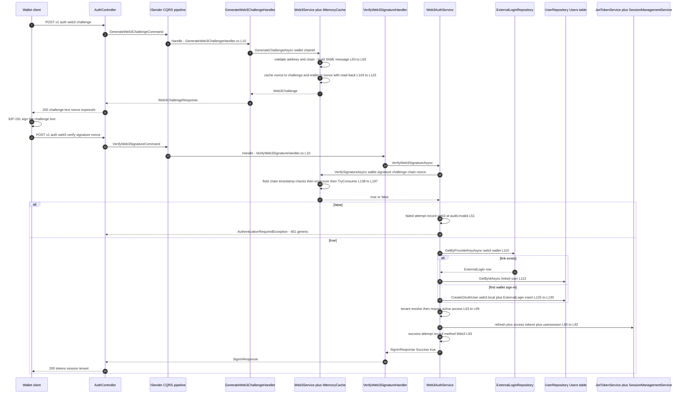
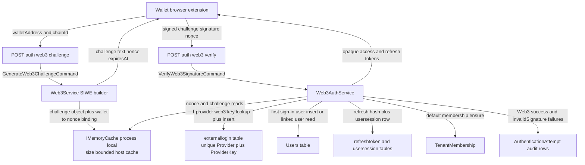

# Web3 SIWE Wallet Sign-In Flow (Challenge Generation, SIWE Verification, Wallet-Account Linking) — User Flow Diagram

> Issue #1079 · Features #30 / #291 / #292 · Module `GameGuild.Identity.Authentication` (+ `GameGuild.Identity.Users`, host `GameGuild.API` cache config) · Documented against `develop` commit `501477fce`.
> Scope: `POST /auth/web3/challenge` and `POST /auth/web3:verify` — EIP-4361 challenge construction and process-local storage, wallet-address and chain admission, nonce/expiry/replay enforcement (including the atomic single-use claim), EIP-191 signature recovery, wallet↔account resolution (existing `web3` external-login link vs first-wallet provisioning and the takeover guard), tenant checks, and session issuance.

## 1. Overview

Wallet sign-in is a two-step proof-of-possession protocol. Step one, `POST v1/auth/web3/challenge` (`Controllers/AuthController.cs:831-849`, `[AllowAnonymous]`, class-level `Authentication` rate-limit policy at `:20`), carries a `Web3ChallengeRequest` (`DTOs/Web3ChallengeRequest.cs:8-14`: required `WalletAddress`, `ChainId` default `"1"`) into `GenerateWeb3ChallengeCommand` (`Commands/GenerateWeb3ChallengeCommand.cs:8-13`). `GenerateWeb3ChallengeHandler` (`Handlers/GenerateWeb3ChallengeHandler.cs:8-26`) maps address/chain `ArgumentException`s to `RequestValidationException` → 400 (`:18-22`) and otherwise delegates through the composite `AuthService` (`Services/AuthService.cs:87-88`) to `Web3AuthService.GenerateWeb3ChallengeAsync` (`Services/Web3AuthService.cs:33-38`) and finally `Web3Service.GenerateChallengeAsync` (`Services/Web3Service.cs:63-126`). The service validates the address format and EIP-55 checksum (`:200-216`), admits only configured chains (`GetAllowedChainId`, `:328-336`; `Authentication:Web3:Siwe:AllowedChainIds`, default mainnet-only, `:338-363`), builds a canonical EIP-4361 message bound to the configured origin (`ParseOrigin` enforces HTTPS or HTTP-loopback, `:365-380`) with a 32-byte random hex nonce and a 5-minute lifetime (`:22`, `:72-90`), and stores **two process-local `IMemoryCache` entries** — nonce → `Web3Challenge` object and wallet-lowercased → nonce (`:104-111`) — under the host's size-bounded cache (`GameGuild.API/Core/Extensions/CachingExtensions.cs:38-44`). A read-back check refuses to return a challenge the cache silently declined (`:115-122`).

Step two, `POST v1/auth/web3:verify` (`Controllers/AuthController.cs:1086-1116`; body `Web3VerifyRequest` at `DTOs/AuthRequestDtos.cs:219-243`: wallet, full challenge message, signature, nonce, optional chain/tenant/fingerprint/remember-me), routes `VerifyWeb3SignatureCommand` (`Commands/VerifyWeb3SignatureCommand.cs:8-26`) through `VerifyWeb3SignatureHandler` (`Handlers/VerifyWeb3SignatureHandler.cs:8-26`) to `Web3AuthService.VerifyWeb3SignatureAsync` (`Services/Web3AuthService.cs:40-105`). `Web3Service.VerifySignatureAsync` (`Services/Web3Service.cs:138-198`) re-checks the address, resolves the wallet's live nonce, requires an exact byte-for-byte challenge match plus a strict field comparison against the cached challenge (domain, URI, version, address, nonce, chain, issued-at/expiration timestamps including a ±1-minute issued-at skew bound, `:218-270`), parses the message with the Nethereum ABNF parser after a scheme-aware header check (`:272-306`), recovers the EIP-191 signer address (`:308-326`), and only then atomically claims the challenge via `Web3Challenge.TryConsume` (`Models/Web3Challenge.cs:53-58`, `Interlocked.CompareExchange`) so the same nonce can establish at most one session even under concurrency, removing both cache keys (`:188-195`).

After a valid signature, `ResolveWalletUserAsync` (`Services/Web3AuthService.cs:107-132`) maps the wallet to an account: an existing `ExternalLogin` row for provider `"web3"` (`:31`) resolves the linked user (missing user row → 401); with no link, the synthetic identifier `0x…@web3.local` is looked up and, if an account already holds it, sign-in fails with "Wallet identity requires an explicit account link" (`:119-123`) — wallet possession never takes over an existing account. Otherwise a passwordless `User.CreateOAuthUser(..., emailVerified: false)` (`GameGuild.Identity.Users/Entities/User.cs:603-618`) is inserted together with an insert-only `ExternalLogin` row (`Repositories/ExternalLoginRepository.cs:53-65`; unique `(Provider, ProviderKey)` index `Data/Configurations/ExternalLoginConfiguration.cs:31-33`), with the enclosing `UseCaseOperationBehavior` command transaction (`GameGuild.API/Core/Eventing/UseCaseOperationBehavior.cs:42-70`) rolling the whole attempt back on a first-sign-in uniqueness race. Deleted/invalid accounts, tenant denial, and signature failure all throw `AuthenticationRequiredException` → generic 401 (`GameGuild.SharedKernel/Exceptions/SecurityException.cs:53-76`; `ExceptionHandlingMiddleware.cs:26-41`). Success issues refresh + access tokens, a `usersession` row, tenant provisioning, and a "Web3" `AuthenticationAttempt` record (`Web3AuthService.cs:63-104`).

## 2. End-to-End Flowchart — happy path and every edge case

```mermaid
flowchart TD
    subgraph CH["Challenge - POST v1 auth web3 challenge"]
        C1["Wallet client POST walletAddress and chainId<br/>AuthController.cs L831"] --> C2["GenerateWeb3ChallengeCommand<br/>GenerateWeb3ChallengeCommand.cs L8"]
        C2 --> C3["GenerateWeb3ChallengeHandler<br/>GenerateWeb3ChallengeHandler.cs L10"]
        C3 --> C4{"Web3Service IsValidWalletAddress<br/>0x plus 42 hex chars plus EIP-55 checksum<br/>Web3Service.cs L200"}
        C4 -- "malformed or bad checksum" --> C400["ArgumentException mapped to<br/>RequestValidationException 400<br/>GenerateWeb3ChallengeHandler.cs L18"]
        C4 -- "valid" --> C5{"ChainId allowed<br/>GetAllowedChainId L328<br/>AllowedChainIds config L338"}
        C5 -- "not enabled or unparsable" --> C400
        C5 -- "allowed" --> C6["Checksum the address - nonce 32 random bytes hex<br/>5 minute lifetime L72 to L74 L398"]
        C6 --> C7["Build EIP-4361 SIWE message<br/>Domain Uri Version 1 ChainId Nonce IssuedAt ExpirationTime<br/>bound to configured Origin L75 to L90"]
        C7 --> C8["IMemoryCache Set nonce to challenge plus<br/>wallet key to nonce with Size accounting<br/>Web3Service.cs L104 to L111"]
        C8 --> C9{"Read-back both entries<br/>cache capacity honored L115"}
        C9 -- "entry silently declined" --> C500["remove partial entries then<br/>InvalidOperationException storage unavailable - 500 L120"]
        C9 -- "stored" --> C10["200 Web3ChallengeResponse<br/>Challenge Nonce ExpiresAt<br/>AuthController.cs L846"]
    end

    C10 --> W0["Wallet signs the exact challenge text<br/>EIP-191 personal_sign"]
    W0 --> V1["POST v1 auth web3 verify with wallet signature<br/>challenge nonce chainId tenant fingerprint rememberMe<br/>AuthController.cs L1087"]
    V1 --> V2["VerifyWeb3SignatureCommand then Handler<br/>VerifyWeb3SignatureHandler.cs L10"]
    V2 --> V3["Web3AuthService VerifyWeb3SignatureAsync<br/>Web3AuthService.cs L40"]
    V3 --> V4["Web3Service VerifySignatureAsync<br/>Web3Service.cs L138"]
    V4 --> V5{"wallet address format valid<br/>L145"}
    V5 -- "no" --> VF["false - InvalidSignature"]
    V5 -- "yes" --> V6{"wallet key holds a live nonce<br/>L151"}
    V6 -- "no challenge ever issued or superseded" --> VF
    V6 -- "nonce found" --> V7{"challenge row exists by nonce<br/>L158"}
    V7 -- "evicted or expired and removed" --> VF
    V7 -- "found" --> V8{"exact message match and<br/>IsValidAt not consumed not expired L165"}
    V8 -- "mismatched text or expired" --> V8R["expired entries removed from cache<br/>L170 to L174"] --> VF
    V8 -- "matching" --> V9["Parse SIWE via ABNF after header check<br/>canonical rebuild must equal input<br/>L167 L272 to L306"]
    V9 -- "malformed or non canonical" --> VF
    V9 --> V10{"HasExpectedSiweFields<br/>domain uri version address nonce chain<br/>timestamps plus NotBefore L218 to L270"}
    V10 -- "any field mismatch or skew over 1 minute<br/>or span over 5 minutes" --> VF
    V10 -- "all match" --> V11{"EIP-191 recover signer address<br/>132 char 0x hex signature L308"}
    V11 -- "recovered address differs" --> VF
    V11 -- "matches" --> V12{"challenge TryConsume atomic claim<br/>Web3Challenge.cs L53 L188"}
    V12 -- "lost to concurrent verify" --> VF
    V12 -- "claimed" --> V13["remove nonce and wallet cache keys<br/>L194 to L195"]

    VF --> F1["RecordFailedAttemptAsync under web3 at audit.invalid<br/>reason InvalidSignature L49 to L52"]
    F1 --> F401a["AuthenticationRequiredException Invalid Web3 signature<br/>generic 401 public message<br/>SecurityException.cs L60 L74"]

    V13 --> R1["ResolveWalletUserAsync lowercased wallet key<br/>Web3AuthService.cs L107"]
    R1 --> R2{"ExternalLogin provider web3<br/>GetByProviderKeyAsync L110<br/>ExternalLoginRepository.cs L12"}
    R2 -- "link exists" --> R3{"linked user row found<br/>L113"}
    R3 -- "user deleted" --> R401a["AuthenticationRequiredException<br/>Linked wallet account was not found L114"]
    R3 -- "found" --> R5
    R2 -- "no link" --> R4{"synthetic identifier wallet at web3.local<br/>already has an account L119"}
    R4 -- "yes - takeover guard" --> R401b["AuthenticationRequiredException<br/>Wallet identity requires an explicit account link L122"]
    R4 -- "no" --> R4b["User CreateOAuthUser emailVerified false<br/>plus insert-only ExternalLogin row<br/>L125 to L130 User.cs L603"]
    R4b -- "concurrent first sign-in same wallet<br/>unique index race" --> R500["DbUpdateException rolls back via command transaction<br/>UseCaseOperationBehavior.cs L70 then 500 generic"]
    R4b -- "saved" --> R5{"user IsDeleted or<br/>ValidateForAuthentication fails L58"}
    R5 -- "yes" --> R401c["AuthenticationRequiredException<br/>Wallet account is unavailable L60"]
    R5 -- "active" --> R6["DefaultTenantMembershipProvisioner EnsureAsync<br/>then GetUserMembershipsQuery L63 to L64"]
    R6 --> R7{"TenantAccessContextResolver<br/>active tenant or requested match L65"}
    R7 -- "no active tenant or mismatch" --> R401d["AuthenticationRequiredException<br/>no active access to the requested tenant L68"]
    R7 -- "resolved" --> R8["DeviceInfo Wallet Device Web<br/>fingerprint or fresh guid L71"]
    R8 --> R9["RefreshTokenLifetimeResolver by RememberMe<br/>GenerateRefreshTokenAsync then access token<br/>with tenant roles tokenVersion sid L76 to L87"]
    R9 --> R10["CreateSessionAsync usersession row<br/>AuthenticatedSessionDeadline Require L89 to L92"]
    R10 --> R11["RecordSuccessfulAttemptAsync method Web3 L93"]
    R11 --> R200["200 SignInResponse Success true<br/>message Web3 authentication successful L98 to L104"]

    R500 --> VEND["client retries - winner link now resolves"]
    R401a --> VEND401["401 ProblemDetails via middleware<br/>ExceptionHandlingMiddleware.cs L26 L88"]
    R401b --> VEND401
    R401c --> VEND401
    R401d --> VEND401
    F401a --> VEND401
    R200 --> DONE["authenticated session - refresh rotation per token-lifecycle-flow"]
```

## 3. CQRS Chain Sequence Diagram

## 4. Data Flow Diagram

## 5. Edge-Case Matrix

| # | Edge case | Code path | Outcome |
|---|-----------|-----------|---------|
| 1 | Wallet address malformed (no `0x`, wrong length, non-hex) | `IsValidWalletAddress` (`Services/Web3Service.cs:200-216`) → `ArgumentException` mapped by handler (`Handlers/GenerateWeb3ChallengeHandler.cs:18-22`) | 400 Validation Failed (challenge); plain `false` → 401 on verify (`Web3Service.cs:145-149`) |
| 2 | Mixed-case address with invalid EIP-55 checksum | checksum branch (`Web3Service.cs:212-215`); uniform-case accepted | 400 on challenge; `false` → 401 on verify |
| 3 | Requested chain not in `AllowedChainIds` | `GetAllowedChainId` (`Web3Service.cs:328-336`) | 400 "wallet address or Ethereum chain is invalid or unsupported" (handler mapping) |
| 4 | `AllowedChainIds` config contains an invalid chain ID | startup validation (`Web3Service.cs:351-359`) | `InvalidOperationException` at construction — fail fast, no runtime fallback |
| 5 | `Authentication:Web3:Siwe:Origin` unset or not HTTPS / non-loopback HTTP / has userinfo/query/fragment | ctor (`Web3Service.cs:41-45`) + `ParseOrigin` (`:365-380`) | `InvalidOperationException` at startup — SIWE refuses to run without a bound origin |
| 6 | Cache at capacity declines a challenge entry | size-accounted `Set` + read-back (`Web3Service.cs:104-122`) | partial entries removed, `InvalidOperationException` "SIWE challenge storage is unavailable" → 500; no challenge handed out unverifiable |
| 7 | Second challenge requested for the same wallet | wallet key overwritten (`Web3Service.cs:108-111`) | previous challenge becomes unverifiable (wallet key now points at the new nonce) — one live challenge per wallet |
| 8 | Challenge older than 5 minutes | `IsValidAt` (`Models/Web3Challenge.cs:48-53`; lifetime `Web3Service.cs:22`) | verify `false` → 401; expired entries proactively removed (`Web3Service.cs:170-174`) |
| 9 | Challenge text modified (any byte) | exact `string.Equals` ordinal compare (`Web3Service.cs:165`) | `false` → 401 "Invalid Web3 signature" |
| 10 | Client submits a nonce not matching the message / another wallet's nonce | wallet-key → nonce → challenge chain (`Web3Service.cs:151-163`, `:229-232`) | `false` → 401 |
| 11 | Message timestamps tampered (issued-at skew > 1 min, span > 5 min, expiry ≤ now) | `HasExpectedSiweFields` (`Web3Service.cs:248-265`) | `false` → 401 |
| 12 | Future `not-before` in the message | `NotBefore <= now` check (`Web3Service.cs:267-269`) | `false` → 401 |
| 13 | Message parsed but non-canonical (ABNF rebuild differs) | canonical rebuild compare (`Web3Service.cs:297-298`) | `false` → 401 |
| 14 | Signature malformed (length ≠ 132, non-hex, no `0x`) | `VerifyEthereumSignature` guard (`Web3Service.cs:310-317`) | `false` → 401 (authentication failure, not a 500) |
| 15 | Signature recovers a different address | ecrecover compare (`Web3Service.cs:318-319`) | `false` → 401 + failed attempt audit under `web3@audit.invalid` (`Web3AuthService.cs:49-54`) |
| 16 | Replay: same challenge verified twice | `TryConsume` `Interlocked.CompareExchange` (`Models/Web3Challenge.cs:53-58`, `Web3Service.cs:188-192`) + cache key removal (`:194-195`) | second presentation `false` → 401 |
| 17 | Two concurrent verifies of the same challenge | same atomic claim | exactly one wins; loser gets 401 — no double session |
| 18 | First wallet sign-in races another first sign-in (same wallet, two tabs) | insert-only `ExternalLogin` + unique `(Provider, ProviderKey)` index (`ExternalLoginConfiguration.cs:31-33`; insert `Web3AuthService.cs:128-131`) | loser's `DbUpdateException` rolls back the whole command transaction (`UseCaseOperationBehavior.cs:68-100`) → 500; retry resolves the winner's link |
| 19 | Wallet linked but user row deleted | `GetByIdAsync` null (`Web3AuthService.cs:113-114`) | 401 "Linked wallet account was not found" |
| 20 | Synthetic `wallet@web3.local` account already exists but is not linked | takeover guard (`Web3AuthService.cs:117-123`) | 401 "Wallet identity requires an explicit account link" — wallet possession never adopts an existing account |
| 21 | Account deleted or fails `ValidateForAuthentication` | guard (`Web3AuthService.cs:58-61`) | 401 "Wallet account is unavailable" |
| 22 | No active tenant / requested tenant not accessible | resolver + guard (`Web3AuthService.cs:63-69`) | 401 "no active access to the requested tenant" |
| 23 | API restart or second node between challenge and verify | challenge state only in process-local `IMemoryCache` (`Web3Service.cs:25`, `:104-111`) | every pending challenge reads as unknown → 401 — see Gaps |
| 24 | Verify called without any prior challenge (direct attempt) | wallet key miss (`Web3Service.cs:151-156`) | `false` → 401 + failed attempt audit |

## 6. Endpoint Inventory

| Method + Route | Handler chain | Controller ref |
|----------------|---------------|----------------|
| POST `v{v}/auth/web3/challenge` | `GenerateWeb3ChallengeCommand` → `GenerateWeb3ChallengeHandler` → (`AuthService` composite →) `Web3AuthService.GenerateWeb3ChallengeAsync` → `Web3Service.GenerateChallengeAsync` | `Controllers/AuthController.cs:831-849` |
| POST `v{v}/auth/web3:verify` | `VerifyWeb3SignatureCommand` → `VerifyWeb3SignatureHandler` → `Web3AuthService.VerifyWeb3SignatureAsync` → `Web3Service.VerifySignatureAsync` + wallet-account resolution + session issuance | `Controllers/AuthController.cs:1086-1116` |

Both are `[AllowAnonymous]` (registered anonymous actions `GameGuild.API/Security/AnonymousEndpointRegistry.cs:71-72`) under the class-level `Authentication` rate-limit policy (`Controllers/AuthController.cs:20`). Unsuccessful `SignInResponse` shapes return 401 from the controller (`:1110-1113`); thrown `AuthenticationRequiredException`s map to generic 401 problem details through the middleware.

## 7. Events Published / Consumed

- **Published** — `AuthenticationAuditEvent` rows via `IAuthAttemptService`: failed attempt reason `InvalidSignature` under the synthetic key `web3@audit.invalid` (`Services/Web3AuthService.cs:49-54`), successful "Web3" attempt under the account email (`:93-94`). Structured logs record challenge generation (`Services/Web3Service.cs:124`), verification failure reasons (`:147-191`), and session establishment (`Web3AuthService.cs:95`).
- **Consumed** — none specific to this flow. The issued session feeds the standard token lifecycle (refresh rotation, replay containment — see `token-lifecycle-flow.md`); the sign-in compliance gate (`KycAndHoldSignInCompliancePolicy`) is **not** evaluated on the wallet path (see Gaps).
- **Not published** — no durable integration event for wallet-account provisioning (contrast `UserCreatedEvent` on email sign-up).

## 8. Entities and Tables Touched

| Entity / store | Mapping | Writes |
|----------------|---------|--------|
| `ExternalLogin` → `externallogin` | unique `(Provider, ProviderKey)` index (`Data/Configurations/ExternalLoginConfiguration.cs:31-33`; snapshot `ApplicationDbContextModelSnapshot.cs:19964-19970`) | INSERT provider `"web3"` + lowercased wallet on first sign-in (`Web3AuthService.cs:128-131`) |
| `User` → `Users` | `CreateOAuthUser` passwordless, `IsEmailVerified=false` (`GameGuild.Identity.Users/Entities/User.cs:603-618`) | INSERT synthetic `wallet@web3.local` account; read for linked wallets |
| `RefreshToken` → refreshtokens | `GenerateRefreshTokenAsync` (`Web3AuthService.cs:80-85`) | INSERT hash only |
| `UserSession` → usersession | `CreateSessionAsync` (`Web3AuthService.cs:89-91`) | INSERT wallet-device session |
| `TenantMembership` | `DefaultTenantMembershipProvisioner.EnsureAsync` (`Web3AuthService.cs:63`) | INSERT default membership (idempotent) |
| `AuthenticationAttempt` | `RecordFailedAttemptAsync` / `RecordSuccessfulAttemptAsync` (`Web3AuthService.cs:51`, `:93`) | INSERT failure (synthetic email) and success rows |
| `IMemoryCache` (not a table) | challenge + wallet-nonce bindings (`Web3Service.cs:104-111`) | volatile, size-accounted, process-local — see Gaps |

## 9. Gaps — realistic scenarios the code does not handle

1. ~~**NEW — Challenge state is process-local.**~~ **fixed (issue #1272)**: the nonce→challenge and wallet→nonce entries now live in `IDistributedCache` (the Redis path in production, mirroring the token revocation store and the push-MFA factor) as JSON state with the same key scheme; a verify landing on any node reads the ceremony, the read-back refusal survives (a store that silently dropped the write never returns the challenge), and consumption still removes both entries (with the in-memory `TryConsume` claim retained as the same-node fence). Cross-instance single use is the remove-on-consume pattern shared with the push-MFA factor; a narrow read-read race between two nodes remains possible, as it does there.
2. **NEW — No admission controls on the verify path.** `PasswordSignInAdmissionService` (source-IP throttle, account lockout, Turnstile challenge — `GameGuild.API/Core/Filters/PasswordSignInAdmissionService.cs:41-122`) runs only on the email sign-in action and the polymorphic handler (`Core/Filters/AuthenticationLockoutActionFilter.cs:27-28`; `Handlers/PolymorphicSignInHandler.cs:75-77`); `Web3AuthService` never calls it. Signature guesses are only bounded by the endpoint-wide `Authentication` rate limit, and failed attempts are recorded under the synthetic `web3@audit.invalid` email (`Web3AuthService.cs:51-52`), so per-account lockout, progressive delay (#1084) and the #1082 Turnstile gate never key on the wallet.
3. **NEW — Wallet accounts are permanently unverified-email islands unless manually linked.** First sign-in provisions `User.CreateOAuthUser(identifier, …, emailVerified: false)` with the synthetic `@web3.local` address (`Web3AuthService.cs:119-125`); nothing in this flow offers the wallet user a path to attach a real email, and tenants whose `LocalSignInPolicyOptions.RequiresVerifiedEmail` is on have no equivalent check here. The external-login link surface (`external-login-link-unlink-flow.md`) covers OAuth providers; there is no authenticated link/unlink endpoint for provider `"web3"`, so a wallet holder who later wants email+password on the same account has no in-product path.
4. **NEW — No durable provisioning event for wallet-created accounts.** Email sign-up attaches `UserCreatedEvent` (`identity.user.created.v1`) consumed by the welcome-email handler; the wallet provisioning branch (`Web3AuthService.cs:125-127`) publishes nothing, so wallet accounts skip onboarding notifications and any downstream `UserCreatedEvent` consumers entirely.
5. **NEW — First-sign-in race surfaces as an opaque 500.** Two concurrent first sign-ins for one wallet serialize on the unique `(Provider, ProviderKey)` index; the loser's `DbUpdateException` rolls back cleanly (`UseCaseOperationBehavior.cs:68-100`) but maps to the generic 500 bucket rather than a retryable 409/401, and the wallet holder gets no "try again" signal (mirrors the #1197 duplicate-email 500 class on sign-up).
6. **NEW — Challenge flooding shares one cache budget with all platform entries.** Every `POST /auth/web3/challenge` allocates two size-accounted cache entries (`Web3Service.cs:104-111`) with no per-wallet cooldown; within the endpoint rate limit an attacker can churn challenges (each invalidating the previous one for that wallet, gap 7 in the matrix) and consume `MemoryCachingOptions.SizeLimit` budget (`CachingExtensions.cs:38-44`) shared with authorization caching, degrading unrelated cached state.
