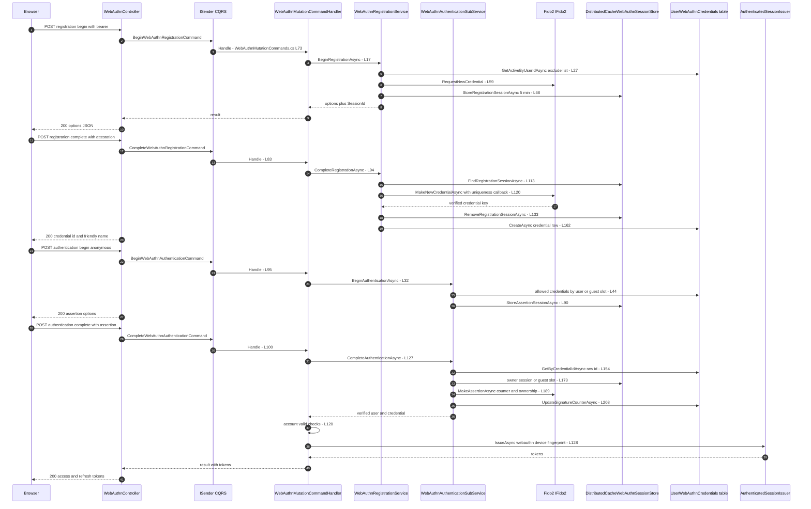
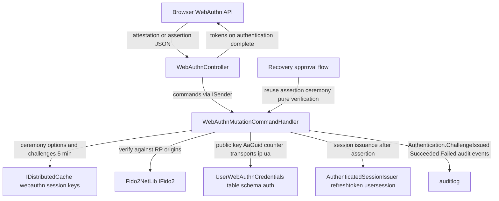

# WebAuthn / FIDO2 Flow (Passkey and Security-Key Registration, Authentication, Device Management) — User Flow Diagram

> Issue #1099 · Module `GameGuild.Identity.Authentication` (Fido2NetLib) · Documented against `develop` commit `74e9bba4c`.
> Scope: credential registration (attestation ceremony + challenge store), passwordless authentication (assertion ceremony + session issuance), credential lifecycle (list/get/verify/rename, reversible deactivate vs terminal delete, activate), status surface, and the recovery-approval reuse of the assertion ceremony. **In-flight:** PR #1172 (open) changes attestation conveyance to `Indirect` and reads the real `UserVerified` flag from attestation auth data (#1143) — current develop is documented here; see Gaps.

## 1. Overview

All routes live under `v1/auth/webauthn` (`Controllers/WebAuthnController.cs:20-25`, `Authentication` rate-limit policy at `:22`). Registration endpoints are `[Authorize]`; authentication endpoints are `[AllowAnonymous]`. Commands are handled by `WebAuthnMutationCommandHandler` (`Commands/WebAuthnMutationCommands.cs:37-171`), which delegates to the `WebAuthnService` façade and its sub-services.

**Registration** (`registration:begin` `:35-62`): `WebAuthnRegistrationService.BeginRegistrationAsync` (`Services/WebAuthnRegistrationService.cs:17-92`) builds Fido2 options with existing credentials as `excludeCredentials` (prevents duplicate registrations of the same authenticator, `:27-31`), `ResidentKey=Preferred`, `UserVerification=Preferred`, `AttestationConveyancePreference.None` (`:42-65`), and stores the challenge in the **distributed** session store (`DistributedCacheWebAuthnSessionStore`, 5-minute TTL + 5-minute eviction slack, logical expiry re-checked on read, `Services/DistributedCacheWebAuthnSessionStore.cs:16-25`, `:114-119`) keyed per user (`auth:webauthn:session:reg:{userId}`). `registration:complete` (`:70-100`) parses the attestation, finds the stored session, and verifies via `fido2.MakeNewCredentialAsync` with a uniqueness callback (`:120-130`); the credential row stores base64 public key, AaGuid, signature counter, transports, `IsPasswordless` flag, hard-coded `UserVerified = true` (`:155`), registration IP/UA, and a heuristic friendly name from the UA (`:186-212`). The session is removed after use (`:133`).

**Authentication** (`authentication:begin` `:112-129`, anonymous): `WebAuthnAuthenticationSubService.BeginAuthenticationAsync` (`Services/WebAuthnAuthenticationSubService.cs:32-125`) scopes `allowedCredentials` to the user when the email resolves, else issues empty options for **discoverable** credentials with a **single shared guest slot** (`DistributedCacheWebAuthnSessionStore.cs:35`, `:46-47`). `authentication:complete` (`:137-157`) looks up the credential by raw id, finds the owner's assertion session or falls back to the guest slot (`WebAuthnAuthenticationSubService.cs:173-174`), verifies with `fido2.MakeAssertionAsync` (challenge, origin, signature, signature-counter clone detection, user-handle ownership callback `:189-201`), removes the session, updates the signature counter (`:204-211`), and audits `Authentication.Succeeded`/`.Failed`. The command handler then re-validates the account (not deleted, `ValidateForAuthentication`, token version, `Commands/WebAuthnMutationCommands.cs:120-125`) and issues a **full session** via `IAuthenticatedSessionIssuer.IssueAsync` with a `webauthn:{credentialId}` device fingerprint (`:127-144`).

**Device management**: list/get/HEAD-exist (`:166-234`), `:verify` status check, `:deactivate`/`:activate` as a reversible state machine (revocation terminal; `Conflict` on invalid transitions via `SendCredentialTransitionAsync` `:321-338`, `Services/WebAuthnCredentialManagementService.cs:140-216`), DELETE as terminal `RevokeAsync` (`:124-138`), PATCH rename, and a status summary (`:411-435`). Delegated account recovery reuses `BeginAuthenticationAsync`/`CompleteAuthenticationAsync` in pure-verification mode (no tokens, `Handlers/ApproveAccountRecoveryCommandHandler.cs:151-158`).

## 2. End-to-End Flowchart — happy path and every edge case

```mermaid
flowchart TD
    subgraph REG["Passkey or security-key registration"]
        R1["POST webauthn registration begin - Authorize<br/>WebAuthnController.cs L35"] --> R2["BeginRegistrationAsync<br/>WebAuthnRegistrationService.cs L17"]
        R2 --> R3["excludeCredentials from active rows<br/>prevents same-authenticator duplicate - L27"]
        R3 --> R4["options with ResidentKey Preferred<br/>UserVerification Preferred attestation None - L42 L64"]
        R4 --> R5["challenge stored distributed cache<br/>key reg plus userId 5 min TTL - SessionStore L30"]
        R5 --> R6["200 SessionId plus options JSON"]
        R6 --> R7["browser navigator credentials create<br/>then POST registration complete - L70"]
        R7 --> R8{"attestation parses - L106"}
        R8 -- "malformed" --> R400a["400 Invalid attestation response"]
        R8 -- "ok" --> R9{"registration session found<br/>5 min logical expiry - L113"}
        R9 -- "expired or none" --> R400b["400 Registration session not found or expired"]
        R9 -- "found" --> R10{"MakeNewCredentialAsync<br/>challenge and origin and signature - L120"}
        R10 -- "credential id already on another user<br/>uniqueness callback - L124" --> R400c["400 Failed to complete registration"]
        R10 -- "verified" --> R11["session removed single use - L133"]
        R11 --> R12["UserWebAuthnCredential row saved<br/>public key AaGuid counter transports<br/>UserVerified hard-coded true - L141 L155"]
        R12 --> R13["200 credential id plus friendly name<br/>default name from user agent heuristic - L149 L186"]
    end

    subgraph AUTH["Passwordless authentication"]
        A1["POST webauthn authentication begin - anonymous<br/>optional email - WebAuthnController.cs L112"] --> A2{"email resolves to user<br/>SubService L44 L67"}
        A2 -- "email given and user found" --> A3["allowedCredentials scoped to that user<br/>L48"]
        A2 -- "email unknown" --> A4["empty allowed list - discoverable flow<br/>guest slot session - L90"]
        A2 -- "no email" --> A4
        A3 -- "user has zero active credentials" --> A400a["400 No WebAuthn credentials found<br/>audit ChallengeFailed L52"]
        A3 -- "has credentials" --> A5["challenge stored user-keyed or guest slot<br/>5 min TTL"]
        A4 --> A5
        A5 --> A6["200 SessionId plus assertion options"]
        A6 --> A7["browser navigator credentials get<br/>then POST authentication complete - L137"]
        A7 --> A8{"assertion parses and credential row found by raw id<br/>L138 L154"}
        A8 -- "unknown credential" --> A400b["400 Credential not found<br/>audit Failed CredentialNotFound"]
        A8 -- "found" --> A9{"owner session or guest slot present<br/>L173"}
        A9 -- "expired or overwritten" --> A400c["400 Authentication session not found or expired"]
        A9 -- "found" --> A10{"MakeAssertionAsync<br/>challenge origin signature counter<br/>user handle owns credential - L189"}
        A10 -- "any check fails" --> A400d["400 Failed to complete WebAuthn authentication<br/>audit AssertionVerificationFailed"]
        A10 -- "verified" --> A11["sessions removed counter updated - L204"]
        A11 --> A12{"account valid - not deleted<br/>ValidateForAuthentication version ok<br/>MutationCommands L120"}
        A12 -- "invalid" --> A401["AuthenticationRequiredException mapped 401"]
        A12 -- "valid" --> A13["AuthenticatedSessionIssuer IssueAsync<br/>device fingerprint webauthn credential id<br/>L127 L133"]
        A13 --> A14["200 tokens plus user plus IsPasswordless"]
    end

    subgraph MGMT["Credential device management"]
        G1["GET credentials or credentials by id<br/>or HEAD exists - L166 L188 L217"] --> G2["owner-scoped reads"]
        G3["POST credentials id verify - L241"] --> G4["status IsValid Status LastUsedAt counter<br/>CredentialManagementService.cs L51"]
        G5["POST credentials id deactivate - L273"] --> G6{"status guard<br/>CredentialManagementService.cs L153 L160"}
        G6 -- "revoked" --> G409a["409 revoked is terminal"]
        G6 -- "already deactivated" --> G409b["409 already deactivated"]
        G6 -- "active" --> G7["DeactivateAsync - reversible - L167"]
        G8["POST credentials id activate - L300"] --> G9{"status guard L192 L199"}
        G9 -- "revoked" --> G409a
        G9 -- "already active" --> G409c["409 already active"]
        G9 -- "deactivated" --> G10["ReactivateAsync - L206"]
        G11["DELETE credentials id - L347"] --> G12{"owner matches - L131"}
        G12 -- "not owner or missing" --> G404a["404"]
        G12 -- "owner" --> G13["RevokeAsync terminal - never restorable - L137"]
        G14["PATCH credentials id rename - L379"] --> G15["UpdateCredentialNameAsync"]
        G16["GET webauthn status - L411"] --> G17["IsEnabled count HasPasswordless<br/>HasPlatform HasSecurityKey - L427"]
    end

    subgraph RECOVER["Account-recovery reuse - pure verification"]
        RC1["approve-passkey begin - anonymous<br/>AccountRecoveryController.cs L110"] --> RC2["BeginAuthenticationAsync email<br/>same ceremony"]
        RC2 --> RC3["approve-passkey complete<br/>CompleteAuthenticationAsync<br/>ApproveAccountRecoveryCommandHandler.cs L151"]
        RC3 -- "assertion verified" --> RC4["one recovery approval factor recorded<br/>no tokens issued"]
        RC3 -- "verify fails" --> RC5["generic recovery denial"]
    end
```

## 3. CQRS Chain Sequence Diagram

## 4. Data Flow Diagram

## 5. Edge-Case Matrix

| # | Edge case | Code path | Outcome |
|---|-----------|-----------|---------|
| 1 | Same authenticator registered twice | `excludeCredentials` from active rows (`Services/WebAuthnRegistrationService.cs:27-31`) + Fido2-enforced exclusion | browser blocks re-registration; a forced attempt fails verification → 400 |
| 2 | Credential id already owned (cross-user uniqueness) | `IsCredentialIdUniqueToUserCallback` (`:124-129`) | registration refused → 400 |
| 3 | Registration abandoned > 5 min | session TTL + logical expiry (`DistributedCacheWebAuthnSessionStore.cs:21`, `:114-119`) | "Registration session not found or expired" 400; restart begin |
| 4 | `registration:complete` without prior `begin` (or replay) | session removed after success (`WebAuthnRegistrationService.cs:133`) and missing on replay | 400 session not found |
| 5 | Challenge/session store outage mid-ceremony | store throws → catch-all (`:175-183`) | generic 400, no partial credential row |
| 6 | Corrupted session payload in cache | JsonException → treated as expired (`DistributedCacheWebAuthnSessionStore.cs:100-107`) | ceremony restarts cleanly |
| 7 | `authentication:begin` with email of user without credentials | zero-credential branch (`WebAuthnAuthenticationSubService.cs:52-65`) | 400 + `ChallengeFailed` audit (enumeration signal — see Gaps) |
| 8 | `authentication:begin` with unknown email | user null → discoverable/guest options (`:67-79`) | success 200, guest slot; indistinguishable from no-email |
| 9 | Two anonymous discoverable ceremonies at once | single shared guest key (`DistributedCacheWebAuthnSessionStore.cs:35`, `:46-47`) | second begin overwrites first's challenge (see Gaps) |
| 10 | Assertion for a deactivated/revoked credential | lookup by id is status-blind at `:154`; `GetActiveByUserIdAsync` only filters begin-side | deactivated credential can still verify end-side unless Fido2/stored state rejects (see Gaps) |
| 11 | Authenticator clone detected (signature counter regression) | Fido2 `MakeAssertionAsync` counter validation (`:189-201`) | verification fails → 400 + audit |
| 12 | User-handle does not own credential | ownership callback (`:195-200`) | verification fails |
| 13 | Account deleted / token version stale at issuance | post-assertion account checks (`Commands/WebAuthnMutationCommands.cs:120-125`) | `AuthenticationRequiredException` (401), no tokens |
| 14 | Session issuer not configured | guard (`:127`) | `InvalidOperationException` → 500 (deployment misconfiguration) |
| 15 | Deactivate a revoked credential | terminal-status guard (`Services/WebAuthnCredentialManagementService.cs:153-158`) | 409 "revocation is terminal" |
| 16 | Deactivate already-deactivated / activate already-active | idempotency guards (`:160-165`, `:199-204`) | 409 with current status |
| 17 | Activate a revoked credential | terminal guard (`:192-197`) | 409 — revocation is one-way by design |
| 18 | Delete someone else's credential | owner check (`:131`) | 404 (no existence oracle) |
| 19 | Delete vs deactivate semantics | DELETE = `RevokeAsync` terminal (`:136-137`); deactivate reversible (`:167`) | documented terminal vs reversible split |
| 20 | Concurrent deactivate/activate race | `DeactivateAsync`/`ReactivateAsync` return applied flag (`:167`, `:206`) | loser gets 409 InvalidTransition |
| 21 | Assertion replay after successful sign-in | sessions removed (`WebAuthnAuthenticationSubService.cs:204-205`) | replayed assertion finds no session → 400 |
| 22 | WebAuthn sign-in for an MFA-enrolled account | issuance path has no MFA proof requirement (`Commands/WebAuthnMutationCommands.cs:127-137`) | full session issued without second factor — passkey is itself the proof of possession (see Gaps for policy note) |
| 23 | Passkey used for recovery approval | pure-verification reuse (`Handlers/ApproveAccountRecoveryCommandHandler.cs:151-158`) | approval recorded; no credentials issued |

## 6. Endpoint Inventory

| Method + Route | Handler chain | Controller ref |
|----------------|---------------|----------------|
| POST `v{v}/auth/webauthn/registration:begin` | `BeginWebAuthnRegistrationCommand` → `WebAuthnMutationCommandHandler` → `WebAuthnRegistrationService` | `Controllers/WebAuthnController.cs:35-62` |
| POST `v{v}/auth/webauthn/registration:complete` | `CompleteWebAuthnRegistrationCommand` → same | `Controllers/WebAuthnController.cs:70-100` |
| POST `v{v}/auth/webauthn/authentication:begin` (anon) | `BeginWebAuthnAuthenticationCommand` → `WebAuthnAuthenticationSubService` | `Controllers/WebAuthnController.cs:112-129` |
| POST `v{v}/auth/webauthn/authentication:complete` (anon) | `CompleteWebAuthnAuthenticationCommand` → assertion verify + `AuthenticatedSessionIssuer.IssueAsync` | `Controllers/WebAuthnController.cs:137-157` |
| GET `v{v}/auth/webauthn/credentials` | direct `IWebAuthnService` | `Controllers/WebAuthnController.cs:166-181` |
| GET `v{v}/auth/webauthn/credentials/{id}` | direct | `Controllers/WebAuthnController.cs:188-210` |
| HEAD `v{v}/auth/webauthn/credentials/{id}` | direct | `Controllers/WebAuthnController.cs:217-234` |
| POST `v{v}/auth/webauthn/credentials/{id}:verify` | `VerifyWebAuthnCredentialCommand` | `Controllers/WebAuthnController.cs:241-265` |
| POST `v{v}/auth/webauthn/credentials/{id}:deactivate` | `DeactivateWebAuthnCredentialCommand` → transition | `Controllers/WebAuthnController.cs:273-292` |
| POST `v{v}/auth/webauthn/credentials/{id}:activate` | `ActivateWebAuthnCredentialCommand` → transition | `Controllers/WebAuthnController.cs:300-319` |
| DELETE `v{v}/auth/webauthn/credentials/{id}` | `DeleteWebAuthnCredentialCommand` → terminal revoke | `Controllers/WebAuthnController.cs:347-371` |
| PATCH `v{v}/auth/webauthn/credentials/{id}` | `UpdateWebAuthnCredentialNameCommand` | `Controllers/WebAuthnController.cs:379-406` |
| GET `v{v}/auth/webauthn` | direct status summary | `Controllers/WebAuthnController.cs:411-435` |

## 7. Events Published / Consumed

- **Published (audit events):** `Authentication.ChallengeIssued` / `.ChallengeFailed` (`Services/WebAuthnAuthenticationSubService.cs:97-100`, `:54-58`, `:113-117`), `Authentication.Succeeded` / `.Failed` with safe reason codes (`:217-222`, `:141-165`, `:235-241`) — all via `IAuthenticationAuditEventSink`. No durable integration events on this surface.
- **Consumed:** the delegated account-recovery flow consumes the assertion ceremony in verification-only mode (`Handlers/ApproveAccountRecoveryCommandHandler.cs:151-158`); the forced account-recovery reset revokes every WebAuthn credential (`Handlers/CompleteAccountRecoveryResetCommandHandler.cs:97-101`).
- **Metrics/logs:** registration success log with credential id (`Services/WebAuthnRegistrationService.cs:164-166`).

## 8. Entities and Tables Touched

| Entity / Table | Mapping | Writes |
|----------------|---------|--------|
| `UserWebAuthnCredential` → `auth.UserWebAuthnCredentials` | snapshot `:20787` | INSERT on registration (`WebAuthnRegistrationService.cs:162`), UPDATE signature counter (`WebAuthnAuthenticationSubService.cs:208`), UPDATE status transitions (`WebAuthnCredentialManagementService.cs:167`, `:206`), terminal UPDATE revoke (`:137`), rename |
| WebAuthn ceremony sessions → `IDistributedCache` | `DistributedCacheWebAuthnSessionStore.cs:23-25` | SET/GET/REMOVE registration + assertion + guest keys, 5-min TTL |
| `refreshtoken` + `usersession` | via `AuthenticatedSessionIssuer.IssueAsync` (`Commands/WebAuthnMutationCommands.cs:128`) | INSERT per WebAuthn sign-in |
| `auditlog` | — | audit events above |

## 9. Gaps — realistic scenarios the code does not handle

1. **`UserVerified` is hard-coded `true` on registration** (`Services/WebAuthnRegistrationService.cs:155`): the stored flag reflects the attestation's presence, not actual user verification, so later policy decisions consuming it (e.g. trusted-device or step-up gating) over-trust. **PR #1172 (open, #1143) parses the real `UserVerified` from attestation auth data and switches conveyance from `None` (`:64`) to `Indirect` — re-verify this section after it lands.**
2. **Single shared guest slot for discoverable-credential flows** (`DistributedCacheWebAuthnSessionStore.cs:25`, `:35`): two anonymous users (or two tabs) calling `authentication:begin` without email overwrite each other's challenge; the first user's `complete` then fails with "Authentication session not found or expired" (`WebAuthnAuthenticationSubService.cs:173-186`). A per-browser or per-session id keyed slot does not exist.
3. **Status-blind end-side credential lookup.** `CompleteAuthenticationAsync` resolves the credential by raw id without checking `IsActive`/status (`WebAuthnAuthenticationSubService.cs:153-155`); deactivation is enforced on the begin side (`GetActiveByUserIdAsync` scoping `:46-48`) but a **deactivated** credential that is still presented with an active challenge may verify and issue tokens. Only `RevokeAsync` terminality is safe (deleted rows are filtered by `GetByCredentialIdAsync` only if the repository excludes revoked — it does not).
4. **Email enumeration on `authentication:begin`.** A user with zero credentials gets `400 "No WebAuthn credentials found for user"` (`:52-65`) while an unknown email gets a 200 guest ceremony — the endpoint distinguishes registered-without-passkeys from unknown accounts.
5. **No step-up or re-authentication for credential management.** Registration, deletion and deactivation require only a valid access token (`[Authorize]`, `Controllers/WebAuthnController.cs:36`, `:274`, `:347`); a stolen session can silently register an attacker passkey (it even becomes a recovery factor via `HasActiveCredentialsAsync`) or revoke the victim's. No password/MFA confirmation on any mutation (contrast MFA disable, issue #244).
6. **Registration does not require recent authentication.** `registration:begin` accepts any live token regardless of token age (`auth_time`), so long-lived sessions can add credentials years after sign-in.
7. **RP origins are deploy-time only.** `Fido2Configuration.Origins` comes solely from configuration (`Data/Extensions/DependencyInjection.cs:258-266`); a missing/misconfigured origin surfaces as a generic `Failed to complete WebAuthn registration/authentication` 400 with no distinct error, making RP misconfiguration hard to distinguish from attack traffic (uniform errors are good; no operational signal is the gap).
8. **WebAuthn sign-in bypasses the MFA-policy decision.** The issuance path (`Commands/WebAuthnMutationCommands.cs:127-144`) never consults the sign-in MFA policy (`IsMfaRequiredAsync`); a user who enrolled TOTP but also has a passkey gets a token-bearing session from the passkey alone. Defensible (the passkey is a possession factor), but the `amr`/MFA-proof claims of the issued session are not marked with the WebAuthn method, so downstream step-up consumers cannot tell a passwordless session from an unverified one.
9. **Last-credential protections absent.** Deleting or revoking the **last** credential (or the last sign-in method overall, on a passwordless-only account) is allowed (`WebAuthnCredentialManagementService.cs:124-138` has no last-credential guard, unlike external-login unlink's orphan prevention) — an account can be left with no WebAuthn credential and no password.
