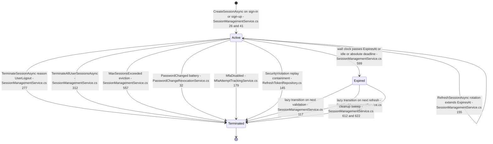
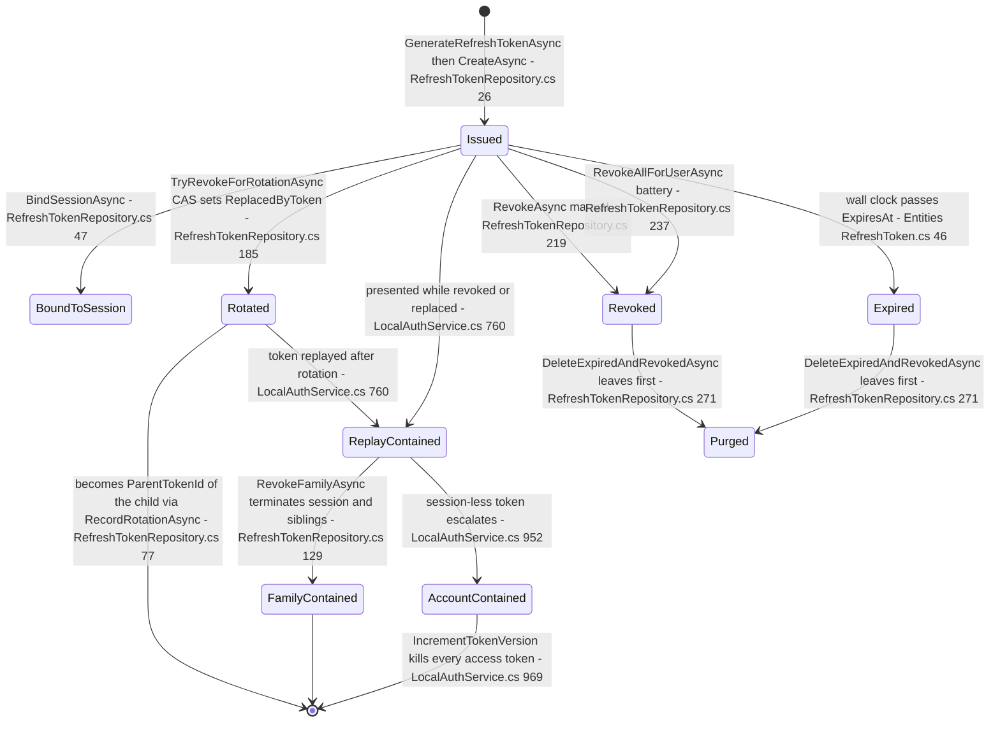
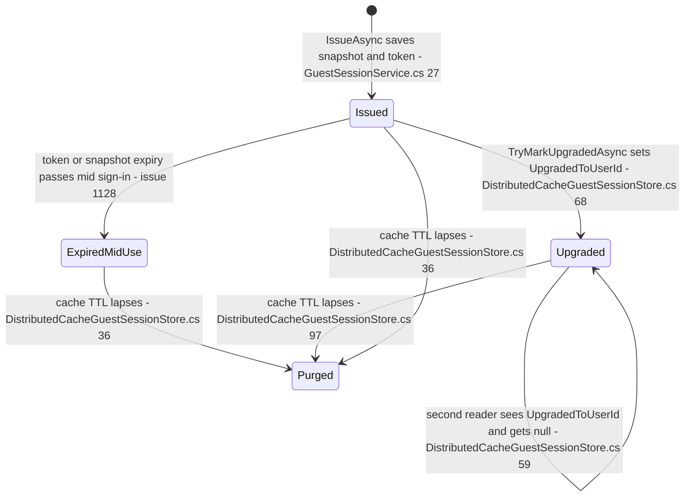
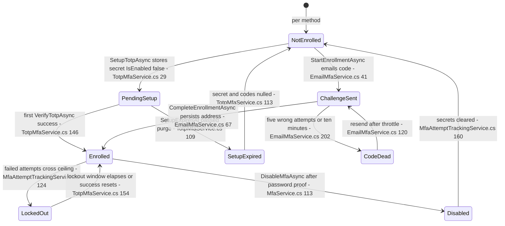
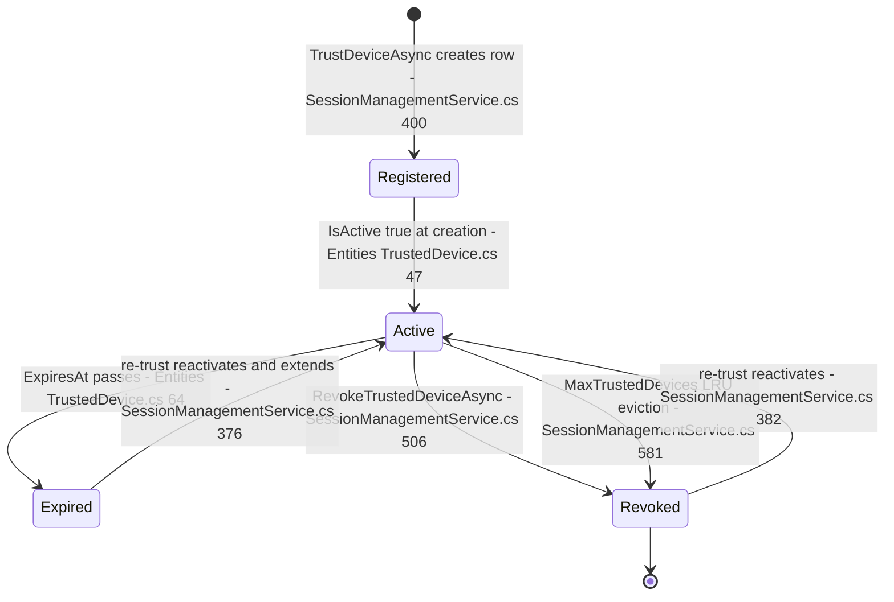
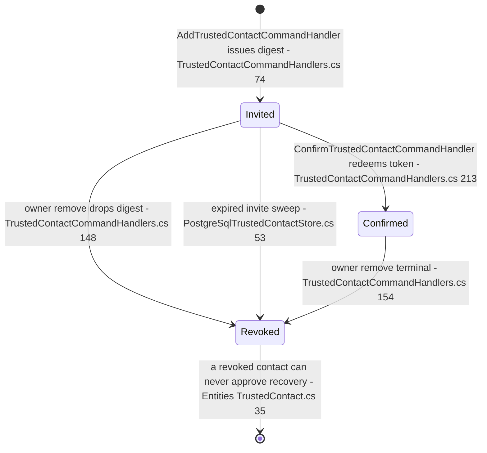
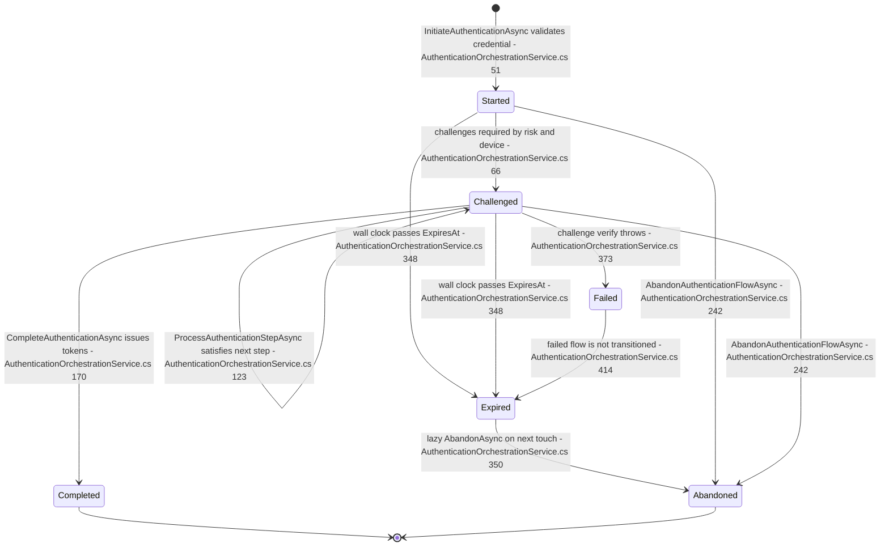
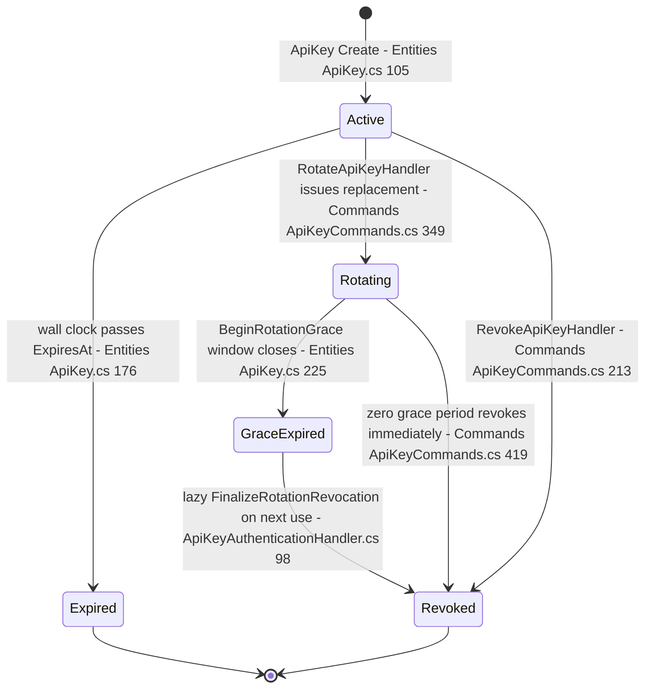
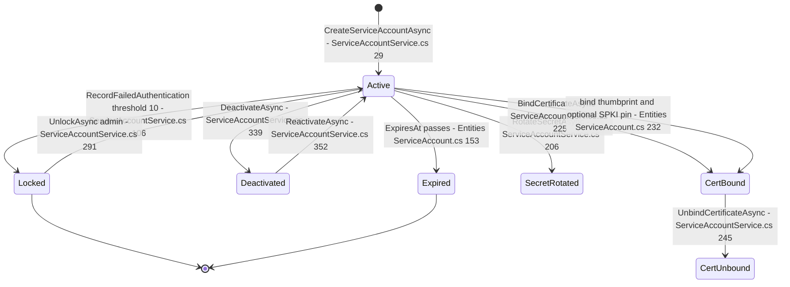

# Authentication State Machines — every stateful entity, every transition, audited

> Module `GameGuild.Identity.Authentication` (+ `GameGuild.Identity.Authorization` middleware surfaces) · Documented against `develop` commit `74e9bba4c`.
> Scope: one Mermaid `stateDiagram-v2` per stateful authentication entity, with the states enumerated from the entity code, every transition tied to its trigger (command / service method with `file:line`), and a transitions-audit table per entity: what the code ALLOWS, what has NO trigger (unreachable states), and what is missing a guard (verification / fencing that should be there but is not).
> Why: state machines catch invalid-transition bugs. Two recent live examples are marked inline — the guest→member non-CAS double-upgrade window (§3) and the session-less refresh-family escalation (§2).

Path convention below: all `file:line` references are relative to `apps/api/Source/Modules/GameGuild.Identity.Authentication/` unless the path starts with another module or `GameGuild.API`.

---

## 1. UserSession

Entity: `Entities/UserSession.cs`. There is no status enum; the state is the pair of the `IsActive` flag (`Entities/UserSession.cs:73`) plus the derived `IsExpired` clock check (`Entities/UserSession.cs:100`). The composite "usable" predicate is `IsValid` (`IsActive && !IsExpired`, `Entities/UserSession.cs:102`). Termination reasons come from `Enums/SessionTerminationReason.cs` (UserLogout, AdministrativeTermination, Expired, SecurityViolation, Device Changed, LocationChanged, MaxSessionsExceeded, MfaDisabled, PasswordChanged) and are stored as a string in `TerminationReason` (`Entities/UserSession.cs:79`).

Timeouts (defaults from `Modules/GameGuild.SharedKernel/Configuration/ApplicationLayer/SessionOptions.cs`): idle `IdleTimeoutMinutes = 30` (:35), absolute `AbsoluteTimeoutMinutes = 1440` (:41), `MaxConcurrentSessions = 5` (:47), `TrustedDeviceDurationDays = 30` (:53), `MaxTrustedDevices = 10` (:59), `TerminateSessionsOnMfaDisable = true` (:69). The idle/absolute clocks are evaluated by `SessionManagementService.IsExpired` (`Services/SessionManagementService.cs:599-604`) — note that `IsExpired` checks idle and absolute timeout even when `ExpiresAt` is still in the future, so a session can be "expired" before its stored expiry column says so.

Device-trust interplay: the `IsTrustedDevice` / `TrustedAt` columns on the session row (`Entities/UserSession.cs:89-94`) record that the creating device was trusted at sign-in time; the authoritative trust record is the separate `TrustedDevice` row (§5), consulted by `SessionManagementService.IsDeviceTrustedAsync` (`Services/SessionManagementService.cs:432`) when the orchestration service decides whether a `DeviceTrust` challenge is required (`Services/AuthenticationOrchestrationService.cs:112-118`).

Concurrent sign-in paths: every issuance funnels through `EnforceMaxConcurrentSessionsAsync` (`Services/SessionManagementService.cs:557-579`), which evicts the least-recently-used active sessions (`LastUsedAt`, then `CreatedAt`) with reason `MaxSessionsExceeded`. Sign-in, sign-up, refresh (session recreation path) and the orchestrated flow all create sessions.

### Transitions audit — UserSession

| Transition | Code allows? | Trigger (file:line) | Guard assessment |
|---|---|---|---|
| create → Active | yes | `SessionManagementService.CreateSessionAsync` (`Services/SessionManagementService.cs:26,41`) | Caller must already hold a verified credential; no separate fencing needed |
| Active → Terminated (logout / admin) | yes | `TerminateSessionAsync` (`:277`) — logout via `Controllers/SessionController.cs:111` and `Commands/RevokeAllUserTokensCommand.cs:40`; admin via `Modules/GameGuild.Identity.Provisioning/Services/ScimUserService.cs:252`; `TerminateAllUserSessionsAsync` (`:312`) | Unguarded against concurrent refresh: see edge case E1 |
| Active → Terminated (eviction) | yes | `EnforceMaxConcurrentSessionsAsync` (`:557`) | LRU eviction is best-effort; a session created between the fetch and the loop is not swept |
| Active → Expired | derived only | `IsExpired` (`:599`), entity `IsExpired` (`Entities/UserSession.cs:100`) | Expiry is a *derived* state — no write happens until something touches the row |
| Expired → Terminated | lazy | `ValidateSessionAsync` (`:117`), `RefreshSessionAsync` (`:149`), `TerminateExpiredSessionAsync` (`:612`), `CleanupExpiredSessionsAsync` (`:622`) | Correct fail-closed read enforcement first (`Middleware/TokenRevocationMiddleware.cs:122`) |
| Terminated → Active | **no trigger** | none | Good: no reactivation path exists; the refresh path recreates a *new* session id instead (`Services/LocalAuthService.cs:859`) |

Unreachable / no-trigger states: **two enum values have no production writer.** `SessionTerminationReason.DeviceChanged` and `SessionTerminationReason.LocationChanged` are never passed to any termination call in `Source` (only tests reference them); `AnalyzeSessionSecurityAsync` (`Services/SessionManagementService.cs:629`) *detects* device/location changes but nothing feeds its recommendation into `TerminateSessionAsync`. Every other reason has a writer: UserLogout and AdministrativeTermination (`Modules/GameGuild.Identity.Provisioning/Services/ScimUserService.cs:252`), Expired (`Services/SessionManagementService.cs:117`), SecurityViolation (`Repositories/RefreshTokenRepository.cs:142`), MaxSessionsExceeded (`:568`), MfaDisabled (`Services/MfaAttemptTrackingService.cs:181`), PasswordChanged (`Services/PasswordChangeRevocationService.cs:32`).

Missing guards / edge cases:

- **E1 (expiry race, terminate vs rotate).** `TerminateAllUserSessionsAsync` fetches then updates rows one by one (`:314-324`). A concurrent `RefreshSessionAsync` that re-read the row before the termination write can extend `ExpiresAt`/`LastUsedAt` on a row the sweep already classified, and a session created between fetch and loop survives entirely. The replay-containment path avoids this with an `ExecuteUpdateAsync` guard (`Repositories/RefreshTokenRepository.cs:145-151`); the sweep does not.
- **E2 (double transition is harmless but unaudited twice).** `TerminateSessionAsync` writes unconditionally even for an already-terminated row; only the metric is guarded by `wasActive` (`:286-295`). A late `PasswordChanged` battery after logout rewrites `TerminationReason`, masking the original reason in the audit trail.

---

## 2. RefreshToken (and its family / lineage)

Entity: `Entities/RefreshToken.cs`. Again flag-based: `IsRevoked` (`:27`), derived `IsExpired` (`:46`), derived `IsActive = !IsRevoked && !IsExpired` (`:48`). Lineage columns: `ParentTokenId` (`:15`), `SessionId` (`:18`), `ReplacedByToken` (`:36`), `RevokedByIp`/`RevokedAt` (`:30-32`).

The rotation claim is a genuine compare-and-swap: `TryRevokeForRotationAsync` (`Repositories/RefreshTokenRepository.cs:185-217`) executes an `ExecuteUpdateAsync` that succeeds only when the row still matches `!IsRevoked && ReplacedByToken == null && ExpiresAt > now`; the loser of a concurrent rotation gets `affected == 0` and the caller escalates to containment (`Services/LocalAuthService.cs:894-901`). Family metadata is then linked by `RecordRotationAsync` (`Repositories/RefreshTokenRepository.cs:77-116`) which re-validates the committed rows (revoked parent, live child, matching session) and throws `UnauthorizedAccessException("Invalid refresh-token lineage")` otherwise.

Version-bump invalidation: the account-wide containment path bumps the user's `TokenVersion` (`Services/LocalAuthService.cs:963-971`), which `Middleware/TokenRevocationMiddleware.cs:91-108` enforces per request (`token_version < current` → reject). This is the mechanism that kills already-issued *access* tokens; refresh-token revocation alone cannot.

### Transitions audit — RefreshToken

| Transition | Code allows? | Trigger (file:line) | Guard assessment |
|---|---|---|---|
| Issued → Rotated | yes (CAS) | `TryRevokeForRotationAsync` (`Repositories/RefreshTokenRepository.cs:185`) called from `LocalAuthService.RefreshTokenAsync` (`Services/LocalAuthService.cs:886`) | Correctly fenced — concurrent rotation loser is contained |
| Issued/Rotated → ReplayContained | yes | replay detection (`Services/LocalAuthService.cs:760-776`); containment (`:934-972`) | Containment runs *inside* the command transaction; the denial returns a `RefreshTokenContainmentDenial` instead of throwing so the containment is not rolled back (`:774-775`) |
| ReplayContained → FamilyContained | yes, only when `token.SessionId.HasValue` | `RevokeFamilyAsync` (`Repositories/RefreshTokenRepository.cs:129-171`) | Session row is locked (`ExecuteUpdateAsync`, `:145-151`) **before** descendants are revoked — good fencing |
| ReplayContained → AccountContained | yes | fallback when family scope is configured but the token is session-less, or scope is Account (`Services/LocalAuthService.cs:952-971`) | See R1 |
| Issued → Revoked (manual / battery) | yes | `RevokeAsync` (`:219`), `RevokeAllForUserAsync` (`:237`), `JwtTokenService` revoke (`Services/JwtTokenService.cs:434`), password-change battery (`Services/PasswordChangeRevocationService.cs:30`) | OK |
| Expired/Revoked → Purged | yes | `DeleteExpiredAndRevokedAsync` (`:260-283`) | Retention keeps replay markers through original expiry; deletes leaves first and retains predecessors while any child survives (`:262-263`) |

Unreachable states: none — every stored column combination has a producer.

Missing guards / edge cases:

- **R1 — session-less refresh-family escalation (live bug class, 2026-11).** A replayed token with `SessionId == null` cannot take the family path (`RevokeFamilyAsync` returns `null` at `Repositories/RefreshTokenRepository.cs:134`), so containment silently escalates to **account-wide revocation + token-version bump** (`Services/LocalAuthService.cs:956-971`): every session of the user dies because one legacy/unbound token was replayed. Symmetrically, a *live* session-less token does not fail — `RefreshTokenAsync` **creates a brand-new session row** for it (`:859-870`), re-materializing access from a credential whose session was deleted (or never bound). Both directions are surprising; the second one is how a token that survived a session cleanup can resurrect a session.
- **R2 — family containment does not bump the token version.** The family path returns at `Services/LocalAuthService.cs:949` without `IncrementTokenVersion`. Access tokens minted from the contained family that do **not** carry a session claim (or pre-date session binding) remain valid until natural expiry; only session-claim-bearing requests are stopped by `Middleware/TokenRevocationMiddleware.cs:113-135`.
- **R3 — expiry race.** Between the `ExpiresAt <= now` read (`Services/LocalAuthService.cs:778`) and the CAS at `:886`, the only fencing is the CAS itself, which re-checks `ExpiresAt > revokedAt` (`Repositories/RefreshTokenRepository.cs:207`) — correct. No gap.

---

## 3. GuestSession (issue #213)

There is no entity table: the guest session is a snapshot in `IDistributedCache` (`Guest/DistributedCacheGuestSessionStore.cs`), keys `auth:guest:session:<id>` (`:22`), with a JWT-shaped guest token issued by `Guest/GuestTokenService.cs`. Lifetime options: `AccessTokenLifetimeMinutes = 30` (max 60), `IsEnabled = true`, store eviction slack 5 minutes (`Guest/GuestSessionOptions.cs:19-45`). States live on the snapshot: issued → (`UpgradedToUserId` set) → upgraded; logical expiry is re-checked on read against the domain clock so a lagging cache cannot revive a stale session (`Guest/DistributedCacheGuestSessionStore.cs:59`, `:81`).

Upgrade trigger: `GuestSessionService.UpgradeAsync` (`Guest/GuestSessionService.cs:97-144`) is invoked by `GuestSessionUpgradeIntegration.ApplyGuestUpgradeAsync` (`Guest/GuestSessionUpgradeIntegration.cs:13-40`) from the sign-in and sign-up handlers *after* the authenticated session exists. An invalid, expired or already-upgraded guest token never blocks the sign-in — only the continuity link is dropped and the rejection audited (`Guest/GuestSessionUpgradeIntegration.cs:22-39`).

### Transitions audit — GuestSession

| Transition | Code allows? | Trigger (file:line) | Guard assessment |
|---|---|---|---|
| → Issued | yes | `IssueAsync` (`Guest/GuestSessionService.cs:27-82`); disabled-by-config rejects with audit (`:32-43`) | OK |
| Issued → Upgraded | yes | `TryMarkUpgradedAsync` (`Guest/DistributedCacheGuestSessionStore.cs:68-108`) | **No CAS** — see G1 |
| Issued → ExpiredMidUse | derived | token validation (`Guest/GuestSessionService.cs:109-114`) + snapshot re-check (`:116-121`, store `:59`, `:81`) | Correctly fails closed on both layers |
| any → Purged | yes | cache absolute TTL (`:36`, `:97`) | OK |

Unreachable states: none.

Missing guards / edge cases:

- **G1 — non-CAS double-upgrade window (live bug class, 2026-11).** `TryMarkUpgradedAsync` is read-modify-write on `IDistributedCache`; the code comments the window instead of closing it: "The distributed cache has no compare-and-swap; the token itself is a single-client bearer capability with a short lifetime, so a concurrent double-upgrade window is bounded by the guest token's expiry…" (`Guest/DistributedCacheGuestSessionStore.cs:93-96`). Two parallel sign-ins presenting the same guest token can both win the check at `:81` and both bind the guest session to different authenticated sessions (`UpgradedToSessionId` last-writer-wins). Already documented in `docs/auth/flows/guest-session-lifecycle.md` §Gaps item 3.
- **G2 — expired-mid-use (#1128).** A guest who signs in right at the 30-minute boundary can have the guest token validate at the door and fail the snapshot read (or vice versa); the user keeps the authenticated session but loses cart/progress continuity, and the API response simply omits `UpgradedFromGuestSessionId` (`Guest/GuestSessionUpgradeIntegration.cs:34-39`). This is a deliberate degradation, not a bug — but clients must treat continuity as optional.

---

## 4. MFA enrollment — per method

Entity: `Entities/UserMfaConfiguration.cs`. Flags: `IsEnabled` (`:17`), `IsSetupComplete` (`:67`), `SetupExpiresAt` (`:70`), `LockedOutUntil` (`:51`), `PreferredMethod` (`:56`), per-method addresses: `TotpSecretKey` (`:24`), `SmsPhoneNumber` (`:76`), `PushDeviceToken` (`:83`), `EmailMfaAddress` (`:90`, only set after a sent code is verified — issue #1152/#1168), `BackupCodes` versioned issued-set (`:31`). Methods enum: `Enums/MfaMethod.cs` (Totp, BackupCode, Sms, Email, WebAuthn, Push). The lockout sub-state is shared by all methods via `FailedAttempts`/`LockedOutUntil` (`Services/MfaAttemptTrackingService.cs`).

TOTP lifecycle (`Services/TotpMfaService.cs`): setup writes the encrypted secret with `IsEnabled = false`, `IsSetupComplete = false` and a fixed `SetupExpiresAt` (`:57-63`); first successful verify flips to enrolled inside the replay-store acceptance callback (`:143-160`, enrollment at `:146-153`); a setup that outlives `SetupExpiresAt` is purged — secret and backup codes nulled (`:109-121`). Email-MFA two-phase (#1168): `StartEnrollmentAsync` issues a 10-minute, 60-second-throttled, five-attempt code (`Services/EmailMfaService.cs:27-33`) to the account's own address; `CompleteEnrollmentAsync` consumes it and only then persists `EmailMfaAddress` and sets `IsEnabled` (`:67-91`).

Recovery (backup) codes are a sub-lifecycle of the same row: provisioned during setup (`Services/MfaService.cs:36-44` → `StoreBackupCodesForSetupAsync`, `Services/BackupCodeMfaService.cs:251`), regenerated on demand (`:20-78`, requires `IsEnabled`), each code single-use on verify (`:84` onward), cleared entirely on disable (`Services/MfaAttemptTrackingService.cs:163`). WebAuthn credentials are a separate entity with their own status enum (`Enums/WebAuthnCredentialStatus.cs`, `Entities/UserWebAuthnCredential.cs`) and are not drawn here.

Disable is the critical transition and it is double-guarded: password re-verification first (`Services/MfaService.cs:113-131` — passwordless accounts cannot self-disable), then the tracking service clears every method secret, revokes all tokens unconditionally, and (option, default on) terminates all sessions with reason `MfaDisabled` (`Services/MfaAttemptTrackingService.cs:160-183`).

### Transitions audit — MFA enrollment

| Transition | Code allows? | Trigger (file:line) | Guard assessment |
|---|---|---|---|
| NotEnrolled → PendingSetup | yes | `SetupTotpAsync` (`Services/TotpMfaService.cs:29`); refuses when already enabled (`:43-48`) | Re-initiating setup overwrites the secret (`:57-67`) — safe (old secret dies) but silently invalidates a pending authenticator |
| PendingSetup → Enrolled | yes | first verify (`:146-153`) inside TOTP replay-accept (`:143`) | Replay-fenced and lockout-checked (`:124`) |
| PendingSetup → SetupExpired → NotEnrolled | yes | deadline purge (`:109-121`) | Failed attempts cannot extend the deadline (fixed `SetupExpiresAt`, `Entities/UserMfaConfiguration.cs:69-70`) |
| NotEnrolled → ChallengeSent → Enrolled (email) | yes | `StartEnrollmentAsync` (`Services/EmailMfaService.cs:41`), `CompleteEnrollmentAsync` (`:67`) | See M1/M2 |
| Enrolled → LockedOut → Enrolled | yes | `RecordFailedMfaAttemptAsync` via `Services/MfaAttemptTrackingService.cs`; reset on success (`Services/TotpMfaService.cs:154-156`) | OK |
| Enrolled → Disabled | yes | `MfaService.DisableMfaAsync` (`:113`) → `MfaAttemptTrackingService.DisableMfaAsync` (`:144`) | Password-fenced; token revocation unconditional (`:172`) |
| Disabled → Enrolled (re-enroll) | yes | fresh setup path; `IsEnabled` was reset false | Requires walking the full setup again — OK |

Unreachable states: `IsSetupComplete` stays `false` forever on the email path — `CompleteEnrollmentAsync` sets `IsEnabled = true` but never `IsSetupComplete` (`Services/EmailMfaService.cs:83-86`), while the TOTP path sets both (`Services/TotpMfaService.cs:148-151`). Any consumer keying off `IsSetupComplete` sees email-MFA users as never set up.

Missing guards / edge cases:

- **M1 — challenge without enrollment check.** `EmailMfaService.SendChallengeAsync` gates only on `EmailMfaAddress is not null` (`Services/EmailMfaService.cs:96-100`), not on `IsEnabled`; and `DisableMfaAsync` clears `TotpSecretKey`, `BackupCodes`, `SmsPhoneNumber`, `PushDeviceToken` but **not** `EmailMfaAddress` (`Services/MfaAttemptTrackingService.cs:162-165`). After a disable, `VerifyCodeAsync` will still consume a code issued to the stale address (`Services/EmailMfaService.cs:114-118`) — the code verify alone does not re-check `IsEnabled` either; callers must. Net effect: the email method can keep issuing and accepting codes for an account whose MFA is "disabled" (the sign-in policy layer is what stops it from being accepted as a factor — verify your caller).
- **M2 — email enrollment has no setup deadline.** The TOTP purge (`Services/TotpMfaService.cs:109-121`) keys off `SetupExpiresAt`, which the email path never sets, so an emailed enrollment code has its own 10-minute TTL but the half-enrolled configuration row has none.
- **M3 — concurrent enrollment races.** `SetupTotpAsync` read-modify-writes the configuration row; two parallel setups last-writer-wins on `TotpSecretKey`. Harmless (old secret unusable) but the backup codes written during setup (`Services/MfaService.cs:36-44`) correspond to whichever row won.

---

## 5. TrustedDevice

Entity: `Entities/TrustedDevice.cs`. Flags: `IsActive` (`:47`), optional `ExpiresAt` (`:52`), derived `IsExpired` (`:64`) and `IsValid` (`:66`). Lifetime: `TrustedDeviceDurationDays = 30` default (`SessionOptions.cs:53`), cap `MaxTrustedDevices = 10` (`:59`).

Expiry enforcement is read-time, not write-time: `IsDeviceTrustedAsync` returns false when `ExpiresAt <= now` (`Services/SessionManagementService.cs:446-449`), `GetTrustedDevicesAsync` filters expired rows out of listings (`:463-464`), and the orchestrated flow's device-recognition check consults the repository (`Services/AuthenticationOrchestrationService.cs:112-118`). No background job transitions an expired row — the row stays `IsActive = true` with a past `ExpiresAt` until the owner re-trusts or revokes it. This is exactly the enforcement seam the open PR #1172 (trusted-device expiry hardening) targets: today "expired" is a derived predicate that every reader must remember to evaluate.

### Transitions audit — TrustedDevice

| Transition | Code allows? | Trigger (file:line) | Guard assessment |
|---|---|---|---|
| → Registered/Active | yes | `TrustDeviceAsync` (`Services/SessionManagementService.cs:366-419`); fingerprinting must be enabled (`:368`) | Device metadata clamped to column limit (`:425-430`) |
| Active → Expired | derived | `IsExpired` (`Entities/TrustedDevice.cs:64`) | Read-enforced only (see above) |
| Expired → Active | yes | re-trust (`:376-397`) reactivates and re-extends `ExpiresAt` | OK — deliberate |
| Revoked → Active | yes | same re-trust path (`:382-383`) | OK — deliberate |
| Active/Expired → Revoked | yes | `RevokeTrustedDeviceAsync` (`:506-523`), eviction (`:581-597`) | Owner-scoped (`device.UserId != userId` → false) |

Unreachable states: none.

Missing guards / edge cases:

- **D1 — trust grant needs no MFA proof.** `TrustDeviceAsync` is invoked post-authentication; nothing in it requires a fresh step-up. A session-hijacking attacker with the fingerprint can pin their device for 30 days.
- **D2 — expiry vs revoke asymmetry.** Revocation is persisted (`IsActive = false`); expiry is not (row remains active-but-derived-expired). Anything reading `IsActive` directly (e.g. analytics or a future admin surface) over-trusts expired devices; the two correct readers are `:432-452` and `:454-465`.
- **D3 — eviction race.** `EnforceMaxTrustedDevicesAsync` (`:581-597`) fetch-then-updates; two concurrent trusts can both pass the cap check and both persist, exceeding `MaxTrustedDevices`.

---

## 6. TrustedContact (issue #209)

Entity: `Entities/TrustedContact.cs` with a real status enum `Enums/TrustedContactStatus.cs` (Invited = 0, Confirmed = 1, Revoked = 2). `Status` (`Entities/TrustedContact.cs:24`), `InviteTokenHash`/`InviteTokenExpiresAt` (`:27-29`), `ConfirmedAt` (`:33`), `RevokedAt` (`:36`), eligibility `IsEligible => Status == Confirmed` (`:39`). The invite token is stored as a SHA-256 digest only and is single-use.

Approval codes: only `Confirmed` contacts receive recovery codes; recovery approval handlers re-check `Status == Confirmed` at approval time (`Handlers/ApproveAccountRecoveryCommandHandler.cs:67`), and the recovery-request query counts only confirmed contacts (`Handlers/AccountRecoveryRequestHandlers.cs:66`). Redemption re-checks the digest with a fixed-time comparison (`Handlers/TrustedContactCommandHandlers.cs:196-201`) after sweeping expired invites (`:194`, `Repositories/PostgreSqlTrustedContactStore.cs:53-56`).

### Transitions audit — TrustedContact

| Transition | Code allows? | Trigger (file:line) | Guard assessment |
|---|---|---|---|
| → Invited | yes | `AddTrustedContactCommandHandler` (`Handlers/TrustedContactCommandHandlers.cs:74-79`); duplicate active email refused (`:60-63`) | Invite is a capability: digest-only storage, fixed lifetime |
| Invited → Confirmed | yes | `ConfirmTrustedContactCommandHandler` (`:213-217`) | Single-use enforced by consuming the digest; expiry checked; fixed-time compare; generic denial messages |
| Invited → Revoked | yes | owner remove (`:148-158`); expiry sweep (`Repositories/PostgreSqlTrustedContactStore.cs:53-56`) | Fail-closed: revocation nulls the digest so in-flight invites die |
| Confirmed → Revoked | yes | owner remove (`:154`) | Terminal — correct |
| Revoked → Invited (re-invite) | via a new row only | `AddTrustedContactCommandHandler` accepts a fresh contact with the same email (the duplicate check is on *active* contacts, `:60-63`) | Acceptable; note the old revoked row keeps history |

Unreachable states: none.

Missing guards / edge cases:

- **T1 — confirm-vs-revoke race.** Confirmation (`Handlers/TrustedContactCommandHandlers.cs:191-217`) reads the contact, checks status/expiry, then writes; a concurrent owner revoke between read and write is overwritten by the confirm (last-writer-wins on `Status`). The revoke's digest-nulling usually wins because confirm consumed it first — but the confirming write re-persists `Status = Confirmed` on a row the owner believes revoked. Narrow window, real conflict.
- **T2 — expiry sweep is lazy.** Expired invites become `Revoked` only when some confirmation attempt runs the sweep (`:194`); listing surfaces may show long-expired contacts as Invited.

---

## 7. OrchestratedAuthentication flow record

Entity: `Entities/AuthenticationFlowStateRecord.cs` — `CurrentStep` (`:24`, from `Enums/AuthenticationStep.cs`: PrimaryCredential, MfaVerification, DeviceTrust, RiskChallenge), `IsComplete` (`:41`), `ExpiresAt` (`:56`), `AbandonedAt` (`:78`), `CompletedAt` (`:83`). Flow lifetime is a constant 15 minutes (`Services/AuthenticationOrchestrationService.cs:35`). Risk thresholds: high-risk ≥ 0.7 adds MFA + RiskChallenge, ≥ 0.5 adds MFA (`:38-41`, applied `:101-109`); risk-analysis failure assumes **maximum** risk (fail closed, `:330-335`).

Note that **Failed is not a persisted state**: a failed challenge throws (`Services/AuthenticationOrchestrationService.cs:373,385,399`) and only the MFA-attempt row records the failure (`:414-446`); the flow record itself remains in its previous step until it expires or is abandoned. `GetFlowStateAsync` fails closed — abandoned and expired flows are not observable and expired ones are lazily abandoned (`:248-269`).

### Transitions audit — Orchestration flow

| Transition | Code allows? | Trigger (file:line) | Guard assessment |
|---|---|---|---|
| → Started | yes | `InitiateAuthenticationAsync` (`:51-94`); only `Local` method (`:273-277`); enumeration-protected credential check (`:286-310`) | OK |
| Started/Challenged → Challenged | yes | `ProcessAuthenticationStepAsync` (`:123-168`) with order enforcement (`:462-478`) | Step order and duplicate-step fenced; **row update is not** — see O2 |
| Challenged → Completed | yes | `CompleteAuthenticationAsync` (`:170-240`) | Pending-steps check (`:175-180`) but **no already-completed check** — see O1 |
| any → Abandoned | yes | `AbandonAuthenticationFlowAsync` (`:242-246`); lazy on expired read (`:262-266`, `:348-352`) | OK |
| Completed → Completed (again) | **yes — this is the bug** | second `CompleteAuthenticationAsync` call (`:170-240`) | O1 |

Unreachable states: `Failed` as drawn is conceptual only (see above).

Missing guards / edge cases:

- **O1 — double-completion window (#1178, live bug class).** `CompleteAuthenticationAsync` never inspects `record.IsComplete`. `LoadActiveFlowAsync` rejects only abandoned/expired flows (`:338-355`); the pending-steps check passes trivially on a flow whose steps are all complete — which includes a flow that was *already completed*. Two sequential or concurrent calls both mint a fresh access+refresh token pair and a fresh `sessionId` (`:197-219`). A replayed completion request therefore yields a second live credential set until the flow expires (up to 15 minutes after initiation).
- **O2 — lost-update on parallel step processing.** `ProcessAuthenticationStepAsync` read-modify-writes `CompletedStepsJson` (`:148-161`) with no concurrency token; two parallel requests satisfying different steps can each write a list missing the other's step, forcing one challenge to be re-satisfied.
- **O3 — user deletion between steps and completion.** Completion re-checks the user (`:187-192`), good; but the token issued at `:198-214` does not bind the tenant context the way the primary sign-in path does (`tenantId: null` at `:202`) — tenant scoping for orchestrated tokens relies entirely on later middleware.

---

## 8. ApiKey and ServiceAccount

### 8a. ApiKey

Entity: `Entities/ApiKey.cs`. Flags: `IsActive` (`:57`), `ExpiresAt` (`:62`), `RevokedAt`/`RevocationReason` (`:83-89`), rotation lineage `ReplacesKeyId` (`:94`) and `RotationGraceEndsAt` (`:100`), composite `IsValid()` (`:159-182`) which fails closed on inactive, revoked, grace-expired, or wall-clock-expired.

Rotation keeps the old key valid through a bounded overlap window (`RotateApiKeyHandler`, `Commands/ApiKeyCommands.cs:349-421`; single atomic repository save at `:387` → `Repositories/ApiKeyRepository.cs:69-86`). The final revocation of the rotated key is *lazy*: `ApiKeyAuthenticationHandler` finalizes it on the next authentication attempt (`Services/ApiKeyAuthenticationHandler.cs:98` → `Entities/ApiKey.cs:236-245`), so an unused rotated key sits in `GraceExpired` (still `IsActive`, grace past) indefinitely — `IsValid()` fails closed regardless (`:171-174`).

| Transition | Code allows? | Trigger (file:line) | Guard assessment |
|---|---|---|---|
| → Active | yes | `ApiKey.Create` (`Entities/ApiKey.cs:105-145`), `CreateApiKeyHandler` | Plaintext returned exactly once (`Commands/ApiKeyCommands.cs`) |
| Active → Rotating → GraceExpired → Revoked | yes | `BeginRotationGrace` (`Entities/ApiKey.cs:225-229`), `FinalizeRotationRevocation` (`:236-245`) | Grace clamped to configured max (`Commands/ApiKeyCommands.cs:423-433`) |
| Active → Revoked | yes | `RevokeApiKeyHandler` (`Commands/ApiKeyCommands.cs:213-238`), `Revoke` (`Entities/ApiKey.cs:213-219`) | Owner-scoped via repository (`Repositories/ApiKeyRepository.cs:49`) |
| Active → Expired | derived | `IsValid` (`Entities/ApiKey.cs:176-179`) | Fail-closed read enforcement; rows never transition |

Unreachable states: none. Missing guards: **K1** — `GraceExpired → Revoked` has no background sweeper; only an authentication attempt finalizes it (`Services/ApiKeyAuthenticationHandler.cs:98`), so inventories over-report active keys. **K2** — concurrent rotations of the same key: `RotateApiKeyHandler` checks `oldKey.IsValid()` (`:364-367`) outside the save; two parallel rotations both pass and create two replacements (the old key's grace is overwritten; both replacements are valid).

### 8b. ServiceAccount

Entity: `Entities/ServiceAccount.cs`. Flags: `IsActive` (`:60`), `ExpiresAt` (`:65`), `IsLocked`/`LockedAt` (`:117-122`), composite `CanAuthenticate` (`:147-155`: inactive, locked, and expired all fail closed). Certificate binding is a column pair, not a status enum: `CertificateThumbprint` (`:135`) and `CertificateSpkiSha256` (`:142`), null = secret-only.

| Transition | Code allows? | Trigger (file:line) | Guard assessment |
|---|---|---|---|
| → Active | yes | `CreateServiceAccountAsync` (`Services/ServiceAccountService.cs:29`) | Secret hashed (`Entities/ServiceAccount.cs:30`) |
| Active → Locked | yes | any failed auth (secret, cert, IP) via `RecordFailedAuthentication(LockThreshold=10)` (`Services/ServiceAccountService.cs:16,106,118,168,189`) | Threshold constant; failed count resets on success (`Entities/ServiceAccount.cs:179`) |
| Locked → Active | yes | `UnlockAsync` (`Services/ServiceAccountService.cs:291-301` → `Entities/ServiceAccount.cs:199-204`) | Admin surface only |
| Active ⇄ Deactivated | yes | `DeactivateAsync` (`:339-350`) / `ReactivateAsync` (`:352-362`) | **Reactivation has no expiry/credential re-check** — a long-expired-but-reactivated account is still `CanAuthenticate == false` until `ExpiresAt` is extended; nothing warns |
| → SecretRotated | yes | `RotateSecretAsync` (`:206-223` → `Entities/ServiceAccount.cs:220-226`) | No grace window: old secret dies at once (contrast with ApiKey rotation) |
| → CertBound / CertUnbound | yes | `BindCertificateAsync` (`:225`) / `UnbindCertificateAsync` (`:245`) | Overwrites any prior binding silently; `AuthenticateWithCertificateAsync` (`:135`) verifies thumbprint and optional SPKI pin |

Unreachable states: none (every flag combination has a writer). Missing guards: **S1** — `RecordFailedAuthentication` increments even when `CanAuthenticate` is already false (locked accounts keep "failing" harmlessly, which is fine, but IP-mismatch failures count toward lockout, `Services/ServiceAccountService.cs:99-108` — a misconfigured client whitelist can lock the account). **S2** — lockout has no automatic expiry: `LockedAt` is recorded but nothing unlocks after time; only `UnlockAsync` clears it.

---

## Cross-cutting edge-case summary

| # | Entity | Finding | file:line |
|---|---|---|---|
| R1 | RefreshToken | session-less replay escalates to account-wide revocation + version bump; live session-less token *re-creates* a session | `Services/LocalAuthService.cs:859-870`, `:952-971` |
| R2 | RefreshToken | family containment skips `IncrementTokenVersion`; non-session-bound access tokens outlive the family kill | `Services/LocalAuthService.cs:941-951` |
| G1 | GuestSession | non-CAS `TryMarkUpgradedAsync` — concurrent double-upgrade window acknowledged in code | `Guest/DistributedCacheGuestSessionStore.cs:93-96` |
| G2 | GuestSession | expiry mid-sign-in drops continuity only (#1128) | `Guest/GuestSessionUpgradeIntegration.cs:22-39` |
| M1 | MFA (email) | challenge/verify paths skip the `IsEnabled` gate; disable does not clear `EmailMfaAddress` | `Services/EmailMfaService.cs:96-100,114-118`, `Services/MfaAttemptTrackingService.cs:162-165` |
| M2 | MFA (email) | enrollment sets `IsEnabled` but never `IsSetupComplete`; no setup deadline on this path | `Services/EmailMfaService.cs:83-86` |
| O1 | Orchestration flow | `CompleteAuthenticationAsync` lacks an already-complete fence — double token mint (#1178) | `Services/AuthenticationOrchestrationService.cs:170-219` |
| O2 | Orchestration flow | step completion is a lost-update-prone read-modify-write | `Services/AuthenticationOrchestrationService.cs:148-161` |
| D2 | TrustedDevice | expiry is derived and read-enforced only; rows linger active-but-expired (PR #1172 seam) | `Entities/TrustedDevice.cs:64`, `Services/SessionManagementService.cs:446-449` |
| K1 | ApiKey | rotation revocation finalizes lazily on next use; no sweeper | `Services/ApiKeyAuthenticationHandler.cs:98` |
| E1 | UserSession | terminate-all sweep races concurrent create/refresh (no set-based guard like the replay path has) | `Services/SessionManagementService.cs:312-334` |

Companion document: `docs/auth/cross-module-sequences.md` (sequence diagrams for the interactions that *drive* these machines from outside the module).
