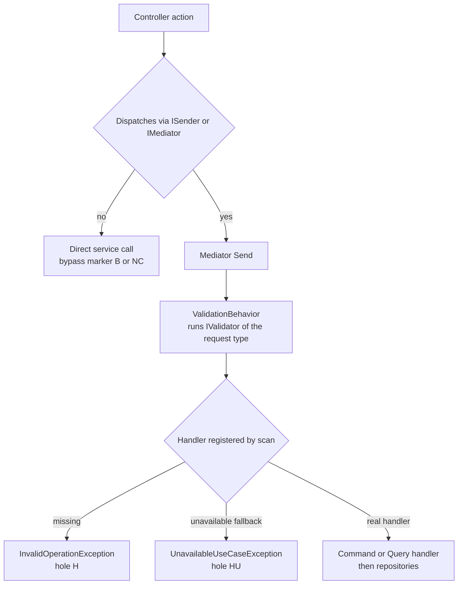

# Auth CQRS wiring matrix — every endpoint, every pipeline cell

> Generated against `origin/develop` @ `74e9bba4c`. Docs-only artifact; no code changed.
> Scope: **all** controllers in `apps/api/Source/Modules/GameGuild.Identity.Authentication/Controllers` (28 endpoint-bearing controllers)
> plus **all** controllers in `apps/api/Source/Modules/GameGuild.Identity.Authorization/Controllers` (18 controllers across 16 files).
> Every cell was extracted from the source at the commit above and spot-verified by hand; per-table notes name the controller file and line anchors.

## How the pipeline is wired (read this first)

1. **Controller → `ISender.Send`** — the module convention is `Controller → ISender.Send → FluentValidation → Command/Query → Handler → Repositories`. Deviations are marked in the HOLE column (`B`, `NC`) and listed in [Part C](#part-c--isender-bypass-register).
2. **Handler registration is assembly-scan based** — `AddApplicationLayer` discovers enabled module assemblies (`GameGuild.API/Core/Setup/ApplicationLayerExtensions.cs:91-92`) — `Identity.Authentication` and `Identity.Authorization` are both always-on (`GameGuild.API/Core/Setup/ModuleConfiguration.cs:27-28`) — and `AddCqrs` registers every non-abstract class implementing `ICommandHandler<,>`, `ICommandHandler<>`, `IQueryHandler<,>`, `IRequestHandler<,>` (`SharedKernel/CQRS/Extensions/ServiceCollectionExtensions.cs:46-75, 231-234`). Consequence: **"registered in DI" == "a handler type exists"**; the only way to be unregistered is to have no handler at all (shown as `H`), or to hit the declared-unavailable fallback (`HU`). 36 request types additionally carry redundant explicit registrations in the module DI files (marked `scan+expl`; harmless, see [Part E](#part-e--observations)).
3. **FluentValidation runs only for validators bound to the sent request type** — `ValidationBehavior<TRequest,TResponse>` is registered globally (`GameGuild.API/Core/Extensions/InfrastructureLayerExtensions.cs:240`) and resolves `IValidator<TRequest>` (`SharedKernel/CQRS/Behaviors/ValidationBehavior.cs:13,21`), with validators registered by the same scan (`ServiceCollectionExtensions.cs:223-226`). A validator written against the controller DTO (e.g. `LocalSignUpRequest`) does **not** run for `LocalSignUpCommand`; this matrix therefore records validators for the **command/query type**, which is the type that actually flows through the pipeline.
4. **Authorization default is deny-anonymous** — endpoints without `[Authorize]` still require an authenticated user because the default policy requires it (`SharedKernel/Configuration/PresentationLayer/Authorization/AuthorizationOptions.cs:18`, applied in `GameGuild.API/Core/Extensions/SecurityServiceCollectionExtensions.cs:397-401`). Shown as `default` in the Auth column. `[AllowAnonymous]` endpoints must appear in `GameGuild.API/Security/AnonymousEndpointRegistry.cs` (architecture-test-enforced); every anonymous endpoint in scope **is** registered (0 violations).
5. **Rate limiting** — every request rides the global limiter (`GameGuild.API/Core/Extensions/RateLimitingServiceCollectionExtensions.cs:87-111`); named policies come from `[EnableRateLimiting(RateLimitPolicies.X)]` (`SharedKernel/Configuration/PresentationLayer/RateLimiting/RateLimitPolicies.cs:17-119`). `— global` means no named policy. `†` = method-level override of the class policy.
6. **Declared-unavailable commands** — commands whose use-case contract carries `UnavailableReason` (`Modules/GameGuild.Identity.Authentication/Architecture/UseCaseEventContracts.g.cs`, 35 entries) get a fallback `UnavailableCommandHandler` that **throws `UnavailableUseCaseException`** on `Send` (`SharedKernel/CQRS/Implementation/UnavailableUseCaseHandlers.cs:10-22`, registered at `ServiceCollectionExtensions.cs:77-111`). These endpoints are wired but intentionally non-functional (`HU`). **Queries have no such fallback**: a query without a handler makes `Send` throw `InvalidOperationException` (`SharedKernel/CQRS/Implementation/MediatorSender.cs:136`) — every such endpoint is a live 500 (`H`).

### Overview

> Unavailable use-case fallback applies to commands only; queries missing a handler fail at `Send`.

### Column legend

| Column | Meaning |
|---|---|
| Route | `METHOD /v{n}/path` with the class-level `[Route]` prefix applied; `{n}` marks the API-version segment |
| Command/Query | request type(s) passed to `Send` |
| Validator | `file:line` of an `AbstractValidator<T>` for that request type; `—` = none exists; `n/a` = no request type |
| Handler | handler class and `file:line`; `UNAVAILABLE` = declared-unavailable fallback; `MISSING` = no handler anywhere |
| DI | `scan` = auto-registered by assembly scan; `+expl` = also explicitly registered in module DI; `fallback` = unavailable fallback handler; `—` = nothing to register |
| Auth | `anon` (`[AllowAnonymous]`, registry-checked), `authz` (`[Authorize]`, with policy name when scoped), `default` (no attribute; default policy requires authentication) |
| Rate-limit | effective named policy; `— global` = global limiter only |
| Unit / Integration | test files referencing the request/handler type (unit) or exercising the route or request type (integration incl. PostgreSql). Helper/fixture files are excluded. |
| HOLE | codes below, `ok` = every cell populated |

| Code | Hole class | Severity |
|---|---|---|
| `V` | no validator for a **command** (mutation reaches handler validation-free) | high |
| `VQ` | no validator for a **query** (convention: queries are read-only; still flagged per matrix rules) | low |
| `H` | **no handler at all** — `Send` throws `InvalidOperationException` at runtime | critical |
| `HU` | handler **declared unavailable** — `Send` throws `UnavailableUseCaseException` ("planned authorization management API is not available") | known |
| `NC` | **no command/query** — endpoint not on the CQRS pipeline | medium |
| `B` | **ISender bypass** — controller calls a service directly (convention violation unless justified) | medium |
| `NU` | no unit test (request/handler/controller not referenced by any unit-test file) | high |
| `NI` | no integration/PG test (route never exercised by any integration-test file) | high |

## Part A — Authentication module controllers

### AbacPolicyController (16 endpoints)

File: `apps/api/Source/Modules/GameGuild.Identity.Authentication/Controllers/AbacPolicyController.cs` (class decl line 21).
 — class route prefix `v{version:apiVersion}/abac-policies`; class `[Authorize]`.

| Route | Command/Query | Validator | Handler | DI | Auth | Rate-limit | Unit test | Integration/PG test | HOLE |
|---|---|---|---|---|---|---|---|---|---|
| GET /v{n}/abac-policies/{policyId} | `GetAbacPolicyQuery` | — | **MISSING** | — | authz | — global | AbacPolicyControllerTests.cs | — | VQ, H, NI |
| PUT /v{n}/abac-policies/{policyId} | `UpdateAbacPolicyCommand` | — | **UNAVAILABLE** | fallback | authz | — global | AbacPolicyControllerTests.cs | — | V, HU, NI |
| DELETE /v{n}/abac-policies/{policyId} | `DeleteAbacPolicyCommand` | — | **UNAVAILABLE** | fallback | authz | — global | AbacPolicyControllerTests.cs | — | V, HU, NI |
| POST /v{n}/abac-policies/:evaluate | `EvaluateAbacPoliciesCommand` | — | `EvaluateAbacPoliciesCommandHandler (PolicyEvaluationCommandHandlers.cs:74)` | scan | authz | — global | AbacPolicyControllerTests.cs, PolicyEvaluationCommandHandlersTests.cs | AccessControlIntegrationTests.cs | V |
| POST /v{n}/abac-policies/:evaluate-bulk | `BulkEvaluateAbacPoliciesCommand` | — | `BulkEvaluateAbacPoliciesCommandHandler (PolicyEvaluationCommandHandlers.cs:123)` | scan | authz | — global | AbacPolicyControllerTests.cs, PolicyEvaluationCommandHandlersTests.cs | AccessControlIntegrationTests.cs | V |
| POST /v{n}/abac-policies/:test-expression | `TestAbacExpressionCommand` | — | `TestAbacExpressionCommandHandler (PolicyEvaluationCommandHandlers.cs:200)` | scan | authz | — global | AbacPolicyControllerTests.cs, TestAbacExpressionCommandHandlerTests.cs | — | V, NI |
| POST /v{n}/abac-policies/{policyId}:activate | `ActivateAbacPolicyCommand` | — | **UNAVAILABLE** | fallback | authz | — global | AbacPolicyControllerTests.cs | — | V, HU, NI |
| POST /v{n}/abac-policies/{policyId}:deactivate | `DeactivateAbacPolicyCommand` | — | **UNAVAILABLE** | fallback | authz | — global | AbacPolicyControllerTests.cs | — | V, HU, NI |
| POST /v{n}/abac-policies/{policyId}:clone | `CloneAbacPolicyCommand` | — | **UNAVAILABLE** | fallback | authz | — global | AbacPolicyControllerTests.cs | — | V, HU, NI |
| GET /v{n}/abac-policies/statistics | `GetAbacPolicyStatisticsQuery` | — | **MISSING** | — | authz | — global | AbacPolicyControllerTests.cs | — | VQ, H, NI |
| GET /v{n}/abac-policies/{policyId}/usage | `GetAbacPolicyUsageQuery` | — | **MISSING** | — | authz | — global | AbacPolicyControllerTests.cs | — | VQ, H, NI |
| GET /v{n}/abac-policies/{policyId}/audit-trail | `GetAbacPolicyAuditTrailQuery` | — | **MISSING** | — | authz | — global | AbacPolicyControllerTests.cs | — | VQ, H, NI |
| POST /v{n}/abac-policies/:validate | `ValidateAbacPolicyCommand` | — | **UNAVAILABLE** | fallback | authz | — global | AbacPolicyControllerTests.cs | — | V, HU, NI |
| GET /v{n}/abac-policies/conflicts | `GetAbacPolicyConflictsQuery` | — | **MISSING** | — | authz | — global | AbacPolicyControllerTests.cs | — | VQ, H, NI |
| GET /v{n}/abac-policies/templates | `GetAbacPolicyTemplatesQuery` | — | **MISSING** | — | authz | — global | AbacPolicyControllerTests.cs | — | VQ, H, NI |
| POST /v{n}/abac-policies/templates/{templateId}:instantiate | `CreateAbacPolicyFromTemplateCommand` | — | **UNAVAILABLE** | fallback | authz | — global | AbacPolicyControllerTests.cs | — | V, HU, NI |

### AccessReviewAnalyticsController (6 endpoints)

File: `apps/api/Source/Modules/GameGuild.Identity.Authentication/Controllers/AccessReviewAnalyticsController.cs` (class decl line 22).
 — class route prefix `v{version:apiVersion}/access-reviews`; class `[Authorize]`.

| Route | Command/Query | Validator | Handler | DI | Auth | Rate-limit | Unit test | Integration/PG test | HOLE |
|---|---|---|---|---|---|---|---|---|---|
| POST /v{n}/access-reviews/:revoke-access | `RevokeAccessCommand` | — | **UNAVAILABLE** | fallback | authz | — global | AdminAnalyticsControllerTests.cs | — | V, HU, NI |
| POST /v{n}/access-reviews/:bulk-revoke-access | `BulkRevokeAccessCommand` | — | **UNAVAILABLE** | fallback | authz | — global | AdminAnalyticsControllerTests.cs | — | V, HU, NI |
| GET /v{n}/access-reviews/revocation-history | `GetAccessRevocationHistoryQuery` | — | **MISSING** | — | authz | — global | AdminAnalyticsControllerTests.cs | — | VQ, H, NI |
| GET /v{n}/access-reviews/analytics | `GetAccessReviewAnalyticsQuery` | — | **MISSING** | — | authz | — global | AdminAnalyticsControllerTests.cs | — | VQ, H, NI |
| GET /v{n}/access-reviews/compliance-status | `GetComplianceStatusQuery` | — | **MISSING** | — | authz | — global | AdminAnalyticsControllerTests.cs | — | VQ, H, NI |
| POST /v{n}/access-reviews/:generate-report | `GenerateAccessReviewReportCommand` | — | **UNAVAILABLE** | fallback | authz | — global | AdminAnalyticsControllerTests.cs | — | V, HU, NI |

### AccessReviewCampaignController (11 endpoints)

File: `apps/api/Source/Modules/GameGuild.Identity.Authentication/Controllers/AccessReviewCampaignController.cs` (class decl line 22).
 — class route prefix `v{version:apiVersion}/access-reviews`; class `[Authorize]`.

| Route | Command/Query | Validator | Handler | DI | Auth | Rate-limit | Unit test | Integration/PG test | HOLE |
|---|---|---|---|---|---|---|---|---|---|
| POST /v{n}/access-reviews/campaigns | `CreateAccessReviewCampaignCommand` | `AccessReviewCommands.cs:23` | `CreateAccessReviewCampaignHandler (AccessReviewCommands.cs:38)` | scan | authz | — global | AccessReviewCampaignControllerTests.cs, AccessReviewsControllerStatusTranslationTests.cs +1 | AccessReviewWorkflowPostgreSqlHttpTests.cs | HU |
| GET /v{n}/access-reviews/campaigns/{campaignId} | `GetAccessReviewCampaignQuery` | — | **MISSING** | — | authz | — global | AccessReviewCampaignControllerTests.cs | — | VQ, H, NI |
| PUT /v{n}/access-reviews/campaigns/{campaignId} | — none | n/a | — (none) | n/a | authz | — global | AccessReviewCampaignControllerTests.cs | — | NC, NI |
| DELETE /v{n}/access-reviews/campaigns/{campaignId} | `DeleteAccessReviewCampaignCommand` | — | **UNAVAILABLE** | fallback | authz | — global | AccessReviewCampaignControllerTests.cs | — | V, HU, NI |
| GET /v{n}/access-reviews/campaigns | `GetAccessReviewCampaignsQuery` | — | **MISSING** | — | authz | — global | AccessReviewCampaignControllerTests.cs | AccessReviewWorkflowPostgreSqlHttpTests.cs | VQ, H |
| POST /v{n}/access-reviews/campaigns/{campaignId}:start | `StartAccessReviewCampaignCommand` | `AccessReviewCommands.cs:65` | `StartAccessReviewCampaignHandler (AccessReviewCommands.cs:74)` | scan | authz | — global | AccessReviewCampaignControllerTests.cs, AccessReviewsControllerStatusTranslationTests.cs +1 | — | HU, NI |
| POST /v{n}/access-reviews/campaigns/{campaignId}:complete | `CompleteAccessReviewCampaignCommand` | `AccessReviewCommands.cs:93` | `CompleteAccessReviewCampaignHandler (AccessReviewCommands.cs:103)` | scan | authz | — global | AccessReviewCampaignControllerTests.cs, CoverageBoostTests5.cs | — | HU, NI |
| POST /v{n}/access-reviews/campaigns/{campaignId}:send-reminders | `SendReviewRemindersCommand` | — | **UNAVAILABLE** | fallback | authz | — global | AccessReviewCampaignControllerTests.cs | — | V, HU, NI |
| POST /v{n}/access-reviews/reminder-settings | `ConfigureReminderSettingsCommand` | — | **UNAVAILABLE** | fallback | authz | — global | AccessReviewCampaignControllerTests.cs | — | V, HU, NI |
| GET /v{n}/access-reviews/templates | `GetAccessReviewTemplatesQuery` | — | **MISSING** | — | authz | — global | AccessReviewCampaignControllerTests.cs | — | VQ, H, NI |
| POST /v{n}/access-reviews/templates/{templateId}:create-campaign | — none | n/a | — (none) | n/a | authz | — global | AccessReviewCampaignControllerTests.cs | — | NC, NI |

### AccessReviewItemController (8 endpoints)

File: `apps/api/Source/Modules/GameGuild.Identity.Authentication/Controllers/AccessReviewItemController.cs` (class decl line 22).
 — class route prefix `v{version:apiVersion}/access-reviews`; class `[Authorize]`.

| Route | Command/Query | Validator | Handler | DI | Auth | Rate-limit | Unit test | Integration/PG test | HOLE |
|---|---|---|---|---|---|---|---|---|---|
| GET /v{n}/access-reviews/campaigns/{campaignId}/items | `GetAccessReviewItemsQuery` | — | **MISSING** | — | authz | — global | AccessReviewItemControllerTests.cs | — | VQ, H, NI |
| POST /v{n}/access-reviews/items/{itemId}:review | — none | n/a | — (none) | n/a | authz | — global | AccessReviewItemControllerTests.cs | AccessReviewWorkflowPostgreSqlHttpTests.cs | NC |
| POST /v{n}/access-reviews/items:bulk-review | `BulkReviewAccessItemsCommand` | — | **UNAVAILABLE** | fallback | authz | — global | AccessReviewItemControllerTests.cs | — | V, HU, NI |
| GET /v{n}/access-reviews/items/{itemId} | `GetAccessReviewItemDetailsQuery` | — | **MISSING** | — | authz | — global | AccessReviewItemControllerTests.cs | AccessReviewWorkflowPostgreSqlHttpTests.cs | VQ, H |
| POST /v{n}/access-reviews/periodic | `CreatePeriodicAccessReviewCommand` | — | **UNAVAILABLE** | fallback | authz | — global | AccessReviewItemControllerTests.cs | — | V, HU, NI |
| GET /v{n}/access-reviews/periodic/{scheduleId} | `GetPeriodicAccessReviewQuery` | — | **MISSING** | — | authz | — global | AccessReviewItemControllerTests.cs | — | VQ, H, NI |
| GET /v{n}/access-reviews/periodic | `GetPeriodicAccessReviewsQuery` | — | **MISSING** | — | authz | — global | AccessReviewItemControllerTests.cs | — | VQ, H, NI |
| POST /v{n}/access-reviews/periodic/{scheduleId}:trigger | `TriggerPeriodicAccessReviewCommand` | — | **UNAVAILABLE** | fallback | authz | — global | AccessReviewItemControllerTests.cs | — | V, HU, NI |

### AccountRecoveryController (6 endpoints)

File: `apps/api/Source/Modules/GameGuild.Identity.Authentication/Controllers/AccountRecoveryController.cs` (class decl line 21).
 — class route prefix `v{version:apiVersion}/auth/account-recovery`; class `[Authorize]`.

| Route | Command/Query | Validator | Handler | DI | Auth | Rate-limit | Unit test | Integration/PG test | HOLE |
|---|---|---|---|---|---|---|---|---|---|
| POST /v{n}/auth/account-recovery/request | `RequestAccountRecoveryCommand` | `AccountRecoveryCommandValidators.cs:5` | `RequestAccountRecoveryCommandHandler (AccountRecoveryRequestHandlers.cs:27)` | scan+expl | anon ✓registry | — global | AccountRecoveryRequestHandlersTests.cs | — | NI |
| POST /v{n}/auth/account-recovery/cancel | `CancelAccountRecoveryCommand` | `AccountRecoveryCommandValidators.cs:16` | `CancelAccountRecoveryCommandHandler (AccountRecoveryRequestHandlers.cs:193)` | scan+expl | authz | — global | AccountRecoveryRequestHandlersTests.cs | — | NI |
| POST /v{n}/auth/account-recovery/approve | `ApproveAccountRecoveryCommand` | `AccountRecoveryCommandValidators.cs:25` | `ApproveAccountRecoveryCommandHandler (ApproveAccountRecoveryCommandHandler.cs:35)` | scan+expl | anon ✓registry | — global | ApproveAccountRecoveryCommandHandlersTests.cs | — | NI |
| POST /v{n}/auth/account-recovery/approve-passkey:begin | `BeginPasskeyRecoveryApprovalCommand` | `AccountRecoveryCommandValidators.cs:35` | `BeginPasskeyRecoveryApprovalCommandHandler (ApproveAccountRecoveryCommandHandler.cs:12)` | scan+expl | anon ✓registry | — global | — | — | NU, NI |
| POST /v{n}/auth/account-recovery/approve-passkey:complete | `ApproveAccountRecoveryWithPasskeyCommand` | `AccountRecoveryCommandValidators.cs:46` | `ApproveAccountRecoveryWithPasskeyCommandHandler (ApproveAccountRecoveryCommandHandler.cs:136)` | scan+expl | anon ✓registry | — global | ApproveAccountRecoveryCommandHandlersTests.cs | — | NI |
| POST /v{n}/auth/account-recovery/reset | `CompleteAccountRecoveryResetCommand` | `AccountRecoveryCommandValidators.cs:56` | `CompleteAccountRecoveryResetCommandHandler (CompleteAccountRecoveryResetCommandHandler.cs:22)` | scan+expl | anon ✓registry | — global | CompleteAccountRecoveryResetCommandHandlerTests.cs | — | NI |

### AdminMfaController (1 endpoints)

File: `apps/api/Source/Modules/GameGuild.Identity.Authentication/Controllers/AdminMfaController.cs` (class decl line 18).
 — class `[Authorize]`.

| Route | Command/Query | Validator | Handler | DI | Auth | Rate-limit | Unit test | Integration/PG test | HOLE |
|---|---|---|---|---|---|---|---|---|---|
| POST /v{n}/admin/users/{userId:guid}/mfa:reset | `AdminResetUserMfaCommand` | `AdminResetUserMfaCommandValidator.cs:5` | `AdminResetUserMfaCommandHandler (AdminResetUserMfaCommandHandler.cs:29)` | scan+expl | authz | — global | AdminResetUserMfaCommandHandlerTests.cs | MfaRecoveryPostgreSqlTests.cs | ok |

### ApiKeyController (4 endpoints)

File: `apps/api/Source/Modules/GameGuild.Identity.Authentication/Controllers/ApiKeyController.cs` (class decl line 15).
 — class `[Authorize]`.

| Route | Command/Query | Validator | Handler | DI | Auth | Rate-limit | Unit test | Integration/PG test | HOLE |
|---|---|---|---|---|---|---|---|---|---|
| POST /v{n}/auth/api-keys | `CreateApiKeyCommand` | `ApiKeyCommands.cs:43` | `CreateApiKeyHandler (ApiKeyCommands.cs:56)` | scan | authz | — global | AdditionalCoverageTests.cs, ApiKeyLifecycleTests.cs +3 | ApiKeyPolicyPostgreSqlHttpTests.cs | ok |
| GET /v{n}/auth/api-keys | `ListApiKeysQuery` | — | `ListApiKeysHandler (ApiKeyCommands.cs:159)` | scan | authz | — global | ApiKeyLifecycleTests.cs, ApiKeyAndRolesControllerTests.cs +1 | ApiKeyPolicyPostgreSqlHttpTests.cs | VQ |
| POST /v{n}/auth/api-keys/{keyId}:rotate | `RotateApiKeyCommand` | `ApiKeyCommands.cs:302` | `RotateApiKeyHandler (ApiKeyCommands.cs:327)` | scan | authz | — global | ApiKeyLifecycleTests.cs | — | NI |
| POST /v{n}/auth/api-keys/{keyId}:revoke | `RevokeApiKeyCommand` | — | `RevokeApiKeyHandler (ApiKeyCommands.cs:194)` | scan | authz | — global | ApiKeyLifecycleTests.cs, ApiKeyAndRolesControllerTests.cs +1 | — | V, NI |

### AuthController (32 endpoints)

File: `apps/api/Source/Modules/GameGuild.Identity.Authentication/Controllers/AuthController.cs` (class decl line 22).
 — class `[Authorize]`; class `[EnableRateLimiting(RateLimitPolicies.Authentication)]`.

| Route | Command/Query | Validator | Handler | DI | Auth | Rate-limit | Unit test | Integration/PG test | HOLE |
|---|---|---|---|---|---|---|---|---|---|
| POST /v{n}/auth/sign-up | `LocalSignUpCommand` | `LocalSignUpCommandValidator.cs:9` | `LocalSignUpHandler (LocalSignUpHandler.cs:15)` | scan+expl | anon ✓registry | Authentication | AuthFacadeApiRegistrationTests.cs, AuthenticationLockoutActionFilterTests.cs +4 | AuthenticationDtoPostgreSqlHttpTests.cs, ContextualAccessAndGradingRealSessionPostgreSqlHttpTests.cs +5 | ok |
| POST /v{n}/auth/sign-in | `LocalSignInCommand` | `LocalSignInCommandValidator.cs:8` | `LocalSignInHandler (LocalSignInHandler.cs:18)` | scan+expl | anon ✓registry | Authentication | AuthFacadeApiRegistrationTests.cs, AuthenticationLockoutActionFilterTests.cs +7 | AuthenticationDtoPostgreSqlHttpTests.cs, AuthenticationTimingPostgreSqlHttpTests.cs +11 | ok |
| POST /v{n}/auth/mfa/sign-in/complete | `CompleteMfaSignInCommand` | — | `CompleteMfaSignInHandler (CompleteMfaSignInHandler.cs:8)` | scan+expl | anon ✓registry | Authentication | — | MfaSignInCompletionPostgreSqlTests.cs, MfaSignInCompletionSecurityPostgreSqlTests.cs | V, NU |
| POST /v{n}/auth/polymorphic | `PolymorphicSignInCommand` | — | `PolymorphicSignInHandler (PolymorphicSignInHandler.cs:23)` | scan+expl | anon ✓registry | Authentication | AuthFacadeApiRegistrationTests.cs, AuthenticationDtoHandlerContractTests.cs +5 | AuthenticationTimingPostgreSqlHttpTests.cs, PolymorphicSignInPostgreSqlHttpTests.cs +4 | V |
| POST /v{n}/auth/google:sign-in | `GoogleIdTokenSignInCommand` | `GoogleIdTokenSignInCommandValidator.cs:8` | `GoogleIdTokenSignInHandler (GoogleIdTokenSignInHandler.cs:11)` | scan+expl | anon ✓registry | Authentication | AuthFacadeApiRegistrationTests.cs, AuthenticationCoverageCompletionTests.cs +2 | AuthenticationFlowsE2ETests.cs | ok |
| POST /v{n}/auth/magic-link:request | `RequestMagicLinkCommand` | — | `RequestMagicLinkCommandHandler (MagicLinkCommandHandlers.cs:15)` | scan+expl | anon ✓registry | Authentication | PasswordCommandHandlersTests.cs | — | V, NI |
| POST /v{n}/auth/magic-link:consume | `ConsumeMagicLinkCommand` | — | `ConsumeMagicLinkCommandHandler (MagicLinkCommandHandlers.cs:72)` | scan+expl | anon ✓registry | Authentication | AuthenticationCoverageCompletionTests.cs, MagicLinkMfaPolicyTests.cs +2 | CertificateEvmEvidencePostgreSqlHttpTests.cs, MfaSignInPolicyPostgreSqlTests.cs +1 | V |
| GET /v{n}/auth/github:authorize | `GitHubSignInCommand` | — | `GitHubSignInCommandHandler (GitHubSignInCommandHandler.cs:13)` | scan | anon ✓registry | Authentication | MaxCoverageTests5.cs | — | V, NI |
| POST /v{n}/auth/email-code:request | `RequestEmailCodeCommand` | — | `RequestEmailCodeCommandHandler (EmailCodeCommandHandlers.cs:11)` | scan+expl | anon ✓registry | Authentication | EmailCodeCommandHandlersTests.cs | — | V, NI |
| POST /v{n}/auth/email-code:consume | `ConsumeEmailCodeCommand` | — | `ConsumeEmailCodeCommandHandler (EmailCodeCommandHandlers.cs:74)` | scan+expl | anon ✓registry | Authentication | EmailCodeCommandHandlersTests.cs | MfaSignInPolicyPostgreSqlTests.cs | V |
| POST /v{n}/auth/discord:sign-in-authorize | `DiscordSignInCommand` | — | `DiscordSignInCommandHandler (DiscordSignInCommandHandler.cs:13)` | scan | anon ✓registry | Authentication | DiscordAuthControllerTests.cs, DiscordSignInTests.cs | — | V, NI |
| POST /v{n}/auth/discord:sign-in-callback | `DiscordCallbackCommand` | `DiscordCallbackCommandValidator.cs:8` | `DiscordCallbackCommandHandler (DiscordCallbackCommandHandler.cs:16)` | scan | anon ✓registry | Authentication | DiscordAuthControllerTests.cs, AuthenticationDtoHandlerContractTests.cs +1 | — | NI |
| POST /v{n}/auth/oidc/{slug}:sign-in-authorize | `OidcSignInCommand` | — | `OidcSignInCommandHandler (OidcSignInCommandHandler.cs:13)` | scan | anon ✓registry | Authentication | OidcAuthControllerTests.cs, OidcFederationHandlerTests.cs | — | V, NI |
| POST /v{n}/auth/oidc/{slug}:sign-in-callback | `OidcCallbackCommand` | `OidcCallbackCommandValidator.cs:8` | `OidcCallbackCommandHandler (OidcCallbackCommandHandler.cs:18)` | scan | anon ✓registry | Authentication | OidcAuthControllerTests.cs, OidcFederationHandlerTests.cs | — | NI |
| GET /v{n}/auth/oidc:discover-provider | `DiscoverOidcProvidersQuery` | — | `DiscoverOidcProvidersQueryHandler (OidcFederationQueryHandlers.cs:14)` | scan | anon ✓registry | Authentication | OidcAuthControllerTests.cs, OidcDiscoveryLoggingTests.cs +2 | — | VQ, NI |
| GET /v{n}/auth/oidc/{slug}:end-session-url | `GetOidcEndSessionUrlQuery` | — | `GetOidcEndSessionUrlQueryHandler (OidcFederationQueryHandlers.cs:55)` | scan | authz | Authentication | OidcAuthControllerTests.cs, OidcFederationHandlerTests.cs | — | VQ, NI |
| POST /v{n}/auth/saml/{slug}:sign-in-authorize | `SamlSignInCommand` | — | `SamlSignInCommandHandler (SamlSignInCommandHandler.cs:13)` | scan | anon ✓registry | Authentication | SamlAuthControllerTests.cs, SamlFederationHandlerTests.cs | SamlBrowserFlowPostgreSqlTests.cs | V |
| POST /v{n}/auth/saml/{slug}:assertion-consumer | `SamlCallbackCommand` | `SamlCallbackCommandValidator.cs:8` | `SamlCallbackCommandHandler (SamlCallbackCommandHandler.cs:20)` | scan | anon ✓registry | Authentication | SamlAuthControllerTests.cs, SamlFederationHandlerTests.cs | SamlBrowserFlowPostgreSqlTests.cs | ok |
| GET /v{n}/auth/saml/{slug}:metadata | `GetSamlServiceProviderMetadataQuery` | — | `GetSamlServiceProviderMetadataQueryHandler (SamlFederationQueryHandlers.cs:14)` | scan | anon ✓registry | Authentication | SamlAuthControllerTests.cs, SamlFederationHandlerTests.cs | SamlBrowserFlowPostgreSqlTests.cs | VQ |
| GET /v{n}/auth/saml/{slug}:logout-url | `GetSamlLogoutUrlQuery` | — | `GetSamlLogoutUrlQueryHandler (SamlFederationQueryHandlers.cs:33)` | scan | authz | Authentication | SamlAuthControllerTests.cs, SamlFederationHandlerTests.cs | SamlBrowserFlowPostgreSqlTests.cs | VQ |
| POST /v{n}/auth/tokens:refresh | `RefreshTokenCommand` | `RefreshTokenCommandValidator.cs:8` | `RefreshTokenHandler (RefreshTokenHandler.cs:11)` | scan+expl | anon ✓registry | Authentication | AuthFacadeApiRegistrationTests.cs, AuthenticationCoverageCompletionTests.cs +8 | AuthenticationDtoPostgreSqlHttpTests.cs, MfaSignInCompletionPostgreSqlTests.cs +13 | ok |
| POST /v{n}/auth/tokens:revoke | `RevokeTokenCommand` | `RevokeTokenCommandValidator.cs:8` | `RevokeTokenHandler (RevokeTokenHandler.cs:15)` | scan | authz | Authentication | AuthFacadeApiRegistrationTests.cs, AuthenticationCoverageCompletionTests.cs +3 | CommonOpenApiIntegrationTests.cs, RefreshTokenLifecycleAuditPostgreSqlHttpTests.cs +1 | ok |
| POST /v{n}/auth/sign-out | `LogoutCommand` | — | `LogoutHandler (LogoutHandler.cs:9)` | scan+expl | authz | Authentication | AuthenticationCoverageCompletionTests.cs, AuthControllerTests.cs +1 | — | V, NI |
| GET /v{n}/auth/session-state | `GetAuthSessionStateQuery` | — | `GetAuthSessionStateQueryHandler (GetAuthSessionStateQuery.cs:42)` | scan+expl | authz | Api† | SessionStateRateLimitPolicyTests.cs, GetAuthSessionStateQueryHandlerTests.cs | AuthSessionStatePostgreSqlHttpTests.cs, TrustedDeviceSessionPostgreSqlHttpTests.cs +1 | VQ |
| POST /v{n}/auth/web3/challenge | `GenerateWeb3ChallengeCommand` | — | `GenerateWeb3ChallengeHandler (GenerateWeb3ChallengeHandler.cs:8)` | scan | anon ✓registry | Authentication | AuthenticationCoverageCompletionTests.cs, Web3ServiceSiweTests.cs | Web3AuthenticationPostgreSqlHttpTests.cs | V |
| POST /v{n}/auth/email:send-verification | `SendEmailVerificationCommand` | — | `SendEmailVerificationCommandHandler (SendEmailVerificationCommandHandler.cs:19)` | scan+expl | anon ✓registry | Authentication | LocalSignUpHandlerTests.cs, SendEmailVerificationEnumerationProtectionTests.cs +2 | — | V, NI |
| POST /v{n}/auth/email:verify | `VerifyEmailCommand` | — | `VerifyEmailCommandHandler (PasswordCommandHandlers.cs:11)` | scan+expl | anon ✓registry | Authentication | PasswordCommandHandlersTests.cs, MaxCoverageTests.cs | — | V, NI |
| POST /v{n}/auth/password:reset-request | `RequestPasswordResetCommand` | — | `RequestPasswordResetCommandHandler (PasswordCommandHandlers.cs:59)` | scan+expl | anon ✓registry | Authentication | PasswordCommandHandlersTests.cs, MaxCoverageTests.cs | — | V, NI |
| POST /v{n}/auth/password:reset | `ResetPasswordCommand` | — | `ResetPasswordCommandHandler (PasswordCommandHandlers.cs:103)` | scan+expl | anon ✓registry | Authentication | PasswordCommandHandlersTests.cs, MaxCoverageTests.cs +1 | PasswordHistoryPostgreSqlHttpTests.cs | V |
| POST /v{n}/auth/password:change | `ChangePasswordCommand` | — | `ChangePasswordCommandHandler (PasswordCommandHandlers.cs:189)` | scan+expl | authz | Authentication | AuthControllerTests.cs, SessionStateRateLimitPolicyTests.cs +2 | PasswordHistoryPostgreSqlHttpTests.cs | V |
| POST /v{n}/auth/github:callback | `GitHubCallbackCommand` | `GitHubCallbackCommandValidator.cs:8` | `GitHubCallbackCommandHandler (GitHubCallbackCommandHandler.cs:16)` | scan | anon ✓registry | Authentication | GitHubAuthControllerTests.cs, AuthenticationDtoHandlerContractTests.cs +1 | — | NI |
| POST /v{n}/auth/web3:verify | `VerifyWeb3SignatureCommand` | — | `VerifyWeb3SignatureHandler (VerifyWeb3SignatureHandler.cs:8)` | scan | anon ✓registry | Authentication | AuthFacadeApiRegistrationTests.cs, AuthControllerTests.cs +1 | Web3AuthenticationPostgreSqlHttpTests.cs | V |

### ConditionalPolicyCrudController (9 endpoints)

File: `apps/api/Source/Modules/GameGuild.Identity.Authentication/Controllers/ConditionalPolicyCrudController.cs` (class decl line 20).
 — class route prefix `v{version:apiVersion}/conditional-policies`; class `[Authorize]`.

| Route | Command/Query | Validator | Handler | DI | Auth | Rate-limit | Unit test | Integration/PG test | HOLE |
|---|---|---|---|---|---|---|---|---|---|
| GET /v{n}/conditional-policies/{policyId} | `GetConditionalPolicyQuery` | — | **MISSING** | — | authz | — global | ConditionalPolicyCrudControllerTests.cs | — | VQ, H, NI |
| PUT /v{n}/conditional-policies/{policyId} | `UpdateConditionalPolicyCommand` | — | **UNAVAILABLE** | fallback | authz | — global | ConditionalPolicyCrudControllerTests.cs | — | V, HU, NI |
| DELETE /v{n}/conditional-policies/{policyId} | `DeleteConditionalPolicyCommand` | — | **UNAVAILABLE** | fallback | authz | — global | ConditionalPolicyCrudControllerTests.cs | — | V, HU, NI |
| POST /v{n}/conditional-policies/{policyId}:activate | `ActivateConditionalPolicyCommand` | — | **UNAVAILABLE** | fallback | authz | — global | ConditionalPolicyCrudControllerTests.cs | — | V, HU, NI |
| POST /v{n}/conditional-policies/{policyId}:deactivate | `DeactivateConditionalPolicyCommand` | — | **UNAVAILABLE** | fallback | authz | — global | ConditionalPolicyCrudControllerTests.cs | — | V, HU, NI |
| POST /v{n}/conditional-policies/{policyId}:clone | `CloneConditionalPolicyCommand` | — | **UNAVAILABLE** | fallback | authz | — global | ConditionalPolicyCrudControllerTests.cs | — | V, HU, NI |
| PUT /v{n}/conditional-policies/{policyId}/priority | `UpdateConditionalPolicyPriorityCommand` | — | **UNAVAILABLE** | fallback | authz | — global | ConditionalPolicyCrudControllerTests.cs | — | V, HU, NI |
| GET /v{n}/conditional-policies/templates | `GetConditionalPolicyTemplatesQuery` | — | **MISSING** | — | authz | — global | ConditionalPolicyCrudControllerTests.cs | — | VQ, H, NI |
| POST /v{n}/conditional-policies/templates/{templateId}:instantiate | `CreateConditionalPolicyFromTemplateCommand` | — | **UNAVAILABLE** | fallback | authz | — global | ConditionalPolicyCrudControllerTests.cs | — | V, HU, NI |

### ConditionalPolicyEvaluationController (11 endpoints)

File: `apps/api/Source/Modules/GameGuild.Identity.Authentication/Controllers/ConditionalPolicyEvaluationController.cs` (class decl line 20).
 — class route prefix `v{version:apiVersion}/conditional-policies`; class `[Authorize]`.

| Route | Command/Query | Validator | Handler | DI | Auth | Rate-limit | Unit test | Integration/PG test | HOLE |
|---|---|---|---|---|---|---|---|---|---|
| POST /v{n}/conditional-policies/:evaluate | `EvaluateConditionalPoliciesCommand` | — | `EvaluateConditionalPoliciesCommandHandler (PolicyEvaluationCommandHandlers.cs:280)` | scan | authz | — global | ConditionalPolicyEvaluationControllerTests.cs, PolicyEvaluationCommandHandlersTests.cs | AccessControlIntegrationTests.cs | V |
| POST /v{n}/conditional-policies/:evaluate-bulk | `BulkEvaluateConditionalPoliciesCommand` | — | `BulkEvaluateConditionalPoliciesCommandHandler (PolicyEvaluationCommandHandlers.cs:323)` | scan | authz | — global | ConditionalPolicyEvaluationControllerTests.cs | — | V, NI |
| POST /v{n}/conditional-policies/:test-rule | `TestConditionalPolicyRuleCommand` | — | `TestConditionalPolicyRuleCommandHandler (PolicyEvaluationCommandHandlers.cs:403)` | scan | authz | — global | ConditionalPolicyEvaluationControllerTests.cs, PolicyEvaluationCommandHandlersTests.cs | — | V, NI |
| GET /v{n}/conditional-policies/statistics | `GetConditionalPolicyStatisticsQuery` | — | **MISSING** | — | authz | — global | ConditionalPolicyEvaluationControllerTests.cs | — | VQ, H, NI |
| GET /v{n}/conditional-policies/{policyId}/usage | `GetConditionalPolicyUsageQuery` | — | **MISSING** | — | authz | — global | ConditionalPolicyEvaluationControllerTests.cs | — | VQ, H, NI |
| GET /v{n}/conditional-policies/{policyId}/evaluation-history | `GetConditionalPolicyEvaluationHistoryQuery` | — | **MISSING** | — | authz | — global | ConditionalPolicyEvaluationControllerTests.cs | — | VQ, H, NI |
| POST /v{n}/conditional-policies/:validate | `ValidateConditionalPolicyCommand` | — | `ValidateConditionalPolicyCommandHandler (PolicyEvaluationCommandHandlers.cs:544)` | scan | authz | — global | ConditionalPolicyEvaluationControllerTests.cs | — | V, NI |
| GET /v{n}/conditional-policies/conflicts | `GetConditionalPolicyConflictsQuery` | — | **MISSING** | — | authz | — global | ConditionalPolicyEvaluationControllerTests.cs | — | VQ, H, NI |
| POST /v{n}/conditional-policies/:simulate | `SimulateConditionalPolicyCommand` | — | `SimulateConditionalPolicyCommandHandler (PolicyEvaluationCommandHandlers.cs:465)` | scan | authz | — global | ConditionalPolicyEvaluationControllerTests.cs, PolicyEvaluationCommandHandlersTests.cs | — | V, NI |
| GET /v{n}/conditional-policies/condition-types | `GetPolicyConditionTypesQuery` | — | **MISSING** | — | authz | — global | ConditionalPolicyEvaluationControllerTests.cs | — | VQ, H, NI |
| POST /v{n}/conditional-policies/:validate-condition | `ValidateConditionCommand` | — | `ValidateConditionCommandHandler (PolicyEvaluationCommandHandlers.cs:590)` | scan | authz | — global | ConditionalPolicyEvaluationControllerTests.cs | — | V, NI |

### ExternalLoginsController (6 endpoints)

File: `apps/api/Source/Modules/GameGuild.Identity.Authentication/Controllers/ExternalLoginsController.cs` (class decl line 23).
 — class `[Authorize]`; class `[EnableRateLimiting(RateLimitPolicies.Authentication)]`.

| Route | Command/Query | Validator | Handler | DI | Auth | Rate-limit | Unit test | Integration/PG test | HOLE |
|---|---|---|---|---|---|---|---|---|---|
| GET /v{n}/auth/external-logins/{provider}/link-preview | `GetExternalLoginLinkPreviewQuery` | — | `GetExternalLoginLinkPreviewQueryHandler (ExternalLoginHandlers.cs:30)` | scan | authz | Authentication | ExternalLoginsControllerTests.cs, ExternalLoginHandlersTests.cs | — | VQ, NI |
| POST /v{n}/auth/external-logins/google | `LinkGoogleAccountCommand` | — | `LinkGoogleAccountCommandHandler (ExternalLoginHandlers.cs:64)` | scan | authz | Authentication | ExternalLoginsControllerTests.cs, SessionStateRateLimitPolicyTests.cs +1 | — | V, NI |
| POST /v{n}/auth/external-logins/discord:link-authorize | `DiscordLinkAuthorizeCommand` | — | `DiscordLinkAuthorizeCommandHandler (ExternalLoginHandlers.cs:83)` | scan | authz | Authentication | ExternalLoginsControllerTests.cs, SessionStateRateLimitPolicyTests.cs +1 | — | V, NI |
| POST /v{n}/auth/external-logins/discord:link-callback | `LinkDiscordAccountCommand` | — | `LinkDiscordAccountCommandHandler (ExternalLoginHandlers.cs:104)` | scan | authz | Authentication | ExternalLoginsControllerTests.cs, SessionStateRateLimitPolicyTests.cs +1 | — | V, NI |
| POST /v{n}/auth/external-logins/{provider}/scopes:revoke | `RevokeExternalLoginScopesCommand` | — | `RevokeExternalLoginScopesCommandHandler (ExternalLoginHandlers.cs:158)` | scan | authz | Authentication | ExternalLoginsControllerTests.cs, SessionStateRateLimitPolicyTests.cs +1 | — | V, NI |
| DELETE /v{n}/auth/external-logins/{provider} | `UnlinkExternalLoginCommand` | — | `UnlinkExternalLoginCommandHandler (ExternalLoginHandlers.cs:124)` | scan | authz | Authentication | ExternalLoginsControllerTests.cs, SessionStateRateLimitPolicyTests.cs +1 | — | V, NI |

### GuestSessionController (2 endpoints)

File: `apps/api/Source/Modules/GameGuild.Identity.Authentication/Controllers/GuestSessionController.cs` (class decl line 24).
 — no class auth attribute — endpoints rely on method attributes or the authenticated-by-default policy.

| Route | Command/Query | Validator | Handler | DI | Auth | Rate-limit | Unit test | Integration/PG test | HOLE |
|---|---|---|---|---|---|---|---|---|---|
| POST /v{n}/auth/guest-session | `IssueGuestSessionCommand` | — | `IssueGuestSessionHandler (IssueGuestSessionHandler.cs:16)` | scan+expl | anon ✓registry | GuestIssuance | GuestSessionServiceTests.cs | — | V, NI |
| GET /v{n}/auth/guest-session | — none | n/a | — (none) | n/a | authz | — global | — | — | NC, NU, NI |

### KeyRotationController (3 endpoints)

File: `apps/api/Source/Modules/GameGuild.Identity.Authentication/Controllers/KeyRotationController.cs` (class decl line 20).
 — class `[Authorize(Policy = Policies.SystemConfigurationManage)]`.

| Route | Command/Query | Validator | Handler | DI | Auth | Rate-limit | Unit test | Integration/PG test | HOLE |
|---|---|---|---|---|---|---|---|---|---|
| GET /v{n}/auth/signing-keys | — none | n/a | — (none) | n/a | authz | — global | MaxCoverageTests.cs | — | NC, B, NI |
| POST /v{n}/auth/signing-keys:rotate | `RotateSigningKeyCommand` | — | `KeyRotationCommandHandler (KeyRotationCommands.cs:9)` | scan | authz | — global | MaxCoverageTests.cs | — | V, NI |
| POST /v{n}/auth/signing-keys:cleanup | `CleanupExpiredSigningKeysCommand` | — | `KeyRotationCommandHandler (KeyRotationCommands.cs:10)` | scan | authz | — global | MaxCoverageTests.cs | — | V, NI |

### MfaController (17 endpoints)

File: `apps/api/Source/Modules/GameGuild.Identity.Authentication/Controllers/MfaController.cs` (class decl line 19).
 — class `[Authorize]`.

| Route | Command/Query | Validator | Handler | DI | Auth | Rate-limit | Unit test | Integration/PG test | HOLE |
|---|---|---|---|---|---|---|---|---|---|
| GET /v{n}/auth/mfa | — none | n/a | — (none) | n/a | authz | — global | MaxCoverageTests2.cs | — | NC, B, NI |
| POST /v{n}/auth/mfa/totp:setup | `InitiateMfaSetupCommand` | — | `MfaMutationCommandHandler (MfaMutationCommands.cs:16)` | scan | authz | — global | MfaMutationCommandHandlerTests.cs, MaxCoverageTests2.cs | — | V, NI |
| POST /v{n}/auth/mfa/totp:complete | `CompleteMfaSetupCommand` | — | `MfaMutationCommandHandler (MfaMutationCommands.cs:17)` | scan | authz | — global | MfaMutationCommandHandlerTests.cs, MaxCoverageTests2.cs | — | V, NI |
| POST /v{n}/auth/mfa/verify | `VerifyMfaCodeCommand` | — | `MfaMutationCommandHandler (MfaMutationCommands.cs:18)` | scan | anon ✓registry | — global | MfaMutationCommandHandlerTests.cs, MaxCoverageTests2.cs | MfaRecoveryPostgreSqlTests.cs | V |
| GET /v{n}/auth/mfa/backup-codes | — none | n/a | — (none) | n/a | authz | — global | MaxCoverageTests2.cs | MfaRecoveryPostgreSqlTests.cs | NC, B |
| POST /v{n}/auth/mfa/backup-codes:regenerate | `RegenerateMfaBackupCodesCommand` | — | `MfaMutationCommandHandler (MfaMutationCommands.cs:19)` | scan | authz | — global | MfaMutationCommandHandlerTests.cs, MaxCoverageTests2.cs | MfaRecoveryPostgreSqlTests.cs | V |
| POST /v{n}/auth/mfa/sms:setup | `StartSmsMfaEnrollmentCommand` | — | `SmsPushMfaCommandHandler (SmsPushMfaCommands.cs:31)` | scan | authz | — global | MaxCoverageTests2.cs | — | V, NI |
| POST /v{n}/auth/mfa/sms:complete | `CompleteSmsMfaEnrollmentCommand` | — | `SmsPushMfaCommandHandler (SmsPushMfaCommands.cs:32)` | scan | authz | — global | MaxCoverageTests2.cs | — | V, NI |
| POST /v{n}/auth/mfa/sms:challenge | `SendSmsMfaChallengeCommand` | — | `SmsPushMfaCommandHandler (SmsPushMfaCommands.cs:33)` | scan | anon ✓registry | — global | — | — | V, NU, NI |
| POST /v{n}/auth/mfa/email:setup | `StartEmailMfaEnrollmentCommand` | `EmailMfaCommandValidators.cs:8` | `EmailMfaCommandHandler (EmailMfaCommands.cs:18)` | scan | authz | — global | — | — | NU, NI |
| POST /v{n}/auth/mfa/email:complete | `CompleteEmailMfaEnrollmentCommand` | `EmailMfaCommandValidators.cs:17` | `EmailMfaCommandHandler (EmailMfaCommands.cs:19)` | scan | authz | — global | — | — | NU, NI |
| POST /v{n}/auth/mfa/email:challenge | `SendEmailMfaChallengeCommand` | `EmailMfaCommandValidators.cs:33` | `EmailMfaCommandHandler (EmailMfaCommands.cs:20)` | scan | anon ✓registry | — global | — | — | NU, NI |
| POST /v{n}/auth/mfa/push:register-device | `RegisterPushMfaDeviceCommand` | — | `SmsPushMfaCommandHandler (SmsPushMfaCommands.cs:34)` | scan | authz | — global | — | — | V, NU, NI |
| POST /v{n}/auth/mfa/push:challenge | `IssuePushMfaChallengeCommand` | — | `SmsPushMfaCommandHandler (SmsPushMfaCommands.cs:35)` | scan | anon ✓registry | — global | — | — | V, NU, NI |
| POST /v{n}/auth/mfa/push:respond | `RespondPushMfaChallengeCommand` | — | `SmsPushMfaCommandHandler (SmsPushMfaCommands.cs:36)` | scan | anon ✓registry | — global | — | — | V, NU, NI |
| GET /v{n}/auth/mfa/methods | — none | n/a | — (none) | n/a | authz | — global | MaxCoverageTests2.cs | — | NC, B, NI |
| POST /v{n}/auth/mfa:disable | `DisableMfaCommand` | — | `MfaMutationCommandHandler (MfaMutationCommands.cs:20)` | scan | authz | — global | MfaMutationCommandHandlerTests.cs, MaxCoverageTests2.cs | — | V, NI |

### MfaRecoveryController (3 endpoints)

File: `apps/api/Source/Modules/GameGuild.Identity.Authentication/Controllers/MfaRecoveryController.cs` (class decl line 18).
 — class `[Authorize]`.

| Route | Command/Query | Validator | Handler | DI | Auth | Rate-limit | Unit test | Integration/PG test | HOLE |
|---|---|---|---|---|---|---|---|---|---|
| POST /v{n}/auth/mfa/recovery:request | `RequestMfaRecoveryCommand` | `MfaRecoveryCommandValidators.cs:5` | `RequestMfaRecoveryCommandHandler (MfaRecoveryCommandHandlers.cs:47)` | scan+expl | anon ✓registry | — global | MfaRecoveryCommandHandlersTests.cs | MfaRecoveryPostgreSqlTests.cs | ok |
| POST /v{n}/auth/mfa/recovery:continue | `ContinueMfaRecoveryCommand` | `MfaRecoveryCommandValidators.cs:16` | `ContinueMfaRecoveryCommandHandler (MfaRecoveryCommandHandlers.cs:151)` | scan+expl | anon ✓registry | — global | MfaRecoveryCommandHandlersTests.cs | MfaRecoveryPostgreSqlTests.cs | ok |
| POST /v{n}/auth/mfa/recovery:confirm | `ConfirmMfaRecoveryCommand` | `MfaRecoveryCommandValidators.cs:26` | `ConfirmMfaRecoveryCommandHandler (MfaRecoveryCommandHandlers.cs:245)` | scan+expl | anon ✓registry | — global | MfaRecoveryCommandHandlersTests.cs | MfaRecoveryPostgreSqlTests.cs | ok |

### OrchestratedAuthController (5 endpoints)

File: `apps/api/Source/Modules/GameGuild.Identity.Authentication/Controllers/OrchestratedAuthController.cs` (class decl line 24).
 — class `[Authorize]`; class `[EnableRateLimiting(RateLimitPolicies.Authentication)]`.

| Route | Command/Query | Validator | Handler | DI | Auth | Rate-limit | Unit test | Integration/PG test | HOLE |
|---|---|---|---|---|---|---|---|---|---|
| POST /v{n}/auth/orchestrated:initiate | `InitiateOrchestratedAuthenticationCommand` | `OrchestratedAuthenticationCommandValidators.cs:8` | `InitiateOrchestratedAuthenticationHandler (OrchestratedAuthenticationHandlers.cs:20)` | scan | anon ✓registry | Authentication | OrchestratedAuthenticationWiringTests.cs | — | NI |
| POST /v{n}/auth/orchestrated/{flowId}:process-step | `ProcessOrchestratedAuthenticationStepCommand` | `OrchestratedAuthenticationCommandValidators.cs:27` | `ProcessOrchestratedAuthenticationStepHandler (OrchestratedAuthenticationHandlers.cs:64)` | scan | anon ✓registry | Authentication | OrchestratedAuthenticationWiringTests.cs | — | NI |
| POST /v{n}/auth/orchestrated/{flowId}:complete | `CompleteOrchestratedAuthenticationCommand` | `OrchestratedAuthenticationCommandValidators.cs:50` | `CompleteOrchestratedAuthenticationHandler (OrchestratedAuthenticationHandlers.cs:99)` | scan | anon ✓registry | Authentication | OrchestratedAuthenticationWiringTests.cs | — | NI |
| GET /v{n}/auth/orchestrated/{flowId} | `GetOrchestratedAuthenticationFlowStateQuery` | — | `GetOrchestratedAuthenticationFlowStateHandler (OrchestratedAuthenticationHandlers.cs:151)` | scan | anon ✓registry | Authentication | OrchestratedAuthenticationWiringTests.cs | — | VQ, NI |
| POST /v{n}/auth/orchestrated/{flowId}:abandon | `AbandonOrchestratedAuthenticationCommand` | `OrchestratedAuthenticationCommandValidators.cs:63` | `AbandonOrchestratedAuthenticationHandler (OrchestratedAuthenticationHandlers.cs:127)` | scan | anon ✓registry | Authentication | OrchestratedAuthenticationWiringTests.cs | — | NI |

### PermissionAdminController (9 endpoints)

File: `apps/api/Source/Modules/GameGuild.Identity.Authentication/Controllers/PermissionAdminController.cs` (class decl line 39).
 — class route prefix `v{version:apiVersion}/permissions`; class `[Authorize]`; class `[EnableRateLimiting(RateLimitPolicies.Authorization)]`.

| Route | Command/Query | Validator | Handler | DI | Auth | Rate-limit | Unit test | Integration/PG test | HOLE |
|---|---|---|---|---|---|---|---|---|---|
| GET /v{n}/tenants/{tenantId:guid}/permissions/analytics | `GetPermissionAnalyticsQuery` | — | **MISSING** | — | authz | Authorization | AdminAnalyticsControllerTests.cs | — | VQ, H, NI |
| GET /v{n}/permissions/audit-trail | `GetPermissionAuditTrailQuery` | — | **MISSING** | — | authz | Authorization | AdminAnalyticsControllerTests.cs | — | VQ, H, NI |
| GET /v{n}/permissions/cache/stats | `GetPermissionCacheStatsQuery` | — | `GetPermissionCacheStatsQueryHandler (GetPermissionCacheStatsQueryHandler.cs:10)` | scan+expl | authz | Authorization | AdminAnalyticsControllerTests.cs, PermissionCacheStatsQueryHandlerTests.cs | — | VQ, NI |
| POST /v{n}/permissions/cache:clear | `ClearPermissionCacheCommand` | — | `ClearPermissionCacheCommandHandler (ClearPermissionCacheCommandHandler.cs:33)` | scan | authz | Authorization | AdminAnalyticsControllerTests.cs, PermissionCommandSecurityTests.cs | AccessControlIntegrationTests.cs | V |
| POST /v{n}/permissions/cache:warm | `WarmPermissionCacheCommand` | — | `WarmPermissionCacheCommandHandler (WarmPermissionCacheCommand.cs:34)` | scan+expl | authz | Authorization | WarmPermissionCacheCommandHandlerTests.cs | — | V, NI |
| GET /v{n}/permissions/cache/keys | `GetPermissionCacheKeysQuery` | — | `GetPermissionCacheKeysQueryHandler (GetPermissionCacheKeysQueryHandler.cs:9)` | scan+expl | authz | Authorization | PermissionCacheKeysControllerTests.cs, PermissionCacheKeysQueryHandlerTests.cs | — | VQ, NI |
| GET /v{n}/permissions/cache/keys:inspect | `GetPermissionCacheKeyQuery` | — | `GetPermissionCacheKeyQueryHandler (GetPermissionCacheKeysQueryHandler.cs:63)` | scan+expl | authz | Authorization | PermissionCacheKeysControllerTests.cs, PermissionCacheKeysQueryHandlerTests.cs | — | VQ, NI |
| GET /v{n}/permissions/templates | `GetPermissionTemplatesQuery` | — | `GetPermissionTemplatesQueryHandler (GetPermissionTemplatesQueryHandler.cs:14)` | scan+expl | authz | Authorization | AuthenticationCoverageCompletionTests.cs, AdminAnalyticsControllerTests.cs | — | VQ, NI |
| POST /v{n}/permissions/templates/{templateId:guid}:apply | `ApplyPermissionTemplateCommand` | — | `ApplyPermissionTemplateCommandHandler (ApplyPermissionTemplateCommandHandler.cs:32)` | scan+expl | authz | Authorization | AuthenticationCoverageCompletionTests.cs, AdminAnalyticsControllerTests.cs +1 | — | V, NI |

### PermissionEvaluationController (9 endpoints)

File: `apps/api/Source/Modules/GameGuild.Identity.Authentication/Controllers/PermissionEvaluationController.cs` (class decl line 28).
 — class route prefix `v{version:apiVersion}/permissions`; class `[Authorize]`; class `[EnableRateLimiting(RateLimitPolicies.Authorization)]`.

| Route | Command/Query | Validator | Handler | DI | Auth | Rate-limit | Unit test | Integration/PG test | HOLE |
|---|---|---|---|---|---|---|---|---|---|
| POST /v{n}/permissions/tenant:check | `HasTenantPermissionQuery` | — | `HasTenantPermissionQueryHandler (PermissionEvaluationQueryHandlers.cs:32)` | scan | authz | Authorization | AdminAnalyticsControllerTests.cs, HasTenantPermissionQueryHandlerTests.cs +1 | AccessControlIntegrationTests.cs | VQ |
| GET /v{n}/permissions/tenant | `GetTenantPermissionsQuery` | — | `GetTenantPermissionsQueryHandler (TenantPermissionQueries.cs:118)` | scan | authz | Authorization | AdminAnalyticsControllerTests.cs, AuthorizationCoverageCompletionTests.cs +5 | — | VQ, NI |
| POST /v{n}/permissions/content-type:check | `HasContentTypePermissionQuery` | — | `HasContentTypePermissionQueryHandler (PermissionEvaluationQueryHandlers.cs:128)` | scan | authz | Authorization | AdminAnalyticsControllerTests.cs | — | VQ, NI |
| GET /v{n}/permissions/content-type | `GetContentTypePermissionsQuery` | — | `GetContentTypePermissionsQueryHandler (PermissionEvaluationQueryHandlers.cs:65)` | scan | authz | Authorization | AdminAnalyticsControllerTests.cs | — | VQ, NI |
| POST /v{n}/permissions/resource:check | `HasResourcePermissionQuery` | — | `HasResourcePermissionQueryHandler (PermissionEvaluationQueryHandlers.cs:211)` | scan | authz | Authorization | AdminAnalyticsControllerTests.cs | — | VQ, NI |
| GET /v{n}/permissions/resource | `GetResourcePermissionsQuery` | — | `GetResourcePermissionsQueryHandler (PermissionEvaluationQueryHandlers.cs:181)` | scan | authz | Authorization | AdminAnalyticsControllerTests.cs | — | VQ, NI |
| GET /v{n}/users/{userId:guid}/permissions | `GetUserPermissionsQuery` | — | `GetUserPermissionsQueryHandler (PermissionEvaluationQueryHandlers.cs:244)` | scan | authz | Authorization | AdminAnalyticsControllerTests.cs | — | VQ, NI |
| GET /v{n}/users/{userId:guid}/permissions/effective | `GetEffectivePermissionsQuery` | — | `GetEffectivePermissionsQueryHandler (PermissionEvaluationQueryHandlers.cs:332)` | scan | authz | Authorization | AdminAnalyticsControllerTests.cs, AuthorizationCoverageCompletionTests.cs +1 | — | VQ, NI |
| POST /v{n}/permissions/:resolve-hierarchy | `ResolvePermissionHierarchyQuery` | — | `ResolvePermissionHierarchyQueryHandler (PermissionEvaluationQueryHandlers.cs:388)` | scan | authz | Authorization | AdminAnalyticsControllerTests.cs | — | VQ, NI |

### PermissionGrantsController (12 endpoints)

File: `apps/api/Source/Modules/GameGuild.Identity.Authentication/Controllers/PermissionGrantsController.cs` (class decl line 34).
 — class route prefix `v{version:apiVersion}/permissions`; class `[Authorize]`; class `[EnableRateLimiting(RateLimitPolicies.Authorization)]`.

| Route | Command/Query | Validator | Handler | DI | Auth | Rate-limit | Unit test | Integration/PG test | HOLE |
|---|---|---|---|---|---|---|---|---|---|
| POST /v{n}/permissions/tenant-grants | `GrantTenantPermissionCommand` | — | `GrantTenantPermissionCommandHandler (TenantPermissionCommands.cs:52)` | scan | authz | Authorization | AdminAnalyticsControllerTests.cs, AuthorizationCoverageCompletionTests.cs +5 | — | V, NI |
| DELETE /v{n}/permissions/tenant-grants/{grantId:guid} | `RevokeTenantPermissionByIdCommand` | — | `RevokeTenantPermissionByIdHandler (RevokeTenantPermissionByIdHandler.cs:16)` | scan | authz | Authorization | AuthenticationCoverageCompletionTests.cs, AdminAnalyticsControllerTests.cs +1 | — | V, NI |
| POST /v{n}/permissions/tenant-grants:revoke | `RevokeTenantPermissionCommand` | — | `RevokeTenantPermissionCommandHandler (TenantPermissionCommands.cs:150)` | scan | authz | Authorization | AuthenticationCoverageCompletionTests.cs, AdminAnalyticsControllerTests.cs +5 | AccessControlIntegrationTests.cs | V |
| POST /v{n}/permissions/tenant-grants:batch-create | `BulkGrantTenantPermissionsCommand` | — | `BulkGrantTenantPermissionsCommandHandler (BulkTenantPermissionCommandHandlers.cs:35)` | scan | authz | Authorization | AdminAnalyticsControllerTests.cs, BulkTenantPermissionCommandHandlerTests.cs +1 | — | V, NI |
| POST /v{n}/permissions/tenant-grants:batch-delete | `BulkRevokeTenantPermissionsCommand` | — | `BulkRevokeTenantPermissionsCommandHandler (BulkTenantPermissionCommandHandlers.cs:126)` | scan | authz | Authorization | AdminAnalyticsControllerTests.cs, BulkTenantPermissionCommandHandlerTests.cs +1 | AccessControlIntegrationTests.cs | V |
| POST /v{n}/permissions/content-type-grants | `GrantContentTypePermissionCommand` | — | **UNAVAILABLE** | fallback | authz | Authorization | AdminAnalyticsControllerTests.cs | — | V, HU, NI |
| DELETE /v{n}/permissions/content-type-grants/{grantId:guid} | `RevokeContentTypePermissionByIdCommand` | — | `RevokeContentTypePermissionByIdHandler (RevokeContentTypePermissionByIdHandler.cs:10)` | scan | authz | Authorization | AuthenticationCoverageCompletionTests.cs, AdminAnalyticsControllerTests.cs | — | V, NI |
| POST /v{n}/permissions/content-type-grants:revoke | `RevokeContentTypePermissionCommand` | — | **UNAVAILABLE** | fallback | authz | Authorization | AuthenticationCoverageCompletionTests.cs, AdminAnalyticsControllerTests.cs | — | V, HU, NI |
| POST /v{n}/permissions/resource-grants | `GrantResourcePermissionCommand` | — | `GrantResourcePermissionCommandHandler (ResourcePermissionCommandHandlers.cs:27)` | scan | authz | Authorization | AdminAnalyticsControllerTests.cs | — | V, NI |
| DELETE /v{n}/permissions/resource-grants/{grantId:guid} | `RevokeResourcePermissionByIdCommand` | — | `RevokeResourcePermissionByIdHandler (RevokeResourcePermissionByIdHandler.cs:10)` | scan | authz | Authorization | AuthenticationCoverageCompletionTests.cs, AdminAnalyticsControllerTests.cs | — | V, NI |
| POST /v{n}/permissions/resource-grants:revoke | `RevokeResourcePermissionCommand` | — | `RevokeResourcePermissionCommandHandler (ResourcePermissionCommandHandlers.cs:152)` | scan | authz | Authorization | AuthenticationCoverageCompletionTests.cs, AdminAnalyticsControllerTests.cs | — | V, NI |
| POST /v{n}/permissions/resource-grants:batch-create | `BulkGrantResourcePermissionsCommand` | — | `BulkGrantResourcePermissionsCommandHandler (BulkGrantResourcePermissionsCommandHandler.cs:24)` | scan | authz | Authorization | AdminAnalyticsControllerTests.cs, PermissionCommandSecurityTests.cs | — | V, NI |

### RolesController (7 endpoints)

File: `apps/api/Source/Modules/GameGuild.Identity.Authentication/Controllers/RolesController.cs` (class decl line 29).
 — class route prefix `v{version:apiVersion}/roles`; no class auth attribute — endpoints rely on method attributes or the authenticated-by-default policy.

| Route | Command/Query | Validator | Handler | DI | Auth | Rate-limit | Unit test | Integration/PG test | HOLE |
|---|---|---|---|---|---|---|---|---|---|
| GET /v{n}/roles/{roleId:guid} | `GetRoleByIdQuery` | — | `GetRoleByIdQueryHandler (RoleQueryHandlers.cs:32)` | scan | authz | — global | AuthorizationRoleContractTests.cs, ApiKeyAndRolesControllerTests.cs +1 | — | VQ, NI |
| PUT /v{n}/roles/{roleId:guid} | `UpdateRoleCommand` | — | `UpdateRoleCommandHandler (RoleCommandHandlers.cs:52)` | scan | authz | — global | AuthorizationRoleContractTests.cs, ApiKeyAndRolesControllerTests.cs +1 | — | V, NI |
| DELETE /v{n}/roles/{roleId:guid} | `DeleteRoleCommand` | — | `DeleteRoleCommandHandler (RoleCommandHandlers.cs:126)` | scan | authz | — global | AuthorizationRoleContractTests.cs, ApiKeyAndRolesControllerTests.cs +1 | — | V, NI |
| GET /v{n}/roles/user/{userId:guid} | `GetUserRolesQuery` | — | `GetUserRolesQueryHandler (RoleQueryHandlers.cs:60)` | scan | authz | — global | AuthorizationRoleContractTests.cs, ApiKeyAndRolesControllerTests.cs +1 | — | VQ, NI |
| POST /v{n}/roles/:assign | `AssignRoleToUserCommand` | — | `AssignRoleToUserCommandHandler (RoleCommandHandlers.cs:162)` | scan | authz | — global | AuthorizationRoleContractTests.cs, ApiKeyAndRolesControllerTests.cs +1 | — | V, NI |
| POST /v{n}/roles/:bulk-assign | `BulkAssignRolesCommand` | — | `BulkAssignRolesCommandHandler (RoleCommandHandlers.cs:241)` | scan | authz | — global | AuthorizationRoleContractTests.cs, ApiKeyAndRolesControllerTests.cs +1 | — | V, NI |
| POST /v{n}/roles/:remove | `RemoveRoleFromUserCommand` | — | `RemoveRoleFromUserCommandHandler (RoleCommandHandlers.cs:335)` | scan | authz | — global | AuthorizationRoleContractTests.cs, ApiKeyAndRolesControllerTests.cs +1 | — | V, NI |

### ServiceAccountCrudController (3 endpoints)

File: `apps/api/Source/Modules/GameGuild.Identity.Authentication/Controllers/ServiceAccountCrudController.cs` (class decl line 19).
 — class route prefix `v{version:apiVersion}/auth/service-accounts`; no class auth attribute — endpoints rely on method attributes or the authenticated-by-default policy.

| Route | Command/Query | Validator | Handler | DI | Auth | Rate-limit | Unit test | Integration/PG test | HOLE |
|---|---|---|---|---|---|---|---|---|---|
| GET /v{n}/auth/service-accounts/{serviceAccountId:guid} | — none | n/a | — (none) | n/a | authz · RequireAdminRole | — global | MaxCoverageTests2.cs | — | NC, B, NI |
| PATCH /v{n}/auth/service-accounts/{serviceAccountId:guid} | `PatchServiceAccountCommand` | — | `ServiceAccountMutationCommandHandler (ServiceAccountMutationCommands.cs:48)` | scan | authz · RequireAdminRole | — global | MaxCoverageTests2.cs | — | V, NI |
| DELETE /v{n}/auth/service-accounts/{serviceAccountId:guid} | `DeactivateServiceAccountCommand` | — | `ServiceAccountMutationCommandHandler (ServiceAccountMutationCommands.cs:52)` | scan | authz · RequireAdminRole | — global | MaxCoverageTests2.cs | — | V, B, NI |

### ServiceAccountOperationsController (8 endpoints)

File: `apps/api/Source/Modules/GameGuild.Identity.Authentication/Controllers/ServiceAccountOperationsController.cs` (class decl line 18).
 — class route prefix `v{version:apiVersion}/auth/service-accounts`; no class auth attribute — endpoints rely on method attributes or the authenticated-by-default policy.

| Route | Command/Query | Validator | Handler | DI | Auth | Rate-limit | Unit test | Integration/PG test | HOLE |
|---|---|---|---|---|---|---|---|---|---|
| POST /v{n}/auth/service-accounts/{serviceAccountId:guid}:rotate-secret | `RotateServiceAccountSecretCommand` | — | `ServiceAccountMutationCommandHandler (ServiceAccountMutationCommands.cs:49)` | scan | authz · RequireAdminRole | — global | ServiceAccountOperationsControllerTests.cs | — | V, NI |
| POST /v{n}/auth/service-accounts/{serviceAccountId:guid}:unlock | `UnlockServiceAccountCommand` | — | `ServiceAccountMutationCommandHandler (ServiceAccountMutationCommands.cs:50)` | scan | authz · RequireAdminRole | — global | ServiceAccountOperationsControllerTests.cs | — | V, NI |
| POST /v{n}/auth/service-accounts/{serviceAccountId:guid}:lock | `LockServiceAccountCommand` | — | `ServiceAccountMutationCommandHandler (ServiceAccountMutationCommands.cs:51)` | scan | authz · RequireAdminRole | — global | ServiceAccountOperationsControllerTests.cs | — | V, B, NI |
| GET /v{n}/auth/service-accounts/{serviceAccountId:guid}/audit-log | — none | n/a | — (none) | n/a | authz · RequireAdminRole | — global | ServiceAccountOperationsControllerTests.cs | — | NC, B, NI |
| POST /v{n}/auth/service-accounts/{serviceAccountId:guid}:deactivate | `DeactivateServiceAccountCommand` | — | `ServiceAccountMutationCommandHandler (ServiceAccountMutationCommands.cs:52)` | scan | authz · RequireAdminRole | — global | ServiceAccountOperationsControllerTests.cs | — | V, NI |
| POST /v{n}/auth/service-accounts/{serviceAccountId:guid}:reactivate | `ReactivateServiceAccountCommand` | — | `ServiceAccountMutationCommandHandler (ServiceAccountMutationCommands.cs:53)` | scan | authz · RequireAdminRole | — global | ServiceAccountOperationsControllerTests.cs | — | V, NI |
| PATCH /v{n}/auth/service-accounts/{serviceAccountId:guid}/scopes | `UpdateServiceAccountScopesCommand` | — | `ServiceAccountMutationCommandHandler (ServiceAccountMutationCommands.cs:54)` | scan | authz · RequireAdminRole | — global | ServiceAccountOperationsControllerTests.cs | — | V, NI |
| PATCH /v{n}/auth/service-accounts/{serviceAccountId:guid}/client-certificate | `BindServiceAccountCertificateCommand` | `ServiceAccountCommandValidators.cs:10` | `ServiceAccountMutationCommandHandler (ServiceAccountMutationCommands.cs:55)` | scan | authz · RequireAdminRole | — global | ServiceAccountOperationsControllerTests.cs | — | NI |

### ServiceAccountTokenController (1 endpoints)

File: `apps/api/Source/Modules/GameGuild.Identity.Authentication/Controllers/ServiceAccountTokenController.cs` (class decl line 19).
 — class route prefix `v{version:apiVersion}/auth/service-accounts`; no class auth attribute — endpoints rely on method attributes or the authenticated-by-default policy.

| Route | Command/Query | Validator | Handler | DI | Auth | Rate-limit | Unit test | Integration/PG test | HOLE |
|---|---|---|---|---|---|---|---|---|---|
| POST /v{n}/oauth/token | `IssueServiceAccountTokenCommand` | — | `ServiceAccountMutationCommandHandler (ServiceAccountMutationCommands.cs:56)` | scan | anon ✓registry | Authentication | ServiceAccountTokenControllerTests.cs | — | V, NI |

### SessionController (7 endpoints)

File: `apps/api/Source/Modules/GameGuild.Identity.Authentication/Controllers/SessionController.cs` (class decl line 18).
 — class `[Authorize]`.

| Route | Command/Query | Validator | Handler | DI | Auth | Rate-limit | Unit test | Integration/PG test | HOLE |
|---|---|---|---|---|---|---|---|---|---|
| GET /v{n}/auth/sessions | — none | n/a | — (none) | n/a | authz | — global | MaxCoverageTests2.cs, SessionControllerRenameTests.cs | ProviderSessionPostgreSqlHttpTests.cs, RefreshTokenReplayScopePostgreSqlHttpTests.cs +5 | NC, B |
| GET /v{n}/auth/sessions:analyze-security | — none | n/a | — (none) | n/a | authz | — global | MaxCoverageTests2.cs | — | NC, B, NI |
| DELETE /v{n}/auth/sessions/{sessionId:guid} | `TerminateSessionCommand` | — | `SessionMutationCommandHandler (SessionMutationCommands.cs:25)` | scan | authz | — global | MaxCoverageTests2.cs, TrustedDeviceSessionCommandTests.cs | — | V, B, NI |
| PATCH /v{n}/auth/sessions/{sessionId:guid}/name | `RenameSessionCommand` | — | `SessionMutationCommandHandler (SessionMutationCommands.cs:31)` | scan | authz | — global | SessionControllerRenameTests.cs, TrustedDeviceSessionCommandTests.cs | — | V, NI |
| POST /v{n}/auth/sessions:terminate-others | `TerminateUserSessionsCommand` | — | `SessionMutationCommandHandler (SessionMutationCommands.cs:26)` | scan | authz | — global | MaxCoverageTests2.cs, TrustedDeviceSessionCommandTests.cs | RevokeAllUserTokensPostgreSqlHttpTests.cs | V |
| POST /v{n}/auth/sessions:terminate-all | `RevokeAllUserTokensCommand` | — | `RevokeAllUserTokensHandler (RevokeAllUserTokensCommand.cs:16)` | scan | authz | — global | AuthFacadeApiRegistrationTests.cs, RevokeAllUserTokensTests.cs +1 | RefreshTokenLifecycleAuditPostgreSqlHttpTests.cs, RevokeAllUserTokensPostgreSqlHttpTests.cs +1 | V |
| POST /v{n}/auth/sessions:refresh | `RefreshUserSessionCommand` | — | `SessionMutationCommandHandler (SessionMutationCommands.cs:27)` | scan | authz | — global | MaxCoverageTests2.cs, TrustedDeviceSessionCommandTests.cs | — | V, NI |

### StepUpController (3 endpoints)

File: `apps/api/Source/Modules/GameGuild.Identity.Authentication/Controllers/StepUpController.cs` (class decl line 21).
 — class route prefix `v{version:apiVersion}/auth/step-up`; class `[Authorize]`.

| Route | Command/Query | Validator | Handler | DI | Auth | Rate-limit | Unit test | Integration/PG test | HOLE |
|---|---|---|---|---|---|---|---|---|---|
| POST /v{n}/auth/step-up/challenges | `CreateStepUpChallengeCommand` | — | `StepUpCommandHandler (StepUpCommands.cs:10)` | scan | authz | — global | CommandHandlerSender.cs | — | V, NI |
| POST /v{n}/auth/step-up/challenges/{challengeId:guid}:webauthn-options | `BeginStepUpWebAuthnCommand` | — | `StepUpCommandHandler (StepUpCommands.cs:11)` | scan | authz | — global | CommandHandlerSender.cs | — | V, NI |
| POST /v{n}/auth/step-up/challenges/{challengeId:guid}:verify | `VerifyStepUpChallengeCommand` | — | `StepUpCommandHandler (StepUpCommands.cs:12)` | scan | authz | — global | CommandHandlerSender.cs | — | V, NI |

### TrustedContactsController (2 endpoints)

File: `apps/api/Source/Modules/GameGuild.Identity.Authentication/Controllers/TrustedContactsController.cs` (class decl line 19).
 — class route prefix `v{version:apiVersion}/auth/trusted-contacts`; class `[Authorize]`.

| Route | Command/Query | Validator | Handler | DI | Auth | Rate-limit | Unit test | Integration/PG test | HOLE |
|---|---|---|---|---|---|---|---|---|---|
| POST /v{n}/auth/trusted-contacts/confirm | `ConfirmTrustedContactCommand` | `TrustedContactCommandValidators.cs:34` | `ConfirmTrustedContactCommandHandler (TrustedContactCommandHandlers.cs:183)` | scan+expl | anon ✓registry | — global | TrustedContactCommandHandlersTests.cs | — | NI |
| DELETE /v{n}/auth/trusted-contacts/{contactId:guid} | `RemoveTrustedContactCommand` | `TrustedContactCommandValidators.cs:22` | `RemoveTrustedContactCommandHandler (TrustedContactCommandHandlers.cs:140)` | scan+expl | authz | — global | TrustedContactCommandHandlersTests.cs | — | NI |

### TrustedDevicesController (2 endpoints)

File: `apps/api/Source/Modules/GameGuild.Identity.Authentication/Controllers/TrustedDevicesController.cs` (class decl line 18).
 — class route prefix `v{version:apiVersion}/auth/trusted-devices`; class `[Authorize]`.

| Route | Command/Query | Validator | Handler | DI | Auth | Rate-limit | Unit test | Integration/PG test | HOLE |
|---|---|---|---|---|---|---|---|---|---|
| DELETE /v{n}/auth/trusted-devices/{deviceId:guid} | `RevokeTrustedDeviceCommand` | — | `SessionMutationCommandHandler (SessionMutationCommands.cs:29)` | scan | authz | — global | MaxCoverageTests2.cs, TrustedDeviceSessionCommandTests.cs | — | V, NI |
| PATCH /v{n}/auth/trusted-devices/{deviceId:guid}/name | `RenameTrustedDeviceCommand` | — | `SessionMutationCommandHandler (SessionMutationCommands.cs:30)` | scan | authz | — global | TrustedDeviceSessionCommandTests.cs | — | V, NI |

### WebAuthnController (11 endpoints)

File: `apps/api/Source/Modules/GameGuild.Identity.Authentication/Controllers/WebAuthnController.cs` (class decl line 23).
 — class route prefix `v{version:apiVersion}/auth/webauthn`; no class auth attribute — endpoints rely on method attributes or the authenticated-by-default policy; class `[EnableRateLimiting(RateLimitPolicies.Authentication)]`.

| Route | Command/Query | Validator | Handler | DI | Auth | Rate-limit | Unit test | Integration/PG test | HOLE |
|---|---|---|---|---|---|---|---|---|---|
| POST /v{n}/auth/webauthn/registration:begin | `BeginWebAuthnRegistrationCommand` | — | `WebAuthnMutationCommandHandler (WebAuthnMutationCommands.cs:38)` | scan | authz | Authentication | AuthenticationCoverageCompletionTests.cs, ProviderRefreshIssuanceSafetyTests.cs +2 | — | V, NI |
| POST /v{n}/auth/webauthn/registration:complete | `CompleteWebAuthnRegistrationCommand` | — | `WebAuthnMutationCommandHandler (WebAuthnMutationCommands.cs:39)` | scan | authz | Authentication | AuthenticationCoverageCompletionTests.cs, WebAuthnControllerMalformedPayloadTests.cs +3 | — | V, NI |
| POST /v{n}/auth/webauthn/authentication:begin | `BeginWebAuthnAuthenticationCommand` | — | `WebAuthnMutationCommandHandler (WebAuthnMutationCommands.cs:40)` | scan | anon ✓registry | Authentication | AuthenticationCoverageCompletionTests.cs, ProviderRefreshIssuanceSafetyTests.cs +2 | — | V, NI |
| POST /v{n}/auth/webauthn/authentication:complete | `CompleteWebAuthnAuthenticationCommand` | — | `WebAuthnMutationCommandHandler (WebAuthnMutationCommands.cs:41)` | scan | anon ✓registry | Authentication | AuthenticationCoverageCompletionTests.cs, WebAuthnControllerMalformedPayloadTests.cs +3 | ProviderSessionPostgreSqlHttpTests.cs | V |
| GET /v{n}/auth/webauthn/credentials | — none | n/a | — (none) | n/a | authz | Authentication | MaxCoverageTests.cs | — | NC, B, NI |
| GET /v{n}/auth/webauthn/credentials/{credentialId:guid} | — none | n/a | — (none) | n/a | authz | Authentication | MaxCoverageTests.cs, WebAuthnCredentialLifecycleTests.cs | — | NC, B, NI |
| POST /v{n}/auth/webauthn/credentials/{credentialId:guid}:verify | `VerifyWebAuthnCredentialCommand` | — | `WebAuthnMutationCommandHandler (WebAuthnMutationCommands.cs:42)` | scan | authz | Authentication | AuthenticationCoverageCompletionTests.cs, ProviderRefreshIssuanceSafetyTests.cs +2 | — | V, NI |
| POST /v{n}/auth/webauthn/credentials/{credentialId:guid}:deactivate | `DeactivateWebAuthnCredentialCommand` | — | `WebAuthnMutationCommandHandler (WebAuthnMutationCommands.cs:44)` | scan | authz | Authentication | AuthenticationCoverageCompletionTests.cs, ProviderRefreshIssuanceSafetyTests.cs +1 | — | V, NI |
| POST /v{n}/auth/webauthn/credentials/{credentialId:guid}:activate | `ActivateWebAuthnCredentialCommand` | — | `WebAuthnMutationCommandHandler (WebAuthnMutationCommands.cs:45)` | scan | authz | Authentication | AuthenticationCoverageCompletionTests.cs, ProviderRefreshIssuanceSafetyTests.cs +1 | — | V, NI |
| DELETE /v{n}/auth/webauthn/credentials/{credentialId:guid} | `DeleteWebAuthnCredentialCommand` | — | `WebAuthnMutationCommandHandler (WebAuthnMutationCommands.cs:43)` | scan | authz | Authentication | AuthenticationCoverageCompletionTests.cs, ProviderRefreshIssuanceSafetyTests.cs +2 | — | V, NI |
| PATCH /v{n}/auth/webauthn/credentials/{credentialId:guid} | `UpdateWebAuthnCredentialNameCommand` | — | `WebAuthnMutationCommandHandler (WebAuthnMutationCommands.cs:46)` | scan | authz | Authentication | AuthenticationCoverageCompletionTests.cs, ProviderRefreshIssuanceSafetyTests.cs +2 | — | V, NI |

## Part B — Authorization module controllers

### AccessReviewsController (11 endpoints)

File: `apps/api/Source/Modules/GameGuild.Identity.Authorization/Controllers/AccessReviewsController.cs` (class decl line 19).
 — class route prefix `v{version:apiVersion}/access-reviews`; class `[Authorize]`.

| Route | Command/Query | Validator | Handler | DI | Auth | Rate-limit | Unit test | Integration/PG test | HOLE |
|---|---|---|---|---|---|---|---|---|---|
| POST /v{n}/access-reviews/campaigns | — none | n/a | — (none) | n/a | authz | — global | AccessReviewsControllerStatusTranslationTests.cs | AccessReviewWorkflowPostgreSqlHttpTests.cs | NC |
| GET /v{n}/access-reviews/campaigns/{id:guid} | `GetAccessReviewCampaignByIdQuery` | — | `GetAccessReviewCampaignByIdHandler (AccessReviewQueries.cs:15)` | scan | authz | — global | CoverageBoostTests5.cs | — | VQ, NI |
| GET /v{n}/access-reviews/campaigns/active | `GetActiveAccessReviewCampaignsQuery` | — | `GetActiveAccessReviewCampaignsHandler (AccessReviewQueries.cs:32)` | scan | authz | — global | CoverageBoostTests5.cs | — | VQ, NI |
| POST /v{n}/access-reviews/campaigns/{id:guid}:start | `StartAccessReviewCampaignCommand` | `AccessReviewCommands.cs:65` | `StartAccessReviewCampaignHandler (AccessReviewCommands.cs:74)` | scan | authz | — global | AccessReviewCampaignControllerTests.cs, AccessReviewsControllerStatusTranslationTests.cs +1 | — | HU, NI |
| POST /v{n}/access-reviews/campaigns/{id:guid}:complete | `CompleteAccessReviewCampaignCommand` | `AccessReviewCommands.cs:93` | `CompleteAccessReviewCampaignHandler (AccessReviewCommands.cs:103)` | scan | authz | — global | AccessReviewCampaignControllerTests.cs, CoverageBoostTests5.cs | — | HU, NI |
| POST /v{n}/access-reviews/campaigns/{id:guid}:cancel | `CancelAccessReviewCampaignCommand` | `AccessReviewCommands.cs:123` | `CancelAccessReviewCampaignHandler (AccessReviewCommands.cs:132)` | scan | authz | — global | CoverageBoostTests5.cs | — | NI |
| POST /v{n}/access-reviews/campaigns/{id:guid}:send-reminders | `SendAccessReviewRemindersCommand` | — | `SendAccessReviewRemindersHandler (AccessReviewCommands.cs:221)` | scan | authz | — global | CoverageBoostTests5.cs | — | V, NI |
| GET /v{n}/access-reviews/items/pending | `GetPendingReviewItemsQuery` | — | `GetPendingReviewItemsHandler (AccessReviewQueries.cs:49)` | scan | authz | — global | AccessReviewsControllerStatusTranslationTests.cs, CoverageBoostTests5.cs | — | VQ, NI |
| POST /v{n}/access-reviews/items/{id:guid}:approve | `ApproveAccessReviewItemCommand` | `AccessReviewCommands.cs:152` | `ApproveAccessReviewItemHandler (AccessReviewCommands.cs:163)` | scan | authz | — global | AccessReviewsControllerStatusTranslationTests.cs, CoverageBoostTests5.cs | AccessReviewWorkflowPostgreSqlHttpTests.cs | ok |
| POST /v{n}/access-reviews/items/{id:guid}:revoke | `RevokeAccessReviewItemCommand` | `AccessReviewCommands.cs:188` | `RevokeAccessReviewItemHandler (AccessReviewCommands.cs:199)` | scan | authz | — global | AccessReviewsControllerStatusTranslationTests.cs, CoverageBoostTests5.cs | AccessReviewWorkflowPostgreSqlHttpTests.cs | ok |
| POST /v{n}/access-reviews/campaigns:process-expired | `ProcessExpiredCampaignsCommand` | — | `ProcessExpiredCampaignsHandler (AccessReviewCommands.cs:238)` | scan | authz | — global | CoverageBoostTests5.cs | — | V, NI |

### ContentTypePermissionsController (6 endpoints)

File: `apps/api/Source/Modules/GameGuild.Identity.Authorization/Controllers/ContentTypePermissionsController.cs` (class decl line 26).
 — class route prefix `api/v{version:apiVersion}/authorization/content-types`; class `[Authorize]`.

| Route | Command/Query | Validator | Handler | DI | Auth | Rate-limit | Unit test | Integration/PG test | HOLE |
|---|---|---|---|---|---|---|---|---|---|
| POST /api/v{n}/authorization/content-types/grants | `GrantContentTypePermissionGrantCommand` | — | `GrantContentTypePermissionGrantCommandHandler (ContentTypePermissionCommands.cs:47)` | scan | authz | — global | ContentTypePermissionGrantServiceTests.cs | — | V, NI |
| POST /api/v{n}/authorization/content-types/denies | `DenyContentTypePermissionGrantCommand` | — | `DenyContentTypePermissionGrantCommandHandler (ContentTypePermissionCommands.cs:193)` | scan | authz | — global | — | — | V, NU, NI |
| POST /api/v{n}/authorization/content-types/grants:revoke | `RevokeContentTypePermissionGrantCommand` | — | `RevokeContentTypePermissionGrantCommandHandler (ContentTypePermissionCommands.cs:101)` | scan | authz | — global | — | — | V, NU, NI |
| DELETE /api/v{n}/authorization/content-types/{tenantId:guid}/grants/{grantId:guid} | `RevokeContentTypePermissionGrantByIdCommand` | — | `RevokeContentTypePermissionGrantByIdCommandHandler (ContentTypePermissionCommands.cs:137)` | scan | authz | — global | ContentTypePermissionGrantServiceTests.cs | — | V, NI |
| GET /api/v{n}/authorization/content-types/{tenantId:guid}/grants | `GetContentTypePermissionGrantsQuery` | — | `GetContentTypePermissionGrantsQueryHandler (ContentTypePermissionCommands.cs:274)` | scan | authz | — global | ContentTypePermissionGrantServiceTests.cs | — | VQ, NI |
| GET /api/v{n}/authorization/content-types/{tenantId:guid}/has-permission | `DacPermissionQuery` | — | **MISSING** | — | authz | — global | ResourcePermissionAuthorizationFilterDacAttributeTests.cs, QueryOperationsPermissionTests.cs +3 | — | VQ, H, B, NI |

### DelegatedAdminController (7 endpoints)

File: `apps/api/Source/Modules/GameGuild.Identity.Authorization/Controllers/DelegatedAdminController.cs` (class decl line 19).
 — class route prefix `v{version:apiVersion}/delegated-admin`; class `[Authorize]`.

| Route | Command/Query | Validator | Handler | DI | Auth | Rate-limit | Unit test | Integration/PG test | HOLE |
|---|---|---|---|---|---|---|---|---|---|
| DELETE /v{n}/delegated-admin/{id:guid} | `RevokeDelegatedAdminCommand` | `DelegatedAdminCommands.cs:120` | `RevokeDelegatedAdminHandler (DelegatedAdminCommands.cs:133)` | scan | authz | — global | CoverageBoostTests5.cs, DelegatedAdminScopeGuardTests.cs | — | NI |
| GET /v{n}/delegated-admin/{id:guid} | `GetDelegatedAdminScopeByIdQuery` | — | `GetDelegatedAdminScopeByIdHandler (DelegatedAdminQueries.cs:15)` | scan | authz | — global | CoverageBoostTests5.cs | — | VQ, NI |
| GET /v{n}/delegated-admin/user/{adminUserId:guid}/scopes | `GetAdminScopesQuery` | — | `GetAdminScopesHandler (DelegatedAdminQueries.cs:32)` | scan | authz | — global | CoverageBoostTests5.cs | — | VQ, NI |
| GET /v{n}/delegated-admin/user/{adminUserId:guid}/managed-users | `GetManagedUsersQuery` | — | `GetManagedUsersHandler (DelegatedAdminQueries.cs:49)` | scan | authz | — global | CoverageBoostTests5.cs | — | VQ, NI |
| GET /v{n}/delegated-admin/user/{adminUserId:guid}/managed-resources | `GetManagedResourceTypesQuery` | — | `GetManagedResourceTypesHandler (DelegatedAdminQueries.cs:66)` | scan | authz | — global | CoverageBoostTests5.cs | — | VQ, NI |
| GET /v{n}/delegated-admin/user/{adminUserId:guid}/can-manage-user/{targetUserId:guid} | `CanManageUserQuery` | — | `CanManageUserHandler (DelegatedAdminQueries.cs:83)` | scan | authz | — global | AuthorizationCoverageCompletionTests.cs, CoverageBoostTests5.cs | — | VQ, NI |
| GET /v{n}/delegated-admin/user/{adminUserId:guid}/can-manage-resource | `CanManageResourceQuery` | — | `CanManageResourceHandler (DelegatedAdminQueries.cs:105)` | scan | authz | — global | AuthorizationCoverageCompletionTests.cs, CoverageBoostTests5.cs | — | VQ, NI |

### JitElevationsController (9 endpoints)

File: `apps/api/Source/Modules/GameGuild.Identity.Authorization/Controllers/JitElevationsController.cs` (class decl line 19).
 — class route prefix `v{version:apiVersion}/jit-elevations`; class `[Authorize]`.

| Route | Command/Query | Validator | Handler | DI | Auth | Rate-limit | Unit test | Integration/PG test | HOLE |
|---|---|---|---|---|---|---|---|---|---|
| POST /v{n}/jit-elevations/{id:guid}:approve | `ApproveJitElevationCommand` | `JitElevationCommands.cs:94` | `ApproveJitElevationHandler (JitElevationCommands.cs:109)` | scan | authz | — global | AuthorizationCoverageCompletionTests.cs, CoverageBoostTests5.cs +1 | — | NI |
| POST /v{n}/jit-elevations/{id:guid}:deny | `DenyJitElevationCommand` | `JitElevationCommands.cs:168` | `DenyJitElevationHandler (JitElevationCommands.cs:182)` | scan | authz | — global | AuthorizationCoverageCompletionTests.cs, CoverageBoostTests5.cs +1 | — | NI |
| POST /v{n}/jit-elevations/{id:guid}:revoke | `RevokeJitElevationCommand` | `JitElevationCommands.cs:223` | `RevokeJitElevationHandler (JitElevationCommands.cs:237)` | scan | authz | — global | AuthorizationCoverageCompletionTests.cs, CoverageBoostTests5.cs +1 | — | NI |
| GET /v{n}/jit-elevations/{id:guid} | `GetJitElevationByIdQuery` | — | `GetJitElevationByIdHandler (JitElevationQueries.cs:15)` | scan | authz | — global | CoverageBoostTests5.cs | — | VQ, NI |
| GET /v{n}/jit-elevations/pending | `GetPendingJitElevationsQuery` | — | `GetPendingJitElevationsHandler (JitElevationQueries.cs:32)` | scan | authz | — global | AuthorizationCoverageCompletionTests.cs, CoverageBoostTests5.cs | — | VQ, NI |
| GET /v{n}/jit-elevations/user/{userId:guid} | `GetUserJitElevationsQuery` | — | `GetUserJitElevationsHandler (JitElevationQueries.cs:49)` | scan | authz | — global | AuthorizationCoverageCompletionTests.cs, CoverageBoostTests5.cs | — | VQ, NI |
| GET /v{n}/jit-elevations/user/{userId:guid}/active | `GetActiveJitElevationsQuery` | — | `GetActiveJitElevationsHandler (JitElevationQueries.cs:66)` | scan | authz | — global | CoverageBoostTests5.cs | — | VQ, NI |
| GET /v{n}/jit-elevations/user/{userId:guid}/check | `HasActiveJitElevationQuery` | — | `HasActiveJitElevationHandler (JitElevationQueries.cs:88)` | scan | authz | — global | CoverageBoostTests5.cs | — | VQ, NI |
| POST /v{n}/jit-elevations/:cleanup | `CleanupExpiredElevationsCommand` | — | `CleanupExpiredElevationsHandler (JitElevationCommands.cs:275)` | scan | authz | — global | CoverageBoostTests5.cs | — | V, NI |

### PermissionAnalyticsController (6 endpoints)

File: `apps/api/Source/Modules/GameGuild.Identity.Authorization/Controllers/PermissionAnalyticsController.cs` (class decl line 18).
 — class route prefix `v{version:apiVersion}/permission-analytics`; class `[Authorize]`.

| Route | Command/Query | Validator | Handler | DI | Auth | Rate-limit | Unit test | Integration/PG test | HOLE |
|---|---|---|---|---|---|---|---|---|---|
| GET /v{n}/permission-analytics/usage | `GetPermissionUsageQuery` | — | `GetPermissionUsageHandler (PermissionAnalyticsQueries.cs:19)` | scan | authz | — global | CoverageBoostTests5.cs | — | VQ, NI |
| GET /v{n}/permission-analytics/user-activity | `GetUserActivityQuery` | — | `GetUserActivityHandler (PermissionAnalyticsQueries.cs:46)` | scan | authz | — global | CoverageBoostTests5.cs | — | VQ, NI |
| GET /v{n}/permission-analytics/resource-patterns | `GetResourceAccessPatternsQuery` | — | `GetResourceAccessPatternsHandler (PermissionAnalyticsQueries.cs:74)` | scan | authz | — global | CoverageBoostTests5.cs | — | VQ, NI |
| GET /v{n}/permission-analytics/trends | `GetPermissionTrendsQuery` | — | `GetPermissionTrendsHandler (PermissionAnalyticsQueries.cs:101)` | scan | authz | — global | CoverageBoostTests5.cs | — | VQ, NI |
| GET /v{n}/permission-analytics/anomalies | `DetectPermissionAnomaliesQuery` | — | `DetectPermissionAnomaliesHandler (PermissionAnalyticsQueries.cs:126)` | scan | authz | — global | CoverageBoostTests5.cs | — | VQ, NI |
| GET /v{n}/permission-analytics/report | `GeneratePermissionReportQuery` | — | `GeneratePermissionReportHandler (PermissionAnalyticsQueries.cs:151)` | scan | authz | — global | CoverageBoostTests5.cs | — | VQ, NI |

### PermissionApprovalsController (2 endpoints)

File: `apps/api/Source/Modules/GameGuild.Identity.Authorization/Controllers/PermissionApprovalsController.cs` (class decl line 20).
 — class route prefix `api/v{version:apiVersion}/authorization/permission-approvals`; class `[Authorize]`.

| Route | Command/Query | Validator | Handler | DI | Auth | Rate-limit | Unit test | Integration/PG test | HOLE |
|---|---|---|---|---|---|---|---|---|---|
| GET /api/v{n}/authorization/permission-approvals/{id:guid} | `GetPermissionApprovalQuery` | — | `GetPermissionApprovalQueryHandler (PermissionApprovalCommands.cs:129)` | scan | authz | — global | — | — | VQ, NU, NI |
| POST /api/v{n}/authorization/permission-approvals/{id:guid}/decisions | `DecidePermissionApprovalCommand` | — | `DecidePermissionApprovalCommandHandler (PermissionApprovalCommands.cs:99)` | scan | authz | — global | — | — | V, NU, NI |

### PermissionDelegationsController (6 endpoints)

File: `apps/api/Source/Modules/GameGuild.Identity.Authorization/Controllers/PermissionDelegationsController.cs` (class decl line 19).
 — class route prefix `v{version:apiVersion}/permission-delegations`; class `[Authorize]`.

| Route | Command/Query | Validator | Handler | DI | Auth | Rate-limit | Unit test | Integration/PG test | HOLE |
|---|---|---|---|---|---|---|---|---|---|
| DELETE /v{n}/permission-delegations/{id:guid} | `RevokeDelegationCommand` | `PermissionDelegationCommands.cs:71` | `RevokeDelegationHandler (PermissionDelegationCommands.cs:80)` | scan | authz | — global | AuthorizationCoverageCompletionTests.cs, CoverageBoostTests5.cs | — | NI |
| GET /v{n}/permission-delegations/{id:guid} | `GetDelegationByIdQuery` | — | `GetDelegationByIdHandler (PermissionDelegationQueries.cs:15)` | scan | authz | — global | CoverageBoostTests5.cs | — | VQ, NI |
| GET /v{n}/permission-delegations/delegate/{delegateUserId:guid} | `GetActiveDelegationsQuery` | — | `GetActiveDelegationsHandler (PermissionDelegationQueries.cs:32)` | scan | authz | — global | CoverageBoostTests5.cs | — | VQ, NI |
| GET /v{n}/permission-delegations/delegator/{delegatorUserId:guid} | `GetDelegationsByDelegatorQuery` | — | `GetDelegationsByDelegatorHandler (PermissionDelegationQueries.cs:49)` | scan | authz | — global | CoverageBoostTests5.cs | — | VQ, NI |
| GET /v{n}/permission-delegations/check | `CheckDelegatedPermissionQuery` | — | `CheckDelegatedPermissionHandler (PermissionDelegationQueries.cs:71)` | scan | authz | — global | CoverageBoostTests5.cs | — | VQ, NI |
| POST /v{n}/permission-delegations/:cleanup | `CleanupExpiredDelegationsCommand` | — | `CleanupExpiredDelegationsHandler (PermissionDelegationCommands.cs:114)` | scan | authz | — global | CoverageBoostTests5.cs | — | V, NI |

### PermissionSyncController (2 endpoints)

File: `apps/api/Source/Modules/GameGuild.Identity.Authorization/Controllers/PermissionEngineControllers.cs` (class decl line 21).
 — class route prefix `api/v{version:apiVersion}/authorization/sync`; class `[Authorize]`.

| Route | Command/Query | Validator | Handler | DI | Auth | Rate-limit | Unit test | Integration/PG test | HOLE |
|---|---|---|---|---|---|---|---|---|---|
| GET /api/v{n}/authorization/sync/export | `ExportPermissionSyncCommand` | — | `ExportPermissionSyncCommandHandler (PermissionEngineCommands.cs:144)` | scan | authz | — global | PermissionEngineOperationsTests.cs | — | V, NI |
| POST /api/v{n}/authorization/sync/import | `ImportPermissionSyncCommand` | — | `ImportPermissionSyncCommandHandler (PermissionEngineCommands.cs:171)` | scan | authz | — global | PermissionEngineOperationsTests.cs | — | V, NI |

### PermissionRestorationController (2 endpoints)

File: `apps/api/Source/Modules/GameGuild.Identity.Authorization/Controllers/PermissionEngineControllers.cs` (class decl line 99).
 — class route prefix `api/v{version:apiVersion}/authorization/restorations`; class `[Authorize]`.

| Route | Command/Query | Validator | Handler | DI | Auth | Rate-limit | Unit test | Integration/PG test | HOLE |
|---|---|---|---|---|---|---|---|---|---|
| POST /api/v{n}/authorization/restorations/deleted/{permissionId:guid} | `RestoreDeletedPermissionCommand` | — | `RestoreDeletedPermissionCommandHandler (PermissionEngineCommands.cs:203)` | scan | authz | — global | PermissionEngineOperationsTests.cs | — | V, NI |
| POST /api/v{n}/authorization/restorations/undo/{auditLogId:guid} | `UndoPermissionChangeCommand` | — | `UndoPermissionChangeCommandHandler (PermissionEngineCommands.cs:224)` | scan | authz | — global | PermissionEngineOperationsTests.cs | — | V, NI |

### PermissionComplianceController (1 endpoints)

File: `apps/api/Source/Modules/GameGuild.Identity.Authorization/Controllers/PermissionEngineControllers.cs` (class decl line 153).
 — class route prefix `api/v{version:apiVersion}/authorization/compliance`; class `[Authorize]`.

| Route | Command/Query | Validator | Handler | DI | Auth | Rate-limit | Unit test | Integration/PG test | HOLE |
|---|---|---|---|---|---|---|---|---|---|
| GET /api/v{n}/authorization/compliance/report | `GetPermissionComplianceReportQuery` | — | `GetPermissionComplianceReportHandler (PermissionEngineCommands.cs:246)` | scan | authz | — global | PermissionEngineOperationsTests.cs | — | VQ, NI |

### PermissionGraphController (2 endpoints)

File: `apps/api/Source/Modules/GameGuild.Identity.Authorization/Controllers/PermissionGraphController.cs` (class decl line 22).
 — class route prefix `api/v{version:apiVersion}/authorization/permission-graph`; class `[Authorize]`.

| Route | Command/Query | Validator | Handler | DI | Auth | Rate-limit | Unit test | Integration/PG test | HOLE |
|---|---|---|---|---|---|---|---|---|---|
| GET /api/v{n}/authorization/permission-graph/roles/{roleId:guid}/deletion-impact | `AnalyzeRoleDeletionQuery` | — | `AnalyzeRoleDeletionHandler (PermissionGraphQueries.cs:33)` | scan | authz | — global | PermissionGraphQueryHandlerTests.cs, PermissionGraphControllerTests.cs | — | VQ, NI |
| GET /api/v{n}/authorization/permission-graph/roles/{roleId:guid}/permission-removal-impact/{permissionKey} | `AnalyzePermissionRemovalQuery` | — | `AnalyzePermissionRemovalHandler (PermissionGraphQueries.cs:50)` | scan | authz | — global | PermissionGraphQueryHandlerTests.cs, PermissionGraphControllerTests.cs | — | VQ, NI |

### PermissionHistoryController (3 endpoints)

File: `apps/api/Source/Modules/GameGuild.Identity.Authorization/Controllers/PermissionHistoryController.cs` (class decl line 21).
 — class route prefix `api/v{version:apiVersion}/authorization/permissions`; class `[Authorize]`.

| Route | Command/Query | Validator | Handler | DI | Auth | Rate-limit | Unit test | Integration/PG test | HOLE |
|---|---|---|---|---|---|---|---|---|---|
| GET /api/v{n}/authorization/permissions/history/at | `GetPermissionHistoryAtQuery` | — | `GetPermissionHistoryAtQueryHandler (PermissionHistoryQueries.cs:36)` | scan | authz | — global | — | — | VQ, NU, NI |
| GET /api/v{n}/authorization/permissions/history/inheritance | `GetInheritanceHistoryQuery` | — | `GetInheritanceHistoryQueryHandler (PermissionHistoryQueries.cs:112)` | scan | authz | — global | — | — | VQ, NU, NI |
| GET /api/v{n}/authorization/permission-policies/{policyId:guid}/versions | `GetPolicyVersionHistoryQuery` | — | `GetPolicyVersionHistoryQueryHandler (PermissionHistoryQueries.cs:161)` | scan | authz | — global | — | — | VQ, NU, NI |

### PermissionSimulationController (1 endpoints)

File: `apps/api/Source/Modules/GameGuild.Identity.Authorization/Controllers/PermissionSimulationController.cs` (class decl line 21).
 — class route prefix `api/v{version:apiVersion}/authorization`; class `[Authorize]`.

| Route | Command/Query | Validator | Handler | DI | Auth | Rate-limit | Unit test | Integration/PG test | HOLE |
|---|---|---|---|---|---|---|---|---|---|
| POST /api/v{n}/authorization/permissions:simulate | `SimulatePermissionChangeCommand` | — | `SimulatePermissionChangeCommandHandler (PermissionSimulationCommands.cs:88)` | scan | authz | — global | PermissionTemplateLifecycleTests.cs | — | V, NI |

### PermissionTemplatesController (8 endpoints)

File: `apps/api/Source/Modules/GameGuild.Identity.Authorization/Controllers/PermissionTemplatesController.cs` (class decl line 20).
 — class route prefix `api/v{version:apiVersion}/authorization/permission-templates`; class `[Authorize]`.

| Route | Command/Query | Validator | Handler | DI | Auth | Rate-limit | Unit test | Integration/PG test | HOLE |
|---|---|---|---|---|---|---|---|---|---|
| PUT /api/v{n}/authorization/permission-templates/{templateId:guid} | `UpdatePermissionTemplateCommand` | — | `UpdatePermissionTemplateCommandHandler (PermissionTemplateCommands.cs:211)` | scan | authz | — global | PermissionTemplateLifecycleTests.cs | — | V, NI |
| DELETE /api/v{n}/authorization/permission-templates/{templateId:guid} | `DeletePermissionTemplateCommand` | — | `DeletePermissionTemplateCommandHandler (PermissionTemplateCommands.cs:380)` | scan | authz | — global | PermissionTemplateLifecycleTests.cs | — | V, NI |
| GET /api/v{n}/authorization/permission-templates/{templateId:guid}/versions | `GetPermissionTemplateVersionsQuery` | — | `GetPermissionTemplateVersionsQueryHandler (PermissionTemplateQueries.cs:99)` | scan | authz | — global | — | — | VQ, NU, NI |
| POST /api/v{n}/authorization/permission-templates/{templateId:guid}:instantiate-preview | `PreviewPermissionTemplateInstantiationQuery` | — | `PreviewPermissionTemplateInstantiationQueryHandler (PermissionTemplateQueries.cs:161)` | scan | authz | — global | — | — | VQ, NU, NI |
| POST /api/v{n}/authorization/permission-templates/{templateId:guid}:instantiate | `InstantiatePermissionTemplateCommand` | — | `InstantiatePermissionTemplateCommandHandler (PermissionTemplateCommands.cs:501)` | scan | authz | — global | PermissionTemplateLifecycleTests.cs | — | V, NI |
| POST /api/v{n}/authorization/permission-templates/{templateId:guid}/migrations | `MigratePermissionTemplateCommand` | — | `MigratePermissionTemplateCommandHandler (PermissionTemplateCommands.cs:810)` | scan | authz | — global | PermissionTemplateLifecycleTests.cs | — | V, NI |
| GET /api/v{n}/authorization/permission-templates/{templateId:guid}/migrations/{migrationId:guid} | `GetPermissionTemplateMigrationQuery` | — | `GetPermissionTemplateMigrationQueryHandler (PermissionTemplateQueries.cs:194)` | scan | authz | — global | — | — | VQ, NU, NI |
| POST /api/v{n}/authorization/permission-templates/{templateId:guid}/migrations/{migrationId:guid}:rollback | `RollbackPermissionTemplateMigrationCommand` | — | `RollbackPermissionTemplateMigrationCommandHandler (PermissionTemplateCommands.cs:1219)` | scan | authz | — global | PermissionTemplateLifecycleTests.cs | — | V, NI |

### PolicyBundlesController (4 endpoints)

File: `apps/api/Source/Modules/GameGuild.Identity.Authorization/Controllers/PolicyBundlesController.cs` (class decl line 34).
 — class route prefix `api/v{version:apiVersion}/authorization/policy-bundles`; class `[Authorize]`; class `[EnableRateLimiting(RateLimitPolicies.Authorization)]`.

| Route | Command/Query | Validator | Handler | DI | Auth | Rate-limit | Unit test | Integration/PG test | HOLE |
|---|---|---|---|---|---|---|---|---|---|
| POST /api/v{n}/authorization/policy-bundles/{bundleId:guid}:sign | `SignPolicyBundleCommand` | — | `SignPolicyBundleCommandHandler (PolicyBundleCommands.cs:148)` | scan | authz | Authorization | SignPolicyBundleCommandHandlerTests.cs | — | V, NI |
| POST /api/v{n}/authorization/policy-bundles/{bundleId:guid}:approve | `ApprovePolicyBundleCommand` | — | `ApprovePolicyBundleCommandHandler (PolicyBundleCommands.cs:220)` | scan | authz | Authorization | SignPolicyBundleCommandHandlerTests.cs | — | V, NI |
| POST /api/v{n}/authorization/policy-bundles/{bundleId:guid}:deploy | `DeployPolicyBundleCommand` | — | `DeployPolicyBundleCommandHandler (PolicyBundleCommands.cs:297)` | scan | authz | Authorization | SignPolicyBundleCommandHandlerTests.cs | — | V, NI |
| POST /api/v{n}/authorization/policy-bundles/deployments/{deploymentId:guid}:rollback | `RollbackPolicyBundleDeploymentCommand` | — | `RollbackPolicyBundleDeploymentCommandHandler (PolicyBundleCommands.cs:405)` | scan | authz | Authorization | — | — | V, NU, NI |

### ResourcePermissionsController (11 endpoints)

File: `apps/api/Source/Modules/GameGuild.Identity.Authorization/Controllers/ResourcePermissionsController.cs` (class decl line 21).
 — class route prefix `api/v{version:apiVersion}/authorization/resources`; class `[Authorize]`.

| Route | Command/Query | Validator | Handler | DI | Auth | Rate-limit | Unit test | Integration/PG test | HOLE |
|---|---|---|---|---|---|---|---|---|---|
| GET /api/v{n}/authorization/resources/invitations/{invitationId:guid} | `GetResourceInvitationQuery` | — | `GetResourceInvitationQueryHandler (ResourceInvitationQueries.cs:45)` | scan | authz | — global | AuthorizationCoverageCompletionTests.cs, ResourcePermissionsControllerInvitationTests.cs | — | VQ, NI |
| GET /api/v{n}/authorization/resources/invitations/pending | `GetPendingResourceInvitationsQuery` | — | `GetPendingResourceInvitationsQueryHandler (ResourceInvitationQueries.cs:85)` | scan | authz | — global | AuthorizationCoverageCompletionTests.cs, ResourcePermissionsControllerInvitationTests.cs | — | VQ, NI |
| POST /api/v{n}/authorization/resources/invitations/{invitationId:guid}/accept | `AcceptResourceInvitationCommand` | — | `AcceptResourceInvitationCommandHandler (ResourcePermissionCommands.cs:259)` | scan | authz | — global | AuthorizationCoverageCompletionTests.cs, ResourcePermissionsControllerInvitationTests.cs | — | V, NI |
| POST /api/v{n}/authorization/resources/invitations/{invitationId:guid}/decline | `DeclineResourceInvitationCommand` | — | `DeclineResourceInvitationCommandHandler (ResourcePermissionCommands.cs:322)` | scan | authz | — global | AuthorizationCoverageCompletionTests.cs, ResourcePermissionsControllerInvitationTests.cs | — | V, NI |
| DELETE /api/v{n}/authorization/resources/invitations/{invitationId:guid} | `RevokeResourceInvitationCommand` | — | `RevokeResourceInvitationCommandHandler (ResourcePermissionCommands.cs:384)` | scan | authz | — global | AuthorizationCoverageCompletionTests.cs, ResourcePermissionsControllerInvitationTests.cs | — | V, NI |
| POST /api/v{n}/authorization/resources/share | `ShareResourceCommand` | — | `ShareResourceCommandHandler (ResourcePermissionCommands.cs:181)` | scan | authz | — global | AuthorizationCoverageCompletionTests.cs, CoverageBoostTests5.cs | — | V, NI |
| PUT /api/v{n}/authorization/resources/users/permissions | `UpdateUserPermissionsCommand` | — | `UpdateUserPermissionsCommandHandler (ResourcePermissionCommands.cs:59)` | scan | authz | — global | AuthorizationCoverageCompletionTests.cs, CoverageBoostTests5.cs | — | V, NI |
| DELETE /api/v{n}/authorization/resources/users/access | `RemoveUserAccessCommand` | — | `RemoveUserAccessCommandHandler (ResourcePermissionCommands.cs:469)` | scan | authz | — global | AuthorizationCoverageCompletionTests.cs, CoverageBoostTests5.cs | — | V, NI |
| GET /api/v{n}/authorization/resources/{resourceType}/{resourceId}/permissions | `GetEffectivePermissionsQuery` | — | `GetEffectivePermissionsQueryHandler (PermissionEvaluationQueryHandlers.cs:332)` | scan | authz | — global | AdminAnalyticsControllerTests.cs, AuthorizationCoverageCompletionTests.cs +1 | — | VQ, NI |
| GET /api/v{n}/authorization/resources/{resourceType}/{resourceId}/has-permission | `HasPermissionQuery` | — | `HasPermissionQueryHandler (TenantPermissionQueries.cs:593)` | scan | authz | — global | AuthorizationCoverageCompletionTests.cs, CoverageBoostTests5.cs | — | VQ, NI |
| GET /api/v{n}/authorization/resources/{resourceType}/{resourceId}/users | `GetResourceUsersQuery` | — | `GetResourceUsersQueryHandler (TenantPermissionQueries.cs:708)` | scan | authz | — global | AuthorizationCoverageCompletionTests.cs, CoverageBoostTests5.cs | — | VQ, NI |

### SoDController (11 endpoints)

File: `apps/api/Source/Modules/GameGuild.Identity.Authorization/Controllers/SoDController.cs` (class decl line 19).
 — class route prefix `v{version:apiVersion}/sod`; class `[Authorize]`.

| Route | Command/Query | Validator | Handler | DI | Auth | Rate-limit | Unit test | Integration/PG test | HOLE |
|---|---|---|---|---|---|---|---|---|---|
| POST /v{n}/sod/rules | `CreateSoDRuleCommand` | `SoDCommands.cs:22` | `CreateSoDRuleHandler (SoDCommands.cs:35)` | scan | authz | — global | CoverageBoostTests5.cs | — | NI |
| PUT /v{n}/sod/rules/{id:guid} | `UpdateSoDRuleCommand` | `SoDCommands.cs:68` | `UpdateSoDRuleHandler (SoDCommands.cs:82)` | scan | authz | — global | CoverageBoostTests5.cs | — | NI |
| DELETE /v{n}/sod/rules/{id:guid} | `DeleteSoDRuleCommand` | `SoDCommands.cs:110` | `DeleteSoDRuleHandler (SoDCommands.cs:119)` | scan | authz | — global | CoverageBoostTests5.cs | — | NI |
| GET /v{n}/sod/rules/{id:guid} | `GetSoDRuleByIdQuery` | — | `GetSoDRuleByIdHandler (SoDQueries.cs:15)` | scan | authz | — global | CoverageBoostTests5.cs | — | VQ, NI |
| GET /v{n}/sod/rules | `GetActiveSoDRulesQuery` `GetSoDRulesQuery` | — / — | `GetActiveSoDRulesHandler (SoDQueries.cs:49)` / `GetSoDRulesHandler (SoDQueries.cs:32)` | scan/scan | authz | — global | CoverageBoostTests5.cs | — | VQ, NI |
| GET /v{n}/sod/violations/detect/{userId:guid} | `DetectSoDViolationsQuery` | — | `DetectSoDViolationsHandler (SoDQueries.cs:66)` | scan | authz | — global | CoverageBoostTests5.cs | — | VQ, NI |
| GET /v{n}/sod/violations/user/{userId:guid} | `GetUserSoDViolationsQuery` | — | `GetUserSoDViolationsHandler (SoDQueries.cs:83)` | scan | authz | — global | CoverageBoostTests5.cs | — | VQ, NI |
| GET /v{n}/sod/violations/active | `GetActiveSoDViolationsQuery` | — | `GetActiveSoDViolationsHandler (SoDQueries.cs:100)` | scan | authz | — global | CoverageBoostTests5.cs | — | VQ, NI |
| POST /v{n}/sod/violations/{id:guid}:resolve | `ResolveSoDViolationCommand` | `SoDCommands.cs:140` | `ResolveSoDViolationHandler (SoDCommands.cs:152)` | scan | authz | — global | AuthorizationCoverageCompletionTests.cs, CoverageBoostTests5.cs | — | NI |
| POST /v{n}/sod/violations/{id:guid}:exception | `GrantSoDExceptionCommand` | `SoDCommands.cs:178` | `GrantSoDExceptionHandler (SoDCommands.cs:189)` | scan | authz | — global | AuthorizationCoverageCompletionTests.cs, CoverageBoostTests5.cs | — | NI |
| POST /v{n}/sod/violations:scan | `ScanSoDViolationsCommand` | — | `ScanSoDViolationsHandler (SoDCommands.cs:211)` | scan | authz | — global | CoverageBoostTests5.cs | — | V, NI |

### TenantPermissionsController (18 endpoints)

File: `apps/api/Source/Modules/GameGuild.Identity.Authorization/Controllers/TenantPermissionsController.cs` (class decl line 23).
 — class route prefix `api/v{version:apiVersion}/authorization/tenants`; class `[Authorize]`.

| Route | Command/Query | Validator | Handler | DI | Auth | Rate-limit | Unit test | Integration/PG test | HOLE |
|---|---|---|---|---|---|---|---|---|---|
| POST /api/v{n}/authorization/tenants/grant | `GrantTenantPermissionCommand` | — | `GrantTenantPermissionCommandHandler (TenantPermissionCommands.cs:52)` | scan | authz | — global | AdminAnalyticsControllerTests.cs, AuthorizationCoverageCompletionTests.cs +5 | — | V, NI |
| POST /api/v{n}/authorization/tenants/revoke | `RevokeTenantPermissionCommand` | — | `RevokeTenantPermissionCommandHandler (TenantPermissionCommands.cs:150)` | scan | authz | — global | AdminAnalyticsControllerTests.cs, AuthorizationCoverageCompletionTests.cs +4 | AccessControlIntegrationTests.cs | V |
| GET /api/v{n}/authorization/tenants/{tenantId}/permissions | `GetTenantPermissionsQuery` | — | `GetTenantPermissionsQueryHandler (TenantPermissionQueries.cs:118)` | scan | authz | — global | AdminAnalyticsControllerTests.cs, AuthorizationCoverageCompletionTests.cs +5 | — | VQ, NI |
| GET /api/v{n}/authorization/permissions/global:check | `HasGlobalPermissionQuery` | — | `HasGlobalPermissionQueryHandler (TenantPermissionQueries.cs:295)` | scan | authz | — global | TenantPermissionQueryPagingAndGlobalTests.cs | — | VQ, NI |
| GET /api/v{n}/authorization/tenants/{tenantId}/has-permission | `GetTenantPermissionsQuery` | — | `GetTenantPermissionsQueryHandler (TenantPermissionQueries.cs:118)` | scan | authz | — global | AdminAnalyticsControllerTests.cs, AuthorizationCoverageCompletionTests.cs +5 | — | VQ, NI |
| POST /api/v{n}/authorization/tenants/global/defaults | `SetGlobalDefaultPermissionsCommand` | — | `SetGlobalDefaultPermissionsCommandHandler (TenantPermissionCommands.cs:248)` | scan | authz | — global | AuthorizationCoverageCompletionTests.cs, CoverageBoostTests5.cs +1 | — | V, NI |
| POST /api/v{n}/authorization/tenants/defaults | `SetTenantDefaultPermissionsCommand` | — | `SetTenantDefaultPermissionsCommandHandler (TenantPermissionCommands.cs:316)` | scan | authz | — global | AuthorizationCoverageCompletionTests.cs, CoverageBoostTests5.cs +2 | — | V, NI |
| POST /api/v{n}/authorization/tenants/deny | `DenyTenantPermissionCommand` | — | `DenyTenantPermissionCommandHandler (TenantPermissionCommands.cs:398)` | scan | authz | — global | AuthorizationCoverageCompletionTests.cs, CoverageBoostTests5.cs +2 | — | V, NI |
| POST /api/v{n}/authorization/tenants/deny/remove | `RemoveDenyPermissionsCommand` | — | `RemoveDenyPermissionsCommandHandler (TenantPermissionCommands.cs:495)` | scan | authz | — global | AuthorizationCoverageCompletionTests.cs, CoverageBoostTests5.cs +2 | — | V, NI |
| POST /api/v{n}/authorization/tenants/permissions:set-expiration | `SetTenantPermissionExpirationCommand` | — | `SetTenantPermissionExpirationCommandHandler (TenantPermissionCommands.cs:594)` | scan | authz | — global | TenantPermissionExpirationBoundaryTests.cs, TenantPermissionExpirationInputLoggingTests.cs +2 | — | V, NI |
| POST /api/v{n}/authorization/tenants/permissions:extend-expiration | `ExtendTenantPermissionExpirationCommand` | — | `ExtendTenantPermissionExpirationCommandHandler (TenantPermissionCommands.cs:658)` | scan | authz | — global | TenantPermissionExpirationBoundaryTests.cs, TenantPermissionExpirationInputLoggingTests.cs +2 | — | V, NI |
| GET /api/v{n}/authorization/tenants/permissions:expiring | `GetExpiringTenantPermissionsQuery` | — | `GetExpiringTenantPermissionsQueryHandler (TenantPermissionQueries.cs:849)` | scan | authz | — global | — | PermissionExpirationAdministrationPostgreSqlHttpTests.cs | VQ, NU |
| POST /api/v{n}/authorization/tenants/permissions:process-expired | `ProcessExpiredPermissionsCommand` | — | `ProcessExpiredPermissionsCommandHandler (TenantPermissionCommands.cs:700)` | scan | authz | — global | PermissionExpirationCommandHandlerTests.cs | — | V, NI |
| POST /api/v{n}/authorization/tenants/permissions:send-expiration-reminders | `SendExpirationRemindersCommand` | — | `SendExpirationRemindersCommandHandler (TenantPermissionCommands.cs:737)` | scan | authz | — global | PermissionExpirationCommandHandlerTests.cs | — | V, NI |
| GET /api/v{n}/authorization/tenants/permissions:expiration-rules | `GetEffectiveExpirationRuleQuery` | — | `GetEffectiveExpirationRuleQueryHandler (TenantPermissionQueries.cs:959)` | scan | authz | — global | PermissionExpirationAnalyticsQueryHandlerTests.cs | — | VQ, NI |
| GET /api/v{n}/authorization/tenants/permissions:expiration-summary | `GetExpirationSummaryQuery` | — | `GetExpirationSummaryQueryHandler (PermissionExpirationAnalyticsQueries.cs:33)` | scan | authz | — global | PermissionExpirationAnalyticsQueryHandlerTests.cs | — | VQ, NI |
| GET /api/v{n}/authorization/tenants/permissions:expiration-trends | `GetExpirationTrendsQuery` | — | `GetExpirationTrendsQueryHandler (PermissionExpirationAnalyticsQueries.cs:78)` | scan | authz | — global | PermissionExpirationAnalyticsQueryHandlerTests.cs | — | VQ, NI |
| GET /api/v{n}/authorization/tenants/permissions:expiration-report | `GetExpirationReportQuery` | — | `GetExpirationReportQueryHandler (PermissionExpirationAnalyticsQueries.cs:127)` | scan | authz | — global | PermissionExpirationAnalyticsQueryHandlerTests.cs | — | VQ, NI |
