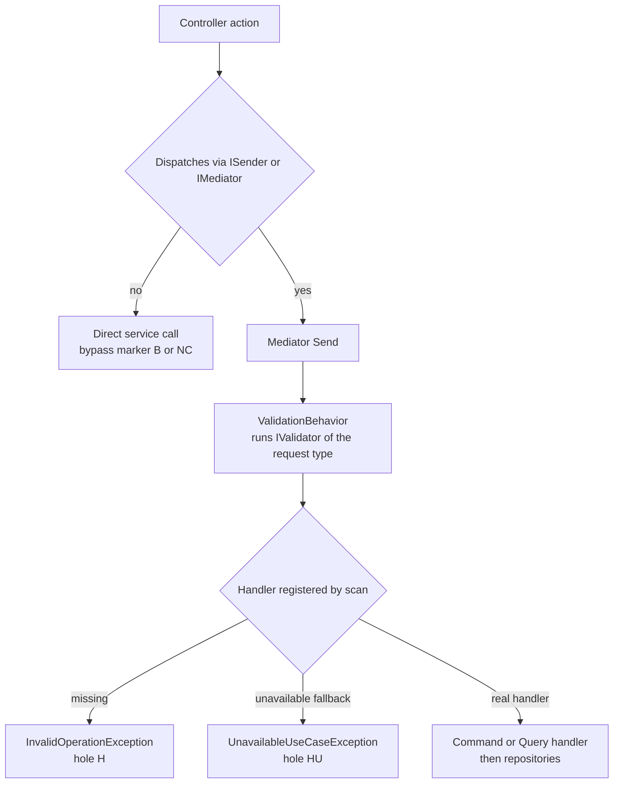

# Auth CQRS wiring matrix — every endpoint, every pipeline cell

> Generated against `origin/develop` @ `74e9bba4c`. Docs-only artifact; no code changed.
> Scope: **all** controllers in `apps/api/Source/Modules/GameGuild.Identity.Authentication/Controllers` (28 endpoint-bearing controllers)
> plus **all** controllers in `apps/api/Source/Modules/GameGuild.Identity.Authorization/Controllers` (18 controllers across 16 files).
> Every cell was extracted from the source at the commit above and spot-verified by hand; per-table notes name the controller file and line anchors.

## How the pipeline is wired (read this first)

1. **Controller → `ISender.Send`** — the module convention is `Controller → ISender.Send → FluentValidation → Command/Query → Handler → Repositories`. Deviations are marked in the HOLE column (`B`, `NC`) and listed in [Part C](#part-c--isender-bypass-register).
2. **Handler registration is assembly-scan based** — `AddApplicationLayer` discovers enabled module assemblies (`GameGuild.API/Core/Setup/ApplicationLayerExtensions.cs:91-92`) — `Identity.Authentication` and `Identity.Authorization` are both always-on (`GameGuild.API/Core/Setup/ModuleConfiguration.cs:27-28`) — and `AddCqrs` registers every non-abstract class implementing `ICommandHandler<,>`, `ICommandHandler<>`, `IQueryHandler<,>`, `IRequestHandler<,>` (`SharedKernel/CQRS/Extensions/ServiceCollectionExtensions.cs:46-75, 231-234`). Consequence: **"registered in DI" == "a handler type exists"**; the only way to be unregistered is to have no handler at all (shown as `H`), or to hit the declared-unavailable fallback (`HU`). 36 request types additionally carry redundant explicit registrations in the module DI files (marked `scan+expl`; harmless, see [Part E](#part-e--observations)).
3. **FluentValidation runs only for validators bound to the sent request type** — `ValidationBehavior<TRequest,TResponse>` is registered globally (`GameGuild.API/Core/Extensions/InfrastructureLayerExtensions.cs:240`) and resolves `IValidator<TRequest>` (`SharedKernel/CQRS/Behaviors/ValidationBehavior.cs:13,21`), with validators registered by the same scan (`ServiceCollectionExtensions.cs:223-226`). A validator written against the controller DTO (e.g. `LocalSignUpRequest`) does **not** run for `LocalSignUpCommand`; this matrix therefore records validators for the **command/query type**, which is the type that actually flows through the pipeline.
4. **Authorization default is deny-anonymous** — endpoints without `[Authorize]` still require an authenticated user because the default policy requires it (`SharedKernel/Configuration/PresentationLayer/Authorization/AuthorizationOptions.cs:18`, applied in `GameGuild.API/Core/Extensions/SecurityServiceCollectionExtensions.cs:397-401`). Shown as `default` in the Auth column. `[AllowAnonymous]` endpoints must appear in `GameGuild.API/Security/AnonymousEndpointRegistry.cs` (architecture-test-enforced); every anonymous endpoint in scope **is** registered (0 violations).
5. **Rate limiting** — every request rides the global limiter (`GameGuild.API/Core/Extensions/RateLimitingServiceCollectionExtensions.cs:87-111`); named policies come from `[EnableRateLimiting(RateLimitPolicies.X)]` (`SharedKernel/Configuration/PresentationLayer/RateLimiting/RateLimitPolicies.cs:17-119`). `— global` means no named policy. `†` = method-level override of the class policy.
6. **Declared-unavailable commands** — commands whose use-case contract carries `UnavailableReason` (`Modules/GameGuild.Identity.Authentication/Architecture/UseCaseEventContracts.g.cs`, 35 entries) get a fallback `UnavailableCommandHandler` that **throws `UnavailableUseCaseException`** on `Send` (`SharedKernel/CQRS/Implementation/UnavailableUseCaseHandlers.cs:10-22`, registered at `ServiceCollectionExtensions.cs:77-111`). These endpoints are wired but intentionally non-functional (`HU`). **Queries have no such fallback**: a query without a handler makes `Send` throw `InvalidOperationException` (`SharedKernel/CQRS/Implementation/MediatorSender.cs:136`) — every such endpoint is a live 500 (`H`).

### Overview

> Unavailable use-case fallback applies to commands only; queries missing a handler fail at `Send`.

### Column legend

| Column | Meaning |
|---|---|
| Route | `METHOD /v{n}/path` with the class-level `[Route]` prefix applied; `{n}` marks the API-version segment |
| Command/Query | request type(s) passed to `Send` |
| Validator | `file:line` of an `AbstractValidator<T>` for that request type; `—` = none exists; `n/a` = no request type |
| Handler | handler class and `file:line`; `UNAVAILABLE` = declared-unavailable fallback; `MISSING` = no handler anywhere |
| DI | `scan` = auto-registered by assembly scan; `+expl` = also explicitly registered in module DI; `fallback` = unavailable fallback handler; `—` = nothing to register |
| Auth | `anon` (`[AllowAnonymous]`, registry-checked), `authz` (`[Authorize]`, with policy name when scoped), `default` (no attribute; default policy requires authentication) |
| Rate-limit | effective named policy; `— global` = global limiter only |
| Unit / Integration | test files referencing the request/handler type (unit) or exercising the route or request type (integration incl. PostgreSql). Helper/fixture files are excluded. |
| HOLE | codes below, `ok` = every cell populated |

| Code | Hole class | Severity |
|---|---|---|
| `V` | no validator for a **command** (mutation reaches handler validation-free) | high |
| `VQ` | no validator for a **query** (convention: queries are read-only; still flagged per matrix rules) | low |
| `H` | **no handler at all** — `Send` throws `InvalidOperationException` at runtime | critical |
| `HU` | handler **declared unavailable** — `Send` throws `UnavailableUseCaseException` ("planned authorization management API is not available") | known |
| `NC` | **no command/query** — endpoint not on the CQRS pipeline | medium |
| `B` | **ISender bypass** — controller calls a service directly (convention violation unless justified) | medium |
| `NU` | no unit test (request/handler/controller not referenced by any unit-test file) | high |
| `NI` | no integration/PG test (route never exercised by any integration-test file) | high |

## Part A — Authentication module controllers

### AbacPolicyController (16 endpoints)

File: `apps/api/Source/Modules/GameGuild.Identity.Authentication/Controllers/AbacPolicyController.cs` (class decl line 21).
 — class route prefix `v{version:apiVersion}/abac-policies`; class `[Authorize]`.

| Route | Command/Query | Validator | Handler | DI | Auth | Rate-limit | Unit test | Integration/PG test | HOLE |
|---|---|---|---|---|---|---|---|---|---|
| GET /v{n}/abac-policies/{policyId} | `GetAbacPolicyQuery` | — | **MISSING** | — | authz | — global | AbacPolicyControllerTests.cs | — | VQ, H, NI |
| PUT /v{n}/abac-policies/{policyId} | `UpdateAbacPolicyCommand` | — | **UNAVAILABLE** | fallback | authz | — global | AbacPolicyControllerTests.cs | — | V, HU, NI |
| DELETE /v{n}/abac-policies/{policyId} | `DeleteAbacPolicyCommand` | — | **UNAVAILABLE** | fallback | authz | — global | AbacPolicyControllerTests.cs | — | V, HU, NI |
| POST /v{n}/abac-policies/:evaluate | `EvaluateAbacPoliciesCommand` | — | `EvaluateAbacPoliciesCommandHandler (PolicyEvaluationCommandHandlers.cs:74)` | scan | authz | — global | AbacPolicyControllerTests.cs, PolicyEvaluationCommandHandlersTests.cs | AccessControlIntegrationTests.cs | V |
| POST /v{n}/abac-policies/:evaluate-bulk | `BulkEvaluateAbacPoliciesCommand` | — | `BulkEvaluateAbacPoliciesCommandHandler (PolicyEvaluationCommandHandlers.cs:123)` | scan | authz | — global | AbacPolicyControllerTests.cs, PolicyEvaluationCommandHandlersTests.cs | AccessControlIntegrationTests.cs | V |
| POST /v{n}/abac-policies/:test-expression | `TestAbacExpressionCommand` | — | `TestAbacExpressionCommandHandler (PolicyEvaluationCommandHandlers.cs:200)` | scan | authz | — global | AbacPolicyControllerTests.cs, TestAbacExpressionCommandHandlerTests.cs | — | V, NI |
| POST /v{n}/abac-policies/{policyId}:activate | `ActivateAbacPolicyCommand` | — | **UNAVAILABLE** | fallback | authz | — global | AbacPolicyControllerTests.cs | — | V, HU, NI |
| POST /v{n}/abac-policies/{policyId}:deactivate | `DeactivateAbacPolicyCommand` | — | **UNAVAILABLE** | fallback | authz | — global | AbacPolicyControllerTests.cs | — | V, HU, NI |
| POST /v{n}/abac-policies/{policyId}:clone | `CloneAbacPolicyCommand` | — | **UNAVAILABLE** | fallback | authz | — global | AbacPolicyControllerTests.cs | — | V, HU, NI |
| GET /v{n}/abac-policies/statistics | `GetAbacPolicyStatisticsQuery` | — | **MISSING** | — | authz | — global | AbacPolicyControllerTests.cs | — | VQ, H, NI |
| GET /v{n}/abac-policies/{policyId}/usage | `GetAbacPolicyUsageQuery` | — | **MISSING** | — | authz | — global | AbacPolicyControllerTests.cs | — | VQ, H, NI |
| GET /v{n}/abac-policies/{policyId}/audit-trail | `GetAbacPolicyAuditTrailQuery` | — | **MISSING** | — | authz | — global | AbacPolicyControllerTests.cs | — | VQ, H, NI |
| POST /v{n}/abac-policies/:validate | `ValidateAbacPolicyCommand` | — | **UNAVAILABLE** | fallback | authz | — global | AbacPolicyControllerTests.cs | — | V, HU, NI |
| GET /v{n}/abac-policies/conflicts | `GetAbacPolicyConflictsQuery` | — | **MISSING** | — | authz | — global | AbacPolicyControllerTests.cs | — | VQ, H, NI |
| GET /v{n}/abac-policies/templates | `GetAbacPolicyTemplatesQuery` | — | **MISSING** | — | authz | — global | AbacPolicyControllerTests.cs | — | VQ, H, NI |
| POST /v{n}/abac-policies/templates/{templateId}:instantiate | `CreateAbacPolicyFromTemplateCommand` | — | **UNAVAILABLE** | fallback | authz | — global | AbacPolicyControllerTests.cs | — | V, HU, NI |

### AccessReviewAnalyticsController (6 endpoints)

File: `apps/api/Source/Modules/GameGuild.Identity.Authentication/Controllers/AccessReviewAnalyticsController.cs` (class decl line 22).
 — class route prefix `v{version:apiVersion}/access-reviews`; class `[Authorize]`.

| Route | Command/Query | Validator | Handler | DI | Auth | Rate-limit | Unit test | Integration/PG test | HOLE |
|---|---|---|---|---|---|---|---|---|---|
| POST /v{n}/access-reviews/:revoke-access | `RevokeAccessCommand` | — | **UNAVAILABLE** | fallback | authz | — global | AdminAnalyticsControllerTests.cs | — | V, HU, NI |
| POST /v{n}/access-reviews/:bulk-revoke-access | `BulkRevokeAccessCommand` | — | **UNAVAILABLE** | fallback | authz | — global | AdminAnalyticsControllerTests.cs | — | V, HU, NI |
| GET /v{n}/access-reviews/revocation-history | `GetAccessRevocationHistoryQuery` | — | **MISSING** | — | authz | — global | AdminAnalyticsControllerTests.cs | — | VQ, H, NI |
| GET /v{n}/access-reviews/analytics | `GetAccessReviewAnalyticsQuery` | — | **MISSING** | — | authz | — global | AdminAnalyticsControllerTests.cs | — | VQ, H, NI |
| GET /v{n}/access-reviews/compliance-status | `GetComplianceStatusQuery` | — | **MISSING** | — | authz | — global | AdminAnalyticsControllerTests.cs | — | VQ, H, NI |
| POST /v{n}/access-reviews/:generate-report | `GenerateAccessReviewReportCommand` | — | **UNAVAILABLE** | fallback | authz | — global | AdminAnalyticsControllerTests.cs | — | V, HU, NI |

### AccessReviewCampaignController (11 endpoints)

File: `apps/api/Source/Modules/GameGuild.Identity.Authentication/Controllers/AccessReviewCampaignController.cs` (class decl line 22).
 — class route prefix `v{version:apiVersion}/access-reviews`; class `[Authorize]`.

| Route | Command/Query | Validator | Handler | DI | Auth | Rate-limit | Unit test | Integration/PG test | HOLE |
|---|---|---|---|---|---|---|---|---|---|
| POST /v{n}/access-reviews/campaigns | `CreateAccessReviewCampaignCommand` | `AccessReviewCommands.cs:23` | `CreateAccessReviewCampaignHandler (AccessReviewCommands.cs:38)` | scan | authz | — global | AccessReviewCampaignControllerTests.cs, AccessReviewsControllerStatusTranslationTests.cs +1 | AccessReviewWorkflowPostgreSqlHttpTests.cs | HU |
| GET /v{n}/access-reviews/campaigns/{campaignId} | `GetAccessReviewCampaignQuery` | — | **MISSING** | — | authz | — global | AccessReviewCampaignControllerTests.cs | — | VQ, H, NI |
| PUT /v{n}/access-reviews/campaigns/{campaignId} | — none | n/a | — (none) | n/a | authz | — global | AccessReviewCampaignControllerTests.cs | — | NC, NI |
| DELETE /v{n}/access-reviews/campaigns/{campaignId} | `DeleteAccessReviewCampaignCommand` | — | **UNAVAILABLE** | fallback | authz | — global | AccessReviewCampaignControllerTests.cs | — | V, HU, NI |
| GET /v{n}/access-reviews/campaigns | `GetAccessReviewCampaignsQuery` | — | **MISSING** | — | authz | — global | AccessReviewCampaignControllerTests.cs | AccessReviewWorkflowPostgreSqlHttpTests.cs | VQ, H |
| POST /v{n}/access-reviews/campaigns/{campaignId}:start | `StartAccessReviewCampaignCommand` | `AccessReviewCommands.cs:65` | `StartAccessReviewCampaignHandler (AccessReviewCommands.cs:74)` | scan | authz | — global | AccessReviewCampaignControllerTests.cs, AccessReviewsControllerStatusTranslationTests.cs +1 | — | HU, NI |
| POST /v{n}/access-reviews/campaigns/{campaignId}:complete | `CompleteAccessReviewCampaignCommand` | `AccessReviewCommands.cs:93` | `CompleteAccessReviewCampaignHandler (AccessReviewCommands.cs:103)` | scan | authz | — global | AccessReviewCampaignControllerTests.cs, CoverageBoostTests5.cs | — | HU, NI |
| POST /v{n}/access-reviews/campaigns/{campaignId}:send-reminders | `SendReviewRemindersCommand` | — | **UNAVAILABLE** | fallback | authz | — global | AccessReviewCampaignControllerTests.cs | — | V, HU, NI |
| POST /v{n}/access-reviews/reminder-settings | `ConfigureReminderSettingsCommand` | — | **UNAVAILABLE** | fallback | authz | — global | AccessReviewCampaignControllerTests.cs | — | V, HU, NI |
| GET /v{n}/access-reviews/templates | `GetAccessReviewTemplatesQuery` | — | **MISSING** | — | authz | — global | AccessReviewCampaignControllerTests.cs | — | VQ, H, NI |
| POST /v{n}/access-reviews/templates/{templateId}:create-campaign | — none | n/a | — (none) | n/a | authz | — global | AccessReviewCampaignControllerTests.cs | — | NC, NI |

### AccessReviewItemController (8 endpoints)

File: `apps/api/Source/Modules/GameGuild.Identity.Authentication/Controllers/AccessReviewItemController.cs` (class decl line 22).
 — class route prefix `v{version:apiVersion}/access-reviews`; class `[Authorize]`.

| Route | Command/Query | Validator | Handler | DI | Auth | Rate-limit | Unit test | Integration/PG test | HOLE |
|---|---|---|---|---|---|---|---|---|---|
| GET /v{n}/access-reviews/campaigns/{campaignId}/items | `GetAccessReviewItemsQuery` | — | **MISSING** | — | authz | — global | AccessReviewItemControllerTests.cs | — | VQ, H, NI |
| POST /v{n}/access-reviews/items/{itemId}:review | — none | n/a | — (none) | n/a | authz | — global | AccessReviewItemControllerTests.cs | AccessReviewWorkflowPostgreSqlHttpTests.cs | NC |
| POST /v{n}/access-reviews/items:bulk-review | `BulkReviewAccessItemsCommand` | — | **UNAVAILABLE** | fallback | authz | — global | AccessReviewItemControllerTests.cs | — | V, HU, NI |
| GET /v{n}/access-reviews/items/{itemId} | `GetAccessReviewItemDetailsQuery` | — | **MISSING** | — | authz | — global | AccessReviewItemControllerTests.cs | AccessReviewWorkflowPostgreSqlHttpTests.cs | VQ, H |
| POST /v{n}/access-reviews/periodic | `CreatePeriodicAccessReviewCommand` | — | **UNAVAILABLE** | fallback | authz | — global | AccessReviewItemControllerTests.cs | — | V, HU, NI |
| GET /v{n}/access-reviews/periodic/{scheduleId} | `GetPeriodicAccessReviewQuery` | — | **MISSING** | — | authz | — global | AccessReviewItemControllerTests.cs | — | VQ, H, NI |
| GET /v{n}/access-reviews/periodic | `GetPeriodicAccessReviewsQuery` | — | **MISSING** | — | authz | — global | AccessReviewItemControllerTests.cs | — | VQ, H, NI |
| POST /v{n}/access-reviews/periodic/{scheduleId}:trigger | `TriggerPeriodicAccessReviewCommand` | — | **UNAVAILABLE** | fallback | authz | — global | AccessReviewItemControllerTests.cs | — | V, HU, NI |

### AccountRecoveryController (6 endpoints)

File: `apps/api/Source/Modules/GameGuild.Identity.Authentication/Controllers/AccountRecoveryController.cs` (class decl line 21).
 — class route prefix `v{version:apiVersion}/auth/account-recovery`; class `[Authorize]`.

| Route | Command/Query | Validator | Handler | DI | Auth | Rate-limit | Unit test | Integration/PG test | HOLE |
|---|---|---|---|---|---|---|---|---|---|
| POST /v{n}/auth/account-recovery/request | `RequestAccountRecoveryCommand` | `AccountRecoveryCommandValidators.cs:5` | `RequestAccountRecoveryCommandHandler (AccountRecoveryRequestHandlers.cs:27)` | scan+expl | anon ✓registry | — global | AccountRecoveryRequestHandlersTests.cs | — | NI |
| POST /v{n}/auth/account-recovery/cancel | `CancelAccountRecoveryCommand` | `AccountRecoveryCommandValidators.cs:16` | `CancelAccountRecoveryCommandHandler (AccountRecoveryRequestHandlers.cs:193)` | scan+expl | authz | — global | AccountRecoveryRequestHandlersTests.cs | — | NI |
| POST /v{n}/auth/account-recovery/approve | `ApproveAccountRecoveryCommand` | `AccountRecoveryCommandValidators.cs:25` | `ApproveAccountRecoveryCommandHandler (ApproveAccountRecoveryCommandHandler.cs:35)` | scan+expl | anon ✓registry | — global | ApproveAccountRecoveryCommandHandlersTests.cs | — | NI |
| POST /v{n}/auth/account-recovery/approve-passkey:begin | `BeginPasskeyRecoveryApprovalCommand` | `AccountRecoveryCommandValidators.cs:35` | `BeginPasskeyRecoveryApprovalCommandHandler (ApproveAccountRecoveryCommandHandler.cs:12)` | scan+expl | anon ✓registry | — global | — | — | NU, NI |
| POST /v{n}/auth/account-recovery/approve-passkey:complete | `ApproveAccountRecoveryWithPasskeyCommand` | `AccountRecoveryCommandValidators.cs:46` | `ApproveAccountRecoveryWithPasskeyCommandHandler (ApproveAccountRecoveryCommandHandler.cs:136)` | scan+expl | anon ✓registry | — global | ApproveAccountRecoveryCommandHandlersTests.cs | — | NI |
| POST /v{n}/auth/account-recovery/reset | `CompleteAccountRecoveryResetCommand` | `AccountRecoveryCommandValidators.cs:56` | `CompleteAccountRecoveryResetCommandHandler (CompleteAccountRecoveryResetCommandHandler.cs:22)` | scan+expl | anon ✓registry | — global | CompleteAccountRecoveryResetCommandHandlerTests.cs | — | NI |

### AdminMfaController (1 endpoints)

File: `apps/api/Source/Modules/GameGuild.Identity.Authentication/Controllers/AdminMfaController.cs` (class decl line 18).
 — class `[Authorize]`.

| Route | Command/Query | Validator | Handler | DI | Auth | Rate-limit | Unit test | Integration/PG test | HOLE |
|---|---|---|---|---|---|---|---|---|---|
| POST /v{n}/admin/users/{userId:guid}/mfa:reset | `AdminResetUserMfaCommand` | `AdminResetUserMfaCommandValidator.cs:5` | `AdminResetUserMfaCommandHandler (AdminResetUserMfaCommandHandler.cs:29)` | scan+expl | authz | — global | AdminResetUserMfaCommandHandlerTests.cs | MfaRecoveryPostgreSqlTests.cs | ok |

### ApiKeyController (4 endpoints)

File: `apps/api/Source/Modules/GameGuild.Identity.Authentication/Controllers/ApiKeyController.cs` (class decl line 15).
 — class `[Authorize]`.

| Route | Command/Query | Validator | Handler | DI | Auth | Rate-limit | Unit test | Integration/PG test | HOLE |
|---|---|---|---|---|---|---|---|---|---|
| POST /v{n}/auth/api-keys | `CreateApiKeyCommand` | `ApiKeyCommands.cs:43` | `CreateApiKeyHandler (ApiKeyCommands.cs:56)` | scan | authz | — global | AdditionalCoverageTests.cs, ApiKeyLifecycleTests.cs +3 | ApiKeyPolicyPostgreSqlHttpTests.cs | ok |
| GET /v{n}/auth/api-keys | `ListApiKeysQuery` | — | `ListApiKeysHandler (ApiKeyCommands.cs:159)` | scan | authz | — global | ApiKeyLifecycleTests.cs, ApiKeyAndRolesControllerTests.cs +1 | ApiKeyPolicyPostgreSqlHttpTests.cs | VQ |
| POST /v{n}/auth/api-keys/{keyId}:rotate | `RotateApiKeyCommand` | `ApiKeyCommands.cs:302` | `RotateApiKeyHandler (ApiKeyCommands.cs:327)` | scan | authz | — global | ApiKeyLifecycleTests.cs | — | NI |
| POST /v{n}/auth/api-keys/{keyId}:revoke | `RevokeApiKeyCommand` | — | `RevokeApiKeyHandler (ApiKeyCommands.cs:194)` | scan | authz | — global | ApiKeyLifecycleTests.cs, ApiKeyAndRolesControllerTests.cs +1 | — | V, NI |

### AuthController (32 endpoints)

File: `apps/api/Source/Modules/GameGuild.Identity.Authentication/Controllers/AuthController.cs` (class decl line 22).
 — class `[Authorize]`; class `[EnableRateLimiting(RateLimitPolicies.Authentication)]`.

| Route | Command/Query | Validator | Handler | DI | Auth | Rate-limit | Unit test | Integration/PG test | HOLE |
|---|---|---|---|---|---|---|---|---|---|
| POST /v{n}/auth/sign-up | `LocalSignUpCommand` | `LocalSignUpCommandValidator.cs:9` | `LocalSignUpHandler (LocalSignUpHandler.cs:15)` | scan+expl | anon ✓registry | Authentication | AuthFacadeApiRegistrationTests.cs, AuthenticationLockoutActionFilterTests.cs +4 | AuthenticationDtoPostgreSqlHttpTests.cs, ContextualAccessAndGradingRealSessionPostgreSqlHttpTests.cs +5 | ok |
| POST /v{n}/auth/sign-in | `LocalSignInCommand` | `LocalSignInCommandValidator.cs:8` | `LocalSignInHandler (LocalSignInHandler.cs:18)` | scan+expl | anon ✓registry | Authentication | AuthFacadeApiRegistrationTests.cs, AuthenticationLockoutActionFilterTests.cs +7 | AuthenticationDtoPostgreSqlHttpTests.cs, AuthenticationTimingPostgreSqlHttpTests.cs +11 | ok |
| POST /v{n}/auth/mfa/sign-in/complete | `CompleteMfaSignInCommand` | — | `CompleteMfaSignInHandler (CompleteMfaSignInHandler.cs:8)` | scan+expl | anon ✓registry | Authentication | — | MfaSignInCompletionPostgreSqlTests.cs, MfaSignInCompletionSecurityPostgreSqlTests.cs | V, NU |
| POST /v{n}/auth/polymorphic | `PolymorphicSignInCommand` | — | `PolymorphicSignInHandler (PolymorphicSignInHandler.cs:23)` | scan+expl | anon ✓registry | Authentication | AuthFacadeApiRegistrationTests.cs, AuthenticationDtoHandlerContractTests.cs +5 | AuthenticationTimingPostgreSqlHttpTests.cs, PolymorphicSignInPostgreSqlHttpTests.cs +4 | V |
| POST /v{n}/auth/google:sign-in | `GoogleIdTokenSignInCommand` | `GoogleIdTokenSignInCommandValidator.cs:8` | `GoogleIdTokenSignInHandler (GoogleIdTokenSignInHandler.cs:11)` | scan+expl | anon ✓registry | Authentication | AuthFacadeApiRegistrationTests.cs, AuthenticationCoverageCompletionTests.cs +2 | AuthenticationFlowsE2ETests.cs | ok |
| POST /v{n}/auth/magic-link:request | `RequestMagicLinkCommand` | — | `RequestMagicLinkCommandHandler (MagicLinkCommandHandlers.cs:15)` | scan+expl | anon ✓registry | Authentication | PasswordCommandHandlersTests.cs | — | V, NI |
| POST /v{n}/auth/magic-link:consume | `ConsumeMagicLinkCommand` | — | `ConsumeMagicLinkCommandHandler (MagicLinkCommandHandlers.cs:72)` | scan+expl | anon ✓registry | Authentication | AuthenticationCoverageCompletionTests.cs, MagicLinkMfaPolicyTests.cs +2 | CertificateEvmEvidencePostgreSqlHttpTests.cs, MfaSignInPolicyPostgreSqlTests.cs +1 | V |
| GET /v{n}/auth/github:authorize | `GitHubSignInCommand` | — | `GitHubSignInCommandHandler (GitHubSignInCommandHandler.cs:13)` | scan | anon ✓registry | Authentication | MaxCoverageTests5.cs | — | V, NI |
| POST /v{n}/auth/email-code:request | `RequestEmailCodeCommand` | — | `RequestEmailCodeCommandHandler (EmailCodeCommandHandlers.cs:11)` | scan+expl | anon ✓registry | Authentication | EmailCodeCommandHandlersTests.cs | — | V, NI |
| POST /v{n}/auth/email-code:consume | `ConsumeEmailCodeCommand` | — | `ConsumeEmailCodeCommandHandler (EmailCodeCommandHandlers.cs:74)` | scan+expl | anon ✓registry | Authentication | EmailCodeCommandHandlersTests.cs | MfaSignInPolicyPostgreSqlTests.cs | V |
| POST /v{n}/auth/discord:sign-in-authorize | `DiscordSignInCommand` | — | `DiscordSignInCommandHandler (DiscordSignInCommandHandler.cs:13)` | scan | anon ✓registry | Authentication | DiscordAuthControllerTests.cs, DiscordSignInTests.cs | — | V, NI |
| POST /v{n}/auth/discord:sign-in-callback | `DiscordCallbackCommand` | `DiscordCallbackCommandValidator.cs:8` | `DiscordCallbackCommandHandler (DiscordCallbackCommandHandler.cs:16)` | scan | anon ✓registry | Authentication | DiscordAuthControllerTests.cs, AuthenticationDtoHandlerContractTests.cs +1 | — | NI |
| POST /v{n}/auth/oidc/{slug}:sign-in-authorize | `OidcSignInCommand` | — | `OidcSignInCommandHandler (OidcSignInCommandHandler.cs:13)` | scan | anon ✓registry | Authentication | OidcAuthControllerTests.cs, OidcFederationHandlerTests.cs | — | V, NI |
| POST /v{n}/auth/oidc/{slug}:sign-in-callback | `OidcCallbackCommand` | `OidcCallbackCommandValidator.cs:8` | `OidcCallbackCommandHandler (OidcCallbackCommandHandler.cs:18)` | scan | anon ✓registry | Authentication | OidcAuthControllerTests.cs, OidcFederationHandlerTests.cs | — | NI |
| GET /v{n}/auth/oidc:discover-provider | `DiscoverOidcProvidersQuery` | — | `DiscoverOidcProvidersQueryHandler (OidcFederationQueryHandlers.cs:14)` | scan | anon ✓registry | Authentication | OidcAuthControllerTests.cs, OidcDiscoveryLoggingTests.cs +2 | — | VQ, NI |
| GET /v{n}/auth/oidc/{slug}:end-session-url | `GetOidcEndSessionUrlQuery` | — | `GetOidcEndSessionUrlQueryHandler (OidcFederationQueryHandlers.cs:55)` | scan | authz | Authentication | OidcAuthControllerTests.cs, OidcFederationHandlerTests.cs | — | VQ, NI |
| POST /v{n}/auth/saml/{slug}:sign-in-authorize | `SamlSignInCommand` | — | `SamlSignInCommandHandler (SamlSignInCommandHandler.cs:13)` | scan | anon ✓registry | Authentication | SamlAuthControllerTests.cs, SamlFederationHandlerTests.cs | SamlBrowserFlowPostgreSqlTests.cs | V |
| POST /v{n}/auth/saml/{slug}:assertion-consumer | `SamlCallbackCommand` | `SamlCallbackCommandValidator.cs:8` | `SamlCallbackCommandHandler (SamlCallbackCommandHandler.cs:20)` | scan | anon ✓registry | Authentication | SamlAuthControllerTests.cs, SamlFederationHandlerTests.cs | SamlBrowserFlowPostgreSqlTests.cs | ok |
| GET /v{n}/auth/saml/{slug}:metadata | `GetSamlServiceProviderMetadataQuery` | — | `GetSamlServiceProviderMetadataQueryHandler (SamlFederationQueryHandlers.cs:14)` | scan | anon ✓registry | Authentication | SamlAuthControllerTests.cs, SamlFederationHandlerTests.cs | SamlBrowserFlowPostgreSqlTests.cs | VQ |
| GET /v{n}/auth/saml/{slug}:logout-url | `GetSamlLogoutUrlQuery` | — | `GetSamlLogoutUrlQueryHandler (SamlFederationQueryHandlers.cs:33)` | scan | authz | Authentication | SamlAuthControllerTests.cs, SamlFederationHandlerTests.cs | SamlBrowserFlowPostgreSqlTests.cs | VQ |
| POST /v{n}/auth/tokens:refresh | `RefreshTokenCommand` | `RefreshTokenCommandValidator.cs:8` | `RefreshTokenHandler (RefreshTokenHandler.cs:11)` | scan+expl | anon ✓registry | Authentication | AuthFacadeApiRegistrationTests.cs, AuthenticationCoverageCompletionTests.cs +8 | AuthenticationDtoPostgreSqlHttpTests.cs, MfaSignInCompletionPostgreSqlTests.cs +13 | ok |
| POST /v{n}/auth/tokens:revoke | `RevokeTokenCommand` | `RevokeTokenCommandValidator.cs:8` | `RevokeTokenHandler (RevokeTokenHandler.cs:15)` | scan | authz | Authentication | AuthFacadeApiRegistrationTests.cs, AuthenticationCoverageCompletionTests.cs +3 | CommonOpenApiIntegrationTests.cs, RefreshTokenLifecycleAuditPostgreSqlHttpTests.cs +1 | ok |
| POST /v{n}/auth/sign-out | `LogoutCommand` | — | `LogoutHandler (LogoutHandler.cs:9)` | scan+expl | authz | Authentication | AuthenticationCoverageCompletionTests.cs, AuthControllerTests.cs +1 | — | V, NI |
| GET /v{n}/auth/session-state | `GetAuthSessionStateQuery` | — | `GetAuthSessionStateQueryHandler (GetAuthSessionStateQuery.cs:42)` | scan+expl | authz | Api† | SessionStateRateLimitPolicyTests.cs, GetAuthSessionStateQueryHandlerTests.cs | AuthSessionStatePostgreSqlHttpTests.cs, TrustedDeviceSessionPostgreSqlHttpTests.cs +1 | VQ |
| POST /v{n}/auth/web3/challenge | `GenerateWeb3ChallengeCommand` | — | `GenerateWeb3ChallengeHandler (GenerateWeb3ChallengeHandler.cs:8)` | scan | anon ✓registry | Authentication | AuthenticationCoverageCompletionTests.cs, Web3ServiceSiweTests.cs | Web3AuthenticationPostgreSqlHttpTests.cs | V |
| POST /v{n}/auth/email:send-verification | `SendEmailVerificationCommand` | — | `SendEmailVerificationCommandHandler (SendEmailVerificationCommandHandler.cs:19)` | scan+expl | anon ✓registry | Authentication | LocalSignUpHandlerTests.cs, SendEmailVerificationEnumerationProtectionTests.cs +2 | — | V, NI |
| POST /v{n}/auth/email:verify | `VerifyEmailCommand` | — | `VerifyEmailCommandHandler (PasswordCommandHandlers.cs:11)` | scan+expl | anon ✓registry | Authentication | PasswordCommandHandlersTests.cs, MaxCoverageTests.cs | — | V, NI |
| POST /v{n}/auth/password:reset-request | `RequestPasswordResetCommand` | — | `RequestPasswordResetCommandHandler (PasswordCommandHandlers.cs:59)` | scan+expl | anon ✓registry | Authentication | PasswordCommandHandlersTests.cs, MaxCoverageTests.cs | — | V, NI |
| POST /v{n}/auth/password:reset | `ResetPasswordCommand` | — | `ResetPasswordCommandHandler (PasswordCommandHandlers.cs:103)` | scan+expl | anon ✓registry | Authentication | PasswordCommandHandlersTests.cs, MaxCoverageTests.cs +1 | PasswordHistoryPostgreSqlHttpTests.cs | V |
| POST /v{n}/auth/password:change | `ChangePasswordCommand` | — | `ChangePasswordCommandHandler (PasswordCommandHandlers.cs:189)` | scan+expl | authz | Authentication | AuthControllerTests.cs, SessionStateRateLimitPolicyTests.cs +2 | PasswordHistoryPostgreSqlHttpTests.cs | V |
| POST /v{n}/auth/github:callback | `GitHubCallbackCommand` | `GitHubCallbackCommandValidator.cs:8` | `GitHubCallbackCommandHandler (GitHubCallbackCommandHandler.cs:16)` | scan | anon ✓registry | Authentication | GitHubAuthControllerTests.cs, AuthenticationDtoHandlerContractTests.cs +1 | — | NI |
| POST /v{n}/auth/web3:verify | `VerifyWeb3SignatureCommand` | — | `VerifyWeb3SignatureHandler (VerifyWeb3SignatureHandler.cs:8)` | scan | anon ✓registry | Authentication | AuthFacadeApiRegistrationTests.cs, AuthControllerTests.cs +1 | Web3AuthenticationPostgreSqlHttpTests.cs | V |

### ConditionalPolicyCrudController (9 endpoints)

File: `apps/api/Source/Modules/GameGuild.Identity.Authentication/Controllers/ConditionalPolicyCrudController.cs` (class decl line 20).
 — class route prefix `v{version:apiVersion}/conditional-policies`; class `[Authorize]`.

| Route | Command/Query | Validator | Handler | DI | Auth | Rate-limit | Unit test | Integration/PG test | HOLE |
|---|---|---|---|---|---|---|---|---|---|
| GET /v{n}/conditional-policies/{policyId} | `GetConditionalPolicyQuery` | — | **MISSING** | — | authz | — global | ConditionalPolicyCrudControllerTests.cs | — | VQ, H, NI |
| PUT /v{n}/conditional-policies/{policyId} | `UpdateConditionalPolicyCommand` | — | **UNAVAILABLE** | fallback | authz | — global | ConditionalPolicyCrudControllerTests.cs | — | V, HU, NI |
| DELETE /v{n}/conditional-policies/{policyId} | `DeleteConditionalPolicyCommand` | — | **UNAVAILABLE** | fallback | authz | — global | ConditionalPolicyCrudControllerTests.cs | — | V, HU, NI |
| POST /v{n}/conditional-policies/{policyId}:activate | `ActivateConditionalPolicyCommand` | — | **UNAVAILABLE** | fallback | authz | — global | ConditionalPolicyCrudControllerTests.cs | — | V, HU, NI |
| POST /v{n}/conditional-policies/{policyId}:deactivate | `DeactivateConditionalPolicyCommand` | — | **UNAVAILABLE** | fallback | authz | — global | ConditionalPolicyCrudControllerTests.cs | — | V, HU, NI |
| POST /v{n}/conditional-policies/{policyId}:clone | `CloneConditionalPolicyCommand` | — | **UNAVAILABLE** | fallback | authz | — global | ConditionalPolicyCrudControllerTests.cs | — | V, HU, NI |
| PUT /v{n}/conditional-policies/{policyId}/priority | `UpdateConditionalPolicyPriorityCommand` | — | **UNAVAILABLE** | fallback | authz | — global | ConditionalPolicyCrudControllerTests.cs | — | V, HU, NI |
| GET /v{n}/conditional-policies/templates | `GetConditionalPolicyTemplatesQuery` | — | **MISSING** | — | authz | — global | ConditionalPolicyCrudControllerTests.cs | — | VQ, H, NI |
| POST /v{n}/conditional-policies/templates/{templateId}:instantiate | `CreateConditionalPolicyFromTemplateCommand` | — | **UNAVAILABLE** | fallback | authz | — global | ConditionalPolicyCrudControllerTests.cs | — | V, HU, NI |

### ConditionalPolicyEvaluationController (11 endpoints)

File: `apps/api/Source/Modules/GameGuild.Identity.Authentication/Controllers/ConditionalPolicyEvaluationController.cs` (class decl line 20).
 — class route prefix `v{version:apiVersion}/conditional-policies`; class `[Authorize]`.

| Route | Command/Query | Validator | Handler | DI | Auth | Rate-limit | Unit test | Integration/PG test | HOLE |
|---|---|---|---|---|---|---|---|---|---|
| POST /v{n}/conditional-policies/:evaluate | `EvaluateConditionalPoliciesCommand` | — | `EvaluateConditionalPoliciesCommandHandler (PolicyEvaluationCommandHandlers.cs:280)` | scan | authz | — global | ConditionalPolicyEvaluationControllerTests.cs, PolicyEvaluationCommandHandlersTests.cs | AccessControlIntegrationTests.cs | V |
| POST /v{n}/conditional-policies/:evaluate-bulk | `BulkEvaluateConditionalPoliciesCommand` | — | `BulkEvaluateConditionalPoliciesCommandHandler (PolicyEvaluationCommandHandlers.cs:323)` | scan | authz | — global | ConditionalPolicyEvaluationControllerTests.cs | — | V, NI |
| POST /v{n}/conditional-policies/:test-rule | `TestConditionalPolicyRuleCommand` | — | `TestConditionalPolicyRuleCommandHandler (PolicyEvaluationCommandHandlers.cs:403)` | scan | authz | — global | ConditionalPolicyEvaluationControllerTests.cs, PolicyEvaluationCommandHandlersTests.cs | — | V, NI |
| GET /v{n}/conditional-policies/statistics | `GetConditionalPolicyStatisticsQuery` | — | **MISSING** | — | authz | — global | ConditionalPolicyEvaluationControllerTests.cs | — | VQ, H, NI |
| GET /v{n}/conditional-policies/{policyId}/usage | `GetConditionalPolicyUsageQuery` | — | **MISSING** | — | authz | — global | ConditionalPolicyEvaluationControllerTests.cs | — | VQ, H, NI |
| GET /v{n}/conditional-policies/{policyId}/evaluation-history | `GetConditionalPolicyEvaluationHistoryQuery` | — | **MISSING** | — | authz | — global | ConditionalPolicyEvaluationControllerTests.cs | — | VQ, H, NI |
| POST /v{n}/conditional-policies/:validate | `ValidateConditionalPolicyCommand` | — | `ValidateConditionalPolicyCommandHandler (PolicyEvaluationCommandHandlers.cs:544)` | scan | authz | — global | ConditionalPolicyEvaluationControllerTests.cs | — | V, NI |
| GET /v{n}/conditional-policies/conflicts | `GetConditionalPolicyConflictsQuery` | — | **MISSING** | — | authz | — global | ConditionalPolicyEvaluationControllerTests.cs | — | VQ, H, NI |
| POST /v{n}/conditional-policies/:simulate | `SimulateConditionalPolicyCommand` | — | `SimulateConditionalPolicyCommandHandler (PolicyEvaluationCommandHandlers.cs:465)` | scan | authz | — global | ConditionalPolicyEvaluationControllerTests.cs, PolicyEvaluationCommandHandlersTests.cs | — | V, NI |
| GET /v{n}/conditional-policies/condition-types | `GetPolicyConditionTypesQuery` | — | **MISSING** | — | authz | — global | ConditionalPolicyEvaluationControllerTests.cs | — | VQ, H, NI |
| POST /v{n}/conditional-policies/:validate-condition | `ValidateConditionCommand` | — | `ValidateConditionCommandHandler (PolicyEvaluationCommandHandlers.cs:590)` | scan | authz | — global | ConditionalPolicyEvaluationControllerTests.cs | — | V, NI |

### ExternalLoginsController (6 endpoints)

File: `apps/api/Source/Modules/GameGuild.Identity.Authentication/Controllers/ExternalLoginsController.cs` (class decl line 23).
 — class `[Authorize]`; class `[EnableRateLimiting(RateLimitPolicies.Authentication)]`.

| Route | Command/Query | Validator | Handler | DI | Auth | Rate-limit | Unit test | Integration/PG test | HOLE |
|---|---|---|---|---|---|---|---|---|---|
| GET /v{n}/auth/external-logins/{provider}/link-preview | `GetExternalLoginLinkPreviewQuery` | — | `GetExternalLoginLinkPreviewQueryHandler (ExternalLoginHandlers.cs:30)` | scan | authz | Authentication | ExternalLoginsControllerTests.cs, ExternalLoginHandlersTests.cs | — | VQ, NI |
| POST /v{n}/auth/external-logins/google | `LinkGoogleAccountCommand` | — | `LinkGoogleAccountCommandHandler (ExternalLoginHandlers.cs:64)` | scan | authz | Authentication | ExternalLoginsControllerTests.cs, SessionStateRateLimitPolicyTests.cs +1 | — | V, NI |
| POST /v{n}/auth/external-logins/discord:link-authorize | `DiscordLinkAuthorizeCommand` | — | `DiscordLinkAuthorizeCommandHandler (ExternalLoginHandlers.cs:83)` | scan | authz | Authentication | ExternalLoginsControllerTests.cs, SessionStateRateLimitPolicyTests.cs +1 | — | V, NI |
| POST /v{n}/auth/external-logins/discord:link-callback | `LinkDiscordAccountCommand` | — | `LinkDiscordAccountCommandHandler (ExternalLoginHandlers.cs:104)` | scan | authz | Authentication | ExternalLoginsControllerTests.cs, SessionStateRateLimitPolicyTests.cs +1 | — | V, NI |
| POST /v{n}/auth/external-logins/{provider}/scopes:revoke | `RevokeExternalLoginScopesCommand` | — | `RevokeExternalLoginScopesCommandHandler (ExternalLoginHandlers.cs:158)` | scan | authz | Authentication | ExternalLoginsControllerTests.cs, SessionStateRateLimitPolicyTests.cs +1 | — | V, NI |
| DELETE /v{n}/auth/external-logins/{provider} | `UnlinkExternalLoginCommand` | — | `UnlinkExternalLoginCommandHandler (ExternalLoginHandlers.cs:124)` | scan | authz | Authentication | ExternalLoginsControllerTests.cs, SessionStateRateLimitPolicyTests.cs +1 | — | V, NI |

