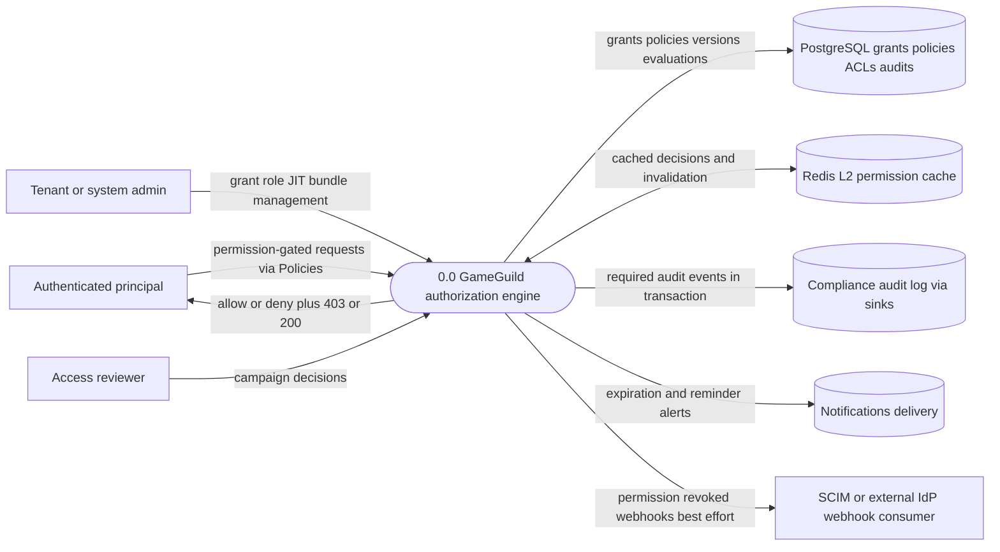
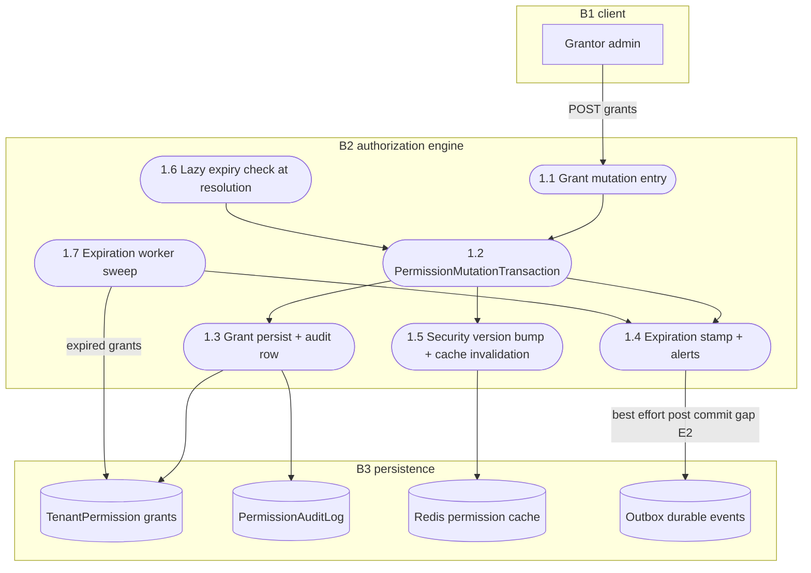
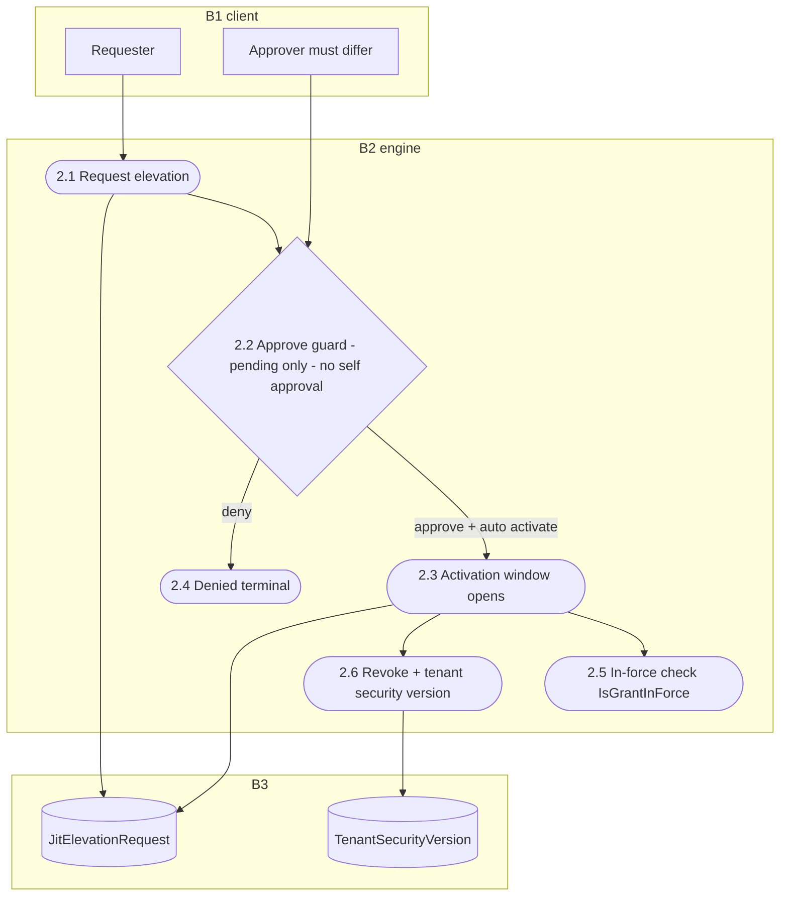
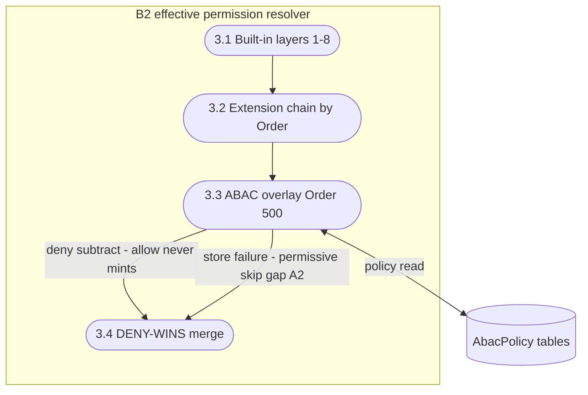
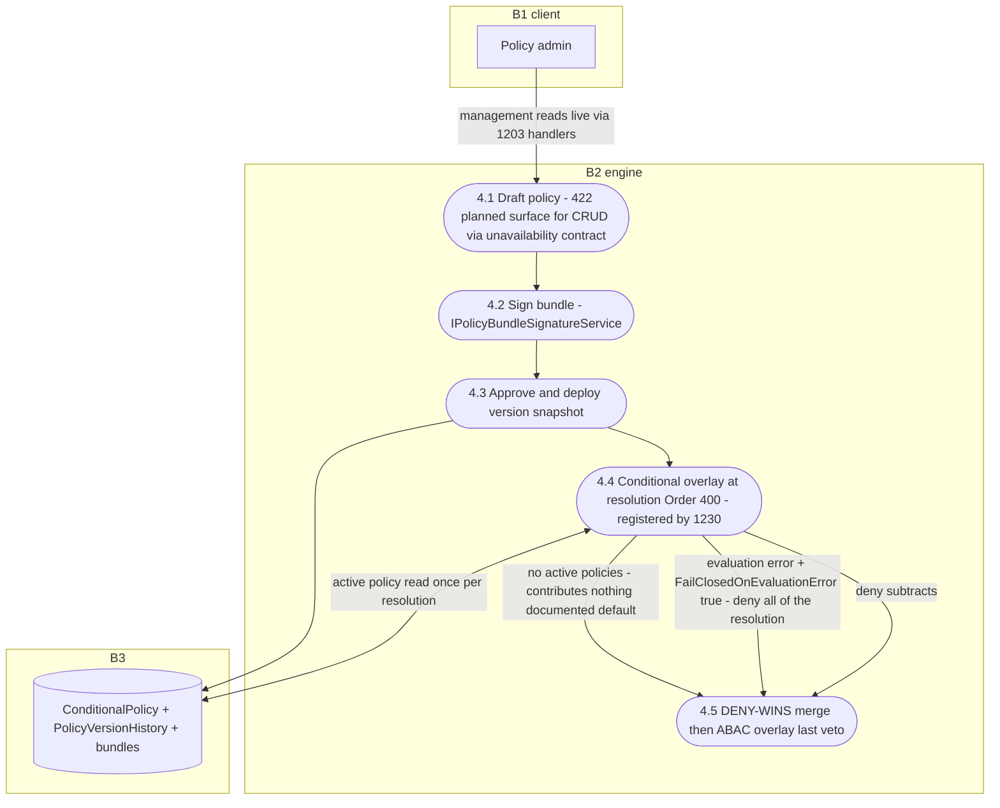
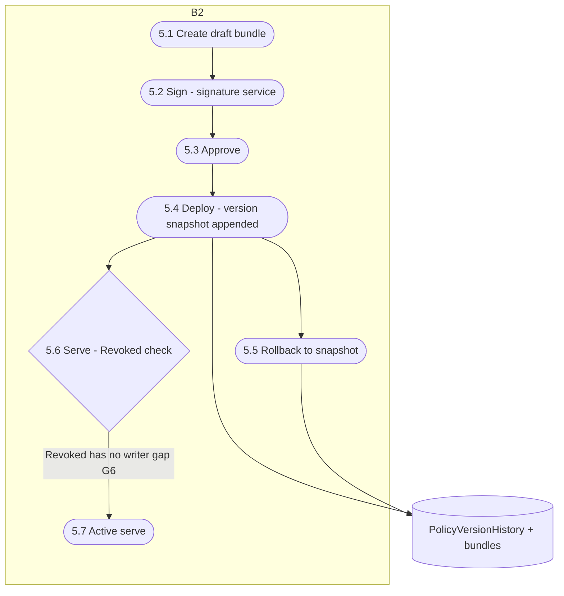
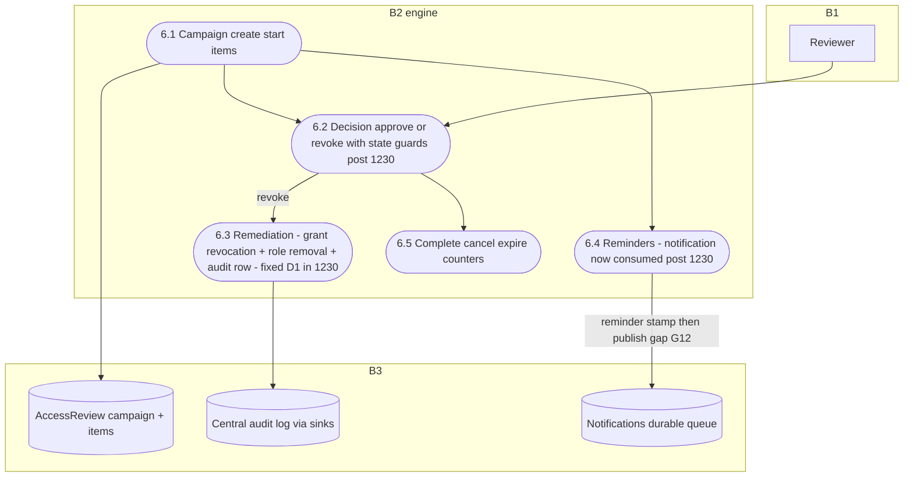
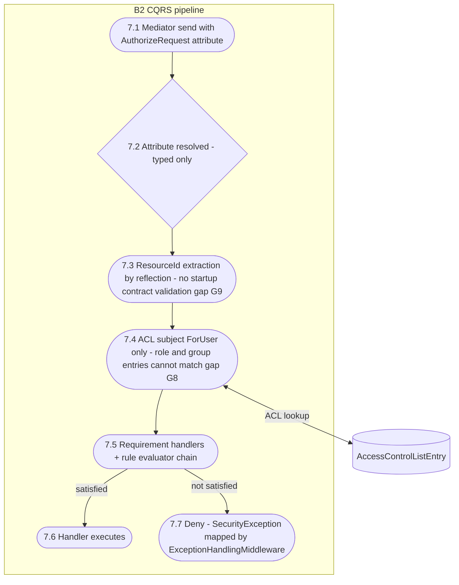

# Authorization Data Flow Diagrams

> Module `GameGuild.Identity.Authorization` · Documented against `develop` commit `7ae5a28a65` (post-#1203/#1230).
> Level-0 context plus one level-1 DFD per flow family (the seven families of [`flows/`](flows/), F1-F7). Notation follows `docs/security/auth-dfds.md` §1: external entities as rectangles, processes as stadiums, stores as cylinders, trust boundaries as subgraphs. STRIDE cross-reference: each family's threat analysis lives in [`07-stride-threat-model.md`](07-stride-threat-model.md) §2-§8.

Paths relative to `apps/api/Source/Modules/GameGuild.Identity.Authorization/` unless stated otherwise. Abbreviations: `Authn/` = `apps/api/Source/Modules/GameGuild.Identity.Authentication/`, `Audit/` = `apps/api/Source/Modules/GameGuild.Compliance.Audit/`, `Host/` = `apps/api/Source/GameGuild.API/`, `Notif/` = `apps/api/Source/Modules/GameGuild.Notifications/`.

## 1. Level 0 — context diagram

Trust boundaries: B1 internet → API host (middleware chain, `cross-module-sequences.md` §1), B2 engine → PostgreSQL (tamper surface), B3 engine → Redis (staleness surface), B4 engine → audit sinks (in-transaction), B5 engine → notifications/webhooks (best-effort, TB-out without receipt).

## 2. Level 1 — F1 grant lifecycle

Source family: [`flows/permission-grant-lifecycle-flow.md`](flows/permission-grant-lifecycle-flow.md). Entities: `Entities/TenantPermission.cs`, `Entities/PermissionDelegation.cs`.

Flows of note: 1.4 is the only grant-lifecycle flow that leaves the transaction without an outbox row (best-effort alert, `Services/PermissionExpirationService.cs:83-89`); every other write is atomic with its audit row.

## 3. Level 1 — F2 JIT elevation

Source family: [`flows/permission-grant-lifecycle-flow.md`](flows/permission-grant-lifecycle-flow.md) (JIT section). Entity: `Entities/JitElevationRequest.cs`.

Flows of note: 2.6 bumps the tenant version only — no user-level security version exists on this path (gap G10, `Services/JitElevationService.cs:280-303`); 2.2's guards are `Entities/JitElevationRequest.cs:106-113`.

## 4. Level 1 — F3 ABAC overlay at resolution

Source family: [`flows/abac-policy-crud-evaluation-flow.md`](flows/abac-policy-crud-evaluation-flow.md). Extension: `Services/AbacPolicyEvaluationExtension.cs` (`Order` 500).

## 5. Level 1 — F4 conditional policies (management + resolution veto)

Source family: [`flows/conditional-policy-crud-evaluation-flow.md`](flows/conditional-policy-crud-evaluation-flow.md). Extension: `Services/ConditionalPolicyEvaluationExtension.cs` (post-#1230).

## 6. Level 1 — F5 policy bundles and version history

Source family: [`flows/conditional-policy-crud-evaluation-flow.md`](flows/conditional-policy-crud-evaluation-flow.md) (bundle path).

## 7. Level 1 — F6 access review campaigns

Source family: [`flows/access-review-campaign-flow.md`](flows/access-review-campaign-flow.md). Post-#1230 remediation included.

## 8. Level 1 — F7 orchestrated CQRS checks

Source family: [`flows/orchestrated-permission-checks-flow.md`](flows/orchestrated-permission-checks-flow.md). Behavior: `Behaviors/AuthorizationBehavior.cs`.

## 9. Coverage matrix

| Family | Level-1 DFD | Highest-risk flow | STRIDE section |
|---|---|---|---|
| F1 grant lifecycle | §2 | 1.4 best-effort expiration alert (no outbox) | §2 |
| F2 JIT elevation | §3 | 2.6 tenant-only version bump | §3 |
| F3 ABAC overlay | §4 | 3.3 permissive skip on store failure | §4 |
| F4 conditional | §5 | 4.4 fail-closed guard (post-#1230); default-allow by absence | §5 |
| F5 bundles | §6 | 5.6 revocation check without a writer | §6 |
| F6 access review | §7 | 6.3 remediation (post-#1230) | §7 |
| F7 orchestrated | §8 | 7.3/7.4 silent ACL narrowing | §8 |

## 10. Maintenance rules

- Keep families in lockstep with the `flows/` directory — a new flow file adds a family here, in the STRIDE doc, and in the tracker row.
- Store shapes mirror EF configurations; if a table is added or renamed (`G2` guard territory), update the cylinders here in the same PR.
- The management-surface posture (16 × designed 422 via the unavailable-contract, hidden controllers) is pinned by `apps/api/tests/GameGuild.API.UnitTests/Architecture/PlannedAuthorizationSurfaceGuardTests.cs`; DFDs must keep depicting that surface as *reads live / writes planned*, not dead.
