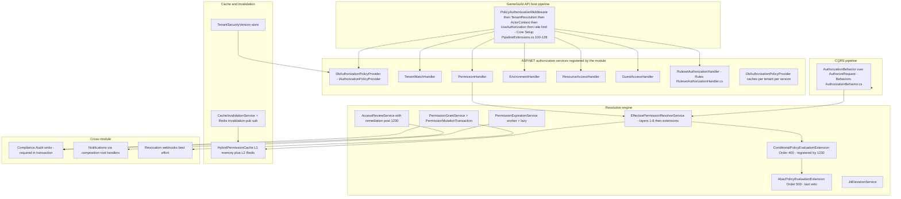

# Authorization Security Architecture — decision doors, cache and throttle layers, signed bundles

> Module `GameGuild.Identity.Authorization` (+ authorization-surface controllers in Authentication) · Documented against `develop` commit `7ae5a28a65` (post-#1203/#1230).
> Companion: decision-path flow [`flows/permission-evaluation-decision-path-flow.md`](flows/permission-evaluation-decision-path-flow.md) (anatomy of door 1), STRIDE [`07-stride-threat-model.md`](07-stride-threat-model.md), DFDs [`08-dfds.md`](08-dfds.md), sequences [`cross-module-sequences.md`](cross-module-sequences.md), gaps [`gaps.md`](gaps.md).

Paths relative to `apps/api/Source/Modules/GameGuild.Identity.Authorization/` unless stated otherwise.

## 1. Component diagram

## 2. The four decision doors

The module answers "may this principal do this" at four distinct places. Each door has its own data sources, caching, and failure posture — a permission can be denied at any door and allowed nowhere else.

| Door | Where | Input | Engine call | Failure posture |
|---|---|---|---|---|
| 1 — request gate (`[Authorize(Policy=…)]`) | `UseAuthorization` in the host pipeline; policy materialized by `Providers/DbAuthorizationPolicyProvider.cs:45` from DB (base + tenant override, `PolicyMerger`) | endpoint policy name, route values, claims | six `IAuthorizationHandler`s (`Extensions/AuthorizationModuleExtensions.cs:219-225,282`) including `RulesetAuthorizationHandler` which runs the seeded rule JSON | missing policy definition → synthesized deny (fail-closed, `:86-93`); handler exception → 500 (fail-closed transport, gap G1) |
| 2 — resource DAC filter | resource-scoped endpoints via `ResourceAccessHandler` + `ResourcePermissionAuthorizationFilter` | ACL entries (`Entities/AccessControlListEntry.cs`), subject kind | `Services/ResourcePermissionService.cs` | no matching entry → deny |
| 3 — query surface | permission-listing endpoints (`ContentTypePermissionsController`, `TenantPermissionsController`) and the #1203-fixed ABAC/conditional read handlers | repository reads with fail-closed tenant guards | `Services/CachedAccessControlListService.cs`, `Services/CachedPolicyDefinitionStore.cs` | repository failure → 500 via the mediator |
| 4 — CQRS behavior | `[AuthorizeRequest]` requests (112 platform declarations; zero in Identity.Users — see `docs/identity/users/` wiring matrix) | typed attribute: permission, resource type, optional `ResourceIdProperty` | `Behaviors/AuthorizationBehavior.cs:42` → requirement handlers | unhandled requirement → deny; reflection misses → deny (silent, gaps G8/G9) |

## 3. Cache layers and invalidation

Two-layer hybrid cache with version-keyed policy cache on top:

- **L1** in-process memory, **L2** `IDistributedCache` (Redis) via `IHybridPermissionCache` (`Caching/HybridPermissionCache.cs:13-46`; explicit-TTL writes only ever *shorten* configured lifetimes — a tamper-resisting detail worth keeping).
- **Policy cache** keys on `(policyName, tenantId, securityVersion)` — a version bump logically evicts every prior entry (`Providers/DbAuthorizationPolicyProvider.cs:57-64` + `IPolicyCache`).
- **Invalidation fan-out**: mutations bump `TenantSecurityVersion` (`Services/JitElevationService.cs:280-303`, `Entities/TenantSecurityVersion.cs`) and publish Redis invalidations (`Caching/RedisPermissionCacheInvalidationPublisher.cs` / `…Subscriber.cs`); `ClearPermissionCacheCommand` is the explicit flush door.
- **Known asymmetry**: JIT approval/revocation bumps the tenant version but there is no user-level version on that path (gap G10) — user-scoped cached decisions can outlive the bump by their TTL.
- **Warmup and pressure**: `Caching/PermissionCacheWarmupService.cs`, `AutomaticPermissionCacheWarmupService.cs`, `PermissionCacheMemoryPressureMonitor.cs`, popularity tracking (`PermissionCachePopularityTracker.cs`) — operational knobs, not security controls.

## 4. Throttle layers

- Endpoint rate limiting via `[EnableRateLimiting(RateLimitPolicies.Authorization)]` on the mutation surfaces (e.g. `Controllers/PolicyBundlesController.cs:32`), enforced by the host's `RateLimitAccessControlMiddleware` + `UseRateLimiter` (+ optional Redis endpoint limiting) at `GameGuild.API/Core/Setup/PipelineExtensions.cs:124-128`.
- The expiration worker self-throttles by `BatchSize` and reminder `MinimumReminderInterval` (`Services/PermissionExpirationService.cs:213-232`).
- GraphQL surface carries its own authorize directive (`GraphQL/GraphQLAuthorizeDirective.cs`).

## 5. Signed bundles — the deployment integrity chain

Draft → **sign** → approve → deploy → rollback, with the signature service as the tamper gate (`Commands/PolicyBundleCommands.cs:45-54`, `IPolicyBundleSignatureService`):

1. bundles are created as drafts — nothing signed can be created in one step;
2. deployment requires an approved, signed bundle; every deploy appends a `PolicyVersionHistory` snapshot (`Entities/PolicyVersionHistory.cs:57-122`) — rollback restores a snapshot rather than re-deriving;
3. serve-time checks `PolicyBundleStatus` including `Revoked` — **but nothing writes `Revoked`** (gap G6): the key-revocation flow is the open half of the chain;
4. retention is unbounded (gap G7) — integrity-safe, resource-unbounded.

## 6. Fail-open / fail-closed verdicts (consolidated)

| Layer | On failure | Where documented |
|---|---|---|
| Policy materialization (door 1) | fail-closed (deny-all synthesis) | §2; `cross-module-sequences.md` §1 |
| PermissionHandler exception | fail-closed decision, 500 transport | gaps.md G1 |
| ABAC overlay evaluation error | **fail-open for the layer** (skip) — compensating: conditional overlay independent + DENY-WINS | 07 §4 |
| Conditional overlay evaluation error | **fail-closed** (deny-all of the resolution) with default-on opt-out switch `PermissionEngine:ConditionalPolicy:FailClosedOnEvaluationError` | 07 §5; `Services/ConditionalPolicyEvaluationExtension.cs:66-80` |
| Conditional "no policy" | contribute nothing (documented absence, not failure) | 07 §5 |
| Resolver extension throws | skip the extension (deny contributions lost) | `cross-module-sequences.md` S4 |
| Audit sinks (role/review/mutation) | fail-closed (in-transaction, mutation rolls back) | `cross-module-sequences.md` §2 |
| Expiration/revocation alerts + webhooks | fail-open (best-effort, no outbox) | gaps.md E2/E3 |

## 7. Open security work items

Consolidated from [`gaps.md`](gaps.md) with the architecture lens:

| Item | Why it is architectural | Gap IDs |
|---|---|---|
| ABAC layer fail-open | a tenant whose denies live only in ABAC loses them during an ABAC outage | A2/H1 |
| JIT user-version gap | invalidation completeness depends on tenant-version-only semantics | G10 |
| Bundle revocation + retention | closes the integrity chain (write `Revoked`; bound history) | G6/G7 |
| Reflection/resource-subject narrowing in the CQRS door | silent fail-closed with no startup contract validation | G8/G9 |
| CodeQL alert on `ConditionalPolicyEvaluator` | **OPEN** — triage against the post-#1230 file | 07 §5 |
| `UseAuthenticationModule` dead composition path | keeps a misleading middleware-order story alive (#1180) | S1 |

## 8. Document register

| Document | Scope |
|---|---|
| `README.md` | package index + headline findings |
| `flows/*.md` (7) | per-family user flows |
| `cqrs-wiring-matrix.md` | endpoints × wiring × tests × holes |
| `state-machines.md` | 5 state machines |
| `event-flows.md` | events, notifications, audit streams |
| `cross-module-sequences.md` | middleware chain, audit sinks, notification consumers |
| `07-stride-threat-model.md` | STRIDE, privilege-escalation focus (post-#1230 state) |
| `08-dfds.md` | level-0 + level-1 per family |
| `09-security-architecture.md` | this document |
| `gaps.md` | consolidated gap register |
