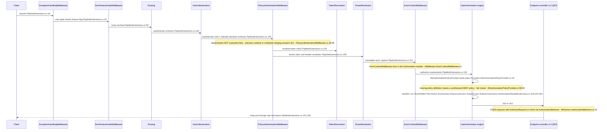
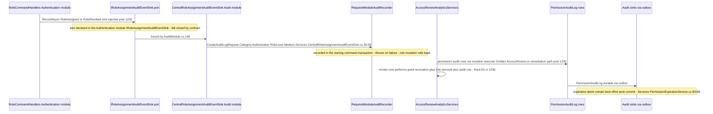
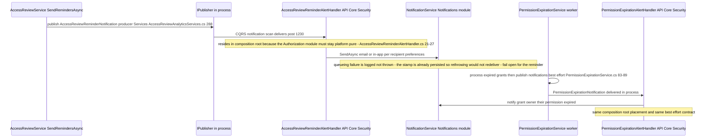

# Authorization Cross-Module Sequences — the middleware chain, audit sinks, notification consumers

> Module `GameGuild.Identity.Authorization` ↔ `GameGuild.Identity.Authentication` (pipeline), `GameGuild.Compliance.Audit` (sinks), `GameGuild.Notifications` (delivery), webhooks · Documented against `develop` commit `7ae5a28a65` (post-#1203/#1230).
> Scope: one Mermaid `sequenceDiagram` per cross-module interaction, following the authentication package's sequence conventions (`docs/auth/cross-module-sequences.md`): every call carries its trigger `file:line`, the failure path (what the caller sees), the retry policy, and the fallback verdict — **fail-open** (the operation proceeds) or **fail-closed** (the operation is denied/suppressed) — plus GAPS.
> Companion docs: the intra-module decision path is [`flows/permission-evaluation-decision-path-flow.md`](flows/permission-evaluation-decision-path-flow.md); the CQRS pipeline side is [`flows/orchestrated-permission-checks-flow.md`](flows/orchestrated-permission-checks-flow.md). This file covers only the seams that cross module boundaries.

Path convention: `file:line` relative to `apps/api/Source/Modules/GameGuild.Identity.Authorization/` unless the path starts with `GameGuild.` (then relative to `apps/api/Source/`).

---

## 1. Authz ↔ Auth — the live middleware chain (request arrives at a `[Authorize(Policy=…)]` endpoint)

The authorization engine does not own a middleware of its own in the live pipeline. It is consulted **inside** `UseAuthorization` via three registrations the Authorization module makes into ASP.NET Core's authorization services: the dynamic policy provider (`DbAuthorizationPolicyProvider`), six `IAuthorizationHandler`s, and — for CQRS requests — the `AuthorizationBehavior` pipeline behavior. The chain below is the host's actual order (`GameGuild.API/Core/Setup/PipelineExtensions.cs`).

Failure paths and fallback verdicts:

| Path | What the caller sees on failure | Retry | Verdict |
|---|---|---|---|
| Policy store unavailable while loading `[Authorize]` policy | 403 — a fail-closed synthesized `DenyAll` policy is cached for the request | none per request; policy cache TTL/invalidation | **fail-closed** (`DbAuthorizationPolicyProvider.cs:86-93` — "Denying access") |
| Policy definition exists but tenant override store read fails | falls back to base definition | policy cache | **fail-open for tenancy** (base policy applies) — see gaps.md G13 for the dangling-name silent static fallback |
| `PermissionHandler` permission check throws | 500 — handler calls `context.Fail` then rethrows (`Handlers/PermissionHandler.cs:69-74`) | none | **fail-closed** for the decision, **500** for the transport (gap G1) |
| `UseAuthenticationModule`'s extra registrations (`AbacPolicyMiddleware`) | nothing — the method has no callers outside one unit test (`GameGuild.Identity.Authentication/AuthenticationModule.cs:33-44`; sole reference `AuthenticationCoverageCompletionTests.cs:474`) | n/a | **dead code path** — the #1180 header-stub is unreachable in the live pipeline (double-dead) |

GAPS: the `UseAuthenticationModule` composition method still registers `app.UseAuthentication()` + `app.UseAuthorization()` + `AbacPolicyMiddleware` but no host calls it — its middleware ordering example in `docs/security/MIDDLEWARE_ORDER.md` should not be read as the live chain (the live chain is `PipelineExtensions.cs`). Tracked as part of #1180 cleanup.

## 2. Authz ↔ Compliance.Audit — the audit sinks

Post-#1204/#1230 the authorization paths write to the central audit log through four bridges. Role mutations are REQUIRED audit events (fail closed, in-transaction); the rest are best-effort or absent.

Failure paths and fallback verdicts:

| Sink | Trigger | Durability | Verdict |
|---|---|---|---|
| `CentralRoleAssignmentAuditEventSink` | role assign/revoke (single + bulk, both paths post-#1230) | in-transaction (`RequiredModuleAuditRecorder`), throws → command fails | **fail-closed** (audit loss prevents the mutation) |
| Access-review remediation audit | revoke decision with remediation (#1230) | in-transaction with the revocation | **fail-closed** |
| `PermissionAuditLog` rows | permission grants/revokes via `PermissionMutationTransaction` | same transaction as the mutation | **fail-closed** |
| Expiration/removal alerts (`PermissionExpirationNotification`, `PermissionRevokedNotification`) | post-commit publish loop (`Services/PermissionExpirationService.cs:83-89`) | **no outbox row** — crash loses the alert permanently | **fail-open** (grant already expired/revoked; only the notification is lost) — gap E2 |
| Webhook revocation delivery | `WebhookPermissionChangeNotifier` | give-up after retries (`:168-243`) | **fail-open** — external systems can permanently miss `permission.revoked` — gap E3 |

## 3. Authz ↔ Notifications — reminder and expiration alert consumers

Pre-#1230 the module published `AccessReviewReminderNotification` into the void. The fix routes it through a composition-root consumer to the Notifications module, honoring per-channel preferences and the durable queue.

Failure paths and fallback verdicts:

| Flow | What the recipient sees on failure | Retry | Verdict |
|---|---|---|---|
| Access-review reminder | reminder absent; counters already incremented | none (stamp persisted before publish — gap G12 pattern preserved by design) | **fail-open** for the campaign, **fail-closed** for that reminder |
| Expiration alert | owner never told; grant already expired | none (no outbox row) | **fail-open** (gap E2) |
| Revocation webhook | external system out of sync with revoked permission | internal retry ladder then give-up log | **fail-open** (gap E3) |

## Cross-cutting gap summary

| # | Gap | Evidence | Status |
|---|---|---|---|
| S1 | `UseAuthenticationModule` (and its `AbacPolicyMiddleware` registration) has no live caller — the #1180 stub never executes | `GameGuild.Identity.Authentication/AuthenticationModule.cs:33-44`; sole reference `apps/api/tests/GameGuild.Identity.Authentication.UnitTests/AuthenticationCoverageCompletionTests.cs:474` | open (folds into #1180) |
| S2 | Expiration/revocation ALERTS remain best-effort post-commit (audit rows are durable; notifications are not) | `Services/PermissionExpirationService.cs:83-89` | open (gaps.md E2/E3) |
| S3 | Reminder stamp persisted before publish — a failed publish suppresses reminders for a full `MinimumReminderInterval` | `Services/PermissionExpirationService.cs:213-232` | open (gaps.md G12) |
| S4 | Resolver-level extension failure skips the extension (deny-wins contributions lost) — the conditional extension compensates internally with its fail-closed guard, but any future extension that throws reverts to skip semantics | `Services/EffectivePermissionResolverService.cs:267-296`; guard `Services/ConditionalPolicyEvaluationExtension.cs:66-80` | partially mitigated (#1230) |
