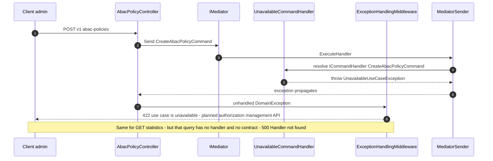

# ABAC Policy CRUD + Evaluation Attempt — User Flow Diagram

> Module `GameGuild.Identity.Authorization` (engine + entities) with its HTTP surface in `GameGuild.Identity.Authentication` (`AbacPolicyController`) · Documented against `develop` commit `74e9bba4c`.
> Scope: the full ABAC policy lifecycle as the code actually behaves — CRUD attempts, activation/cloning, evaluation attempts, statistics — and the stub reality confirmed by issue #1180. This document extends `docs/auth/flows/permission-evaluation-abac-flow.md` (the resolution-path view, #1110) with the management-path view and the wiring holes found in this audit.

Path convention below: paths are relative to `apps/api/Source/Modules/GameGuild.Identity.Authorization/` unless they start with `GameGuild.Identity.Authentication/` or `GameGuild.API`.

## 1. Overview — the honest state

`AbacPolicyController` (`GameGuild.Identity.Authentication/Controllers/AbacPolicyController.cs:21`) exposes 18 endpoints under `v{v}/abac-policies`. It is hidden from the published API (`[ApiExplorerSettings(IgnoreApi = true)]`, `AbacPolicyController.cs:19`) and carries the comment `PLANNED: Reactivate this controller when ABAC policy management is ready for production` (`AbacPolicyController.cs:11`). Of the 18 endpoints only **3 work today** (`:evaluate`, `:evaluate-bulk`, `:test-expression` — handlers in `GameGuild.Identity.Authentication/Handlers/PolicyEvaluationCommandHandlers.cs:74,123,200`):

- **8 endpoints fail 422 "use case unavailable"**: their commands carry `UnavailableReason = "The planned authorization management API is not available."` in the generated use-case contract registry (`GameGuild.Identity.Authentication/Architecture/UseCaseEventContracts.g.cs:26` for `CreateAbacPolicyCommand`, `:91` Update, `:38` Delete, `:2` Activate, `:35` Deactivate, `:19` Clone, `:99` Validate, `:27` CreateFromTemplate). The CQRS registration maps every such contract to a throwing `UnavailableCommandHandler<T>` (`GameGuild.SharedKernel/CQRS/Extensions/ServiceCollectionExtensions.cs:93-109`, throw at `CQRS/Implementation/UnavailableUseCaseHandlers.cs:13-21`), which surfaces as `DomainException` → HTTP 422 via `GameGuild.SharedKernel/Middlewares/ExceptionHandlingMiddleware.cs:59-72,124-133`.
- **7 read endpoints fail 500 "Handler not found"**: `GetAbacPolicyQuery`, `GetAbacPoliciesQuery`, `GetAbacPolicyStatisticsQuery`, `GetAbacPolicyUsageQuery`, `GetAbacPolicyAuditTrailQuery`, `GetAbacPolicyConflictsQuery`, `GetAbacPolicyTemplatesQuery` have **no `IQueryHandler<T>` anywhere in `apps/api/Source`** and no unavailable-contract, so `MediatorSender.GetHandler` throws `InvalidOperationException("Handler not found ...")` (`GameGuild.SharedKernel/CQRS/Implementation/MediatorSender.cs:271-275`) → generic 500 (`ExceptionHandlingMiddleware.cs:74,143`).

At runtime, ABAC policies therefore only enter the store through **policy-bundle deployment** (`Services/PolicyBundlePolicyMaterializer` via `Commands/PolicyBundleCommands.cs:339`) and **seeds** (`Services/PolicyDefinitionSeeder`), never through this controller. Request-time enforcement is a header-writing stub (issue **#1180**, already filed): `Middleware/AbacPolicyMiddleware.cs:27-35` only appends `X-ABAC-Policies: enabled` and calls `next`. Evaluation only happens (a) on the resolution path as a deny-only overlay (`Services/AbacPolicyEvaluationExtension.cs:38`, Order 500) and (b) when a caller explicitly invokes `:evaluate`.

## 2. End-to-End Flowchart — happy path and every edge case

```mermaid
flowchart TD
    subgraph CRUD["Policy management attempt - AbacPolicyController"]
        C1["Admin POST v1 abac-policies<br/>AbacPolicyController.cs L32"] --> C2["CreateAbacPolicyCommand bound from body"]
        C2 --> C3{"ICommandHandler registered<br/>ServiceCollectionExtensions.cs L68"}
        C3 -- "no real handler" --> C4{"UnavailableReason contract exists<br/>UseCaseEventContracts.g.cs L26"}
        C4 -- "yes" --> C5["UnavailableCommandHandler throws UnavailableUseCaseException<br/>UnavailableUseCaseHandlers.cs L13"]
        C5 --> C6["422 Domain Rule Violation<br/>ExceptionHandlingMiddleware.cs L59"]
        C1A["GET policyId L43 / GET list L79 / statistics L178<br/>usage L190 / audit-trail L202 / conflicts L229 / templates L245"] --> C7["Query types with no handler and no contract"]
        C7 --> C8["MediatorSender GetHandler returns null<br/>throws Handler not found - MediatorSender.cs L274"]
        C8 --> C9["500 Internal Server Error<br/>ExceptionHandlingMiddleware.cs L143"]
        C1B["PUT L55 DELETE L67 activate L138 deactivate L150<br/>clone L162 validate L218 instantiate L257"] --> C4
    end

    subgraph EVAL["Evaluation attempt - the 3 working endpoints"]
        E1["Caller POST v1 abac-policies evaluate action<br/>AbacPolicyController.cs L101"] --> E2["EvaluateAbacPoliciesCommandHandler<br/>PolicyEvaluationCommandHandlers.cs L74"]
        E2 --> E3["Map context to AbacRequestContext<br/>AbacEvaluationContextMapper.cs L728"]
        E3 --> E4["AbacPolicyEvaluator EvaluateAsync<br/>Services AbacPolicyEvaluator.cs L74"]
        E4 --> E5["Load active policies for tenant<br/>GetActivePoliciesAsync filters IsEnabled<br/>AbacPolicyEvaluator.cs L85"]
        E5 --> E6{"Any active policy<br/>AbacPolicyEvaluator.cs L85"}
        E6 -- "none" --> E7["NotApplicable with empty details - L124"]
        E6 -- "policies" --> E8["Iterate sorted by Priority descending - L88"]
        E8 --> E9{"Policy IsEffective<br/>enabled and inside window<br/>Entities AdvancedPermissions.cs L171"}
        E9 -- "not effective" --> E10["Skip - continue loop"]
        E9 -- "effective" --> E11{"EvaluatePolicy matches<br/>attribute and condition JSON<br/>AbacPolicyEvaluator.cs L96"}
        E11 -- "no match" --> E12["Detail NotApplicable - L100"]
        E11 -- "match and Effect Deny" --> E13["LogWarning ABAC policy denied<br/>short-circuit Deny with deciding policy<br/>AbacPolicyEvaluator.cs L105-116"]
        E11 -- "match and Effect Allow" --> E14["Detail Permit - request gate only<br/>never mints a permission - L99"]
        E12 --> E8
        E14 --> E8
        E10 --> E8
        E8 -- "loop done no deny" --> E15{"Any Permit in details - L121"}
        E15 -- "yes" --> E16["Permit - evaluation answer only"]
        E15 -- "no" --> E17["NotApplicable"]
        E13 --> ER["200 AbacEvaluationResult"]
        E16 --> ER
        E17 --> ER
        E1B["POST evaluate-bulk action L112"] --> E2B["BulkEvaluateAbacPoliciesCommandHandler<br/>PolicyEvaluationCommandHandlers.cs L123<br/>per-context loop with failure list"]
        E1C["POST test-expression action L123"] --> E2C["TestAbacExpressionCommandHandler<br/>PolicyEvaluationCommandHandlers.cs L200<br/>AbacExpressionEvaluator dry run"]
    end

    subgraph REQUESTGATE["Request-time gate - the stub reality #1180"]
        R1["Any authenticated HTTP request"] --> R2["AbacPolicyMiddleware InvokeAsync<br/>Middleware AbacPolicyMiddleware.cs L27"]
        R2 --> R3["LogTrace only - L29"]
        R3 --> R4["Append header X-ABAC-Policies enabled - L32"]
        R4 --> R5["await next - NO policy is consulted - L34"]
        R2X["Obsolete Authentication copy<br/>GameGuild.Identity.Authentication AbacPolicyMiddleware.cs L14-25<br/>same stub - registered pipeline uses the Authorization copy<br/>AuthenticationModule.cs L41"]
    end

    subgraph OVERLAY["Where ABAC actually bites - resolution overlay"]
        O1["EffectivePermissionResolverService ResolveAsync layers 1-9<br/>GameGuild doc permission-evaluation-abac-flow.md"] --> O2["Evaluation extensions by Order"]
        O2 --> O3["AbacPolicyEvaluationExtension Order 500<br/>Services AbacPolicyEvaluationExtension.cs L38"]
        O3 --> O4["Evaluator throws inside overlay"]
        O4 -- "yes" --> O5["Catch contributes NOTHING - fail-open for the layer<br/>permissive skip logged"]
        O4 -- "no" --> O6["Only denies are subtracted - allow never mints"]
        O6 --> O7["DENY-WINS subtraction"]
    end

    ER --> SEEN["Caller sees Permit and may read it as access approval<br/>but the resolver path ignores Permit - semantic trap"]
```

## 3. CQRS Chain Sequence Diagram

## 4. Edge-Case Matrix

| # | Edge case | Code path | Outcome |
|---|-----------|-----------|---------|
| 1 | Create/Update/Delete policy via API | no handler + `UnavailableReason` contract (`UseCaseEventContracts.g.cs:26,38,91`; throw `UnavailableUseCaseHandlers.cs:13-21`) | 422 "Use case ... is unavailable" — **no ABAC policy can be created via HTTP** |
| 2 | Activate/deactivate/clone/validate/instantiate via API | same unavailable set (`UseCaseEventContracts.g.cs:2,19,35,99,27`) | 422 unavailable |
| 3 | Read policy / list / statistics / usage / audit-trail / conflicts / templates | no `IQueryHandler<T>` in Source; `MediatorSender.cs:271-275` throws | 500 Handler not found |
| 4 | Unauthenticated call | `[Authorize]` (`AbacPolicyController.cs:20`) | 401 |
| 5 | OpenAPI client generation | `ApiExplorerSettings IgnoreApi` (`AbacPolicyController.cs:19`) | endpoints invisible in published surface |
| 6 | `:evaluate` with no active policies | `GetActivePoliciesAsync` empty (`AbacPolicyEvaluator.cs:85`) | `NotApplicable`, empty details |
| 7 | `:evaluate` deny match | short-circuit (`AbacPolicyEvaluator.cs:105-116`) | `Deny` + deciding policy id/name |
| 8 | `:evaluate` allow-only match | permit detail, loop continues (`:99,121`) | `Permit` — request-gate semantics; grants nothing on resolution path |
| 9 | Malformed `SubjectConditions` JSON | parse returns false (`AbacPolicyEvaluator.cs:247-251`) | policy does not match (conservative no-match, i.e. fail-open for deny policies with corrupt JSON) |
| 10 | Malformed `TargetActions` JSON | `ParseTargetActions` → empty (`AbacPolicyEvaluator.cs:132-148`) | treated as no targeted actions |
| 11 | Policy outside effective window | `IsEffective()` false (`Entities/AdvancedPermissions.cs:171-185`) | skipped |
| 12 | Evaluator throws inside resolution overlay | extension catch (`Services/AbacPolicyEvaluationExtension.cs` catch) | contributes nothing — layer fails OPEN |
| 13 | Request-time ABAC gate expected at middleware | stub (`Middleware/AbacPolicyMiddleware.cs:27-35`) | only `X-ABAC-Policies: enabled` header; **#1180** |
| 14 | Unit tests over CRUD endpoints | `GameGuild.Identity.Authentication.UnitTests/Controllers/AbacPolicyControllerTests.cs:14-377` mock `IMediator` | mapping-only green tests; the missing handlers are invisible to them |

## 5. Endpoint Inventory

| Method + Route | Command/Query | Handler | Outcome |
|----------------|---------------|---------|---------|
| POST `v{v}/abac-policies` | `CreateAbacPolicyCommand` | none (unavailable contract) | 422 |
| GET `v{v}/abac-policies/{policyId}` | `GetAbacPolicyQuery` | none | 500 |
| PUT `v{v}/abac-policies/{policyId}` | `UpdateAbacPolicyCommand` | none (unavailable) | 422 |
| DELETE `v{v}/abac-policies/{policyId}` | `DeleteAbacPolicyCommand` | none (unavailable) | 422 |
| GET `v{v}/abac-policies` | `GetAbacPoliciesQuery` | none | 500 |
| POST `v{v}/abac-policies/:evaluate` | `EvaluateAbacPoliciesCommand` | `PolicyEvaluationCommandHandlers.cs:74` | **works** |
| POST `v{v}/abac-policies/:evaluate-bulk` | `BulkEvaluateAbacPoliciesCommand` | `PolicyEvaluationCommandHandlers.cs:123` | **works** |
| POST `v{v}/abac-policies/:test-expression` | `TestAbacExpressionCommand` | `PolicyEvaluationCommandHandlers.cs:200` | **works** |
| POST `v{v}/abac-policies/{policyId}:activate` | `ActivateAbacPolicyCommand` | none (unavailable) | 422 |
| POST `v{v}/abac-policies/{policyId}:deactivate` | `DeactivateAbacPolicyCommand` | none (unavailable) | 422 |
| POST `v{v}/abac-policies/{policyId}:clone` | `CloneAbacPolicyCommand` | none (unavailable) | 422 |
| GET `v{v}/abac-policies/statistics` | `GetAbacPolicyStatisticsQuery` | none | 500 |
| GET `v{v}/abac-policies/{policyId}/usage` | `GetAbacPolicyUsageQuery` | none | 500 |
| GET `v{v}/abac-policies/{policyId}/audit-trail` | `GetAbacPolicyAuditTrailQuery` | none | 500 |
| POST `v{v}/abac-policies/:validate` | `ValidateAbacPolicyCommand` | none (unavailable) | 422 |
| GET `v{v}/abac-policies/conflicts` | `GetAbacPolicyConflictsQuery` | none | 500 |
| GET `v{v}/abac-policies/templates` | `GetAbacPolicyTemplatesQuery` | none | 500 |
| POST `v{v}/abac-policies/templates/{templateId}:instantiate` | `CreateAbacPolicyFromTemplateCommand` | none (unavailable) | 422 |

## 6. Events Published / Consumed

- ABAC deny logs a warning with policy name (`Services/AbacPolicyEvaluator.cs:107-109`) — log only, no durable event.
- No integration events are published by the ABAC path; CRUD is dead and evaluation is synchronous. See `docs/authorization/event-flows.md` for the module-wide inventory.

## 7. Entities and Tables Touched

| Entity / Table | Role | Ref |
|-----------------|------|-----|
| `AbacPolicy` | policy rows, priority, effect, JSON conditions | `Entities/AdvancedPermissions.cs:14-105` |
| `PolicyVersionHistory` | append-only snapshots on every policy mutation written by the repository (not by the dead endpoints) | `Entities/PolicyVersionHistory.cs:57-122`; conditional writer `Repositories/AdvancedPolicyRepositories.cs:96,115,127` |
| `PolicyRegistryAuditLog` | bundle-lifecycle audit (the working path that can materialize ABAC definitions) | `Commands/PolicyBundleCommands.cs:91-100` |

## 8. Gaps

1. **Already filed — #1180**: both `AbacPolicyMiddleware` copies are header-writing stubs; no request-time ABAC gate exists (`Middleware/AbacPolicyMiddleware.cs:27-35`; obsolete copy `GameGuild.Identity.Authentication/AbacPolicyMiddleware.cs:14-25`).
2. **NEW — 15 of 18 endpoints are dead**: 8 throw 422 via the unavailable-contract mechanism and 7 queries throw 500 handler-not-found (see §5). The controller is routed, authorized and unit-tested at the mapping level, so the outage is invisible unless called.
3. **NEW — read-side queries have no failure design**: the 7 dead queries lack both a handler and an `UnavailableReason`, so they surface as 500 instead of the designed 422 — inconsistent with the write-side.
4. Carried from #1110 (see `docs/auth/flows/permission-evaluation-abac-flow.md` §9): overlay failure is permissive (fail-open for that layer); `Permit` exposed by `:evaluate` can be mistaken for access approval.
