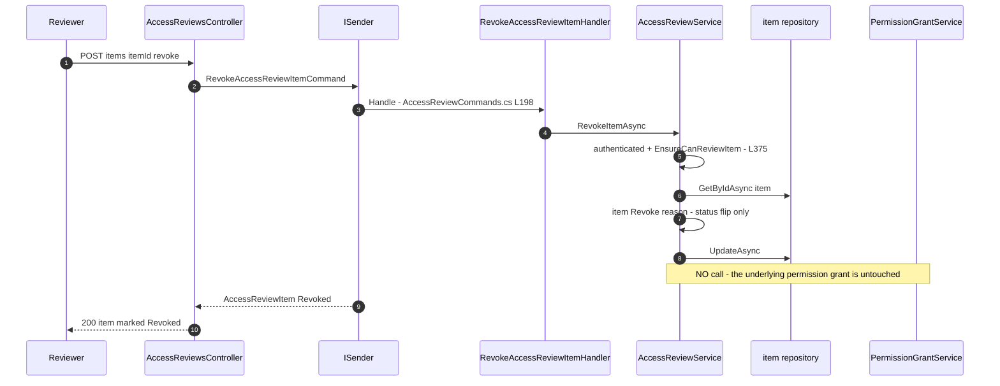

# Access-Review Campaign Lifecycle — User Flow Diagram

> Module `GameGuild.Identity.Authorization` · Documented against `develop` commit `74e9bba4c`.
> Scope: the certification campaign lifecycle — create → start → review items → decisions → reminders → complete/cancel/expiry → "remediation" — including the honest finding that a Revoke decision never revokes the underlying permission.

Paths are relative to `apps/api/Source/Modules/GameGuild.Identity.Authorization/`.

## 1. Overview

`AccessReviewsController` (`Controllers/AccessReviewsController.cs:19`, 11 endpoints under `v{v}/access-reviews`, class-level `[Authorize]`) fronts `AccessReviewService` (`Services/AccessReviewAnalyticsServices.cs:10`). Campaigns are `AccessReviewCampaign` entities (status `Draft → InProgress → Completed | Expired`, `Entities/AccessReview.cs:29,87-135`); items are `AccessReviewItem` rows (status `Pending → Approved | Revoked`, `:184-251`). Every service call enforces tenant scoping: `CanManageTenant` (system admin or same-tenant tenant admin, `AccessReviewAnalyticsServices.cs:349-352`), reviewers must match the item's reviewer or be admins (`:375-394`), and item lookups without tenant context fail closed (`:379`). The controller translates service exceptions: 403 for `UnauthorizedAccessException`, 404 for "not found" `InvalidOperationException`, 409 otherwise (`Controllers/AccessReviewsController.cs:233-265`).

**Remediation reality**: `RevokeItemAsync` (`Services/AccessReviewAnalyticsServices.cs:245-267`) only flips the item to `Revoked` — it never calls `IPermissionGrantService.RevokeTenantPermissionAsync`, never touches role assignments, and writes no audit log row. `AutoRevokeOnNoResponse` (`Entities/AccessReview.cs:45`) is persisted but read by nothing. Decisions are bookkeeping only.

**Reminders**: `SendRemindersAsync` (`:269-304`) stamps `LastReminderSent` and publishes in-process `AccessReviewReminderNotification` (`Notifications/AccessReviewReminderNotification.cs:10`) — which has **no registered handler** anywhere in `apps/api/Source` (orphan notification; see `docs/authorization/event-flows.md`).

The `AccessReviewMiddleware` in the request pipeline is a header-writing stub (`Middleware/AccessReviewMiddleware.cs:27-33`, appends `X-Access-Review: enabled`) — it does not track access patterns or trigger reviews despite its doc comment.

## 2. End-to-End Flowchart — happy path and every edge case

```mermaid
flowchart TD
    subgraph CR["Create campaign"]
        CR1["Tenant admin POST v1 access-reviews campaigns<br/>AccessReviewsController.cs L28"] --> CR2["CreateAccessReviewCampaignHandler<br/>Commands AccessReviewCommands.cs L40"]
        CR2 --> CR3["Validator - name description lengths<br/>StartDate today or later - EndDate after start<br/>AccessReviewCommands.cs L23-35"]
        CR3 -- "invalid" --> CR400["400 validation"]
        CR3 -- "valid" --> CR4["Campaign Status Draft<br/>AccessReviewCommands.cs L45-54"]
        CR4 --> CR5["CreateCampaignAsync - authenticated guard<br/>Services AccessReviewAnalyticsServices.cs L36"]
        CR5 --> CR201["201 campaign"]
    end

    subgraph ST["Start"]
        ST1["POST campaigns id start L75"] --> ST2["StartCampaignAsync<br/>AccessReviewAnalyticsServices.cs L95"]
        ST2 --> ST3{"Campaign exists - L101"}
        ST3 -- "missing" --> ST404["404 false"]
        ST3 -- "found" --> ST4{"Actor can manage tenant<br/>CanManageTenant L108 L349"}
        ST4 -- "no" --> ST403["403 tenant administrator required"]
        ST4 -- "yes" --> ST5{"Entity guard - only Draft can start<br/>Entities AccessReview.cs L89"]
        ST5 -- "not draft" --> ST409["409 only draft campaigns can be started"]
        ST5 -- "draft" --> ST6["Status InProgress - L94"]
    end

    subgraph RV["Review items and decisions"]
        RV1["GET items pending reviewerId<br/>AccessReviewsController.cs L158"] --> RV2["GetPendingItemsForReviewerAsync<br/>AccessReviewAnalyticsServices.cs L184"]
        RV2 --> RV3{"Actor is system admin - L193"}
        RV3 -- "yes" --> RV4["Any tenant scope"]
        RV3 -- "no" --> RV5{"reviewerId equals actor<br/>L210"}
        RV5 -- "self" --> RV6["Own pending items in own tenant"]
        RV5 -- "other" --> RV7{"Actor is tenant admin of that tenant<br/>L212"}
        RV7 -- "no" --> ST403
        RV7 -- "yes" --> RV6
        RV6 --> RV8["Pending items list"]
        RV8 --> D1["POST items id approve L175"]
        RV8 --> D2["POST items id revoke L193"]
        D1 --> D3["ApproveItemAsync - L221"]
        D2 --> D4["RevokeItemAsync - L245"]
        D3 --> D5{"Item exists - L229"}
        D5 -- "missing" --> ST404
        D5 -- "found" --> D6{"EnsureCanReviewItem - reviewer or admin<br/>L375-394"}
        D6 -- "no" --> ST403
        D6 -- "yes" --> D7["item Approve - Status Approved Decision Approve<br/>Entities AccessReview.cs L230-238<br/>NO guard that item is Pending"]
        D4 --> D8["item Revoke - Status Revoked Decision Revoke<br/>Entities AccessReview.cs L243-251<br/>NO guard that item is Pending<br/>NO permission is revoked - see gap"]
        D7 --> D9["UpdateAsync - campaign counters NOT incremented"]
        D8 --> D9
    end

    subgraph RM["Reminders"]
        RM1["POST campaigns id send-reminders L139"] --> RM2["SendRemindersAsync<br/>AccessReviewAnalyticsServices.cs L269"]
        RM2 --> RM3{"Campaign exists - L275"}
        RM3 -- "missing" --> RM0["200 count 0"]
        RM3 -- "found" --> RM4{"CanManageTenant - L282"}
        RM4 -- "no" --> ST403
        RM4 -- "yes" --> RM5["Items where NeedsReminder - pending plus interval elapsed<br/>Entities AccessReview.cs L212-225"]
        RM5 --> RM6["RecordReminderSent - L288-289"]
        RM6 --> RM7["Publish AccessReviewReminderNotification in-process<br/>AccessReviewAnalyticsServices.cs L294-297"]
        RM7 --> RM8["NO handler exists - notification evaporates"]
    end

    subgraph EN["Complete - cancel - expire"]
        EN1["POST campaigns id complete L95"] --> EN2["CompleteCampaignAsync - L117"]
        EN2 --> EN3{"Exists - can manage - CompletedBy equals actor<br/>L124-132 EnsureReportedActor L333"}
        EN3 -- "fail" --> ST403
        EN3 -- "ok" --> EN4{"Entity guard - only InProgress can complete<br/>Entities AccessReview.cs L103"}
        EN4 -- "expired campaign still InProgress status" --> EN5["Complete SUCCEEDS after EndDate passed<br/>IsExpired is derived - never blocks Complete"]
        EN4 -- "completed already" --> ST409
        EN4 -- "in progress" --> EN6["Status Completed - CompletedBy CompletedAt"]
        EN7["POST campaigns id cancel L120"] --> EN8["CancelCampaignAsync - L141"]
        EN8 --> EN9{"Entity guard - cannot cancel Completed<br/>Entities AccessReview.cs L119"}
        EN9 -- "completed" --> ST409
        EN9 -- "other" --> EN10["Status set to Expired - comment uses Expired as cancelled state<br/>Entities AccessReview.cs L124"]
        EN11["SystemAdmin POST campaigns process-expired L212<br/>Roles SystemAdmin required - L211"] --> EN12["ProcessExpiredCampaignsAsync - L306"]
        EN12 --> EN13["Pending campaigns where IsExpired derived<br/>In Progress and past EndDate - Entities AccessReview.cs L68"]
        EN13 --> EN14["MarkExpired - Status Expired - L315"]
        EN14 --> EN15["AutoRevokeOnNoResponse NOT enforced - flag dead"]
    end
```

## 3. CQRS Chain Sequence Diagram



## 4. Edge-Case Matrix

| # | Edge case | Code path | Outcome |
|---|-----------|-----------|---------|
| 1 | Create with EndDate ≤ StartDate | validator (`Commands/AccessReviewCommands.cs:31-32`) | 400 |
| 2 | Start non-draft campaign | entity guard (`Entities/AccessReview.cs:89-92`) | 409 |
| 3 | Start/complete/cancel unknown id | `false` → controller 404 (`Controllers/AccessReviewsController.cs:47,86`) | 404 |
| 4 | Non-admin manages another tenant's campaign | `CanManageTenant` (`Services/AccessReviewAnalyticsServices.cs:349-352`) | 403 |
| 5 | Reviewer without tenant context | `:200-202` | 403 fail-closed |
| 6 | Item with no campaign loaded | `:377-379` | 403 "no tenant context" |
| 7 | Decide an already-decided item | **no guard** — `Approve/Revoke` lack a Pending check (`Entities/AccessReview.cs:230-251`) | decision overwritten silently |
| 8 | `CompletedBy` ≠ authenticated actor | `EnsureReportedActor` (`:333-338`) | 403 |
| 9 | Complete an expired-but-InProgress campaign | `IsExpired` derived only (`Entities/AccessReview.cs:68-69`); `Complete` checks status only (`:103`) | completes after deadline |
| 10 | Cancel a completed campaign | guard (`:119-121`) | 409 |
| 11 | Cancel semantics | `Cancel()` sets `Expired` (`:124`) | status overloaded — cannot distinguish cancelled vs expired |
| 12 | Reminder cadence | `NeedsReminder` (`:212-225`) | only Pending items, once per `ReminderFrequencyDays` |
| 13 | Reminder notification delivery | `AccessReviewReminderNotification` published (`Services:294-297`), no `INotificationHandler` | orphan — nothing sent |
| 14 | No-response auto-revocation | `AutoRevokeOnNoResponse` (`Entities/AccessReview.cs:45`) | **dead flag** — no reader anywhere |
| 15 | Item counters | `IncrementReviewed/Approved/Revoked` (`:140-162`) | never called by the service — `TotalItems/ReviewedItems/...` stay 0 |
| 16 | Cross-tenant item id | tenant scoping in repositories (`Queries/AccessReviewQueries.cs` handlers) | not returned |
| 17 | process-expired by non-system-admin | `[Authorize(Roles = "SystemAdmin")]` (`Controllers/AccessReviewsController.cs:211`) | 403 |

## 5. Endpoint Inventory

| Method + Route | Command/Query | Handler | Validator |
|----------------|---------------|---------|-----------|
| POST `v{v}/access-reviews/campaigns` | `CreateAccessReviewCampaignCommand` | `Commands/AccessReviewCommands.cs:38` | `:23` |
| GET `.../campaigns/{id}` | `GetAccessReviewCampaignByIdQuery` | `Queries/AccessReviewQueries.cs:15` | — |
| GET `.../campaigns/active` | `GetActiveAccessReviewCampaignsQuery` | `:32` | — |
| POST `.../campaigns/{id}:start` | `StartAccessReviewCampaignCommand` | `Commands/AccessReviewCommands.cs:74` | `:65` |
| POST `.../campaigns/{id}:complete` | `CompleteAccessReviewCampaignCommand` | `:103` | `:93` |
| POST `.../campaigns/{id}:cancel` | `CancelAccessReviewCampaignCommand` | `:132` | `:121` |
| POST `.../campaigns/{id}:send-reminders` | `SendAccessReviewRemindersCommand` | `:221` | — |
| GET `.../items/pending` | `GetPendingReviewItemsQuery` | `Queries/AccessReviewQueries.cs:49` | — |
| POST `.../items/{id}:approve` | `ApproveAccessReviewItemCommand` | `Commands/AccessReviewCommands.cs:163` | `:152` |
| POST `.../items/{id}:revoke` | `RevokeAccessReviewItemCommand` | `:199` | `:188` |
| POST `.../campaigns:process-expired` | `ProcessExpiredCampaignsCommand` | `:238` | — (SystemAdmin role) |

## 6. Events Published / Consumed

- `AccessReviewReminderNotification` (`Notifications/AccessReviewReminderNotification.cs:10`) — published in-process (`Services/AccessReviewAnalyticsServices.cs:294-297`), **zero consumers** — orphan (see `docs/authorization/event-flows.md`).
- No outbox rows; no audit-log rows are written by any access-review operation (contrast the grant path). Lifecycle evidence exists only in application logs.
- `AccessReviewMiddleware` (`Middleware/AccessReviewMiddleware.cs:27-33`) — stub, consumes nothing.

## 7. Entities and Tables Touched

| Entity / Table | Role | Ref |
|-----------------|------|-----|
| `AccessReviewCampaign` | status, counters, reminder frequency, auto-revoke flag | `Entities/AccessReview.cs:9-163` |
| `AccessReviewItem` | per-subject decisions, reminder stamps | `:168-262` |
| EF configurations | `Configuration/GovernanceHistoryConfigurations.cs` (campaign/item configs registered at `AuthorizationModule.cs:80-81`) | — |

## 8. Gaps

1. **NEW — revoke decision is not remediation**: `RevokeItemAsync` (`Services/AccessReviewAnalyticsServices.cs:245-267`) flips item status only; the subject's grants/roles are untouched and no audit row is written. A campaign can "revoke" every item with zero change to effective access.
2. **NEW — `AutoRevokeOnNoResponse` is a dead flag** (`Entities/AccessReview.cs:45`): persisted in migrations, read by no code.
3. **NEW — decisions have no Pending-state guard** (`Entities/AccessReview.cs:230-251`): approved items can be revoked and vice-versa, any number of times.
4. **NEW — campaign counters never maintained**: `IncrementReviewed/Approved/Revoked` (`:140-162`) have no caller; `GetCompletionPercentage` (`:74-82`) is always 0%.
5. **NEW — cancel and expire share one status** (`:124` "Using Expired as cancelled state").
6. **NEW — reminders are fire-into-void**: orphan `AccessReviewReminderNotification` (no handler) — reviewers are never actually notified.
7. **NEW — access-review operations write no durable audit trail** (no `PermissionAuditLog`, no audit events).
8. **NEW — `AccessReviewMiddleware` is a second header-writing stub** (`Middleware/AccessReviewMiddleware.cs:27-33`, registered at `GameGuild.Identity.Authentication/AuthenticationModule.cs:42`) — same class of defect as #1180's `AbacPolicyMiddleware`, distinct middleware.
