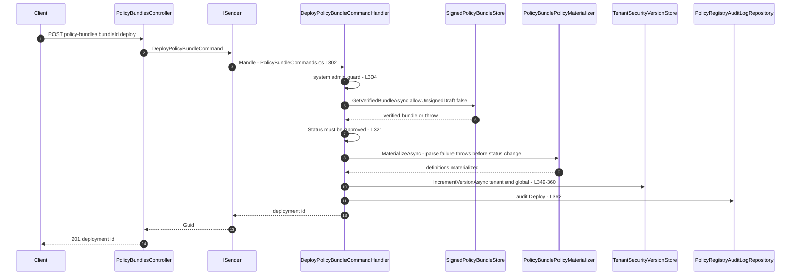

# Conditional Policy CRUD + Evaluation — User Flow Diagram

> Module `GameGuild.Identity.Authorization` (entity, evaluator, versioned repository) with HTTP surface in `GameGuild.Identity.Authentication` (`ConditionalPolicyCrudController`, `ConditionalPolicyEvaluationController`) and the **working** management path in `GameGuild.Identity.Authorization` (`PolicyBundlesController`) · Documented against `develop` commit `74e9bba4c`.
> Scope: creating/updating/deleting conditional policies, activation and priority, evaluation attempts, and the signed-bundle deployment path that is the only live way to change policies at runtime.

Paths are relative to `apps/api/Source/Modules/GameGuild.Identity.Authorization/` unless they start with `GameGuild.Identity.Authentication/` or `GameGuild.SharedKernel/`.

## 1. Overview — two management paths, one works

**Path A — direct CRUD (`v{v}/conditional-policies`, two controllers, 22 endpoints): dead.** `ConditionalPolicyCrudController` (`GameGuild.Identity.Authentication/Controllers/ConditionalPolicyCrudController.cs:20`, `IgnoreApi` `:18`) exposes 11 endpoints; **every one fails**: 8 commands (create/update/delete/activate/deactivate/clone/priority-set/template-instantiate) carry `UnavailableReason = "The planned authorization management API is not available."` (`GameGuild.Identity.Authentication/Architecture/UseCaseEventContracts.g.cs:30,93,40,36,21,20,94,31`) and resolve to the throwing `UnavailableCommandHandler<T>` (`GameGuild.SharedKernel/CQRS/Extensions/ServiceCollectionExtensions.cs:93-109`; `CQRS/Implementation/UnavailableUseCaseHandlers.cs:13-21`) → 422. The 3 reads (`GetConditionalPolicyQuery` `:42`, `GetConditionalPoliciesQuery` `:78`, `GetConditionalPolicyTemplatesQuery` `:152`) have **no handler anywhere** → `InvalidOperationException("Handler not found ...")` (`GameGuild.SharedKernel/CQRS/Implementation/MediatorSender.cs:271-275`) → 500. `ConditionalPolicyEvaluationController` (`:20`, 11 endpoints) is half alive: 6 evaluation endpoints have handlers (`PolicyEvaluationCommandHandlers.cs:280,323,403,544,465,590`), while its 5 analytics reads (statistics `:68`, usage `:80`, evaluation-history `:92`, conflicts `:119`, condition-types `:146`) have no handler → 500.

**Path B — signed policy bundles (`api/v{v}/authorization/policy-bundles`): works.** `PolicyBundlesController` (`Controllers/PolicyBundlesController.cs:34`, the only rate-limited controller in the module — `EnableRateLimiting(RateLimitPolicies.Authorization)` `:32`) drives the guarded lifecycle Draft → Signed → Approved → Active → Deprecated with per-step actor guards and a fail-closed signature check (`Commands/PolicyBundleCommands.cs:48,142,214,288,397`). Deployment materializes `PolicyDefinitionEntity` rows (`Services/PolicyBundlePolicyMaterializer` via `PolicyBundleCommands.cs:339`), bumps tenant security versions (`:349-360`), and every repository mutation of a `ConditionalPolicy` appends an immutable `PolicyVersionHistory` snapshot (`Repositories/AdvancedPolicyRepositories.cs:96,115,127`; writer `Repositories/PolicyVersionHistoryRepository.cs:119-177`).

**Evaluation.** `ConditionalPolicyEvaluator.EvaluateAsync` (`Services/ConditionalPolicyEvaluator.cs:78`) loads active policies sorted by priority descending (`:85`), checks applicability (action + resource-type filters, `:159`), evaluates condition families (time / environment / location / device / custom). A matching **deny** short-circuits with `IsAllowed = false` and the deciding policy id (`:104`); if no deny matched, `IsAllowed = true` (`:126`). The evaluator is *not* wired into the permission-resolution pipeline — it only runs when explicitly invoked through the evaluation endpoints above.

## 2. End-to-End Flowchart — happy path and every edge case

```mermaid
flowchart TD
    subgraph A["Path A - direct CRUD - dead endpoints"]
        A1["Admin POST v1 conditional-policies<br/>ConditionalPolicyCrudController.cs L31"] --> A2{"Handler registered"}
        A2 -- "no - UnavailableReason contract<br/>UseCaseEventContracts.g.cs L30" --> A3["UnavailableCommandHandler throws<br/>UnavailableUseCaseHandlers.cs L13"]
        A3 --> A4["422 planned authorization management API not available"]
        A5["GET policyId L42 - GET list L78 - GET templates L152<br/>statistics L68 - usage L80 - history L92 - conflicts L119 - condition-types L146"] --> A6["No IQueryHandler in Source<br/>MediatorSender.cs L274"]
        A6 --> A7["500 Handler not found"]
        A8["PUT priority L136 activate L100 deactivate L112<br/>clone L124 delete L66 update L54 instantiate L164"] --> A2
    end

    subgraph E["Evaluation - the working half"]
        E1["POST v1 conditional-policies evaluate action<br/>ConditionalPolicyEvaluationController.cs L31"] --> E2["EvaluateConditionalPoliciesCommandHandler<br/>PolicyEvaluationCommandHandlers.cs L280"]
        E2 --> E3["ConditionalPolicyEvaluator EvaluateAsync<br/>Services ConditionalPolicyEvaluator.cs L78"]
        E3 --> E4["Filter IsEnabled and sort Priority desc - L85"]
        E4 --> E5{"Applicable - action and resource type filters<br/>ConditionalPolicyEvaluator.cs L159"}
        E5 -- "not applicable" --> E6["Policy skipped"]
        E5 -- "applicable" --> E7{"Condition families<br/>time - environment - location - device - custom<br/>ConditionalPolicyEvaluator.cs L176"}
        E7 -- "conditions fail" --> E6
        E7 -- "conditions met and Action Deny" --> E8["IsAllowed false with policy id and reason<br/>ConditionalPolicyEvaluator.cs L104"]
        E7 -- "no deny matched after loop" --> E9["IsAllowed true - L126"]
        E6 --> E4
        E8 --> ER["200 ConditionalPolicyResult"]
        E9 --> ER
        E1B["POST evaluate-bulk L42 - test-rule L53 - validate L108<br/>simulate L131 - validate-condition L158<br/>handlers PolicyEvaluationCommandHandlers.cs L323 L403 L544 L465 L590"]
    end

    subgraph B["Path B - signed bundles - works"]
        B1["POST api v1 authorization policy-bundles<br/>PolicyBundlesController.cs L51"] --> B2["CreatePolicyBundleCommandHandler<br/>PolicyBundleCommands.cs L59"]
        B2 --> B3{"EnsureCanManageBundles<br/>system admin or same-tenant admin<br/>PolicyBundleCommands.cs L566"}
        B3 -- "no" --> B403["403 UnauthorizedAccess"]
        B3 -- "yes" --> B4["Bundle created Status Draft - L77"]
        B4 --> B5{"ValidateBundleInputs signature contract<br/>PolicyBundleCommands.cs L82"}
        B5 -- "errors" --> B400["PolicyBundleSignatureException - rejected"]
        B5 -- "ok" --> B6["Repository CreateAsync + PolicyRegistryAuditLog Create - L89-100"]
        B6 --> B7["POST bundleId sign L95"]
        B7 --> B8{"Actor is system admin<br/>PolicyBundleCommands.cs L158"}
        B8 -- "tenant admin" --> B403
        B8 -- "system admin" --> B9{"Status is Deprecated or Revoked - L171"}
        B9 -- "yes" --> B409["InvalidOperationException - cannot sign"]
        B9 -- "no" --> B10["SignBundle sets signature hash and key - L177"]
        B10 --> B11["POST bundleId approve L120"]
        B11 --> B12{"VerifyBundle signature valid<br/>FAIL CLOSED - PolicyBundleCommands.cs L241"}
        B12 -- "invalid or tampered" --> B422["PolicyBundleSignatureException"]
        B12 -- "valid" --> B13["Status Approved - L248"]
        B13 --> B14["POST bundleId deploy L146"]
        B14 --> B15{"Signed store refuses unsigned or unverified<br/>GetVerifiedBundleAsync allowUnsignedDraft false<br/>PolicyBundleCommands.cs L317"}
        B15 -- "refused" --> B422
        B15 -- "verified but Status not Approved" --> B409
        B15 -- "approved" --> B16["MaterializeAsync policy definitions<br/>any parse failure throws first - L339"]
        B16 --> B17["Deployment created then Activate - L327-342"]
        B17 --> B18["Bundle Status Active - DeploymentCount plus - L344-347"]
        B18 --> B19["Bump tenant security version and global version<br/>PolicyBundleCommands.cs L349-360"]
        B17 --> B20["POST deployments deploymentId rollback L181"]
        B20 --> B21{"Deployment Status Active - L429"}
        B21 -- "not active" --> B409
        B21 -- "active" --> B22["DematerializeAsync removes definitions - L441"]
        B22 --> B23["Deployment Rollback - bundle Deprecated - L443-447"]
        B23 --> B24["Security versions bumped again - L449-458"]
    end

    subgraph V["Version history - append only"]
        V1["Every ConditionalPolicyRepository Create Update Delete<br/>Repositories AdvancedPolicyRepositories.cs L96 L115 L127"] --> V2["PolicyVersionSnapshotService appends next version row<br/>Repositories PolicyVersionHistoryRepository.cs L128-177"]
        V2 --> V3["Immutable - no update or delete path"]
        V1A["PolicyDefinitionRepository same pattern for PolicyDefinition<br/>Repositories PolicyDefinitionRepository.cs L91 L101 L111"]
    end
```

## 3. CQRS Chain Sequence Diagram

## 4. Edge-Case Matrix

| # | Edge case | Code path | Outcome |
|---|-----------|-----------|---------|
| 1 | Create/update/delete/activate/deactivate/clone/priority/instantiate via `v{v}/conditional-policies` | unavailable contracts (`UseCaseEventContracts.g.cs:30,93,40,36,21,20,94,31`) | 422 unavailable |
| 2 | Read policy / list / templates / statistics / usage / history / conflicts / condition-types | no handler (`MediatorSender.cs:274`) | 500 |
| 3 | `:evaluate` with no applicable policy | loop completes, no deny (`ConditionalPolicyEvaluator.cs:126`) | `IsAllowed = true` (default-allow) |
| 4 | `:evaluate` conditions met + Deny | short-circuit (`:104`) | `IsAllowed = false` + policy id + reason |
| 5 | `:validate` / `:validate-condition` | handlers (`PolicyEvaluationCommandHandlers.cs:544,590`) | syntax validation without persisting |
| 6 | Bundle create by non-admin | guard (`PolicyBundleCommands.cs:566-601`) | 403 |
| 7 | Bundle sign by tenant admin | system-admin-only (`:158`) | 403 |
| 8 | Approve unsigned/tampered bundle | `VerifyBundle` fail-closed (`:241-246`) | `PolicyBundleSignatureException` |
| 9 | Deploy non-approved bundle | status check (`:321-325`) | InvalidOperationException |
| 10 | Deploy with policy parse failure | materialize-first ordering (`:338-339`) | throws before any status changes |
| 11 | Rollback non-active deployment | status check (`:429-433`) | InvalidOperationException |
| 12 | Stale cached policies after deploy | tenant + global security version bump (`:349-360`) | caches invalidated |
| 13 | Bundle for tenant N deployed | tenant version and global version both bumped (`:355-359`) | merged global base also invalidated |
| 14 | Rate-limit abuse of bundle endpoints | `EnableRateLimiting(RateLimitPolicies.Authorization)` (`PolicyBundlesController.cs:32`) | throttled |
| 15 | Version history mutation attempt | append-only design (`Entities/PolicyVersionHistory.cs:44-49`) | no code path exists to update/delete snapshots |
| 16 | Controller tests over dead CRUD | `ConditionalPolicyCrudControllerTests.cs` mock `IMediator` | mapping-only green; wiring holes invisible |

## 5. Endpoint Inventory

| Method + Route | Command/Query | Handler | Outcome |
|----------------|---------------|---------|---------|
| POST `v{v}/conditional-policies` | `CreateConditionalPolicyCommand` | none (unavailable) | 422 |
| GET `v{v}/conditional-policies/{policyId}` | `GetConditionalPolicyQuery` | none | 500 |
| PUT `v{v}/conditional-policies/{policyId}` | `UpdateConditionalPolicyCommand` | none (unavailable) | 422 |
| DELETE `v{v}/conditional-policies/{policyId}` | `DeleteConditionalPolicyCommand` | none (unavailable) | 422 |
| GET `v{v}/conditional-policies` | `GetConditionalPoliciesQuery` | none | 500 |
| POST `v{v}/conditional-policies/{policyId}:activate` | `ActivateConditionalPolicyCommand` | none (unavailable) | 422 |
| POST `v{v}/conditional-policies/{policyId}:deactivate` | `DeactivateConditionalPolicyCommand` | none (unavailable) | 422 |
| POST `v{v}/conditional-policies/{policyId}:clone` | `CloneConditionalPolicyCommand` | none (unavailable) | 422 |
| PUT `v{v}/conditional-policies/{policyId}/priority` | `UpdateConditionalPolicyPriorityCommand` | none (unavailable) | 422 |
| GET `v{v}/conditional-policies/templates` | `GetConditionalPolicyTemplatesQuery` | none | 500 |
| POST `v{v}/conditional-policies/templates/{templateId}:instantiate` | `CreateConditionalPolicyFromTemplateCommand` | none (unavailable) | 422 |
| POST `v{v}/conditional-policies/:evaluate` | `EvaluateConditionalPoliciesCommand` | `PolicyEvaluationCommandHandlers.cs:280` | **works** |
| POST `v{v}/conditional-policies/:evaluate-bulk` | `BulkEvaluateConditionalPoliciesCommand` | `PolicyEvaluationCommandHandlers.cs:323` | **works** |
| POST `v{v}/conditional-policies/:test-rule` | `TestConditionalPolicyRuleCommand` | `PolicyEvaluationCommandHandlers.cs:403` | **works** |
| GET `v{v}/conditional-policies/statistics` | `GetConditionalPolicyStatisticsQuery` | none | 500 |
| GET `v{v}/conditional-policies/{policyId}/usage` | `GetConditionalPolicyUsageQuery` | none | 500 |
| GET `v{v}/conditional-policies/{policyId}/evaluation-history` | `GetConditionalPolicyEvaluationHistoryQuery` | none | 500 |
| POST `v{v}/conditional-policies/:validate` | `ValidateConditionalPolicyCommand` | `PolicyEvaluationCommandHandlers.cs:544` | **works** |
| GET `v{v}/conditional-policies/conflicts` | `GetConditionalPolicyConflictsQuery` | none | 500 |
| POST `v{v}/conditional-policies/:simulate` | `SimulateConditionalPolicyCommand` | `PolicyEvaluationCommandHandlers.cs:465` | **works** |
| GET `v{v}/conditional-policies/condition-types` | `GetPolicyConditionTypesQuery` | none | 500 |
| POST `v{v}/conditional-policies/:validate-condition` | `ValidateConditionCommand` | `PolicyEvaluationCommandHandlers.cs:590` | **works** |
| POST `api/v{v}/authorization/policy-bundles` | `CreatePolicyBundleCommand` | `PolicyBundleCommands.cs:54` | **works** (Draft) |
| GET `api/v{v}/authorization/policy-bundles` | `ListPolicyBundlesQuery` | `PolicyBundleCommands.cs:527` | **works** |
| POST `api/v{v}/authorization/policy-bundles/{bundleId}:sign` | `SignPolicyBundleCommand` | `PolicyBundleCommands.cs:148` | **works** (system admin) |
| POST `api/v{v}/authorization/policy-bundles/{bundleId}:approve` | `ApprovePolicyBundleCommand` | `PolicyBundleCommands.cs:220` | **works** (system admin, fail-closed verify) |
| POST `api/v{v}/authorization/policy-bundles/{bundleId}:deploy` | `DeployPolicyBundleCommand` | `PolicyBundleCommands.cs:297` | **works** |
| POST `api/v{v}/authorization/policy-bundles/deployments/{deploymentId}:rollback` | `RollbackPolicyBundleDeploymentCommand` | `PolicyBundleCommands.cs:405` | **works** |

## 6. Events Published / Consumed

- Bundle lifecycle steps write `PolicyRegistryAuditLog` rows in the same unit of work (`Commands/PolicyBundleCommands.cs:91-100,180-189,253-262,362-371,460-469`) — durable table audit, not an outbox event.
- Deployment/rollback bump `ITenantSecurityVersionStore` (`:349-360,449-458`) which drives cache invalidation (see `docs/authorization/event-flows.md` §3).
- Conditional-policy deny logs a warning (`Services/ConditionalPolicyEvaluator.cs:104-108`) — log only.

## 7. Entities and Tables Touched

| Entity / Table | Role | Ref |
|-----------------|------|-----|
| `ConditionalPolicy` | condition families, priority, allow/deny action | `Entities/ConditionalPolicy.cs:8-73` |
| `PolicyVersionHistory` | append-only snapshots per mutation | `Entities/PolicyVersionHistory.cs:57-122` |
| `PolicyBundle` / `PolicyBundleDeployment` | signed registry + deployment records | `Entities/ResourcePermissionEntities.cs` (bundle family); status flow `Commands/PolicyBundleCommands.cs:77,248,344,446` |
| `PolicyDefinitionEntity` | materialized runtime policies consumed by `DbAuthorizationPolicyProvider` | `Entities/PolicyDefinitionEntity.cs:19-99` |
| `PolicyRegistryAuditLog` | lifecycle audit trail | `Commands/PolicyBundleCommands.cs:92-99` |

## 8. Gaps

1. **NEW — 16 dead endpoints across the two conditional-policy controllers** (8× 422 unavailable, 8× 500 handler-not-found; §5). The only live management path is the signed-bundle flow.
2. **NEW — the evaluator is not wired into permission resolution**: `ConditionalPolicyEvaluator` runs only via explicit evaluation endpoints; the resolution pipeline consults the ABAC overlay (`AbacPolicyEvaluationExtension`, Order 500) but never the conditional-policy evaluator, so a deployed conditional **deny** does not affect `EffectivePermissionResolverService` decisions.
3. **NEW — default-allow on empty evaluation**: `:evaluate` with zero applicable policies returns `IsAllowed = true` (`Services/ConditionalPolicyEvaluator.cs:126`) — deny-by-default would return false; callers must know the semantics.
4. **NEW — rollback deprecates the bundle but not the deployment's effect on other tenants' caches**: rollback bumps only the bundle's own tenant scope + global (`PolicyBundleCommands.cs:449-458`), matching deploy, which is correct for the current single-scope model but means a global bundle rollback invalidates every tenant cache twice (deploy+rollback) — no partial scoping.
5. Carried from #1110: conditional-policy deny semantics documented in `docs/auth/flows/permission-evaluation-abac-flow.md` §9.
