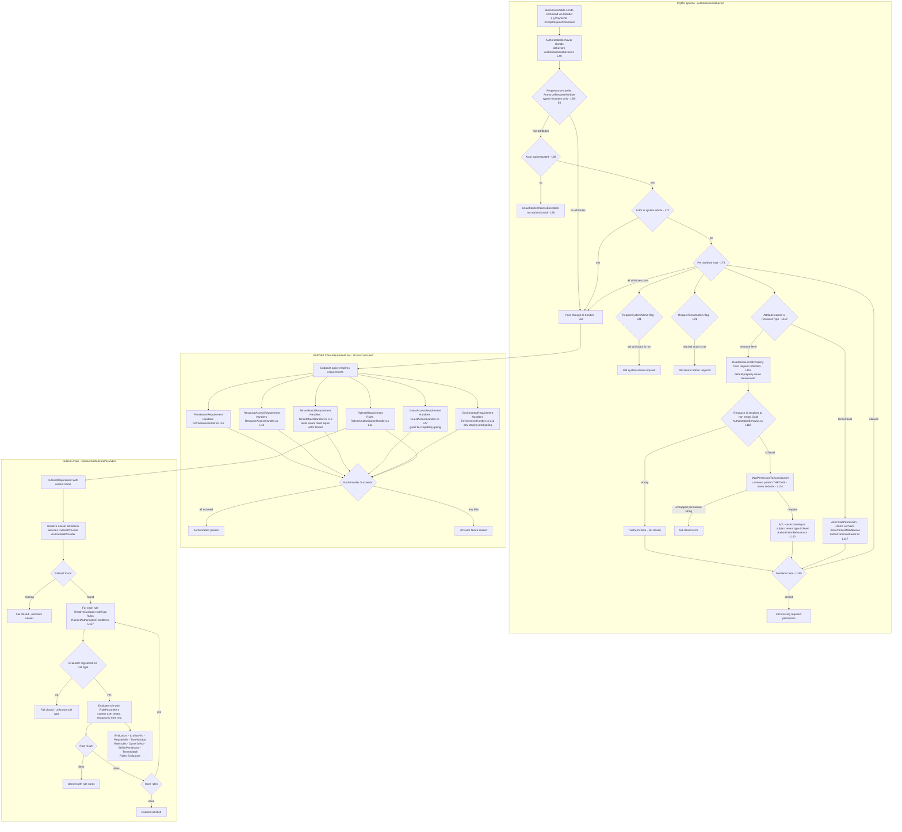
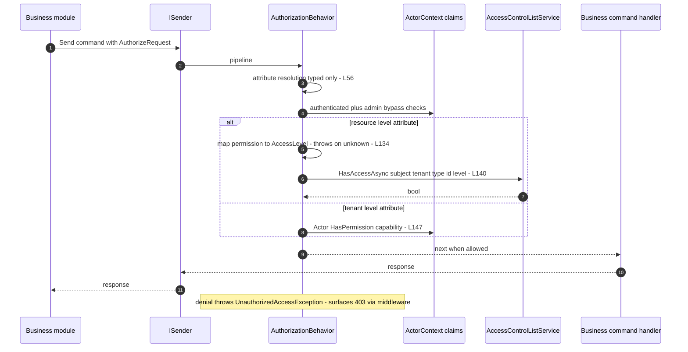

# Orchestrated Permission Checks — User Flow Diagram

> Module `GameGuild.Identity.Authorization` · Documented against `develop` commit `74e9bba4c`.
> Scope: how a **single business request** is orchestrated through multiple permission checks — the CQRS pipeline behavior (`AuthorizationBehavior` over `[AuthorizeRequest]`), the ASP.NET Core multi-requirement handlers (permission, resource access, tenant match, guest access, environment, ruleset), and the ruleset evaluator chain. 112 request declarations across the platform carry `[AuthorizeRequest]` — this is the platform-wide authorization chokepoint, not a niche path.

Paths are relative to `apps/api/Source/Modules/GameGuild.Identity.Authorization/`.

## 1. Overview

Three orchestration frames run in sequence for a typical business command:

1. **CQRS pipeline** — `AuthorizationBehavior<TRequest,TResponse>` (`Behaviors/AuthorizationBehavior.cs:42`, registered `Extensions/AuthorizationModuleExtensions.cs:352`) intercepts **every** command/query sent through `ISender`. If the request type carries `[AuthorizeRequest]` (typed attribute resolution only, `AuthorizationBehavior.cs:56-58`), it: requires authentication (`:66-69`), short-circuits for system admins (`:72-75`), honors `RequireSystemAdmin`/`RequireTenantAdmin` flags (`:81-99`), then per attribute either does a **resource-level ACL check** (`IAccessControlListService.HasAccessAsync` with `AclSubject.ForUser`, permission→`AccessLevel` mapping that throws on unknown patterns — fail closed, `:112-140`) or a **tenant-level capability check** (`Actor.HasPermission`, the claims-cached set built by `ActorContextMiddleware`, `:143-147`).
2. **ASP.NET Core authorization** — endpoint policies resolve requirement *sets*; each requirement is handled by its own handler: `PermissionHandler` (see `permission-evaluation-decision-path-flow.md`), `ResourceAccessHandler` (`Handlers/ResourceAccessHandler.cs:14`), `TenantMatchHandler` (`Handlers/TenantMatchHandler.cs:13`), `GuestAccessHandler` (`Handlers/GuestAccessHandler.cs:27`), `EnvironmentHandler` (`Handlers/EnvironmentHandler.cs:12`), `RulesetAuthorizationHandler` (`Rules/RulesetAuthorizationHandler.cs:11`). All requirements must be satisfied (AND semantics) — an endpoint declaring permission + tenant-match + ruleset must pass all three.
3. **Ruleset chain** — `RulesetAuthorizationHandler` resolves the rule evaluators for a ruleset from `IRuleEvaluatorRegistry` (`Rules/Abstractions/IRuleEvaluatorRegistry.cs`; handler `:157` `ResolveEvaluator`) and runs each rule (`IRuleEvaluator`, `Rules/Abstractions/IRuleEvaluator.cs`): IP allow-list (`Rules/Evaluators/RequireIpAllowListRuleEvaluator.cs`), MFA (`RequireMfaRuleEvaluator.cs`), time window (`RequireTimeWindowRuleEvaluator.cs`), role rules (`RoleRuleEvaluators.cs`), owner-or-ACL (`OwnerOrAclRuleEvaluator.cs`), self-or-permission (`SelfOrPermissionRuleEvaluator.cs`), tenant match (`TenantMatchRuleEvaluator.cs`). Ruleset definitions come from `RulesetProvider` (`Services/RulesetProvider.cs`) over `IRulesetProvider`.

## 2. End-to-End Flowchart — happy path and every edge case

## 3. CQRS Chain Sequence Diagram

## 4. Edge-Case Matrix

| # | Edge case | Code path | Outcome |
|---|-----------|-----------|---------|
| 1 | Request without `[AuthorizeRequest]` | passthrough (`Behaviors/AuthorizationBehavior.cs:60-63`) | no check in this frame |
| 2 | Unauthenticated actor on guarded request | `:66-69` | throw → 403 |
| 3 | System admin | bypass (`:72-75`) | all attribute checks skipped |
| 4 | `RequireSystemAdmin` / `RequireTenantAdmin` flags | `:81-99` | explicit role gates |
| 5 | Resource-level attribute but `ResourceId` property missing on request | `GetResourceIdFromRequest` → `Guid.Empty` (`:118-121`, helper `:166-190`) | `hasPerm=false` fail closed |
| 6 | Permission string not mappable to `AccessLevel` | `MapPermissionToAccessLevel` throws (`:134` remarks `:33-38`) | fail-closed error, never defaults to Write |
| 7 | Tenant-level capability check | claims-set `Actor.HasPermission` (`:147`) | set built once per request by `Middleware/ActorContextMiddleware.cs:45` |
| 8 | ACL subject has no role/group resolution | `AclSubject.ForUser` only (`:137` comment) | role-scoped ACL entries invisible to this frame |
| 9 | Ruleset name unknown | `RulesetAuthorizationHandler` fail closed | requirement not satisfied |
| 10 | Rule type without registered evaluator | `ResolveEvaluator` null (`Rules/RulesetAuthorizationHandler.cs:157`) | fail closed |
| 11 | IP allow-list rule with unlisted client | `Rules/Evaluators/RequireIpAllowListRuleEvaluator.cs` | rule denies |
| 12 | MFA rule without MFA claim | `Rules/Evaluators/RequireMfaRuleEvaluator.cs` | rule denies |
| 13 | Time-window rule outside window | `Rules/Evaluators/RequireTimeWindowRuleEvaluator.cs` | rule denies |
| 14 | Multiple requirements, one fails | ASP.NET AND semantics | 403 with that handler's failure reason |
| 15 | Attribute declared on query (read) as well as command | behavior applies to all `IRequestBase` (`:45`) | queries authorized identically |

## 5. Endpoint Inventory

This flow is not endpoint-shaped; it wraps the endpoints of every module that declares `[AuthorizeRequest]` (112 declarations across Analytics, Commerce.Payments, Commerce.Orders, Resources, Learning and others). The registration and behavior:

| Piece | Ref |
|-------|-----|
| `AuthorizationBehavior<,>` registration | `Extensions/AuthorizationModuleExtensions.cs:352` |
| `[AuthorizeRequest]` consumers | 112 declarations in `apps/api/Source/Modules/*` (e.g. `GameGuild.Commerce.Payments/Commands/AcceptDispute/AcceptDisputeCommand.cs`) |
| Requirement handlers | `Handlers/PermissionHandler.cs:12`, `Handlers/ResourceAccessHandler.cs:14`, `Handlers/TenantMatchHandler.cs:13`, `Handlers/GuestAccessHandler.cs:27`, `Handlers/EnvironmentHandler.cs:12`, `Rules/RulesetAuthorizationHandler.cs:11` |
| Rule evaluators | `Rules/Evaluators/*.cs` (7 evaluators) |
| Tests | `GameGuild.Identity.Authorization.IntegrationTests/RuleBasedAuthorizationIntegrationTests.cs`; `GameGuild.Identity.Authorization.UnitTests/Abstractions/RuleEvaluatorRegistryTests.cs`; `GameGuild.Identity.Authorization.UnitTests/GuestAccessAuthorizationTests.cs` |

## 6. Events Published / Consumed

- None of its own: denials surface as `UnauthorizedAccessException` → 403 problem responses; the host's `AuditingAuthorizationMiddlewareResultHandler` (`GameGuild.API/Core/Security/AuditingAuthorizationMiddlewareResultHandler.cs:90`) records `PermissionGranted`/`PermissionDenied` audit events for the ASP.NET frame (see `docs/authorization/event-flows.md`).

## 7. Gaps

1. **NEW — resource-level `AuthorizeRequest` cannot see role/group ACL subjects**: the behavior builds only `AclSubject.ForUser` (`Behaviors/AuthorizationBehavior.cs:137`, comment admits role/group ids unresolved) — ACL entries scoped to roles never match in this frame even though the ACL service supports them.
2. **NEW — reflection-based `ResourceId` extraction is convention-dependent** (`:116-121`, default property name `ResourceId`): a guarded command whose id property is named differently silently fails closed — safe but undiscoverable (no startup validation of attribute-vs-request contract).
3. **NEW — tenant-level check reads the claims snapshot, not the engine**: `Actor.HasPermission` (`:147`) consults permissions embedded in the request's actor context; grant/revoke mid-request or context-building gaps are invisible here — divergence risk with `EffectivePermissionResolverService` (defense in depth exists only if `ActorContextMiddleware` populates from the same engine).
4. Carried: `PermissionHandler` rethrow-after-fail (decision-path flow §8).
