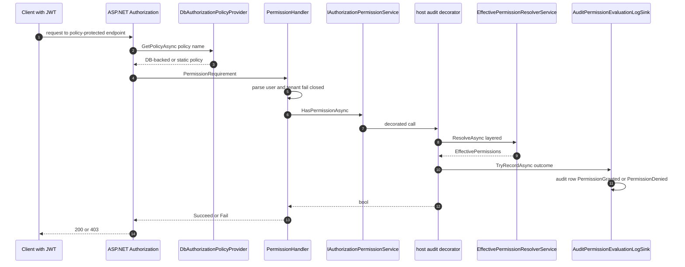

# Permission Evaluation Decision Path — User Flow Diagram

> Module `GameGuild.Identity.Authorization` · Documented against `develop` commit `74e9bba4c`.
> Scope: the decision path **from the Authorization module's own surfaces** — ASP.NET Core policy evaluation (`PermissionHandler`, `DbAuthorizationPolicyProvider`), the DAC check surface, the ruleset/gate evaluators, and the caching + audit layers that wrap every decision. The layered resolution algorithm itself (layers 1-9, DENY-WINS, ABAC overlay) is documented in `docs/auth/flows/permission-evaluation-abac-flow.md` (#1110) and is referenced, not duplicated.

Paths are relative to `apps/api/Source/Modules/GameGuild.Identity.Authorization/` unless they start with `GameGuild.API/` or another module.

## 1. Overview

A permission decision enters through one of four doors:

1. **ASP.NET policy `[Authorize(Policy = ...)]`** — `DbAuthorizationPolicyProvider` (`Providers/DbAuthorizationPolicyProvider.cs:16`) resolves policy names against DB-backed `PolicyDefinitionEntity` rows (tenant-scoped override of a global base, `:80-96`) falling back to the static provider. `PermissionHandler` (`Handlers/PermissionHandler.cs:12`) then runs the `PermissionRequirement`: it parses user + tenant ids fail-closed (`:77-121`), delegates to `IAuthorizationPermissionService.HasPermissionAsync`, and on error **fails and rethrows** (`:69-74`) — the rethrow surfaces as 500, not 403.
2. **`[RequiresPermission]` / resource filters** — attribute-driven, routed to `ResourcePermissionAuthorizationFilter` (`Handlers/ResourcePermissionAuthorizationFilter.cs`, DAC checks at `:412,474,519`).
3. **Direct query surface** — `PermissionEvaluationController` (Authentication module) and `TenantPermissionsController`/`ResourcePermissionsController` reads (`HasPermissionQuery`, `GetEffectivePermissionsQuery` — handlers `GameGuild.Identity.Authentication/Handlers/PermissionEvaluationQueryHandlers.cs:211,332`).
4. **Ruleset gates** — `PolicyGateService.EvaluateGatesAsync` (`Services/PolicyGateService.cs:60`) evaluates rule-based policies (`Rules/RulesetAuthorizationHandler.cs`) with individual evaluators (IP allow-list `Rules/Evaluators/RequireIpAllowListRuleEvaluator.cs`, MFA `RequireMfaRuleEvaluator.cs`, time window `RequireTimeWindowRuleEvaluator.cs`, owner/ACL `OwnerOrAclRuleEvaluator.cs`, tenant match, self-or-permission).

**Cross-cutting layers.** Hybrid caching (`Caching/HybridPermissionCache.cs` with L1 memory + L2 payload `Caching/PermissionCacheL2Payload.cs`, key tracker `Caching/PermissionCacheKeyTracker.cs`, invalidation `Caching/CacheInvalidationService.cs` + Redis pub/sub `Caching/RedisPermissionCacheInvalidationPublisher.cs`/`Subscriber.cs`); denial throttle (`Services/EvaluationDenialThrottleService.cs`, enumeration protection); durable evaluation logging (`Services/PermissionEvaluationLogService.cs` → `IPermissionEvaluationLog` → host sink `GameGuild.API/Core/Security/AuditPermissionEvaluationLogSink.cs:12` writing `PermissionGranted`/`PermissionDenied` audit events, `:31`); and the host decorator `AuditingAuthorizationPermissionService` (`GameGuild.API/Core/Security/AuditingAuthorizationPermissionService.cs:17,167,233,246`) which audits every `HasPermissionAsync` outcome — the events observed in logs.

## 2. End-to-End Flowchart — happy path and every edge case

```mermaid
flowchart TD
    subgraph D1["Door 1 - ASP.NET policy"]
        P1["Endpoint with Authorize Policy name"] --> P2["DbAuthorizationPolicyProvider GetPolicyAsync<br/>Providers DbAuthorizationPolicyProvider.cs L45"]
        P2 --> P3{"Policy in DB store<br/>tenant scoped first then global base - L80-96"}
        P3 -- "found" --> P4["Build AuthorizationPolicy from definition<br/>permissions roles schemes ACL flag - L96"}
        P3 -- "not found" --> P5{"Static fallback provider - L45"}
        P5 -- "static policy" --> P6["Static policy applies"]
        P5 -- "unknown" --> P404["PolicyNotFound - endpoint 403 or 500 by host config"]
        P4 --> P7["PermissionHandler HandleRequirementAsync<br/>Handlers PermissionHandler.cs L35"]
        P6 --> P7
        P7 --> P8{"User id claim parses and not Guid Empty<br/>PermissionHandler.cs L83-95"}
        P8 -- "no" --> P403a["Fail - user or tenant context unavailable - L42"]
        P8 -- "yes" --> P9{"Tenant context or tenant claim valid<br/>L98-120"}
        P9 -- "no" --> P403b["Fail closed - no valid tenant - L119"]
        P9 -- "yes" --> P10["IAuthorizationPermissionService HasPermissionAsync<br/>PermissionHandler.cs L48"]
        P10 --> P11{"Decision - L54"}
        P11 -- "true" --> P12["Succeed requirement - L57"]
        P11 -- "false" --> P13["Fail - missing permission - L66"]
        P10 -- "throws" --> P14["context Fail AND rethrow - L72-73"]
        P14 --> P500["500 - fail closed but loses the 403 semantics"]
    end

    subgraph D2["Door 2 - attributes and resource filter"]
        A1["RequiresPermission attribute on endpoint"] --> A2["PermissionRequirement via policy pipeline"]
        A2 --> P7
        A3["Resource scoped endpoint"] --> A4["ResourcePermissionAuthorizationFilter<br/>Handlers ResourcePermissionAuthorizationFilter.cs L412 L474 L519<br/>DacPermissionQuery per layer"]
        A4 --> A5["IDacPermissionResolver direct service call<br/>Abstractions IDacPermissionResolver.cs L47 L59<br/>NOT a CQRS request"]
        A5 --> A6["EffectivePermissionResolverService ResolveAsync layers 1-9"]
    end

    subgraph D3["Door 3 - direct query surface"]
        Q1["POST v1 permissions tenant check<br/>PermissionEvaluationController.cs L39"] --> Q2["HasTenantPermissionQueryHandler<br/>GameGuild.Identity.Authentication Handlers PermissionEvaluationQueryHandlers.cs L32"]
        Q2 --> Q3["Actor guard EnsureCanReadPermissions - L38"]
        Q3 --> Q4["PermissionQueryService then resolver - see auth doc"]
        Q1b["GET resource has-permission<br/>ResourcePermissionsController.cs L229"] --> Q2b["HasPermissionQuery - TenantPermissionQueries.cs L593"]
    end

    subgraph D4["Door 4 - ruleset gates"]
        G1["PolicyGateService EvaluateGatesAsync<br/>Services PolicyGateService.cs L60"] --> G2["Gate definitions evaluated in order - L171"]
        G2 --> G3["Rule evaluators registry<br/>Rules Abstractions IRuleEvaluatorRegistry.cs"]
        G3 --> G4["Ip allow-list - Mfa - time window - owner or ACL - tenant - self<br/>Rules Evaluators"]
        G4 --> G5{"All gates pass"}
        G5 -- "no" --> G403["Denied with failing gate reason"]
        G5 -- "yes" --> G200["Allowed"]
    end

    subgraph X["Cross-cutting layers on every decision"]
        X1["Denial throttle per user plus tenant<br/>Services EvaluationDenialThrottleService.cs<br/>empty Throttled result - no store reads"] --> X2["Hybrid cache lookup<br/>Caching HybridPermissionCache.cs<br/>L1 memory plus L2 payload"]
        X2 -- "hit" --> X3["Cached decision returned"]
        X2 -- "miss" --> X4["EffectivePermissionResolverService ResolveAsync<br/>see permission-evaluation-abac-flow doc"]
        X4 --> X5["DENY-WINS subtraction"]
        X5 --> X6["Decision cached"]
        X6 --> X7["Evaluation log record<br/>Services PermissionEvaluationLogService.cs"]
        X7 --> X8["Host sink AuditPermissionEvaluationLogSink<br/>GameGuild.API Core Security AuditPermissionEvaluationLogSink.cs L12"]
        X8 --> X9["Audit event PermissionGranted or PermissionDenied<br/>AuditPermissionEvaluationLogSink.cs L31<br/>RiskLevel Medium allow High deny"]
        X10["Mutation elsewhere bumps TenantSecurityVersion<br/>cache invalidation via Redis fan-out<br/>Caching RedisPermissionCacheInvalidationPublisher.cs"]
        X11["Host decorator AuditingAuthorizationPermissionService<br/>GameGuild.API Core Security AuditingAuthorizationPermissionService.cs L167 L233 L246<br/>audits every HasPermissionAsync outcome"]
    end
```

## 3. CQRS Chain Sequence Diagram



## 4. Edge-Case Matrix

| # | Edge case | Code path | Outcome |
|---|-----------|-----------|---------|
| 1 | User id claim missing/unparseable/Empty | fail-closed parse (`Handlers/PermissionHandler.cs:83-95`) | context.Fail |
| 2 | No tenant context and no tenant claim | `:98-120` | fail closed |
| 3 | Permission store throws | `:69-74` | `context.Fail` **then rethrow** → 500 not 403 |
| 4 | Tenant-scoped policy missing, global base exists | merge path (`Providers/DbAuthorizationPolicyProvider.cs:80-96`) | base policy applies |
| 5 | Policy name unknown to DB and static | fallback (`:45`) | policy-not-found path |
| 6 | Denial throttle active | `Services/EvaluationDenialThrottleService.cs` (resolver short-circuit, see auth doc) | empty `Throttled` result, no store reads |
| 7 | Cached decision vs concurrent revoke | security-version bump + Redis invalidation (`Caching/RedisPermissionCacheInvalidationPublisher.cs`) | decision evicted |
| 8 | DAC query half-specified resource pair | `query.IsValid` false (`Abstractions/IDacPermissionResolver.cs` impl `Services/DacPermissionResolver.cs:47-69`) | `ContextValid false`, empty set |
| 9 | Ruleset gate evaluator throws | gate evaluation (`Services/PolicyGateService.cs:171`) | gate denies (fail closed per gate) |
| 10 | Audit sink write fails | `TryRecordAsync` returns false (`GameGuild.API/Core/Security/AuditPermissionEvaluationLogSink.cs:8-11`) | decision unaffected, failure surfaced to caller of sink |
| 11 | Denied decision risk classification | `:31-46` | `PermissionDenied` audit at risk **High**; allow at Medium |
| 12 | Cross-tenant evaluation query | `EnsureCanReadPermissions` (`GameGuild.Identity.Authentication/Handlers/PermissionEvaluationQueryHandlers.cs:38`) | denied |

## 5. Endpoint Inventory (module-side decision surfaces)

| Method + Route | Entry | Handler |
|----------------|-------|---------|
| GET `api/v{v}/authorization/resources/{type}/{id}/has-permission` | `ResourcePermissionsController.cs:229` | `HasPermissionQuery` → `Queries/TenantPermissionQueries.cs:593` |
| GET `api/v{v}/authorization/content-types/{tenantId}/has-permission` | `ContentTypePermissionsController.cs:197` | direct `DacPermissionQuery` via `IDacPermissionResolver` (`:216`) — no CQRS handler by design |
| GET `api/v{v}/authorization/tenants/{tenantId}/has-permission` | `TenantPermissionsController.cs:171` | `GetTenantPermissionsQuery` + client-side contains |
| POST `v{v}/permissions/tenant:check` (+content-type/resource/resolve-hierarchy) | `PermissionEvaluationController.cs:39,85,120,185` | `PermissionEvaluationQueryHandlers.cs:32,128,211,388` |
| POST `v{v}/permissions/:resolve-hierarchy` | `:185` | `ResolvePermissionHierarchyQuery` → `:388` |

## 6. Events Published / Consumed

- **`PermissionGranted` / `PermissionDenied` audit events** (the ones observed in logs): produced by host sinks/decorators — `GameGuild.API/Core/Security/AuditPermissionEvaluationLogSink.cs:31`, `AuditingAuthorizationMiddlewareResultHandler.cs:90`, `AuditingAuthorizationPermissionService.cs:167,233,246` — consumed by `GameGuild.Compliance.Audit` `IAuditService` (durable audit trail; taxonomy `Modules/GameGuild.Compliance.Audit/Constants/SecurityEventTaxonomy.cs:65-66`: Authorization kind, Medium/High risk).
- `PermissionEvaluationLogEntry` durable rows via `Services/PermissionEvaluationLogService.cs` (admin reporting source, issues #359/#358).
- Cache-invalidation fan-out events over Redis (`Caching/RedisPermissionCacheInvalidationPublisher.cs` → `RedisPermissionCacheInvalidationSubscriber.cs`).
- Full inventory with durability in `docs/authorization/event-flows.md`.

## 7. Entities and Tables Touched

| Entity / Table | Role | Ref |
|-----------------|------|-----|
| `PolicyDefinitionEntity` | DB-backed policy registry the provider reads | `Entities/PolicyDefinitionEntity.cs:19-99` |
| `TenantSecurityVersion` | cache epoch per tenant (+global) | `Entities/TenantSecurityVersion.cs`; store `Services/DatabaseTenantSecurityVersionStore.cs` |
| `PermissionEvaluationLogEntry` | durable decision log | `Entities/PermissionEvaluationLogEntry.cs`; EF `Configuration/PermissionEvaluationLogEntryConfiguration.cs` |
| audit rows (Compliance.Audit) | `PermissionGranted`/`PermissionDenied` durable events | via host sinks |

## 8. Gaps

1. **NEW — `PermissionHandler` rethrows after `context.Fail`** (`Handlers/PermissionHandler.cs:72-73`): a permission-store outage becomes a 500 instead of the designed 403, and the `AuthorizationFailureReason` is discarded by the rethrow.
2. **NEW — `DbAuthorizationPolicyProvider` unknown-policy behavior is silent**: a typo'd policy name yields the static fallback's policy-not-found rather than a boot-time or log-time signal that a DB policy reference is dangling (`Providers/DbAuthorizationPolicyProvider.cs:45-96`).
3. **NEW — `ContentTypePermissionsController.has-permission` bypasses CQRS**: direct service call (`Controllers/ContentTypePermissionsController.cs:216`), so it skips pipeline behaviors (validation, observability, the generic operation-event contract) that every other decision surface gets.
4. Carried from #1110: overlay permissive-skip on ABAC evaluator failure; owner-override DEBUG-only audit; role-hierarchy depth caps silently drop grants.
5. **NEW — two has-permission idioms on near-identical routes**: `tenants/{id}/has-permission` fetches-then-contains (`TenantPermissionsController.cs:182-205`) while `resources/.../has-permission` uses a real boolean query — the tenant variant can diverge from engine semantics (deny/expiry filtering happens inside `GetTenantPermissionsQuery` today, but the contract is implicit).
