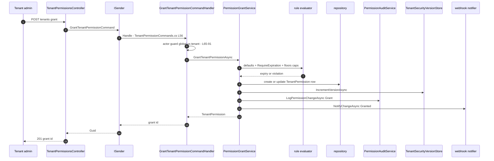

# Permission Grant Lifecycle — Grant, Expire, Revoke, Escalate — User Flow Diagram

> Module `GameGuild.Identity.Authorization` · Documented against `develop` commit `74e9bba4c`.
> Scope: the tenant-permission grant lifecycle — admin grant (with temporal rules), deny entries, background + manual expiration, revocation, expiry extension, reminders, and the JIT-elevation escalation path that mints temporary permission without a grant row.

Paths are relative to `apps/api/Source/Modules/GameGuild.Identity.Authorization/`.

## 1. Overview

Grants are `TenantPermission` rows (`Entities/TenantPermission.cs:20`, base `Entities/PermissionBase.cs:37`) carrying `Permissions` + `DenyPermissions` arrays, `IsActive`, `ExpiresAt`, `IsDeleted`. The admin surface is `TenantPermissionsController` (`Controllers/TenantPermissionsController.cs:23`, 18 endpoints). Commands live in `Commands/TenantPermissionCommands.cs` with in-handler actor guards (`IActorContextAccessor`); the mutation logic lives in `PermissionGrantService` (`Services/FocusedPermissionServices.cs:34`) which enforces temporal rules (issue #331: default expirations, `RequireExpiration` rules, duration floors/caps via `IPermissionExpirationRuleEvaluator`), writes a `PermissionAuditLog` row per mutation (`Services/PermissionAuditService.cs:20-66`), bumps the tenant security version to invalidate caches (`FocusedPermissionServices.cs:149-150`), and fans out a webhook notification (`NotifyChangeAsync`, `FocusedPermissionServices.cs:479-508`).

Expiration is **lazy at evaluation time** (expired grants contribute nothing — `IsGrantEffective` predicate, `FocusedPermissionServices.cs:727-728`) plus **durable via a worker**: `PermissionExpirationWorker` (`BackgroundServices/PermissionExpirationWorker.cs`) drives `PermissionExpirationService.ProcessExpiredAsync` (`Services/PermissionExpirationService.cs:54`) which flips `grant.Expire()` + `IsActive=false`, stamps `expirationProcessedAt` metadata, audits with a system actor, and publishes `PermissionExpirationNotification` (consumed by the host's `PermissionExpirationAlertHandler`). Reminders (`SendUpcomingExpirationRemindersAsync`, `:206`) stamp `expirationReminderAt` and rate-limit themselves via `MinimumReminderInterval`.

**Escalation** is JIT elevation: `JitElevationsController` (`Controllers/JitElevationsController.cs:19`, 10 endpoints) → `JitElevationService` (`Services/JitElevationService.cs:8`) creates `JitElevationRequest` rows (Pending → Approved → Active → Expired/Revoked) with anti-self-approval (`Entities/JitElevationRequest.cs:113`); in-force elevations contribute a `TemporaryElevation` allow at layer 7 of `EffectivePermissionResolverService` (`admin:*` never grantable — see `docs/auth/flows/permission-evaluation-abac-flow.md`).

## 2. End-to-End Flowchart — happy path and every edge case

```mermaid
flowchart TD
    subgraph G["Grant - POST api v1 authorization tenants grant"]
        G1["Tenant admin POST grant<br/>TenantPermissionsController.cs L35"] --> G2["GrantTenantPermissionCommandHandler<br/>TenantPermissionCommands.cs L56"]
        G2 --> G3{"Target tenant is Guid Empty global default<br/>TenantPermissionCommands.cs L65"}
        G3 -- "yes" --> G4{"Actor has ManageGlobalDefaults or IsSystemAdmin<br/>L68"}
        G4 -- "no" --> G403["403 UnauthorizedAccess - L75"]
        G3 -- "no" --> G5{"Actor is system admin or same-tenant tenant admin<br/>L82"}
        G5 -- "no" --> G403
        G5 -- "yes" --> G6["PermissionGrantService GrantTenantPermissionAsync<br/>FocusedPermissionServices.cs L47"]
        G6 --> G7{"ApplyDefaultsOnGrant and no caller expiry<br/>FocusedPermissionServices.cs L67"}
        G7 -- "yes rule matches" --> G8["expiresAt = now plus configured default - L72"]
        G7 -- "no default" --> G9{"RequireExpiration rule matches and still no expiry<br/>L86-99"}
        G9 -- "yes no default configured" --> G422["PermissionExpirationRuleViolationException - L92"]
        G9 -- "rule gives default" --> G8
        G8 --> G10{"ValidateSetExpiration floors and caps<br/>FocusedPermissionServices.cs L107"}
        G10 -- "violations" --> G422
        G10 -- "ok" --> G11{"Existing grant row for user plus tenant - L116"}
        G11 -- "exists" --> G12["AddPermissions RemoveDenyPermissions IsActive true<br/>expiry keeps EARLIER of old vs new - L122-127"]
        G11 -- "none" --> G13["Create TenantPermission row - L135-146"]
        G12 --> G14["Bump tenant security version - L150"]
        G13 --> G14
        G14 --> G15["PermissionAuditLog Grant row - L152-162"]
        G15 --> G16["NotifyChangeAsync Granted webhooks - L164-170"]
        G16 --> G201["201 grant id"]
    end

    subgraph R["Revoke - POST revoke and POST deny"]
        R1["POST revoke - TenantPermissionsController.cs L63"] --> R2["RevokeTenantPermissionCommandHandler<br/>TenantPermissionCommands.cs L154"]
        R2 --> R3{"Same admin guards as grant - L163-190"}
        R3 -- "fail" --> R403["403"]
        R3 -- "pass" --> R4{"Self-revoke of own TenantAdmin or Admin<br/>TenantPermissionCommands.cs L193-198"}
        R4 -- "yes" --> R409["InvalidOperationException - cannot revoke own admin"]
        R4 -- "no" --> R5["RemovePermissions from row<br/>FocusedPermissionServices.cs L192"]
        R5 --> R6{"Row now empty of permissions<br/>FocusedPermissionServices.cs L194-196"}
        R6 -- "empty" --> R7["Repository DeleteAsync removes row"]
        R6 -- "not empty" --> R8["UpdateAsync keeps remaining permissions"]
        R7 --> R9["Audit Revoke - cache bump - webhook Revoked"]
        R8 --> R9
        R10["POST deny L271 - deny entries take precedence DENY-WINS<br/>DenyTenantPermissionCommandHandler L402"] --> R11["AddDenyPermissions on row<br/>FocusedPermissionServices.cs L341"]
        R11 --> R12["POST deny remove L301 clears deny entries<br/>RemoveDenyPermissionsCommandHandler L499"]
    end

    subgraph X["Expire - worker and manual"]
        X1["PermissionExpirationWorker period<br/>BackgroundServices PermissionExpirationWorker.cs"] --> X2["ProcessExpiredAsync<br/>Services PermissionExpirationService.cs L54"]
        X3["SystemAdmin POST permissions process-expired<br/>TenantPermissionsController.cs L437<br/>ProcessExpiredPermissionsCommandHandler L704"] --> X2
        X2 --> X4{"Actor resolution - anonymous ambient becomes<br/>system maintenance actor or authenticated admin<br/>PermissionExpirationService.cs L102-122"}
        X4 -- "neither" --> X403["403 requires system administration"]
        X4 -- "ok" --> X5["GetExpiredPermissionsAsync - L69"]
        X5 --> X6["Skip grants stamped expirationProcessedAt<br/>batch capped by BatchSize - L72"]
        X6 --> X7["Per tenant group inside PermissionMutationTransaction<br/>grant Expire + IsActive false + stamp - L151-152"]
        X7 --> X8["Audit Expire with system actor - throws if audit row not persisted<br/>PermissionExpirationService.cs L154-161"]
        X8 --> X9{"Audit write failed - L159"}
        X9 -- "audit null" --> X500["InvalidOperationException - grant processing rolls back"]
        X9 -- "ok" --> X10["Publish PermissionExpirationNotification Expired<br/>best effort - failure logged not fatal - L83-89"]
        X10 --> X11["Tenant security version bump per group - L139"]
        X11 --> X12["Any group failure" ]
        X12 -- "yes" --> X13["AggregateException with ProcessedGrantCount<br/>processed groups stay committed - L92-97"]
        X12 -- "no" --> X14["200 processed count"]
        X15["Lazy expiry - evaluation ignores expired rows<br/>FocusedPermissionServices.cs L727-728 IsGrantEffective"]
        X16["POST permissions send-expiration-reminders L457<br/>SendUpcomingExpirationRemindersAsync L206"] --> X17["Grants expiring inside window<br/>respects MinimumReminderInterval stamp - L213-214"]
        X17 --> X18["Publish PermissionExpirationNotification Upcoming - L224-232"]
        X19["POST permissions set-expiration L335 and extend-expiration L365<br/>SetExpirationAsync L253 ExtendExpirationAsync L292"] --> X20{"ExpiresAt in the past rejected L262<br/>Extension positive L301"}
        X20 -- "invalid" --> X400["ArgumentException"]
        X20 -- "ok" --> X21["Rules validated for EVERY matched grant BEFORE first mutation - L273-275"]
        X21 -- "violations" --> X422b["PermissionExpirationRuleViolationException atomic reject"]
        X21 -- "ok" --> X22["Mutate - clear reminder and processed stamps - L282-285"]
        X22 --> X23["Audit Update per grant + tenant version bump - L387-404"]
    end

    subgraph J["Escalation - JIT elevation"]
        J1["User POST v1 jit-elevations<br/>JitElevationsController.cs L24"] --> J2["RequestJitElevationCommandHandler<br/>JitElevationCommands.cs L50"]
        J2 --> J3["JitElevationService RequestElevationAsync<br/>Services JitElevationService.cs L27"]
        J3 --> J4["Create JitElevationRequest Status Pending<br/>ExpiresAt now plus durationMinutes - JitElevationService.cs L46-58"]
        J4 --> J5["Audit ElevateJIT - L62-78"]
        J5 --> J6["Reviewer POST approve L39"]
        J6 --> J7["ApproveRequestAsync - JitElevationService.cs L83"]
        J7 --> J8{"Request exists - L92"}
        J8 -- "missing" --> J404["404 not found"]
        J8 -- "found" --> J9{"Entity Approve guard<br/>pending only AND reviewer differs from requester<br/>Entities JitElevationRequest.cs L107-113"}
        J9 -- "self approval" --> J409b["InvalidOperationException - not allowed"]
        J9 -- "ok" --> J10["Status Approved - tenant version bump - audit Review"]
        J10 --> J11["Activation - IsGrantInForce at evaluation time<br/>JitElevationRequest.cs L75 - resolver layer 7"]
        J11 --> J12{"Window elapsed at next check<br/>JitElevationRequest.cs L95"}
        J12 -- "yes" --> J13["MarkExpired - cleanup endpoint L174<br/>CleanupExpiredElevationsCommand L275"]
        J12 -- "active" --> J14["TemporaryElevation allow - admin wildcard never grantable"]
        J15["POST revoke L73 - revoke elevation early<br/>RevokeJitElevationCommand L237 - entity guard active or approved only"]
    end
```

## 3. CQRS Chain Sequence Diagram

## 4. Edge-Case Matrix

| # | Edge case | Code path | Outcome |
|---|-----------|-----------|---------|
| 1 | Grant to global defaults (tenantId=Empty) without `ManageGlobalDefaults` | guard (`Commands/TenantPermissionCommands.cs:65-78`) | 403 |
| 2 | Cross-tenant or non-admin grant | guard (`:82-91`) | 403 "Only tenant or system administrators" |
| 3 | Grant of permissions under a `RequireExpiration` rule without expiry and no default | `FocusedPermissionServices.cs:86-99` | 422 rule violation, grant rejected |
| 4 | Expiry beyond rule cap / below floor | `ValidateSetExpiration` (`:107-112`) | `PermissionExpirationRuleViolationException` |
| 5 | Re-grant over existing row | merge (`:120-131`) | permissions unioned, denies removed, expiry keeps the EARLIER deadline |
| 6 | Self-revoking own TenantAdmin/Admin | guard (`TenantPermissionCommands.cs:193-198`) | InvalidOperationException lockout protection |
| 7 | Revoke leaving an empty permissions array | `FocusedPermissionServices.cs:194-196` | row deleted outright |
| 8 | Expired grant still in table | `IsGrantEffective` (`:727-728`) | contributes nothing (fail-closed at evaluation) |
| 9 | Expiration audit write fails | `PermissionExpirationService.cs:159-161` | throws — mutation rolls back (audit-or-nothing) |
| 10 | Expiration notification publish fails | best-effort catch (`:83-89`) | logged, expiration still committed |
| 11 | Some tenant groups fail during process-expired | aggregate (`:92-97`) | `AggregateException` with `ProcessedGrantCount`; successful groups stay committed |
| 12 | Reminder spam prevention | `MinimumReminderInterval` stamp (`:213-214`) | re-reminder only after interval |
| 13 | Set expiration in the past | `ArgumentException` (`:262-265`) | rejected; use process-expired |
| 14 | Bulk set/extend with one violating grant | validate-all-before-mutate (`:273-275,311-313`) | atomic reject citing rule keys |
| 15 | Extending a processed-expired grant | stamps cleared (`:284-285`) | grant reactivates (`IsActive=true`, `:323`) |
| 16 | JIT self-approval | entity guard (`Entities/JitElevationRequest.cs:113`) | rejected |
| 17 | Expired JIT elevation at evaluation | `IsGrantInForce` (`:75`) | no TemporaryElevation allow |
| 18 | Unauthenticated call | `[Authorize]` (`TenantPermissionsController.cs:21`) | 401 |
| 19 | Duplicate deny + allow on same row | DENY-WINS subtraction (resolver `:322`) | deny wins |

## 5. Endpoint Inventory

| Method + Route | Command/Query | Handler |
|----------------|---------------|---------|
| POST `api/v{v}/authorization/tenants/grant` | `GrantTenantPermissionCommand` | `TenantPermissionCommands.cs:52` |
| POST `.../tenants/revoke` | `RevokeTenantPermissionCommand` | `:150` |
| GET `.../tenants/{tenantId}/permissions` | `GetTenantPermissionsQuery` | `Queries/TenantPermissionQueries.cs:118` |
| GET `.../authorization/permissions/global:check` | `HasGlobalPermissionQuery` | `Queries/TenantPermissionQueries.cs:295` |
| GET `.../tenants/{tenantId}/has-permission` | `GetTenantPermissionsQuery` (client-side `Contains`) | `Queries/TenantPermissionQueries.cs:118` |
| POST `.../tenants/global/defaults` | `SetGlobalDefaultPermissionsCommand` | `TenantPermissionCommands.cs:248` |
| POST `.../tenants/defaults` | `SetTenantDefaultPermissionsCommand` | `:316` |
| POST `.../tenants/deny` | `DenyTenantPermissionCommand` | `:398` |
| POST `.../tenants/deny/remove` | `RemoveDenyPermissionsCommand` | `:495` |
| POST `.../tenants/permissions:set-expiration` | `SetTenantPermissionExpirationCommand` | `:594` |
| POST `.../tenants/permissions:extend-expiration` | `ExtendTenantPermissionExpirationCommand` | `:658` |
| GET `.../tenants/permissions:expiring` | `GetExpiringTenantPermissionsQuery` | `Queries/TenantPermissionQueries.cs:849` |
| POST `.../tenants/permissions:process-expired` | `ProcessExpiredPermissionsCommand` | `TenantPermissionCommands.cs:700` |
| POST `.../tenants/permissions:send-expiration-reminders` | `SendExpirationRemindersCommand` | `:737` |
| GET `.../tenants/permissions:expiration-rules` | `GetEffectiveExpirationRuleQuery` | `Queries/TenantPermissionQueries.cs:959` |
| GET `.../tenants/permissions:expiration-summary` | `GetExpirationSummaryQuery` | `Queries/PermissionExpirationAnalyticsQueries.cs:33` |
| GET `.../tenants/permissions:expiration-trends` | `GetExpirationTrendsQuery` | `:78` |
| GET `.../tenants/permissions:expiration-report` | `GetExpirationReportQuery` | `:127` |
| POST `v{v}/jit-elevations` (+`:approve`/`:deny`/`:revoke`/`:cleanup`, 5 GETs) | `JitElevation*` | `Commands/JitElevationCommands.cs:50,109,182,237,275`; `Queries/JitElevationQueries.cs:15-88` |

## 6. Events Published / Consumed

- `PermissionExpirationNotification` (Expired / Upcoming) — in-process `IPublisher.Publish` (`Services/PermissionExpirationService.cs:435-443`), consumed by host `GameGuild.API/Core/Security/PermissionExpirationAlertHandler.cs:45` (security alert + audit row). In-process only — no outbox row; durability = the notification handler's own writes.
- Webhook fan-out `IPermissionChangeNotifier.NotifyAsync` on Grant/Revoke/Deny (`Services/FocusedPermissionServices.cs:479-508`) — HMAC-signed HTTP, retried, delivery failures do not roll back the grant (`Services/WebhookPermissionChangeNotifier.cs:168-243`).
- `PermissionAuditLog` rows on every mutation (`Services/PermissionAuditService.cs:20-66`) — durable table, same scope.
- Tenant security version bump (`ITenantSecurityVersionStore`) drives cache invalidation everywhere (`FocusedPermissionServices.cs:149`; `PermissionExpirationService.cs:416-433`).

## 7. Entities and Tables Touched

| Entity / Table | Role | Ref |
|-----------------|------|-----|
| `TenantPermission` | grant/deny rows, expiry, soft-delete | `Entities/TenantPermission.cs:20`; base `Entities/PermissionBase.cs:37,112` |
| `PermissionAuditLog` | durable mutation trail | `Configuration/PermissionAuditLogConfiguration.cs`; writer `Services/PermissionAuditService.cs:38-57` |
| `JitElevationRequest` | escalation windows | `Entities/JitElevationRequest.cs`; guards `:104-191` |
| `TenantSecurityVersion` | cache epoch | `Entities/TenantSecurityVersion.cs`; store `Services/DatabaseTenantSecurityVersionStore.cs` |

## 8. Gaps

1. **NEW — `has-permission` endpoint evaluates client-side**: `GET {tenantId}/has-permission` fetches the full permission list then does `result.Permissions.Contains(permission)` in the controller (`Controllers/TenantPermissionsController.cs:182-205`) instead of a `HasPermission` query — O(list) and bypasses the deny/expiry-aware `HasTenantPermission` path used elsewhere (`GetTenantPermissionsQuery` does apply effective filtering, but the boolean answer here is string-contains on the effective set; a deny-filtered set is correct, yet future field additions can drift from the engine contract).
2. **NEW — reminder stamp written before publish**: `SendUpcomingExpirationRemindersAsync` stamps `expirationReminderAt` and saves (`Services/PermissionExpirationService.cs:221-222`) before publishing (`:224-232`); a publish failure logs and moves on — that grant now waits a full `MinimumReminderInterval` before another reminder attempt.
3. **NEW — JIT elevation approval bumps the tenant version but not the user token version**: approval invalidates cached permission views (`Services/JitElevationService.cs:103`) yet any user-security-version-keyed cache entries (see `IUserSecurityVersionStore`) are not bumped — stale allows could persist for the elevation window if such caches key on user version.
4. Carried from #1110 §9: owner-override audit is DEBUG-only; deep role hierarchies silently drop grants past depth 20.
