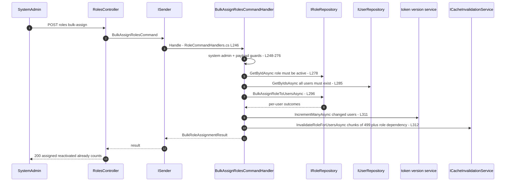

# Roles Lifecycle — User Flow Diagram

> Module `GameGuild.Identity.Authorization` (inheritance engine, dynamic roles, cache invalidation) with the roles HTTP surface in `GameGuild.Identity.Authentication` (`RolesController`) · Documented against `develop` commit `74e9bba4c`.
> Scope: role CRUD, assignment (single + bulk), removal, expiry, inheritance with cycle protection, and the analysis surface (`PermissionGraphController` deletion-impact) — plus the invalidation inconsistency between the single and bulk assignment paths.

Paths are relative to `apps/api/Source/Modules/GameGuild.Identity.Authentication/` when they start with `GameGuild.Identity.Authentication/`; otherwise `apps/api/Source/Modules/GameGuild.Identity.Authorization/`.

## 1. Overview

`RolesController` (`GameGuild.Identity.Authentication/Controllers/RolesController.cs:29`) exposes 9 endpoints under `v{v}/roles`, every action individually guarded with `[Authorize(Policy = Policies.RolesManage)]` (`:42,65,90,124,157,183,206,236,260`; policy name `Roles.Manage`, `GameGuild.Identity.Authorization/Policies.cs:185`). Handlers live in `GameGuild.Identity.Authentication/Handlers/RoleCommandHandlers.cs` and `RoleQueryHandlers.cs`.

The `Role` entity (`GameGuild.Identity.Authentication/Entities/Role.cs:9`) stores `Permissions` as a JSON string (`:49`) and has an `IsActive` flag; `UserRole` assignment rows (`GameGuild.Identity.Authentication/Entities/UserRole.cs`) carry `AssignedBy`, `AssignedAt`, `ExpiresAt` and a derived `IsExpired()`. Role permissions reach users through `RbacPermissionResolver` (direct + inherited via `RoleInheritanceEngine`), which is layer 2 of the permission resolution pipeline (see `docs/auth/flows/permission-evaluation-abac-flow.md`).

Inheritance: `RoleInheritanceEngine` (`GameGuild.Identity.Authorization/Services/RoleInheritanceEngine.cs`) computes the ancestor closure with a visited-set cycle guard plus a `MaxDepth` cap (default 10, `:29-30`) and exposes `WouldCreateCycleAsync` to reject cycle-forming parent edits (`:45-46`).

Deletion-impact analysis is a **separate read path**: `GET api/v{v}/authorization/permission-graph/roles/{roleId}/deletion-impact` (`GameGuild.Identity.Authorization/Controllers/PermissionGraphController.cs:59` → `Queries/PermissionGraphQueries.cs:33`) reports blast radius — but `DeleteRoleCommand` never consults it.

## 2. End-to-End Flowchart — happy path and every edge case

```mermaid
flowchart TD
    subgraph RC["Role CRUD"]
        RC1["SystemAdmin POST v1 roles<br/>RolesController.cs L89"] --> RC2["CreateRoleCommandHandler<br/>RoleCommandHandlers.cs L13"]
        RC2 --> RC3{"Name exists in tenant<br/>ExistsByNameAsync - L18"}
        RC3 -- "exists" --> RC409["InvalidOperationException duplicate name"]
        RC3 -- "free" --> RC4["Role created IsActive true<br/>permissions JSON serialized - L25-29"]
        RC4 --> RC201["201 RoleDto"]
        RC5["PUT roleId L123"] --> RC6["UpdateRoleCommandHandler - L52"]
        RC6 --> RC7{"Role exists - L70"}
        RC7 -- "missing" --> RC404["InvalidOperationException not found"]
        RC7 -- "found" --> RC8{"Rename collides - L79"}
        RC8 -- "collides" --> RC409
        RC8 -- "ok" --> RC9["Patch name description permissions IsActive - L84-101"]
        RC9 --> RC10["InvalidateRoleAsync cache dependency - L105"]
        RC11["DELETE roleId L156"] --> RC12["DeleteRoleCommandHandler - L126"]
        RC12 --> RC7b{"Role exists - L144"}
        RC7b -- "missing" --> RC404
        RC7b -- "found" --> RC13["DeleteAsync - NO assignment check<br/>NO deletion-impact consult - L151"]
        RC13 --> RC14["InvalidateRoleAsync - L152"]
        RC14 --> RC15["200 true - assignments cascade or orphan per FK"]
    end

    subgraph ASG["Assignment"]
        A1["Admin POST v1 roles assign<br/>RolesController.cs L205"] --> A2["AssignRoleToUserCommandHandler<br/>RoleCommandHandlers.cs L162"]
        A2 --> A3{"Role exists - L180"}
        A3 -- "missing" --> RC404
        A3 -- "found" --> A4{"User already has role - L187"}
        A4 -- "yes" --> A409["InvalidOperationException already has role"]
        A4 -- "no" --> A5["UserRole row with ExpiresAt optional - L194-197"]
        A5 --> A6["InvalidateRoleAsync user plus dependency - L201-205"]
        A6 --> A7["NOTE - no user token version bump"]
        A7 --> A200["200 UserRoleDto"]
        B1["SystemAdmin POST roles bulk-assign L235"] --> B2["BulkAssignRolesCommandHandler - L235-241"]
        B2 --> B3{"Actor system admin - L253"}
        B3 -- "no" --> B403["403 requires system administration"]
        B3 -- "yes" --> B4{"Validations - role id - 1 to 500 users - future expiry<br/>RoleCommandHandlers.cs L258-276"}
        B4 -- "invalid" --> B400["ArgumentException"]
        B4 -- "ok" --> B5{"Role exists AND IsActive - L279"}
        B5 -- "inactive or missing" --> RC404
        B5 --> B6{"All users exist - L285-294"}
        B6 -- "missing users" --> B400
        B6 -- "ok" --> B7["BulkAssignRoleToUsers atomic outcomes<br/>Assigned Reactivated AlreadyAssigned - L296-302"]
        B7 --> B8["IncrementManyAsync user token versions - L311"]
        B8 --> B9["InvalidateRoleForUsersAsync chunked 499 plus role dependency - L312-316"]
        B9 --> B200["200 BulkRoleAssignmentResult"]
        C1["POST roles remove L259"] --> C2["RemoveRoleFromUserCommandHandler - L335"]
        C2 --> C3{"User has role - L353"}
        C3 -- "no" --> A409
        C3 -- "yes" --> C4["RemoveRoleFromUserAsync - L361"]
        C4 --> C5["InvalidateRoleAsync - L364-368"]
        C5 --> C6["NOTE - no user token version bump"]
    end

    subgraph EXP["Expiry and inheritance"]
        E1["Assignment with ExpiresAt"] --> E2{"Wall clock past ExpiresAt<br/>UserRole IsExpired"}
        E2 -- "yes" --> E3["Assignment contributes nothing at resolution<br/>RbacPermissionResolver skips expired rows"]
        E2 -- "no" --> E4["Role permissions apply - direct grants"]
        E4 --> E5["RoleInheritanceEngine closure<br/>visited set cuts cycles - MaxDepth 10<br/>RoleInheritanceEngine.cs L14-30"]
        E5 --> E6{"WouldCreateCycleAsync guard on parent edits<br/>RoleInheritanceEngine.cs L45"}
        E6 -- "cycle detected" --> E409["Edit rejected - fail closed"]
        E6 -- "ok" --> E7["Inherited permissions attributed RoleInheritance"]
    end

    subgraph G["Graph analysis surface"]
        G1["GET authorization permission-graph<br/>PermissionGraphController.cs L34"] --> G2["GetPermissionGraphQuery<br/>Queries PermissionGraphQueries.cs L16"]
        G3["GET roles roleId deletion-impact L59"] --> G4["AnalyzeRoleDeletionQuery - L33"]
        G5["GET roles roleId permission-removal-impact permissionKey L77"] --> G6["AnalyzePermissionRemovalQuery - L50"]
        G4 -. "NOT consulted by DELETE role" .-> RC13
    end
```

## 3. CQRS Chain Sequence Diagram

## 4. Edge-Case Matrix

| # | Edge case | Code path | Outcome |
|---|-----------|-----------|---------|
| 1 | Duplicate role name in tenant | `ExistsByNameAsync` (`RoleCommandHandlers.cs:18,79`) | InvalidOperationException |
| 2 | Update non-existent role | `:70-74` | InvalidOperationException not found |
| 3 | Delete role with live assignments | `DeleteAsync` with no assignment check (`:141-156`) | role deleted; assignments fall to FK behavior — **deletion-impact analysis is not consulted** |
| 4 | Single assign of inactive role | no `IsActive` check (`:177-200`) | assignment succeeds against an inactive role whose permissions resolve nowhere |
| 5 | Single assign duplicate | `UserHasRoleAsync` (`:187`) | InvalidOperationException |
| 6 | Bulk assign >500 users | cap (`:263-266`) | ArgumentException |
| 7 | Bulk assign past-dated expiry | future check (`:273-276`) | ArgumentException |
| 8 | Bulk assign unknown users | existence check (`:285-294`) | ArgumentException citing ids |
| 9 | Bulk assign to inactive role | `role.IsActive` check (`:279`) | InvalidOperationException |
| 10 | Remove role user does not have | `:353-357` | InvalidOperationException |
| 11 | Role-hierarchy cycle attempted via parent edit | `WouldCreateCycleAsync` (`RoleInheritanceEngine.cs:45-46`) | rejected fail-closed |
| 12 | Cycle encountered during traversal | visited set cuts it (`RoleInheritanceEngine.cs:14-30`) | closure computed, `CyclesCut` reported |
| 13 | Legit hierarchy deeper than MaxDepth 10 | depth cap (`:29`) | ancestors pruned, `DepthLimitReached` true (engine-level visibility; resolver layer notes 20-cap behavior in `docs/auth/flows/permission-evaluation-abac-flow.md` §9) |
| 14 | Expired assignment | `UserRole.IsExpired()` | contributes nothing at resolution |
| 15 | Non-admin calling any roles endpoint | `Policies.RolesManage` on every action (`RolesController.cs:42-260`) | 403 |
| 16 | Global vs tenant role scoping | `Role.IsGlobalRole()/IsTenantRole()` (`Entities/Role.cs:60-66`) | cache invalidation picks global ( InvalidateGlobalAsync ) vs tenant batch (`RoleCommandHandlers.cs:388-406,420-422`) |

## 5. Endpoint Inventory

| Method + Route | Command/Query | Handler | Auth |
|----------------|---------------|---------|------|
| GET `v{v}/roles` | `GetRolesQuery` | `GameGuild.Identity.Authentication/Handlers/RoleQueryHandlers.cs:9` | `Roles.Manage` |
| GET `v{v}/roles/{roleId}` | `GetRoleByIdQuery` | `:32` | `Roles.Manage` |
| POST `v{v}/roles` | `CreateRoleCommand` | `Handlers/RoleCommandHandlers.cs:13` | `Roles.Manage` |
| PUT `v{v}/roles/{roleId}` | `UpdateRoleCommand` | `:52` | `Roles.Manage` |
| DELETE `v{v}/roles/{roleId}` | `DeleteRoleCommand` | `:126` | `Roles.Manage` |
| GET `v{v}/roles/user/{userId}` | `GetUserRolesQuery` | `RoleQueryHandlers.cs:60` | `Roles.Manage` |
| POST `v{v}/roles/:assign` | `AssignRoleToUserCommand` | `RoleCommandHandlers.cs:162` | `Roles.Manage` |
| POST `v{v}/roles/:bulk-assign` | `BulkAssignRolesCommand` | `:241` | `Roles.Manage` |
| POST `v{v}/roles/:remove` | `RemoveRoleFromUserCommand` | `:335` | `Roles.Manage` |
| GET `api/v{v}/authorization/permission-graph` | `GetPermissionGraphQuery` | `Authorization/Queries/PermissionGraphQueries.cs:16` | `[Authorize]` |
| GET `.../permission-graph/roles/{roleId}/deletion-impact` | `AnalyzeRoleDeletionQuery` | `:33` | `[Authorize]` |
| GET `.../permission-graph/roles/{roleId}/permission-removal-impact/{permissionKey}` | `AnalyzePermissionRemovalQuery` | `:50` | `[Authorize]` |

## 6. Events Published / Consumed

- No integration events: role mutations write no outbox rows. Cache invalidation is the observable side effect (`RolePermissionCacheInvalidation`, `RoleCommandHandlers.cs:375-443`) plus token-version bumps on the bulk path (`:311`).
- `RoleAssigned`/`RoleRevoked` exist only as **audit action-type strings** in the Compliance.Audit taxonomy (`GameGuild.Compliance.Audit/Constants/AuditActionTypes.cs`, referenced by `ComprehensiveEventCoverageService.cs:104`) — no producer in the roles path writes an audit row with those action types; role mutations are not audited to the permission audit log at all (contrast: tenant-permission grants are).

## 7. Entities and Tables Touched

| Entity / Table | Role | Ref |
|-----------------|------|-----|
| `Role` | name, tenant scope, JSON permissions, IsActive | `GameGuild.Identity.Authentication/Entities/Role.cs:9-66` |
| `UserRole` | assignment rows with expiry | `GameGuild.Identity.Authentication/Entities/UserRole.cs` |
| `DynamicRole` / assignments (deny-capable) | Authorization-module RBAC tables | `GameGuild.Identity.Authorization/Entities/DynamicRoleEntities.cs:26`; EF `Configuration/DynamicRoleConfiguration.cs` |
| Role hierarchy edges | inheritance closure inputs | `Services/RoleInheritanceEngine.cs` |

## 8. Gaps

1. **NEW — invalidation asymmetry single vs bulk**: bulk assignment bumps user token versions (`RoleCommandHandlers.cs:311`) and invalidates per-user caches; the single `:assign` (`:201-205`) and `:remove` (`:364-368`) bump only the role cache dependency — a user-scoped cache entry or an issued token carrying role-derived permissions stays live after a single-path change.
2. **NEW — single assign ignores `IsActive`**: bulk requires an active role (`:279`); single assign does not check (`:180-184`), allowing assignments to roles whose permissions resolve nowhere.
3. **NEW — delete role without consulting deletion-impact or assignment census**: `DeleteRoleCommandHandler` (`:141-156`) deletes blind; the `deletion-impact` endpoint exists (`PermissionGraphController.cs:59`) but is advisory-only with no enforcement hook.
4. **NEW — roles path writes no durable audit trail**: no `PermissionAuditLog` or audit-event rows on create/update/delete/assign/remove (only logs + cache invalidation), unlike the tenant-permission path (`Services/PermissionAuditService.cs`); `RoleAssigned`/`RoleRevoked` taxonomy entries have no producer.
