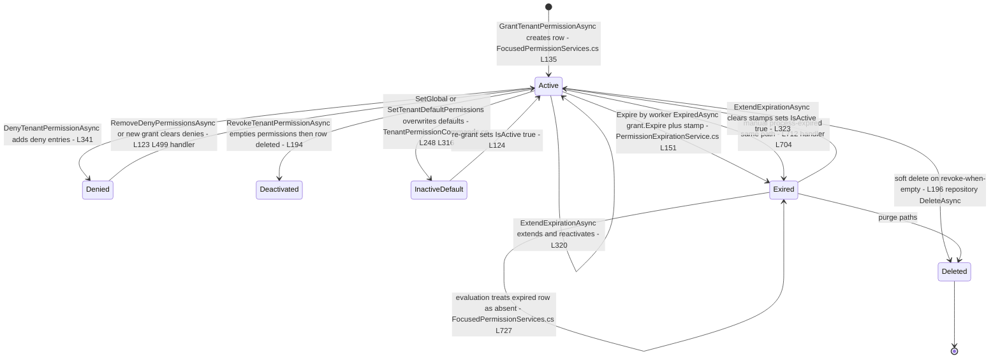
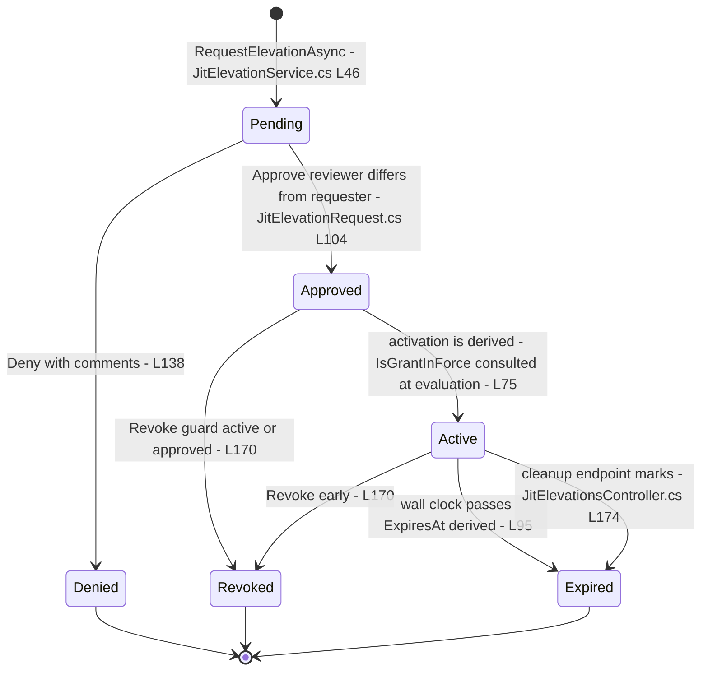
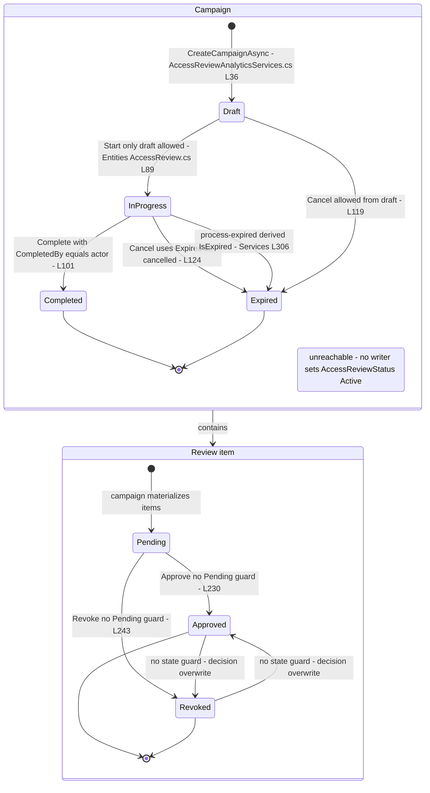
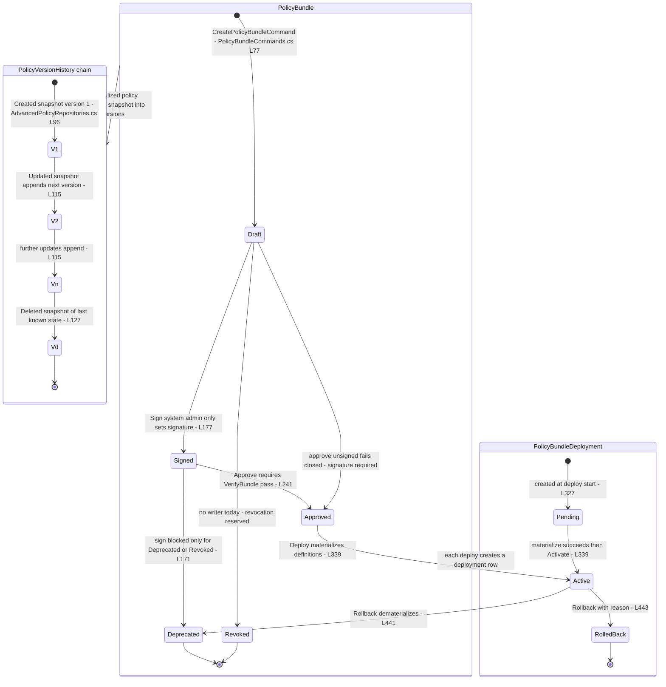
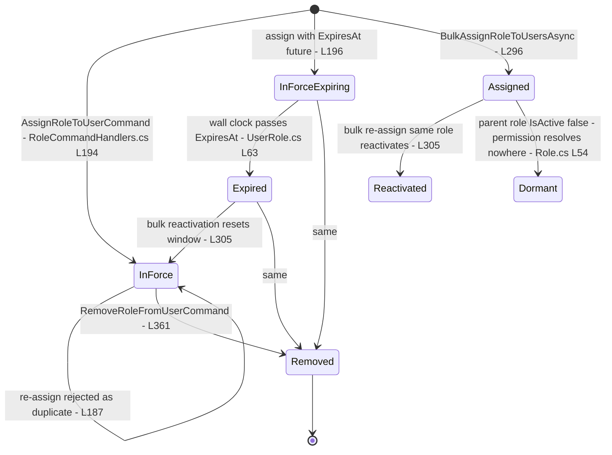

# Authorization State Machines — every stateful entity, every transition, audited

> Module `GameGuild.Identity.Authorization` (+ role assignment entity in `GameGuild.Identity.Authentication`) · Documented against `develop` commit `74e9bba4c`.
> Scope: one Mermaid `stateDiagram-v2` per stateful authorization entity — permission grant (TenantPermission), JIT elevation request, access-review campaign + item, conditional-policy version (+ the signed-bundle family that writes versions), and role assignment. Each entity gets a transitions audit: what the code allows, what has no trigger (unreachable states), and what is missing a guard.

Paths are relative to `apps/api/Source/Modules/GameGuild.Identity.Authorization/` unless they start with `GameGuild.Identity.Authentication/`.

---

## 1. Permission grant — `TenantPermission`

Entity: `Entities/TenantPermission.cs:20` (base `Entities/PermissionBase.cs:37`). State is the tuple (`IsActive` `:198`, `ExpiresAt` `:61`, `IsDeleted` soft-delete from the base) with derived `IsEffective() = !IsDeleted && IsActive && !IsExpired()` (`PermissionBase.cs:112`). The durable "Expired" transition is `Expire()` (`PermissionBase.cs:125`). Expired rows contribute nothing at evaluation time regardless of `IsActive` (`Services/FocusedPermissionServices.cs:727-728`).

State name note: `Exired` labels the durable post-expiration state (column values unchanged except `IsActive=false` + `expirationProcessedAt` metadata stamp) to keep the diagram label free of special characters.

### Transitions audit — TenantPermission

| Transition | Code allows? | Trigger (file:line) | Guard assessment |
|---|---|---|---|
| create → Active | yes | `GrantTenantPermissionAsync` (`Services/FocusedPermissionServices.cs:47-146`) | admin guards in handler (`Commands/TenantPermissionCommands.cs:64-91`); temporal rules enforced (`:67-113`) |
| Active → merged Active | yes | re-grant (`:120-131`) | expiry keeps the **earlier** deadline — extending requires the explicit extend endpoint |
| Active ↔ Denied | yes | deny/remove-deny (`:341`; handler `:495`) | deny wins at resolution (DENY-WINS) |
| Active → deleted (revoke) | yes | revoke (`:192-196`) | self-admin-revoke guard (`Commands/TenantPermissionCommands.cs:193-198`) |
| Active → Exired | yes | worker + manual (`Services/PermissionExpirationService.cs:151-153`; handler `Commands/TenantPermissionCommands.cs:712`) | audit-or-throw (`:159-161`); reminder stamp cleared on any re-set |
| Exired → Active | yes | extend (`:320-326`) | deliberate reactivation; `RequireExpiration` rules re-validated |
| derived expiry (no write) | yes | `IsGrantEffective` (`Services/FocusedPermissionServices.cs:727-728`) | fail-closed read first; durable write follows on worker cadence — window where row says Active but decision ignores it |

Missing guards / edge cases:

- **E1 (derived-vs-durable lag).** Between `ExpiresAt` passing and the worker's `Expire()` write, the row still reads `IsActive=true` — any admin UI or export reading raw rows overstates access; only the engine view is correct.
- **E2 (reminder stamp pre-publish).** `expirationReminderAt` is persisted before the notification publish (`PermissionExpirationService.cs:221-232`); a failed publish suppresses reminders for a full `MinimumReminderInterval`.

---

## 2. JIT elevation request — `JitElevationRequest`

Entity: `Entities/JitElevationRequest.cs`; status enum `ElevationRequestStatus` (Pending/Approved/Denied/Active/Revoked/Expired). Entity methods carry the real guards: `Approve` (`:104-117`, pending-only + no self-approval), `Deny` (`:138`), `Activate` (`:155-162`, approved-only), `Revoke` (`:170-178`, active-or-approved), `MarkExpired` (`:187`), derived `IsExpired` (`:95`, Active + wall clock) and `IsGrantInForce` (`:75`).

### Transitions audit — JitElevationRequest

| Transition | code allows? | Trigger (file:line) | Guard assessment |
|---|---|---|---|
| Pending → Approved | yes | `ApproveRequestAsync` (`Services/JitElevationService.cs:83-130`) | self-approval rejected in entity (`:113`) |
| Pending → Denied | yes | `:132-160` | comments required |
| Active → contribution | derived | resolver layer 7 (see auth flow doc) | `admin:*` never grantable |
| Approved → Active | **no explicit writer** | no code sets `Status = Active` | `Active` is reached only via cleanup/expiry semantics — `IsGrantInForce` treats Approved-in-window as in force (`:75`); the `Activate()` method (`:155`) has no controller/service caller |
| Active → Expired | lazy | derived `IsExpired` (`:95`) + cleanup command | cleanup exists (`Controllers/JitElevationsController.cs:174`) |

Missing guards: **E3** — approval bumps the tenant security version (`Services/JitElevationService.cs:103`) but never the user security version (`IUserSecurityVersionStore` unused here).

---

## 3. Access-review campaign — `AccessReviewCampaign` (+ item)

Entities: `Entities/AccessReview.cs:9` (campaign) and `:168` (item). Campaign status enum `AccessReviewStatus` (`Models/PermissionEnums.cs:142-150`): `None=0, Draft=1, Active=2, InProgress=3, Completed=4, Expired=5`. Transitions: `Start()` (`:87-96` Draft→InProgress), `Complete()` (`:101-112` InProgress→Completed), `Cancel()` (`:117-126` non-Completed→**Expired**), `MarkExpired()` (`:131-135`). Items: `Approve()`/`Revoke()` (`:230-251`), `RecordReminderSent()` (`:256-261`).

### Transitions audit — campaign + item

| Transition | code allows? | Trigger (file:line) | Guard assessment |
|---|---|---|---|
| Draft → InProgress | yes | `StartCampaignAsync` (`Services/AccessReviewAnalyticsServices.cs:95-115`) | entity guard pending-only states |
| InProgress → Completed | yes | `CompleteCampaignAsync` (`:117-139`) | **no EndDate guard** — completing after expiry succeeds (entity checks status only, `Entities/AccessReview.cs:103`) |
| * → Expired (cancel) | yes | `CancelCampaignAsync` (`:141-161`) | completed-campaign cancel rejected (`:119`); cancel and expiry share the `Expired` value |
| InProgress → Expired (real expiry) | yes | `ProcessExpiredCampaignsAsync` (`:306-323`); derived `IsExpired` (`Entities/AccessReview.cs:68-69`) | manual SystemAdmin-only endpoint (`Controllers/AccessReviewsController.cs:211`); no background worker exists for campaigns |
| `AccessReviewStatus.Active` | **no trigger** | none | **unreachable enum value** — no writer anywhere sets it |
| `AccessReviewStatus.None` | no trigger | default only | never persisted deliberately |
| item Pending → Approved/Revoked | yes | `ApproveItemAsync`/`RevokeItemAsync` (`:221-267`) | **no Pending-state guard** — decisions overwrite each other |
| revoke → permission removal | **no trigger** | none | `RevokeItemAsync` never calls the grant service — remediation is a status flip only |
| counters (ReviewedItems…) | **no trigger** | `IncrementReviewed/Approved/Revoked` (`Entities/AccessReview.cs:140-162`) | no callers — completion percentage is always 0% |

---

## 4. Conditional policy version — `PolicyVersionHistory` (+ bundle family)

Entity: `Entities/PolicyVersionHistory.cs:61` — append-only snapshot per policy (kind `ConditionalPolicy` or `PolicyDefinition`, `:10-20`), `Version` monotonic per policy (`:87`), `ChangeType` Created/Updated/Deleted (`:25-38`). Writers: `ConditionalPolicyRepository.CreateAsync/UpdateAsync/DeleteAsync` (`Repositories/AdvancedPolicyRepositories.cs:96,115,127`) and `PolicyDefinitionRepository` (`Repositories/PolicyDefinitionRepository.cs:91,101,111`) via `PolicyVersionSnapshotService` (`Repositories/PolicyVersionHistoryRepository.cs:119-177`). Read surface: `GET api/v{v}/authorization/permission-policies/{policyId}/versions` (`Controllers/PermissionHistoryController.cs:106`).

The version **lifecycle** is the snapshot chain itself; the **policy lifecycle** that drives it today is the signed-bundle family: `PolicyBundle.Status` Draft → (Signed) → Approved → Active → Deprecated/Revoked (`Commands/PolicyBundleCommands.cs:77,171-177,248,344,446`) and `PolicyBundleDeployment.Status` Pending → Active → RolledBack (`:327-341,443`).

### Transitions audit — versions + bundles

| Transition | code allows? | Trigger (file:line) | Guard assessment |
|---|---|---|---|
| snapshot append | yes | repository Create/Update/Delete (`AdvancedPolicyRepositories.cs:96,115,127`) | same unit of work as the mutation — atomic; unique index `(PolicyId, Version)` (`Entities/PolicyVersionHistory.cs:58`) |
| version number allocation | yes | `GetLatestVersionAsync + 1` under writing transaction (`Repositories/PolicyVersionHistoryRepository.cs:54-56` remarks) | relies on isolation level for concurrent writers |
| history update/delete | **no trigger** | none by design | append-only — correct |
| Draft → Signed | yes | `SignPolicyBundleCommandHandler` (`PolicyBundleCommands.cs:142-198`) | system-admin-only; Deprecated/Revoked refuse re-signing |
| Signed → Approved | yes | `ApprovePolicyBundleCommandHandler` (`:214-265`) | signature verification fail-closed |
| Approved → Active | yes | `DeployPolicyBundleCommandHandler` (`:288-378`) | verified-store + materialize-first ordering |
| Active → Deprecated | yes | rollback (`:397-472`) | active-deployment check |
| * → Revoked | **no trigger** | `PolicyBundleStatus.Revoked` checked at `:171` but no writer sets it | reserved state — key revocation flow not implemented |
| versions from HTTP CRUD | **no trigger** | dead endpoints (see wiring matrix §2.2) | snapshots today come only from bundle materialization and seeds |

Missing guard: **E4** — `PolicyVersionHistory` has no retention/quota; every bundle redeploy appends definitions and snapshots unboundedly.

---

## 5. Role assignment — `UserRole`

Entity: `GameGuild.Identity.Authentication/Entities/UserRole.cs:7` — no status column; the "state" is (`ExpiresAt` `:52`, derived `IsExpired()` `:63`, `IsPermanent()` `:69`), plus role `IsActive` on the parent `Role` (`Entities/Role.cs:54`).

### Transitions audit — UserRole

| Transition | code allows? | Trigger (file:line) | Guard assessment |
|---|---|---|---|
| create → InForce | yes | single assign (`GameGuild.Identity.Authentication/Handlers/RoleCommandHandlers.cs:177-229`) | duplicate rejected (`:187`); **no `role.IsActive` check** |
| bulk create/reactivate | yes | bulk assign (`:246-329`) | requires active role (`:279`), user existence (`:285-294`), cap 500 |
| InForce → Expired | derived only | `UserRole.IsExpired()` (`Entities/UserRole.cs:63`) | no cleanup job archives expired assignments |
| any → Removed | yes | remove (`:350-372`) | must currently hold the role (`:353`) |
| role delete → assignments | FK cascade | `DeleteAsync` (`:141-156`) | **no census/impact check** despite `deletion-impact` endpoint |
| token-version bump on change | bulk only | `:311` | single assign/remove skip it — invalidation asymmetry (see roles flow §8) |
