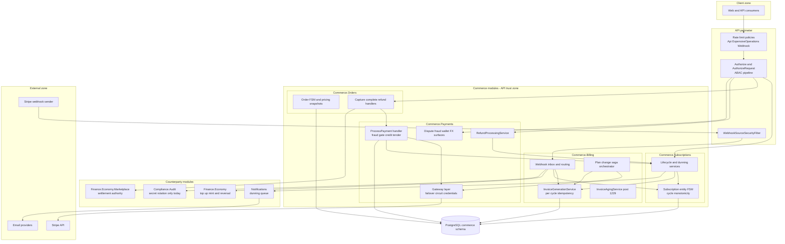
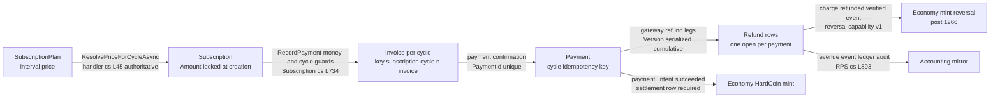

# Commerce Security Architecture — the Money Path

> Modules `GameGuild.Commerce.Payments` + `GameGuild.Commerce.Billing` + `GameGuild.Commerce.Orders` + `GameGuild.Commerce.Subscriptions` (+ `GameGuild.Finance.Economy` top-up and `GameGuild.Finance.Economy.Marketplace` settlement as counterparties) · Documented against `develop` commit `21b58ac6a7`.
> This is the third artifact of the commerce security trio, joining the package STRIDE models (`payments/07-stride-threat-model.md`, `billing-orders/07-stride-threat-model.md`) and DFDs (`payments/08-dfds.md`, `billing-orders/08-dfds.md`). It consolidates the cross-module view: components, trust boundaries, who can move money, the price-to-reversal integrity chain, and fail-open/fail-closed verdicts per external dependency.

## 1. Component diagram

Composition rule: modules never reference each other's internals — integration goes through ports (`IOrderPaymentProcessor`/`IOrderPaymentAuthority`/`IOrderPaymentRefunder` in Orders, `IPaymentSubscriptionSyncService`/`ISubscriptionInvoiceMaterializer`/`IPaymentDunningLifecycleService` across Subscriptions/Billing/Payments, `IStripeVerifiedEventConsumer` at the webhook router), implemented in the provider module and bound in the API root.

## 2. The money-path trust boundaries

| Id | Boundary | Crossed by | Control at the boundary |
|----|----------|------------|--------------------------|
| M1 | Client → API | charge, refund, subscription, order requests | `[Authorize]` + `[AuthorizeRequest]` ABAC (`Identity.Authorization/Behaviors/AuthorizationBehavior.cs:49-156`) + controller tenant guards (`PaymentsController.cs:138-139`, `SubscriptionsController.cs:41-42`) + rate-limit tiers |
| M2 | API → Stripe outbound | PaymentIntent create/confirm, Refund create, SetupIntent, dispute evidence | DataProtection-encrypted credentials (`Payments:/Services/GatewayCredentialStore.cs:93-94` purpose `Payments.GatewayCredentials`), per-operation Stripe idempotency keys, circuit breaker + failover wrapper |
| M3 | Stripe → webhook ingress | signed provider events | HMAC/per-provider signature verification (`Billing:/Services/StripeWebhookVerifier.cs:15`), payload contract pinning (livemode/api-version/account), `WebhookSourceSecurityFilter` + IP allowlist, `Webhook` rate policy (`BillingWebhooksController.cs:186-189`) |
| M4 | Webhook ingress → aggregates | verified events only | durable inbox admission (`WebhookProcessorBase.cs:187-215`), single-worker claim, consumer chain; signature-unverified legacy rows never replayed (`StripeBillingWebhookService.cs:235-245`) |
| M5 | Commerce → Economy | top-up mint/reversal, marketplace settle, invoice-paid wallet credit | settlement-row binding + posted idempotency (`Economy:/Integrations/StripeEconomyTopUpEventConsumer.cs:40-58`); Deny-default settlement port (`Orders:/Abstractions/IOrderMarketplaceSettlementAuthority.cs:47-55`); outbox per-consumer receipts ×5 → DLQ |
| M6 | Commerce → Notifications | receipts, dunning, fraud notices | durable queue with attempt ceiling + dead-letter (`Notifications/Entities/Notification.cs:292-310`); failures never alter money outcomes |

The single anonymous surface on the money path is M3 — every other boundary requires an authenticated principal or an in-process port with a Deny default.

## 3. Who can move money — permission map

Permission keys from `Identity.Authorization/Models/TypedPermissions.cs` (`PaymentsPermission` :894-912, `OrdersPermission` :596-640, `MonetizationPermission` :1265-1294); wiring from the two package matrices. "Move money" = can cause a charge, a refund, a balance change, or a price that drives one.

| Actor / capability | Charge | Refund out | Balance mint | Price authority | Where enforced |
|--------------------|--------|-----------|--------------|-----------------|----------------|
| Any authenticated tenant user | own-subscription charge via `POST payments` (amount still plan-bound); own-order capture with `orders:create` | request own refund (below threshold → queue) | no | none | tenant + ownership guards (`ProcessPaymentCommandHandler.cs:45-53`, `OrderActorContext.Authorize`) |
| `payments:refunds:approve` holder | — | **approve/reject queued refunds** | no | none | `RefundsController.cs:165,189` + query `GetPendingRefundApprovals` |
| `payments:admin` holder | — | dispute decisions incl. accept (which records chargeback settlement) | no | no | `GetFraudStatisticsQuery.cs:36`, fraud review commands, `GetGatewayMetricsQuery.cs:14`, `GetGatewayAnalyticsQuery.cs:15` |
| `orders:refund` + ownership | — | order refund via Payments boundary post-#1229 | no | none | `RefundOrderCommandHandler.cs:34-43` |
| `monetization:configure` holder | — | — | no | **plan prices, currencies, tax rules** | `SubscriptionsController.cs:222,249,276`, plan CRUD, `CurrenciesController.cs:66,85,104` role gates |
| SystemAdmin policy | — | webhook admin incl. **secret rotation** | no | provider config | `BillingWebhooksController.cs:463-581`, `BillingEventsController.cs:20-22` |
| Stripe (via M3 signature) | provider-billed renewals | chargeback/accept legs | top-up mint trigger | provider subscription clock | verified consumer chain |
| Background workers | retry charges (opt-in queue), refund execution, aging sweeps | refund worker after approval | mint/reversal via protected ops | no | module hosted services |

Key invariants behind the map:

1. **No principal can name a price that money follows.** Subscription amounts are plan-derived post-#1229 (`CreateSubscriptionCommandHandler.cs:30-59`); order prices are published-version snapshots (`Entities/Order.cs:218-296`); invoice amounts freeze at issue (`Entities/Invoice.cs:185`). The monetization:configure holder controls the *plan*, and the plan controls the money — a two-step chain with the pricing-decision ledger as witness.
2. **Every refund above threshold needs a second human** (approval queue, `RefundProcessingService.cs:297`) or is executed by code that already verified settlement (accept-dispute recording, saga compensation).
3. **The webhook secret is the only key that unlocks M3** — rotating it is SystemAdmin-only and is the single money-path action that reaches `Compliance.Audit` (`RotateWebhookSecretCommand.cs:126-141`).

## 4. The integrity chain — plan to economy reversal

One monotonic chain of custody from price to reversal; every link is an idempotency-bound store write verified against the previous link.

| Link | Guard | Backstop |
|------|-------|----------|
| plan → subscription | server-side price resolution; client amount advisory + logged (#1229, G-13 fix) | fraud gate assesses the *plan* amount (`CreateSubscriptionCommandHandler.cs:65-66`) |
| subscription → invoice | cycle monotonicity + per-cycle key | unique index `IX_invoices_IdempotencyKey` race backstop (`InvoiceGenerationService.cs:179-191`) |
| invoice → payment | amount/currency equality (`RejectedMoney`), single payment per invoice | `PaymentId` unique index (`Entities/Invoice.cs:20`) |
| payment → refund | remainder bounds, single-open-refund, status fail-closed | entity `Version` optimistic serialization (#1266, N2 fix — `ApplyRefundToPaymentAsync`), storage-level guard (`RefundRepository.cs:108`) |
| refund → gateway | payment-currency minor-unit conversion (#1266, N1 fix — `StripePaymentService.cs:754-768`) | webhook amount verification fail-closed (#1266, N3 fix — `RefundProcessingService.cs:644-653`) |
| payment → economy mint | verified success event + settlement row + posted idempotency | inbox retry, Held on failure |
| refund → economy reversal | verified `charge.refunded` + cumulative `amount_refunded` (#1266, N4 fix) | reversal capability registry (`economy.reverse-provider-funding.v1`) |
| any money mutation → accounting | revenue event + ledger entry + audit trail in-transaction | **residual**: projection into central `Compliance.Audit` does not exist (open item R-P6) |

The #1202 class (currency/concurrency/webhook-truth confusions) was fixed end-to-end by #1266; the #1205 class (billing money-integrity: plan amounts, order refunds, dunning healing, aging) by #1229. Both are cited as live mitigations in the STRIDE documents.

## 5. Fail-open / fail-closed verdicts per external dependency

| Dependency / failure mode | Verdict | Rationale and behavior |
|---------------------------|---------|------------------------|
| Stripe API timeout / 5xx / 429 on **charge** | **fail-open to Processing** (deliberate) | provider may already have charged; local claim kept, no blind retry; webhook reconciles; aged Pending rows exit via sweep (`StripePaymentService.cs:701-715`, `PendingPaymentAgingService.cs`) |
| Stripe hard decline on charge | **fail-closed** (TerminalDecline) | classified non-retriable except per failure-code policy (`StripePaymentService.cs:677-699`) |
| Stripe unknown outcome on **plan-change charge** | **fail-closed for activation** | throw + rollback + reconcile-first; never auto-refund (`SubscriptionChangeSagaOrchestrator.cs:260-266`) |
| Stripe webhook signature invalid | **fail-closed** | 400, no inbox row, provider does not retry; security event recorded |
| Stripe webhook processing failure | **fail-closed with provider retry** | inbox `MarkAsFailed` + 500 → Stripe redelivery; dead-letter + critical security event after ceiling |
| Webhook event references unknown aggregate | **fail-closed for disputes** (throw → retry), **fail-open release for lifecycle** | disputes never guess the target (`StripeDisputeEventConsumer.cs:50`); lifecycle events release so siblings can claim |
| Outbox consumer (wallet credit) failure | **fail-closed with bounded retry** | ×5 per consumer then dead-letter; idempotent replays |
| Payments module unregistered (order capture/complete) | **fail-closed Deny** | no order charged or completed by accident (`IOrderPaymentAuthority.cs:9-31`) |
| Economy settlement authority unregistered | **fail-closed Deny** | `DenyOrderMarketplaceSettlementAuthority` |
| Economy mint failure mid-webhook | **fail-closed** (Held + rethrow) | inbox redelivery retries the mint |
| Notifications failure (receipt/dunning) | **fail-open for money, durable for mail** | delivery failure never changes a money outcome; rows retry with ceiling |
| Subscription sync / invoice materialization failure after payment | **fail-open for the payment** | never throws back; idempotent replay heals (`SubscriptionInvoiceMaterializer.cs:52-59`) |
| Fraud provider overruns sync budget | **fail-open to defer** | background re-score may only *tighten*; never loosens a decision (`Payment.cs:818-823`) |
| Fraud background queue full / restart | **fail-open (lost)** | in-process channel, jobs dropped — open item R-P5 |
| Invoice aging / retry scheduling pre-#1229 | was fail-open stub | now real (InvoiceAgingService, RetryInvoicePaymentHandler dispatch) |

Pattern: **money stops, communication retries, truth waits.** Anything that could double-move money fails closed or fails to a *reconciliation* state; anything that only informs (emails, analytics) fails open with durable retry.

## 6. Peripheral surfaces and their posture

- **Currency suggestion / FX / pricing / tax reads** — data-minimized (country code only, nothing persisted); the anonymous-500 defect was fixed in #1266 (attribute removed). Residual: these controllers still lack rate-limit policies (open item R-P2).
- **Wallets** — ownership + tenant guards on every mutation, validators on add/deduct/transfer, reconciliation report and audit log surfaces.
- **Gateway credential management** — DataProtection at rest, scope-per-call, admin-gated commands; connection tests route through the same store.
- **Webhook raw payload retention** — opt-in, default off, redacted (`WebhookRawDeliveryRedactor.cs`), expiry sweep in the retry worker.

## 7. Open security work items (consolidated)

From both STRIDE models, for the orchestrator to file:

| Id | Item | Where |
|----|------|-------|
| R-P1 | Dispute status settable arbitrarily via respond — no transition table | `Payments:/Services/DisputeService.cs:81` |
| R-P2 | Ten unthrottled controllers incl. anonymous suggestion | payments wiring matrix N10 |
| R-P3 | BillingCharges refund alias defaults amount to 0 | `BillingChargesController.cs:114` |
| R-P4 | Dead cancel-refund branch with timestamped idempotency key | `CancelPaymentCommandHandler.cs:37-80` |
| R-P5 | Fraud re-score queue volatile | `FraudBackgroundScoringQueue.cs:47-49` |
| R-P6 | Money events not projected into Compliance.Audit | `RevenueAuditService.cs` |
| R-B1 | Invoice Uncollectible has no writer — no bad-debt write-off | `Billing:/Entities/Invoice.cs:424` |
| R-B2 | Order cancel/delete/hold/release lack ownership checks | Orders command handlers |
| R-B3 | Economy-settled orders have no refund path | `RefundOrderCommandHandler.cs:62-68` |
| R-B4 | Dead states — Subscription Expired, Order Disputed | both state-machine docs |
| R-B6 | Plan-change orchestrate route is any-authenticated | `SubscriptionChangeOrchestrationController.cs:19-22` |

## 8. Document register

| Artifact | Payments | Billing / Orders / Subscriptions |
|----------|----------|----------------------------------|
| User flows | `payments/01-user-flows.md` | `billing-orders/subscription-billing-cycle-flow.md`, `order-lifecycle-flow.md` |
| Wiring matrix | `payments/02-cqrs-wiring-matrix.md` | `billing-orders/cqrs-wiring-matrix.md` |
| State machines | `payments/03-state-machines.md` | `billing-orders/state-machines.md` |
| Event inventory | `payments/04-event-flow-inventory.md` | `billing-orders/event-flow-inventory.md` |
| Sequences | `payments/05-cross-module-sequences.md` | `billing-orders/cross-module-sequences.md` |
| Gaps | `payments/06-gaps.md` | `billing-orders/gaps.md` |
| STRIDE | `payments/07-stride-threat-model.md` | `billing-orders/07-stride-threat-model.md` |
| DFDs | `payments/08-dfds.md` | `billing-orders/08-dfds.md` |
| Architecture | this document | this document |
