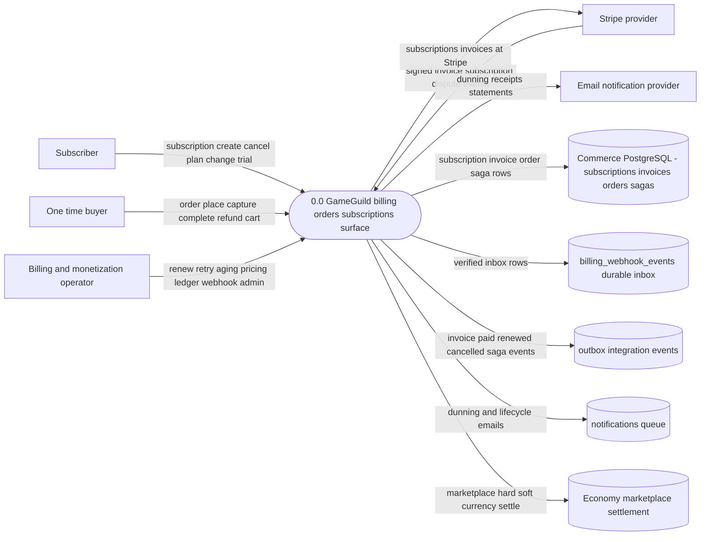
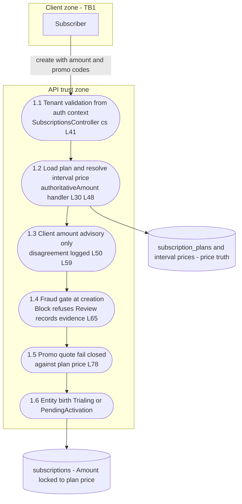
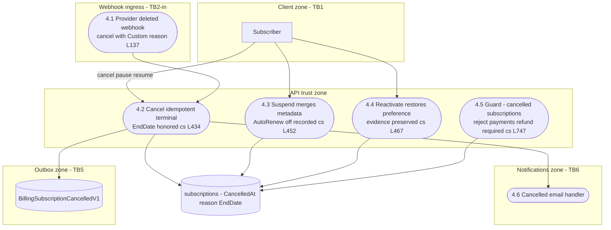
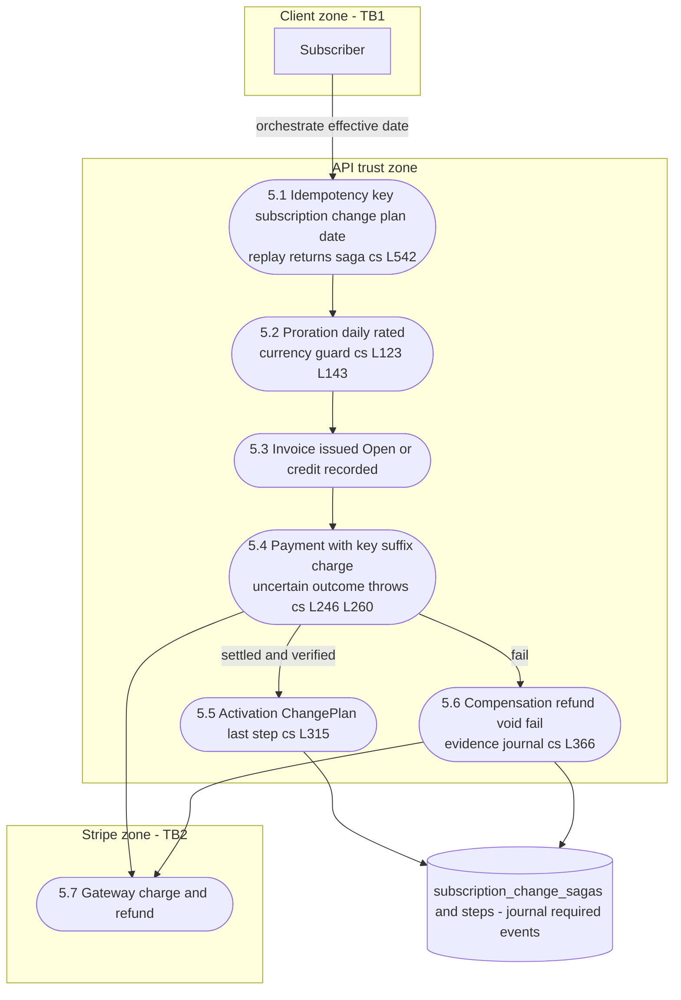
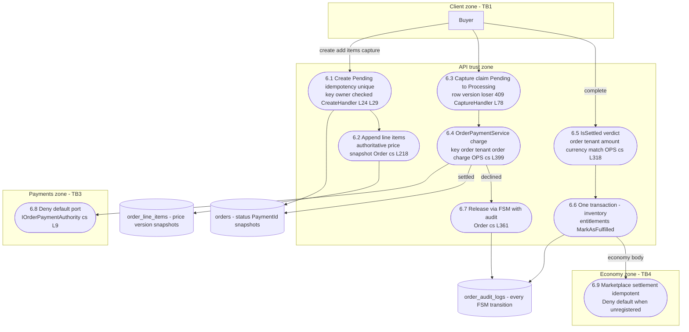

# Billing / Orders / Subscriptions Data Flow Diagrams — DFDs

> Modules `GameGuild.Commerce.Billing` + `GameGuild.Commerce.Orders` + `GameGuild.Commerce.Subscriptions` (+ `GameGuild.Commerce.Payments` authority, `GameGuild.Finance.Economy.Marketplace` settlement) · Documented against `develop` commit `21b58ac6a7`.
> Companion documents: flows (`subscription-billing-cycle-flow.md`, `order-lifecycle-flow.md`), STRIDE (`07-stride-threat-model.md`), architecture (`../09-security-architecture.md`). Threat numbering refers to the STRIDE document.

## 1. Notation and conventions

Mermaid flowchart with standard DFD shapes:

- External entity — rectangle: `E1["Subscriber"]`
- Process — stadium: `P1(["1.1 Resolve plan authoritative price"])`
- Data store — cylinder: `D1[("subscriptions table")]`
- Trust boundary — one subgraph per zone

Zones (money-path trust boundaries, detailed in `../09-security-architecture.md` §2):

| Zone | Boundary id | Meaning |
|------|-------------|---------|
| Client | TB1 | User-controlled browser or API consumer |
| API | — | Modular monolith trust zone (Billing, Subscriptions, Orders, Payments ports) |
| Provider | TB2/TP | Stripe — provider-billed truth |
| Webhook ingress | TB2-in | Anonymous perimeter, trusted after per-provider signature verification |
| Payments | TB3 | In-process port boundary with Deny defaults |
| Economy | TB4 | Marketplace settlement authority |
| Outbox / Notifications | TB5/TB6 | Durable event transport and dunning email channel |

Citation shorthand: `Billing:` = `apps/api/Source/Modules/GameGuild.Commerce.Billing/`, `Subs:` = `apps/api/Source/Modules/GameGuild.Commerce.Subscriptions/`, `Orders:` = `apps/api/Source/Modules/GameGuild.Commerce.Orders/`, `Payments:` = `apps/api/Source/Modules/GameGuild.Commerce.Payments/`, `Economy:` = `apps/api/Source/Modules/GameGuild.Finance.Economy.Marketplace/`, `API:` = `apps/api/Source/GameGuild.API/`.

## 2. Level 0 — context diagram



Boundaries crossed at level 0: TB1 client to API, TB2 provider both directions, TB3 Payments (off-scene authority), TB4 Economy, TB5 outbox, TB6 notifications.

## 3. Level 1 — flow families

### F1 — Subscription creation — plan derived amounts post #1229

Entry `Subs:/Controllers/SubscriptionsController.cs:35-75`; handler `Commands/CreateSubscription/CreateSubscriptionCommandHandler.cs`.



Pre-#1229 the client amount flowed straight into the entity (gap G-13); now the plan price is the only authority and the request amount is a logged signal (STRIDE 1.2).

### F2 — Billing period renewal and invoice materialization

`Subs:/Services/SubscriptionBillingService.cs:31-91` (quote-only) + `Billing:/Services/InvoiceGenerationService.cs` (materialize) + provider path `StripeBillingWebhookService.cs:486-497`.

```mermaid
flowchart TB
    subgraph PROVIDER["Stripe zone - TB2"]
        S1["Provider subscription clock"]
    end

    subgraph WBI["Webhook ingress - TB2-in"]
        W1(["2.1 invoice payment succeeded verified<br/>materialize then sync L486"])
    end

    subgraph API["API trust zone"]
        P1(["2.2 Renewal quote only<br/>pricing ledger entry per cycle L48"])
        P2(["2.3 RecordPayment money and cycle guards<br/>Subs Entities Subscription cs L734"])
        P3(["2.4 Materialize invoice<br/>key subscription cycle n invoice cs L47"])
        P4(["2.5 Issue then RecordPayment lands Paid"])
        P5(["2.6 Unique index race backstop<br/>loser re-fetches winner L179"])
        P6(["2.7 Wallet credit on BillingInvoicePaidV1<br/>idempotent per event id"])
        P7(["2.8 InvoiceAgingService<br/>overdue Open to PastDue"])
    end

    D1[("subscriptions - LastProcessedBillingCycle monotonic")]
    D2[("invoices - IdempotencyKey unique PaymentId unique")]
    D3[("pricing decision ledger")]
    D4[("outbox receipts TB5"])

    S1 -->|"provider billed confirmation"| W1
    W1 --> P3
    P3 --> P5
    P5 --> D2
    P3 --> P4
    P4 --> D2
    W1 --> P2
    P2 --> D1
    P2 --> P6
    P6 --> D4
    P1 --> D3
    P7 --> D2
    P1 --> P2
```

Double billing is closed by three independent stores: the cycle-monotonic subscription row, the per-cycle invoice key with unique index, and the single-payment-per-invoice index (STRIDE 2.1).

### F3 — Payment failure retry and dunning

`Subs:/Services/PaymentDunningLifecycleService.cs`; retry engine in Payments; ladder `API:/Core/Integration/PaymentDunningOptions.cs:20-43`.

```mermaid
flowchart TB
    subgraph API["API trust zone"]
        P1(["3.1 RecordPaymentFailure<br/>Active to PastDue Subs cs L844"])
        P2(["3.2 Retry queue claim and charge<br/>Payments retry worker"])
        P3(["3.3 Suspension on exhaustion<br/>reason RetryExhausted DL cs L22 L57"])
        P4(["3.4 Recovery reactivation<br/>reason guarded cs L74 L127"])
        P5(["3.5 PastDue heals on confirmed payment<br/>Subs cs L814"])
        P6(["3.6 RetryInvoicePayment real dispatch<br/>tenant scoped handler cs L37"])
    end

    subgraph NOTIF["Notifications zone - TB6"]
        N1(["3.7 Dunning ladder High then Urgent<br/>quiet hours attempt ceiling dead letter"])
    end

    subgraph STRIPE["Stripe zone - TB2"]
        S1(["3.8 Provider charge retry"])
    end

    D1[("subscriptions - status suspension reason metadata merged")]
    D2[("notifications queue - durable rows"])

    P1 --> D1
    P1 --> N1
    P2 --> S1
    P2 -->|"exhausted"| P3
    P3 --> D1
    P3 --> N1
    P2 -->|"recovered"| P4
    P4 --> D1
    P5 --> D1
    P6 --> P2
    N1 --> D2
```

Dunning harassment control: two rungs only, final notice fired once at suspension, notification queue enforces its own ceiling (STRIDE 3.2).

### F4 — Cancellation pause resume reactivate

`Subs:/Entities/Subscription.cs:434-495`; provider cancel `Billing:/Services/BillingWebhookService.cs:124-150`.



### F5 — Plan change saga

`Billing:/Services/SubscriptionChangeSagaOrchestrator.cs`.



Note the diagram stores journal rows durably; saga step events are published `required: true` so a publish failure rolls back the local transaction (`Billing:/Events/BillingIntegrationEventPublisher.cs:158-213`).

### F6 — Order placement capture and fulfillment

`Orders:/Controllers/OrdersController.cs` + `Commands/*` handlers + `Payments:/Services/OrderPaymentService.cs`.



The settlement verdict (6.5) is the single gate between money and entitlements — fail-closed on any mismatch or unregistered Payments port (STRIDE 6.4).

### F7 — Order refund — post #1229 semantics

`Orders:/Commands/RefundOrder/RefundOrderCommandHandler.cs`.

```mermaid
flowchart TB
    subgraph CLIENT["Client zone - TB1"]
        E1["Buyer with refund permission"]
    end

    subgraph API["API trust zone"]
        P1(["7.1 Ownership Authorize<br/>handler L34"])
        P2(["7.2 Status gate Fulfilled Completed PartiallyRefunded<br/>partial once only L39 L45"])
        P3(["7.3 Payments boundary first<br/>AuthoritativeOrderRefund L73"])
        P4(["7.4 Approval aware<br/>queued refunds move no money"])
        P5(["7.5 On completed refund - revoke entitlements<br/>restore inventory local status"])
    end

    subgraph PAY["Payments zone - TB3"]
        PAY1(["7.6 Gateway refund and accounting<br/>single open cumulative Version guards"])
    end

    D1[("orders - Refunded PartiallyRefunded RefundAmount")]
    D2[("entitlements and inventory restore"])

    E1 -->|"refund amount reason"| P1
    P1 --> P2
    P2 --> P3
    P3 --> PAY1
    PAY1 -->|"completed"| P5
    P3 -->|"queued"| P4
    P5 --> D1
    P5 --> D2
```

Money-first ordering is the post-#1229 change: the gateway refund must complete (or be approval-queued) before any local order mutation (STRIDE 7.1).

### F8 — Provider webhook ingress — billing truth

`Billing:/Controllers/BillingWebhooksController.cs` + `Services/WebhookProcessorBase.cs:177-298`.

```mermaid
flowchart TB
    subgraph PROVIDER["Provider zone - TB2-in"]
        S1["Stripe PayPal Google Apple Braintree senders"]
    end

    subgraph WBI["Webhook ingress zone - anonymous until verified"]
        W1(["8.1 Per provider signature verification<br/>IP allowlist source filter"])
        W2(["8.2 Duplicate check ExternalEventId Provider<br/>Base cs L187"])
        W3(["8.3 Store inbox row before processing<br/>Base cs L212"])
        W4(["8.4 Route with per attempt timeout<br/>Base cs L254"])
    end

    subgraph API["API trust zone"]
        P1(["8.5 Subscription and invoice routing"])
        P2(["8.6 Retry worker backoff 1 to 360 min<br/>terminal 1440 then dead letter"])
        P3(["8.7 Dead letter raises critical security event"])
    end

    D1[("billing_webhook_events - attempts dead letter")]
    D2[("billing_webhook_raw_delivery - opt in redacted"])

    S1 -->|"signed deliveries"| W1
    W1 --> W2
    W2 --> W3
    W3 --> W4
    W4 --> P1
    W3 --> D1
    W3 --> D2
    D1 --> P2
    P2 --> P3
    P2 -->|"500 provider redelivers"| S1
```

## 4. Data store inventory on the billing money path

| Store | Contents that matter | Integrity role |
|-------|----------------------|----------------|
| `subscriptions` | `Amount` plan-derived, `LastProcessedBillingCycle`, `LastPaymentIdempotencyKey`, `RowVersion`, merged `Metadata` | cycle monotonicity + evidence preservation |
| `invoices` | `IdempotencyKey` unique, `PaymentId` unique, frozen amounts post-issue | one invoice and one payment per cycle |
| `orders` + `order_line_items` | status FSM, `IdempotencyKey` unique, pricing snapshots, `PaymentId` | price tamper resistance, double-capture closure |
| `subscription_change_sagas(+_steps)` | `IdempotencyKey` unique, compensation journal | plan-change double-charge closure |
| `pricing decision ledger` | idempotent per-cycle quotes | pricing repudiation defense |
| `billing_webhook_events` | provider scope unique, attempts, dead-letter | provider truth admission control |
| `order_audit_logs` | every FSM transition incl. reservation release post-#1229 | order repudiation defense |

## 5. Coverage notes

- Subscription flow families from `subscription-billing-cycle-flow.md`: creation F1, billing period/invoice F2, dunning F3, cancellation/pause F4, plan change F5, trial folds into F1 (creation grants) and F4 (end-trial cancel/convert, `Subs:/Entities/Subscription.cs:344-358`).
- Order flow families from `order-lifecycle-flow.md`: placement/capture/fulfillment F6, refund F7, hold/release folds into F6 (reservation release path 6.7), marketplace cart feeds F6 through the same create/capture chain (`MarketplaceCartCommands.cs:141-186`).
- Webhook ingress F8 is shared with the payments package (`../payments/08-dfds.md` F5) — rendered once per package from that package's viewpoint.
