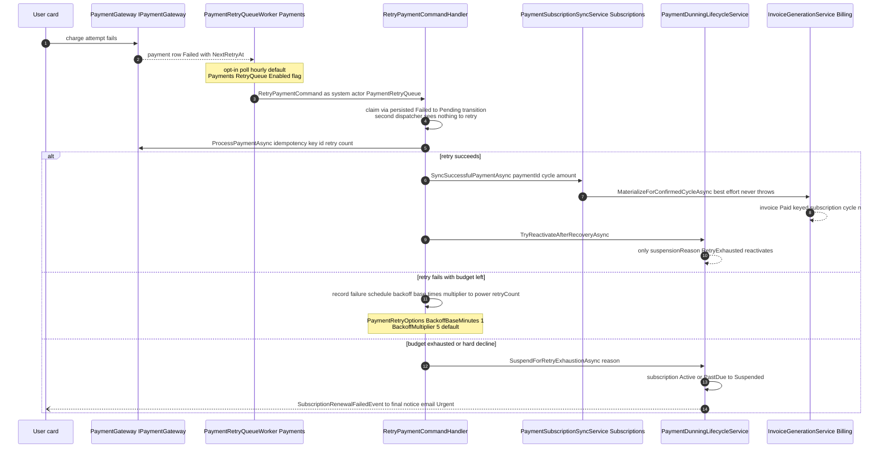
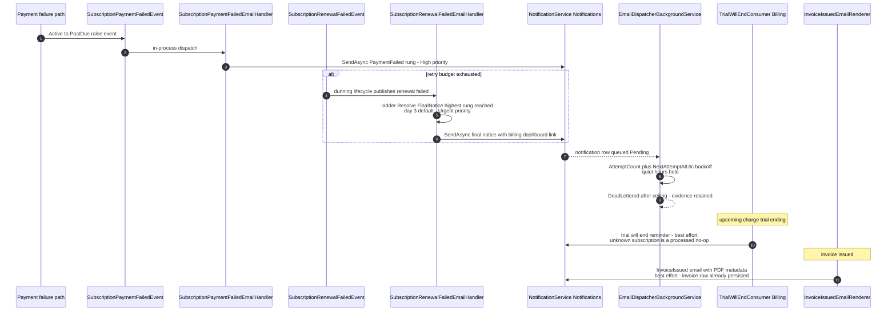
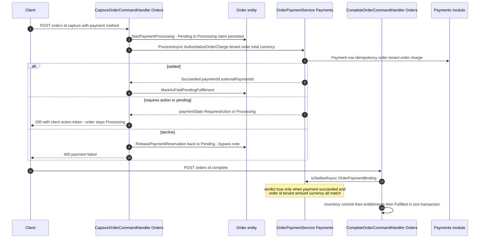
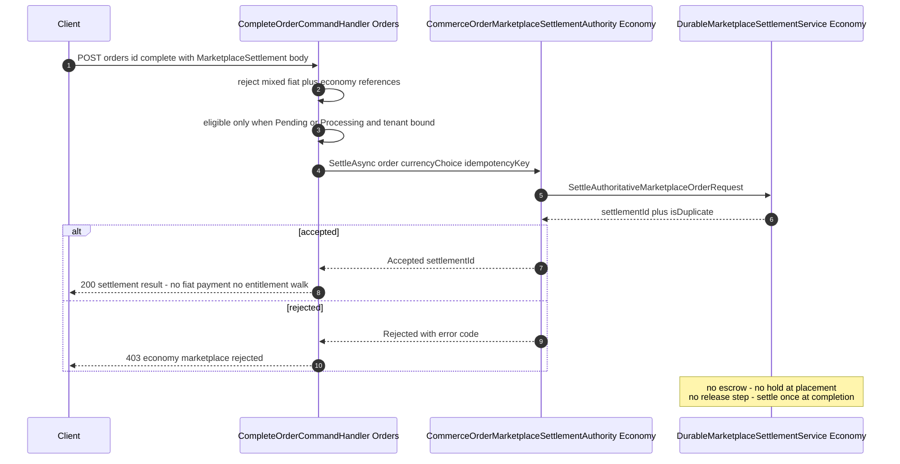

# Cross-Module Sequence Diagrams — Billing ↔ Payments, Billing ↔ Notifications, Orders ↔ Payments, Orders ↔ Economy

> Documented against `develop` commit `74e9bba4c`. Each diagram lists participants, timeouts, and an explicit **fail-open / fail-closed verdict** for every cross-module hop. Modules never reference each other's internals directly — integration goes through ports (`IOrderPaymentProcessor`, `IOrderPaymentAuthority`, `IOrderMarketplaceSettlementAuthority`, `IPaymentSubscriptionSyncService`, `ISubscriptionInvoiceMaterializer`, `IPaymentDunningLifecycleService`) implemented in the provider module and composed in the API root. Unregistered ports resolve to **Deny** implementations (fail-closed) — `GameGuild.Commerce.Orders/Abstractions/IOrderPaymentAuthority.cs:3-31`, `IOrderMarketplaceSettlementAuthority.cs:47-55`.

## 1. Billing ↔ Payments — invoice payment attempts (first-party charge, retry, exhaustion)

Ports: `GameGuild.Commerce.Payments` implements `IPaymentSubscriptionSyncService` (`GameGuild.Commerce.Subscriptions/Services/PaymentSubscriptionSyncService.cs:11`), `IPaymentDunningLifecycleService` consumer side (`GameGuild.Commerce.Payments/Abstractions/IPaymentDunningLifecycleService.cs`), gateway abstraction `IPaymentGateway`.

**Timeouts** — gateway call bounded by the provider adapter; webhook inbox processing bounded by `ProcessingTimeoutSeconds` (`GameGuild.Commerce.Billing/Configuration/WebhookSettings.cs`, enforced `Services/WebhookProcessorBase.cs:254-257`); retry queue poll interval ≥1 min (`GameGuild.Commerce.Payments/Services/PaymentRetryQueueWorker.cs:132`).

**Verdicts**
- Payment → subscription sync: **fail-open for the payment, fail-closed for the invoice** — sync/materialization failures are logged and healed by idempotent replay; the payment is never rolled back (`GameGuild.Commerce.Subscriptions/Services/PaymentSubscriptionSyncService.cs:136-170`, `GameGuild.Commerce.Billing/Services/SubscriptionInvoiceMaterializer.cs:52-59`).
- Dunning suspension: **fail-closed** — only Active/PastDue subscriptions suspend, already-suspended/cancelled skip (`Services/PaymentDunningLifecycleService.cs:39-55`).
- Uncertain gateway outcome (pending/unknown): **fail-closed for activation** — the saga refuses to grant the plan and demands reconciliation; never auto-refund (`GameGuild.Commerce.Billing/Services/SubscriptionChangeSagaOrchestrator.cs:260-266`).
- Manual invoice retry endpoint: **fail-open stub** — returns "accepted for local scheduling" while scheduling nothing (G-1).

## 2. Billing ↔ Notifications — dunning and upcoming-charge emails

No direct port: Billing/Subscriptions publish domain events or call `INotificationService.SendAsync`; the API composition root binds handlers (`GameGuild.API/Core/Integration/`). Ladder config: `Payments:Dunning` (`GameGuild.API/Core/Integration/PaymentDunningOptions.cs:20-43`) — PaymentFailed rung day 0 High priority, FinalNotice rung day 3 Urgent.

**Verdicts**
- Dunning emails: **best-effort (fail-open) with durable retry** — a queue failure never fails the payment/webhook flow; rows retry with backoff and dead-letter (`GameGuild.Notifications/Entities/Notification.cs:292-310`).
- Recipient unavailable/suspended: **skip (fail-closed to no-send)** — `recipient.IsActive` checks before queueing (`GameGuild.Commerce.Billing/Services/InvoiceGenerationService.cs:303-310`, `Services/StripeTrialWillEndConsumer.cs:69-76`).
- Reminder ladder fallback: **fail-closed to legacy copy** — a misconfigured ladder falls back to the built-in default step, never to silence (`GameGuild.API/Core/Integration/PaymentDunningOptions.cs:91-112,129-152`).

## 3. Orders ↔ Payments — capture, settlement verdict, payment intent

Ports in Orders, implemented by `GameGuild.Commerce.Payments/Services/OrderPaymentService.cs:10-14` (`IOrderPaymentProcessor` + `IOrderPaymentAuthority`) and `Services/OrderPaymentIntentService.cs:6-11` (`IOrderPaymentIntentPreparer`). Deny defaults when Payments is absent (`GameGuild.Commerce.Orders/Abstractions/IOrderPaymentAuthority.cs:3-31`).

**Timeouts** — no explicit HTTP timeout between modules (in-process ports); the provider window matters only inside Payments (`SafeProviderReplayWindow`, `GameGuild.Commerce.Payments/Services/OrderPaymentService.cs:105-110`).

**Verdicts**
- Settlement verdict: **fail-closed** — `IsSettledAsync` demands status + order + tenant + amount + currency equality (`:317-325`); any mismatch refuses fulfillment.
- Unregistered Payments: **fail-closed Deny** (`GameGuild.Commerce.Orders/Abstractions/IOrderPaymentAuthority.cs:3-31`) — no order can be charged or completed by accident.
- Uncertain provider outcome: **fail-closed to RequiresReconciliation** after the safe replay window (`OrderPaymentService.cs:105-110`) — no blind re-charge.
- Duplicate capture: **fail-open idempotent** — second call returns the settled payment, no double charge (`Commands/CaptureOrder/CaptureOrderCommandHandler.cs:30-33`).

## 4. Orders ↔ Economy — marketplace settlement (no escrow)

Port: `IOrderMarketplaceSettlementAuthority` (`GameGuild.Commerce.Orders/Abstractions/IOrderMarketplaceSettlementAuthority.cs:40-45`), implemented by `GameGuild.Finance.Economy.Marketplace/CommerceOrderMarketplaceSettlementAuthority.cs:6-34`. **There is no escrow hold/release in the current code** — settlement is a single atomic settle call at completion time (hard/soft/fixed-mix currency choice), idempotent by caller-supplied key; the Economy side records the settlement aggregate. Escrow-style flows (hold funds at order placement, release at fulfillment, refund on cancel) do not exist: orders that end cancelled never touched Economy, and there is no release-on-completion either — completion with `MarketplaceSettlement` settles immediately and returns (`Commands/CompleteOrder/CompleteOrderCommandHandler.cs:39-73`).

**Verdicts**
- Economy unavailable/unregistered: **fail-closed Deny** (`DenyOrderMarketplaceSettlementAuthority`, `IOrderMarketplaceSettlementAuthority.cs:47-55`).
- Mixed settlement authorities: **fail-closed 400** (`Commands/CompleteOrder/CompleteOrderCommandHandler.cs:41-47`).
- Duplicate settle: **idempotent** — `IsDuplicate` propagates to the response (`CommerceOrderMarketplaceSettlementAuthority.cs:22-24`).
- Refund of an Economy-settled order: **no path** — `RefundOrderCommandHandler` accepts only Completed/PartiallyRefunded fiat-flow orders and never calls Economy (G-4 adjacent).

## 5. Timeout and verdict summary

| Hop | Timeout mechanism | Verdict |
|-----|-------------------|---------|
| Webhook ingress → inbox processing | `ProcessingTimeoutSeconds` CTS (`WebhookProcessorBase.cs:254-257`) | fail-closed: timeout counts as failed attempt with backoff |
| Inbox retry cycle | backoff `[1,5,15,60,360]` + terminal `1440` min (`Configuration/WebhookSettings.cs:158,164`) | fail-closed: dead-letter + critical security event after ceiling |
| Outbox → consumer | ×5 attempts per consumer (`GameGuild.API/Core/Eventing/InboxStore.cs:8`) | fail-closed: receipt dead-letter, message dead-letter when all consumers terminal |
| Payments gateway → order capture | provider adapter + `SafeProviderReplayWindow` for unknowns (`OrderPaymentService.cs:105-110`) | fail-closed: RequiresReconciliation, never blind retry |
| Charge → subscription sync | none needed (in-process) | fail-open: payment persisted, sync healed by replay |
| Sync → invoice materialization | none (same call chain) | fail-open: never throws, idempotent per cycle key |
| Saga → gateway (plan change) | provider adapter; uncertain outcomes throw | fail-closed: rollback + reconcile-first; compensation refund only after confirmed settlement |
| Dunning/email fan-out | Notifications queue backoff + attempt ceiling (`Notification.cs:292-310`) | best-effort with durable retry, dead-letter terminal |
| Orders → Economy settlement | in-process port | fail-closed Deny when unregistered; idempotent accept when registered |
