# Event Flow Inventory — Billing and Order Events, Outbox, Consumers, Retry and DLQ

> Modules `GameGuild.Commerce.Billing` + `GameGuild.Commerce.Orders` + `GameGuild.Commerce.Subscriptions` + transport in `GameGuild.API/Core/Eventing` · Documented against `develop` commit `74e9bba4c`.
> Three distinct event fabrics meet here: (1) the **durable integration-event outbox** (`OutboxMessage`/`InboxReceipt`, per-consumer retry ×5 then dead-letter), (2) the **billing webhook durable inbox** (`BillingWebhookEvent`, exponential backoff 1-5-15-60-360 min, terminal 1440 min, then dead-letter), and (3) **in-process domain events** (`DomainEvent`/`INotificationHandler`, fire-and-forget within the request transaction; notification emails get their own durable queue inside Notifications).

## 1. Durable outbox (named integration events)

Producer contract: `IDurableEventProducer.RecordAsync` persists into the `outbox` transport (`GameGuild.API/Core/Eventing/DurableEventProducer.cs:6`). Publication is best-effort for webhook-path events but **required for saga events** — failures propagate and roll back the local transaction (`GameGuild.Commerce.Billing/Events/BillingIntegrationEventPublisher.cs:215-243`, `required: true` at `:172,193,213`).

| Event | Published by | Trigger file:line | Consumers | Consumer module |
|-------|--------------|-------------------|-----------|-----------------|
| `commerce.billing.webhook-processed.v1` (`BillingWebhookProcessedV1`, `Events/BillingIntegrationEvents.cs:7-16`) | `BillingIntegrationEventPublisher.PublishWebhookProcessedAsync` | after inbox row MarkAsProcessed (`Events/BillingIntegrationEventPublisher.cs:76-91`) | none registered (observability stream only) | — |
| `commerce.billing.webhook-failed.v1` (`:22-32`) | `PublishWebhookFailedAsync` | failed inbox attempt (`:93-109`) | none registered | — |
| `commerce.billing.invoice-paid.v1` (`BillingInvoicePaidV1`, `:37-46`) | `PublishInvoicePaidAsync` | provider payment recorded (`Services/BillingWebhookService.cs:199-205`) | **`BillingInvoicePaidWalletCreditHandler`** (`GameGuild.API/Core/Billing/BillingInvoicePaidWalletCreditHandler.cs:30`, registered `GameGuild.API/Core/Eventing/EventTransportServiceCollectionExtensions.cs:26`) — credits the payer's billing wallet, idempotent per provider event id (issue #406) | Payments (wallet) |
| `commerce.billing.subscription-renewed.v1` (`:51-58`) | `PublishSubscriptionRenewedAsync` | payment against already-active subscription (`Services/BillingWebhookService.cs:207-213`) | none registered | — |
| `commerce.billing.subscription-cancelled.v1` (`:63-70`) | `PublishSubscriptionCancelledAsync` | provider lifecycle cancel (`Services/BillingWebhookService.cs:150-154`) | none registered | — |
| `commerce.billing.subscription-change-step.v1` / `-completed.v1` / `-failed.v1` (`Events/SubscriptionChangeIntegrationEvents.cs`) | saga `RecordStepAsync`/`Complete`/`CompensateAsync` | every step journal append, completion, failure (`Services/SubscriptionChangeSagaOrchestrator.cs:341-348,429-432`) | none registered in-process; events exist for downstream analytics/audit | — |

**Transport mechanics (all outbox events)** — `OutboxBackgroundService` polls (`GameGuild.API/Core/Eventing/OutboxBackgroundService.cs:8-44`); `OutboxDispatcher` claims ≤50 messages per cycle (`OutboxDispatcher.cs:16`), skips rows already dead-lettered (`:63-79`), and dispatches **per consumer** with an inbox receipt: `TryLockAsync` (exactly-once claim, `:263-277`) → handler `HandleAsync` (`:279-286`) → `CompleteAsync` + commit (`:287-292`). A consumer failure records the failure receipt with **attempt count and next-attempt backoff**; at **`MaxAttempts = 5`** the receipt is dead-lettered (`InboxStore.cs:8,105-110`), and once **all** consumers of a message are terminal the message itself is dead-lettered (`OutboxDispatcher.cs:223-231`). Dead-lettered rows are retained (replay via `EventReplayService` / `ReplayOutboxEventCommand`, `GameGuild.API/Core/Eventing/ReplayOutboxEventCommand.cs`).

**Per-consumer retry/DLQ table (outbox)**

| Consumer | Event(s) | Retry policy | DLQ | Failure containment |
|----------|----------|--------------|-----|---------------------|
| `BillingInvoicePaidWalletCreditHandler` | `BillingInvoicePaidV1` | transport-level ×5 with backoff (`InboxStore.cs:8`) | dead-letter after 5th failure, replay tooling exists | wallet credit idempotent per provider event id — replays safe |
| `GameGuild.EventTransport` (synthetic consumer) | any message the dispatcher itself cannot serialize/route | same | same (`OutboxDispatcher.cs:345-360`) | poison message isolated, other consumers unaffected |

## 2. Billing webhook durable inbox (provider → platform)

Ingress: `POST api/v{v}/billing/webhooks/{provider}` (`GameGuild.Commerce.Billing/Controllers/BillingWebhooksController.cs:60,126,186,253,319`), anonymous but signature-verified per provider (`Services/StripeWebhookVerifier.cs`, `PayPalSignatureVerificationService.cs`, `BraintreeWebhookVerificationService.cs`, `AppleJwsVerificationService.cs`, `GooglePayWebhookVerificationService.cs`) plus source-IP allowlist (`Security/WebhookSourceIpAllowlist.cs`, filter `Security/WebhookSourceSecurityFilter.cs`) and replay/suspicion monitors (`Security/WebhookSuspiciousActivityMonitor.cs`).

Pipeline (`Services/WebhookProcessorBase.cs:177-298`): duplicate check by `(ExternalEventId, Provider)` (`:187-198`) → store inbox row **before** processing (`:212-215`) → route with per-attempt timeout (`ProcessingTimeoutSeconds`, `:254-257`) → success `MarkAsProcessed` (`:260-261`) / failure `MarkAsFailed` + in-request retry loop (`:283-296`). Events processed for Stripe (`Services/StripeBillingWebhookService.cs:472-506`): `customer.subscription.created/updated/deleted`, `invoice.payment_succeeded` (materialize invoice **then** payment sync, `:486-497`), `invoice.payment_failed`; plus consumer extension points that run ahead of routing: `StripeTrialWillEndConsumer` (`customer.subscription.trial_will_end`, `Services/StripeTrialWillEndConsumer.cs:29-80`), `StripePaymentLifecycleEventConsumer` (`payment_intent.succeeded|payment_failed`, `Services/StripePaymentLifecycleEventConsumer.cs:41-42`), `StripeDisputeEventConsumer` (charge.dispute.* → `payment.MarkAsDisputed()`, `:109`), `StripePaymentMethodUpdatedConsumer`.

**Retry and DLQ (webhook inbox)** — `BillingWebhookRetryWorker` (`Services/BillingWebhookRetryWorker.cs:35-142`): every cycle purges expired raw deliveries (issue #408 retention, `:150-174`), dead-letters rows already past the ceiling (`:181-207`), then requeues due rows through `RetryWebhookEventCommand` with exponential backoff from the row's last update — schedule `[1, 5, 15, 60, 360]` minutes, terminal attempts at 1440 minutes (`Configuration/WebhookSettings.cs:158,164`, `WebhookRetrySchedule.DelayFor :170`). Dead-lettering raises a **critical security event** for operator alerting (`Services/BillingWebhookDeadLetterService.cs:28-35`, publisher `Security/WebhookSecurityEventPublisher.cs`) and `BillingWebhookRetryMetrics.RecordRetryExhausted` (`Services/BillingWebhookRetryMetrics.cs`). Raw delivery payloads + all headers are retained for replay under the opt-in retention policy (`Entities/BillingWebhookRawDelivery.cs`, redaction `Security/WebhookRawDeliveryRedactor.cs`).

| Inbox outcome | Route | Retry | Terminal |
|---------------|-------|-------|----------|
| processed | `MarkAsProcessed` + `BillingWebhookProcessedV1` | — | — |
| failed, attempts < max | `MarkAsFailed` + `BillingWebhookFailedV1` | backoff 1→360 min via retry worker | — |
| failed, attempts ≥ max (default 5) | `BillingWebhookDeadLetterService.DeadLetterAsync` (`Services/BillingWebhookDeadLetterService.cs:35`) | none | dead-lettered row + critical security event |
| duplicate delivery | `AlreadyProcessed` (`WebhookProcessorBase.cs:192-198`) | — | 200 to provider |
| unknown subscription in payload | handlers log + return success (`Services/BillingWebhookService.cs:100-103,137-140`, `Services/StripeTrialWillEndConsumer.cs:53-62`) | none — inbox row processed | prevents infinite replay of unfixable events |

## 3. In-process domain events (raised and consumed)

| Event | Raised at | Consumers | Delivery guarantee |
|-------|-----------|-----------|--------------------|
| `OrderStateChangedEvent` | every validated Order transition (`GameGuild.Commerce.Orders/Entities/Order.cs:187-215`) | `OrderStateChangedEventHandler` → `order_audit_logs` (`Handlers/OrderStateChangedEventHandler.cs:17-41`) | in-request; a SaveChanges failure fails the request |
| `SubscriptionActivatedEvent` / `SubscriptionCancelledEvent` / `SubscriptionSuspendedEvent` / `SubscriptionReactivatedEvent` / `SubscriptionRenewedEvent` / `SubscriptionPaymentProcessedEvent` / `SubscriptionPaymentFailedEvent` / `SubscriptionRenewalFailedEvent` / `TrialStartedEvent` / `TrialEndedEvent` / `TrialExtendedEvent` / `SubscriptionPlanChangedEvent` / `SubscriptionBillingCycleChangedEvent` / `SubscriptionExternalIdUpdatedEvent` / price-version events / `BillingPeriodsSkippedEvent` | entity methods (`GameGuild.Commerce.Subscriptions/Entities/Subscription.cs:327,338,360,406,427,446,459,471,494,537,580,711,719,743`) and the dunning bridge (`Services/PaymentDunningLifecycleService.cs:68`) | API composition root: `SubscriptionRenewalFailedEmailHandler` (final-notice dunning email, `GameGuild.API/Core/Integration/SubscriptionRenewalFailedEmailHandler.cs:27-76`), `SubscriptionPaymentFailedEmailHandler` (PaymentFailed rung), `SubscriptionCancelledEmailHandler`, `SubscriptionActivatedQuotaSyncHandler`, `SubscriptionPlanChangedQuotaSyncHandler`, `SendMonthlyStatementPreparedHandler` (`GameGuild.Commerce.Subscriptions/Handlers/SendMonthlyStatementPreparedHandler.cs`) | in-process `INotificationHandler` dispatch; email fan-out re-queued durably inside Notifications (below) |
| Monthly statement | `MonthlyStatementDispatchBackgroundService` hourly poll (`GameGuild.Commerce.Subscriptions/Services/MonthlyStatementDispatchBackgroundService.cs:23,65`) composes + sends (`:180`) | Notifications email queue | durable notification rows |

**Notifications queue retry/DLQ (email channel)** — notification rows carry `AttemptCount`, `NextAttemptAtUtc` backoff and quiet-hours hold (`GameGuild.Notifications/Entities/Notification.cs:99-108`); failed delivery attempts return the row to Pending (`:292-296`); after the attempt ceiling the row is `DeadLettered` with reason and evidence retained (`:306-310`, enum `:501`). Dispatcher loop: `EmailDispatcherBackgroundService` (`GameGuild.Notifications/Services/Email/EmailDispatcherBackgroundService.cs:13,58-63`).

## 4. Compliance visibility

- Billing webhooks persist raw delivery (payload + all headers) under retention (`Entities/BillingWebhookRawDelivery.cs`, policy `Configuration/WebhookSettings.cs` retention block, redaction `Security/WebhookRawDeliveryRedactor.cs`) — the evidence trail Compliance/FinancialCrime replay audits.
- Pricing decision ledger entries (`GameGuild.Commerce.Billing/Entities/…/PricingDecisionLedgerEntryConfiguration.cs`, writer `Services/PricingDecisionLedgerWriter.cs`) record every priced decision (renewal quotes included, `GameGuild.Commerce.Subscriptions/Services/SubscriptionBillingService.cs:48-88`) — the audit surface for price-fairness compliance; no outbox event, table-read only.
- Outbox and inbox receipts (attempt counts, next-attempt times, dead-letter timestamps) are retained rows (`GameGuild.API/Core/Eventing/EventTransportEntities.cs:3-31`) queryable via `api/v{v}/billing/events/outbox` (`Controllers/BillingEventsController.cs:89-125`).

## 5. Fan-out map

```mermaid
flowchart TD
    E1["Provider webhook verified"] --> E2["BillingWebhookEvent inbox row"]
    E2 --> E3["Processed or Failed with attempts"]
    E3 -->|"backoff 1 5 15 60 360 min"| E4["BillingWebhookRetryWorker requeue"]
    E4 -->|"attempts at ceiling"| E5["Dead-letter plus critical security event"]
    E2 --> E6["BillingWebhookProcessedV1 or FailedV1 outbox"]
    E3 --> E7["Subscription payment recorded"]
    E7 --> E8["BillingInvoicePaidV1 outbox"]
    E8 --> E9["OutboxDispatcher per consumer inbox receipt"]
    E9 -->|"5 attempts"| E10["Consumer receipt dead-lettered"]
    E9 --> E11["BillingInvoicePaidWalletCreditHandler<br/>wallet credit idempotent per event id"]
    E7 --> E12["Domain events in-process<br/>renewed payment failed renewal failed"]
    E12 --> E13["Dunning email ladder High then Urgent<br/>PaymentDunningOptions ladder"]
    E13 --> E14["Notifications queue AttemptCount backoff<br/>then DeadLettered"]
    E15["Order transition"] --> E16["OrderStateChangedEvent"]
    E16 --> E17["order_audit_logs immutable row"]
```

