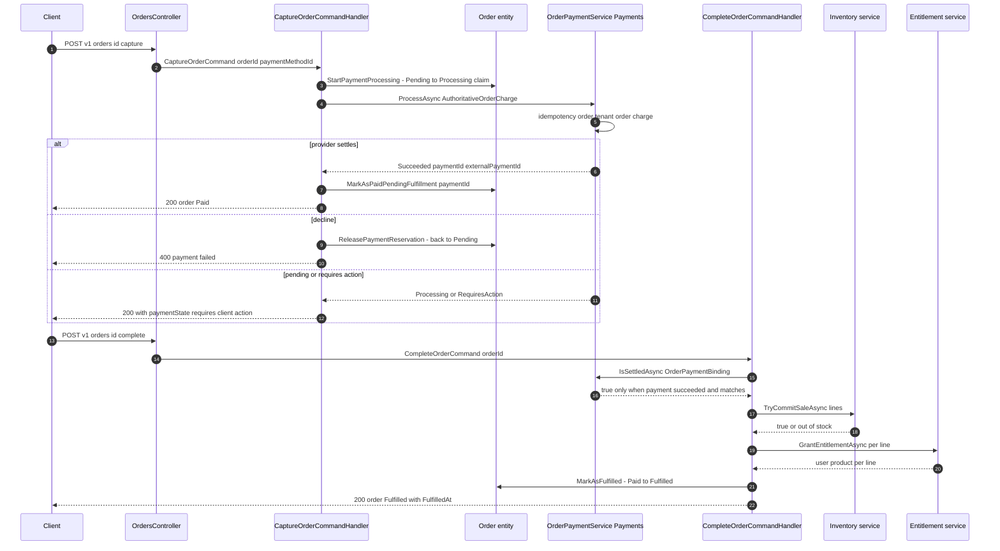
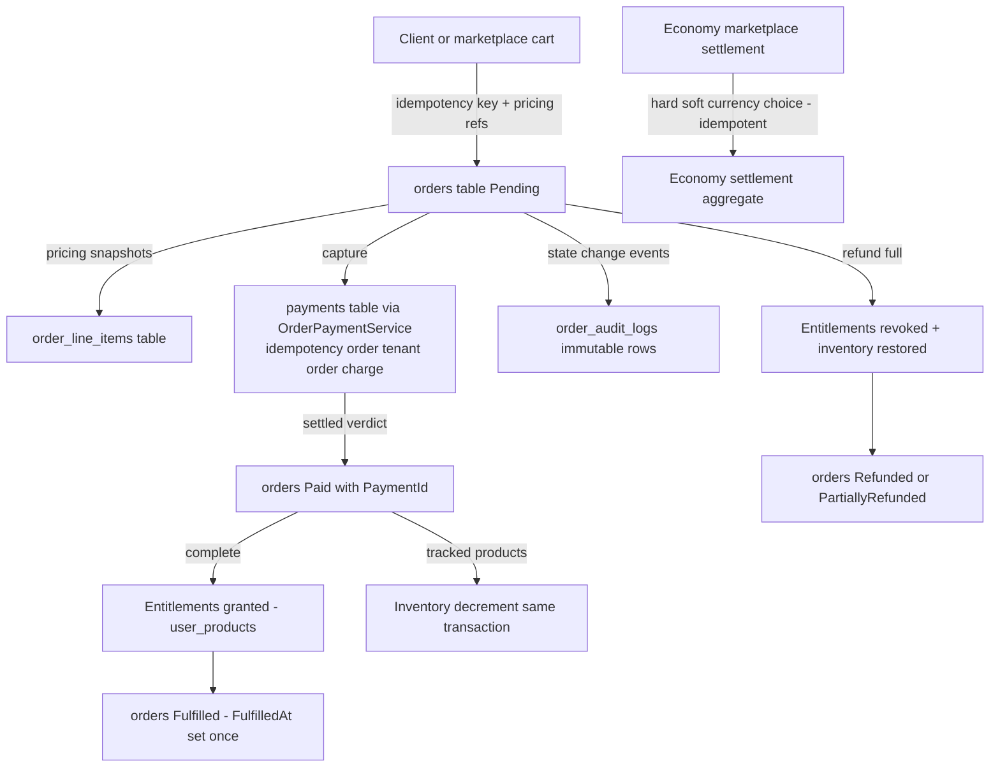

# Order Lifecycle (Placement, Payment Capture, Fulfillment, Completion, Cancellation, Hold, Refund) — User Flow Diagram

> Module `GameGuild.Commerce.Orders` (+ `GameGuild.Commerce.Payments` charge authority, `GameGuild.Commerce.Products` entitlements/inventory, `GameGuild.Finance.Economy.Marketplace` settlement) · Documented against `develop` commit `74e9bba4c`.
> Scope: one-time purchase orders — placement with idempotency, authoritative line-item pricing snapshots, payment reservation and capture, entitlement fulfillment, completion, cancellation, hold/release, refunds, and the marketplace-cart checkout that spawns orders per currency.

## 1. Overview

Orders are created `Pending` via `Order.Create` (`GameGuild.Commerce.Orders/Entities/Order.cs:154-178`) guarded by a unique `IdempotencyKey` index (`:14`) — a replayed create with the same key returns the existing order (`Commands/CreateOrder/CreateOrderCommandHandler.cs:24-36`), refusing keys owned by another actor (`:29-33`). Line items are appended only while `Pending` and carry an authoritative pricing snapshot — pricing version ids, unit/base prices, currency (`Entities/Order.cs:218-296`), all items must share one currency (`:270-277`). Capture (`POST {orderId}:capture`) reserves the order via the FSM transition Pending→Processing (`StartPaymentProcessing`, `Entities/Order.cs:347-356`, concurrent-change rejection through the row-version claim at `Commands/CaptureOrder/CaptureOrderCommandHandler.cs:78-93`), charges through the Payments module's `OrderPaymentService.ProcessAsync` (`GameGuild.Commerce.Payments/Services/OrderPaymentService.cs:23-53`, idempotency key `order:{tenant}:{order}:charge` `:327`), and on success lands the explicit `Paid` state with a bound `PaymentId` (`MarkAsPaidPendingFulfillment`, `Entities/Order.cs:334-341`). Fulfillment (`POST {orderId}:complete`) verifies Payments' settlement verdict (`IOrderPaymentAuthority.IsSettledAsync`, `Commands/CompleteOrder/CompleteOrderCommandHandler.cs:111-123`, implementation `OrderPaymentService.cs:317-325`), decrements tracked inventory (`:129-145`), grants entitlements per line (`:147-174`) and transitions Paid→Fulfilled (`MarkAsFulfilled`, `Entities/Order.cs:375-394`) inside one transaction. An alternative Economy settlement path (`MarketplaceSettlement` on complete, `:39-73`) settles hard/soft currency through `CommerceOrderMarketplaceSettlementAuthority` (`GameGuild.Finance.Economy.Marketplace/CommerceOrderMarketplaceSettlementAuthority.cs:10-25`). Every transition raises `OrderStateChangedEvent` (`Entities/Order.cs:187-215`) persisted as an immutable audit row (`Handlers/OrderStateChangedEventHandler.cs:17-41`). Refund (`POST {orderId}:refund`) revokes entitlements and restores inventory for full refunds but only accepts orders in `Completed`/`PartiallyRefunded` — see gaps.

## 2. End-to-End Flowchart — happy path and every edge case

```mermaid
flowchart TD
    subgraph PLACE["Order placement"]
        PL1["POST v1 orders<br/>OrdersController.cs L64"] --> PL2["CreateOrderCommand idempotency key<br/>validator + handler"]
        PL2 --> PL3{"Existing order same key<br/>CreateOrderCommandHandler.cs L24"}
        PL3 -- "yes other actor" --> PL4["403 key belongs to another actor L31"]
        PL3 -- "yes same actor" --> PL5["200 duplicate - same order returned L35"]
        PL3 -- "no" --> PL6["Order.Create Pending USD default L39"]
        PL6 --> PL7["Persisted - 201 Created"]
        PL7 --> PL8["Add line items POST items L93<br/>AddProductToOrderCommand"]
        PL8 -- "order not Pending" --> PL9["InvalidOperationException Entities Order.cs L231"]
        PL8 -- "price version not positive or zero price" --> PL10["ArgumentOutOfRange L245"]
        PL8 -- "mixed currencies" --> PL11["InvalidOperationException L274"]
        PL8 -- "discount eats whole line" --> PL12["ArgumentOutOfRange L260"]
        PL8 -- "valid snapshot" --> PL13["LineItem with pricing snapshot - totals recalculated L293"]
    end

    subgraph CART["Marketplace cart checkout alternative"]
        CA1["POST v1 marketplace cart checkout<br/>MarketplaceCartController.cs L55"] --> CA2{"Cart changed on another device<br/>MarketplaceCartCommands.cs L141"}
        CA2 -- "yes" --> CA3["409 conflict"]
        CA2 -- "no idempotency key missing" --> CA4["400 idempotency key required L146"]
        CA2 -- "stable" --> CA5["Re-snapshot every line against current published price L149"]
        CA5 -- "price changed or unpublished" --> CA6["409 a cart price changed L153"]
        CA5 -- "all valid" --> CA7["One order per currency group L162<br/>key checkout id plus currency"]
        CA7 --> CA8["Cart marked checked out - orders returned L186"]
    end

    subgraph CAPT["Payment capture"]
        CP1["POST v1 orders id capture<br/>OrdersController.cs L282"] --> CP2["CaptureOrderCommand paymentMethodId"]
        CP2 --> CP3{"Actor owns order<br/>CaptureOrderCommandHandler.cs L26"}
        CP3 -- "no" --> CP4["Forbidden"]
        CP3 -- "yes" --> CP5{"Already Paid with payment L30"}
        CP5 -- "yes" --> CP6["200 duplicate - no second charge L32"]
        CP5 -- "not Pending or Processing L35" --> CP7["409 cannot capture in this status"]
        CP5 -- "no payment method" --> CP8["400 payment method required L41"]
        CP5 --> CP9{"Payable snapshot integrity<br/>positive prices single currency L47"}
        CP9 -- "broken" --> CP10["400 invalid payable order"]
        CP9 -- "subscription line L63" --> CP11["403 subscription checkout authority required"]
        CP9 -- "valid" --> CP12["Pending to Processing claim persisted L78<br/>concurrency conflict = 409 not charged L86"]
        CP12 --> CP13["OrderPaymentService ProcessAsync<br/>idempotency order tenant order charge"]
        CP13 -- "existing succeeded payment" --> CP14["Succeeded returned L62"]
        CP13 -- "requires action" --> CP15["RequiresAction - client completes L79"]
        CP13 -- "processing with expired replay window" --> CP16["RequiresReconciliation L105"]
        CP13 -- "failed retriable" --> CP17["retry attempt with new key L124"]
        CP13 -- "settled" --> CP18["MarkAsPaidPendingFulfillment<br/>Entities Order.cs L334 - Paid with PaymentId"]
        CP13 -- "decline" --> CP19["ReleasePaymentReservation back to Pending<br/>Entities Order.cs L358 - 402 payment failed"]
    end

    subgraph FULFILL["Fulfillment and completion"]
        F1["POST v1 orders id complete<br/>OrdersController.cs L121"] --> F2{"Actor owns order<br/>CompleteOrderCommandHandler.cs L30"}
        F2 -- "no" --> F3["Forbidden"]
        F2 -- "yes" --> F4{"Already Fulfilled L34"}
        F4 -- "yes" --> F5["200 duplicate L36"]
        F4 --> F6{"Economy marketplace settlement body L39"}
        F6 -- "with fiat references too" --> F7["400 mixed settlement authority L41"]
        F6 -- "order not Pending or Processing L48" --> F8["403 economy marketplace ineligible"]
        F6 -- "eligible" --> F9["IOrderMarketplaceSettlementAuthority SettleAsync<br/>Economy module - idempotent - fail closed when unregistered"]
        F9 -- "rejected" --> F10["403 economy marketplace rejected"]
        F9 -- "accepted" --> F11["Settlement result returned - no fiat payment path"]
        F6 -- "fiat path" --> F12{"Status is Paid and PaymentId bound L75"}
        F12 -- "no" --> F13["403 payment authority required"]
        F12 -- "yes" --> F14{"IsSettledAsync verdict L117<br/>payment succeeded and matches order tenant amount currency"}
        F14 -- "not settled" --> F13
        F14 -- "settled" --> F15["Transaction begins L125"]
        F15 --> F16["Inventory commit sale - tracked stock only L129"]
        F16 -- "out of stock" --> F17["409 out of stock at fulfillment - rollback L139"]
        F16 -- "ok" --> F18["Grant entitlement per line L147<br/>subscription lines refused L103"]
        F18 -- "grant failed" --> F19["500 fulfillment failed - rollback L165"]
        F18 -- "all granted" --> F20["MarkAsFulfilled Paid to Fulfilled L176<br/>FulfilledAt set exactly once"]
        F20 --> F21["Commit - 200"]
    end

    subgraph HOLDCANCEL["Hold release cancel"]
        H1["POST id hold L345"] --> H2["HoldOrderCommand<br/>PlaceOnHold Pending or Processing to OnHold"]
        H2 -- "terminal state" --> H3["409 invalid transition"]
        H2 -- "ok" --> H4["OnHold with reason in metadata"]
        H5["POST id release L361"] --> H6["ReleaseOrderCommand<br/>Release OnHold to Pending"]
        H6 -- "not OnHold" --> H7["409 invalid transition"]
        H6 -- "ok" --> H8["Back to Pending - capture again"]
        HC1["POST id cancel L143"] --> HC2["CancelOrderCommand"]
        HC2 -- "not Pending L24" --> HC3["409 cannot cancel in current state"]
        HC2 -- "Pending" --> HC4["Inventory release for reserved lines L31"]
        HC4 --> HC5["Cancel - terminal - audit event"]
    end

    subgraph REFUND["Refund"]
        R1["POST id refund L159 - Refund permission"] --> R2["RefundOrderCommand amount reason"]
        R2 --> R3{"Status Completed or PartiallyRefunded<br/>RefundOrderCommandHandler.cs L24"}
        R3 -- "Fulfilled or Paid or other" --> R4["400 cannot refund order in this state<br/>FSM allows Fulfilled to Refunded - handler does not"]
        R3 -- "eligible" --> R5{"Full refund amount R36"}
        R5 -- "yes" --> R6["Revoke entitlements per line L38"]
        R6 --> R7["Inventory restore L44"]
        R5 -- "partial" --> R8["Entitlements kept"]
        R7 --> R9["ProcessRefund to Refunded or PartiallyRefunded<br/>Entities Order.cs L457"]
        R8 --> R9
    end

    subgraph AUDIT["Audit trail"]
        AU1["Every TransitionToWithReason<br/>Entities Order.cs L187"] --> AU2["OrderStateChangedEvent raised"]
        AU2 --> AU3["OrderStateChangedEventHandler persists OrderAuditLog<br/>Handlers OrderStateChangedEventHandler.cs L28"]
        AU4["ReleasePaymentReservation L358"] --> AU5["Direct Status set - no FSM validation<br/>no audit event - see gaps"]
    end
```

## 3. CQRS Chain Sequence Diagram — capture then complete

## 4. Data Flow Diagram

## 5. Edge-Case Matrix

| # | Edge case | Code path | Outcome |
|---|-----------|-----------|---------|
| 1 | Duplicate create with same idempotency key, same actor | lookup (`Commands/CreateOrder/CreateOrderCommandHandler.cs:24-36`) | 200 with the original order (`WasDuplicate`) |
| 2 | Duplicate create, key owned by another actor | ownership check (`:29-33`) | Forbidden — key collision across actors refused |
| 3 | Add item after processing began | status guard (`Entities/Order.cs:230-233`) | `InvalidOperationException` |
| 4 | Mixed-currency line items | currency guard (`:270-277`) | rejected — order keeps single currency |
| 5 | Discount consumes the entire line | guard (`:260-263`) | rejected — line total must stay positive |
| 6 | Non-positive authoritative price | guard (`:245-253`) | rejected — no zero-priced payable lines |
| 7 | Cart price drift between add and checkout | re-snapshot (`Commands/MarketplaceCartCommands.cs:149-156`) | 409 “a cart price changed before checkout” |
| 8 | Cart edited on another device | version check (`:141`) | 409 conflict |
| 9 | Checkout without idempotency key | guard (`:146`) | 400 |
| 10 | Capture on already-Paid order with bound payment | duplicate guard (`Commands/CaptureOrder/CaptureOrderCommandHandler.cs:30-33`) | 200 duplicate, no second charge |
| 11 | Capture from terminal/hold state | status guard (`:35-39`) | 409 |
| 12 | Subscription line captured through generic order flow | authority guard (`:63-69`) | 403 — subscription checkout authority required |
| 13 | Concurrent capture vs item-add vs cancel | row-version claim (`:78-93`) | loser gets 409 `ConcurrentModification`, order was not charged |
| 14 | Gateway outcome pending / requires action | passthrough (`:122-127`) | 200 with payment state; completion blocked until settled |
| 15 | Processing payment past safe replay window | reconciliation (`GameGuild.Commerce.Payments/Services/OrderPaymentService.cs:105-110`) | `RequiresReconciliation` — no blind re-charge |
| 16 | Failed payment with retry budget | retry with fresh key (`:124-138`) | auto retry inside Payments |
| 17 | Failed payment budget exhausted | replacement payment generation (`:140-142`) | new payment id under `after:{exhausted}` key |
| 18 | Decline after reservation | release (`Commands/CaptureOrder/CaptureOrderCommandHandler.cs:129-149`) | order back to `Pending`, reservation released, 400 |
| 19 | Complete without Payments binding (PaymentId null) | guard (`Commands/CompleteOrder/CompleteOrderCommandHandler.cs:75-85`) | 403 payment authority required |
| 20 | Payment settled but amount/currency mismatches order | `IsSettledAsync` match (`GameGuild.Commerce.Payments/Services/OrderPaymentService.cs:317-325`) | false → complete refused (fail-closed) |
| 21 | Payments module not registered | `DenyOrderPaymentProcessor` (`Abstractions/IOrderPaymentAuthority.cs:9-31`) | fail-closed — “Payments is not configured for order charging” |
| 22 | Out of tracked stock at fulfillment | inventory commit (`Commands/CompleteOrder/CompleteOrderCommandHandler.cs:129-145`) | rollback + 409 |
| 23 | Entitlement grant failure mid-fulfillment | rollback (`:165-170`) | transaction rolled back, order stays Paid (retryable) |
| 24 | Economy settlement mixed with fiat references | guard (`:41-47`) | 400 mixed settlement authority |
| 25 | Economy module not registered | `DenyOrderMarketplaceSettlementAuthority` (`Abstractions/IOrderMarketplaceSettlementAuthority.cs:47-55`) | fail-closed rejection |
| 26 | Cancel after processing began | status guard (`Commands/CancelOrder/CancelOrderCommandHandler.cs:24-27`) | 409 — only Pending cancellable |
| 27 | Full refund restores inventory + revokes entitlements | refund path (`Commands/RefundOrder/RefundOrderCommandHandler.cs:36-50`) | users lose products, tracked stock restored |
| 28 | Refund of a `Fulfilled` (modern) order | status guard (`:24-27`) | **rejected** although the FSM allows Fulfilled→Refunded (`Entities/Order.cs:49`) — see gaps |
| 29 | Fulfilled twice | idempotency (`Entities/Order.cs:377-389`) | second call no-ops; legacy Completed just stamps `FulfilledAt` |
| 30 | Soft-delete of an order | `SoftDelete` override (`Entities/Order.cs:448-452`) | `DeletedAt` only — no FSM transition, row retained for audit |

## 6. Endpoint Inventory

| Method + Route | Handler chain | Controller ref |
|----------------|---------------|----------------|
| POST `v{v}/orders` | `CreateOrderCommand` → `CreateOrderCommandHandler` | `Controllers/OrdersController.cs:64-88` |
| POST `v{v}/orders/{id}/items` | `AddProductToOrderCommand` → handler (pricing-snapshot append) | `Controllers/OrdersController.cs:93-116` |
| POST `v{v}/orders/{id}:complete` | `CompleteOrderCommand` → `CompleteOrderCommandHandler` (fiat or Economy settlement) | `Controllers/OrdersController.cs:121-138` |
| POST `v{v}/orders/{id}:cancel` | `CancelOrderCommand` → `CancelOrderCommandHandler` | `Controllers/OrdersController.cs:143-154` |
| POST `v{v}/orders/{id}:refund` | `RefundOrderCommand` → `RefundOrderCommandHandler` | `Controllers/OrdersController.cs:159-170` |
| GET `v{v}/orders/{id}` | `GetOrderQuery` (+ ownership / ReadAll permission check in controller) | `Controllers/OrdersController.cs:175-196` |
| GET `v{v}/orders` | `GetAllOrdersQuery` / `GetUserOrdersQuery` (`owner=me`) | `Controllers/OrdersController.cs:203-232` |
| HEAD `v{v}/orders/{id}` | `OrderExistsQuery` | `Controllers/OrdersController.cs:237-245` |
| PATCH `v{v}/orders/{id}` | `UpdateOrderCommand` | `Controllers/OrdersController.cs:250-261` |
| DELETE `v{v}/orders/{id}` | `DeleteOrderCommand` (soft delete) | `Controllers/OrdersController.cs:266-277` |
| POST `v{v}/orders/{id}:capture` | `CaptureOrderCommand` → Payments `OrderPaymentService` | `Controllers/OrdersController.cs:282-323` |
| POST `v{v}/orders/{id}:payment-intent` | `PrepareOrderPaymentIntentCommand` → Payments `OrderPaymentIntentService` | `Controllers/OrdersController.cs:325-340` |
| POST `v{v}/orders/{id}:hold` / `:release` | `HoldOrderCommand` / `ReleaseOrderCommand` | `Controllers/OrdersController.cs:345-371` |
| GET `v{v}/marketplace/cart` | `GetMarketplaceCartQuery` | `Controllers/MarketplaceCartController.cs:19` |
| POST `v{v}/marketplace/cart/items` + PATCH/DELETE | `Add/SetQuantity/RemoveMarketplaceCartItemCommand` | `Controllers/MarketplaceCartController.cs:26,35,45` |
| POST `v{v}/marketplace/cart/checkout` | `CheckoutMarketplaceCartCommand` (order per currency group) | `Controllers/MarketplaceCartController.cs:55` |
| GET `v{v}/products/{productId}/recommendations` | `GetProductRecommendationsQuery` | `Controllers/ProductRecommendationsController.cs:27-28` |

Auth note: every Orders endpoint is `[Authorize]` plus a `RequirePermission(OrdersPermission.Keys.*)` per action (`Create`/`Read`/`ReadAll`/`Refund`/`Delete`); capture/complete additionally enforce `OrderActorContext.Authorize` ownership in-handler. The Orders controller applies **no** rate-limit policy (no `[EnableRateLimiting]` on the controller).

## 7. Events Published / Consumed

- **Published (in-process domain events)** — `OrderStateChangedEvent` on every validated transition (`Entities/Order.cs:187-215`), consumed by `OrderStateChangedEventHandler` → immutable `OrderAuditLog` rows (`Handlers/OrderStateChangedEventHandler.cs:28-35`). Raised transitions carry previous/new status, optional reason and external payment id.
- **Consumed** — none inbound at module boundary; Orders is a leaf command surface. (Marketplace checkout publishes nothing; the Economy settlement authority records its own aggregate events inside `GameGuild.Finance.Economy.Marketplace`.)

## 8. Entities and Tables Touched

| Entity / store | Fields that matter | Ref |
|----------------|--------------------|-----|
| `Order` → orders | `Status`, `IdempotencyKey` (unique), `Total/Subtotal/DiscountTotal/TaxAmount`, `Currency`, `PaymentId`, `ExternalPaymentId`, `PaidAt`, `FulfilledAt`, `OrderType`, `TargetSubscriptionId`, `RefundAmount` | `Entities/Order.cs:11-152` |
| `OrderLineItem` | pricing snapshot columns (`ProductPricingId`, `ProductPricingVersionId`, `PriceVersionSnapshot`, `UnitPriceSnapshot`, `CurrencySnapshot`), `EntitlementId` link | `Entities/OrderLineItem.cs`, snapshot `Models/OrderLineItemPricingSnapshot.cs` |
| `OrderAuditLog` | `FromStatus`/`ToStatus`, reason, `ExternalPaymentId` | `Entities/OrderAuditLog.cs` |
| `MarketplaceCart` | optimistic version, `CheckedOutAtUtc` | `Entities/MarketplaceCart.cs` |
| Payments `Payment` (cross-module) | `OrderId`, `TenantId`, `Amount`, `Currency`, `Status`, `RetryCount` — the settlement verdict source | `GameGuild.Commerce.Payments/Services/OrderPaymentService.cs:317-325` |

## 9. Gaps

See [gaps.md](./gaps.md). Order-flow NEW items: refund handler excludes modern `Fulfilled` orders and never issues a gateway refund (G-4); `ReleasePaymentReservation` bypasses the FSM and raises no audit event (G-5); cancel/update/delete/refund handlers skip the actor-ownership check that capture/complete enforce (G-6); the Orders controller has no rate-limit policy (G-7).
