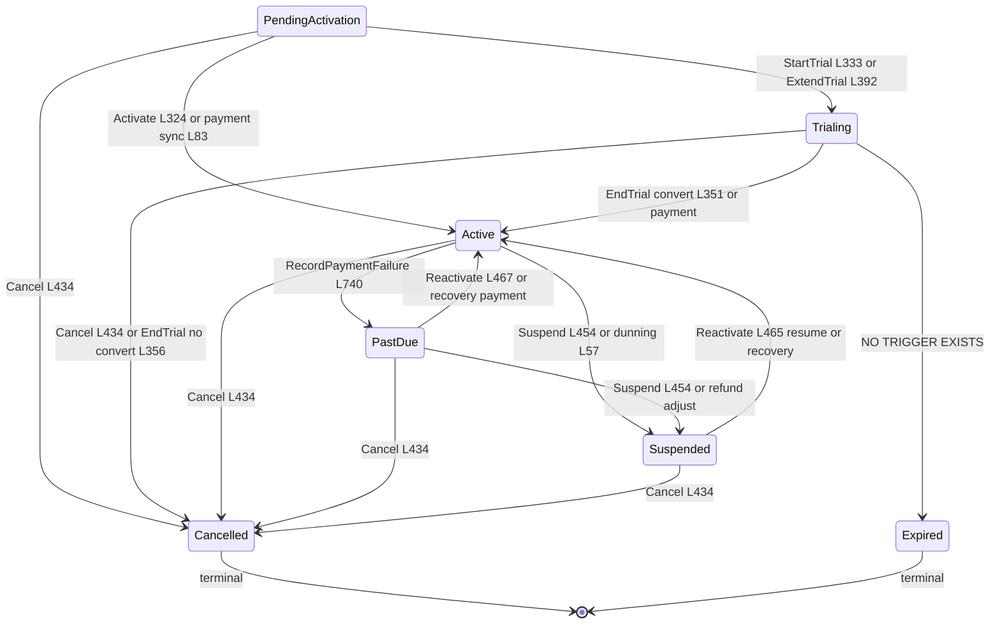
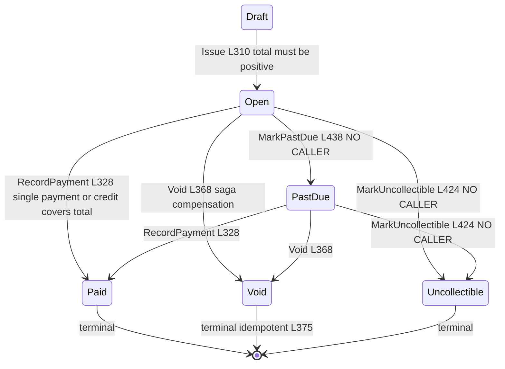
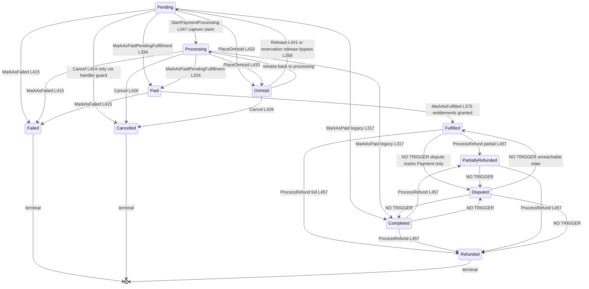
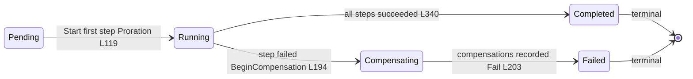

# State Machines and Transitions Audit — Subscription, Invoice, Order (+ Plan-Change Saga)

> Modules `GameGuild.Commerce.Subscriptions` + `GameGuild.Commerce.Billing` + `GameGuild.Commerce.Orders` · Documented against `develop` commit `74e9bba4c`.
> State machines are declared once per entity as a `ValidTransitions` map / guarded methods and enforced by the `StatefulEntity<T>.TransitionTo` base (`GameGuild.SharedKernel`). Every diagram below is derived from the entity code, then audited for: triggers with file:line, unreachable states, and missing guards (double-billing windows, concurrent cancels).

## 1. Subscription state machine

Declared at `GameGuild.Commerce.Subscriptions/Entities/Subscription.cs:28-38`; statuses at `Models/SubscriptionStatus.cs:11-41`.

### Transitions audit — Subscription

| # | Transition | Guard in entity | Production triggers | Notes |
|---|-----------|-----------------|---------------------|-------|
| 1 | PendingActivation → Active | `Activate()` (`Entities/Subscription.cs:324-328`) | `:activate` endpoint (`SubscriptionLifecycleCommandHandler` chain); payment sync on first confirmed payment (`Services/PaymentSubscriptionSyncService.cs:81-84`) | raises `SubscriptionActivatedEvent` |
| 2 | PendingActivation → Trialing | `StartTrial()` (`:333-339`); `ExtendTrial` (`:389-393`) | `:start-trial` endpoint; trial-extension promo at creation (`Commands/CreateSubscription/CreateSubscriptionCommandHandler.cs:99-103`) | `ExtendTrial` may grant a trial a subscription never had |
| 3 | PendingActivation → Cancelled | `Cancel()` (`:434-447`) | cancel endpoint; provider deleted webhook | idempotent when already cancelled (`:436`) |
| 4 | Trialing → Active | `EndTrial(true)` (`:344-353`) | `:end-trial` with `ConvertToPaid=true`; payment arrival | `EndTrial` throws unless Trialing (`:346-347`) |
| 5 | Trialing → Cancelled | `EndTrial(false)` → `Cancel(TrialEnded)` (`:356-358`); direct `Cancel` | trial expiry without conversion; user cancel | |
| 6 | Trialing → Expired | transition allowed (`:32`) | **none — no method or caller ever writes Expired** | unreachable (G-3) |
| 7 | Active → PastDue | `RecordPaymentFailure()` (`:736-744`) | `invoice.payment_failed` webhook (`Services/BillingWebhookService.cs:247-251`); `RecordPaymentFailure` command | only when currently Active (`:738`); no counter of consecutive failures — the FSM has no dunning-step memory |
| 8 | Active/PastDue → Suspended | `Suspend()` (`:452-460`) | `:suspend`/`:pause`; dunning exhaustion (`Services/PaymentDunningLifecycleService.cs:57`); full refund (`Services/PaymentSubscriptionSyncService.cs:250`) | reason recorded into Metadata JSON (`:457`) — overwrites prior metadata (G-10) |
| 9 | PastDue → Active | `Reactivate()` (`:465-472`) | recovery payment (`PaymentDunningLifecycleService.cs:74-109`); `:reactivate` | direct Active→Active via `RecordPayment` while PastDue is **not** auto-healed — `RecordPayment` does not transition PastDue→Active (see missing guards) |
| 10 | Suspended → Active | `Reactivate()` | `:resume`/`:reactivate`; recovery payment (dunning reason only) | `Reactivate` force-sets `AutoRenew = true` (`:468`) |
| 11 | * → Cancelled | `Cancel()` | user/admin endpoint; webhook; `EndTrial` | `AutoRenew=false`, `EndDate=effectiveDate ?? now` (`:443-444`) |
| 12 | Cancelled → * | empty set (`:36`) | — | terminal; `RecordPayment` rejects cancelled subscriptions (`:650-652`) |

**Missing guards — Subscription**
- **PastDue→Active on successful payment is implicit-only.** `RecordPayment` (`:641-721`) mutates billing state regardless of PastDue status and does not transition back to Active; only dunning-suspended subscriptions get an explicit reactivation (`Services/PaymentDunningLifecycleService.cs:74-109`). A PastDue subscription whose next payment succeeds via webhook (`BillingWebhookService.HandlePaymentSucceededAsync:191`) stays **PastDue with a fresh paid period** until someone calls `:reactivate`. (Known-adjacent: the webhook path never reactivates.)
- **Concurrent renewal vs cancellation** is guarded only by optimistic `RowVersion` (`Entities/Subscription.cs:229-235`) — the loser's `UpdateAsync` throws; no automatic retry. The billing-window double-charge itself is closed by `LastProcessedBillingCycle` monotonicity + `LastPaymentIdempotencyKey` (`:685-703`) and the per-cycle invoice key (below), so the double-billing window is: **same cycle, different payment id** → rejected; **same payment, replayed** → idempotent; **next cycle charged twice concurrently** → first wins cycle n+1, second rejected as out-of-order.
- **`Cancel` accepts a future `effectiveDate`** (`:443`) but transitions to terminal `Cancelled` immediately — access-restriction semantics (service until date) are not represented; entitlement handlers only see Cancelled.

## 2. Invoice state machine

Methods at `GameGuild.Commerce.Billing/Entities/Invoice.cs` — `Issue :310-322`, `RecordPayment :328-363`, `Void :368-384`, `ApplyAccountCredit :394-419`, `MarkUncollectible :424-433`, `MarkPastDue :438-447`; statuses `:482-501`. Immutability: amounts frozen once `Status != Draft` (`:185`, `EnsureMutable :458-464`).

### Transitions audit — Invoice

| # | Transition | Guard | Production triggers | Notes |
|---|-----------|-------|---------------------|-------|
| 1 | Draft → Open | `Issue()` requires `Total > 0` (`:313-315`) | cycle materialization (`Services/InvoiceGenerationService.cs:166`); plan-change saga invoice step (`Services/SubscriptionChangeSagaOrchestrator.cs:183`) | sets `IssuedAt`, `DueDate` (default +30d `:320`) |
| 2 | Open → Paid | `RecordPayment` single-payment invariant (`:345-351`) or `ApplyAccountCredit` (`:411-416`) | materializer records immediately on confirmed cycle (`InvoiceGenerationService.cs:171`); saga payment (`SubscriptionChangeSagaOrchestrator.cs:300`); account-credit tender endpoint | `PaymentId` unique index (`:20`) is the DB-level double-payment backstop |
| 3 | Open/PastDue → PastDue | `MarkPastDue` only from Open (`:440-442`) | **no callers anywhere** | unreachable in production (G-2) — invoices opened and paid in the same flow, or never age |
| 4 | Open/PastDue → Uncollectible | `MarkUncollectible` (`:426-428`) | **no callers anywhere** | unreachable (G-2) — no bad-debt write-off path exists |
| 5 | Open/Draft → Void | `Void` refuses Paid (`:370-372`), idempotent (`:375-377`) | saga compensation (`Services/SubscriptionChangeSagaOrchestrator.cs:402-408`) | only trigger in the codebase |
| 6 | Paid → * | refused everywhere (`:336-338`, `:371`, `:407`) | — | terminal; no credit-note/refund linkage from Invoice (refunds live in Payments) |

**Missing guards — Invoice**
- **No PastDue aging job.** `DueDate` is written (`Invoice.cs:320`) but nothing sweeps Open invoices past due date to `PastDue`, and nothing ever writes `Uncollectible` — the state enum's bad-debt half is dead code (G-2).
- **Amount immutability is entity-only.** `EnsureMutable` protects Draft-state mutations; a draft invoice's amounts have no secondary approval record (acceptable: drafts only exist inside the materializer/saga which issue immediately).
- **Double-billing window** (same subscription cycle producing two invoices) is closed twice: check-then-create on `IdempotencyKey` (`InvoiceGenerationService.cs:97-113`) + unique index `IX_invoices_IdempotencyKey` race backstop (`:179-191`). Residual window: **two different cycles billed for the same period** would each produce an invoice — prevented only by `Subscription.RecordPayment`'s cycle monotonicity on the first-party path; the provider path trusts Stripe's own subscription clock.

## 3. Order state machine

`ValidTransitions` at `GameGuild.Commerce.Orders/Entities/Order.cs:42-56`; statuses at `Entities/OrderEnums.cs:9-54`. Monotonic FSM: no backward economic transitions.

### Transitions audit — Order

| # | Transition | Guard | Production triggers | Notes |
|---|-----------|-------|---------------------|-------|
| 1 | Pending → Processing | `StartPaymentProcessing` idempotent-if-already (`Entities/Order.cs:349-351`) | capture claim persisted before gateway call (`Commands/CaptureOrder/CaptureOrderCommandHandler.cs:78-93`) | concurrency loser gets `DbUpdateConcurrencyException` → 409 not-charged |
| 2 | Processing → Pending | `ReleasePaymentReservation` (**direct status set, bypasses `TransitionTo`**) (`:358-367`) | capture decline release (`CaptureOrderCommandHandler.cs:129-143`) | no `OrderStateChangedEvent`, no FSM validation (G-5) |
| 3 | OnHold → Pending | `Release()` via FSM (`:441-445`) | `:release` endpoint | guarded, audited |
| 4 | Pending/Processing → Paid | `MarkAsPaidPendingFulfillment` (`:334-341`) | settled gateway charge (`CaptureOrderCommandHandler.cs:151`) | binds `PaymentId`, sets `PaidAt`; `PaymentId` single-payment invariant `AssociatePayment :402-411` |
| 5 | Pending/Processing → Completed | `MarkAsPaid` legacy (`:317-325`) | legacy paths only | skips `Paid`/`Fulfilled` — `FulfilledAt` unset until `MarkAsFulfilled` stamps it (`:383-389`) |
| 6 | Paid → Fulfilled | `MarkAsFulfilled` idempotent (`:377-389`) | fulfillment transaction (`Commands/CompleteOrder/CompleteOrderCommandHandler.cs:176`) after settlement verdict + inventory + entitlements | `FulfilledAt` set exactly once |
| 7 | * → Failed | `MarkAsFailed` (`:415-420`) | capture/gateway failure paths | reason into `Metadata` (overwrites metadata — noted) |
| 8 | Pending/Processing/OnHold → Cancelled | `Cancel` (`:424-429`) | `:cancel` endpoint — **handler only allows Pending** (`Commands/CancelOrder/CancelOrderCommandHandler.cs:24-27`) | FSM is broader than the handler; Processing/OnHold cancels impossible via API |
| 9 | Completed/Fulfilled → Refunded/PartiallyRefunded | `ProcessRefund` picks by `amount >= Total` (`:457-465`) | `:refund` endpoint — **handler only allows Completed/PartiallyRefunded** (`Commands/RefundOrder/RefundOrderCommandHandler.cs:24-27`) | Fulfilled orders (the modern flow) cannot be refunded via API (G-4); no gateway refund is issued |
| 10 | * → Disputed | transition table (`:55`) | **none** — the Stripe dispute consumer marks the *Payment* disputed (`GameGuild.Commerce.Billing/Services/StripeDisputeEventConsumer.cs:109`), never the Order | `OrderStatus.Disputed` is unreachable (see §5) |
| 11 | Disputed → Fulfilled/Completed/Refunded | transition table (`:55`) | none (source state unreachable) | dead transitions |

**Missing guards — Order**
- **`ReleasePaymentReservation` writes `Status` directly** (`Entities/Order.cs:365`) — outside the FSM: no `OrderStateChangedEvent` (audit hole), no transition validation. If a future caller invokes it on a non-Processing order the `if` guard (`:360-363`) throws, but the success path is invisible to the audit log (G-5).
- **Handler/FSM mismatch on cancel and refund** — the FSM allows Processing→Cancelled and Fulfilled→Refunded; the handlers forbid both, so those FSM rows are unreachable via API. A paid-but-unfulfillable order can never be cancelled (only Failed from Paid), and a Fulfilled order can never be refunded (G-4).
- **Double-capture window** — closed by the persisted Pending→Processing claim (`CaptureOrderCommandHandler.cs:78-93`) plus the Payments idempotency key `order:{tenant}:{order}:charge` (`GameGuild.Commerce.Payments/Services/OrderPaymentService.cs:327-328`); a concurrent second capture loses on row version and is refused before the gateway call.
- **Concurrent cancel during capture** — cancel is Pending-only and capture's claim moves the order out of Pending first; a cancel racing the claim fails its status check. A cancel racing `MarkAsPaidPendingFulfillment` fails the FSM (Paid→Cancelled not allowed). No double economic effect.

## 4. Plan-change saga status machine

Statuses at `GameGuild.Commerce.Billing/Entities/SubscriptionChangeSaga.cs:12-29`; mutation methods `Start :146-151`, `AdvanceTo :169-171`, `Complete :187-191`, `BeginCompensation :194-200`, `Fail :203-207`.

Audit notes: saga rows are keyed by unique `IdempotencyKey` = `subscription:{id}:change:{plan}:{effectiveDate:O}` (`Entities/SubscriptionChangeSaga.cs:87-92`, builder `Services/SubscriptionChangeSagaOrchestrator.cs:540-542`), so a replayed intent can never start a second saga — the double-billing window for plan changes is closed at intent level, and the gateway charge carries `{key}:charge` as its idempotency key (`:246`). Steps are journaled in `subscription_change_sagas`/`subscription_change_sagas_steps` with per-step durable events published **required** (`Events/BillingIntegrationEventPublisher.cs:158-213`) — a publish failure rolls back the local transaction rather than losing the event. Terminal Failed sagas keep compensation evidence in `CompensationsApplied` (`:140`); there is **no retry/resume of a Failed saga** — operators re-submit the same intent key, which returns the recorded failure (`SubscriptionChangeSagaOrchestrator.cs:93-101`) until a new effective date is chosen (documented behavior, listed in gaps.md as G-11 for visibility).

## 5. Unreachable/dead states summary

| Entity | State | Declared | Writer | Verdict |
|--------|-------|----------|--------|---------|
| Subscription | `Expired` | `Models/SubscriptionStatus.cs:41`, transition row `Entities/Subscription.cs:32` | none | dead state (G-3) — entity rejects payments into it (`:654-656`) but nothing can enter it |
| Invoice | `PastDue` | `Entities/Invoice.cs:497`, `MarkPastDue :438-447` | none | dead state (G-2) |
| Invoice | `Uncollectible` | `Entities/Invoice.cs:500`, `MarkUncollectible :424-433` | none | dead state — no bad-debt write-off (G-2) |
| Order | `Disputed` (and its three out-transitions) | `Entities/Order.cs:48-55` | none — disputes are recorded on the Payments aggregate (`GameGuild.Commerce.Billing/Services/StripeDisputeEventConsumer.cs:109`), the Order is never moved | dead state (G-12) |
| Order FSM rows Processing→Cancelled, Fulfilled→Refunded | `:46-49` | handler guards forbid | unreachable via API (G-4 adjacent) |
