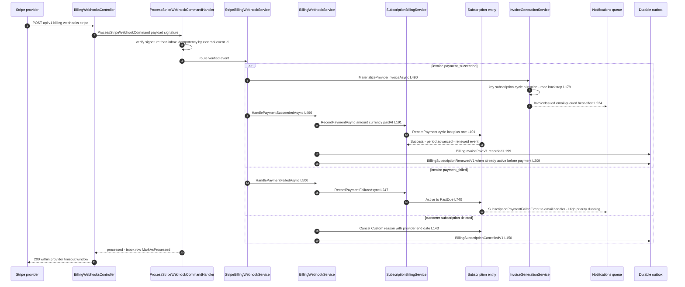
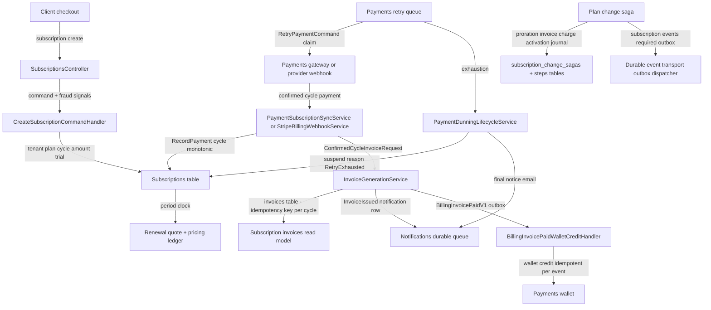

# Subscription Billing Cycle (Purchase, Billing Period, Invoice Generation, Payment Retry and Dunning, Cancellation, Plan Change, Trial) — User Flow Diagram

> Modules `GameGuild.Commerce.Subscriptions` + `GameGuild.Commerce.Billing` (+ `GameGuild.Commerce.Payments` retry engine, `GameGuild.Notifications` dunning email) · Documented against `develop` commit `74e9bba4c`.
> Scope: everything a subscription invoice rides on — creation (with trial and promo), the billing-period clock, renewal quotes, first-party vs provider-billed invoice materialization, payment failure → retry queue → dunning suspension → recovery, cancellation semantics, and the orchestrated plan-change saga with proration.

## 1. Overview

A subscription links a tenant to a plan with an authoritative `Money` amount and a billing-period clock computed by `Subscription.CalculateBillingDates` (`GameGuild.Commerce.Subscriptions/Entities/Subscription.cs:771-786` — Monthly/Quarterly/SemiAnnually/Annually/Biannually, period end = next billing minus one day). Creation runs the fraud gate first (`Commands/CreateSubscription/CreateSubscriptionCommandHandler.cs:41-51`, Block refuses, Review flags metadata `:134-148`), quotes promo codes fail-closed (`:54-84`), then constructs the entity in `Trialing` (trial end date present) or `PendingActivation` (`Entities/Subscription.cs:67`). A first-party payment for cycle N=1 activates it and materializes the invoice: `PaymentSubscriptionSyncService.SyncSuccessfulPaymentAsync` (`Services/PaymentSubscriptionSyncService.cs:35-128`) → `Subscription.RecordPayment` (`Entities/Subscription.cs:641-721`, enforces amount/currency match, cycle monotonicity, idempotency key `payment:{paymentId}`) → `SubscriptionInvoiceMaterializer` (`GameGuild.Commerce.Billing/Services/SubscriptionInvoiceMaterializer.cs:19-61`) → `InvoiceGenerationService.MaterializeForConfirmedCycleAsync` (`Services/InvoiceGenerationService.cs:69-236`), which issues the invoice paid-in-place with idempotency key `subscription:{id}:cycle:{n}:invoice` (`:48-49`) backstopped by unique index `IX_invoices_IdempotencyKey` (`Entities/Invoice.cs:17`). Provider-billed cycles arrive as Stripe `invoice.payment_succeeded` webhooks through the durable inbox (`Services/StripeBillingWebhookService.cs:486-497` → `MaterializeProviderInvoiceAsync :403-460` → `BillingWebhookService.HandlePaymentSucceededAsync :168-225`). Renewal is a *quote-only* operation (`SubscriptionBillingService.ProcessRenewalAsync`, `Services/SubscriptionBillingService.cs:31-91`, records a pricing-decision ledger entry `:48-88`); charging happens provider-side or via the Payments retry engine. Payment failure moves Active → PastDue (`Entities/Subscription.cs:736-744`); the Payments retry queue (`GameGuild.Commerce.Payments/Services/PaymentRetryQueueWorker.cs:26-109`, opt-in hourly poll, backoff `base * multiplier^retryCount` from `Configuration/PaymentRetryOptions.cs:29,33,49-56`) retries failed payments, and on exhaustion suspends the subscription and fires the final dunning notice (`PaymentDunningLifecycleService.SuspendForRetryExhaustionAsync`, `Services/PaymentDunningLifecycleService.cs:22-72`; ladder config `GameGuild.API/Core/Integration/PaymentDunningOptions.cs:20-43`). A recovery payment reactivates only dunning-suspended subscriptions (`PaymentDunningLifecycleService.cs:74-109`). Plan changes run as a journaled compensation saga: Proration → Invoice → Payment → Activation (`Services/SubscriptionChangeSagaOrchestrator.cs:123-358`).

## 2. End-to-End Flowchart — happy path and every edge case

```mermaid
flowchart TD
    subgraph PURCHASE["Subscription purchase"]
        P1["POST api v1 subscriptions<br/>SubscriptionsController.cs L35"] --> P2["Tenant access validated from auth context<br/>SubscriptionsController.cs L41"]
        P2 -- "other tenant id" --> P403["403 cross-tenant refused"]
        P2 --> P3["CreateSubscriptionCommand<br/>validator then handler"]
        P3 --> P4{"Plan requires custom quote<br/>CreateSubscriptionCommandHandler.cs L33"}
        P4 -- "yes -1 sentinel" --> P400["SubscriptionPlanCustomQuotePendingException L35"]
        P4 -- "priced" --> P5{"Fraud gate at creation<br/>CreateSubscriptionCommandHandler.cs L41"}
        P5 -- "Block" --> P403b["SubscriptionFraudBlockedException L50"]
        P5 -- "Review" --> P6["Created with evidence in metadata L134"]
        P5 -- "Allow" --> P7
        P6 --> P7{"Promo codes supplied<br/>L54"}
        P7 -- "yes none applicable" --> P400b["InvalidOperationException fail closed L79"]
        P7 -- "yes some applied" --> P8["Amount discounted - trial extended - periods skipped<br/>ExtendTrial L102 - SkipBillingPeriods L108"]
        P7 -- "no" --> P8b["Amount as requested"]
        P8 --> P9["new Subscription<br/>Trialing when trial end set else PendingActivation<br/>Entities Subscription.cs L67"]
        P8b --> P9
        P9 --> P10{"FulfilledOrderId supplied L112"}
        P10 -- "yes" --> P11["SetFulfilledOrderId audit link L114"]
        P10 -- "no" --> P12["Warning logged - legacy or admin path L122"]
        P11 --> P13["Persisted - returns subscription id"]
        P12 --> P13
    end

    subgraph ACTIVATE["First payment and activation"]
        A1["First-party payment confirmed for cycle 1<br/>PaymentSubscriptionSyncService.cs L35"] --> A2{"Billing cycle identity present L44"}
        A2 -- "missing" --> A3["Warning - no sync L46"]
        A2 -- "present" --> A4{"Subscription found L62"}
        A4 -- "missing" --> A5["Warning - skip L64"]
        A4 --> A6["RecordPayment amount currency cycle key<br/>Entities Subscription.cs L641"]
        A6 -- "cancelled or expired" --> A7["Rejected - refund required L650"]
        A6 -- "amount or currency mismatch" --> A8["RejectedMoney L667"]
        A6 -- "same cycle different key" --> A9["RejectedOutOfOrder L690"]
        A6 -- "same cycle same key" --> A10["AlreadyProcessed - idempotent replay L687"]
        A6 -- "cycle equals last plus one" --> A11["Payment recorded - period advanced when n greater than 1 L705"]
        A11 --> A12{"Status was PendingActivation<br/>PaymentSubscriptionSyncService.cs L81"}
        A12 -- "yes" --> A13["Activate - PendingActivation to Active L83"]
        A12 -- "no" --> A14["Persist update"]
        A13 --> A14
        A14 --> A15["Materialize invoice - see INVOICE subgraph"]
    end

    subgraph INVOICE["Invoice generation per confirmed cycle"]
        I1["MaterializeForConfirmedCycleAsync<br/>InvoiceGenerationService.cs L69"] --> I2["Key subscription id cycle n invoice L48<br/>unique index backstop Invoice.cs L17"]
        I2 --> I3{"Row exists for key L99"}
        I3 -- "yes" --> I4["Enrich late external id or payment then return L102"]
        I3 -- "no" --> I5["Draft invoice - period - description - promo gross-up L115"]
        I5 --> I6{"Provider invoice id present L159"}
        I6 -- "yes" --> I7["SetExternalId L161"]
        I6 -- "no" --> I8["Derive payment id from SHA256 L57<br/>when provider id present"]
        I7 --> I9["Issue with confirmation date L166<br/>then RecordPayment L171 - lands Paid"]
        I8 --> I9
        I9 --> I10{"Unique constraint race L179"}
        I10 -- "lost" --> I11["Detach - fetch winner - return winner L182"]
        I10 -- "won" --> I12["Invoice persisted Paid L193"]
        I12 --> I13["Stamp promo usage rows L203"]
        I13 --> I14["Invoice issued email queued best effort L224<br/>renderer Billing Services Email Renderers"]
        I14 --> I15{"Invoice Paid<br/>referral trigger L229"}
        I15 -- "yes" --> I16["Referral conversion check idempotent L231"]
        I15 -- "no" --> I17["Done"]
        I16 --> I17
    end

    subgraph BILLINGP["Billing period and renewal"]
        B1["Period clock CurrentPeriodStart End NextBillingDate<br/>Entities Subscription.cs L69"] --> B2["Renewal due - admin endpoint or scheduler<br/>POST subscription renew L275"]
        B2 --> B3["ProcessSubscriptionRenewalCommand<br/>handler delegates to billing service"]
        B3 --> B4["PrepareRenewal quote only<br/>Entities Subscription.cs L554"]
        B4 -- "not active" --> B5["Failed subscription is not active L559"]
        B4 -- "auto renew off" --> B6["Failed auto-renewal is disabled L562"]
        B4 -- "eligible" --> B7["RequiresPayment quote for cycle last plus one L565"]
        B7 --> B8["Pricing decision ledger entry idempotent per cycle<br/>SubscriptionBillingService.cs L48"]
        B8 -- "ledger rejected" --> B9["InvalidOperationException L84"]
        B8 -- "recorded" --> B10["Charge happens provider-side or via Payments retry"]
        B10 --> B11["Provider webhook invoice payment_succeeded<br/>StripeBillingWebhookService.cs L486"]
        B11 --> B12["Materialize invoice first then payment sync L490"]
    end

    subgraph DUNNING["Payment failure - retry - dunning"]
        D1["invoice payment failed webhook<br/>BillingWebhookService.cs L228"] --> D2["RecordPaymentFailureAsync<br/>SubscriptionBillingService.cs L111"]
        D2 --> D3{"Status Active<br/>Entities Subscription.cs L738"}
        D3 -- "yes" --> D4["Transition Active to PastDue L740<br/>SubscriptionPaymentFailedEvent raised L743"]
        D3 -- "no" --> D5["Event raised - no transition"]
        D4 --> D6["PaymentFailed dunning email High priority<br/>API Core Integration SubscriptionPaymentFailedEmailHandler"]
        D1b["Payments retry queue poll - opt in<br/>PaymentRetryQueueWorker.cs L117"] --> D7["GetDueForRetry claim via Failed to Pending persist<br/>RetryPaymentCommandHandler.cs L94"]
        D7 -- "dispatch failed" --> D8["Item isolated - reconsidered next poll L67"]
        D7 -- "retry success" --> D9["Dunning suspension lifted L484<br/>reactivate only when RetryExhausted reason"]
        D7 -- "budget exhausted or hard decline" --> D10["SuspendForRetryExhaustionAsync L500<br/>PaymentDunningLifecycleService.cs L22"]
        D10 --> D11{"Already suspended or cancelled L39"}
        D11 -- "yes" --> D12["Skip - no double suspension L41"]
        D11 -- "not Active or PastDue L48" --> D13["Skip with warning L49"]
        D11 -- "eligible" --> D14["Suspend with reason payment retry exhausted L57"]
        D14 --> D15["SubscriptionRenewalFailedEvent L68<br/>final notice dunning email Urgent"]
        D9 --> D16["TryReactivateAfterRecoveryAsync L74<br/>only suspensionReason equals RetryExhausted L94"]
        D16 -- "suspended for other reason" --> D17["No automatic reactivation L96"]
        D16 -- "dunning suspension" --> D18["ReactivateAsync - back to Active L102"]
    end

    subgraph CANCEL["Cancellation"]
        C1["POST subscription cancel<br/>SubscriptionLifecycleController.cs L96"] --> C2["CancelSubscriptionCommand<br/>reason note effectiveDate"]
        C2 --> C3["Subscription.Cancel<br/>Entities Subscription.cs L434"]
        C3 -- "already cancelled" --> C4["Idempotent return L436"]
        C3 -- "any live state" --> C5["TransitionTo Cancelled - AutoRenew false L439"]
        C5 --> C6{"EffectiveDate supplied"}
        C6 -- "yes future" --> C7["EndDate set to future date L443<br/>mid-cycle cancel recorded immediately"]
        C6 -- "no" --> C8["EndDate now L443"]
        C7 --> C9["SubscriptionCancelledEvent L446"]
        C8 --> C9
        C9 --> C10["Cancelled email via API handler<br/>Core Integration SubscriptionCancelledEmailHandler"]
        C1b["Provider deleted webhook<br/>BillingWebhookService.cs L124"] --> C11["Cancel with Custom reason and provider EndDate L143"]
    end

    subgraph PLANCHANGE["Plan change - orchestrated saga with proration"]
        S1["POST plan-change orchestrate<br/>SubscriptionChangeOrchestrationController.cs L32"] --> S2["Explicit UTC effective date required<br/>SubscriptionChangeSagaOrchestrator.cs L41"]
        S2 -- "missing" --> S3["BusinessRuleViolation L43"]
        S2 --> S4["Idempotency key subscription change plan date L91<br/>replay returns recorded saga L93"]
        S4 --> S5{"Same plan L103"}
        S5 -- "yes" --> S6["BusinessRuleViolation same-plan L105"]
        S5 -- "no" --> S7["Saga row Pending - journal table L110"]
        S7 --> S8["Step 1 Proration L123<br/>daily rate over remaining days L148"]
        S8 -- "currency mismatch" --> S9["BusinessRuleViolation L145"]
        S8 --> S10{"Net adjustment positive L171"}
        S10 -- "yes" --> S11["Step 2 Invoice issued Open L173"]
        S10 -- "credit" --> S12["Invoice step Skipped - credit recorded on saga L197"]
        S11 --> S13["Step 3 Payment external L206<br/>method resolved and ownership checked L442"]
        S13 -- "no method" --> S14["Compensate - void invoice - saga Failed L235"]
        S13 -- "gateway cannot verify settlement L226" --> S14
        S13 -- "outcome unknown or pending L260" --> S15["Throw - local rollback - retry same intent L265"]
        S13 -- "confirmed decline L268" --> S16["Compensate L271"]
        S13 -- "settled amount or currency mismatch L292" --> S17["Throw reconcile first L295"]
        S13 -- "settled and verified L297" --> S18["Invoice RecordPayment L300"]
        S12 --> S19["Step 4 Activation L315"]
        S18 --> S19
        S19 --> S20["ChangePlan on entity L319<br/>SubscriptionPlanChangedEvent"]
        S20 -- "not Active" --> S21["Compensate with refund when charged L323"]
        S20 --> S22["Complete - subscription on new plan L340<br/>completed event published required L348"]
    end

    subgraph TRIAL["Trial periods"]
        T1["Start trial<br/>POST start-trial L52"] --> T2["StartTrial sets Trialing and end date<br/>Entities Subscription.cs L333"]
        T1b["Trial granted at creation<br/>CreateSubscriptionCommandHandler.cs L87"] --> T2
        T2 --> T3["Trial extension promo<br/>ExtendTrial L374 - billing pushed past trial L399"]
        T3 --> T4["trial_will_end webhook reminder<br/>StripeTrialWillEndConsumer.cs L29<br/>unknown subscription is processed no-op L53"]
        T4 --> T5["End trial POST end-trial L72"]
        T5 --> T6{"Convert to paid<br/>Entities Subscription.cs L344"}
        T6 -- "yes" --> T7["Trialing to Active - activated event L351"]
        T6 -- "no" --> T8["Cancel with reason TrialEnded L356"]
        T7 --> T9["TrialEndedEvent L360"]
        T8 --> T9
        T9 --> T10["Trial expiration reminders<br/>SubscriptionBillingService.cs L198"]
    end
```

## 3. CQRS Chain Sequence Diagram — provider-billed renewal

## 4. Data Flow Diagram

## 5. Edge-Case Matrix

| # | Edge case | Code path | Outcome |
|---|-----------|-----------|---------|
| 1 | Cross-tenant subscription create | tenant validation (`Controllers/SubscriptionsController.cs:41-42`) | 403 before command dispatch |
| 2 | Custom-quote pending plan (-1 sentinel) | `RequiresCustomQuote` (`Commands/CreateSubscription/CreateSubscriptionCommandHandler.cs:33-35`) | creation refused fail-closed |
| 3 | Fraud gate Block at creation | `AssessSubscriptionCreationAsync` (`:41-51`) | `SubscriptionFraudBlockedException`, nothing created |
| 4 | Fraud gate Review at creation | metadata evidence (`:134-148`) | subscription created flagged; reviewers see evidence |
| 5 | Supplied promo codes all rejected | fail-closed quote (`:73-81`) | creation fails with per-code reasons (no silent drop) |
| 6 | Promo trial-extension on trial-less subscription | `ExtendTrial` PendingActivation→Trialing (`Entities/Subscription.cs:389-393`) | trial granted, billing pushed past trial end (`:399-404`) |
| 7 | Payment without billing-cycle identity | `SyncSuccessfulPaymentAsync` no cycle (`Services/PaymentSubscriptionSyncService.cs:44-50`) | warning, no sync (cycle-less overload logs and no-ops, `:17-30`) |
| 8 | Payment for missing subscription | lookup miss (`:62-69`) | warning, skip — payment itself untouched |
| 9 | Payment recorded on cancelled subscription | `RecordPayment` guard (`Entities/Subscription.cs:650-656`) | `RejectedCancelled`, message says refund required |
| 10 | Payment amount ≠ authoritative amount | money guard (`:667-683`) | `RejectedMoney` — cannot over/under-record |
| 11 | Replay of the same cycle with the same key | idempotency (`:685-694`) | `AlreadyProcessed`; invoice materialization re-attempted (`PaymentSubscriptionSyncService.cs:103-121`) |
| 12 | Replay of the same cycle with a different key | (`:690-694`) | `RejectedOutOfOrder` — no double credit |
| 13 | Out-of-order cycle (skips ahead) | expected = last+1 (`:696-703`) | `RejectedOutOfOrder` |
| 14 | Concurrent materialization of the same cycle invoice | unique index race (`GameGuild.Commerce.Billing/Services/InvoiceGenerationService.cs:179-191`) | loser detaches, re-fetches and returns the winner |
| 15 | Invoice write fails after payment synced | never-throws adapter (`GameGuild.Commerce.Billing/Services/SubscriptionInvoiceMaterializer.cs:52-59`) | logged for ops; idempotent replay heals |
| 16 | Renewal while not Active / auto-renew off | `PrepareRenewal` (`Entities/Subscription.cs:559-563`) | quote fails with explicit reason |
| 17 | Renewal pricing-ledger write rejected | `ProcessRenewalAsync` (`Services/SubscriptionBillingService.cs:79-87`) | throws — quote never silently lost |
| 18 | Retry dispatch fails mid-batch | isolation (`GameGuild.Commerce.Payments/Services/PaymentRetryQueueWorker.cs:67-74`) | one payment never aborts the cycle |
| 19 | Retry budget exhausted or hard decline | dunning suspension (`Commands/RetryPayment/RetryPaymentCommandHandler.cs:498-510`) | subscription Suspended with `RetryExhausted` reason + final notice email |
| 20 | Recovery payment on non-dunning suspension | reason guard (`Services/PaymentDunningLifecycleService.cs:94-100`) | no automatic reactivation |
| 21 | Full refund of subscription payment | `AdjustForRefundAsync` (`Services/PaymentSubscriptionSyncService.cs:212-257`) | active/past-due subscription suspended with `RefundIssued` reason; partial refund leaves it running |
| 22 | Cancel already-cancelled subscription | idempotent guard (`Entities/Subscription.cs:436`) | no-op success |
| 23 | Cancel with future effective date | `Cancel` (`:443`) | terminal state now, `EndDate` honored — mid-cycle vs end-of-cycle distinction is only a date, service continues until provider enforces |
| 24 | Provider cancel webhook for unknown external id | lookup miss (`Services/BillingWebhookService.cs:137-140`) | logged, 200 to provider, inbox row processed |
| 25 | Plan change to the same plan | guard (`Services/SubscriptionChangeSagaOrchestrator.cs:103-107`) | `BusinessRuleViolation` |
| 26 | Replayed plan-change intent | idempotency key (`:89-101`) | recorded saga returned — no double charge |
| 27 | Plan-change gateway outcome unknown/pending | throw (`:260-266`) | local rollback, same intent retried after reconciliation — never auto-refund |
| 28 | Plan-change settled amount/currency mismatch | verification (`:292-296`) | activation blocked, reconcile first |
| 29 | Saga failure after charge | compensation (`:366-440`) | gateway refund + invoice void + Failed terminal state + events |
| 30 | Currency mismatch between plans | guard (`:143-147`) | plan change refused — no cross-currency proration |
| 31 | Trial end without conversion | `EndTrial(false)` (`Entities/Subscription.cs:356-358`) | cancelled with reason `TrialEnded` |
| 32 | `trial_will_end` for untracked subscription | no-op (`Services/StripeTrialWillEndConsumer.cs:53-62`) | inbox row processed — retry worker never replays it |
| 33 | Manual invoice retry on Draft invoice | status gate (`Commands/RetryInvoicePayment/RetryInvoicePaymentHandler.cs:39-55`) | refused `InvoiceNotIssued` |
| 34 | Manual invoice retry on Open/PastDue | accepted (`:27-37`) | accepted *for local scheduling only* — no gateway capture is dispatched (see gaps) |
| 35 | Account-credit tender on Paid/Void invoice | `ApplyAccountCredit` guards (`Entities/Invoice.cs:394-410`) | `InvalidOperationException` |

## 6. Endpoint Inventory

| Method + Route | Handler chain | Controller ref |
|----------------|---------------|----------------|
| POST `api/v{v}/subscriptions` | `CreateSubscriptionCommand` → `CreateSubscriptionCommandHandler` | `GameGuild.Commerce.Subscriptions/Controllers/SubscriptionsController.cs:35-75` |
| POST `api/v{v}/subscriptions/{id}:activate` | `ActivateSubscriptionCommand` → handler → `SubscriptionLifecycleService.ActivateAsync` | `Controllers/SubscriptionLifecycleController.cs:33` |
| POST `api/v{v}/subscriptions/{id}:start-trial` | `StartSubscriptionTrialCommand` → `StartTrialAsync` | `Controllers/SubscriptionLifecycleController.cs:52` |
| POST `api/v{v}/subscriptions/{id}:end-trial` | `EndSubscriptionTrialCommand` → `EndTrialAsync` | `Controllers/SubscriptionLifecycleController.cs:72` |
| POST `api/v{v}/subscriptions/{id}:cancel` | `CancelSubscriptionCommand` → `CancelAsync` | `Controllers/SubscriptionLifecycleController.cs:96` |
| POST `api/v{v}/subscriptions/{id}:suspend` / `:pause` / `:resume` | Suspend / Suspend-as-pause / Reactivate-as-resume | `Controllers/SubscriptionLifecycleController.cs:116,136,155` |
| POST `api/v{v}/subscriptions/{id}:reactivate` | `ReactivateSubscriptionCommand` → `ReactivateAsync` | `Controllers/SubscriptionLifecycleController.cs:173` |
| POST `api/v{v}/subscriptions/{id}:upgrade` / `:downgrade` | fraud-gated then `UpgradePlanAsync` / `DowngradePlanAsync` (direct, non-saga) | `Controllers/SubscriptionLifecycleController.cs:204,240` |
| POST `api/v{v}/subscriptions/{id}:renew` | `ProcessSubscriptionRenewalCommand` → `ProcessRenewalAsync` (quote) | `Controllers/SubscriptionLifecycleController.cs:275` |
| POST `api/v{v}/subscriptions/{id}:auto-renew` | `SetSubscriptionAutoRenewCommand` | `Controllers/SubscriptionLifecycleController.cs:301` |
| POST `api/v{v}/subscriptions/{id}:external-ids` | `SetSubscriptionExternalIdsCommand` | `Controllers/SubscriptionLifecycleController.cs:325` |
| POST `api/v{v}/billing/subscriptions/{id}:renew` / `:cancel` | renewal quote / cancel (billing facade) | `Controllers/BillingSubscriptionsController.cs:101,110` |
| POST `api/v{v}/billing/subscriptions/{id}/plan-change:orchestrate` | `OrchestrateSubscriptionPlanChangeCommand` → saga | `GameGuild.Commerce.Billing/Controllers/SubscriptionChangeOrchestrationController.cs:32-45` |
| GET `api/v{v}/billing/subscriptions/{id}/plan-change:saga` | `GetSubscriptionChangeSagaQuery` | `GameGuild.Commerce.Billing/Controllers/SubscriptionChangeOrchestrationController.cs:60-68` |
| POST `api/v{v}/billing/invoices/{invoiceId}/retry` | `RetryInvoicePaymentCommand` → `RetryInvoicePaymentHandler` | `GameGuild.Commerce.Billing/Controllers/BillingInvoicesController.cs:18-25` |
| POST `api/v{v}/billing/invoices/{invoiceId}/account-credits` | `ApplyInvoiceAccountCreditsCommand` | `GameGuild.Commerce.Billing/Controllers/BillingInvoicesController.cs:43-53` |
| POST `api/v{v}/billing/webhooks/stripe` (and google-pay/apple-pay/paypal/braintree) | `Process*WebhookCommand` → inbox | `GameGuild.Commerce.Billing/Controllers/BillingWebhooksController.cs:60,126,186,253,319` |
| GET `api/v{v}/subscriptions/{id}/invoices` | `GetSubscriptionInvoicesQuery` (SQL projection of invoices) | `Controllers/SubscriptionBillingController.cs:67` |

## 7. Events Published / Consumed

- **Domain events (in-process, raised by the entity)** — `SubscriptionActivatedEvent`, `SubscriptionCancelledEvent`, `SubscriptionSuspendedEvent`, `SubscriptionReactivatedEvent`, `SubscriptionRenewedEvent`, `SubscriptionPaymentProcessedEvent`, `SubscriptionPaymentFailedEvent`, `SubscriptionRenewalFailedEvent`, `TrialStartedEvent`/`TrialEndedEvent`/`TrialExtendedEvent`, `SubscriptionPlanChangedEvent`, `SubscriptionBillingCycleChangedEvent`, `SubscriptionPriceVersion*`, `BillingPeriodsSkippedEvent` (raised at `Entities/Subscription.cs:327,338,360,406,427,446,459,471,494,537,580,711,719,743` and webhook path `Services/PaymentDunningLifecycleService.cs:68`). Email/quota handlers live in the API composition root (`GameGuild.API/Core/Integration/SubscriptionRenewalFailedEmailHandler.cs`, `SubscriptionPaymentFailedEmailHandler.cs`, `SubscriptionCancelledEmailHandler.cs`, `SubscriptionActivatedQuotaSyncHandler.cs`, `SubscriptionPlanChangedQuotaSyncHandler.cs`).
- **Durable integration events (outbox)** — `BillingInvoicePaidV1`, `BillingSubscriptionRenewedV1`, `BillingSubscriptionCancelledV1`, `BillingWebhookProcessedV1`, `BillingWebhookFailedV1` (`GameGuild.Commerce.Billing/Events/BillingIntegrationEvents.cs:7-70`) plus saga events `BillingSubscriptionChangeStepV1`/`CompletedV1`/`FailedV1` (`Events/SubscriptionChangeIntegrationEvents.cs`, published with `required: true` so failures roll back the saga transaction, `Events/BillingIntegrationEventPublisher.cs:158-213,215-243`). Consumers and retry/DLQ: see [event-flow-inventory.md](./event-flow-inventory.md).

## 8. Entities and Tables Touched

| Entity / store | Fields that matter | Ref |
|----------------|--------------------|-----|
| `Subscription` → Subscriptions | `Status`, `CurrentPeriodStart/End`, `NextBillingDate`, `LastProcessedBillingCycle`, `LastPaymentIdempotencyKey`, `LastRenewalIdempotencyKey`, `AutoRenew`, `TrialEndDate`, `CancelledAt/Reason`, `LockedPriceVersionId`, `FulfilledOrderId`, `RowVersion` (optimistic concurrency) | `GameGuild.Commerce.Subscriptions/Entities/Subscription.cs:13-235` |
| `SubscriptionPlan`, `SubscriptionPlanIntervalPrice` | interval-aware pricing, custom-quote sentinel | `Entities/SubscriptionPlan.cs`, `Entities/SubscriptionPlanIntervalPrice.cs` |
| `Invoice` → invoices | `Status`, `IdempotencyKey` (unique), `ExternalId` (unique), `PaymentId` (unique), `AmountPaid`, `PeriodStart/End` | `GameGuild.Commerce.Billing/Entities/Invoice.cs:12-20` |
| `SubscriptionChangeSaga` + `Steps` → subscription_change_sagas(+_steps) | `Status`, `IdempotencyKey` (unique), proration amounts, `CompensationsApplied`, step journal | `Entities/SubscriptionChangeSaga.cs:37-258` |
| `BillingWebhookEvent` → durable inbox | `ExternalEventId+Provider` (unique), `ProcessingAttempts`, `DeadLetteredAt` | `Entities/BillingWebhookEvent.cs` |
| Pricing decision ledger | renewal quotes, `IdempotencyKey` per cycle | `Entities/PricingDecisionLedgerEntryConfiguration.cs`, writer `Services/PricingDecisionLedgerWriter.cs` |

## 9. Gaps

See [gaps.md](./gaps.md) for the consolidated register. Subscription-flow NEW items: the manual invoice-retry endpoint schedules nothing (G-1), `Invoice.PastDue`/`Uncollectible` are unreachable in production code (G-2), `SubscriptionStatus.Expired` has no writer (G-3), and five subscription query endpoints have no registered handler (G-8).
