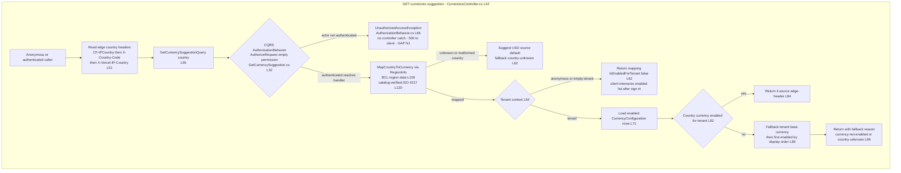
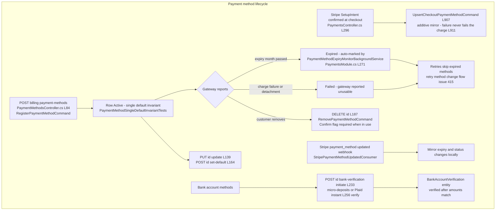

# Payments User Flows — happy path and every edge case

> Module `GameGuild.Commerce.Payments` · Documented against `develop` commit `74e9bba4c`.
> Citation shorthand: `Payments:` = `apps/api/Source/Modules/GameGuild.Commerce.Payments/`, `Billing:` = `apps/api/Source/Modules/GameGuild.Commerce.Billing/`.

## 1. Payment initiation → provider (Stripe) → success/failure

Happy path: `POST api/v1/payments` (`Payments:/Controllers/PaymentsController.cs:122-184`) validates tenant + amount + gateway token, enriches the command with fraud-signal metadata (client IP, device fingerprint, payer email, card BIN, client timezone — `PaymentsController.cs:163-181`), and sends `ProcessPaymentCommand`. `ProcessPaymentCommandHandler` (`Payments:/Commands/ProcessPayment/ProcessPaymentCommandHandler.cs:36-389`) resolves the subscription context, derives the idempotency key from the billing identity, runs the pre-gateway fraud gate, plans account-credit tender, claims `Processing` locally, calls `IPaymentGateway.ProcessPaymentAsync` (Stripe `PaymentIntent` create with `Confirm = true` — `Payments:/Services/StripePaymentService.cs:593-642`), then records Succeeded / RequiresAction / outcome-unknown / Failed-with-retry-schedule and syncs the subscription, receipt notification and credit consumption.

```mermaid
flowchart TD
    subgraph INIT["Payment initiation"]
        P1["Client POST api v1 payments<br/>PaymentsController.cs L122"] --> P2{"TenantId empty<br/>L132"}
        P2 -- "empty" --> P400a["400 TenantId cannot be empty L134"]
        P2 -- "present" --> P3{"ValidateTenantAccess<br/>cross-tenant guard L138"]
        P3 -- "other tenant" --> P403a["403 L931"]
        P3 -- "own or admin" --> P4{"Amount greater than 0<br/>L141"]
        P4 -- "no" --> P400b["400 Amount must be greater than zero L143"]
        P4 -- "yes" --> P5{"PaymentMethodId present and known gateway token<br/>GatewayPaymentMethodTokens.IsKnownGatewayToken L151"]
        P5 -- "unknown token" --> P400c["400 gateway token validation message L153"]
        P5 -- "known" --> P6["Collect fraud metadata - remote IP<br/>X-Device-Fingerprint X-Client-Timezone<br/>payer email card BIN L163"]
        P6 --> P7["ProcessPaymentCommand sent<br/>L169"]
        P7 --> P8["ProcessPaymentCommandValidator<br/>FluentValidation pipeline L1 of validator file"]
    end

    subgraph CORE["ProcessPaymentCommandHandler - ProcessPaymentCommandHandler.cs"]
        C1["Resolve subscription context<br/>L41 GetPaymentContextAsync"] --> C2{"Subscription found L43"}
        C2 -- "not found" --> C500a["InvalidOperationException payment subscription not found L43"]
        C2 -- "found" --> C3{"Tenant matches L45<br/>Amount equals subscription amount L50<br/>valid pricing L55"}
        C3 -- "mismatch" --> C500b["UnauthorizedAccess or InvalidOperation L47 L52 L57"]
        C3 -- "valid" --> C4["Idempotency key from tenant subscription billing cycle<br/>SubscriptionPaymentIdentity L60"]
        C4 --> C5{"Existing payment by idempotency key<br/>GetByIdempotencyKeyAsync L70"}
        C5 -- "exists" --> C6["Return recorded result - no second charge<br/>Success only when Succeeded L73"]
        C5 -- "absent" --> C7["Payment Create + RecordFraudAttemptContext<br/>persist attempt context before insert L95 L110"]
        C7 --> C8["Fraud gate AssessPaymentAsync L138<br/>see flow 3"]
        C8 --> C9{"Decision not Allow L149"}
        C9 -- "Review or Block" --> C10["RecordFraudAssessment transitions payment to Failed<br/>no gateway call - no auto retry<br/>Payment.cs L748"]
        C10 --> C11["Admin notice Urgent or High<br/>Review opens support ticket best-effort L155 L162"]
        C11 --> C200a["200 result Success false with fraud FailureReason L165"]
        C9 -- "Allow" --> C12{"Deferred background providers L180"}
        C12 -- "any" --> C13["Enqueue FraudBackgroundScoringJob L184"]
        C12 -- "none" --> C14["Plan account-credit tender when enabled<br/>charge reduced by spendable credits L196"]
        C13 --> C14
        C14 --> C15{"Credits cover whole invoice<br/>chargeAmount 0 L233"}
        C15 -- "yes" --> C16["SettleWithCreditsOnlyAsync L235<br/>MarkAsProcessing then MarkAsSucceeded L434 L435<br/>account-credit settlement reference L433"]
        C15 -- "no" --> C17["PrepareProcessingClaim - persist local claim<br/>before provider call GatewayPaymentResultBinder.cs L10<br/>handler L227"]
        C17 --> C18["paymentGateway.ProcessPaymentAsync L267<br/>StripePaymentService ProcessPaymentRealAsync L593<br/>PaymentIntent create Confirm true IdempotencyKey L599"]
        C18 --> C19{"Gateway outcome L279"}
        C19 -- "Success" --> C20["MarkAsSucceeded L281<br/>raises PaymentSucceededEvent<br/>Payment.cs L468"]
        C19 -- "RequiresAction 3DS" --> C21["MarkAsRequiresAction L290<br/>ClientActionToken returned to client"]
        C19 -- "OutcomeUnknown or Pending or Processing" --> C22["Keep processing claim - await provider reconciliation<br/>failure retry would double-charge L293"]
        C19 -- "declined" --> C23["RetryPolicyResolver ComputeSchedule L305<br/>hard declines non-retriable issue 415"]
        C23 --> C24["MarkAsFailed with schedule<br/>Payment.cs L493"]
        C20 --> C25["Consume planned credits only on success L323"]
        C25 --> C26["UpdateAsync persist L338"]
        C26 --> C27{"Success and ProcessedAt set L340"}
        C27 -- "yes" --> C28["SyncSuccessfulPaymentAsync subscription sync L342<br/>receipt email NotifyPaymentReceiptAsync L353"]
        C27 -- "no" --> C29{"Failed and RetryCount 1 L358<br/>second failure dunning ladder"}
        C29 -- "yes" --> C30["NotifyPaymentMethodUpdateRequiredAsync L365"]
        C29 -- "no" --> C31["Return RecordedPaymentResult L376<br/>commit-on-failure keeps the recorded attempt L34"]
        C28 --> C31
        C30 --> C31
        C21 --> C26
        C22 --> C26
        C24 --> C26
        C16 --> C32["Credit-only settlement persisted and notified L437 L451"]
    end

    subgraph SETUP["SetupIntent checkout path - Stripe hosted card collection"]
        S1["POST payments setup-intents<br/>PaymentsController.cs L201"] --> S2["CreateSetupIntentCommand L223"]
        S2 --> S3{"Subscription found and paid L228"}
        S3 -- "not found" --> S404["404 L228"]
        S3 -- "success" --> S4["200 CustomerId SetupIntentId ClientSecret L231"]
        S5["Stripe confirms SetupIntent client-side"] --> S6["POST payments subscription-checkouts complete<br/>L241"]
        S6 --> S7["Pause queued retries during method swap L294<br/>issue 415 - no retry charges the dead card"]
        S7 --> S8["SetDefaultPaymentMethodAsync Stripe customer L296"]
        S8 -- "fail" --> S400d["400 Stripe could not store method L302<br/>retries stay paused"]
        S8 -- "success" --> S9["Resume retries on new method L305<br/>mirror into local registry best-effort L309"]
        S9 --> S10["ProcessPaymentCommand first charge L311"]
    end

    subgraph RECON["Provider-side reconciliation of unknown outcomes"]
        R1["Stripe webhook payment_intent.succeeded<br/>Billing StripePaymentLifecycleEventConsumer.cs L41"] --> R2{"Local payment Pending Processing or RequiresAction L89"}
        R2 -- "yes" --> R3["MarkAsSucceeded from provider event L93"]
        R2 -- "settled" --> R4["Idempotent ignore L100"]
        R5["Stripe webhook payment_intent.payment_failed L42"] --> R6{"Payment still non-terminal L116"}
        R6 -- "yes" --> R7["MarkAsFailed - default backoff schedule<br/>payload carries no decline code L120"]
        R6 -- "no" --> R8["Idempotent ignore L137"]
    end
```

### 1a. Edge-case matrix — payment initiation

| # | Edge case | Code path | Outcome |
|---|-----------|-----------|---------|
| 1 | Replay of the same subscription billing cycle | idempotency-key lookup (`ProcessPaymentCommandHandler.cs:70-90`) | recorded result returned, `Success` mirrors stored status, no second charge |
| 2 | Amount does not match the authoritative subscription price | guard (`ProcessPaymentCommandHandler.cs:50-53`) | `InvalidOperationException` → 400/500, no payment row |
| 3 | Subscription belongs to another tenant | guard (`:45-48`) | `UnauthorizedAccessException` |
| 4 | Cross-tenant caller at controller | `ValidateTenantAccess` (`PaymentsController.cs:138-139`, `:931-934`) | 403 |
| 5 | Malformed card BIN (short/long/non-digit) | `NormalizeCardBin` (`PaymentsController.cs:191-196`) | dropped to null — signal simply does not fire, request not rejected |
| 6 | AVS/CVV outcomes supplied by the client | not accepted at the API (`PaymentsController.cs:159-162` comment) | server-known facts only — client-supplied AVS/CVV is not read |
| 7 | Gateway timeout / 5xx / 429 | `IsOutcomeUnknown` (`StripePaymentService.cs:701-704`) → `UnknownPaymentResult` (`:706-715`) | payment stays `Processing` (`handler :293-299`), provider may already have charged |
| 8 | Non-Stripe decline | `MapStripeException` (`StripePaymentService.cs:677-699`) | `Failed` with `TerminalDecline`, retry policy classifies (`handler :305-317`) |
| 9 | Simulated mode | `UseSimulation` (`StripePaymentService.cs:717-723`, options `:126`) | deterministic simulated success, no provider call |
| 10 | Credits drained concurrently between planning and consumption | `ConsumePlannedCreditsAsync` failure (`ProcessPaymentCommandHandler.cs:496-508`) | provider charge stands, shortfall flagged for manual settlement, credit not recorded |
| 11 | Credits cover the whole invoice but consumption fails | `SettleWithCreditsOnlyAsync` (`:397-430`) | payment recorded failed with `credit_auto_apply_reconcile_failed`, retriable, no credits moved |
| 12 | Second consecutive failure | dunning ladder (`:358-367`) | customer asked to update the payment method (issue #415) |
| 13 | Subscription-checkout method swap fails at Stripe | retries stay paused (`PaymentsController.cs:291-305`) | no automated retry charges the failed instrument mid-change |
| 14 | Local payment-method registry upsert fails post-checkout | best-effort swallow (`PaymentsController.cs:902-925`) | logged, checkout continues — gateway state authoritative |
| 15 | Concurrent duplicate webhook for the same intent | inbox idempotency (`StripeBillingWebhookService.cs:97-115`) | `AlreadyProcessed` result + replay security event |

## 2. Refund flow — full / partial / prorated, refund legs

Two entrances: the synchronous legacy action `POST payments/{paymentId}:refund` (`PaymentsController.cs:437-473` → `ProcessRefundCommand` → `RefundProcessingService.ExecuteAsync`, `Payments:/Services/RefundProcessingService.cs:325-399`) and the workflow surface `POST refunds` (`RefundsController.cs:36-66` → `RequestRefundCommand` → `RequestRefundAsync`, `RefundProcessingService.cs:142-323`) which routes to manual-approval queue, immediate execution, or chargeback recording.

```mermaid
flowchart TD
    subgraph REQ["Refund request - RefundsController POST refunds L36"]
        F1["RequestRefundCommand<br/>RefundsController.cs L57"] --> F2["RequestRefundAsync<br/>RefundProcessingService.cs L142"]
        F2 --> F3{"Payment status is Succeeded Disputed<br/>or PartiallyRefunded L153"}
        F3 -- "no" --> F400r["Failure - cannot be refunded L155"]
        F3 -- "yes" --> F4{"Kind prorated L162"}
        F4 -- "prorated" --> F5["ComputeProratedRefundAsync L672<br/>daily-rated unused time capped at remaining L711"]
        F5 -- "no period" --> F400p["Failure - requires subscription-linked payment L167"]
        F5 -- "period ended" --> F400q["Failure - nothing left to refund L173"]
        F4 -- "full or partial" --> F6{"Amount null means remainder L159<br/>explicit amount over remainder L190"}
        F6 -- "over" --> F400s["Failure - exceeds maximum refundable L192"]
        F6 -- "within" --> F7{"Client idempotency key L204"}
        F7 -- "replay of same key" --> F8["Return recorded refund row L208"]
        F7 -- "new or synthesized" --> F9{"Open refund already exists<br/>GetOpenRefundForPaymentAsync L234<br/>issue 419 duplicate guard"}
        F9 -- "open row" --> F409r["Failure - retry or cancel the open refund L244"]
        F9 -- "none" --> F10{"Amount at or above manual-approval<br/>threshold L225"}
        F10 -- "at or above" --> F11["Refund Create RequiresApproval true<br/>Refund.cs L142 status Pending"]
        F11 --> F12["NotifyApproversAsync emails L286<br/>RefundProcessingService.cs L943"]
        F12 --> F200r["200 queued for manual approval L293"]
        F10 -- "below or no threshold" --> F13{"ExecuteAtGateway false<br/>accept-dispute path L301"}
        F13 -- "false" --> F14["RecordGatewaySettledRefundAsync L305<br/>chargeback already moved the money L638<br/>gateway refund id chargeback_refund L646"]
        F13 -- "true" --> F15["ExecuteAsync immediately L315"]
    end

    subgraph APPROVE["Manual approval queue"]
        A1["GET refunds pending-approvals<br/>RefundsController.cs L137 GetPendingRefundApprovalsQuery"] --> A2["Admin decision"]
        A2 -- "approve" --> A3["POST refunds id approve L165<br/>ApproveRefundCommand payments-refunds-approve permission"]
        A3 --> A4["MarkApproved Refund.cs L200<br/>status Approved"]
        A4 --> A5["ExecuteAsync via refund workflow worker<br/>RefundWorkflowBackgroundService.cs L121"]
        A2 -- "reject" --> A6["POST refunds id reject L189<br/>RejectRefundCommand"]
        A6 --> A7["MarkRejected Refund.cs L214<br/>status Rejected terminal - no money moves"]
    end

    subgraph EXEC["Gateway execution leg - ExecuteAsync L325"]
        E1["Refund status must be Pending Approved or Failed L328"] --> E2["MarkProcessing Refund.cs L228<br/>status Processing in flight"]
        E2 --> E3["BuildRefundGatewayRequest L538<br/>StripeAccount refund idempotency key<br/>remaining attempts from workflow options L540"]
        E3 --> E4["paymentGateway.ProcessRefundAsync L354<br/>Stripe RefundCreateOptions<br/>StripePaymentService.cs L729"]
        E4 -- "gateway decline" --> E5["MarkFailed with FailureKind L363<br/>retryable only when classification allows L360"]
        E4 -- "accepted" --> E6["MarkCompleted gateway refund id L381<br/>Refund.cs L235"]
        E6 --> E7["payment.ProcessRefund cumulative amount<br/>Payment.cs L688 - full transitions to Refunded<br/>partial to PartiallyRefunded L710"]
        E7 --> E8["RecordRefundAccountingAsync L893<br/>revenue event plus ledger entry<br/>Dr RefundsAndChargebacks Cr Cash L921"]
        E8 --> E9["ApplyPostCompletionAsync L723<br/>confirmation email - opt-in wallet credit<br/>subscription suspend on full refund L729"]
    end

    subgraph WEBLEG["Webhook completion leg"]
        W1["Stripe refund.created or refund.updated<br/>StripePaymentLifecycleEventConsumer.cs L45"] --> W2{"Local refund by gateway id L170"}
        W2 -- "no row" --> W3["Released - platform never records<br/>unattributable financial rows L174"]
        W2 -- "found" --> W4{"Gateway status L181"}
        W4 -- "succeeded" --> W5["CompleteFromGatewayAsync L193<br/>RefundProcessingService.cs L552"]
        W4 -- "failed or canceled" --> W6["MarkFailed when Processing L218"]
        W4 -- "pending" --> W7["Still in flight - nothing to do L229"]
        W8["Stripe charge.refunded L49"] --> W9["Fallback only - exactly one in-flight<br/>local refund when per-refund events missed L270"]
        W9 --> W10["CompleteFromGatewayAsync with derived id L286<br/>infrastructure failures propagate for inbox retry L282"]
    end
```



### 2a. Edge-case matrix — refunds

| # | Edge case | Code path | Outcome |
|---|-----------|-----------|---------|
| 1 | Refund request with null amount | remainder coalescing (`PaymentsController.cs:460-464`) | full refund of the remaining balance (historical 0-amount bug fixed) |
| 2 | Refund without a reason | guard (`PaymentsController.cs:455-458`, `RefundsController.cs:45-48`) | 400 — reason required for compliance (issue #415) |
| 3 | Already fully refunded | remaining refundable 0 (`RefundProcessingService.cs:185-188`) | failure "Nothing left to refund" |
| 4 | Duplicate open refund | single-open-refund guard (`:234-247`) + storage-level `OpenRefundAlreadyExistsException` (`:265-271`) | rejected; retry/cancel the open row instead |
| 5 | Concurrent approval + execution race | inbox claim + status guards (`:328-336`) | one leg proceeds; the other fails with status message |
| 6 | Gateway refund accepted but webhook late/lost | `charge.refunded` coalescing (`StripePaymentLifecycleEventConsumer.cs:245-310`) | exactly-one-in-flight fallback completes the row; ambiguous cases logged and skipped |
| 7 | Refund for a payment that never succeeded locally | fail-closed status guard (`RefundProcessingService.cs:592-603`) | refusal instead of illegal transition |
| 8 | Accepted chargeback then refund request | `ExecuteAtGateway=false` (`:301-313`) | records already-moved money, no second gateway refund (`RecordGatewaySettledRefundAsync :638-664`) |
| 9 | Approver email delivery fails | best-effort loop (`:943-977`) | refund stays queued; logged |
| 10 | Wallet credit on partial refund | strictly opt-in (`Payments:/Configuration/RefundWorkflowOptions.cs` via `:731`) | double-value only when explicitly enabled |
| 11 | Refund succeeded but subscription adjustment fails | best-effort (`:851-874`) | refund stays completed; warning logged |
| 12 | Interrupted refund stuck in Processing | `RecoverInterruptedAsync` + single-flight gates (`:402`, `:140`) + workflow worker (`RefundWorkflowBackgroundService.cs:12-65`) | recovered or retried up to `MaxExecutionAttempts` (default 3) |

## 3. Fraud assessment flow — gate, thresholds, statistics

Pre-gateway gate: `FraudDetectionService.AssessPaymentAsync` (`Payments:/Services/FraudDetection/FraudDetectionService.cs:36-39` → `AssessAsync :62-174`) sums the weights of all registered `IFraudSignalProvider`s (13 providers under `Payments:/Services/FraudDetection/`), clamps to 0-100, and decides by tenant-resolved thresholds — `ReviewThreshold` default 40, `BlockThreshold` default 70 (`Payments:/Configuration/FraudAssessmentOptions.cs:187,191`). Synchronous budget 150 ms (`FraudAssessmentOptions.cs:197`); overrunning providers are deferred to the background re-scoring worker (`FraudBackgroundScoringWorker`, hosted at `PaymentsModule.cs:147`), which may only tighten an Allow decision (`Payment.EscalateFraudAssessment`, `Payments:/Entities/Payment.cs:804-849`).

```mermaid
flowchart TD
    subgraph GATE["Synchronous gate - inside ProcessPaymentCommandHandler L120"]
        G1["FraudSignalContext built from attempt<br/>country IP device fingerprint payer email<br/>card BIN AVS CVV timezone L120"] --> G2["AssessPaymentAsync<br/>FraudDetectionService.cs L36"]
        G2 --> G3{"Fraud enabled for tenant L72"}
        G3 -- "disabled" --> G4["Allow score 0 L80"]
        G3 -- "enabled" --> G5["Loop signal providers under<br/>150ms linked cancellation L100"]
        G5 -- "provider overruns budget" --> G6["DeferredProviders recorded L126<br/>background re-score later"]
        G5 -- "provider answers" --> G7["Signals accumulated weights 0-100 each L118"]
        G6 --> G8["Score sum clamped 100 L142"]
        G7 --> G8
        G8 --> G9{"Thresholds L144"}
        G9 -- "score 70 or more" --> G10["Block"]
        G9 -- "score 40 to 69" --> G11["Review"]
        G9 -- "below 40" --> G12["Allow"]
    end

    subgraph DECIDE["Decision recorded - Payment.RecordFraudAssessment L748"]
        D1["Allow"] --> D2["Payment proceeds to gateway"]
        D3["Review"] --> D4["Payment transitions to Failed<br/>FraudReviewStatus PendingReview L761<br/>FailureReason fraud gate review L766"]
        D5["Block"] --> D6["Payment transitions to Failed<br/>never auto retried NextRetryAt null L769"]
        D4 --> D7["Admin notice High L660<br/>customer in-app notice - email opt-in L542<br/>support ticket opened L615"]
        D5 --> D8["Admin notice Urgent L687"]
        D9["Background re-score escalates<br/>EscalateFraudAssessment Payment.cs L804"] --> D10{"Charge not settled yet L831"}
        D10 -- "Pending Processing RequiresAction" --> D11["Hold payment now - Failed<br/>fraud escalated L834"]
        D10 -- "settled and Review" --> D12["Flag for review only -<br/>no retroactive money reversal L840"]
        D10 -- "already held or blocked" --> D13["No-op tightening only L818"]
    end

    subgraph REVIEW["Manual review queue - FraudReviewsController"]
        M1["GET fraud reviews L40<br/>GetFraudReviewsQuery"] --> M2["GET fraud reviews paymentId detail L82<br/>GetFraudReviewDetailQuery"]
        M2 --> M3["Admin decision"]
        M3 -- "approve" --> M4["POST fraud reviews paymentId approve L113<br/>ResolveFraudReviewCommand approved true"]
        M4 --> M5["ResolveFraudReview Payment.cs L870<br/>FraudReviewStatus Approved<br/>hold released - manual retry allowed"]
        M3 -- "deny" --> M6["POST id deny L132<br/>approved false"]
        M6 --> M7["FraudReviewStatus Declined<br/>stays failed permanently non-retryable"]
        M7 --> M8["FraudReviewAutoBlacklister L30<br/>blacklist method token card fingerprint<br/>external customer id with expiry"]
        M3 -- "bulk" --> M9["POST bulk-approve or bulk-deny L150 L169<br/>ResolveFraudReviewsBulkCommand"]
    end

    subgraph STATS["GetFraudStatistics - FraudStatisticsController GET fraud statistics L37"]
        T1["GetFraudStatisticsQuery<br/>payments-admin permission<br/>GetFraudStatisticsQuery.cs L36"] --> T2["Handler L233 window defaults<br/>ToUtc now FromUtc minus 30 days L236<br/>swaps reversed bounds L238"]
        T2 --> T3["Totals - created assessed allowed<br/>held blocked succeeded disputed L253"]
        T3 --> T4["Rates - flagged blocked chargeback<br/>false-positive proxy L390"]
        T4 --> T5["Review backlog window-independent L276<br/>average hours to resolve L403"]
        T5 --> T6["Top signals from evidence JSON L288<br/>bounded to 5000 rows L226"]
        T6 --> T7["By country by provider by plan<br/>L317 L334 L373"]
        T7 --> T8["Trend buckets daily weekly monthly<br/>BucketStart ISO week Monday L495"]
        T8 --> T9["CSV export FraudStatisticsController.cs L71<br/>PDF export L111 culture-stable composer"]
    end
```



### 3a. Edge-case matrix — fraud

| # | Edge case | Code path | Outcome |
|---|-----------|-----------|---------|
| 1 | Tenant disables the gate | `IsEnabled` (`FraudDetectionService.cs:72-89`) | Allow with score 0, reason "disabled" |
| 2 | Provider exceeds the 150 ms sync budget | budget CTS (`:109-133`) | deferred, not failed; background worker re-scores (`FraudBackgroundScoringWorker`) |
| 3 | Background re-score says Block after success | settled branch (`Payment.cs:840-845`) | review flag only — money never retroactively reversed |
| 4 | Background re-score tries to loosen a hold | tightening-only guard (`Payment.cs:818-823`) | no-op, recorded decision stands |
| 5 | Background escalation with nothing changed | no-op write skip (`Payment.cs:796-798` return false; fix commit `ad6607e9f`) | persistence write skipped |
| 6 | Resolve review on a non-review payment | guard (`Payment.cs:877-881`) | `InvalidOperationException` |
| 7 | Retry of a review-held payment | `FraudBlocksRetry` (`Payment.cs:905-908`) | blocked until review approved |
| 8 | Review declined | auto-blacklist (`FraudReviewAutoBlacklister.cs:30-73`, default on) | method token + card fingerprint + customer id blacklisted with expiry |
| 9 | Statistics window reversed | swap (`GetFraudStatisticsQuery.cs:238-241`) | silently swapped, not rejected (differs from recovery-metrics endpoints which 400) |
| 10 | Weekly trend seeded in the current ISO week (Mon/Tue) | window filter vs future-dated attempts (`GetFraudStatisticsQuery.cs:251`, `:495-508`) | future attempts dropped from buckets — KNOWN date-bug class, test anchored to previous ISO week (commits `94aab401e`, `c40b4c80b`) |
| 11 | Evidence JSON malformed | `ExtractSignalTypes` (`GetFraudStatisticsQuery.cs:513-549`) | skipped silently, signal undercounted |
| 12 | Anonymous statistics call | controller `[Authorize]` + query `payments:admin` | 401/403 before handler |

## 4. Chargeback / dispute flow

Ingress is the Stripe `charge.dispute.*` family through the verified inbox (`Billing:/Services/StripeDisputeEventConsumer.cs:25-80`). Local lifecycle is driven by `DisputesController` actions (`Payments:/Controllers/DisputesController.cs`) and the `PaymentDispute` entity (`Payments:/Entities/PaymentDispute.cs`).

```mermaid
flowchart TD
    subgraph DISR["Dispute ingress - StripeDisputeEventConsumer"]
        B1["Stripe charge.dispute.created updated closed<br/>verified inbox event"] --> B2{"Parse dispute payload L36"}
        B2 -- "unparseable" --> B3["Skip with warning L39<br/>inbox delivery still succeeds"]
        B2 -- "ok" --> B4["Resolve payment by provider mapping<br/>payment_intent capture leg L317<br/>fallback legacy ExternalPaymentId L336"]
        B4 -- "no local payment" --> B5["Throw InvalidWebhookPayload<br/>fail closed - never guess the target L50"]
        B4 -- "found" --> B6{"Existing dispute by GatewayDisputeId L54"}
        B6 -- "new" --> B7["Create PaymentDispute L91<br/>type from reason amount fee due date L95"]
        B7 --> B8{"Payment Succeeded L107"}
        B8 -- "yes" --> B9["payment.MarkAsDisputed L109"]
        B8 -- "no" --> B10["Dispute recorded without status change"]
        B9 --> B11["Collect automatic evidence L117<br/>invoice receipt subscription record L139"]
        B11 --> B12["Dispute created alert to team L120<br/>DisputeNotificationService"]
        B6 -- "existing" --> B13["RecordDisputeFee then ApplyGatewayStatus L69 L70<br/>fee frozen at terminal resolution"]
    end

    subgraph DISPUTE["Operator lifecycle - DisputesController"]
        O1["GET disputes + filters L37<br/>byId L89 evidence L112 statistics L368"] --> O2["POST disputes create L174<br/>CreateDisputeCommand validator present"]
        O2 --> O3["POST id respond L213<br/>UpdateDisputeStatusCommand L226"]
        O3 --> O4["POST id submit-evidence L289<br/>SubmitDisputeEvidenceCommand"]
        O4 --> O5["Stripe evidence upload<br/>StripePaymentService.cs L326 L452"]
        O6["POST id challenge L263<br/>ChallengeDisputeCommandHandler"] --> O7["Stripe dispute close - lost path<br/>StripePaymentService.cs L326"]
        O8["POST id accept L238<br/>AcceptDisputeCommand"] --> O9["Gateway accept<br/>refund of disputed funds"]
        O9 --> O10["AcceptDisputeRefundChainTests<br/>records chargeback-settled refund<br/>ExecuteAtGateway false path"]
        O11["POST id cancel L313<br/>CancelDisputeCommand validator"] --> O12["Cancelled without resolution"]
        O13["POST id resolve L342<br/>ResolveDisputeCommand"] --> O14["MarkAsWon or MarkAsLost<br/>PaymentDispute.cs L270 L277"]
        O15["DisputeDeadlineReminderBackgroundService<br/>PaymentsModule.cs L79"] --> O16["Daily opt-in evidence-deadline reminders"]
    end
```



### 4a. Edge-case matrix — disputes

| # | Edge case | Code path | Outcome |
|---|-----------|-----------|---------|
| 1 | Dispute for a payment not in Succeeded | guard (`StripeDisputeEventConsumer.cs:107-110`) | dispute row created, payment status untouched |
| 2 | Duplicate `charge.dispute.created` deliveries | inbox idempotency + `GatewayDisputeId` lookup (`:54-77`) | second delivery reconciles status instead of duplicating |
| 3 | Dispute references an unknown payment | fail-closed throw (`:50-52`) | inbox marks delivery failed, retried; never recorded against a guessed target |
| 4 | Terminal event arrives before fee known | fee recorded before status (`:66-69`) | fee frozen at resolution time (issue #419) |
| 5 | Evidence upload to Stripe fails mid-bundle | file upload loop (`StripePaymentService.cs:452+`) | partial acceptance list returned; handler reports what stuck |
| 6 | Disputed payment then refund attempt | `Payment.ProcessRefund` allows Disputed source (`Payment.cs:690-692`) | refund legs legal from Disputed |
| 7 | Dispute closed as won | `ApplyGatewayStatus` map (`StripeDisputeEventConsumer.cs:70`) | status Won; payment may transition Disputed → Succeeded (`Payment.cs:33`) |
| 8 | Deadline reminder worker | opt-in (`PaymentsModule.cs:76-79`) | daily reminders only when configured |

## 5. Currency suggestion endpoint

`GET api/v1/currencies/suggestion` — anonymous (`CurrenciesController.cs:42-57`), registered in the anonymous endpoint registry (`GameGuild.API/Security/AnonymousEndpointRegistry.cs:112`). This is the endpoint observed failing in Session-state logs — see the Gaps document (`06-gaps.md` gap N1): the query carries `[AuthorizeRequest("")]` (`Queries/Currencies/GetCurrencySuggestion.cs:32`) and the CQRS `AuthorizationBehavior` rejects unauthenticated actors before the empty-permission skip (`Identity.Authorization/Behaviors/AuthorizationBehavior.cs:66-69` vs `:105-108`).



### 5a. Edge-case matrix — currency suggestion

| # | Edge case | Code path | Outcome |
|---|-----------|-----------|---------|
| 1 | All three edge headers absent | header chain (`CurrenciesController.cs:51-53`) | country null → `country-unknown` default USD |
| 2 | Bogus 3-letter or 1-letter code | `MapCountryToCurrency` guard (`GetCurrencySuggestion.cs:111-113`) | null → default path |
| 3 | Region maps to a currency outside the ISO catalog | catalog check (`:120`) | treated as unknown (defensive) |
| 4 | Anonymous caller | intended allow (`CurrenciesController.cs:43`, registry `:112`) | **BUG** — CQRS auth behavior throws first (Gap N1) |
| 5 | Tenant with zero enabled currencies | fallback chain (`:89-94`) | `first-enabled` absent → default USD, `IsEnabledForTenant=false` |
| 6 | Disabled currency for the tenant | enablement filter (`:82`) | never suggested; tenant-base offered instead |
| 7 | Direct unit tests | handler invoked directly (`FxSecurityTests.cs:284-313`) | pass — the pipeline behavior is bypassed, masking gap N1 |

## 6. Payment method lifecycle

Local registry mirror of gateway payment methods (`Payments:/Entities/PaymentMethod.cs`, status enum `:382-392`), managed through `PaymentMethodsController` (route `api/v1/billing/payment-methods`) and reconciled from Stripe `payment_method.updated`/detachment events (`Billing:/Services/StripePaymentMethodUpdatedConsumer.cs`).



### 6a. Edge-case matrix — payment methods

| # | Edge case | Code path | Outcome |
|---|-----------|-----------|---------|
| 1 | Registry upsert fails post-checkout | best-effort (`PaymentsController.cs:902-925`) | logged; charge proceeds — gateway authoritative |
| 2 | Two defaults attempted | single-default invariant (`PaymentMethod.cs` + `PaymentMethodSingleDefaultInvariantTests.cs`) | invariant enforced on set-default |
| 3 | Removing a method tied to active subscription | `Confirm` flag (`PaymentMethodsController.cs:187-208`) | refusal without explicit confirm |
| 4 | Expired card in dunning | expiry monitor (`PaymentMethodExpiryMonitor.cs`, `PaymentMethodExpiryMonitorBackgroundService`) | marked Expired; retry method-change nudges new card |
| 5 | Per-type saved methods (PayPal/Apple/Google) | typed registration (commit `0ed5a5dbf`) | method-type hint mapped (fix commit `358fa8290`) |
| 6 | Gateway payment-method id exposure | `GatewayPaymentMethodIdProtector` (`Payments:/Services/GatewayPaymentMethodIdProtector.cs`) | ids protected at the API boundary |
| 7 | Micro-deposit amounts wrong | verification match (`BankAccountVerification` flow) | stays unverified; retries allowed |
| 8 | Plaid not configured | fail-closed NoOp (`PaymentsModule.cs:48-53`) | micro-deposit challenge retained |
