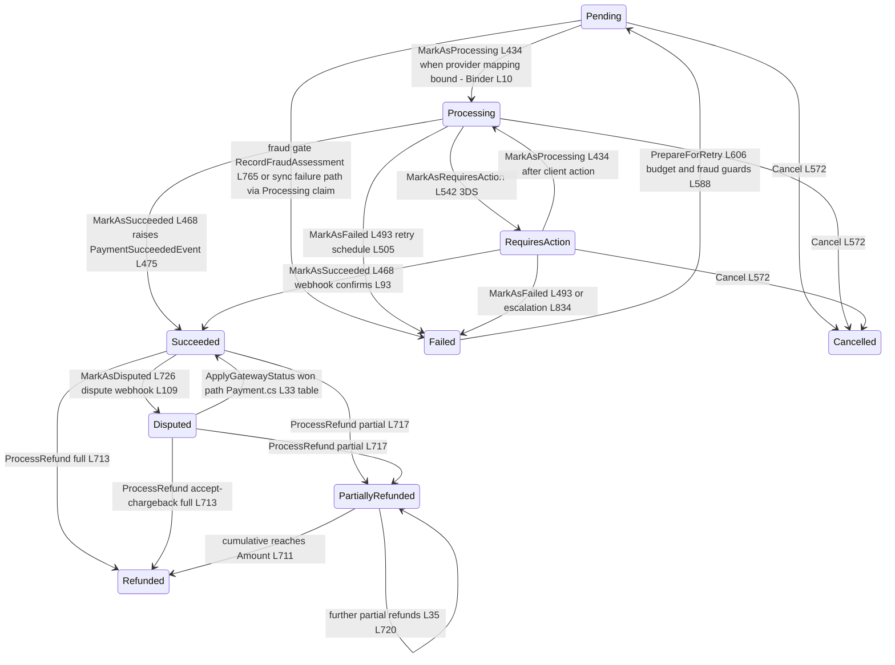
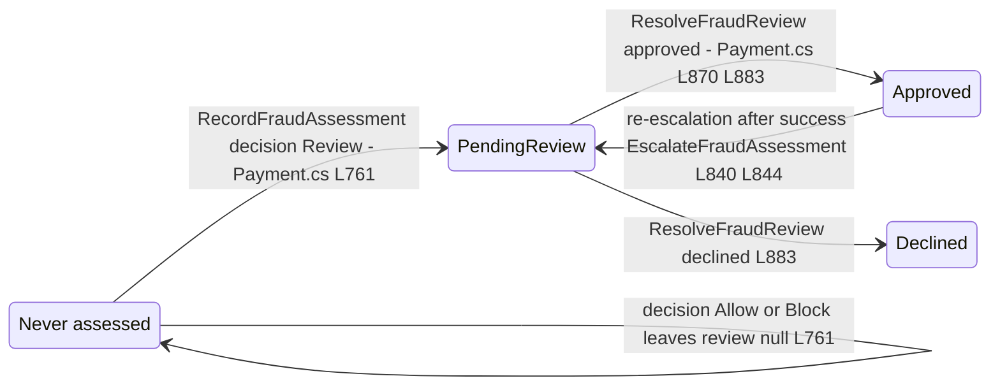
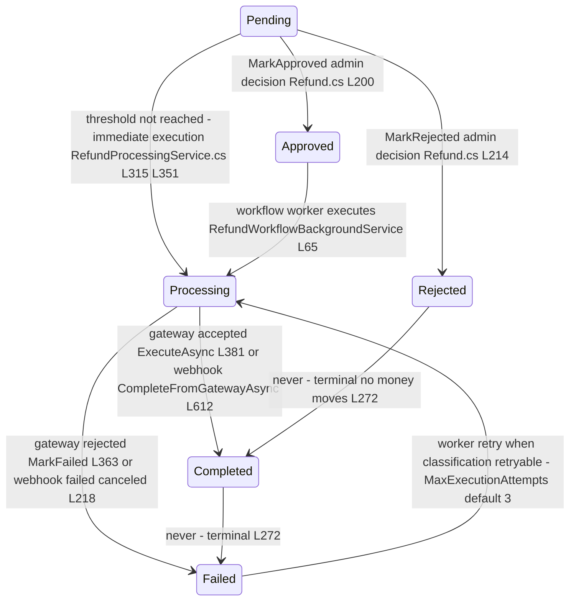
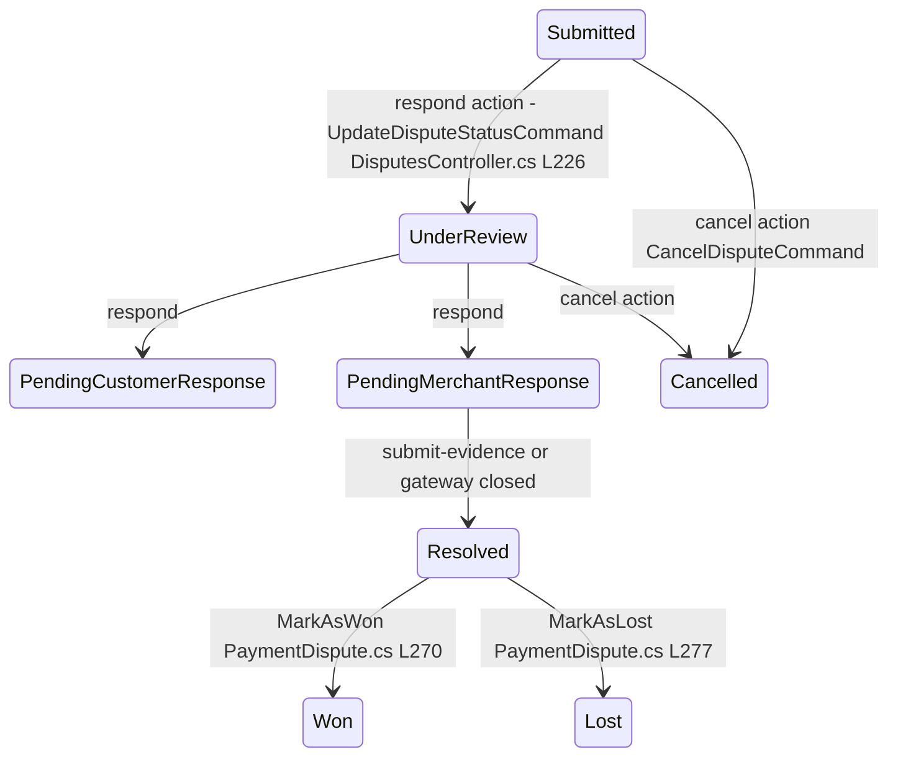

# Payments State Machines and Transitions Audit

> Module `GameGuild.Commerce.Payments` · Documented against `develop` commit `74e9bba4c`.
> Citation shorthand: `Payments:` = `apps/api/Source/Modules/GameGuild.Commerce.Payments/`, `Billing:` = `apps/api/Source/Modules/GameGuild.Commerce.Billing/`.

## 1. Payment aggregate

Source of truth: the static transition table `Payment.ValidTransitions` (`Payments:/Entities/Payment.cs:24-36`) enforced by `TransitionTo` (`:421-431`); every mutator goes through it except `PrepareForRetry` (direct status assignment, `:581-618`, guarded by `Status == Failed` at `:583`).

### 1a. Transitions audit — Payment

| Transition | Trigger | file:line | Guard |
|------------|---------|-----------|-------|
| → Pending (birth) | `Payment.Create` | `Payment.cs:237-282` | tenant/amount/idempotency-key invariants |
| Pending → Processing | `MarkAsProcessing` via `GatewayPaymentResultBinder.PrepareProcessingClaim` (handler L227, L276) and credit-only settlement (handler L434) | `GatewayPaymentResultBinder.cs:10-22` | **only when provider mapping fully bound** — unmapped Stripe stays Pending (deliberate, `:6-9` comment) |
| Pending → Failed | fraud gate Review/Block | `Payment.cs:763-770` | score bounds; no retry scheduled (`NextRetryAt = null`) |
| Pending → Failed | sync decline before claim bind | `Payment.cs:493-539` | via Processing claim first in the normal path |
| Pending/Processing/RequiresAction → Failed | background escalation | `Payment.cs:831-839` | tightening only (`:818-823`) |
| Processing → Succeeded | gateway success / webhook confirm | `Payment.cs:468-482`, `Billing:/Services/StripePaymentLifecycleEventConsumer.cs:93` | sets ExternalPaymentId, raises `PaymentSucceededEvent` |
| Processing → RequiresAction | gateway 3DS | `Payment.cs:542-546` | ClientActionToken surfaced |
| * → Cancelled | `Cancel` | `Payment.cs:571-578` | reason recorded; terminal |
| Failed → Pending | `PrepareForRetry` (manual `RetryPaymentCommand` or retry queue worker) | `Payment.cs:581-618` | `CanRetry` (`:903`): budget left + retriable + fraud not blocking; swaps method (`:612`) |
| Failed → Processing claim re-assert | retry execution | `PaymentRetryQueueWorker` + handler | idempotency key replays the same row (`handler :70-90`) |
| Succeeded → Disputed | dispute webhook | `Payment.cs:725-729`, `StripeDisputeEventConsumer.cs:107-110` | only from Succeeded |
| Succeeded/Disputed/PartiallyRefunded → (Partially)Refunded | `ProcessRefund` | `Payment.cs:687-723` | positive amount, cumulative ≤ Amount (`:700-703`), status guard (`:690-692`) |
| Pause/Resume retry schedule | dunning method-change | `Payment.cs:624-659` | Failed-only; exhausted/non-retriable stay out |

**Unreachable / dead states and transitions:**

1. `Pending → Succeeded` is **not in the table** (`Payment.cs:26`), yet the webhook reconciliation explicitly attempts it: `StripePaymentLifecycleEventConsumer.cs:89-93` calls `MarkAsSucceeded` when the local status is `Pending`, `Processing` **or** `RequiresAction`. If a resolvable payment ever sat in `Pending`, `TransitionTo` would throw `InvalidOperationException`, fail the inbox delivery and retry-fail forever. Today the branch is dead only because an unmapped Pending payment is also *unresolvable* (no provider mapping → `GetByProviderMappingAsync` misses; no `ExternalPaymentId` → legacy fallback misses, `:317-339`) — see NEW gap N2 in `06-gaps.md`.
2. Outcome-unknown payments left `Pending` (unmapped) have **no automated exit**: the retry queue only picks `Failed` rows (`GetRetryingPaymentCandidatesQuery` filters on status), cancellation requires an operator, and the webhook cannot resolve them. Terminal-by-limbo.
3. `TransactionStatus.Reversed` (`Models/TransactionStatus.cs:22`) is defined but unused by the Payment aggregate — dead enum value.

**Missing guards (concurrency / partial-refund windows):**

1. **No optimistic-concurrency token on `Payment`** (`Data/Configurations/PaymentConfiguration.cs` — no `IsRowVersion`/`ConcurrencyToken`; entity has none). Two concurrent writers — refund execution (`RefundProcessingService.cs:384`) and webhook completion (`:615`) — both do read → `RefundedAmount += amount` → save. The entity guard `RefundedAmount + refundAmount > Amount` (`Payment.cs:700`) runs on *stale tracked copies*; last-write-wins can record a cumulative refund lower than what the gateway actually refunded across two concurrent partials. The refund *row* side is protected (storage-level single-open-refund guard, `Repositories/RefundRepository.cs:108`), but the payment aggregate's cumulative counter is not.
2. **Partial-refund window vs dispute**: `ProcessRefund` accepts `Disputed` as a source (`Payment.cs:690`) and `ValidateProviderMonetaryBounds` (`:385-413`) exists to check combined refunded+disputed ≤ confirmed, but it is **advisory** — nothing in `RefundProcessingService` calls it before executing a refund on a disputed payment; the webhook verifier accumulates `CumulativeDisputedAmount` (`Billing:/Services/StripeWebhookVerifier.cs:121-122`) yet no consumer applies those bounds to the payment's refund decision.
3. **Retry + method-change race**: `PauseRetryQueue`/`ResumeRetryQueue` (`Payment.cs:624-659`) are in-memory state on the row; a retry-queue pass that already claimed a payment between pause and resume still charges the old instrument (pause is checked at candidate-selection time, `GetRetryingPaymentCandidatesQuery`).
4. `Cancel` allows `Processing → Cancelled` (`Payment.cs:27`) with **no gateway cancellation leg** — `CancelPaymentAsync` exists on the gateway interface but `CancelPaymentCommandHandler` does not invoke it (see `06-gaps.md` N10); a cancelled-looking payment may still settle at Stripe, after which the reconciliation events fail against a terminal local row.

## 2. Fraud review states

Enum `FraudReviewStatus` (`Payments:/Models/FraudAssessmentModels.cs:35-45`); decisions `FraudDecision` (`:6-16`).

Audit notes:

- Entry guard: `ResolveFraudReview` requires `FraudDecision == Review && FraudReviewStatus == PendingReview` (`Payment.cs:877-881`) — anything else throws.
- Escalation is strictly tightening: `EscalateFraudAssessment` refuses Allow decisions and no-ops on already-held payments (`:813-823`); a settled payment escalated to Review only re-flags `PendingReview` (`:840-845`), never reverses money.
- `FraudBlocksRetry` (`:905-908`): Block always; Review until Approved. Approved → `CanRetry` true → manual retry allowed; Declined → permanent.
- Unreachable: `Declined → Approved` (no undo), by design.
- Concurrency: two admins resolving the same review both pass the guard on stale copies (no concurrency token) — second write overwrites the first's reviewer id/notes silently.

## 3. Refund states

Enum `RefundStatus` (`Payments:/Models/RefundStatus.cs:4-23`); mutators on `Refund` (`Payments:/Entities/Refund.cs:200-272`).

Audit notes:

- Terminal set: `Completed`, `Rejected` (`Refund.cs:272`). `Failed` is *not* terminal while attempts remain — the workflow worker re-executes retryable failures (`RefundWorkflowBackgroundService.cs:12-65`); permanent declines (`GatewayFailureKind.TerminalDecline` / outcome-unknown) are never replayed (classification preserved on the row, `RefundProcessingService.cs:360-366`).
- `MarkProcessing` from any non-terminal state is legal inside `CompleteFromGatewayAsync` (`:607-610`) — a refund that jumped straight to gateway-settled recording skips `Pending → Approved`.
- Missing guard: `CompleteFromGatewayAsync` does not verify the webhook's refund amount equals the row's amount — it completes `refund.Amount` regardless of what Stripe reports refunded (`CumulativeRefundedAmount` is carried on the verified event but unused here, `Billing:/Services/StripeWebhookVerifier.cs:121`). See `06-gaps.md` N3.
- Single-open-refund invariant enforced twice: app-level check (`RefundProcessingService.cs:234-247`) and storage-level (`Repositories/RefundRepository.cs:108`) — concurrent losers get `OpenRefundAlreadyExistsException` mapped to a failure result.

## 4. Dispute states

Enum `DisputeStatus` (`Payments:/Models/DisputeStatus.cs:4-29`); gateway reconciliation `PaymentDispute.ApplyGatewayStatus` (`Payments:/Entities/PaymentDispute.cs:209+`), operator resolution `MarkAsWon`/`MarkAsLost` (`:270,277`).

Audit notes:

- Gateway truth wins: `StripeDisputeEventConsumer.cs:66-77` applies Stripe's status and `EvidenceDueBy` on every `charge.dispute.*` delivery; the fee is recorded *before* the status so terminal won/lost freezes the fee (`:66-69`, issue #419).
- **Missing guard:** the `:respond` action posts an operator-supplied `DisputeStatus` straight into `UpdateDisputeStatusCommand` (`DisputesController.cs:226`) — the module ships no dispute transition table equivalent to `Payment.ValidTransitions`; the validator (`Commands/UpdateDisputeStatus/UpdateDisputeStatusCommandValidator.cs`) checks shape, not legality. An operator can "respond" a dispute from `Won` back to `UnderReview` unless `ApplyGatewayStatus` guards it — verify before relying on dispute-state reports (audit flag, see `06-gaps.md` N9).
- `MarkAsDisputed` on the payment is only reachable from `Succeeded` (`Payment.cs:29`, consumer guard `:107-110`); a dispute arriving for a `PartiallyRefunded` payment is recorded locally without touching the payment status.
