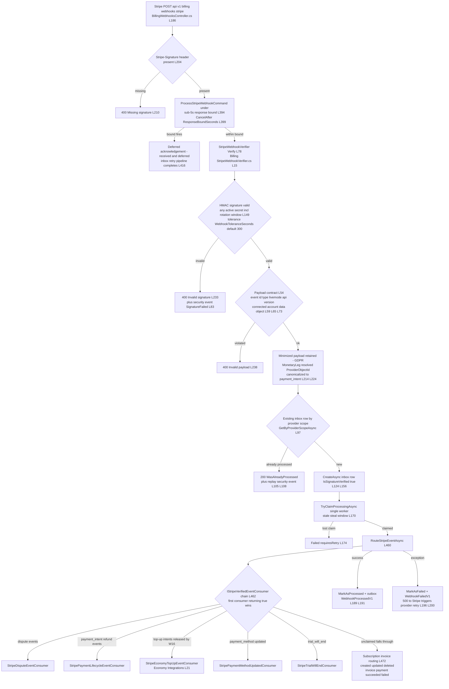

# Payments Event Flow Inventory

> Module `GameGuild.Commerce.Payments` (+ Stripe ingress in `GameGuild.Commerce.Billing`) · Documented against `develop` commit `74e9bba4c`.
> Citation shorthand: `Payments:` = `apps/api/Source/Modules/GameGuild.Commerce.Payments/`, `Billing:` = `apps/api/Source/Modules/GameGuild.Commerce.Billing/`, `Economy:` = `apps/api/Source/Modules/GameGuild.Finance.Economy/`, `API:` = `apps/api/Source/GameGuild.API/`.

## 1. Event machinery overview

Two event rails exist in the platform; Payments uses both plus direct service seams:

- **Domain events** (`EntityBase.Raise` → `IHasDomainEvents`): collected in `SaveChangesCoreAsync` (`API:/Database/ApplicationDbContext.cs:179-182`) and **cleared without dispatch** (`:348-351`). No publisher, no consumer registration exists for them anywhere (verified by search) — see gap N13.
- **Integration events** (`IHasIntegrationEvents` → `OutboxMessage` rows persisted transactionally, `ApplicationDbContext.cs:183-230`; delivered by `OutboxBackgroundService` + `OutboxDispatcher`, `API:/Core/Eventing/OutboxBackgroundService.cs:8`, `API:/Core/Eventing/OutboxDispatcher.cs:10`) with per-consumer `OutboxDeliveryReceipt`s, retry and dead-letter (`DeadLetteredAtUtc`, `OutboxDispatcher.cs:63-117, 223-231, 337-369`). Payments itself does not raise integration events directly; its financial integration events are raised by the sibling Billing module (`Billing:/Events/BillingIntegrationEvents.cs`, publisher `Billing:/Events/BillingIntegrationEventPublisher.cs:71`).
- **Direct service seams**: subscription sync, notifications, revenue auditing, wallet credit — synchronous calls inside command handlers (see `05-cross-module-sequences.md`).

## 2. Events published by the payment flow

| Event | Raised at | Rail | Consumers | Retry / DLQ |
|-------|-----------|------|-----------|-------------|
| `PaymentSucceededEvent` (`Payments:/Events/PaymentSucceededEvent.cs:8`) | `Payment.MarkAsSucceeded` (`Payments:/Entities/Payment.cs:475`) | domain (in-process) | **none — collected and discarded** (`ApplicationDbContext.cs:348-351`) | n/a — dead event, gap N13 |
| `PaymentMethodEvents` (`Payments:/Events/PaymentMethodEvents.cs`) | payment-method registry mutations | domain (in-process) | none registered | n/a |
| `BillingWebhookProcessedV1` / `BillingWebhookFailedV1` (`Billing:/Events/BillingIntegrationEvents.cs`) | inbox outcome (`Billing:/Services/StripeBillingWebhookService.cs:310-328`) | integration outbox | billing events surface (`Billing:/Controllers/BillingEventsController.cs`), ops dashboards | outbox dispatcher retry + dead-letter |
| `BillingInvoicePaidV1` | invoice confirmed paid (Billing) | integration outbox | `BillingInvoicePaidWalletCreditHandler` (`API:/Core/Billing/BillingInvoicePaidWalletCreditHandler.cs:30-34`, `IIntegrationEventHandler<BillingInvoicePaidV1>`) → credits the paying user's wallet (gated by `WalletsOptions`) | outbox dispatcher retry + dead-letter; idempotent by event id (`RejectCompletedEventIdsAsync`, `ApplicationDbContext.cs:366-381`) |
| Webhook security events (`IWebhookSecurityEventPublisher`) | signature failure, replay detected (`StripeBillingWebhookService.cs:80-90, 108-113, 330-349`) | dedicated security-event pipeline | security monitoring surface (`GET billing/webhooks/security`, `BillingWebhooksController.cs:520`) | best-effort publication; delivery health surfaced in the summary |
| Fraud notifications | fraud hold admin/customer notices (`ProcessPaymentCommandHandler.cs:520-720`) | direct `INotificationService.SendAsync` | Notifications module | best-effort by design — delivery failure never changes the fraud decision (`:598-605`) |
| Refund/chargeback notifications | `SendRefundConfirmationAsync` (`RefundProcessingService.cs:753`), approver notices (`:943`), dispute alerts (`StripeDisputeEventConsumer.cs:120`) | direct `INotificationService` | Notifications module | best-effort |
| Revenue events + ledger entries + audit trail | `RecordRefundAccountingAsync` (`RefundProcessingService.cs:893-941`) | direct `IRevenueAuditService` | Revenue auditing (own tables: `RevenueEvent`, `FinancialLedgerEntry`, `AuditTrail`) | synchronous, in-transaction with the aggregate write |

**No `PaymentSucceeded` integration event exists** — Economy crediting on payment success is *not* event-driven; it happens only for Stripe top-up intents through the verified-event consumer (below) and for invoice-paid wallet credits through the outbox.

## 3. Stripe webhook ingress path

Ingress security layers: HMAC signature with dual-secret rotation window (`StripeWebhookVerifier.cs:26-30, 149-177`), livemode/endpoint/api-version/account pinning (`:59-76`), `WebhookSourceSecurityFilter` (controller `:189`), `RateLimitPolicies.Webhook` (`:188`), replay detection through the idempotent inbox (`StripeBillingWebhookService.cs:97-115`), and provider-object binding validation for monetary events (`_providerObjectBindingValidator`, `:117-122`; canonical payment_intent identity enforced at `StripeWebhookVerifier.cs:224-243`).

## 4. Consumers inventory

| Consumer | Module | Claims | Outcome on no match | Retry / DLQ |
|----------|--------|--------|--------------------|-------------|
| `StripeDisputeEventConsumer` (`Billing:/Services/StripeDisputeEventConsumer.cs:16`) | Payments reconciliation | `charge.dispute.*` only (`:31`) | n/a (prefix gate) — **throws on unknown payment** (fail closed, `:50`) | inbox `MarkAsFailed` + Stripe-side redelivery; manual replay endpoint `webhook-events id retry` (`BillingWebhooksController.cs:494`) |
| `StripePaymentLifecycleEventConsumer` (`Billing:/Services/StripePaymentLifecycleEventConsumer.cs:22`) | Payments reconciliation | `payment_intent.succeeded/failed`, `refund.created/updated`, `charge.refunded` (`:41-49`) | releases (`false`) so siblings can claim (`:84, :177, :255`) | infrastructure failures propagate → inbox retry (`:282-285` comment); refund rows never silently stuck |
| `StripeEconomyTopUpEventConsumer` (`Economy:/Integrations/StripeEconomyTopUpEventConsumer.cs:11`) | Finance.Economy | Stripe payment-intent status family for *top-up* intents (`:128-136`) | releases when no `EconomyTopUpProviderIdentity` settlement row (`:40-44`) | on failure marks top-up Held and rethrows → inbox retry (`:119-125`); idempotent posted check (`:55-58`) |
| `StripePaymentMethodUpdatedConsumer` (`Billing:/Services/StripePaymentMethodUpdatedConsumer.cs`) | Payments method registry | `payment_method.*` | releases | inbox retry |
| `StripeTrialWillEndConsumer` (`Billing:/Services/StripeTrialWillEndConsumer.cs`) | Subscriptions | `customer.subscription.trial_will_end` | releases | inbox retry |
| `BillingInvoicePaidWalletCreditHandler` (`API:/Core/Billing/BillingInvoicePaidWalletCreditHandler.cs:30`) | API composition (wallet credit) | `BillingInvoicePaidV1` via outbox | receipt completed/dead-lettered per consumer | `OutboxDispatcher` retry with exponential backoff; dead-letter flag at `OutboxDispatcher.cs:223-231` |
| Subscription/invoice routing fallback (`StripeBillingWebhookService.cs:472-506`) | Commerce.Billing/Subscriptions | `customer.subscription.*`, `invoice.payment_*` after no consumer claims | unhandled event types logged debug (`:503`) | invoice events with unknown subscription throw `InvalidWebhookPayloadException` → inbox retry until manual resolution |

## 5. Background workers touching Payments state

| Worker | Registration | Behavior | Failure posture |
|--------|-------------|----------|-----------------|
| `RefundWorkflowBackgroundService` | `Payments:/PaymentsModule.cs:70` | executes approved refunds, retries retryable failures up to `MaxExecutionAttempts` (default 3) | exhausted refunds left `Failed` for operators — no auto-dead-letter row |
| `PaymentRetryQueueBackgroundService` | `:163` | polls `GetRetryingPaymentCandidatesQuery` due rows, executes retries through the standard handler | retry budget persisted on payment; terminal when exhausted |
| `FraudBackgroundScoringHostedService` | `:147` | drains `FraudBackgroundScoringQueue`, re-scores deferred providers, escalates Allow → Review/Block | in-process queue only — jobs lost on restart (queue not durable, `Services/FraudDetection/FraudBackgroundScoringQueue.cs`) |
| `DisputeDeadlineReminderBackgroundService` | `:79` | daily evidence-deadline reminders | opt-in config |
| `RevenueAnomalyDetectionBackgroundService` | `:99` | anomaly detection runs | alerts surfaced via controller |
| `PaymentMethodExpiryMonitorBackgroundService` | `:271` | marks methods Expired | idempotent |
| `WalletBalanceAlertMonitorBackgroundService` | `:280` | wallet thresholds | notifications best-effort |
| `AccountCreditExpiryBackgroundService` | `:348` | credit grant expiry | idempotent |
| `OutboxBackgroundService` | `API:/Core/Eventing/OutboxBackgroundService.cs:8` | delivers all integration events | dead-letter + receipts |

## 6. Retry / DLQ posture summary

- **Stripe deliveries**: Stripe retries failed webhook deliveries on its own schedule; the API returns 500 only when inbox processing fails (`BillingWebhooksController.cs:221-227`), so the provider is the retry engine; the inbox row tracks attempts; SystemAdmin can replay (`:494`) or inspect (`:462`); signature-unverified legacy rows are never replayed (fail closed, `StripeBillingWebhookService.cs:235-245`).
- **Refund execution**: bounded in-process retries (3 by default), then manual; no DLQ entity.
- **Payment retries**: bounded by `MaxRetries` on the payment row with backoff (1m×5^n defaults, `Payment.cs:20-22`); failure-code policy overrides (issue #415).
- **Outbox consumers**: per-consumer receipts, retry with dead-letter flags — the only true DLQ mechanism in the flow.
- **Fraud background scoring**: in-memory queue, no durability — lost jobs are silent (gap N14).
