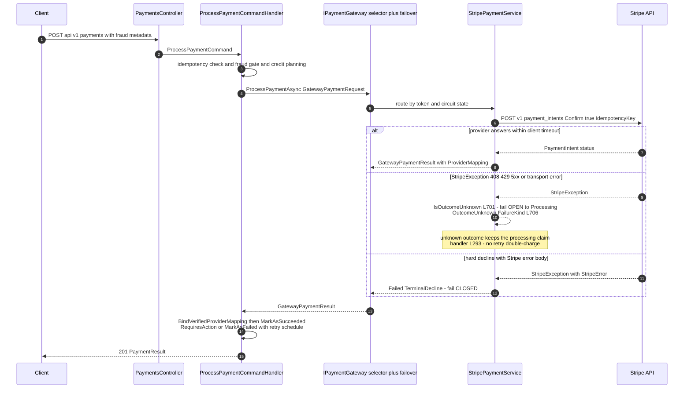
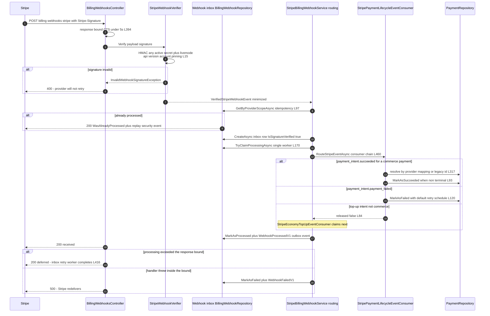
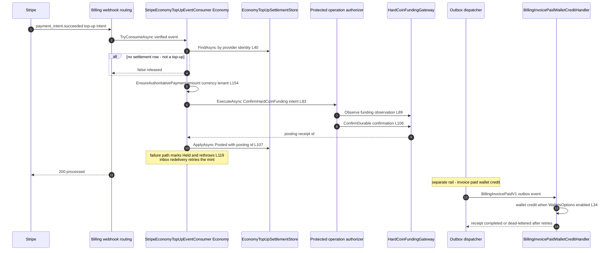
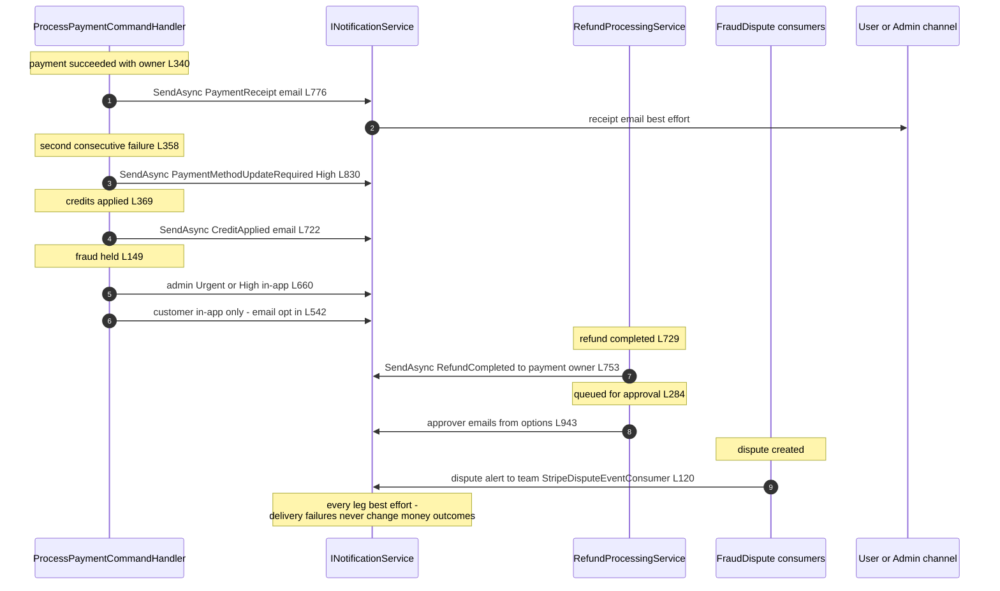
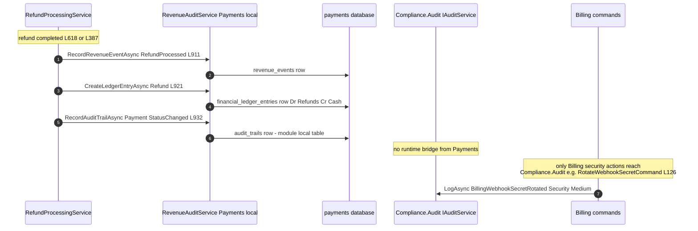
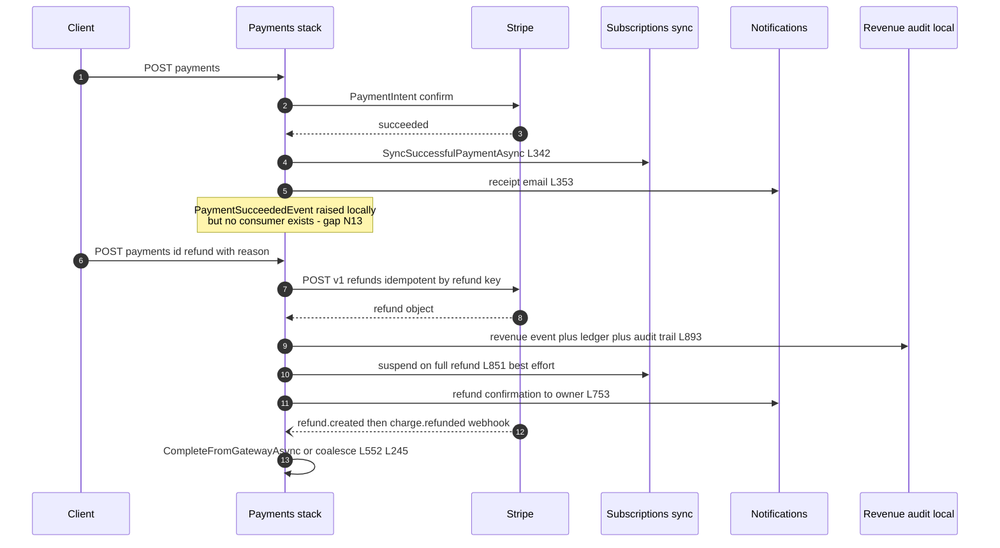

# Payments Cross-Module Sequence Diagrams

> Module `GameGuild.Commerce.Payments` · Documented against `develop` commit `74e9bba4c`.
> Citation shorthand: `Payments:` = `apps/api/Source/Modules/GameGuild.Commerce.Payments/`, `Billing:` = `apps/api/Source/Modules/GameGuild.Commerce.Billing/`, `Economy:` = `apps/api/Source/Modules/GameGuild.Finance.Economy/`, `API:` = `apps/api/Source/GameGuild.API/`.

## 1. Payments ↔ Stripe — synchronous charge

Fail-open/fail-closed verdicts: outcome-unknown (timeout/5xx/429/no body) is deliberately **fail-open** — the payment stays `Processing` because the provider may already have charged (`StripePaymentService.cs:701-715`, handler `:293-299`); every decline with a Stripe error body is **fail-closed** `TerminalDecline` (`:677-699`). Simulated mode replaces the provider leg entirely (`:717-723`).

## 2. Payments ↔ Stripe — webhook ingress and reconciliation

## 3. Payments ↔ Economy — crediting and debit legs

Economy money movement touching payments happens on two rails: Stripe **top-up** minting (webhook rail) and **invoice-paid wallet credit** (outbox rail). Subscription payment success does **not** credit Economy (no consumer; see `06-gaps.md` N13).

Refunds debit no Economy wallet by default — the opt-in `CreditWalletOnPartialRefund` actually *credits* the local `UserWallet` (Commerce wallet, `RefundProcessingService.cs:810-844`), it does not reverse a HardCoin mint; top-up refunds are not wired back to Economy (gap N4).

## 4. Payments ↔ Notifications — receipts and dunning

## 5. Payments ↔ Compliance — audit posture

Key finding: Payments money movements (success, refund, dispute, fraud hold) are audited into the module-local `audit_trails` / `revenue_events` tables only (`Payments:/Services/RevenueAuditService.cs:131+`); nothing projects them into the central `GameGuild.Compliance.Audit` module, whose `IAuditService.LogAsync` is currently invoked by Billing only for webhook-secret rotation (`Billing:/Commands/RotateWebhookSecret/RotateWebhookSecretCommand.cs:126-141`). Retention, chain-of-custody and security aggregation of the compliance module therefore do not cover payment money events — gap N15.

## 6. End-to-end success and refund composite

